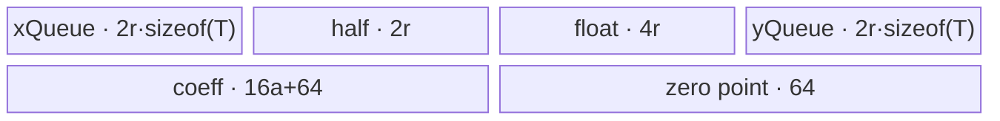
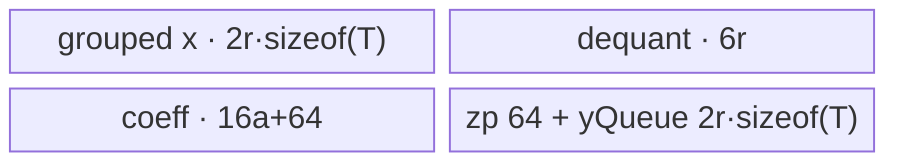

# QuantizedBatchNorm A2/A3 ACLNN 算子知识

## 算子速览

| 项目 | 内容 |
|---|---|
| 实际入口 | `aclnnQuantizedBatchNormGetWorkspaceSize` / `aclnnQuantizedBatchNorm`，公开 ACLNN，固定仓内无更高版本入口。 |
| 计算语义 | 逐 NCHW 元素完成反量化、使用逐 C 的统计量/仿射参数归一化，再量化回输入 dtype。 |
| 输入输出 | `input/output:int8,uint8,int32` 且同 shape/format/dtype；`mean,var,weight,bias:float32[C]`；四个量化 scalar 分别为 FP32/INT32；NCHW 四维。 |
| 执行类型 | 单 Kernel、`AIV_VECTOR`；entry 在适用编译架构上遇 `g_coreType==AIC` 立即返回，所有实际 body 都是 Vector/MTE。 |
| Kernel 路线 | R-001 key 1000；R-002 1001；R-003 1002；R-004 1003；R-005 1012；R-006 1013。 |
| 核心资源 | GM、AIV UB 的 4 个 `TQue` 与 2 个 `TBuf`、硬事件和 Vector pipe barrier；算子 Kernel 不读 workspace。 |
| 来源闭包 | `source_closed`：公开 ACLNN→L0 launcher→Tiling selector/POD→单 Vector entry/router→实际 Welford body→A2/A3 构建接线闭合。 |
| 验证状态 | 已完成源码闭包检查；本次知识提取未执行编译、真机、数值或性能测试。 |

## 接口与语义

### 计算语义

令 `xq=input[n,c,h,w]`，`s_i/z_i` 为输入 scale/zero-point，`s_o/z_o` 为输出 scale/zero-point，则源码实现的 FP32 系数为 `alpha=(weight[c]/sqrt(var[c]+epsilon))*s_i/s_o`、`beta=(bias[c]-mean[c]*weight[c]/sqrt(var[c]+epsilon))/s_o`，并计算 `output=cast_T(round((xq-z_i)*alpha+beta+z_o))`。这等价于公开文档的反量化、BatchNorm 仿射与再量化；非 INT32 输入先经 half 再升到 FP32，输出在 `ClearInvalidNum` 中先 FP32→INT32 `CAST_ROUND`→FP32，再降到目标整数类型。

### 输入、输出与属性

| 参数 | shape/layout | dtype | 约束、默认值与语义 |
|---|---|---|---|
| `input` | NCHW，4 维，N/C/H/W 均形成正的 `R1/A/R0` | INT8/UINT8/INT32 | 非空；Kernel 折叠为 `R1=N,A=C,R0=H*W`。 |
| `mean`,`var` | ND `[C]` | FLOAT32 | 必需、非空；维数 1 且长度 C。 |
| `inputScale`,`outputScale` | scalar，L0 转为单元素 Tensor | FLOAT32 | 必需；固定源码未校验数值范围或 `outputScale!=0`。 |
| `inputZeroPoint`,`outputZeroPoint` | scalar，L0 转为单元素 Tensor | INT32 | 必需；文档要求不超出 input dtype 范围，ACLNN 实现只校验 dtype。 |
| `weight`,`bias` | ND `[C]` | FLOAT32 | 可选；空指针分别由 `FillScalar(C,1)`、`FillScalar(C,0)` 补齐；显式 Tensor 不得为空。 |
| `epsilon` | attribute | float | 必需传入；固定源码未校验范围。 |
| `output` | 与 input 同 shape、storage format、dtype | INT8/UINT8/INT32 | 必需、非空；私有 format 被拒绝，公开语义为 NCHW。 |

### 入口与版本

固定 Commit `955f8b33985b6d72989ebff341bb9c2c564a51bc` 只公开这一组两段式 `aclnnQuantizedBatchNorm`，无 V2/V3 同语义入口。公开文档明确支持 Atlas A2/A3；OpDef 注册 `ascend910b` 和 `ascend910_93`，对应 binary config 均提供 INT8、UINT8、INT32 三个输入/输出同 dtype binary，全局 `ascendc_config.json` 同时接线这两个 compute unit。950 使用同一公开版本但独立记录于 `_950` 卡。

## Host/Launcher 执行流程

### 参数校验与前处理

第一段先创建 executor，依次检查 `input/output/mean/var` 与四个 scalar 非空；检查 input/mean/var 及显式 weight/bias 非空 Tensor；检查 input/output dtype、storage format 和 shape 一致，拒绝 private format；检查 mean/var/weight/bias 为 FP32 且 `[C]`；检查 scalar dtype。随后只把 input 连续化，缺省 weight/bias 用 Fill 补齐，再把 weight/bias/mean/var 各自 `Contiguous` 并 Cast 到 FP32（同 dtype Cast 仍属于框架节点），把 scalar 转为单元素 Tensor，调用 L0 `QuantizedBatchNorm`，最后 `ViewCopy` 到用户 output。任一步返回空指针即失败。

### 参数、Workspace 与生命周期

L0 分配与 input storage/original shape、dtype、format 相同的临时 `y`，用 `ADD_TO_LAUNCHER_LIST_AICORE` 加入一个 QuantizedBatchNorm 节点。算子 Tiling 固定令 `workspace[0]=16,777,216` bytes；Kernel entry 的 `workspace` 参数没有 consumer，故这是 Host 声明的保留区，不是本 Kernel 的中间数据边。executor 总 workspace 还可能包含 Contiguous/Cast/Fill/ViewCopy 框架节点所需空间，其精确拆分由仓外 executor 框架决定。调用者持有 workspace 至第二段 `CommonOpExecutorRun(workspace,size,executor,stream)` 返回。

### 启动图与失败传播

```text
aclnnQuantizedBatchNormGetWorkspaceSize
  -> Contiguous / optional Fill / Cast / scalar-to-Tensor framework nodes
  -> l0op::QuantizedBatchNorm
     -> Tiling4QuantizedBatchNorm
        -> QuantizedBatchNormWelfordTiling(priority=2000)
     -> quantized_batch_norm<<<usedCoreNum, stream>>>(9 inputs,y,workspace,tiling)
        -> exactly one key-selected QuantizedBatchNormWelford body
  -> ViewCopy framework node
aclnnQuantizedBatchNorm(workspace,size,executor,stream)
  -> CommonOpExecutorRun in executor order on stream
```

唯一算子自有 Device 节点直接读九个 GM 输入并写 GM `y`，没有跨 Kernel edge。框架节点由 executor 按其执行协议排序；该协议内部事件细节在固定仓不可见。第一段的检查或 launcher 挂接失败立即返回，第二段传播 `CommonOpExecutorRun` 的状态。

## Route 与参数设计

### 分核与资源计算

`R1=N,A=C,R0=H*W`，`R0Align=ceil_align(R0,8)` 对 INT32，其他 dtype 为 `ceil_align(R0,32)`。`blockFactor=ceil(A/coreNum)`，`usedCoreNum=ceil(A/blockFactor)`，尾核通道数 `A-(usedCoreNum-1)*blockFactor`。令平台 UB 为 `U`：INT32 路线 `E=floor((U-2048)/4)`、`a=min(512,ceil_align(blockFactor,8))`、`r=floor_align(floor((E-5a)/4),8)`；INT8/UINT8 路线 `E=U-2048`、相同 a、`r=floor_align(floor((E-20a)/9),32)`。Host 再生成通道 tile loop/tail、R0 tile loop/tail；若 `R0Align<=r/2 && R1>1`，则把多个 batch 的同一通道以 `procNR0=floor(r/R0Align)` 行合并搬运。

### Route 选择

| 顺序 | Route | Key/模板 | 精确选择条件与优先级 | 不适用去向 |
|---:|---|---|---|---|
| 1 | R-001 R0Split-Tail | 1000 | 先置 key：`!(r0UbLoop==1 \|\| r0UbFactor==r0UbTail)`；且 R1 合并 guard 不成立 | 1001 或 R1 覆盖路线 |
| 2 | R-002 R0Split-Aligned | 1001 | 先置 key：`r0UbLoop==1 \|\| r0UbFactor==r0UbTail`；且 R1 合并 guard 不成立 | R1 覆盖路线 |
| 3 | R-003 R1Group-Tail-Padded | 1002 | R1 guard 成立，`R0!=R0Align`，且 `nR0Loop!=1 && lastLoopNR0!=procNR0` | R-004 |
| 4 | R-004 R1Group-Aligned-Padded | 1003 | R1 guard 成立，`R0!=R0Align`，且 `nR0Loop==1 \|\| lastLoopNR0==procNR0` | 无 |
| 5 | R-005 R1Group-Tail-R0Aligned | 1012 | R1 guard 成立，`R0==R0Align`，且 `nR0Loop!=1 && lastLoopNR0!=procNR0` | R-006 |
| 6 | R-006 R1Group-Aligned-R0Aligned | 1013 | R1 guard 成立，`R0==R0Align`，且 `nR0Loop==1 \|\| lastLoopNR0==procNR0` | 无 |

```text
key = (r0UbLoop == 1 || r0UbFactor == r0UbTail) ? 1001 : 1000
if R0Align <= r0UbFactor/2 && R1 > 1:
  procNR0 = floor(r0UbFactor/R0Align)
  nR0Loop = ceil(R1/procNR0); lastLoopNR0 = R1-(nR0Loop-1)*procNR0
  procNR0 = min(procNR0,R1)
  bias = (R0 == R0Align) ? 10 : 0
  key = (nR0Loop == 1 || lastLoopNR0 == procNR0 ? 1003 : 1002) + bias
```

### 模板/实现执行矩阵

| Route | key/selector | dtype/shape/platform 完整命中条件 | 执行拓扑与 Kernel 节点 | 实际模板/body | 内存与同步特征 | tail/fallback |
|---|---|---|---|---|---|---|
| R-001 | 1000 | A2/A3，三种 x dtype；R1 guard false；末 R0 tile 较短 | 单 AIV Kernel | `Welford<T,float,0,0>::CalcYAndCopyOutR0SPLIT` | 连续 R0 tile；每 tile MTE2→V→MTE3 | `r0UbTail<r` |
| R-002 | 1001 | 同上，且 R0 只有一 tile 或整除 r | 单 AIV Kernel | `Welford<T,float,1,0>`，实际仍走 R0SPLIT body | 同 R-001 | 每个 R0 tile 等长 |
| R-003 | 1002 | R1 guard true，R0 非 32B 对齐，末 batch group 较短 | 单 AIV Kernel | `Welford<T,float,2,0>::R0NOTSPLIT` | strided multi-row DMA，逐行 padding | `lastLoopNR0<procNR0` |
| R-004 | 1003 | R1 guard true，R0 非 32B 对齐，batch group 整齐 | 单 AIV Kernel | `Welford<T,float,3,0>` | 同 R-003 | 所有 group 等长 |
| R-005 | 1012 | R1 guard true，R0 已 32B 对齐，末 group 较短 | 单 AIV Kernel | `Welford<T,float,2,1>` | strided multi-row DMA，无 padding | group tail |
| R-006 | 1013 | R1 guard true，R0 已 32B 对齐，group 整齐 | 单 AIV Kernel | `Welford<T,float,3,1>` | 同 R-005 | 无短 group |

### 隐藏性能 Guard

| Guard | Host/Tiling 条件 | Device/资源原因 | 影响 Route | 不满足时去向 | 源码符号 |
|---|---|---|---|---|---|
| 平台资源 | `coreNum>0 && ubSize>0` | 分核和 UB factor 需要平台值 | 全部 | `GRAPH_FAILED` | `TilingPrepare4QuantizedBatchNorm` / `GetPlatformInfo` |
| 正 shape | `R1>0 && A>0 && R0>0` | 避免空循环和除零 | 全部 | `GRAPH_FAILED` | `CheckInputShape` |
| dtype alignment | INT32 按 8 元素；INT8/U8 按 32 元素 | 32B DMA/Cast 对齐 | 全部 | 生成不同 `R0Align/r` | `GetShapeAttrsInfo`,`DoUbTiling` |
| 通道 UB cap | `a=min(512,ceil_align(blockFactor,8))` | 限制逐通道 coefficient buffer | 全部 | 增加 a-loop | `DoUbTiling` |
| R1 合并 | `R0Align<=r/2 && R1>1` | 一个 UB tile 至少容纳两条对齐 R0 行 | R-003..006 | R-001/002 | `DoOpTiling` |
| R0 padding | `R0==R0Align` | 可关闭 `DataCopyPad` 补尾 | R-005/006 | R-003/004 | `r0AlignTilingKeyBias` |
| key 闭集 | key∈{1000,1001,1002,1003,1012,1013} | router 只实例化六项 | 全部 | unknown key 无 body、无输出 | `quantized_batch_norm` |

### POD/ABI

`BEGIN_TILING_DATA_DEF` 给出以下宏序列化顺序和源码类型；固定仓未展开生成结构，故 `sizeof/alignof/offsetof` 不可见。

| 结构 | 字段 | 类型/位宽 | ABI 布局 | 单位 | Host/launcher producer | Device consumer | 边界 |
|---|---|---|---|---|---|---|---|
| `QuantizedBatchNormWelfordTilingData` | `patternR1` | int64/64 | 顺序 0，offset 不可见 | batch row | `PostTiling←commonParams.patternR1` | `Init/CalcY...` | >0 |
| 同上 | `patternR0` | int64/64 | 顺序 1 | element/channel/batch | `PostTiling` | address/DMA length | `H*W>0` |
| 同上 | `patternA` | int64/64 | 顺序 2 | channel | `PostTiling` | strided DMA address | >0 |
| 同上 | `blockFactor` | int64/64 | 顺序 3 | channel/core | `DoOpTiling=ceil(A/coreNum)` | `Init` GM base | >0 |
| 同上 | `tailCoreBlockFactor` | int64/64 | 顺序 4 | channel | `DoOpTiling` | 不直接读取；已折入 tail loop 字段 | inactive consumer |
| 同上 | `aUbFactor` | int64/64 | 顺序 5 | channel/tile | `DoUbTiling` | UB size、channel loop | 对齐 8，最大 512（blockFactor≤512 时） |
| 同上 | `aUbTail` | int64/64 | 顺序 6 | channel | `DoOpTiling` | 非尾核末 a-loop | 1..a |
| 同上 | `aUbLoop` | int64/64 | 顺序 7 | loop | `DoOpTiling` | 非尾核 Process | ≥1 |
| 同上 | `tailCoreAUbLoop` | int64/64 | 顺序 8 | loop | `DoOpTiling` | 尾核 Init | ≥1 |
| 同上 | `tailCoreAUbTail` | int64/64 | 顺序 9 | channel | `DoOpTiling` | 尾核末 a-loop | 1..a |
| 同上 | `r0UbLoop` | int64/64 | 顺序 10 | loop | `DoOpTiling` | R0SPLIT body | R1 路线仍读取但 body 不用 |
| 同上 | `r0UbFactor` | int64/64 | 顺序 11 | element | `DoUbTiling` | UB size、两种 body | 固定源码未显式检查 >0 |
| 同上 | `r0UbTail` | int64/64 | 顺序 12 | element | `DoOpTiling` | R0SPLIT tail | R1 路线 inactive |
| 同上 | `procNR0` | int64/64 | 顺序 13 | batch row/group | `DoOpTiling`，默认 1 | R0NOTSPLIT | R0 路线 inactive |
| 同上 | `nR0Loop` | int64/64 | 顺序 14 | loop | `DoOpTiling`，默认 R1 | R0NOTSPLIT | ≥1 |
| 同上 | `patternR0Align` | int64/64 | 顺序 15 | element | `PostTiling` | padding/row extent | ceil 32B |
| 同上 | `lastLoopNR0` | int64/64 | 顺序 16 | batch row | `DoOpTiling`，默认 1 | R0NOTSPLIT tail | 1..proc |
| 同上 | `epsilon` | float/32 | 顺序 17 | scalar | `PostTiling←attribute` | `CalAlphaAndBetaWithQuantTensor` | 未做数值 guard |

### Route 源码闭包

| Route | Key/selector | Host/Tiling producer | POD/参数 | Kernel entry/router 节点 | Kernel body/直接依赖 | 构建接线 |
|---|---|---|---|---|---|---|
| R-001 | 1000 | `QuantizedBatchNormWelfordTiling::DoOpTiling` | Welford POD | `quantized_batch_norm` | `Welford<T,float,0,0>` | 910B/910_93 binary config |
| R-002 | 1001 | 同上 | 同上 | 同上 | `Welford<T,float,1,0>` | 同上 |
| R-003 | 1002 | 同上 | 同上 | 同上 | `Welford<T,float,2,0>` | 同上 |
| R-004 | 1003 | 同上 | 同上 | 同上 | `Welford<T,float,3,0>` | 同上 |
| R-005 | 1012 | 同上 | 同上 | 同上 | `Welford<T,float,2,1>` | 同上 |
| R-006 | 1013 | 同上 | 同上 | 同上 | `Welford<T,float,3,1>` | 同上 |

## Kernel 实现

### 公共执行流程

entry 参数为九输入、`y,workspace,tiling`；A2/A3 编译路径先让 AIC core 返回，随后解析 Welford POD，以 key 实例化六个模板之一。每核负责连续的 channel 块；每个 a-tile 一次搬入 mean/var/weight/bias 和四个 scalar，先在 FP32 计算 alpha/beta，再对 tile 内每个 channel 遍历 N 与 H*W。`workspace` 与 `yQueue` 均无实际 consumer；输出复用 `xQueue` 的 `xTensor` 原地完成量化后直写 GM。

### Route R-001：R0Split-Tail

#### 适用条件

##### 选择证据

| 层级 | 文件 | 符号 | 源码谓词/参数 | 结果/下一跳 |
|---|---|---|---|---|
| Tiling | `op_host/quantized_batch_norm_welford_tiling.cpp` | `DoOpTiling` | 初始 key 1000 且 R1 guard false | key 1000 |
| Router | `op_kernel/quantized_batch_norm.cpp` | `quantized_batch_norm` | `TILING_KEY_IS(1000)` | `<T,float,0,0>` |

#### Device 数据流

##### 函数级调用链

```text
quantized_batch_norm -> Welford<0,0>::Init -> Process
  -> CopyInMeanVar/CopyInWeightBias/CopyInScaleZeroPoint
  -> CalAlphaAndBetaWithQuantTensor
  -> CalcYAndCopyOut -> CalcYAndCopyOutR0SPLIT
     -> CopyInXAndDequant -> DequantX -> Muls/Adds -> QuantX -> CopyOutY
```

##### 源码等价伪码

```text
for channel tile, for channel a, for n in [0,R1), for rTile in [0,r0UbLoop):
  len = last(rTile) ? r0UbTail : r0UbFactor
  off = n*A*R0 + channel*R0 + rTile*r
  xfp = float(cast(x[off:off+len])) - inputZeroPoint
  q = round(xfp*alpha[channel] + beta[channel] + outputZeroPoint)
  y[off:off+len] = cast_T(q)
```

#### 内存与数据搬运

##### 资源与搬运表

| 层级/缓冲区 | offset/地址公式 | extent/容量公式 | dtype/layout | producer | consumer | owner/lifetime | 对齐/复用 |
|---|---|---|---|---|---|---|---|
| x/y GM | `core*blockFactor*R0 + n*A*R0 + localC*R0 + rTile*r` | `len` T elements | T/NCHW | caller/Kernel | Kernel/caller | caller | tail uses DataCopyPad |
| `xQueue` | UB | depth 2 × `r*sizeof(T)` | T | MTE2 | Vector/MTE3 | TPipe; one tile | `xTensor` in-place output |
| dequant TBufs | UB | `r*2 + r*4` bytes | half/FP32 | Cast | arithmetic/Quant | TPipe | reused each tile |
| coefficient queues | UB | `16a+64` and 64 bytes | FP32/INT32 | MTE2 | scalar/vector | one a-tile | subview alias |
| `yQueue` | UB | depth 2 × `r*sizeof(T)` | T | no writer | no reader | allocated for Kernel | no semantic use |

##### 分层内存布局


##### 字节账与复用顺序

```text
UB_total = (6 + 4*sizeof(T))*r + 16*a + 128 bytes
          = 10r+16a+128 (INT8/UINT8), 22r+16a+128 (INT32)
Host r formula uses (U-2048-20a)/9 for I8/U8, (U-2048-20a)/16 for INT32;
fixed source has no final check proving the above InitBuffer sum <= U.
dynamic_ub = N/A
workspace_total(operator declaration) = 16 MiB; Kernel-consumed workspace = 0
```

| 复用子区 | 写入者 | 读取者/消费点 | 下一次覆盖 | 同步或释放依据 | 安全条件 |
|---|---|---|---|---|---|
| `xTensor` | `DataCopyPad` | Dequant | `QuantX` cast output | MTE2_V、V_MTE3 events | CopyOut 完成后 FreeTensor |
| FP32 dequant TBuf | `DequantX` | affine/QuantX | next R0 tile | PIPE_V + MTE3_MTE2 | previous CopyOut visible |
| coefficient queue | four CopyIn helpers | alpha/beta and channel loop | next a-tile | MTE2_V/S_V + outer FreeTensor | all channels consumed first |

#### 同步、精度与尾块

##### 同步与数值边界表

| 阶段 | primitive/机制 | producer | consumer/等待点 | 保护对象 | 精度/尾块 |
|---|---|---|---|---|---|
| coefficient load | MTE2_V、MTE2_S、S_V events | GM copy | Vector/scalar GetValue | coefficient UB | FP32 |
| x reuse | MTE3_MTE2 | previous MTE3 | next MTE2 | xTensor | tail `len=r0UbTail` |
| arithmetic | `PipeBarrier<PIPE_V>` | each Vector op | next Vector op | FP32 TBuf | I8/U8 input经 half；INT32直接 FP32 |
| output | V_MTE3 | QuantX | DataCopyPad | xTensor | `ClearInvalidNum` round；只写有效 len |

#### 关键实现

##### 符号证据表

| 阶段 | 文件 | 符号/模板实例 | 实现事实 |
|---|---|---|---|
| Host/Tiling producer | `op_host/quantized_batch_norm_welford_tiling.cpp` | `DoUbTiling/DoOpTiling` | r/a、key、tail |
| Kernel entry/router | `op_kernel/quantized_batch_norm.cpp` | key 1000 branch | 模板 `<0,0>` |
| Device body/helper | `op_kernel/quantized_batch_norm_welford.h` | `CalcYAndCopyOutR0SPLIT` 等 | 连续 R0 tile 全管线 |

### Route R-002：R0Split-Aligned

#### 适用条件

##### 选择证据

| 层级 | 文件 | 符号 | 源码谓词/参数 | 结果/下一跳 |
|---|---|---|---|---|
| Tiling | `op_host/quantized_batch_norm_welford_tiling.cpp` | `DoOpTiling` | `r0UbLoop==1 \|\| r0UbFactor==r0UbTail` 且 R1 guard false | 1001 |
| Router | `op_kernel/quantized_batch_norm.cpp` | key 1001 | `TILING_KEY_IS(1001)` | `<T,float,1,0>` |

#### Device 数据流

##### 函数级调用链

```text
quantized_batch_norm -> Welford<1,0>::Init/Process
  -> coefficient pipeline -> CalcYAndCopyOutR0SPLIT
  -> CopyInXAndDequant/DequantX -> affine -> QuantX -> CopyOutY
```

##### 源码等价伪码

```text
与 R-001 相同；选择谓词保证唯一 tile 或所有 R0 tile 的 len 都等于 r0UbFactor。
```

#### 内存与数据搬运

##### 资源与搬运表

| 层级/缓冲区 | offset/地址公式 | extent/容量公式 | dtype/layout | producer | consumer | owner/lifetime | 对齐/复用 |
|---|---|---|---|---|---|---|---|
| GM↔xTensor | 同 R-001 | 每次 r 元素 | T/NCHW | MTE2/Vector | Vector/MTE3 | tile | 无短 R0 tile |
| UB queues/TBuf | 同 R-001 | `(6+4*sizeof(T))*r+16*a+128` | mixed | InitBuffer | body | Kernel | 同 R-001 |

##### 分层内存布局



##### 字节账与复用顺序

```text
UB_total=(6+4*sizeof(T))*r+16a+128; dynamic_ub=N/A
workspace declaration=16 MiB; Kernel consumption=0
```

| 复用子区 | 写入者 | 读取者/消费点 | 下一次覆盖 | 同步或释放依据 | 安全条件 |
|---|---|---|---|---|---|
| xTensor/FP32 TBuf | CopyIn/Dequant | affine/CopyOut | next tile | explicit hard events + FreeTensor | fixed-length tile completes |

#### 同步、精度与尾块

##### 同步与数值边界表

| 阶段 | primitive/机制 | producer | consumer/等待点 | 保护对象 | 精度/尾块 |
|---|---|---|---|---|---|
| full tile | MTE2_V、PIPE_V、V_MTE3 | CopyIn/vector | vector/CopyOut | x/dequant UB | 无短 R0 tail，dtype cast 同 R-001 |

#### 关键实现

##### 符号证据表

| 阶段 | 文件 | 符号/模板实例 | 实现事实 |
|---|---|---|---|
| Host/Tiling producer | `op_host/quantized_batch_norm_welford_tiling.cpp` | `DoOpTiling` | 1001 谓词 |
| Kernel entry/router | `op_kernel/quantized_batch_norm.cpp` | `<T,float,1,0>` | 1001 映射 |
| Device body/helper | `op_kernel/quantized_batch_norm_welford.h` | R0SPLIT pipeline | 等长 R0 tile |

### Route R-003：R1Group-Tail-Padded

#### 适用条件

##### 选择证据

| 层级 | 文件 | 符号 | 源码谓词/参数 | 结果/下一跳 |
|---|---|---|---|---|
| Tiling | `op_host/quantized_batch_norm_welford_tiling.cpp` | `DoOpTiling` | R1 guard；R0!=R0Align；末 group 短 | 1002 |
| Router | `op_kernel/quantized_batch_norm.cpp` | key 1002 | branch | `<T,float,2,0>` |

#### Device 数据流

##### 函数级调用链

```text
quantized_batch_norm -> Welford<2,0>::Init/Process
  -> coefficient pipeline -> CalcYAndCopyOutR0NOTSPLIT
  -> CopyInNR0AndDequant -> DequantNR0 -> affine -> QuantX -> CopyOutNR0Y
```

##### 源码等价伪码

```text
for group in ceil(R1/procNR0):
  rows = last(group) ? lastLoopNR0 : procNR0
  GM base = group*procNR0*A*R0 + channel*R0
  strided copy rows blocks of R0*sizeof(T), srcStride=(A-1)*R0*sizeof(T)
  pad each UB row to R0Align, compute rows*R0Align lanes
  strided write only R0 valid elements per row
```

#### 内存与数据搬运

##### 资源与搬运表

| 层级/缓冲区 | offset/地址公式 | extent/容量公式 | dtype/layout | producer | consumer | owner/lifetime | 对齐/复用 |
|---|---|---|---|---|---|---|---|
| strided GM x/y | `group*proc*A*R0+channel*R0` | rows×R0 valid | T/NCHW | caller/Kernel | Kernel/caller | caller | src/dst stride `(A-1)R0*sizeof(T)` |
| xTensor | UB | rows×R0Align≤r | T/row padded | `DataCopyPad` | Vector/MTE3 | group | pad right `R0Align-R0` |
| remaining UB | 同 R-001 | same capacity | mixed | Init | body | Kernel | group reuse |

##### 分层内存布局


##### 字节账与复用顺序

```text
UB_total=(6+4*sizeof(T))*r+16a+128; dynamic_ub=N/A
workspace declaration=16 MiB; Kernel consumption=0
```

| 复用子区 | 写入者 | 读取者/消费点 | 下一次覆盖 | 同步或释放依据 | 安全条件 |
|---|---|---|---|---|---|
| padded xTensor rows | multi-block MTE2 | Vector/strided MTE3 | next batch group | events + FreeTensor | MTE3只提交每行 R0 valid bytes |

#### 同步、精度与尾块

##### 同步与数值边界表

| 阶段 | primitive/机制 | producer | consumer/等待点 | 保护对象 | 精度/尾块 |
|---|---|---|---|---|---|
| row gather | MTE3_MTE2 then MTE2_V | previous write/MTE2 | Vector | padded rows | last group uses `lastLoopNR0`；padding lanes算但不写 |
| row scatter | V_MTE3 | QuantX | `DataCopyPad` | valid R0 bytes | dstStride restores NCHW |

#### 关键实现

##### 符号证据表

| 阶段 | 文件 | 符号/模板实例 | 实现事实 |
|---|---|---|---|
| Host/Tiling producer | `op_host/quantized_batch_norm_welford_tiling.cpp` | R1 guard / key1002 | group/tail |
| Kernel entry/router | `op_kernel/quantized_batch_norm.cpp` | `<2,0>` | padded tail route |
| Device body/helper | `op_kernel/quantized_batch_norm_welford.h` | `CopyInNR0AndDequant/CopyOutNR0Y` | strided DMA + pad |

### Route R-004：R1Group-Aligned-Padded

#### 适用条件

##### 选择证据

| 层级 | 文件 | 符号 | 源码谓词/参数 | 结果/下一跳 |
|---|---|---|---|---|
| Tiling | `op_host/quantized_batch_norm_welford_tiling.cpp` | `DoOpTiling` | R1 guard，R0 非对齐，group 无短尾 | 1003 |
| Router | `op_kernel/quantized_batch_norm.cpp` | key1003 | branch | `<T,float,3,0>` |

#### Device 数据流

##### 函数级调用链

```text
entry -> Welford<3,0>::Process -> coefficient pipeline
  -> R0NOTSPLIT -> padded multi-row CopyIn -> Vector affine/quant -> strided CopyOut
```

##### 源码等价伪码

```text
与 R-003 相同；每个 group 的 rows 都为 procNR0（或唯一 group 已把 procNR0 收缩为 R1）。
```

#### 内存与数据搬运

##### 资源与搬运表

| 层级/缓冲区 | offset/地址公式 | extent/容量公式 | dtype/layout | producer | consumer | owner/lifetime | 对齐/复用 |
|---|---|---|---|---|---|---|---|
| GM/UB grouped rows | 同 R-003 | procNR0×R0Align | T/padded rows | MTE2 | Vector/MTE3 | group | constant blockCount |
| UB total | N/A offset | `(6+4*sizeof(T))*r+16*a+128` | mixed | InitBuffer | body | Kernel | 同 R-003 |

##### 分层内存布局



##### 字节账与复用顺序

```text
UB_total=(6+4*sizeof(T))*r+16a+128; dynamic_ub=N/A
workspace declaration=16 MiB; Kernel consumption=0
```

| 复用子区 | 写入者 | 读取者/消费点 | 下一次覆盖 | 同步或释放依据 | 安全条件 |
|---|---|---|---|---|---|
| grouped x | DataCopyPad | Vector/CopyOut | next equal group | hard events | complete constant-size group |

#### 同步、精度与尾块

##### 同步与数值边界表

| 阶段 | primitive/机制 | producer | consumer/等待点 | 保护对象 | 精度/尾块 |
|---|---|---|---|---|---|
| grouped pipeline | same events as R-003 | MTE/Vector | next stage | UB group | no short group；row padding remains |

#### 关键实现

##### 符号证据表

| 阶段 | 文件 | 符号/模板实例 | 实现事实 |
|---|---|---|---|
| Host/Tiling producer | `op_host/quantized_batch_norm_welford_tiling.cpp` | key1003 | equal groups |
| Kernel entry/router | `op_kernel/quantized_batch_norm.cpp` | `<3,0>` | route mapping |
| Device body/helper | `op_kernel/quantized_batch_norm_welford.h` | R0NOTSPLIT helpers | padded grouped body |

### Route R-005：R1Group-Tail-R0Aligned

#### 适用条件

##### 选择证据

| 层级 | 文件 | 符号 | 源码谓词/参数 | 结果/下一跳 |
|---|---|---|---|---|
| Tiling | `op_host/quantized_batch_norm_welford_tiling.cpp` | `r0AlignTilingKeyBias` | R1 guard、R0==R0Align、末 group 短 | 1012 |
| Router | `op_kernel/quantized_batch_norm.cpp` | key1012 | branch | `<T,float,2,1>` |

#### Device 数据流

##### 函数级调用链

```text
entry -> Welford<2,1>::Process -> coefficient pipeline
  -> R0NOTSPLIT -> unpadded multi-row CopyIn -> Vector affine/quant -> strided CopyOut
```

##### 源码等价伪码

```text
与 R-003 相同，但 R0_ALIGN_MODE 令 padParams={false,0,0,0}；末 group 使用 lastLoopNR0。
```

#### 内存与数据搬运

##### 资源与搬运表

| 层级/缓冲区 | offset/地址公式 | extent/容量公式 | dtype/layout | producer | consumer | owner/lifetime | 对齐/复用 |
|---|---|---|---|---|---|---|---|
| grouped GM/UB | group base/strides 同 R-003 | rows×R0（R0Align=R0） | T | MTE2 | Vector/MTE3 | group | no padding |
| queues/TBuf | UB | same allocated capacity | mixed | Init | body | Kernel | last group shorter |

##### 分层内存布局


##### 字节账与复用顺序

```text
UB_total=(6+4*sizeof(T))*r+16a+128; dynamic_ub=N/A
workspace declaration=16 MiB; Kernel consumption=0
```

| 复用子区 | 写入者 | 读取者/消费点 | 下一次覆盖 | 同步或释放依据 | 安全条件 |
|---|---|---|---|---|---|
| aligned grouped x | MTE2 | Vector/MTE3 | next group | events | last group extent uses lastLoopNR0 |

#### 同步、精度与尾块

##### 同步与数值边界表

| 阶段 | primitive/机制 | producer | consumer/等待点 | 保护对象 | 精度/尾块 |
|---|---|---|---|---|---|
| aligned group | MTE2_V/V_MTE3 | DMA/Vector | Vector/DMA | UB rows | no padding lanes；short batch group |

#### 关键实现

##### 符号证据表

| 阶段 | 文件 | 符号/模板实例 | 实现事实 |
|---|---|---|---|
| Host/Tiling producer | `op_host/quantized_batch_norm_welford_tiling.cpp` | key bias + tail | 1012 |
| Kernel entry/router | `op_kernel/quantized_batch_norm.cpp` | `<2,1>` | mapping |
| Device body/helper | `op_kernel/quantized_batch_norm_welford.h` | `CopyInNR0AndDequant` | padding disabled |

### Route R-006：R1Group-Aligned-R0Aligned

#### 适用条件

##### 选择证据

| 层级 | 文件 | 符号 | 源码谓词/参数 | 结果/下一跳 |
|---|---|---|---|---|
| Tiling | `op_host/quantized_batch_norm_welford_tiling.cpp` | `DoOpTiling` | R1 guard、R0==R0Align、group 无短尾 | 1013 |
| Router | `op_kernel/quantized_batch_norm.cpp` | key1013 | branch | `<T,float,3,1>` |

#### Device 数据流

##### 函数级调用链

```text
entry -> Welford<3,1>::Init/Process -> coefficient pipeline
  -> R0NOTSPLIT -> aligned/equal grouped DMA -> affine/QuantX -> CopyOutNR0Y
```

##### 源码等价伪码

```text
for each equal batch group: gather procNR0 complete aligned rows, process, scatter; no padding and no short group。
```

#### 内存与数据搬运

##### 资源与搬运表

| 层级/缓冲区 | offset/地址公式 | extent/容量公式 | dtype/layout | producer | consumer | owner/lifetime | 对齐/复用 |
|---|---|---|---|---|---|---|---|
| grouped rows | standard group base/stride | procNR0×R0 | T/NCHW↔UB rows | MTE2 | Vector/MTE3 | group | naturally 32B aligned |
| all UB | InitBuffer regions | `(6+4*sizeof(T))*r+16*a+128` | mixed | Kernel | Kernel | launch | constant group reuse |

##### 分层内存布局


##### 字节账与复用顺序

```text
UB_total=(6+4*sizeof(T))*r+16a+128; dynamic_ub=N/A
workspace declaration=16 MiB; Kernel consumption=0
```

| 复用子区 | 写入者 | 读取者/消费点 | 下一次覆盖 | 同步或释放依据 | 安全条件 |
|---|---|---|---|---|---|
| grouped x/dequant | MTE2/Cast | Vector/MTE3 | next group | explicit events/barriers | every group same valid extent |

#### 同步、精度与尾块

##### 同步与数值边界表

| 阶段 | primitive/机制 | producer | consumer/等待点 | 保护对象 | 精度/尾块 |
|---|---|---|---|---|---|
| full grouped path | hard events + PIPE_V | MTE/Vector | next stage | UB | no padding or group tail；dtype conversion same public formula |

#### 关键实现

##### 符号证据表

| 阶段 | 文件 | 符号/模板实例 | 实现事实 |
|---|---|---|---|
| Host/Tiling producer | `op_host/quantized_batch_norm_welford_tiling.cpp` | key1013 | full aligned group |
| Kernel entry/router | `op_kernel/quantized_batch_norm.cpp` | `<3,1>` | mapping |
| Device body/helper | `op_kernel/quantized_batch_norm_welford.h` | R0NOTSPLIT pipeline | no pad/tail specialization |

## 算子特定优化

### Trick T-001：小 R0 时跨 batch 合并 strided DMA

#### 触发与源码依据

- 适用 Route：R-003～R-006
- 触发条件：`patternR0Align <= r0UbFactor/2 && patternR1 > 1`
- Golden 来源：[`op_host/quantized_batch_norm_welford_tiling.cpp:103-120`](../../../../../../../cann-ops-raw/ascendc/ops-nn/955f8b33985b6d72989ebff341bb9c2c564a51bc/norm/quantized_batch_norm/op_host/quantized_batch_norm_welford_tiling.cpp#L103-L120)

**官方源码（固定 Commit 连续逐字摘录）**：

```cpp
if ((commonParams.patternR0Align <= (r0UbFactor / TWO_NUM)) && commonParams.patternR1 > 1) {
    int64_t procNR0 = Ops::Base::FloorDiv(r0UbFactor, commonParams.patternR0Align);
    int64_t nR0Loop = Ops::Base::CeilDiv(commonParams.patternR1, procNR0);
    int64_t lastLoopNR0 = commonParams.patternR1 - (nR0Loop - 1) * procNR0;
    if (procNR0 > commonParams.patternR1) {
        procNR0 = commonParams.patternR1;
    }
    td_.set_procNR0(procNR0);
    td_.set_nR0Loop(nR0Loop);
    td_.set_lastLoopNR0(lastLoopNR0);
```

#### 机制与设计原因

当单条对齐后的 H×W 只占不到 r tile 一半时，Host 令 `procNR0=floor(r/R0Align)`，Device 用 `blockCount=procNR0`、`blockLen=R0*sizeof(T)`、`srcStride=(A-1)R0*sizeof(T)` 一次 gather 同一 channel 的多个 batch 行。这样提高单次 UB tile 的有效覆盖，并以 strided CopyOut 恢复 NCHW；R0 未对齐时只在 UB 行尾 padding，GM 仍只读写有效 R0。

#### 迁移边界

- 适用：NCHW 中同一 channel 跨 batch 等距、单行较短的逐元素算子。
- 前提：A2/A3 公开 API、三种整数 dtype、`R1>1`、UB 至少容纳两条 `R0Align` 行。
- 失效：guard 不成立时必须使用 R-001/R-002 的逐 batch、逐 R0 tile 路线。
- 未验证：本次知识提取未执行编译、真机、数值或性能测试。

#### 错误做法

固定仓的真实边界是 R0 未对齐时不能直接把多行紧密拼接后整段回写；R-003/R-004 必须保留逐行 padding 与 dstStride，否则会覆盖相邻 channel。固定仓未提供除此以外的可验证反例。

### Trick T-002：逐通道预计算 alpha/beta 并跨空间复用

#### 触发与源码依据

- 适用 Route：全部
- 触发条件：每个 a-tile 搬入逐 C 参数后
- Golden 来源：[`op_kernel/quantized_batch_norm_welford.h:121-147`](../../../../../../../cann-ops-raw/ascendc/ops-nn/955f8b33985b6d72989ebff341bb9c2c564a51bc/norm/quantized_batch_norm/op_kernel/quantized_batch_norm_welford.h#L121-L147)

**官方源码（固定 Commit 连续逐字摘录）**：

```cpp
Adds(varInTensor, varInTensor, this->epsilon, aProcNum);
PipeBarrier<PIPE_V>();
Sqrt(varInTensor, varInTensor, aProcNum);
PipeBarrier<PIPE_V>();
Div(varInTensor, weightTensor, varInTensor, aProcNum);
PipeBarrier<PIPE_V>();
Muls(weightTensor, varInTensor, static_cast<float>(-1.0f), aProcNum);
PipeBarrier<PIPE_V>();
Muls(varInTensor, varInTensor, inputScale / outputScale, aProcNum);
```

#### 机制与设计原因

源码把 `weight/sqrt(var+epsilon)`、输入/输出 scale 比值以及 mean/bias 合成为每通道 `alpha/beta`，随后内层 N×H×W 只做一次 Muls、一次 Adds 与量化。因 mean/var/weight/bias 对同一 channel 不变，这避免在每个空间元素重复 Sqrt/Div 和参数 GM 读取；关键长度 `aProcNum` 来自当前通道 tile，scalar 来自单元素 GM Tensor。

#### 迁移边界

- 适用：统计量和仿射参数沿空间轴广播的推理 BatchNorm/反量化融合。
- 前提：参数为逐 C FP32、scale 为 per-tensor scalar、同一通道内公式不变。
- 失效：per-channel input/output scale 或逐元素参数需要扩展 coefficient 布局，不能直接复用此公式。
- 未验证：本次知识提取未执行编译、真机、数值或性能测试。

#### 错误做法

固定仓未提供可验证反例。

## 模板与实现对比

| 对比维度 | R-001/002 R0Split | R-003/004 R1Group-Padded | R-005/006 R1Group-Aligned | 设计选择依据 |
|---|---|---|---|---|
| 命中条件/优先级 | R1 guard false；1000 有短 R0 tail，1001 无 | guard true，R0!=R0Align | guard true，R0==R0Align | 先算 R0 key，再由 R1 guard 覆盖 |
| 模板与 dtype | `<0,0>/<1,0>`；T=I8/U8/I32 | `<2,0>/<3,0>` | `<2,1>/<3,1>` | dtype 由三份 binary 固化，不编码进 key |
| 循环与分核 | channel/core→channel tile→N→R0 tile | channel/core→channel tile→batch group | 同左 | 所有路线按 C 分核 |
| Queue/TBuf | 四 TQue、两 TBuf | 相同 | 相同 | 单一 InitBuffer 布局 |
| 内存总占用与复用 | `(6+4s)r+16a+128` | 同左，UB 行 padding | 同左，无 padding | output 原地复用 xTensor；yQueue 未用 |
| 搬运/Vector API | 连续 DataCopyPad | blockCount/stride 多行 DMA | 同左但关闭 pad | 小 R0 合并 batch |
| 同步、精度与 tail | 硬事件+PIPE_V；R0 tail | batch group tail；padding lane 不写 GM | group tail，无 padding | key 的 align/tail specialization |
| fallback/失败边界 | unknown key 无输出 | guard 不成立回 R0Split | 同左 | 无额外 Device fallback |

## 平台差异

| 项目 | A2 | A3 | 950 |
|---|---|---|---|
| 支持状态 | 公开支持；`ascend910b` | 公开支持；`ascend910_93` | 公开支持，见 `_950` 卡 |
| Host/Launcher | 共用 Tiling/API | 共用 Tiling/API | 固定仓共用源码 |
| Kernel/资源 | 同一 Vector body；平台提供 AIV coreNum/UB | 同左 | 同一六 key body；平台资源值可不同 |

## 限制与失败边界

- 只支持非空四维 NCHW；input/output dtype、shape、storage format 必须相同；mean/var/weight/bias 必须为 FP32 `[C]`。
- ACLNN 源码不校验 epsilon、scale、zero-point 的数值范围，也不防止 `outputScale==0`；相关数值结果不得从固定源码外推。
- `r0UbFactor` 计算后没有显式 `>0` 检查；极小 UB 或异常平台信息可能使后续 CeilDiv 非法。
- InitBuffer 字节和为 `(6+4*sizeof(T))*r+16a+128`，而 Host 用 9r/4r 的经验项并预留 2048B 生成 r；固定源码没有最终比较，因此无法仅凭源码证明所有平台/shape 下 `UB_total<=U`。
- entry 对 unknown key 直接结束而不写 output；无 Device fallback 或错误码。
- 非 INT32 输入反量化经过 half 中间，所有输出先经 FP32→INT32 round；精确饱和/异常值规则依赖 AscendC Cast primitive，固定仓不可见。
- executor 对框架 Contiguous/Cast/Fill/ViewCopy 节点的精确 workspace slice、事件和失败清理属于框架边界；算子自有 launcher、POD 与 Kernel 已闭合。
- 本次知识提取未执行编译、真机、数值或性能测试。

## 源码索引

### 链路索引

| 链路阶段 | 文件 | 关键符号 | 支撑内容 |
|---|---|---|---|
| 入口声明/约束 | `norm/quantized_batch_norm/docs/aclnnQuantizedBatchNorm.md` | `aclnnQuantizedBatchNorm` | 公开语义、平台、约束 |
| 入口实现 | `norm/quantized_batch_norm/op_host/op_api/aclnn_quantized_batch_norm.cpp` | `GetWorkspaceSize/Proc1/Proc2` | 校验与框架前后处理 |
| 入口实现 | `norm/quantized_batch_norm/op_host/op_api/quantized_batch_norm.cpp` | `l0op::QuantizedBatchNorm` | 单节点 launcher |
| Host/Tiling/Launcher | `norm/quantized_batch_norm/op_host/quantized_batch_norm_tiling.h` | POD classes | ABI 字段 |
| Host/Tiling/Launcher | `norm/quantized_batch_norm/op_host/quantized_batch_norm_tiling.cpp` | `Tiling4/TilingPrepare4` | registry、AIV/UB 平台参数 |
| Host/Tiling/Launcher | `norm/quantized_batch_norm/op_host/quantized_batch_norm_tiling_base.cpp` | base checks/GetWorkspaceSize | shape/dtype/workspace |
| Host/Tiling/Launcher | `norm/quantized_batch_norm/op_host/quantized_batch_norm_welford_tiling.cpp` | `DoUbTiling/DoOpTiling/PostTiling` | key、POD、blockDim |
| Kernel entry/body | `norm/quantized_batch_norm/op_kernel/quantized_batch_norm.cpp` | `quantized_batch_norm` | 六 key router、AIC return |
| Kernel entry/body | `norm/quantized_batch_norm/op_kernel/quantized_batch_norm_welford.h` | `QuantizedBatchNormWelford` | 完整 Vector/MTE body |
| 构建接线 | `norm/quantized_batch_norm/op_host/quantized_batch_norm_def.cpp` | `QuantizedBatchNorm` | OpDef 与平台注册 |
| 构建接线 | `norm/quantized_batch_norm/op_host/config/ascend910b/quantized_batch_norm_binary.json` | `op_list` | A2 三 dtype binary |
| 构建接线 | `norm/quantized_batch_norm/op_host/config/ascend910_93/quantized_batch_norm_binary.json` | `op_list` | A3 三 dtype binary |
| 构建接线 | `scripts/kernel/binary_config/ascendc_config.json` | `QuantizedBatchNorm` item | compute units 与 auto_sync=false |

### 实现复用检查

| 检查项 | 可复用事实 | 不得改变的约束 | 源码符号 |
|---|---|---|---|
| ABI/POD | 六 key 共用 Welford POD | 字段顺序、int64/float 位宽、inactive 字段 | `QuantizedBatchNormWelfordTilingData` |
| 调用顺序 | coefficient→逐 channel data pipeline | scalar/参数必须先完成 MTE2→V/S 可见 | `Process/CalAlphaAndBeta...` |
| workspace/内存 | Kernel 无 workspace 中间边；UB 固定布局 | r/a 公式、Queue depth、GM stride | `Init/DoUbTiling` |
| 同步 | 硬事件与 PIPE_V 串联 MTE/Vector | 复用 xTensor 前必须完成 MTE3 | CopyIn/CopyOut helpers |
| 精度与尾块 | alpha/beta FP32；round 再降整数 | I8/U8 half 中间、R0/group tail 和 pad | `DequantX/QuantX` |
| 失败边界 | Host 检查失败；unknown key 无输出 | 不得假设 Device fallback | checks/router |