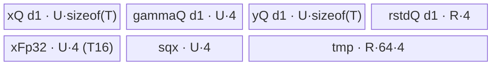
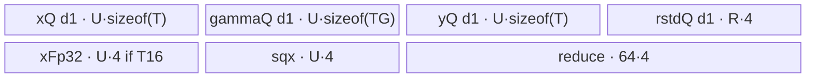
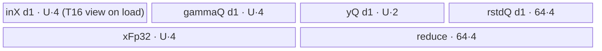
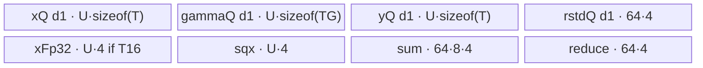

# RmsNorm A2/A3 ACLNN 算子知识

## 算子速览

| 项目 | 内容 |
|---|---|
| 实际入口 | `aclnnRmsNormGetWorkspaceSize` + `aclnnRmsNorm`，公开 ACLNN 两段式接口，固定仓未见更高版本 |
| 计算语义 | `rstd=1/sqrt(sum(x_i^2)/D+epsilon)`；`y_i=x_i*rstd*gamma_i`，对 `gamma` 对应的尾部维归一化 |
| 输入输出 | ND；`x/y` FP16/BF16/FP32，`gamma` 同 dtype 或 16-bit `x`+FP32 gamma，`rstd` FP32 |
| 执行类型 | 所有可达节点均为单 Kernel `AIV_VECTOR`；入口/body 只使用 Vector/Scalar/搬运 API，无 Cube/AIC/MIX_CV |
| Kernel 路线 | R-001 Merge-N 通用；R-002 Merge-N A2 性能分支；R-003 Normal；R-004 mixed SingleRow；R-005 Split-D |
| 核心资源 | GM、depth1 TQue、FP32 TBuf、Vector/Scalar event；workspace 固定 `16 MiB+256 B`，A2/A3 body 不作 Kernel 间交接 |
| 来源闭包 | `source_closed`：公开 ACLNN 契约（生成式 inner bridge 为框架边界）→OpDef/AutoContiguous→Host Tiling/POD→AIV router→五个可达实现族→A2/A3 binary config 已闭合 |
| 验证状态 | 已完成源码闭包检查；本次知识提取未执行编译、真机、数值或性能测试。 |

## 接口与语义

### 计算语义

令 `D=product(gamma.shape)`，`N=product(x.shape[0:xRank-gammaRank])`。对每个行向量 `x[n,0:D]`，先以 FP32 计算平方和与 `rstd[n]=1/sqrt(sum(x^2)/D+epsilon)`，再计算 `y[n,i]=cast_x(float(x[n,i])*rstd[n]*float(gamma[i]))`。输出 `rstd` 在被归一化尾维上保持维度但长度为 1。

### 输入、输出与属性

| 参数 | shape/layout | dtype | 约束、默认值与语义 |
|---|---|---|---|
| `x` | ND，1–8 维 | FP16/BF16/FP32 | 必选；文档支持非连续，OpDef `AutoContiguous`；公开契约称支持空 Tensor，固定仓算子 Tiling 拒绝长度为 0，空算子框架路径未展开 |
| `gamma` | 等于 `x` 的完整尾部若干维，1–8 维 | FP16/BF16/FP32 | 必选且非空；公开五组 dtype 组合 |
| `epsilon` | Host 标量 | `double` 入参，POD FP32 | 默认语义 `1e-6`；必须 `>=0` |
| `yOut` | 与 `x` 相同 | 与 `x` 相同 | 必选、ND、支持非连续 |
| `rstdOut` | rank 同 x，归一化维为 1 | FP32 | 必选、ND、支持非连续 |

### 入口与版本

固定仓只公开 `aclnnRmsNorm`。产品表明确支持 Atlas A2/A3；OpDef 注册 `ascend910b` 与 `ascend910_93`，两份 binary config 均覆盖 FP16+FP32 gamma、BF16+FP32 gamma、全 FP16、全 BF16、全 FP32。Grad、Quant、DynamicMxQuant、Inplace、Gemma 等不同语义不进入本卡。

## Host/Launcher 执行流程

### 参数校验与前处理

公开第一段接口负责必选指针、dtype、shape 与 executor；OpDef 的 `AutoContiguous` 使非连续 `x/gamma` 进入框架连续化。生成式 ACLNN inner bridge未落在固定目录，故其 executor 壳、空 Tensor 快路径和输出写回作为明确框架边界。算子自有 `CheckInputShape4RmsNorm` 继续验证 1–8 维、gamma 尾部 shape、`y=x` 与 rstd 每轴为 1 或对应 x 维；随后读取 epsilon 并拒绝负值。

### 参数、Workspace 与生命周期

`numCol=gamma.shape_size`，`numRow` 是 x 的前导非归一化维连乘；`avgFactor=1/numCol`。Tiling 固定设置 `workspace[0]=256+16*1024*1024` B。entry 通过 `GetUserWorkspace` 取得用户段但 A2/A3 的主可达 body仅在旧 `__CCE_AICORE__==200` 分支使用其初始化 rstd；A2/A3 DAV2201 路线不读该数据区。executor 的生命周期从第一段成功返回延续到第二段 stream launch。

### 启动图与失败传播

单节点图：`executor → rms_norm(x,gamma,y,rstd,workspace,tiling)`。Tiling 设置 `blockDim=ceil(numRow/blockFactor)`；router 按 key 0/1/2/3 构造一个模板 body。没有跨 Kernel workspace edge。Tiling 校验或 UB 公式失败阻止 launch；unknown key 不进入任何 body且不写输出。

## Route 与参数设计

### 分核与资源计算

平台给出 `numCore=GetCoreNumAiv()` 与 UB，Host 先减 1024 B。`dataPerBlock` 对 16-bit 为 16、FP32 为 8，`numColAlign=ceil(D/dataPerBlock)*dataPerBlock`。非 mixed dtype 令 `blockFactor=ceil(N/numCore)`、`rowFactor=64`、`ubFactor=12288`（16-bit）或 10240（FP32）；D 过大转 Split-D。mixed dtype 则按真实驻留字节顺序尝试 Merge-N、Normal、SingleRow、Split-D。A2 的 exact `ASCEND910B` 小 D guard可把路线提升到 Merge-N；A3 `ASCEND910_93` 不满足此 exact-SOC 谓词。

### Route 选择

| 顺序 | Route | Key/模板 | 精确选择条件与优先级 | 不适用去向 |
|---:|---|---|---|---|
| 1 | R-001 Merge-N 通用 | 2 / `KernelRmsNormMergeN<T,TG>` | exact `ASCEND910B`（A2）、`numColAlign<=2000`，且不满足 R-002 性能 shape；mixed dtype 也走此分支 | mixed/normal 决策或 A3 路线 |
| 2 | R-002 Merge-N A2 性能 | 2 / 同模板，`is_performance=1` | R-001 的 SOC/D guard，且非 mixed、x 为 FP16/BF16、`xRank∈{2,3}`、`gammaRank=1`、`x.dim0<=512`，3D 时 `x.dim1<=8`、`D<=5120` | R-001（同 key 的通用 body 分支） |
| 3 | R-003 Normal | 0 / `KernelRmsNorm<T,TG>` | mixed：前两者不命中且 `oneRowXYGamma + oneRowTmp + 64*4 + 64*4 < UB`；non-mixed：`numColAlign<=ubFactor` 且 A2 small-D override 不命中 | R-004（mixed）或 R-005 |
| 4 | R-004 mixed SingleRow | 3 / `KernelRmsNormSingleRow<T,TG>` | mixed，R-003 的完整双 16-bit+FP32 驻留失败，但去掉一块 16-bit row 后 `oneRowBufSizeNew<UB` | R-005 |
| 5 | R-005 Split-D | 1 / `KernelRmsNormSplitD<T,TG>` | mixed 前三种驻留均失败；或 non-mixed `numColAlign>12288/10240` | Tiling 资源不足返回失败 |

```text
if mixed(x16,gamma32):
  if A2 && alignedD<=2000: key2 (R-001)
  else if full mixed one-row buffers fit: key0 (R-003)
  else if reduced single-row buffers fit: key3 (R-004)
  else: key1 (R-005)
else:
  perf = A2 && x16 && rank/shape guard
  if A2 && alignedD<=2000: key2 (perf ? R-002 : R-001)
  else if alignedD<=dtypeUbFactor: key0 (R-003)
  else: key1 (R-005)
```

### 模板/实现执行矩阵

| Route | key/selector | dtype/shape/platform 完整命中条件 | 执行拓扑与 Kernel 节点 | 实际模板/body | 内存与同步特征 | tail/fallback |
|---|---|---|---|---|---|---|
| R-001 | 2 | A2 small-D，非性能 shape或 mixed | 单 AIV | `KernelRmsNormMergeN::Compute` | 多行二维 CopyPad/Broadcast/ReduceSumMultiN，depth1 queues | rowTail、numCol mask；否则下一 selector |
| R-002 | 2 | A2 small-D + 性能完整谓词 | 单 AIV | `KernelRmsNormMergeN::doPerformanceRstd/repeatByRow` | Brcb + repeat Mul，跳过 gamma 物化 broadcast | 240/255 repeat 分段，mulTail |
| R-003 | 0 | A2/A3，整行可驻留；mixed/non-mixed | 单 AIV | `KernelRmsNorm::Process/Compute` | 每行 reduction，gamma 一次驻留，V↔S event | row/tail；资源不足下落 |
| R-004 | 3 | A2/A3 mixed，Normal 不足但单行 reduced buffer 可驻留 | 单 AIV | `KernelRmsNormSingleRow::ComputeMixDtype` | inX 用 FP32 容量承载 16-bit x，FP32 gamma复用 | rowTail；否则 Split-D |
| R-005 | 1 | A2/A3，D 需切分 | 单 AIV | `KernelRmsNormSplitD::ComputeFormerPrecision/ComputeLatter` | x 两遍读取；sum/rstd FP32；V↔S event | ubFactor 列尾与有效 CopyOut；无 fallback |

### 隐藏性能 Guard

| Guard | Host/Tiling 条件 | Device/资源原因 | 影响 Route | 不满足时去向 | 源码符号 |
|---|---|---|---|---|---|
| exact A2 small-D | `curSocVersion==ASCEND910B && numColAlign<=2000` | Merge-N 可同时并行多行 | R-001/R-002 | Normal/Split 决策 | `Tiling4RmsNorm`, `CalMixDtypeTiling` |
| A2 performance shape | rank/dim/dtype 完整谓词 | Brcb/repeat stride针对短 D、多行 | R-002 | R-001 | `isPerformance` producer |
| mixed Normal UB | `bufSizeNew<ubSize` | x/y/gamma/FP32 临时完整驻留 | R-003 | R-004 | `CalMixDtypeTiling` |
| mixed SingleRow UB | `oneRowBufSizeNew<ubSize` | 通过复用 FP32-sized inX 少一块 16-bit行缓冲 | R-004 | R-005 | `CalMixDtypeTiling` |
| non-mixed D 上限 | alignedD `<=12288` (B16) 或 `<=10240` (FP32) | Normal queue/TBuf 静态容量 | R-003 | R-005 | `UB_FACTOR_B16/B32` |
| Split-D 尾块 | 调整 U 直到 `D%U==0 \|\| D%U>=16` | 避免末尾小于 32 B（16-bit）搬运边界 | R-005 | U 减 16；减到 0 则失败 | `Tiling4RmsNorm` |
| epsilon | `epsilon>=0` | rsqrt 域 | 全部 | `GRAPH_FAILED` | `Tiling4RmsNorm` |

### POD/ABI

`RMSNormTilingData` 由宏生成，固定仓未展开 `sizeof/alignof/offsetof`；字段按声明顺序如下。所有 Route 共用同一结构，但 inactive 字段不会被对应 body 读取。

| 结构 | 字段 | 类型/位宽 | ABI 布局 | 单位 | Host/launcher producer | Device consumer | 边界 |
|---|---|---|---|---|---|---|---|
| `RMSNormTilingData` | `num_row` | uint64/64 | 宏布局，offsetof 不可见 | 行 | 前导 shape 连乘 | 全部 Init/分核 | 乘法无显式溢出 guard |
| 同上 | `num_col` | uint64/64 | 同上 | 元素/行 | gamma size | 全部地址/循环 | 非零由 shape 校验 |
| 同上 | `num_col_align` | uint64/64 | 同上 | 元素/行 | 32 B 对齐 | Merge/Split stride | `>=D` |
| 同上 | `block_factor` | uint64/64 | 同上 | 行/核 | `ceil(N/cores)` | GM base/rowWork | mixed同公式 |
| 同上 | `row_factor` | uint32/32 | 同上 | 行/tile | Merge 按 UB；其余通常 64 | 行循环/queue | mixed Merge可变 |
| 同上 | `ub_factor` | uint32/32 | 同上 | 元素或元素总量 | Normal D-align；Merge rowFactor*D；Split U | queue/列循环 | Host uint64→uint32 setter窄化 |
| 同上 | `reduce_mask` | uint32/32 | 同上 | lane | legacy 910 split helper | DAV2201 precision path不读 | inactive on A2/A3 body branch |
| 同上 | `left_num` | uint32/32 | 同上 | 元素 | legacy producer | DAV2201不读 | inactive |
| 同上 | `last_reduce_mask` | uint32/32 | 同上 | lane | legacy producer | DAV2201不读 | inactive |
| 同上 | `last_left_num` | uint32/32 | 同上 | 元素 | legacy producer | DAV2201不读 | inactive |
| 同上 | `rstd_size` | uint32/32 | 同上 | byte | legacy 910 branch | A2/A3不读 | inactive |
| 同上 | `ub_loop` | uint32/32 | 同上 | 次数 | A2/A3写 0 | body不读 | inactive |
| 同上 | `col_buffer_length` | uint32/32 | 同上 | 元素 | A2/A3写 0 | body不读 | inactive |
| 同上 | `multi_n_num` | uint32/32 | 同上 | 行 | A2/A3写 0 | body不读 | inactive |
| 同上 | `is_nddma` | uint32/32 | 同上 | 布尔 | A2/A3写 1 | body不读 | dormant，不构成 NDDMA |
| 同上 | `epsilon` | float/32 | 同上 | 标量 | attr float | 所有 rstd body | `>=0` |
| 同上 | `avg_factor` | float/32 | 同上 | 1/元素 | `1.0f/D` | Merge/Split；Normal重算 | D 非零 |
| 同上 | `is_gemma` | uint8/8 | 同上 | 布尔 | RmsNorm固定 0 | Normal/Split | 0 |
| 同上 | `last_block_factor` | uint64/64 | 同上 | 行 | `N-(cores-1)*blockFactor` | Merge Init | Normal/Split自行算尾核 |
| 同上 | `row_loop` | uint64/64 | 同上 | 次数 | `ceil(blockFactor/rowFactor)` | Merge | 其余 inactive |
| 同上 | `last_block_row_loop` | uint64/64 | 同上 | 次数 | 尾核公式 | Merge | 其余 inactive |
| 同上 | `row_tail` | uint64/64 | 同上 | 行 | `blockFactor-(loops-1)*rowFactor` | Merge | 其余 inactive |
| 同上 | `last_block_row_tail` | uint64/64 | 同上 | 行 | 尾核公式 | Merge | 其余 inactive |
| 同上 | `mul_loop` | uint32/32 | 同上 | 64元素 repeat | `alignedD/64` | R-002 `mulRepeat` | Merge perf only |
| 同上 | `mul_tail` | uint32/32 | 同上 | 元素 | `alignedD%64` | R-002 | Merge perf only |
| 同上 | `dst_rep_stride` | uint8/8 | 同上 | 32 B block | `alignedD/8` | R-002 Vector repeat | 大 D 截断风险由 small-D guard限制 |
| 同上 | `is_performance` | uint8/8 | 同上 | 布尔 | 完整 shape/dtype/SOC 谓词 | Merge Process | R-002 为1 |
| 同上 | `normal_flag` | uint8/8 | 同上 | 布尔 | Merge设 0 | Merge `DoMainCompute` | RmsNorm不走其 dead SingleRow branch |

### Route 源码闭包

| Route | Key/selector | Host/Tiling producer | POD/参数 | Kernel entry/router 节点 | Kernel body/直接依赖 | 构建接线 |
|---|---|---|---|---|---|---|
| R-001/R-002 Merge-N | 2 | `rms_norm_tiling.cpp::Tiling4RmsNorm/CalMixDtypeTiling` | `RMSNormTilingData` | `rms_norm.cpp::rms_norm` | `KernelRmsNormMergeN` + `reduce_common::ReduceSumMultiN` | OpDef 910b/910_93；两份 binary config（A3 key2 Host不可达） |
| R-003 Normal | 0 | 同上 | 同上 | 同上 | `KernelRmsNorm` + `ReduceSumHalfInterval` | 同上 |
| R-004 SingleRow | 3 | `CalMixDtypeTiling` | 同上 | 同上 | `KernelRmsNormSingleRow` + `ReduceSumHalfInterval` | 同上 |
| R-005 Split-D | 1 | `Tiling4RmsNorm/CalMixDtypeTiling` | 同上 | 同上 | `KernelRmsNormSplitD` + base/reduce helpers | 同上 |

## Kernel 实现

### 公共执行流程

每核接管连续 `blockFactor` 行，尾核取 `N-(blockNum-1)*blockFactor`。所有路线都以 FP32 做 square/reduce/rstd 和 16-bit输入的乘法，最终按 `T` cast；gamma 在适当粒度（整行或列 tile）复用。A2/A3 是一个 AIV Kernel，无跨核 reduction、atomic 或多 Kernel workspace；Queue 与 `PipeBarrier<PIPE_V>` 保护 Vector 局部顺序，标量读取/写入 rstd 使用 `V_S/S_V` event。

### Route R-001：Merge-N 通用

#### 适用条件

##### 选择证据

| 层级 | 文件 | 符号 | 源码谓词/参数 | 结果/下一跳 |
|---|---|---|---|---|
| Tiling | `norm/rms_norm/op_host/rms_norm_tiling.cpp` | `CalMixDtypeTiling` / non-mixed branch | `alignedD<=2000 && curSoc==ASCEND910B`，`isPerformance==0` | key 2 |
| Router | `norm/rms_norm/op_kernel/rms_norm.cpp` | `rms_norm` | `TILING_KEY_IS(2)` | `KernelRmsNormMergeN<T,TG>` |

#### Device 数据流

##### 函数级调用链

```text
rms_norm(key=2) -> KernelRmsNormMergeN::Init -> Process
  -> CopyInGamma -> BroadCastGamma
  -> DoMainCompute -> CopyIn(rows) -> Compute
     -> ReduceSumMultiN -> rstd -> BroadCast(rstd)
     -> ComputeMulGammaCast -> CopyOutRstd/CopyOutY
```

##### 源码等价伪码

```text
gammaFP32 = cast(gamma); broadcast [1,D] to [rowFactor,alignedD]
for rowTile:
  xUB = DMA_pad rows*D to [rows,alignedD]
  fp32x=float(x); sq=fp32x^2
  sums=ReduceSumMultiN(sq, valid D); rstd=1/sqrt(sums/D+eps)
  broadcast rstd [rows,1] to [rows,alignedD]
  y=cast_T(fp32x*rstd*gammaFP32); DMA valid rows*D; DMA rstd[rows]
```

#### 内存与数据搬运

##### 资源与搬运表

| 层级/缓冲区 | offset/地址公式 | extent/容量公式 | dtype/layout | producer | consumer | owner/lifetime | 对齐/复用 |
|---|---|---|---|---|---|---|---|
| GM x/y/rstd | core/rowTile contiguous offsets | rows*D / rows | T/FP32 | caller/kernel | DMA/caller | caller | DataCopyPad handles D tail |
| x/y queues | UB | each `U*sizeof(T)`, U=rowFactor*alignedD | T | DMA/vector | vector/DMA | tile | depth1 |
| gamma queue | UB | `U*4` | FP32 | DMA+cast+broadcast | y | Process | broadcast once |
| rstd queue | UB | `rowFactor*4` | FP32 | reduce | y/GM | tile | depth1 |
| xFp32/sqx | UB | each conditional/always `U*4` | FP32 | cast/square | reduce/y | tile | xFp32 retained |
| tmp | UB | `rowFactor*64*4` | FP32 | partial reduce/broadcast | reduce | tile | shared scratch |

##### 分层内存布局



##### 字节账与复用顺序

```text
U=rowFactor*alignedD, R=rowFactor
UB_total = U*sizeof(T) + U*4 + U*sizeof(T) + R*4
         + (T16 ? U*4 : 0) + U*4 + R*64*4
UB_total <= platform_UB-1024（rowFactor=UB/(alignedD*16+260) 的保守选择）
dynamic_ub=N/A; workspace_total=256+16MiB
```

| 复用子区 | 写入者 | 读取者/消费点 | 下一次覆盖 | 同步或释放依据 | 安全条件 |
|---|---|---|---|---|---|
| sqx | square | reduce→rstd broadcast/x scale | 下一 tile | PipeBarrier | 阶段串行 |
| tmp | broadcast/reduce helper | reduction | 下一 tile | helper barrier | 不跨 tile |

#### 同步、精度与尾块

##### 同步与数值边界表

| 阶段 | primitive/机制 | producer | consumer/等待点 | 保护对象 | 精度/尾块 |
|---|---|---|---|---|---|
| DMA/Vector | Queue + MTE2_V event for gamma cast | GM | Vector | gamma/x | pad lane不进入有效 D reduce |
| reduce/rstd | PipeBarrier | square/partial | Div | sq/tmp/rstd | FP32；tailCount=D%64 |
| output | DataCopyPad | cast y | GM | y | BF16 `CAST_RINT`，FP16 `CAST_NONE` |

#### 关键实现

##### 符号证据表

| 阶段 | 文件 | 符号/模板实例 | 实现事实 |
|---|---|---|---|
| Host/Tiling producer | `norm/rms_norm/op_host/rms_norm_tiling.cpp` | `CalMixDtypeTiling`, `Tiling4RmsNorm` | exact A2 small-D key2 |
| Kernel entry/router | `norm/rms_norm/op_kernel/rms_norm.cpp` | `rms_norm` key2 | 模板映射 |
| Device body/helper | `norm/rms_norm/op_kernel/rms_norm_merge_n.h` | `KernelRmsNormMergeN::Compute` | 多行 pipeline |
| Device body/helper | `norm/rms_norm/op_kernel/reduce_common.h` | `ReduceSumMultiN` | 多行 D reduce |

### Route R-002：Merge-N A2 性能分支

#### 适用条件

##### 选择证据

| 层级 | 文件 | 符号 | 源码谓词/参数 | 结果/下一跳 |
|---|---|---|---|---|
| Tiling | `norm/rms_norm/op_host/rms_norm_tiling.cpp` | `Tiling4RmsNorm` | exact rank/dim/x16/non-mixed/A2 谓词并 small-D | key2 + `is_performance=1` |
| Router | `norm/rms_norm/op_kernel/rms_norm.cpp` | `rms_norm` | key2 | 同 Merge-N 模板，内部性能分支 |

#### Device 数据流

##### 函数级调用链

```text
KernelRmsNormMergeN::Process (skip BroadCastGamma)
  -> Compute -> ReduceSumMultiN -> doPerformanceRstd
  -> repeatByRow(type=1, x*rstd) -> repeatByRow(type=0, *gamma) -> cast/copy
```

##### 源码等价伪码

```text
reduce rows as R-001
Brcb rstd in groups <=240 rows to packed 8-lane blocks
for row groups <=255:
  repeat Mul x by rstd with src2RepStride=1
  repeat Mul result by gamma with src2RepStride=0
cast and copy valid rows*D
```

#### 内存与数据搬运

##### 资源与搬运表

| 层级/缓冲区 | offset/地址公式 | extent/容量公式 | dtype/layout | producer | consumer | owner/lifetime | 对齐/复用 |
|---|---|---|---|---|---|---|---|
| UB resources | 同 R-001 | 同 R-001 | 同 R-001 | 同 R-001 | repeat path | tile | gammaQ 容量不变但不做二维 broadcast |
| packed rstd in sqx | `row*8` | `rows*8` FP32 | Brcb layout | `doPerformanceRstd` | repeat Mul | tile | 240 行分段 |
| repeat y | row-major `alignedD` | `rows*alignedD` | FP32→T | two Mul | cast/DMA | tile | 255 repeat上限 |

##### 分层内存布局


##### 字节账与复用顺序

```text
UB_total = R-001 相同公式；性能分支改变 sqx/xFp32 的使用顺序，不增加 InitBuffer
dynamic_ub=N/A; workspace_total=256+16MiB
```

| 复用子区 | 写入者 | 读取者/消费点 | 下一次覆盖 | 同步或释放依据 | 安全条件 |
|---|---|---|---|---|---|
| sqx packed rstd | `doPerformanceRstd` | `repeatByRow(type=1)` | 下一 row tile | PipeBarrier | xFp32仍保留原 x |
| xFp32 | x cast | x*rstd→*gamma 原地 | 下一 tile | repeated PipeBarrier | 只在输出形成后覆盖 |

#### 同步、精度与尾块

##### 同步与数值边界表

| 阶段 | primitive/机制 | producer | consumer/等待点 | 保护对象 | 精度/尾块 |
|---|---|---|---|---|---|
| Brcb | PipeBarrier | rstd | repeat Mul | packed rstd | 240 行分段 |
| repeated Mul | repeat stride | x/rstd/gamma | cast | xFp32 | 255 行分段，`mulTail` 控列尾 |
| cast | FP16 none/BF16 rint | FP32 y | DMA | y | 有效长度 CopyOut |

#### 关键实现

##### 符号证据表

| 阶段 | 文件 | 符号/模板实例 | 实现事实 |
|---|---|---|---|
| Host/Tiling producer | `norm/rms_norm/op_host/rms_norm_tiling.cpp` | `isPerformance` producer | 完整 A2 shape guard |
| Kernel entry/router | `norm/rms_norm/op_kernel/rms_norm.cpp` | key2 | 与 R-001 共 key |
| Device body/helper | `norm/rms_norm/op_kernel/rms_norm_merge_n.h` | `doPerformanceRstd/repeatByRow/mulRepeat` | Brcb/repeat strides |

### Route R-003：Normal

#### 适用条件

##### 选择证据

| 层级 | 文件 | 符号 | 源码谓词/参数 | 结果/下一跳 |
|---|---|---|---|---|
| Tiling | `norm/rms_norm/op_host/rms_norm_tiling.cpp` | `CalMixDtypeTiling` / non-mixed branch | full row fits且 A2 small-D override不命中 | key0 |
| Router | `norm/rms_norm/op_kernel/rms_norm.cpp` | `rms_norm` | key0 | `KernelRmsNorm<T,TG>` |

#### Device 数据流

##### 函数级调用链

```text
KernelRmsNorm::Process -> CopyInGamma -> per row tile SubProcess
  -> per row CopyIn -> Compute(square -> ReduceSumHalfInterval -> scalar rstd -> x*rstd*gamma)
  -> CopyOutY -> CopyOutRstd
```

##### 源码等价伪码

```text
gammaUB=DMA gamma once
for rowTile and row:
  xUB=DMA x[row,D]; fp32x=float(x); sq=fp32x^2
  reduceOut=half-interval tree(sq,D)
  V_S; scalar rstd=1/sqrt(reduceOut/D+eps); store rstdUB; S_V
  y=cast_T(fp32x*rstd*float(gamma)); DMA y[D]
DMA rstd[rows]
```

#### 内存与数据搬运

##### 资源与搬运表

| 层级/缓冲区 | offset/地址公式 | extent/容量公式 | dtype/layout | producer | consumer | owner/lifetime | 对齐/复用 |
|---|---|---|---|---|---|---|---|
| x/gamma/y queues | UB | `U*sizeof(T/TG/T)` | row | DMA/vector | vector/DMA | row | depth1 |
| rstd queue | UB | `rowFactor*4` | FP32 | scalar | GM | row tile | depth1 |
| xFp32 | UB | conditional `U*4` | FP32 | cast | square/y | row | retained |
| sqx | UB | `U*4` | FP32 | square/x scale | reduce/y | row | staged reuse |
| reduce | UB | `64*4` | FP32 | partial sum | WholeReduceSum | row | scratch |

##### 分层内存布局



##### 字节账与复用顺序

```text
UB_total=U*(sizeof(T)+sizeof(TG)+sizeof(T)+4)+(T16?U*4:0)+R*4+64*4
UB_total <= platform_UB-1024 by Normal/mixed buffer guard
dynamic_ub=N/A; workspace_total=256+16MiB
```

| 复用子区 | 写入者 | 读取者/消费点 | 下一次覆盖 | 同步或释放依据 | 安全条件 |
|---|---|---|---|---|---|
| sqx | square | reduce，随后 x*rstd | 下一行 | PipeBarrier/V_S | reduce完成后才覆盖 |
| xFp32 | cast x | square与y | 下一行 | y完成 | 保留原 x |

#### 同步、精度与尾块

##### 同步与数值边界表

| 阶段 | primitive/机制 | producer | consumer/等待点 | 保护对象 | 精度/尾块 |
|---|---|---|---|---|---|
| reduce→scalar | `V_S` event | WholeReduceSum | scalar GetValue/sqrt | sum | FP32 |
| scalar→Vector | `S_V` event | SetValue rstd | Muls | rstd | row tail |
| DMA tail | `DataCopyCustom` | yUB | GM | valid D | DAV2201 DataCopyPad exact bytes |

#### 关键实现

##### 符号证据表

| 阶段 | 文件 | 符号/模板实例 | 实现事实 |
|---|---|---|---|
| Host/Tiling producer | `norm/rms_norm/op_host/rms_norm_tiling.cpp` | `Tiling4RmsNorm/CalMixDtypeTiling` | key0/resources |
| Kernel entry/router | `norm/rms_norm/op_kernel/rms_norm.cpp` | key0 | Normal模板 |
| Device body/helper | `norm/rms_norm/op_kernel/rms_norm.h` | `KernelRmsNorm::Compute` | 逐行 full D |
| Device body/helper | `norm/rms_norm/op_kernel/reduce_common.h` | `ReduceSumHalfInterval` | half-interval tree |

### Route R-004：mixed SingleRow

#### 适用条件

##### 选择证据

| 层级 | 文件 | 符号 | 源码谓词/参数 | 结果/下一跳 |
|---|---|---|---|---|
| Tiling | `norm/rms_norm/op_host/rms_norm_tiling.cpp` | `CalMixDtypeTiling` | mixed，Normal bytes不fit，reduced single-row bytes fit | key3 |
| Router | `norm/rms_norm/op_kernel/rms_norm.cpp` | `rms_norm` | key3 | `KernelRmsNormSingleRow<T,TG>` |

#### Device 数据流

##### 函数级调用链

```text
KernelRmsNormSingleRow::Process -> CopyInGamma
  -> SubProcess -> CopyIn(x into FP32-sized queue)
  -> ComputeMixDtype -> ReduceSumHalfInterval -> scalar rstd -> FP32 gamma Mul
  -> CopyOutY/Rstd
```

##### 源码等价伪码

```text
assert compile-time mixed(T16,TG=float)
gammaUB=DMA gamma
for row: DMA T16 x through reinterpreted FP32-sized queue
  fp32x=cast(x); same physical xLocal FP32 view receives square
  rstd=scalar rsqrt(reduce(square)/D+eps)
  y=cast_T(fp32x*rstd*gammaFP32); copy y and tile rstd
```

#### 内存与数据搬运

##### 资源与搬运表

| 层级/缓冲区 | offset/地址公式 | extent/容量公式 | dtype/layout | producer | consumer | owner/lifetime | 对齐/复用 |
|---|---|---|---|---|---|---|---|
| inX/inGamma | UB | each `U*4` | physical FP32; inX first viewed T16 | DMA | cast/square | row/Process | inX capacity复用 |
| outY/rstd | UB | `U*2`, `64*4` | T16/FP32 | vector/scalar | DMA | row/tile | depth1 |
| xFp32/reduce | UB | `U*4`, `64*4` | FP32 | cast/partial | y/reduce | row | scratch |

##### 分层内存布局



##### 字节账与复用顺序

```text
UB_total=U*4+U*4+U*2+64*4+U*4+64*4
UB_total < platform_UB-1024 by oneRowBufSizeNew guard
dynamic_ub=N/A; workspace_total=256+16MiB
```

| 复用子区 | 写入者 | 读取者/消费点 | 下一次覆盖 | 同步或释放依据 | 安全条件 |
|---|---|---|---|---|---|
| inX physical | DMA T16 view → square FP32 write | reduce | FreeTensor | PipeBarrier | 仅 mixed 模板实例可用 |
| xFp32 | cast x | y | 下一行 | y输出完成 | 原 x保留到 Mul |

#### 同步、精度与尾块

##### 同步与数值边界表

| 阶段 | primitive/机制 | producer | consumer/等待点 | 保护对象 | 精度/尾块 |
|---|---|---|---|---|---|
| view/cast | PipeBarrier | T16 DMA | FP32 square | inX/xFp32 | 物理容量按 FP32 |
| rstd | V_S/S_V | reduce/scalar | y | rstd | row tail |
| output | cast mode | FP32 y | DMA | y | FP16 none/BF16 rint |

#### 关键实现

##### 符号证据表

| 阶段 | 文件 | 符号/模板实例 | 实现事实 |
|---|---|---|---|
| Host/Tiling producer | `norm/rms_norm/op_host/rms_norm_tiling.cpp` | `CalMixDtypeTiling` | key3 reduced buffer guard |
| Kernel entry/router | `norm/rms_norm/op_kernel/rms_norm.cpp` | key3 | SingleRow模板 |
| Device body/helper | `norm/rms_norm/op_kernel/rms_norm_single_row.h` | `ComputeMixDtype` | physical buffer/view复用 |

### Route R-005：Split-D

#### 适用条件

##### 选择证据

| 层级 | 文件 | 符号 | 源码谓词/参数 | 结果/下一跳 |
|---|---|---|---|---|
| Tiling | `norm/rms_norm/op_host/rms_norm_tiling.cpp` | `Tiling4RmsNorm/CalMixDtypeTiling` | full D驻留路线均不满足 | key1 |
| Router | `norm/rms_norm/op_kernel/rms_norm.cpp` | `rms_norm` | key1 | `KernelRmsNormSplitD<T,TG>` |

#### Device 数据流

##### 函数级调用链

```text
KernelRmsNormSplitD::Process -> SubProcess
  -> ComputeFormerPrecision: per row/column tile CopyIn -> ComputeSumPrecision -> scalar accumulate
  -> ComputeRstd
  -> ComputeLatter: CopyInGamma -> per row CopyIn -> ComputeY -> CopyOutY
  -> CopyOutRstd
```

##### 源码等价伪码

```text
for rowTile <=64:
  for row:
    reduceOut=0
    for col groups of up to 64 tiles:
      each tile: DMA x; FP32 square; ReduceSumHalfInterval -> sumUB[j]
      V_S; scalar accumulate sumUB values; S_V
    rstdUB[row]=reduceOut
  rstdUB=1/sqrt(rstdUB/D+eps)
  for colTile: DMA gamma; for row DMA x again; y=cast_T(float(x)*rstd*float(gamma)); DMA valid tail
  DMA rstd
```

#### 内存与数据搬运

##### 资源与搬运表

| 层级/缓冲区 | offset/地址公式 | extent/容量公式 | dtype/layout | producer | consumer | owner/lifetime | 对齐/复用 |
|---|---|---|---|---|---|---|---|
| GM x | `row*D+colTile*U` | tile `min(U,tail)`，读取两遍 | T | caller | former/latter | caller | 第二遍为 y |
| x/gamma/y queues | UB | U乘 dtype | tile | DMA/vector | vector/DMA | tile | depth1 |
| rstd queue | UB | `64*4` | FP32 | reduce | y/GM | row tile | depth1 |
| xFp32/sqx | UB | each conditional/always `U*4` | FP32 | cast/square | reduce/y | tile | scratch |
| sum | UB | `64*8*4` | FP32 block slots | tile reduce | scalar accumulation | row | group复用 |
| reduce | UB | `64*4` | FP32 | partial | WholeReduce | tile | scratch |

##### 分层内存布局



##### 字节账与复用顺序

```text
UB_total=U*(sizeof(TG)+sizeof(T)+sizeof(T)+4)+(T16?U*4:0)+64*4+64*8*4+64*4
UB_total < platform_UB-1024 by Split-D U formula/adjustment
dynamic_ub=N/A; workspace_total=256+16MiB
```

| 复用子区 | 写入者 | 读取者/消费点 | 下一次覆盖 | 同步或释放依据 | 安全条件 |
|---|---|---|---|---|---|
| sum slots | per-tile reduce | scalar accumulation | next <=64 tile group | V_S/S_V | scalar读取完成 |
| x queue | former or latter DMA | square or y | next tile | FreeTensor | 两阶段串行 |
| gamma | colTile DMA | all rows in tile | next colTile | row loop后 FreeTensor | 跨行保留 |

#### 同步、精度与尾块

##### 同步与数值边界表

| 阶段 | primitive/机制 | producer | consumer/等待点 | 保护对象 | 精度/尾块 |
|---|---|---|---|---|---|
| tile sum→scalar | V_S/S_V | Vector reduce | scalar accumulation | sum slots | FP32 |
| rstd | Vector Muls/Adds/Sqrt/Div | accumulated sums | latter | rstd | FP32，rowTail |
| col tail | `DataCopyCustom` | valid U tail | GM | x/y/gamma | Host避免小于16元素尾块；精确 `num` |

#### 关键实现

##### 符号证据表

| 阶段 | 文件 | 符号/模板实例 | 实现事实 |
|---|---|---|---|
| Host/Tiling producer | `norm/rms_norm/op_host/rms_norm_tiling.cpp` | Split-D分支 | key1/U/tail调整 |
| Kernel entry/router | `norm/rms_norm/op_kernel/rms_norm.cpp` | key1 | SplitD模板 |
| Device body/helper | `norm/rms_norm/op_kernel/rms_norm_split_d.h` | `ComputeFormerPrecision/ComputeLatter` | 两遍 x 与分块归约 |
| Device body/helper | `norm/rms_norm/op_kernel/rms_norm_base.h` | `DataCopyCustom/ReduceSumFP32ToBlock` | DAV2201搬运/归约 |

## 算子特定优化

### Trick T-001：A2 小 D 的多行归约与 gamma 广播复用

#### 触发与源码依据

- 适用 Route：R-001
- 触发条件：`curSocVersion==ASCEND910B && numColAlign<=2000 && isPerformance==0`
- Golden 来源：[`norm/rms_norm/op_kernel/rms_norm_merge_n.h:252-277`](../../../../../../../cann-ops-raw/ascendc/ops-nn/955f8b33985b6d72989ebff341bb9c2c564a51bc/norm/rms_norm/op_kernel/rms_norm_merge_n.h#L252-L277)

**官方源码（固定 Commit 连续逐字摘录）**：

```cpp
LocalTensor<float> rstdLocal = outQueueRstd.AllocTensor<float>();
ReduceSumMultiN(rstdLocal, sqx, tmpLocal, calcRowNum, numCol, numColAlign);
PipeBarrier<PIPE_V>();
Muls(rstdLocal, rstdLocal, avgFactor, calcRowNum);
PipeBarrier<PIPE_V>();
Adds(rstdLocal, rstdLocal, epsilon, calcRowNum);
PipeBarrier<PIPE_V>();
Sqrt(rstdLocal, rstdLocal, calcRowNum);
Duplicate(tmpLocal, ONE, calcRowNum);
PipeBarrier<PIPE_V>();
Div(rstdLocal, tmpLocal, rstdLocal, calcRowNum);
```

#### 机制与设计原因

多行 x 一次搬入 UB，`ReduceSumMultiN` 以 `repeat=numRow` 并行归约每行 D；gamma 只从 GM 搬一次并在 UB 广播到各行。相较逐行路线，源码可证明减少 gamma 重复读取并扩大多行 Vector repeat，但未做真实性能测量。

#### 迁移边界

- 适用：D 较小、可同时驻留多行且各行共享 gamma 的归一化。
- 前提：A2 exact SOC、D guard、UB rowFactor 与 255 repeat拆分约束。
- 失效：A3 或 D/UB 条件不成立时转 R-003/R-005；mixed 依实际 buffer guard。
- 未验证：本次知识提取未执行编译、真机、数值或性能测试。

#### 错误做法

固定仓可验证的错误是将对齐 padding 也纳入 `numCol`：会改变均值；helper分别接收 `numCol` 与 `numColAlign` 避免该问题。

### Trick T-002：Split-D 先精确分组归约、再二次读取 x

#### 触发与源码依据

- 适用 Route：R-005
- 触发条件：整行驻留路线失败
- Golden 来源：[`norm/rms_norm/op_kernel/rms_norm_split_d.h:181-220`](../../../../../../../cann-ops-raw/ascendc/ops-nn/955f8b33985b6d72989ebff341bb9c2c564a51bc/norm/rms_norm/op_kernel/rms_norm_split_d.h#L181-L220)

**官方源码（固定 Commit 连续逐字摘录）**：

```cpp
for (uint32_t jOuterIdx = 0; jOuterIdx < jOuterMax - 1; jOuterIdx++) {
    for (uint32_t jInnerIdx = 0; jInnerIdx < jInnerMax; jInnerIdx++) {
        CopyIn(rowIndex, jOuterIdx * jInnerMax + jInnerIdx, ub_factor);
        ComputeSumPrecision(sumLocal[jInnerIdx * NUM_PER_BLK_FP32], ub_factor);
    }
    SetFlag<HardEvent::V_S>(eventVS);
    WaitFlag<HardEvent::V_S>(eventVS);
    for (uint32_t jInnerIdx = 0; jInnerIdx < jInnerMax; jInnerIdx++) {
        reduceOut += sumLocal.GetValue(jInnerIdx * NUM_PER_BLK_FP32);
    }
    SetFlag<HardEvent::S_V>(eventSV);
    WaitFlag<HardEvent::S_V>(eventSV);
}
```

#### 机制与设计原因

每组最多 64 个 column tile 先在 Vector 上形成 FP32 partial sum，再以显式 V→S event让标量累加；UB 的 sum 区固定为 `64*8` 个 FP32，而不随 D 增长。得到 rstd 后第二遍读取 x 生成 y，用额外 GM 搬运换取有界 UB 与精确 FP32 累加顺序。

#### 迁移边界

- 适用：D 很大且输出仍需原 x 的行归约。
- 前提：能接受第二次 x 搬运；V/S event语义与固定 sum slot布局保持不变。
- 失效：若 x 读取昂贵且整行可驻留，应使用 R-003；没有 SIMT/Cube fallback。
- 未验证：本次知识提取未执行编译、真机、数值或性能测试。

#### 错误做法

固定仓可验证的错误是标量在 V_S 完成前读取 partial sum，或在 S_V 前让 Vector 覆盖 sum slot；实现用成对 event避免该竞态。

## 模板与实现对比

| 对比维度 | R-001 Merge通用 | R-002 Merge性能 | R-003 Normal | R-004 SingleRow | R-005 Split-D | 设计选择依据 |
|---|---|---|---|---|---|---|
| 命中条件/优先级 | A2 small-D | A2 small-D+shape guard | full D fits | mixed reduced fit | 其余 | Host顺序不可交换 |
| 模板与 dtype | MergeN，五组合 | MergeN，x16同dtype | Normal，五组合 | mixed两组合 | SplitD，五组合 | dtype/config |
| 循环与分核 | core→rowTile→2D | 同，Brcb/repeat | core→rowTile→row | core→rowTile→row | core→rowTile→row→col group | D/UB |
| Queue/TBuf/寄存器/dynamic UB/通信 window | 多行大UB | 同物理预算 | 单行 U | mixed view复用 | 固定 sum slots | dynamic UB/通信均 N/A |
| 内存总占用与复用 | gamma二维广播 | packed rstd/repeat | xFP32保留 | FP32-sized inX | x读两遍 | Host buffer guard |
| 搬运/Vector/SIMT/NDDMA/通信 API | CopyPad/Broadcast | Brcb/repeat Mul | CopyPad/WholeReduce | CopyPad/WholeReduce | CopyPad/V-S scalar | 全部 Vector；无 SIMT/NDDMA |
| 同步、精度与 tail | PipeBarrier/FP32 | repeat分段 | V_S/S_V | V_S/S_V | V_S/S_V每组 | 有效长度/掩码 |
| fallback/失败边界 | 下落Normal | 同key通用分支 | mixed→Single/Split | →Split | 失败 | unknown key无输出 |

## 平台差异

| 项目 | A2 | A3 | 950 |
|---|---|---|---|
| 支持状态 | 公开支持 | 公开支持 | 公开支持，见 `_950` 卡 |
| Host/Launcher | exact 910B 可达 key2 Merge-N/性能分支 | `ASCEND910_93` 不满足 exact 910B，Host只达 0/1/3 | arch35 5000/2001 |
| Kernel/资源 | DAV2201 Vector API，depth1队列 | 同 DAV2201 body/config | RegBase MicroAPI，关键队列 depth2 |

## 限制与失败边界

- 仅支持公开五组 dtype；shape 必须 1–8 维且 gamma严格匹配 x 尾维，epsilon 必须非负。
- 多处 `uint64` shape/tiling 值被写入或读入 `uint32` member（如 `ub_factor`、Merge `numCol`），固定仓没有完整大 shape 溢出 guard；不得推测超范围行为。
- A2/A3 Tiling 写 `is_nddma=1`，但所有可达 DAV2201 body不读取它；不得误分类为 NDDMA。
- ACLNN inner bridge为生成式框架边界；固定仓未展开空 Tensor executor快路径。本次未执行编译、真机、数值或性能测试。

## 源码索引

### 链路索引

| 链路阶段 | 文件 | 关键符号 | 支撑内容 |
|---|---|---|---|
| 入口声明/约束 | `norm/rms_norm/docs/aclnnRmsNorm.md` | 两段式 ACLNN | API、产品、dtype/shape/错误 |
| 入口实现 | `norm/rms_norm/op_host/rms_norm_def.cpp` | `ops::RmsNorm` | A2/A3注册、AutoContiguous |
| Host/Tiling/Launcher | `norm/rms_norm/op_host/rms_norm_tiling.cpp` | `Tiling4RmsNorm`, `CalMixDtypeTiling` | 完整 Route决策/资源/workspace |
| Host/Tiling/Launcher | `norm/rms_norm/op_host/rms_norm_tiling.h` | `RMSNormTilingData` | POD ABI字段 |
| Kernel entry/body | `norm/rms_norm/op_kernel/rms_norm.cpp` | `rms_norm` | key router |
| Kernel entry/body | `norm/rms_norm/op_kernel/rms_norm.h` | `KernelRmsNorm` | R-003 |
| Kernel entry/body | `norm/rms_norm/op_kernel/rms_norm_merge_n.h` | `KernelRmsNormMergeN` | R-001/R-002 |
| Kernel entry/body | `norm/rms_norm/op_kernel/rms_norm_single_row.h` | `KernelRmsNormSingleRow` | R-004 |
| Kernel entry/body | `norm/rms_norm/op_kernel/rms_norm_split_d.h` | `KernelRmsNormSplitD` | R-005 |
| Kernel entry/body | `norm/rms_norm/op_kernel/reduce_common.h` | reduce helpers | 归约/tail |
| 构建接线 | `norm/rms_norm/op_host/config/ascend910b/rms_norm_binary.json` | 五组 binary | A2 dtype接线 |
| 构建接线 | `norm/rms_norm/op_host/config/ascend910_93/rms_norm_binary.json` | 五组 binary | A3 dtype接线 |

### 实现复用检查

| 检查项 | 可复用事实 | 不得改变的约束 | 源码符号 |
|---|---|---|---|
| ABI/POD | keys 0/1/2/3共用 POD | 字段顺序/位宽、inactive读取边界 | `RMSNormTilingData` |
| 调用顺序 | square→reduce→rstd→y | x/rstd/gamma生命周期必须覆盖 y | 各 `Process/Compute` |
| workspace/内存 | 单 Kernel，无数据交接 slice | depth1仍计字节；系统 workspace不可当私有 buffer | `InitBuffer`, `Tiling4RmsNorm` |
| 同步 | Queue/Pipe/V_S/S_V | scalar partial/rstd读写顺序不可删 | `SetFlag/WaitFlag` |
| 精度与尾块 | 16-bit升FP32、FP32 reduce、最后cast | valid D、padding、BF16 rint不可改 | reduce/ComputeY helpers |
| 失败边界 | selector按优先级下落 | A3不可凭 key2 entry声称Host可达；unknown key无输出 | Tiling/router |