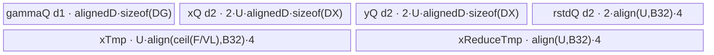
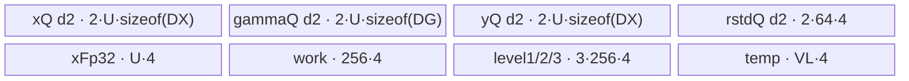

# RmsNorm 950 ACLNN 算子知识

## 算子速览

| 项目 | 内容 |
|---|---|
| 实际入口 | `aclnnRmsNormGetWorkspaceSize` + `aclnnRmsNorm`，公开 ACLNN 两段式接口，固定仓未见更高版本 |
| 计算语义 | 每个归一化行 `rstd=1/sqrt(sum(x_i^2)/D+epsilon)`，`y_i=x_i*rstd*gamma_i` |
| 输入输出 | ND；`x/y` 为 FP16、BF16 或 FP32，`gamma` 为同 dtype 或在 16-bit `x` 时为 FP32，`rstd` 固定 FP32 |
| 执行类型 | 单个 `AIV_VECTOR` Kernel；950 entry 显式 `KERNEL_TYPE_AIV_ONLY`，无 Cube/AIC/MIX_CV 可达节点 |
| Kernel 路线 | R-001 行全载 regbase（key 5000）；R-002 D 轴切分 regbase（key 2001） |
| 核心资源 | GM、双缓冲 TQue、FP32 TBuf/RegTensor；Host workspace 固定 `16 MiB + 256 B`，Kernel entry 不读 workspace |
| 来源闭包 | `source_closed`：公开 ACLNN 契约（生成式 inner bridge 为框架边界）→OpDef/AutoContiguous→950 Tiling/POD→AIV entry→两套 body/helper→binary config 已闭合 |
| 验证状态 | 已完成源码闭包检查；本次知识提取未执行编译、真机、数值或性能测试。 |

## 接口与语义

### 计算语义

令 `D=product(gamma.shape)`，`N=product(x.shape[0:xRank-gammaRank])`。每行计算 `s=sum_{i=0}^{D-1} float(x_i)^2`、`rstd=1/sqrt(s/D+epsilon)`、`y_i=cast_x(float(x_i)*rstd*float(gamma_i))`。归一化域是 `gamma` 对应的全部尾部维；`rstd` 保留这些维但长度均为 1。

### 输入、输出与属性

| 参数 | shape/layout | dtype | 约束、默认值与语义 |
|---|---|---|---|
| `x` | ND，1–8 维 | FP16/BF16/FP32 | 必选；文档称支持非连续，OpDef `AutoContiguous`；允许空 Tensor 的 ACLNN 契约与 Host Tiling 拒绝 0 维长度之间由生成式框架空算子路径负责，固定仓未展开该路径 |
| `gamma` | `x` 的完整尾部若干维，1–8 维 | FP16/BF16/FP32 | 必选且非空；16-bit `x` 可配 FP32 `gamma` |
| `epsilon` | Host 标量 | `double` 入参，算子属性/POD 为 FP32 | 缺省语义 `1e-6`；Tiling 要求 `epsilon>=0` |
| `yOut` | 与 `x` 相同，ND | 与 `x` 相同 | 必选输出，支持非连续 |
| `rstdOut` | rank 同 `x`，前导维同 `x`、归一化尾维为 1 | FP32 | 必选输出，支持非连续 |

### 入口与版本

固定仓只公开 `aclnnRmsNorm`，没有 V2/V3 版本。文档产品表明确支持 Ascend 950PR/950DT；OpDef 的 `ascend950` 配置把 `opFile.value` 指向 `rms_norm_apt`，950 binary config 覆盖五组公开 dtype 组合。Grad、Quant、DynamicMxQuant、Inplace 与 Gemma 语义均不属于本卡。

## Host/Launcher 执行流程

### 参数校验与前处理

公开文档规定两段式调用：第一段校验必选指针、dtype、1–8 维、`gamma=x` 的尾部 shape、`y=x`、`rstd` 的 keep-dim shape，并生成 workspace/executor；非连续 `x/gamma` 由 OpDef `AutoContiguous` 接入框架连续化，输出由框架写回。固定仓未公开生成式 ACLNN inner bridge，因此其 executor 壳、ViewCopy 符号与空 Tensor 快路径明确作为框架边界；算子自有的 `CheckInputShape4RmsNorm`、`epsilon>=0`、Tiling、POD 与 Kernel 均已继续闭合。

### 参数、Workspace 与生命周期

`Tiling4RmsNorm` 取 `numCol=gamma.shape_size`，将 `x` 的非归一化前导维连乘为 `numRow`，设置 `workspace[0]=256+16*1024*1024` B。950 `rms_norm` entry 仍保留 `workspace` 形参但 body 完全不读取它，因此它是框架/系统 workspace，不是 Route 间数据边。executor 由第一段创建，调用者提供 workspace 与 stream 给第二段；输出所有权仍属调用者。

### 启动图与失败传播

单 Kernel 图：executor 在给定 stream 上启动 `rms_norm(x,gamma,y,rstd,workspace,tiling)`；grid 为 `useCoreNum=ceil(numRow/blockFactor)`，950 entry 按 key 5000/2001 解析不同 POD 并调用一个 AIV body。没有跨 Kernel workspace 边、event 或 atomic。shape/dtype/epsilon/UB Tiling 失败时返回错误并阻止启动；未知 key 没有 fallback，entry 不写输出。

## Route 与参数设计

### 分核与资源计算

公共分核为 `blockFactor=ceil(numRow/numCoreAiv)`、`useCoreNum=ceil(numRow/blockFactor)`。950 先取 `ubSize=平台 UB-1024`、`blockSize=GetUbBlockSize(context)`、`vectorLength=GetVRegSize(context)/4`，再令 `numColAlignFullLoad=ceil(numCol*sizeof(x)/blockSize)*blockSize/sizeof(x)`。`powerFactor=2^floor(log2(numColAlignFullLoad-1))`，`firstVcaddLength=ceil(ceil(powerFactor/vectorLength)/blockSize)*blockSize`。全载 `ubFactor` 由源码公式计算并截断到 `blockFactor`；若不足 1 或 `numColAlignFullLoad>16384`，进入 512 B 对齐的切分方案并倍增 `ubFactor` 到首次让 `ComputeTotalBufSize(2*ubFactor)>=ubSize`，`ubLoop` 取满足 `2*ubLoop*ubFactor<=numCol` 的最大 2 次幂。

### Route 选择

| 顺序 | Route | Key/模板 | 精确选择条件与优先级 | 不适用去向 |
|---:|---|---|---|---|
| 1 | R-001 行全载 | 5000 / `KernelRmsNormRegBasePerf<DTYPE_X,DTYPE_GAMMA>` | `ubFactor=(ubSize-2048-numColAlignFullLoad*sizeof(gamma))/(numColAlignFullLoad*sizeof(x)*2*2 + 4*(2+1)+firstVcaddLength)`，且 `ubFactor>=1 && numColAlignFullLoad<=16384` | R-002 |
| 2 | R-002 D 轴切分 | 2001 / `KernelRmsNormRegBaseSplitD<DTYPE_X,DTYPE_GAMMA>` | R-001 任一条件不成立 | 无 Host fallback；Tiling 内部资源失败返回 `GRAPH_FAILED` |

```text
IsRegbaseSocVersion(A5)
  -> compute full-row ubFactor
  -> ubFactor>=1 && alignedD<=16384 ? key 5000 : key 2001
```

### 模板/实现执行矩阵

| Route | key/selector | dtype/shape/platform 完整命中条件 | 执行拓扑与 Kernel 节点 | 实际模板/body | 内存与同步特征 | tail/fallback |
|---|---|---|---|---|---|---|
| R-001 行全载 | 5000 | 950；五组公开 dtype；完整行满足 Host UB 公式且 `alignedD<=16384` | 单 AIV node | `KernelRmsNormRegBasePerf<DX,DG>::Process` + `CalculateSquareReduceSum` + Newton-Raphson rstd | x/y/rstd 双缓冲，gamma depth1，MicroAPI RegTensor/LocalMemBar | `curUbFactor` 尾行与 `UpdateMask` 尾列；失败转 R-002 |
| R-002 D 轴切分 | 2001 | 950；R-001 不成立 | 单 AIV node | `KernelRmsNormRegBaseSplitD<DX,DG>::Process` + `ComputeFormerImplV2`/多级归约 | x/gamma/y/rstd 双缓冲，五个 FP32 TBuf，queue/pipe 顺序 | 32 B DMA pad、512 B 计算 pad、`tailLoop/masterLoop/tail`；无进一步 fallback |

### 隐藏性能 Guard

| Guard | Host/Tiling 条件 | Device/资源原因 | 影响 Route | 不满足时去向 | 源码符号 |
|---|---|---|---|---|---|
| 全载 UB | 上述 `ubFactor>=1` | R-001 同时驻留双缓冲 x/y、gamma、rstd 和归约 scratch | R-001 | R-002 | `TilingArch354RmsNorm` |
| 全载列上限 | `numColAlignFullLoad<=16384` | 限制完整行归约的驻留/折叠规模 | R-001 | R-002 | `FULL_LOAD_R_MAX`, `TilingArch354RmsNorm` |
| 512 B split 对齐 | `numColAlign=ceil(numCol*max(sizeof(x),sizeof(gamma))/512)*512/max(...)` | `ComputeFormerImplV2` 以 512 B 补零后的块做分层归约 | R-002 | 无 | `TilingArch354RmsNorm`, `ComputeFormerHandle` |
| epsilon | `epsilon>=0` | 倒平方根数值域 | 全部 | `GRAPH_FAILED` | `Tiling4RmsNorm` |
| AIV-only | entry 执行 `KERNEL_TASK_TYPE_DEFAULT(KERNEL_TYPE_AIV_ONLY)` | 排除 Cube/AIC task | 全部 | N/A | `rms_norm_apt.cpp::rms_norm` |
| dormant NDDMA flag | Host 写 `is_nddma=(numCol<512)` | 实际 950 split body不读取该字段，搬运走 `DataCopyPad` | R-002 | N/A | `TilingArch354RmsNorm`, `KernelRmsNormRegBaseSplitD` |

### POD/ABI

宏生成结构的固定仓未展开 `sizeof/alignof/offsetof`；下表逐字段保留声明顺序。950 key 5000 使用独立 9 字段 POD；key 2001 解析通用 POD，但只读标出的活动字段。

| 结构 | 字段 | 类型/位宽 | ABI 布局 | 单位 | Host/launcher producer | Device consumer | 边界 |
|---|---|---|---|---|---|---|---|
| `RMSNormArch35TilingData` | `num_row` | uint64/64 | 宏布局，offsetof 不可见 | 行 | `set_num_row(numRow)` | perf `Init` | shape 连乘 |
| 同上 | `num_col` | uint64/64 | 同上 | 元素/行 | `set_num_col(numCol)` | DMA/归约 | gamma size |
| 同上 | `num_col_align` | uint64/64 | 同上 | 元素/行 | block 对齐 | UB stride | `>=num_col` |
| 同上 | `block_factor` | uint64/64 | 同上 | 行/核 | `ceil(numRow/numCore)` | GM base | 尾核另有字段 |
| 同上 | `col_flod_factor` | uint64/64 | 同上 | 元素 | `powerFactor` | square-reduce fold | 名称拼写来自源码 |
| 同上 | `ub_factor` | uint64/64 | 同上 | 行/tile | UB 公式后截到 blockFactor | tile 循环/队列 | `>=1` |
| 同上 | `epsilon` | float/32 | 同上 | 标量 | ACLNN double→属性 float | Newton-Raphson | `>=0` |
| 同上 | `avg_factor` | float/32 | 同上 | 1/元素 | `1.0f/numCol` | rstd | numCol 0 时 0 |
| 同上 | `last_block_factor` | uint64/64 | 同上 | 行 | `numRow-(cores-1)*blockFactor` | 尾核 | `1..blockFactor` |
| `RMSNormTilingData` | `num_row` | uint64/64 | 宏布局，offsetof 不可见 | 行 | 950 split setter | split `Init` | 活动 |
| 同上 | `num_col` | uint64/64 | 同上 | 元素/行 | 950 split setter | 循环/地址 | 活动 |
| 同上 | `num_col_align` | uint64/64 | 同上 | 元素/行 | 512 B 对齐 | `Init` 保存但后续不读 | inactive |
| 同上 | `block_factor` | uint64/64 | 同上 | 行/核 | Host | GM base | Device 窄化到 uint32 member |
| 同上 | `row_factor` | uint32/32 | 同上 | 行/tile | 固定 64 | 行循环/rstd queue | 活动 |
| 同上 | `ub_factor` | uint32/32 | 同上 | 元素/tile | 倍增搜索 | 列切分 | 活动 |
| 同上 | `reduce_mask` | uint32/32 | 同上 | lane | 950 不写 | 950 不读 | inactive |
| 同上 | `left_num` | uint32/32 | 同上 | 元素 | 950 不写 | 950 不读 | inactive |
| 同上 | `last_reduce_mask` | uint32/32 | 同上 | lane | 950 不写 | 950 不读 | inactive |
| 同上 | `last_left_num` | uint32/32 | 同上 | 元素 | 950 不写 | 950 不读 | inactive |
| 同上 | `rstd_size` | uint32/32 | 同上 | byte | 950 不写 | 950 不读 | inactive |
| 同上 | `ub_loop` | uint32/32 | 同上 | tile 数 | 最大 2 次幂 | master/tail 分解 | 活动 |
| 同上 | `col_buffer_length` | uint32/32 | 同上 | 元素 | `ubFactor` | Queue 容量 | 活动 |
| 同上 | `multi_n_num` | uint32/32 | 同上 | 行 | `ubSize/ComputeTotalBufSize(full aligned row)` | 950 split 不读 | inactive |
| 同上 | `is_nddma` | uint32/32 | 同上 | 布尔 | `numCol<512 ? 1:0` | 950 split 不读 | dormant，不构成 NDDMA route |
| 同上 | `epsilon` | float/32 | 同上 | 标量 | Host | `ComputeRstd` | 活动 |
| 同上 | `avg_factor` | float/32 | 同上 | 1/元素 | 950 不写 | 950 split 自行 `1/numCol` | inactive |
| 同上 | `is_gemma` | uint8/8 | 同上 | 布尔 | 950 不写 | 950 不读 | inactive |
| 同上 | `last_block_factor` | uint64/64 | 同上 | 行 | 950 写 0 | 950 split 不读 | inactive |
| 同上 | `row_loop` | uint64/64 | 同上 | 次数 | 950 不写 | 950 不读 | inactive |
| 同上 | `last_block_row_loop` | uint64/64 | 同上 | 次数 | 950 不写 | 950 不读 | inactive |
| 同上 | `row_tail` | uint64/64 | 同上 | 行 | 950 不写 | 950 不读 | inactive |
| 同上 | `last_block_row_tail` | uint64/64 | 同上 | 行 | 950 不写 | 950 不读 | inactive |
| 同上 | `mul_loop` | uint32/32 | 同上 | repeat | 950 不写 | 950 不读 | inactive |
| 同上 | `mul_tail` | uint32/32 | 同上 | 元素 | 950 不写 | 950 不读 | inactive |
| 同上 | `dst_rep_stride` | uint8/8 | 同上 | 32 B block | 950 不写 | 950 不读 | inactive |
| 同上 | `is_performance` | uint8/8 | 同上 | 布尔 | 950 不写 | 950 不读 | inactive |
| 同上 | `normal_flag` | uint8/8 | 同上 | 布尔 | 950 不写 | 950 不读 | inactive |

### Route 源码闭包

| Route | Key/selector | Host/Tiling producer | POD/参数 | Kernel entry/router 节点 | Kernel body/直接依赖 | 构建接线 |
|---|---|---|---|---|---|---|
| R-001 行全载 | 5000 | `rms_norm_tiling.cpp::Tiling4RmsNorm` → `rms_norm_tiling_arch35.cpp::TilingArch354RmsNorm` | `RMSNormArch35TilingData` | `rms_norm_apt.cpp::rms_norm` | `KernelRmsNormRegBasePerf` + `norm_common::CalculateSquareReduceSum/ComputeRstdNewtonRaphson` | `RmsNorm` OpDef `ascend950` + `ascend950/rms_norm_binary.json` |
| R-002 D 轴切分 | 2001 | 同上 | `RMSNormTilingData` 活动子集 | 同上 | `KernelRmsNormRegBaseSplitD` + `rms_norm_regbase_common.h` 多级归约 | 同上 |

## Kernel 实现

### 公共执行流程

每个 core 接管连续 `blockFactor` 行，尾核按剩余行缩短。两条 Route 均在单个 AIV entry 内完成 `GM x/gamma → UB → FP32 square/reduce → rstd → x*rstd*gamma → GM y/rstd`。TQue 的 `EnQue/DeQue/FreeTensor`、MicroAPI `LocalMemBar` 与同一 Vector scope 的顺序保护 UB 生命周期；没有 atomic、跨核归约或跨 Kernel workspace。

### Route R-001：行全载 regbase

#### 适用条件

##### 选择证据

| 层级 | 文件 | 符号 | 源码谓词/参数 | 结果/下一跳 |
|---|---|---|---|---|
| Host | `norm/rms_norm/op_host/rms_norm_tiling.cpp` | `Tiling4RmsNorm` | `IsRegbaseSocVersion(context)` | 调 950 selector |
| Tiling | `norm/rms_norm/op_host/rms_norm_tiling_arch35.cpp` | `TilingArch354RmsNorm` | `ubFactor>=1 && numColAlignFullLoad<=FULL_LOAD_R_MAX` | key 5000 |
| Router | `norm/rms_norm/op_kernel/rms_norm_apt.cpp` | `rms_norm` | `TILING_KEY_IS(5000)` | `KernelRmsNormRegBasePerf<DTYPE_X,DTYPE_GAMMA>` |

#### Device 数据流

##### 函数级调用链

```text
rms_norm(key=5000)
  -> KernelRmsNormRegBasePerf::Init
  -> Process
    -> DataCopyPad(gamma)
    -> per row tile: DataCopyPad(x)
      -> CalculateSquareReduceSum<DX>
      -> ComputeRstdNewtonRaphson<false,true>
      -> DataCopyPad(rstd)
      -> ComputeY -> DataCopyPad(y)
```

##### 源码等价伪码

```text
gammaUB = DMA gamma[0:D]                         # once
for tile in [0, ceil(rowWork/ubFactor)):
  rows = tail ? curUbTails : ubFactor
  xUB[rows,alignedD] = DMA_pad(x[tile,0:D])
  for each row, masked by D:
    sum = ReduceSum(float(xUB)^2) via foldPoint
    rstd = NewtonRaphsonRsqrt(sum*avgFactor + epsilon)
  DMA rstd[rows]
  for row and vector column chunk, mask=UpdateMask(D):
    yReg = float(xReg) * broadcast(rstd[row]) * float(gammaReg)
    yUB = cast_DX(yReg)
  DMA valid D columns of yUB
```

#### 内存与数据搬运

##### 资源与搬运表

| 层级/缓冲区 | offset/地址公式 | extent/容量公式 | dtype/layout | producer | consumer | owner/lifetime | 对齐/复用 |
|---|---|---|---|---|---|---|---|
| GM x/y | `core*blockFactor*D + tile*ubFactor*D` | `rows*D` | DX, row-major ND | caller/kernel | DMA/caller | caller | UB row stride alignedD |
| GM gamma | 0 | `D` | DG | caller | DMA once | caller/Process | padded to alignedD in UB |
| GM rstd | `core*blockFactor + tile*ubFactor` | `rows` | FP32 | Kernel | caller | caller | exact byte length |
| `inQueueGamma` | UB | `alignedD*sizeof(DG)` | DG | DMA | ComputeY | Process | depth1 |
| `inQueueX` | UB | depth2 × `ubFactor*alignedD*sizeof(DX)` | DX | DMA | reduce/Y | tile | double buffer |
| `outQueueY` | UB | depth2 × `ubFactor*alignedD*sizeof(DX)` | DX | ComputeY | DMA | tile | double buffer |
| `outQueueRstd` | UB | depth2 × `align(ubFactor,blockSizeB32)*4` | FP32 | NR helper | DMA/Y | tile | double buffer |
| `xTmpBuf` | UB | `ubFactor*align(ceil(colFlodFactor/VL),blockSizeB32)*4` | FP32 | square partials | reduce | tile | TBuf |
| `xReduceTmpBuf` | UB | `align(ubFactor,blockSizeB32)*4` | FP32 | square reduce | rstd/Y | tile | TBuf |
| RegTensor | register | masked VL chunks | FP32 | load/cast | Mul/reduce/store | Vector scope | `UpdateMask` protects tail |

##### 分层内存布局



##### 字节账与复用顺序

```text
U=ubFactor, A=numColAlign, F=colFlodFactor, B32=blockSize/4
UB_total = A*sizeof(DG)
         + 2*U*A*sizeof(DX) + 2*U*A*sizeof(DX)
         + 2*align(U,B32)*4
         + U*align(ceil(F/VL),B32)*4
         + align(U,B32)*4
UB_total <= platform_UB - 1024（Host selector 的保守公式）
dynamic_ub = N/A
workspace_total = 256 + 16 MiB（Kernel 不读）
```

| 复用子区 | 写入者 | 读取者/消费点 | 下一次覆盖 | 同步或释放依据 | 安全条件 |
|---|---|---|---|---|---|
| x queue slot | `DataCopyPad` | reduce 与 `ComputeY` | 下一 tile DMA | Y 完成后 `FreeTensor` | 必须保留原 x 到 y 结束 |
| rstd queue slot | NR helper | GM copy 与 `ComputeY` | 下一 tile | 两个消费后 `FreeTensor` | 不得在 y 前释放 |
| xTmp | square-reduce partial | same helper | 下一 row tile | helper 内 `LocalMemBar` | fold scratch 不跨 tile |

#### 同步、精度与尾块

##### 同步与数值边界表

| 阶段 | primitive/机制 | producer | consumer/等待点 | 保护对象 | 精度/尾块 |
|---|---|---|---|---|---|
| DMA→Vector | TQue EnQue/DeQue | x/gamma DMA | reduce/Y | queue slot | DataCopyPad 补对齐，计算 mask 只覆盖 D |
| square reduce | MicroAPI `LocalMemBar` | partial stores | final reduction | xTmp | 16-bit 输入先寄存器转 FP32，FP32 累加 |
| rstd | `ComputeRstdNewtonRaphson<false,true>` | sum | ComputeY/GM | rstdUB | 乘 `avgFactor` 后加 epsilon；源码含 Inf/zero 选择修正 |
| y | RegTensor mask | x/rstd/gamma | UB store | yUB | 全程 FP32 乘，最后按 DX cast；`UpdateMask` 保护尾列 |

#### 关键实现

##### 符号证据表

| 阶段 | 文件 | 符号/模板实例 | 实现事实 |
|---|---|---|---|
| Host/Tiling producer | `norm/rms_norm/op_host/rms_norm_tiling_arch35.cpp` | `TilingArch354RmsNorm` | key 5000、全载 UB 公式、POD |
| Kernel entry/router | `norm/rms_norm/op_kernel/rms_norm_apt.cpp` | `rms_norm`, key 5000 | AIV-only 与模板映射 |
| Device body/helper | `norm/rms_norm/op_kernel/arch35/rms_norm_regbase_perf.h` | `KernelRmsNormRegBasePerf::Process/ComputeY` | DMA、双缓冲、寄存器 y |
| Device body/helper | `norm/norm_common/op_kernel/reduce_common_regbase.h` | `CalculateSquareReduceSum`, `ComputeRstdNewtonRaphson` | FP32 归约和 rstd |

### Route R-002：D 轴切分 regbase

#### 适用条件

##### 选择证据

| 层级 | 文件 | 符号 | 源码谓词/参数 | 结果/下一跳 |
|---|---|---|---|---|
| Host | `norm/rms_norm/op_host/rms_norm_tiling.cpp` | `Tiling4RmsNorm` | 950 regbase | 950 selector |
| Tiling | `norm/rms_norm/op_host/rms_norm_tiling_arch35.cpp` | `TilingArch354RmsNorm` | `!(fullUbFactor>=1 && alignedD<=16384)` | key 2001 |
| Router | `norm/rms_norm/op_kernel/rms_norm_apt.cpp` | `rms_norm` | `TILING_KEY_IS(2001)` | `KernelRmsNormRegBaseSplitD<DX,DG>` |

#### Device 数据流

##### 函数级调用链

```text
rms_norm(key=2001)
  -> KernelRmsNormRegBaseSplitD::Init
  -> Process -> SubProcess
    -> per row ComputeFormer
      -> ComputeFormerHandle -> DataCopyPad(x) -> ComputeFormerImplV2
      -> ComputeSum / ComputeMultiLevelReduce / ComputeMultiLevelRstd
    -> ComputeRstd
    -> per column tile ComputeLatter
      -> CopyInGamma + CopyInX -> ComputeLatterY -> CopyOutY
    -> CopyOutRstd
```

##### 源码等价伪码

```text
for rowTile of at most 64 rows:
  rstdUB[0:rows]=0
  for row:
    split D into [tail-paired blocks, optional partial, master blocks]
    each block: DMA x with 32B pad, zero to 512B compute boundary
                square in FP32, reduce into level1/2/3 buffers
    rstdUB[row] = merged sum
  rstdUB = 1/sqrt(rstdUB/D + epsilon)
  for colTile in ceil(D/ubFactor):
    DMA gamma[colTile]
    for row: DMA x[row,colTile]; masked FP32 x*rstd*gamma; cast DX; DMA valid tail
  DMA rstd[rows]
```

#### 内存与数据搬运

##### 资源与搬运表

| 层级/缓冲区 | offset/地址公式 | extent/容量公式 | dtype/layout | producer | consumer | owner/lifetime | 对齐/复用 |
|---|---|---|---|---|---|---|---|
| GM x/y | `(rowTile*64+row)*D + colTile*U` | `min(U,D-colTile*U)` | DX | caller/kernel | DMA/caller | caller | x CopyIn pads, y writes valid count |
| GM gamma | `colTile*U` | same column count | DG | caller | ComputeLatterY | caller | per col tile reuse across rows |
| GM rstd | `rowTile*64` | rows | FP32 | Kernel | caller | caller | exact count |
| x/gamma/y queues | UB | each depth2 × `U*sizeof(dtype)` | row tile | DMA/vector | vector/DMA | substep | double buffer |
| rstd queue | UB | depth2 × `64*4` | FP32 | reduce | Y/GM | row tile | double buffer |
| xFp32 | UB | `U*4` | FP32 | convert/square | reduce/Y helper | block | TBuf |
| work/level1/2/3 | UB | each `256*4` | FP32 | partial reduce | multilevel merge | row | cleared per row |
| temp | UB | `V_LENGTH*4` | FP32 | paired block sums | level1 | row | tail scratch |

##### 分层内存布局



##### 字节账与复用顺序

```text
U=colBufferLength=ubFactor, R=64
UB_total = 2*U*sizeof(DX) + 2*U*sizeof(DG) + 2*U*sizeof(DX)
         + 2*R*4 + U*4 + 4*256*4 + V_LENGTH*4
UB_total < platform_UB - 1024（由 ComputeTotalBufSize 倍增边界保守选择 U）
dynamic_ub = N/A
workspace_total = 256 + 16 MiB（Kernel 不读）
```

| 复用子区 | 写入者 | 读取者/消费点 | 下一次覆盖 | 同步或释放依据 | 安全条件 |
|---|---|---|---|---|---|
| x queue slot | `CopyInX` | `ComputeFormerImplV2` 或 `ComputeLatterY` | 下一 block/tile | `DeQue/FreeTensor` | 归约阶段与 y 阶段不并存 |
| level1/2/3 | partial reduce | multilevel merge | 下一行先 `Duplicate(0)` | helper 调用顺序/Vector barrier | 每行完全合并后覆盖 |
| gamma slot | `CopyInGamma` | 当前列所有行 | 下一列 tile | 行循环后 `FreeTensor` | gamma 必须跨行保留 |

#### 同步、精度与尾块

##### 同步与数值边界表

| 阶段 | primitive/机制 | producer | consumer/等待点 | 保护对象 | 精度/尾块 |
|---|---|---|---|---|---|
| DMA | TQue + DataCopyPad | GM | Vector | x/gamma UB | 32 B pad 为 0；归约另补到 512 B |
| partial reduce | `ComputeMultiLevelReduce` + pipe barrier | level1 | level2/3/final | reduction tree | 16-bit load转 FP32；tail 分三种区间 |
| rstd | `ComputeRstd` RegTensor | merged sum | y/GM | rstdUB | `sum*avg+epsilon → sqrt → 1/x` |
| y | `ComputeLatterY` mask | x/rstd/gamma | yUB | valid column tile | FP32 乘后 cast；CopyOut 只写 `calColNum` |

#### 关键实现

##### 符号证据表

| 阶段 | 文件 | 符号/模板实例 | 实现事实 |
|---|---|---|---|
| Host/Tiling producer | `norm/rms_norm/op_host/rms_norm_tiling_arch35.cpp` | `TilingArch354RmsNorm` | key 2001、U/ubLoop/512 B 对齐 |
| Kernel entry/router | `norm/rms_norm/op_kernel/rms_norm_apt.cpp` | `rms_norm`, key 2001 | AIV-only 映射 |
| Device body/helper | `norm/rms_norm/op_kernel/arch35/rms_norm_regbase_split_d.h` | `Process/ComputeFormer/ComputeLatter` | 行列循环、Queue、tail |
| Device body/helper | `norm/rms_norm/op_kernel/arch35/rms_norm_regbase_common.h` | `ComputeFormerImplV2`, `ComputeMultiLevelReduce`, `ComputeLatterY` | FP32 分层归约和 y |

## 算子特定优化

### Trick T-001：完整行驻留与寄存器广播复用

#### 触发与源码依据

- 适用 Route：R-001
- 触发条件：`ubFactor>=1 && numColAlignFullLoad<=16384`
- Golden 来源：[`norm/rms_norm/op_kernel/arch35/rms_norm_regbase_perf.h:180-190`](../../../../../../../cann-ops-raw/ascendc/ops-nn/955f8b33985b6d72989ebff341bb9c2c564a51bc/norm/rms_norm/op_kernel/arch35/rms_norm_regbase_perf.h#L180-L190)

**官方源码（固定 Commit 连续逐字摘录）**：

```cpp
for (uint16_t i = 0; i < curAloops; i++) {
    uint32_t sregElewiseNum = numCol;
    DataCopy<float, LoadDist::DIST_BRC_B32>(RstdReg, rstdLocalUbAddr + i);
    for (uint16_t j = 0; j < colLoops; j++)  {
        MaskReg pregCurLoop = UpdateMask<float>(sregElewiseNum);
        LoadRegForDtype(xLocalAddr, xReg, pregCurLoop, (i * colNumAlign + j * VectorLenB32));
        Mul(mul1Reg, xReg, RstdReg, pregCurLoop);
        LoadRegForDtype(gammaLocalUbAddr, gammaReg, pregCurLoop, (j * VectorLenB32));
        Mul(mul2Reg, mul1Reg, gammaReg, pregCurLoop);
        StoreRegForDtype(yLocalUbAddr, mul2Reg, pregCurLoop, (i * colNumAlign + j * VectorLenB32));
    }
}
```

#### 机制与设计原因

每行 `rstd` 以 `DIST_BRC_B32` 一次装入广播寄存器并跨该行全部列 chunk 复用；gamma 的列向量也跨所有行复用。`UpdateMask` 直接控制最后一个 VReg chunk，避免物化 padded lane 或单独 tail Kernel。完整 x 保留在 UB，归约后直接用于 y，避免第二次从 GM 读取 x。

#### 迁移边界

- 适用：按最后 D 维归约、归约后仍需原输入做逐元素缩放的算子。
- 前提：完整行与双缓冲可落 UB，列规模不超过 Host guard，950 MicroAPI 可用。
- 失效：UB 或列上限不满足时必须改用 R-002，重新分块读取 x。
- 未验证：本次知识提取未执行编译、真机、数值或性能测试。

#### 错误做法

固定仓可验证的失效边界是忽略 Host UB guard 强行全载会超过已预算的队列/scratch；固定仓未提供可验证的运行反例。

### Trick T-002：Split-D 的成对块与三级在线归约

#### 触发与源码依据

- 适用 Route：R-002
- 触发条件：R-001 不成立；`ubLoop/ubFactor` 将 D 分为 master/tail 块
- Golden 来源：[`norm/rms_norm/op_kernel/arch35/rms_norm_regbase_split_d.h:151-185`](../../../../../../../cann-ops-raw/ascendc/ops-nn/955f8b33985b6d72989ebff341bb9c2c564a51bc/norm/rms_norm/op_kernel/arch35/rms_norm_regbase_split_d.h#L151-L185)

**官方源码（固定 Commit 连续逐字摘录）**：

```cpp
for (uint32_t repeat = 0; repeat < tailLoop; repeat++) {
    ComputeFormerHandle(tempLocal, offset, 0, ubFactor, ubFactor);
    offset += ubFactor;
    ComputeFormerHandle(tempLocal, offset, 1, ubFactor, ubFactor);
    offset += ubFactor;
    ComputeSum(level1Local, tempLocal, level1, SUM_COUNT);
    level1 += 1;
    ComputeMultiLevelReduce(level1Local, level2Local, level3Local, level1, level2, level3);
}
```

#### 机制与设计原因

两个列块的平方和先放到 `tempLocal[0:2]`，随后合并为一个 level1 项并立即推进 level1/2/3 在线归约；因此 scratch 与 D 无线性增长。32 B DMA 补零后又补齐 512 B 计算边界，无效元素为 0，不污染平方和。该路线需在 y 阶段再次读取 x，这是换取有界 UB 的明确代价。

#### 迁移边界

- 适用：归约轴无法整行驻留 UB、且可将 partial sum 在线树归约的逐行算子。
- 前提：padding 值为 0 对归约恒等；层级容量与 `ubLoop` 上界匹配。
- 失效：若 padding 非归约恒等或输出需要原始未补齐布局参与计算，须重设 helper/布局；没有第三 Route。
- 未验证：本次知识提取未执行编译、真机、数值或性能测试。

#### 错误做法

固定仓可验证的错误是把 padding lane 当有效元素：会改变平方和；实现以 `paddingValue=0` 和有效长度 CopyOut 避免该问题。

## 模板与实现对比

| 对比维度 | R-001 行全载 | R-002 D 轴切分 | 设计选择依据 |
|---|---|---|---|
| 命中条件/优先级 | 全载 U>=1 且 alignedD<=16384 | 其余 | Host 先试全载 |
| 模板与 dtype | `KernelRmsNormRegBasePerf<DX,DG>`，五组 dtype | `KernelRmsNormRegBaseSplitD<DX,DG>`，同五组 | binary config 一致 |
| 循环与分核 | core→row tile→row→col VReg | core→row tile→row归约块→col tile→row | 是否完整驻留 D |
| Queue/TBuf/寄存器/dynamic UB/通信 window | x/y/rstd d2，gamma d1，两个 scratch | 四队列 d2，五个 FP32 scratch | dynamic UB/通信 N/A |
| 内存总占用与复用 | 保留整行 x 到 y | U 有界，三级 scratch 在线复用 | Host UB guard |
| 搬运/Vector/SIMT/NDDMA/通信 API | DataCopyPad + MicroAPI RegTensor | DataCopyPad + MicroAPI 多级 reduce | 均非 SIMT/NDDMA/通信 |
| 同步、精度与 tail | queue/LocalMemBar，FP32 reduce，mask tail | queue/pipe，FP32 tree，32/512 B zero pad | 均最后 cast DX |
| fallback/失败边界 | 转 R-002 | Tiling/unknown key 失败 | 无隐式第三实现 |

## 平台差异

| 项目 | A2 | A3 | 950 |
|---|---|---|---|
| 支持状态 | 公开支持，见无后缀卡 | 公开支持，见无后缀卡 | 公开支持 |
| Host/Launcher | 通用 Tiling 0/1/2/3 | 通用 Tiling 0/1/3（2 仅 exact 910B） | arch35 selector 5000/2001，OpDef 指向 `rms_norm_apt` |
| Kernel/资源 | legacy Vector API、depth1 为主 | 同 AIV 架构 | RegBase MicroAPI、关键队列 depth2、独立 POD |

## 限制与失败边界

- `x/gamma/y/rstd` 必须满足文档 dtype/shape 组合；`epsilon<0`、gamma 非尾部 shape 或必选指针为空均失败。
- Host 将某些 64 位 shape 量写入 Device 的 uint32 member（R-002 的 `blockFactor/numCol/ubFactor`），固定仓没有额外溢出 guard；超出范围不得推测支持。
- 950 split Tiling 写 `is_nddma`，但实际 `rms_norm_apt` 可达 body 不读取它；不得把 dormant 字段误报为 NDDMA 执行族。
- 生成式 ACLNN inner bridge 未在固定仓展开；其连续化 executor 壳是明确框架边界。本次未执行编译、真机、数值或性能测试。

## 源码索引

### 链路索引

| 链路阶段 | 文件 | 关键符号 | 支撑内容 |
|---|---|---|---|
| 入口声明/约束 | `norm/rms_norm/docs/aclnnRmsNorm.md` | `aclnnRmsNormGetWorkspaceSize`, `aclnnRmsNorm` | 公开 API、产品、dtype/shape/错误 |
| 入口实现 | `norm/rms_norm/op_host/rms_norm_def.cpp` | `ops::RmsNorm` | AutoContiguous、950 opFile、dtype config |
| Host/Tiling/Launcher | `norm/rms_norm/op_host/rms_norm_tiling.cpp` | `Tiling4RmsNorm` | 校验、workspace、950 分派 |
| Host/Tiling/Launcher | `norm/rms_norm/op_host/rms_norm_tiling_arch35.cpp` | `TilingArch354RmsNorm` | keys/POD/UB 公式 |
| Host/Tiling/Launcher | `norm/rms_norm/op_host/rms_norm_tiling.h` | 两个 POD | ABI 字段 |
| Kernel entry/body | `norm/rms_norm/op_kernel/rms_norm_apt.cpp` | `rms_norm` | AIV-only router |
| Kernel entry/body | `norm/rms_norm/op_kernel/arch35/rms_norm_regbase_perf.h` | `KernelRmsNormRegBasePerf` | R-001 body |
| Kernel entry/body | `norm/rms_norm/op_kernel/arch35/rms_norm_regbase_split_d.h` | `KernelRmsNormRegBaseSplitD` | R-002 body |
| Kernel entry/body | `norm/rms_norm/op_kernel/arch35/rms_norm_regbase_common.h` | reduce/y helpers | split 公共 MicroAPI |
| Kernel entry/body | `norm/norm_common/op_kernel/reduce_common_regbase.h` | square reduce/NR helpers | full-load 归约与 rstd |
| 构建接线 | `norm/rms_norm/op_host/config/ascend950/rms_norm_binary.json` | `RmsNorm` 五组条目 | 950 binary dtype 接线 |

### 实现复用检查

| 检查项 | 可复用事实 | 不得改变的约束 | 源码符号 |
|---|---|---|---|
| ABI/POD | 5000/2001 各自 POD 映射 | 结构、字段顺序/位宽、key 不可混用 | `RMSNormArch35TilingData`, `RMSNormTilingData` |
| 调用顺序 | square→reduce→rstd→y | y 需要原 x 和 rstd 都仍有效 | 两个 `Process` |
| workspace/内存 | 单 Kernel 无交接 workspace | 队列 depth 必须计入；系统 workspace 不可作私有 scratch | `InitBuffer`, `Tiling4RmsNorm` |
| 同步 | Queue + MicroAPI barrier | x/rstd 在 y 前不得释放/覆盖 | `EnQue/DeQue/FreeTensor`, `LocalMemBar` |
| 精度与尾块 | FP32 square/reduce/mul，最终 cast | 0 padding、mask、有效 CopyOut 长度不可改变 | reduce helpers/`ComputeY` |
| 失败边界 | 5000 不满足转 2001 | unknown key 无输出，epsilon/shape 失败不启动 | selector/router |