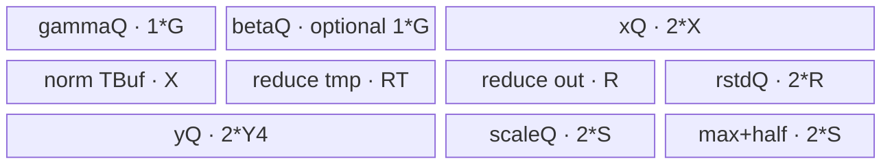
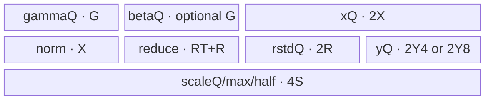
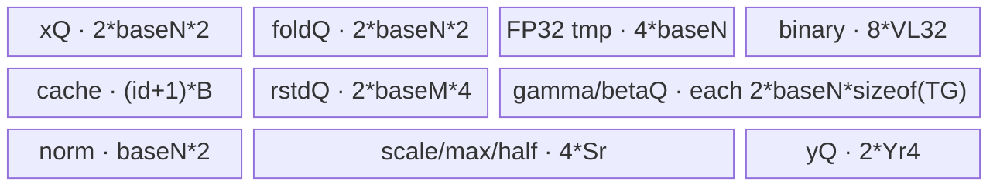

# RmsNormDynamicMxQuant 950 ACLNN 算子知识

## 算子速览

| 项目 | 内容 |
|---|---|
| 实际入口 | `aclnnRmsNormDynamicMxQuantGetWorkspaceSize` + `aclnnRmsNormDynamicMxQuant`，无版本后缀的公开 ACLNN 两段式接口 |
| 计算语义 | 每行做 `rstd = 1/sqrt(sum(x²)/N + epsilon)`、`z = x*rstd*gamma + beta`，再按尾轴每 32 个元素生成一个 E8M0 scale，并量化为 FP4/FP8 |
| 输入输出 | `x: FP16/BF16 [1..7]D`；`gamma`/可选 `beta`: 同 `x` 或 FP32 的 1D；`y`: FP4/FP8 且 shape 同 `x`；`mxscale`: E8M0；可选有效 `rstd`: FP32 |
| 执行类型 | 所有 Route 均为单 Kernel `AIV_VECTOR`；模板声明为 `ASCENDC_TPL_AIV_ONLY`，无 Cube/AIC、SIMT、NDDMA 或 `MIX_CV` 节点 |
| Kernel 路线 | R-001 ReduceEmpty；R-002 FullLoad-Optimize；R-003 FullLoad-Normal；R-004 Recompute-Optimize；R-005 Recompute-Normal |
| 核心资源 | GM 输入输出、AIV UB 的 `TQue/TBuf`、MicroAPI `RegTensor/MaskReg`；Kernel 不消费 workspace，Host 报告平台 LibApi workspace |
| 来源闭包 | `source_closed`：公开 ACLNN→L0 launcher→OpDef/Tiling 模板→POD→AIV entry/router→FullLoad/Recompute/ReduceEmpty body 与公共归约/量化 helper→ascend950 binary config 均已闭合 |
| 验证状态 | 已完成源码闭包检查；本次知识提取未执行编译、真机、数值或性能测试。 |

## 接口与语义

### 计算语义

将 `x` 的最后一维记为 `N`，前缀元素乘积记为 `M`。每行先计算

```text
sum2[m] = sum(n=0..N-1, float(x[m,n])²)
rstd[m] = 1 / sqrt(sum2[m] / N + epsilon)
z[m,n] = cast_to_x(float(x[m,n]) * rstd[m] * float(gamma[n]) + optional float(beta[n]))
```

然后把 `z` 的尾轴按 32 元素分组。`scaleAlg=0` 时从块内最大绝对值的指数生成 OCP scale；`scaleAlg=1` 仅用于 FP8，按 cuBLAS 规则将 `amax / max(dst)` 的指数向上取整。`mxscale` 物理尾部把 scale 个数补到偶数，shape 为 `x[:-1] + [ceil(ceil(N/32)/2), 2]`；补位 scale 写 0。`y` 与 `x` 同 shape，FP4 每字节打包两个元素。`outputRstd=false` 时 `rstd` 是占位输出且 Kernel 不写。

`N=0` 时不做除法和量化；若 `M>0 && outputRstd=true`，ReduceEmpty Route 把 `rstd[0:M]` 写为 quiet NaN。若前缀维含 0，ACLNN 第一段直接返回 `workspaceSize=0`，不创建本算子执行节点。

### 输入、输出与属性

| 参数 | shape/layout | dtype | 约束、默认值与语义 |
|---|---|---|---|
| `x` | ND，1–7D | FP16/BF16 | 最后一维为归一化轴；FP4 输出时 `N` 必须为偶数；ACLNN 支持非连续输入并先 `Contiguous` |
| `gamma` | ND，1D `[N]` | 同 `x` 或 FP32 | ACLNN 先 `Contiguous`；参与 `z=x*rstd*gamma+beta` |
| `beta` | ND，1D `[N]` | 与 `gamma` 相同 | 可为 null；非 null 时 ACLNN 先 `Contiguous` |
| `epsilon` | 标量 | `double` 入口、Tiling/Device 为 FP32 | 默认语义 `1e-6`；L0 显式 `static_cast<float>` |
| `scaleAlg` | 标量 | INT64 | 0=OCP，1=cuBLAS；FP4 只允许 0 |
| `roundMode` | 字符串 | `char*` | `rint/round/floor`；FP8 只允许 `rint`；null 由算子属性默认值补为 `rint` |
| `dstType` | 标量 | INT64 | 40/41/36/35 对应 E2M1/E1M2/E4M3FN/E5M2，必须与 `yOut` dtype 一致 |
| `outputRstd` | 标量 | BOOL | false 时 `rstdOut` 可为 null，L0 构造 shape `[0]` 的内部占位 |
| `yOut` | 同 `x`，ND | FP4_E2M1/FP4_E1M2/FP8_E4M3FN/FP8_E5M2 | ACLNN 用内部输出后 `ViewCopy` 到调用者视图 |
| `mxscaleOut` | `x[:-1]+[ceil(ceil(N/32)/2),2]`，ND | FP8_E8M0 | 每 32 元素一个 scale，scale 数补偶数 |
| `rstdOut` | `x` 同 rank、尾轴 1，ND | FP32 | 仅 `outputRstd=true` 时有效并要求非 null |

### 入口与版本

固定 Commit 只公开无版本后缀 `aclnnRmsNormDynamicMxQuant`，不存在更高版本入口或旧 body 复用关系。README 与 ACLNN 文档均仅将 Ascend 950PR/950DT 标为支持，并明确将 Atlas A2/A3 标为不支持；OpDef 也只添加 `ascend950` AICore config，Host CMake 只声明 `COMPUTE_UNIT "ascend950"`。因此本卡只覆盖 950，不把 `arch35` 文件存在外推为 A2/A3 支持。

## Host/Launcher 执行流程

### 参数校验与前处理

1. `aclnnRmsNormDynamicMxQuantGetWorkspaceSize` 创建 executor，并由 `CheckNotNull` 检查 `x/gamma/yOut/mxscaleOut`；仅当 `outputRstd=true` 时检查 `rstdOut`。
2. 遍历 `x` 的非归一化前缀维；任一维为 0 时直接返回 `workspaceSize=0` 和空执行器流程。
3. `x/gamma` 总是进入框架 `l0op::Contiguous`，`beta` 非 null 时进入 `Contiguous`；这些是框架 Kernel 边界。
4. `ComputeRmsNormDynamicMxQuant` 分配连续内部 `y/mxscale/rstd`；`outputRstd=false` 时内部 `rstd` 为 FP32 shape `[0]`。
5. L0 `RmsNormDynamicMxQuant` 通过 `ADD_TO_LAUNCHER_LIST_AICORE` 添加核心节点，属性顺序为 `float(epsilon), scaleAlg, roundMode, dstType, outputRstd`。
6. 三个计算输出经框架 `ViewCopy` 写入调用者输出；`rstd` 的 ViewCopy 仅在 `outputRstd=true` 添加。第二段由 `CommonOpExecutorRun` 在给定 stream 上按 executor 顺序执行。
7. shape/dtype/属性的完整错误检查在 `RmsNormDynamicMxQuantTilingBase::{GetAttr,CheckDtype,CheckShape}` 完成；失败返回 `GRAPH_FAILED`，由 ACLNN 报 tiling error。

### 参数、Workspace 与生命周期

Tiling 从平台读取 `AIV coreNum`、UB 字节数、UB block 和 Vector register 大小。`workspaceSize_` 取 `PlatformAscendC::GetLibApiWorkSpaceSize()`，三个模板均写入 `workspace[0]`；核心 entry 虽接收 `workspace`，三个 body 都不绑定或读写它。因此该空间是 executor/平台 LibApi 所有，不是 Route 间数据边。

第一段返回的 executor 持有 Contiguous、核心算子和 ViewCopy 的参数及任务列表；调用者分配 `workspaceSize` 字节，第二段在同一 stream 执行。内部连续 Tensor 和 workspace 的生命周期由 executor 管理；核心单 Kernel 内部仅使用每核 UB，结束后无跨 Kernel 中间量。

### 启动图与失败传播

```text
ACLNN GetWorkspaceSize
  -> optional framework Contiguous(x/gamma/beta)
  -> L0 ADD_TO_LAUNCHER_LIST_AICORE(RmsNormDynamicMxQuant)
     -> TilingRegistry priority 50 -> 100 -> 200
     -> single AIV node rms_norm_dynamic_mx_quant<COMPUTE_MODE,OPTIMIZE_MODE>
  -> framework ViewCopy(y, mxscale, optional rstd)

ACLNN Run(workspace, executor, stream)
  -> tasks execute in executor/stream order; an earlier failure prevents successful completion
```

| 节点 | Host 添加/选择 | entry / blockDim | POD | 输入→输出 | workspace/ordering/lifetime |
|---|---|---|---|---|---|
| K-001 核心 AIV | `l0op::RmsNormDynamicMxQuant`；`TilingRegistry::DoTilingImpl` | `rms_norm_dynamic_mx_quant<...>`；`blockDim=usedCoreNum` | 三种 Route POD 之一 | `x,gamma,beta`→`y,mxscale,rstd` | 单 Kernel，无节点间 slice；同 stream 位于 Contiguous 后、ViewCopy 前；Kernel 不读 workspace |

框架 Contiguous/ViewCopy 的内部 Kernel、临时 offset 和 workspace 切片不在固定算子仓可见，属于允许的框架边界。算子自有 selector、POD、Kernel 和单节点内存闭合，不依赖不可见的算子核心算法。

## Route 与参数设计

### 分核与资源计算

公共量：`M=product(x.shape[:-1])`（rank-1 时为 1）、`N=x.shape[-1]`、`avgFactor=1/N`；空 N 在优先级 50 Route 截获。`usedCoreNum=min(M,totalAivCoreNum)`。

FullLoad：每核普通行数 `mPerCore=floor(M/usedCoreNum)`，前 `mTailCores=M-usedCoreNum*mPerCore` 核多一行；`nAlign=ceilAlign(N,64)`，`nScale=nAlign/32`，`needPadN=(nAlign!=N)`。归约折点为 `FindNearestPower2(ceilAlign(N,ubBlockB16Num))`。Host 用 UB 公式算出 `mUbFactorMax`，不足 1 返回 `GRAPH_PARAM_INVALID` 以尝试下一模板；实际 `mUbFactor=min(maxRowsPerCore,mUbFactorMax)`。

Recompute：先从 `baseN=64` 开始，只要 `2*baseN<=N && GetUbSize(2*baseN)<=UB` 就倍增；`baseM=128`。每行 N 切为 `nUbLoops=ceil(N/baseN)`，尾块 `baseNTail=N-(nUbLoops-1)*baseN`，最后量化长度扩至 `baseNTailAligned=ceilAlign(N,64)-(nUbLoops-1)*baseN`。`powerSplit`、`mainFoldCount`、`foldTail` 和 `resultCacheId` 描述跨 N 块的成对折叠与树形 cache。

ReduceEmpty：当有效 `rstd` 需要写时，按每 32 KiB 数据约一个 AIV 核切分，不超过平台 AIV 数；每次 UB 最多容纳 `UB/4` 个 FP32 NaN，并按 UB block 对齐循环长度。

### Route 选择

| 顺序 | Route | Key/模板 | 精确选择条件与优先级 | 不适用去向 |
|---:|---|---|---|---|
| 1 | R-001 ReduceEmpty | `(REDUCE_EMPTY,NORMAL)`；priority 50 | `N==0 \|\| M==0` | 条件 false→priority 100；若 `outputRstd=false \|\| M==0` 仍启动 1 核但不写 |
| 2 | R-002 FullLoad-Optimize | `(FULL_LOAD,OPTIMIZE)`；priority 100 | `M,N!=0 && N<=16384`，FullLoad UB 公式得 `mUbFactorMax>=1`，且 `x=FP16 && y∈FP4 && scaleAlg=0 && roundMode∈{rint,round}` | `N>16384` 或 UB 不足→priority 200；只是不满足 optimize 条件→R-003 |
| 3 | R-003 FullLoad-Normal | `(FULL_LOAD,NORMAL)`；priority 100 | 与 R-002 相同 FullLoad 能力，但 optimize 条件为 false | FullLoad 不可用→priority 200 |
| 4 | R-004 Recompute-Optimize | `(RECOMPUTE,OPTIMIZE)`；priority 200 | 前两模板未成功、`N>64`、`GetUbSize(baseN)<=UB`，且 optimize 条件为 true | optimize false→R-005；基础 UB 不足→失败 |
| 5 | R-005 Recompute-Normal | `(RECOMPUTE,NORMAL)`；priority 200 | 前两模板未成功、`N>64`、基础 UB 可容纳，且 optimize 条件为 false | `N<=64` 或基础 UB 不足→无模板、tiling 失败 |

```text
priority 50: if N==0 || M==0 -> ReduceEmpty
priority 100: else if N<=16384:
  compute FullLoad UB
  if mUbFactorMax>=1 -> FullLoad(Optimize if exact predicate else Normal)
  else continue
priority 200: if N>64:
  expand baseN by powers of two within UB
  if baseN fits -> Recompute(Optimize if exact predicate else Normal)
otherwise -> GRAPH_FAILED
```

优先级数值越小越先尝试。`TilingRegistry` 只对 `GRAPH_PARAM_INVALID` fallthrough；`GRAPH_FAILED` 会立即中止。FullLoad 的 UB 不足特意返回 `GRAPH_PARAM_INVALID`，而 Recompute 的基础 UB 不足返回 `GRAPH_FAILED`。

### 模板/实现执行矩阵

| Route | key/selector | dtype/shape/platform 完整命中条件 | 执行拓扑与 Kernel 节点 | 实际模板/body | 内存与同步特征 | tail/fallback |
|---|---|---|---|---|---|---|
| R-001 | `(REDUCE_EMPTY,NORMAL)` | 950，`N==0 \|\| M==0` | 单 AIV K-001 | `RmsNormDynamicMxQuantReduceEmpty::{Init,Process}` | 一个 VECOUT queue；一次 Duplicate 后循环 DMA | 无 y/scale；按需写 M 个 NaN；否则 no-op |
| R-002 | `(FULL_LOAD,OPTIMIZE)` | FullLoad capable + 精确 optimize 谓词 | 单 AIV K-001 | `RmsNormDynamicMxQuantFullLoad<TX,TG,TY,true>` | gamma/beta 常驻；多行 x 全载；FP4 量化走 FP32 显式 truncate 优化体 | 行尾按 `mUbFactor`；N 补到 64；UB 不足 fallthrough |
| R-003 | `(FULL_LOAD,NORMAL)` | FullLoad capable + 非 optimize | 单 AIV K-001 | `RmsNormDynamicMxQuantFullLoad<TX,TG,TY,false>` | 与 R-002 相同 UB 图；量化 helper 按 FP4/FP8、OCP/cuBLAS 分支 | 同 R-002 |
| R-004 | `(RECOMPUTE,OPTIMIZE)` | Recompute capable + 精确 optimize 谓词 | 单 AIV K-001 | `RmsNormDynamicMxQuantRecompute<TX,TG,TY,true>` | 第一遍分块平方归约并 cache，第二遍重读 x 做 norm+FP4；降低整行常驻 UB | N 尾块补到 64；基础 UB 不足失败 |
| R-005 | `(RECOMPUTE,NORMAL)` | Recompute capable + 非 optimize | 单 AIV K-001 | `RmsNormDynamicMxQuantRecompute<TX,TG,TY,false>` | 同 R-004 的两遍 GM 读取；普通 FP4 或 FP8 helper | 同 R-004 |

### 隐藏性能 Guard

| Guard | Host/Tiling 条件 | Device/资源原因 | 影响 Route | 不满足时去向 | 源码符号 |
|---|---|---|---|---|---|
| 空域优先级 | `N==0 \|\| M==0` | 避免 `1/N` 和空 DMA；必要时只产 NaN rstd | R-001 | R-002/R-003 | `ReduceEmptyTiling::IsCapable` |
| FullLoad N 阈值 | `N<=16384` | 更大 N 的 binary-add rounds 增加 | R-002/R-003 | Recompute | `FullLoadTiling::IsCapable` |
| FullLoad UB | `mUbFactorMax>=1` | 至少容纳一行 x/norm、归约、scale/y queue 与 gamma/beta | R-002/R-003 | 返回 `GRAPH_PARAM_INVALID` 尝试 Recompute | `FullLoadTiling::DoOpTiling` |
| Recompute 最小 N | `N>64` | 至少有两个 N 分块才使用跨 UB 二分 | R-004/R-005 | 无后继模板，失败 | `RecomputeTiling::IsCapable` |
| Recompute UB | `GetUbSize(baseN)<=UB` | 容纳双 x/fold queue、FP32 临时、cache、输出 queue | R-004/R-005 | `GRAPH_FAILED` | `RecomputeTiling::ExpandBaseN` |
| FP4 对齐 | `N%2==0` | 两个 FP4 元素打包到一个字节 | 所有非空 FP4 | tiling error | `CheckShape` |
| 量化分组 | `nAlign=ceilAlign(N,64)` | 32 元素一 scale 且 scale 个数必须为偶数 | 非空 Route | 固定尾部 zero pad | `CalcMxQuantParams` / FullLoad `DoOpTiling` |
| optimize 特化 | `x=FP16 && y=FP4 && scaleAlg=0 && round∈{rint,round}` | 编译期选择显式 FP32 FP4 rounding body | R-002/R-004 | Normal body | `IsOptimizeCondition` |
| FP8 属性 | `roundMode==rint` | FP8 cast body只公开 rint语义 | R-003/R-005 FP8 | tiling error | `CheckDtype` |
| FP4 算法 | `scaleAlg==0` | cuBLAS scale helper未实现 FP4 | FP4 Route | tiling error | `CheckDtype` / `ComputeScalecuBLAS` |
| 950 构建 | `ASCENDC_TPL_AIV_ONLY` + `ascend950` | entry 只实例化 AIV | 所有 Route | 其他平台无发布 | tiling key header / OpDef / CMake |

### POD/ABI

结构均 `#pragma pack(push,8)` 且 `alignas(8)`。因此所有 64 位字段按 8 字节顺序排列，尾部两个 float 各 4 字节；FullLoad `sizeof=128, alignof=8`，Recompute `sizeof=184, alignof=8`，ReduceEmpty `sizeof=80, alignof=8`。下表 offset 均为字节。

| 结构 | 字段 | 类型/位宽 | ABI 布局 | 单位 | Host/launcher producer | Device consumer | 边界 |
|---|---|---|---|---|---|---|---|
| FullLoad | `usedCoreNum` | int64/64 | off 0 | core | `min(M,totalCore)` | `Process` block guard | >0 |
| FullLoad | `mTailCores` | int64/64 | off 8 | core | `M-usedCore*mPerCore` | core 行偏移/多一行 | `[0,usedCore)` |
| FullLoad | `numM` | int64/64 | off 16 | row | shape product | 诊断/域 | 正数 |
| FullLoad | `numN` | int64/64 | off 24 | element/row | x last dim | DMA、地址、reduce | 非空 Route >0 |
| FullLoad | `binAddFoldPoint` | int64/64 | off 32 | FP32 element | `FindNearestPower2(ceilAlign(N,ubBlockB16Num))` | square reduce helper | 幂次折点 |
| FullLoad | `mPerCore` | int64/64 | off 40 | row/core | `M/usedCore` | core offset/loop | ≥1或尾核调整 |
| FullLoad | `mUbFactor` | int64/64 | off 48 | row/tile | UB 公式 | x tile 与 queue 容量 | ≥1 |
| FullLoad | `mxBlockSize` | int64/64 | off 56 | element | 常量 32 | scale 分组 | 固定 32 |
| FullLoad | `nMxblockAligned` | int64/64 | off 64 | element | `ceilAlign(N,64)` | UB row stride/pad | 64 对齐 |
| FullLoad | `needPadN` | int64/64 | off 72 | bool | `nAlign==N?0:1` | 固定 body未读取 | inactive 字段 |
| FullLoad | `nMxblockNumAlignedTwo` | int64/64 | off 80 | scale/row | `nAlign/32` | scale extent/offset | 偶数 |
| FullLoad | `scaleAlg` | int64/64 | off 88 | enum | attr | OCP/cuBLAS branch | 0/1 |
| FullLoad | `roundMode` | int64/64 | off 96 | enum | parsed attr | cast模板分支 | 0/1/4 |
| FullLoad | `hasInputBeta` | int64/64 | off 104 | bool | optional desc | queue分配/加beta | 0/1 |
| FullLoad | `hasOutputRstd` | int64/64 | off 112 | bool | attr | rstd GM DMA guard | 0/1 |
| FullLoad | `epsilon` | float/32 | off 120 | scalar | float attr | Newton-Raphson | FP32 |
| FullLoad | `avgFactor` | float/32 | off 124 | scalar | `float(1)/float(N)` | sum2 缩放 | FP32 |
| Recompute | `usedCoreNum` | int64/64 | off 0 | core | `min(M,totalCore)` | block guard | >0 |
| Recompute | `mPerCore` | int64/64 | off 8 | row/core | `M/usedCore` | batch循环 | ≥1 |
| Recompute | `mTailCores` | int64/64 | off 16 | core | 余数 | 行基址 | `[0,usedCore)` |
| Recompute | `numM` | int64/64 | off 24 | row | shape product | 域 | 正数 |
| Recompute | `numN` | int64/64 | off 32 | element/row | last dim | GM offset/dst stride | >64 |
| Recompute | `baseM` | int64/64 | off 40 | row/batch | 常量 128 | rstd queue/batch | 128 |
| Recompute | `baseN` | int64/64 | off 48 | element/tile | 64 起按 UB 倍增 | queue/loop/address | 2 的幂、≤N |
| Recompute | `baseNTail` | int64/64 | off 56 | element | `N-(loops-1)*baseN` | 尾 DMA | `(0,baseN]` |
| Recompute | `baseNTailAligned` | int64/64 | off 64 | element | `ceilAlign(N,64)-(loops-1)*baseN` | 尾量化 pad | 64 对齐 |
| Recompute | `nUbLoops` | int64/64 | off 72 | loop | `ceil(N/baseN)` | 第二遍 N loop | ≥2 |
| Recompute | `binAddQuotient` | int64/64 | off 80 | element | baseN 折点公式 | block reduce | power-of-two fold |
| Recompute | `powerSplit` | int64/64 | off 88 | block | `GetPowerSplit` | 第一遍成对折叠 | ≥1 |
| Recompute | `mainFoldCount` | int64/64 | off 96 | block | N/baseN 关系 | 完整第二块 guard | ≥0 |
| Recompute | `foldTail` | int64/64 | off 104 | element | `N%baseN` | 尾折 DMA/mask | `[0,baseN)` |
| Recompute | `resultCacheId` | int64/64 | off 112 | cache slot | `GetCacheId(powerSplit-1)` | 最终 sum 读取 | ≥0 |
| Recompute | `mxBlockSize` | int64/64 | off 120 | element | 32 | scale group | 固定 32 |
| Recompute | `nMxblockNumAlignedTwo` | int64/64 | off 128 | scale/row | `ceilAlign(N,64)/32` | scale row stride | 偶数 |
| Recompute | `needPadN` | int64/64 | off 136 | bool | `ceilAlign(N,64)!=N` | 固定 body未读取 | inactive 字段 |
| Recompute | `scaleAlg` | int64/64 | off 144 | enum | attr | scale helper branch | 0/1 |
| Recompute | `roundMode` | int64/64 | off 152 | enum | parsed attr | cast模板 branch | 0/1/4 |
| Recompute | `hasInputBeta` | int64/64 | off 160 | bool | optional input | beta queue/add | 0/1 |
| Recompute | `hasOutputRstd` | int64/64 | off 168 | bool | attr | rstd DMA guard | 0/1 |
| Recompute | `epsilon` | float/32 | off 176 | scalar | attr | Newton-Raphson | FP32 |
| Recompute | `avgFactor` | float/32 | off 180 | scalar | `1/N` | sum2 缩放 | FP32 |
| ReduceEmpty | `perCoreElements` | uint64/64 | off 0 | FP32 element | ceil split | 非尾核 extent/base | 0 或 >0 |
| ReduceEmpty | `lastCoreElements` | uint64/64 | off 8 | FP32 element | remainder | 尾核 extent | 0 或 >0 |
| ReduceEmpty | `perCoreLoops` | uint64/64 | off 16 | loop | ceil split | 非尾核 loop | inactive时 0 |
| ReduceEmpty | `perCorePerLoopElements` | uint64/64 | off 24 | FP32 element | UB floor align | queue/DMA stride | UB block 对齐 |
| ReduceEmpty | `perCoreLastLoopElements` | uint64/64 | off 32 | FP32 element | remainder | 非尾核 tail | ≤perLoop |
| ReduceEmpty | `lastCoreLoops` | uint64/64 | off 40 | loop | ceil split | 尾核 loop | inactive时 0 |
| ReduceEmpty | `lastCorePerLoopElements` | uint64/64 | off 48 | FP32 element | UB floor align/fallback | tail core queue | >0 when active |
| ReduceEmpty | `lastCoreLastLoopElements` | uint64/64 | off 56 | FP32 element | remainder | tail loop | ≤perLoop |
| ReduceEmpty | `hasOutputRstd` | uint64/64 | off 64 | bool | attr | no-op guard | 0/1 |
| ReduceEmpty | `numM` | uint64/64 | off 72 | row | M | no-op guard | ≥0 |

### Route 源码闭包

| Route | Key/selector | Host/Tiling producer | POD/参数 | Kernel entry/router 节点 | Kernel body/直接依赖 | 构建接线 |
|---|---|---|---|---|---|---|
| R-001 | priority 50 / ReduceEmpty | `reduce_empty_tiling.cpp` `IsCapable/DoOpTiling` | `ReduceEmptyTilingData` | `rms_norm_dynamic_mx_quant_apt.cpp` ReduceEmpty branch | `reduce_empty.h` | OpDef `ascend950` + binary JSON + Host CMake |
| R-002/R-003 | priority 100 / FullLoad optimize flag | `full_load_tiling.cpp` | `FullLoadTilingData` | entry FullLoad branch | `full_load.h` + `common.h` + norm common reduce | 同上 |
| R-004/R-005 | priority 200 / Recompute optimize flag | `recompute_tiling.cpp` | `RecomputeTilingData` | entry Recompute branch | `recompute.h` + `common.h` + norm common reduce | 同上 |

## Kernel 实现

### 公共执行流程

K-001 的参数顺序固定为 `x,gamma,beta,y,mxscale,rstd,workspace,tiling`。entry 声明 `KERNEL_TYPE_AIV_ONLY`，解析与 compute mode 对应的 POD，再实例化 ReduceEmpty、FullLoad 或 Recompute。FullLoad/Recompute 模板的 `DTYPE_X/DTYPE_GAMMA/DTYPE_Y` 来自 16 个 ascend950 binary config 组合：`x∈{FP16,BF16}`、`gamma/beta∈{同x,FP32}`、`y∈{两种FP4,两种FP8}`。

所有非空 Route 的数值流水相同：FP16/BF16 输入先升 FP32 做平方归约与 `rstd`，再以 FP32 做 `x*rstd*gamma(+beta)`，最后存回 `T_X` 作为量化输入。OCP helper 提取块最大指数、生成 E8M0 scale 与倒数 scale；cuBLAS helper求绝对最大值并按尾数条件向上取指数。FP4/FP8 cast 使用 MicroAPI mask，最后只把 `N` 个有效 y 与 `ceilAlign(N,64)/32` 个 scale 写 GM。

### Route R-001：ReduceEmpty

#### 适用条件

##### 选择证据

| 层级 | 文件 | 符号 | 源码谓词/参数 | 结果/下一跳 |
|---|---|---|---|---|
| Tiling | `op_host/arch35/rms_norm_dynamic_mx_quant_reduce_empty_tiling.cpp` | `IsCapable` | `numN_==0 \|\| numM_==0` | key `(REDUCE_EMPTY,NORMAL)` |
| Tiling | 同上 | `DoOpTiling` | `hasOutputRstd_==0 \|\| numM_==0` | 1 核，POD loop 全 0 |
| Router | `op_kernel/rms_norm_dynamic_mx_quant_apt.cpp` | entry ReduceEmpty branch | `COMPUTE_MODE==REDUCE_EMPTY` | `Init(rstd)->Process()` |

#### Device 数据流

##### 函数级调用链

```text
rms_norm_dynamic_mx_quant<REDUCE_EMPTY,NORMAL>
  -> RmsNormDynamicMxQuantReduceEmpty::Init(rstd)
     -> optional InitBuffer(outNanQueue, depth=1)
  -> Process
     -> Duplicate(quiet_NaN)
     -> EnQue/DeQue
     -> loop DataCopyPad(UB -> rstd GM)
```

##### 源码等价伪码

```text
if blockIdx >= blockNum or !outputRstd or M==0: return
select normal/tail core extent and loop tuple from POD
rstdBase = rstd + perCoreElements*blockIdx
nanUB[0:perLoopElements] = quiet_NaN
for i in [0, coreLoops):
  len = last ? lastLoopElements : perLoopElements
  copy len*4 bytes nanUB -> rstdBase[i*perLoopElements]
```

#### 内存与数据搬运

##### 资源与搬运表

| 层级/缓冲区 | offset/地址公式 | extent/容量公式 | dtype/layout | producer | consumer | owner/lifetime | 对齐/复用 |
|---|---|---|---|---|---|---|---|
| GM `rstd` | `perCoreElements*blockIdx+i*perLoopElements` | `curElements` | FP32 linear | Kernel DMA | API output | caller；Kernel lifetime | core slices disjoint |
| `outNanQueue` | UB base | `perLoopElements*4` bytes | FP32 | `Duplicate` | repeated DMA | `TPipe`；整个 Process | depth 1；同一填充值跨 loop 复用 |

##### 分层内存布局


##### 字节账与复用顺序

```text
UB_total = perLoopElements * 4 <= platform UB
dynamic_ub = N/A
workspace_total = platform LibApi workspace；Kernel 使用 0 bytes
```

| 复用子区 | 写入者 | 读取者/消费点 | 下一次覆盖 | 同步或释放依据 | 安全条件 |
|---|---|---|---|---|---|
| `outNanQueue` | 一次 `Duplicate` | 每个循环 `DataCopyPad` | 不覆盖，循环结束释放 | EnQue→DeQue，末尾 FreeTensor | 所有循环只读相同 NaN |

#### 同步、精度与尾块

##### 同步与数值边界表

| 阶段 | primitive/机制 | producer | consumer/等待点 | 保护对象 | 精度/尾块 |
|---|---|---|---|---|---|
| NaN 生成 | VECOUT Queue | `Duplicate` | `DeQue` 后 DMA | UB queue | FP32 quiet NaN |
| GM 写出 | 单核 disjoint slice | 各 AIV core | stream completion | `rstd` | 最后一核/循环使用独立 tail extent |

#### 关键实现

##### 符号证据表

| 阶段 | 文件 | 符号/模板实例 | 实现事实 |
|---|---|---|---|
| Host/Tiling producer | `op_host/arch35/rms_norm_dynamic_mx_quant_reduce_empty_tiling.cpp` | `IsCapable/DoOpTiling/PostTiling` | 空域、32KiB 分核、loop POD 与 blockDim |
| Kernel entry/router | `op_kernel/rms_norm_dynamic_mx_quant_apt.cpp` | ReduceEmpty branch | POD→body 映射 |
| Device body/helper | `op_kernel/arch35/rms_norm_dynamic_mx_quant_reduce_empty.h` | `Init/Process` | quiet NaN、queue、tail DMA |

### Route R-002：FullLoad-Optimize

#### 适用条件

##### 选择证据

| 层级 | 文件 | 符号 | 源码谓词/参数 | 结果/下一跳 |
|---|---|---|---|---|
| Tiling | `op_host/arch35/rms_norm_dynamic_mx_quant_full_load_tiling.cpp` | `IsCapable/DoOpTiling` | `N<=16384 && mUbFactorMax>=1` | FULL_LOAD |
| Selector | `op_host/arch35/rms_norm_dynamic_mx_quant_base_tiling.cpp` | `IsOptimizeCondition` | FP16 x、FP4 y、alg0、rint/round | OPTIMIZE |
| Router | `op_kernel/rms_norm_dynamic_mx_quant_apt.cpp` | FullLoad branch | compile tuple | `FullLoad<...,true>` |

#### Device 数据流

##### 函数级调用链

```text
entry -> FullLoad<DTYPE_X,DTYPE_GAMMA,DTYPE_Y,true>::Init/Process
  -> CopyInGammaBeta (once/core)
  -> for each M tile: CopyInX
  -> CalculateSquareReduceSum -> ComputeRstdNewtonRaphson
  -> ComputeY<beta?>
  -> ComputeMaxExpOCP -> ComputeScaleOCP
  -> ComputeDataMxfp4Optimize -> CopyOutScaleAndY
```

##### 源码等价伪码

```text
load gamma and optional beta once per core
for each row tile of at most mUbFactor:
  DMA curM rows x[N] into UB rows with stride nAlign, zero lanes later produced by masked norm store
  reduce each row in FP32: sum2; rstd=NR(sum2*avgFactor+epsilon); optionally DMA rstd
  for each row/vector: z=float(x)*rstd*float(gamma)+float(beta); cast z to TX; zero invalid lanes
  for each 32-lane group: extract OCP max exponent; emit E8M0 scale and reciprocal BF16 exponent
  optimized FP16 path expands scale/data to FP32, performs explicit E1M2/E2M1 truncate policy, packs two FP4/lane
  DMA only N/2 y bytes and nScale scale bytes per row
```

#### 内存与数据搬运

##### 资源与搬运表

| 层级/缓冲区 | offset/地址公式 | extent/容量公式 | dtype/layout | producer | consumer | owner/lifetime | 对齐/复用 |
|---|---|---|---|---|---|---|---|
| gamma/beta queues | 0 | `G=ceilAlign(N*sizeof(TG),B)` each | TG | GM DMA | ComputeY | per core | depth 1 actual |
| x queue | tile | `2*X`, `X=mUb*nAlign*sizeof(TX)` | TX, row stride nAlign | GM | reduce/norm | per tile | depth 2 |
| norm buffer | 0 | `X` | TX padded rows | ComputeY | MX helpers | per tile | invalid lanes zero |
| reduce tmp/out | row | `RT=mUb*ceilAlign(ceilDiv(fold,VL32),B/4)*4` + `R=ceilAlign(mUb*4,B)` | FP32 | reduce | NR | per tile | TBuf |
| rstd queue | 0 | `2R` | FP32 | NR | GM/ComputeY | per tile | depth 2 |
| y queue | 0 | `2Y4`, `Y4=ceilAlign(mUb*nAlign/2,VL_B16)` | packed FP4 | optimized helper | GM | per tile | depth 2 |
| scale queue/max/half | 0 | `2S+S+S`, `S=ceilAlign(mUb*nScale*2,B)` | uint16 working; uint8 GM | scale helpers | y helper/GM | per tile | queue depth2 + 2 TBuf |

##### 分层内存布局



##### 字节账与复用顺序

```text
UB_total = G + optional G + 3X + RT + 3R + 2Y4 + 4S
UB_total <= platform UB by FullLoad mUbFactor guard (Host also reserves 1024 bytes/alignment slack)
dynamic_ub = N/A
workspace_total = platform LibApi workspace；Kernel 使用 0 bytes
```

| 复用子区 | 写入者 | 读取者/消费点 | 下一次覆盖 | 同步或释放依据 | 安全条件 |
|---|---|---|---|---|---|
| xQ slot | CopyInX | reduce + ComputeY | next tile AllocTensor | DeQue后完成计算再FreeTensor | 不在量化前释放原 x |
| norm TBuf | ComputeY | max/scale/data helpers | next M tile ComputeY | helper顺序+单核程序序 | 当前 y/scale 已入队并写出 |
| rstdQ | Newton-Raphson | optional GM + ComputeY | next tile | EnQue/DeQue/FreeTensor | GM DMA和norm消费完成 |
| max/half TBuf | max/scale helper | scale/data helper | next tile | 同一函数调用顺序 | scale完成后才量化 |

#### 同步、精度与尾块

##### 同步与数值边界表

| 阶段 | primitive/机制 | producer | consumer/等待点 | 保护对象 | 精度/尾块 |
|---|---|---|---|---|---|
| GM→UB | VECIN queue | DataCopyPad | DeQue | x/gamma/beta | N字节有效，UB row stride nAlign |
| reduce | MicroAPI + LocalMemBar in common helper | partial sums | final ReduceSum | FP32 tmp | mask excludes N tail |
| norm | FP32 RegTensor | x/rstd/gamma/beta | cast/store TX | norm TBuf | ZEROING store clears invalid lanes |
| quant | MicroAPI masks | max/scale | optimized FP4 pack | scale/y UB | OCP；rint/round；仅有效 N 写出 |
| overflow SPR | save/set/restore on arch3510 | entry/Compute | cast | FP conversion behavior | quant期间设0，之后恢复 |

#### 关键实现

##### 符号证据表

| 阶段 | 文件 | 符号/模板实例 | 实现事实 |
|---|---|---|---|
| Host/Tiling producer | `op_host/arch35/rms_norm_dynamic_mx_quant_full_load_tiling.cpp` | `DoOpTiling/GetTilingKey` | UB、分核、POD、optimize key |
| Kernel entry/router | `op_kernel/rms_norm_dynamic_mx_quant_apt.cpp` | FullLoad branch | `isOptimize=true` 实例 |
| Device body/helper | `op_kernel/arch35/rms_norm_dynamic_mx_quant_full_load.h` | `Process/ComputeY/ComputeMxQuantAndOutput` | 全载循环、地址、queue、tail |
| Device body/helper | `op_kernel/arch35/rms_norm_dynamic_mx_quant_common.h` | `ComputeDataMxfp4Optimize` | FP32 显式 rounding 与 FP4 pack |

### Route R-003：FullLoad-Normal

#### 适用条件

##### 选择证据

| 层级 | 文件 | 符号 | 源码谓词/参数 | 结果/下一跳 |
|---|---|---|---|---|
| Tiling | `op_host/arch35/rms_norm_dynamic_mx_quant_full_load_tiling.cpp` | `IsCapable/DoOpTiling` | `N<=16384 && mUbFactorMax>=1` | FULL_LOAD |
| Selector | `op_host/arch35/rms_norm_dynamic_mx_quant_base_tiling.cpp` | `IsOptimizeCondition` | 任一 optimize 子条件 false | NORMAL |
| Router | `op_kernel/rms_norm_dynamic_mx_quant_apt.cpp` | FullLoad branch | compile tuple | `FullLoad<...,false>` |

#### Device 数据流

##### 函数级调用链

```text
entry -> FullLoad<...,false>::Init/Process
  -> CopyInGammaBeta -> per M tile CopyInX
  -> FP32 square reduce -> Newton-Raphson -> ComputeY
  -> FP4: ComputeMaxExpOCP -> ComputeScaleOCP -> ComputeDataMxfp4General
     FP8 alg0: ComputeMaxExpOCP -> ComputeScaleOCP -> ComputeData
     FP8 alg1: ComputeMaxExpcuBLAS -> ComputeScalecuBLAS -> ComputeData
  -> CopyOutScaleAndY
```

##### 源码等价伪码

```text
same FullLoad row/core/tile pipeline as R-002
if TY is FP4: OCP scale; general BF16/FP16 multiply+cast pack with requested floor/round/rint
else if scaleAlg==0: exponent OCP scale
else: abs-max cuBLAS scale, exponent ceiling, reciprocal scale
cast scaled values to FP8 with saturation/rint; pack and DMA valid output
```

#### 内存与数据搬运

##### 资源与搬运表

| 层级/缓冲区 | offset/地址公式 | extent/容量公式 | dtype/layout | producer | consumer | owner/lifetime | 对齐/复用 |
|---|---|---|---|---|---|---|---|
| gamma/beta/x/norm/reduce/rstd | 同 R-002 | `G + optional G + 3X + RT + 3R` | TG/TX/FP32 | DMA/reduce/norm | quant | per tile | queue/TBuf同 R-002 |
| FP4 y queue | 0 | `2Y4` | packed FP4 | General helper | GM | per tile | depth 2 |
| FP8 y queue | 0 | `2Y8`, `Y8=ceilAlign(ceilAlign(mUb,4)*nAlign,B)` | FP8 bytes | ComputeData | GM | per tile | depth 2，M补4只在UB |
| scale queue/max/half | 0 | `4S` | uint16 work / E8M0 bytes | OCP或cuBLAS | data helper/GM | per tile | 与 R-002 相同 |

##### 分层内存布局



##### 字节账与复用顺序

```text
UB_total = G + optional G + 3X + RT + 3R + 2*(Y4 or Y8) + 4S
UB_total <= platform UB by FullLoad selector formula and reserved alignment slack
dynamic_ub = N/A
workspace_total = platform LibApi workspace；Kernel 使用 0 bytes
```

| 复用子区 | 写入者 | 读取者/消费点 | 下一次覆盖 | 同步或释放依据 | 安全条件 |
|---|---|---|---|---|---|
| norm TBuf | ComputeY | selected max/scale/data chain | next tile | program order | selected chain completes |
| max TBuf | OCP/cuBLAS max | corresponding scale helper | next tile | function order | scale copied before overwrite |
| half-scale TBuf | scale helper | ComputeData/FP4 General | next tile | function order | y queue EnQue completed |
| output queues | quant helper | CopyOut | next Alloc | EnQue→DeQue→FreeTensor | GM DMA complete |

#### 同步、精度与尾块

##### 同步与数值边界表

| 阶段 | primitive/机制 | producer | consumer/等待点 | 保护对象 | 精度/尾块 |
|---|---|---|---|---|---|
| reduce/norm | queue + MicroAPI mask | DMA/FP32 sum | norm store | UB | 与 R-002 相同 |
| OCP scale | exponent mask/reduce | norm TX | scale/data | max/half buffers | Inf/NaN映射 scale 255，zero映射0 |
| cuBLAS scale | abs max + FP32 exponent/mantissa | norm TX | FP8 data | max/half buffers | 正规/非正规数条件向上取整 |
| cast | compile/runtime branch | scaled TX | y queue | packed y | FP8仅rint；FP4支持三种模式 |

#### 关键实现

##### 符号证据表

| 阶段 | 文件 | 符号/模板实例 | 实现事实 |
|---|---|---|---|
| Host/Tiling producer | `op_host/arch35/rms_norm_dynamic_mx_quant_full_load_tiling.cpp` | `DoOpTiling/GetTilingKey` | Normal key 与 UB 参数 |
| Kernel entry/router | `op_kernel/rms_norm_dynamic_mx_quant_apt.cpp` | `FullLoad<...,false>` | 模板映射 |
| Device body/helper | `op_kernel/arch35/rms_norm_dynamic_mx_quant_full_load.h` | `ComputeMxQuantAndOutput` | 三条量化分支 |
| Device body/helper | `op_kernel/arch35/rms_norm_dynamic_mx_quant_common.h` | OCP/cuBLAS/General helpers | 指数、scale、cast、pack |

### Route R-004：Recompute-Optimize

#### 适用条件

##### 选择证据

| 层级 | 文件 | 符号 | 源码谓词/参数 | 结果/下一跳 |
|---|---|---|---|---|
| Tiling | `op_host/arch35/rms_norm_dynamic_mx_quant_recompute_tiling.cpp` | `IsCapable/ExpandBaseN` | `N>64 && GetUbSize(baseN)<=UB` | RECOMPUTE |
| Selector | base tiling | `IsOptimizeCondition` | FP16 x、FP4 y、alg0、rint/round | OPTIMIZE |
| Router | entry | Recompute branch | tuple | `Recompute<...,true>` |

#### Device 数据流

##### 函数级调用链

```text
entry -> Recompute<...,true>::Init/Process
  -> per M batch ComputeBatchRstd
     -> per row ComputeOneLineXSquareSum
        -> FoldBlockVF/CastAndSquare -> CalculateReduceSum -> UpdateCache
     -> ComputeRstdNewtonRaphson -> optional CopyOutRstd
  -> ProcessNSplitLoop: CopyInGammaBeta
     -> per row ComputeNormAndQuantOneRow
        -> ComputeYOneRow -> OCP scale -> ComputeDataMxfp4Optimize -> CopyOut
```

##### 源码等价伪码

```text
for each M batch <=128:
  for row:
    for r in [0,powerSplit): load base block and optional paired block/tail
      square in FP32; pairwise add; reduce block; merge cache slots selected by trailing-one count
    sum2[row]=cache[resultCacheId][0]
  rstd=batch_NR(sum2/N+epsilon); optional GM write
  for each N tile:
    load gamma/beta tile once
    for row: reload x tile, compute padded norm, optimized OCP FP4 quant, write valid y and scale
```

#### 内存与数据搬运

##### 资源与搬运表

| 层级/缓冲区 | offset/地址公式 | extent/容量公式 | dtype/layout | producer | consumer | owner/lifetime | 对齐/复用 |
|---|---|---|---|---|---|---|---|
| x/xFold queues | row + block offsets | each `2*baseN*sizeof(TX)` | TX | GM twice/fold | FP32 square/norm | per block | each depth2 actual InitBuffer |
| FP32 tmp/binary/cache | 0/slot*B | `4baseN + 8VL32 + (cacheId+1)B` | FP32 | square/reduce | UpdateCache/NR | row | cache slots tree reused |
| rstd queue | batch | `2*baseM*4` | FP32 | NR | GM + norm pass | batch | depth2 |
| gamma/beta queues | N tile | each `2*baseN*sizeof(TG)` | TG | GM | norm | N tile | depth2 actual |
| norm TBuf | 0 | `baseN*sizeof(TX)` | TX padded | ComputeYOneRow | MX | row/tile | overwrite per row |
| scale buffers | 0 | `4Sr`, `Sr=ceilAlign(baseN/32,VL_B16)*sizeof(TX)` | uint16 | OCP | data/GM | row | queue depth2 +2 TBuf |
| y queue | 0 | `2Yr4`, `Yr4=ceilAlign(baseN/2,VL_B16)` | packed FP4 | optimized helper | GM | row | depth2 |

##### 分层内存布局



##### 字节账与复用顺序

```text
UB_total = 4BN + 4BN + 4BN + 8VL32 + (cacheId+1)B + 8BM
         + 2BN*sizeof(TG)*(1+hasBeta) + 2BN + 4Sr + 2Yr4
UB_total <= platform UB by GetUbSize(BN); 1024 reserved bytes cover block-alignment slack in scale buffers
dynamic_ub = N/A
workspace_total = platform LibApi workspace；Kernel 使用 0 bytes
```

| 复用子区 | 写入者 | 读取者/消费点 | 下一次覆盖 | 同步或释放依据 | 安全条件 |
|---|---|---|---|---|---|
| x queue | first-pass/second-pass DMA | square或norm | next block/row | EnQue→DeQue→FreeTensor | consumer结束后释放 |
| cache slots | `UpdateCache` | later merge/final result | tree schedule下一写 | 单核程序序 | `GetCacheId(r)` 的二叉合并顺序 |
| rstdQ | NR | all N tiles for batch | next batch | 在 `ProcessNSplitLoop` 后 FreeTensor | 不在第二遍结束前覆盖 |
| norm/scale/y | each row tile | quant/GM | next row | helper order + queue release | 当前 output 已 DMA |

#### 同步、精度与尾块

##### 同步与数值边界表

| 阶段 | primitive/机制 | producer | consumer/等待点 | 保护对象 | 精度/尾块 |
|---|---|---|---|---|---|
| block fold | queue + mask | two GM blocks | FP32 reduce | x/xFold | foldTail mask，超尾只保留主块平方 |
| cache merge | single-core program order | partial sum | later cache merge | cache slots | VL1 FP32 add |
| two-pass | same Kernel program order | rstd pass | norm pass | GM x/rstd UB | x 从 GM 重读，无跨核共享 |
| last N | ZEROING full store | norm | MX | norm TBuf | `baseNTailAligned` 补到64，GM只写curN |
| quant | optimize helper | OCP scale | packed FP4 | scale/y | rint/round exact compile branch |

#### 关键实现

##### 符号证据表

| 阶段 | 文件 | 符号/模板实例 | 实现事实 |
|---|---|---|---|
| Host/Tiling producer | `op_host/arch35/rms_norm_dynamic_mx_quant_recompute_tiling.cpp` | `ExpandBaseN/CalcNSplit/FillTilingData` | BN、fold/cache、POD |
| Kernel entry/router | `op_kernel/rms_norm_dynamic_mx_quant_apt.cpp` | `Recompute<...,true>` | optimize mapping |
| Device body/helper | `op_kernel/arch35/rms_norm_dynamic_mx_quant_recompute.h` | `ComputeOneLineXSquareSum/UpdateCache/ProcessNSplitLoop` | 两遍、cache、地址/tail |
| Device body/helper | `op_kernel/arch35/rms_norm_dynamic_mx_quant_common.h` | `ComputeDataMxfp4Optimize` | optimized FP4 |

### Route R-005：Recompute-Normal

#### 适用条件

##### 选择证据

| 层级 | 文件 | 符号 | 源码谓词/参数 | 结果/下一跳 |
|---|---|---|---|---|
| Tiling | recompute tiling | `IsCapable/ExpandBaseN` | `N>64` 且基础 BN fits | RECOMPUTE |
| Selector | base tiling | `IsOptimizeCondition` | 任一条件 false | NORMAL |
| Router | entry | Recompute branch | tuple | `Recompute<...,false>` |

#### Device 数据流

##### 函数级调用链

```text
entry -> Recompute<...,false>::Init/Process
  -> first pass FoldBlockVF/CastAndSquare -> CalculateReduceSum -> UpdateCache -> NR
  -> second pass per N tile ComputeYOneRow
     -> FP4 General OCP path OR FP8 OCP/cuBLAS path
     -> CopyOutScaleAndYOneRow
```

##### 源码等价伪码

```text
same two-pass core/batch/N split and cache tree as R-004
after padded norm tile:
  FP4 -> OCP max/scale -> General pack
  FP8 alg0 -> OCP max/scale -> FP8 cast
  FP8 alg1 -> abs max/cuBLAS scale -> FP8 cast
write curN (or curN/2) y bytes; write baseNTailAligned/32 scale bytes on last tile
```

#### 内存与数据搬运

##### 资源与搬运表

| 层级/缓冲区 | offset/地址公式 | extent/容量公式 | dtype/layout | producer | consumer | owner/lifetime | 对齐/复用 |
|---|---|---|---|---|---|---|---|
| first pass + gamma/beta/norm | 同 R-004 | 同 R-004 | TX/TG/FP32 | DMA/reduce/norm | quant | per row/batch | 同 R-004 |
| FP4 y | 0 | `2Yr4` | packed FP4 | General helper | GM | row | depth2 |
| FP8 y | 0 | `2Yr8`, `Yr8=ceilAlign(4*baseN,B)` | FP8 | ComputeData | GM | row | depth2，分配为4*BN字节/slot |
| scale/max/half | 0 | `4Sr` | uint16/E8M0 | OCP/cuBLAS | data/GM | row | 同 R-004 |

##### 分层内存布局


##### 字节账与复用顺序

```text
UB_total = first-pass fixed terms + gamma/beta terms + norm + 4Sr + 2*(Yr4 or Yr8)
UB_total <= platform UB by GetUbSize(BN) with 1024-byte reserved alignment budget
dynamic_ub = N/A
workspace_total = platform LibApi workspace；Kernel 使用 0 bytes
```

| 复用子区 | 写入者 | 读取者/消费点 | 下一次覆盖 | 同步或释放依据 | 安全条件 |
|---|---|---|---|---|---|
| cache | partial reductions | later reductions/NR | next row | program order | result copied to rstd before reuse |
| max/half | selected OCP/cuBLAS path | selected data path | next row | function order | 不混用算法分支 |
| output queues | selected cast | compact DMA | next row | queue protocol | DMA完成后FreeTensor |

#### 同步、精度与尾块

##### 同步与数值边界表

| 阶段 | primitive/机制 | producer | consumer/等待点 | 保护对象 | 精度/尾块 |
|---|---|---|---|---|---|
| first pass | 同 R-004 | GM blocks | NR | FP32/cache | foldTail masks |
| norm | FP32 RegTensor→TX | rstd + inputs | scale | norm UB | last tile ZEROING |
| OCP/cuBLAS | runtime alg branch | max | reciprocal scale | scale buffers | Inf/NaN/zero选择逻辑 |
| cast/copy | dtype/round branch | scaled values | GM | y/scale | compact copy只提交有效字节 |

#### 关键实现

##### 符号证据表

| 阶段 | 文件 | 符号/模板实例 | 实现事实 |
|---|---|---|---|
| Host/Tiling producer | `op_host/arch35/rms_norm_dynamic_mx_quant_recompute_tiling.cpp` | `DoOpTiling/GetTilingKey` | Normal recompute 参数 |
| Kernel entry/router | `op_kernel/rms_norm_dynamic_mx_quant_apt.cpp` | `Recompute<...,false>` | 模板映射 |
| Device body/helper | `op_kernel/arch35/rms_norm_dynamic_mx_quant_recompute.h` | `ComputeMxQuantAndOutputOneRow` | 三类量化路径/compact tail |
| Device body/helper | `op_kernel/arch35/rms_norm_dynamic_mx_quant_common.h` | common helpers | OCP、cuBLAS、FP4 General、FP8 cast |

## 算子特定优化

### Trick T-001：Host 谓词把窄 FP16→FP4 rounding 固化为编译期实现

#### 触发与源码依据

- 适用 Route：R-002、R-004
- 触发条件：`xDtype==FP16 && yDtype∈{FP4_E2M1,FP4_E1M2} && scaleAlg==0 && roundMode∈{rint,round}`
- Golden 来源：[`rms_norm_dynamic_mx_quant_base_tiling.cpp:345-361`](../../../../../../../cann-ops-raw/ascendc/ops-nn/955f8b33985b6d72989ebff341bb9c2c564a51bc/norm/rms_norm_dynamic_mx_quant/op_host/arch35/rms_norm_dynamic_mx_quant_base_tiling.cpp#L345-L361)

**官方源码（固定 Commit 连续逐字摘录）**：

```cpp
bool RmsNormDynamicMxQuantTilingBase::IsOptimizeCondition() const
{
    if (xDtype_ != ge::DT_FLOAT16) {
        return false;
    }
    if (Y_SUPPORT_DTYPE_FP4_SET.count(yDtype_) == 0) {
        return false;
    }
    if (scaleAlg_ != 0) {
        return false;
    }
    if (roundMode_ != static_cast<int64_t>(RoundModeList::MODE_RINT) &&
        roundMode_ != static_cast<int64_t>(RoundModeList::MODE_ROUND)) {
        return false;
    }
    return true;
}
```

#### 机制与设计原因

Host 把精确 dtype/算法/round 条件编码进 `OPTIMIZE_MODE`，entry 再以 `constexpr bool isOptimize` 实例化 `ComputeDataMxfp4Optimize`。该 body 将 FP16 数据与 BF16 编码的倒数 scale 显式升到 FP32，调用 `ComputeFP4FromHalf` 实现 E1M2/E2M1 的 truncate/缩放规则，再降到 BF16 并 pack FP4。分支在编译期消除，且避免把不满足精度前提的 BF16、floor 或 FP8 路线误用该顺序。

#### 迁移边界

- 适用：同样需要对 FP16→FP4 的特殊舍入过程做编译期特化的融合量化。
- 前提：950、OCP scale、FP4 目标、rint/round，且保持相同 FP32 中间与 pack 布局。
- 失效：BF16、FP8、cuBLAS 或 floor 必须使用 Normal Route。
- 未验证：本次知识提取未执行编译、真机、数值或性能测试。

#### 错误做法

固定仓给出的可验证反例是把 `floor`、BF16 或 FP8 送入 optimize body；Host 谓词明确排除这些组合，正确去向是 Normal Route。

### Trick T-002：Recompute 用两遍 GM 读取换取 N 轴分块与树形 cache

#### 触发与源码依据

- 适用 Route：R-004、R-005
- 触发条件：FullLoad 未成功且 `N>64`，基础 `baseN` UB 可容纳
- Golden 来源：[`rms_norm_dynamic_mx_quant_recompute.h:224-270`](../../../../../../../cann-ops-raw/ascendc/ops-nn/955f8b33985b6d72989ebff341bb9c2c564a51bc/norm/rms_norm_dynamic_mx_quant/op_kernel/arch35/rms_norm_dynamic_mx_quant_recompute.h#L224-L270)

**官方源码（固定 Commit 连续逐字摘录）**：

```cpp
for (int64_t r = 0; r < tilingData_->powerSplit; ++r) {
    int64_t gmOff1 = rowGmOffset + tilingData_->baseN * r;
    int64_t gmOff2 = rowGmOffset + tilingData_->baseN * (r + tilingData_->powerSplit);
    xCopyParams.blockLen = static_cast<uint32_t>(tilingData_->baseN * sizeof(T_X));
    LocalTensor<T_X> xLocal = xInQueue_.AllocTensor<T_X>();
    DataCopyPad(xLocal, xGm_[gmOff1], xCopyParams, padParams);
    xInQueue_.EnQue<T_X>(xLocal);
    xLocal = xInQueue_.DeQue<T_X>();
```

#### 机制与设计原因

第一遍按 `baseN` 成对搬入块，先做 `x² + xFold²` 再块内归约，并用 `GetCacheId(r)` 把局部和写入二叉 cache slot；得到整行 rstd 后，第二遍才按 N tile 重读 x 并融合 gamma/beta 与量化。这样 UB 不需要常驻整行 N，只保留固定 `baseN` 工作集、最多 128 行 rstd 和少量 cache，代价是 x 的第二次 GM 读取。

#### 迁移边界

- 适用：归一化轴无法整行驻留 UB，但最终逐元素变换依赖整行归约结果。
- 前提：输入可安全重读，`baseN` 取 2 的幂且所有量化块 32 对齐，cache 合并顺序保持不变。
- 失效：`N<=64` 不满足 Recompute selector；基础工作集仍超 UB 时 tiling 失败。
- 未验证：本次知识提取未执行编译、真机、数值或性能测试。

#### 错误做法

不能在第一遍结束前覆盖 cache slot，或在 rstd 生成前启动第二遍；`UpdateCache` 的 slot 选择和单核程序序是正确性的组成部分。

### Trick T-003：融合 norm 中间与块量化，只提交有效 GM 尾部

#### 触发与源码依据

- 适用 Route：R-002–R-005
- 触发条件：非空输入；最后 N tile 可能不足 64 对齐长度
- Golden 来源：[`rms_norm_dynamic_mx_quant_recompute.h:468-516`](../../../../../../../cann-ops-raw/ascendc/ops-nn/955f8b33985b6d72989ebff341bb9c2c564a51bc/norm/rms_norm_dynamic_mx_quant/op_kernel/arch35/rms_norm_dynamic_mx_quant_recompute.h#L468-L516)

**官方源码（固定 Commit 连续逐字摘录）**：

```cpp
int64_t curNAligned = isLastN ? tilingData_->baseNTailAligned : curN;
int64_t curNMxblockNum = ops::CeilDiv(curNAligned, static_cast<int64_t>(tilingData_->mxBlockSize));
uint32_t totalScaleInUB = static_cast<uint32_t>(curNMxblockNum);
uint32_t totalCountInUB = static_cast<uint32_t>(curNMxblockNum * tilingData_->mxBlockSize);
```

#### 机制与设计原因

norm 的 TX 结果只在 `normOutBuffer_` 中物化，并立即被最大指数、scale 与 cast helper 消费，不写一份未量化 GM 中间。最后 N tile 的计算域扩到 `baseNTailAligned`，`ComputeYOneRow` 用 ZEROING 清空无效 lane，保证尾 scale 的归约输入确定；CopyOut 又只写 `curN` 个 FP8 字节或 `curN/2` 个 FP4 字节，同时按对齐后的 scale 数写 `mxscale`。这同时闭合了融合搬运收益与 tail 正确性。

#### 迁移边界

- 适用：逐行归一化后立即做 32 元素分组量化。
- 前提：无效 lane 必须显式 zero，scale shape 必须保留偶数 pad，FP4 的有效 N 必须为偶数。
- 失效：若后续还需要未量化 norm GM 输出，则不能省略该物化；需新增输出及生命周期。
- 未验证：本次知识提取未执行编译、真机、数值或性能测试。

#### 错误做法

若只扩大 `totalCountInUB` 而不由 ZEROING 生成确定 pad，尾块最大值会读取陈旧 UB；固定源码用 full-mask store + ZEROING 避免该错误。

## 模板与实现对比

| 对比维度 | R-001 ReduceEmpty | R-002/R-003 FullLoad | R-004/R-005 Recompute | 设计选择依据 |
|---|---|---|---|---|
| 命中条件/优先级 | 空 M/N，50 | `N<=16384` 且至少一行 fits，100 | FullLoad fallthrough、`N>64`，200 | 小 priority 先；UB不足只对 FullLoad fallthrough |
| 模板与 dtype | 无 dtype计算 | 全 16 binary dtype组合；opt/normal | 同 FullLoad | optimize只覆盖FP16+FP4+OCP+rint/round |
| 循环与分核 | 线性 rstd NaN | 核→M tile→row/vector | 核→M batch→row N-fold；再 N tile→row | 整行驻留 vs 两遍重算 |
| Queue/TBuf/寄存器/dynamic UB/通信 window | 单 VECOUT | 多 queue/TBuf，FP32 RegTensor | 固定 BN 工作集+cache | 均无 dynamic UB/通信 |
| 内存总占用与复用 | `perLoop*4` | 随 `mUb*nAlign` 增长 | 随 `baseN`/`baseM`，不随整 N 线性常驻 | Host UB guard决定 |
| 搬运/Vector/SIMT/NDDMA/通信 API | Duplicate+DMA | x一次GM读；MicroAPI reduce/norm/quant | x两次GM读；树形cache | 全部 AIV Vector |
| 同步、精度与 tail | queue，FP32 NaN | queue+LocalMemBar，FP32 reduce，N→64 pad | 同左，另有程序序 cache/two-pass | compact GM copy只写有效 y |
| fallback/失败边界 | no-op或写NaN | UB不足→Recompute | baseN不fit或N<=64→失败 | `GRAPH_PARAM_INVALID` 与 `GRAPH_FAILED` 不同 |

## 平台差异

| 项目 | A2 | A3 | 950 |
|---|---|---|---|
| 支持状态 | 公开 README/API 明确不支持 | 公开 README/API 明确不支持 | Ascend 950PR/950DT 公开支持 |
| Host/Launcher | 无公开实现接线 | 无公开实现接线 | `arch35` Tiling + `ascend950` OpDef/CMake/binary config |
| Kernel/资源 | 不生成正式卡 | 不生成正式卡 | `ASCENDC_TPL_AIV_ONLY`；AIV core、UB block、VReg 参数化 |

## 限制与失败边界

- 仅 950/Ascend 950PR/950DT；A2/A3 文档明确不支持，不能从 `arch35` 路径外推。
- x rank 1–7；gamma/beta 必须 1D `[N]` 且 beta dtype与gamma相同；y shape必须与x相同；mxscale/rstd shape必须严格匹配公式。
- FP4 要求 N 偶数、`scaleAlg=0`；FP8 要求 `roundMode=rint`。属性或 dtype 不一致在 tiling 阶段失败。
- ACLNN 遇到非归一化前缀维为 0 时提前成功返回且不添加计算/拷贝节点；调用者不得假定输出被写。
- `avgFactor=float(1)/float(N)` 在公共 shape 解析阶段计算，但空 N 由 priority 50 Route 在 Device 侧避免数值使用；固定源码未展示 Host 浮点除零异常检查。
- FullLoad 的 N 门槛源码条件实际是 `N>16384` 才拒绝，日志文本写作 `>=`；本卡按代码布尔式记录 `N<=16384` 可尝试。
- binary JSON 的属性名列表包含 `quant_alg`，而 OpDef/API/Tiling 使用 `scale_alg/scaleAlg`；固定仓没有解释该命名差异，复用配置时必须按构建工具真实属性映射核验，不能推测等价。
- `workspace` 参数被 entry 接收但 body 不使用；报告值来自平台 LibApi workspace，固定仓不公开框架内部切片。
- 未知/未实例化 compute tuple 没有运行时 fallback body；可达 tuple由 tiling key声明限制。
- 本次知识提取未执行编译、真机、数值或性能测试。

## 源码索引

### 链路索引

| 链路阶段 | 文件 | 关键符号 | 支撑内容 |
|---|---|---|---|
| 入口声明/约束 | `norm/rms_norm_dynamic_mx_quant/docs/aclnnRmsNormDynamicMxQuant.md` | ACLNN prototypes / 产品支持表 | 公开性、平台、接口、shape/dtype/错误 |
| 入口实现 | `norm/rms_norm_dynamic_mx_quant/op_host/op_api/aclnn_rms_norm_dynamic_mx_quant.cpp` | `GetWorkspaceSize/ComputeRmsNormDynamicMxQuant/aclnnRmsNormDynamicMxQuant` | 前处理、executor、ViewCopy、运行 |
| Host/Launcher | `norm/rms_norm_dynamic_mx_quant/op_host/arch35/rms_norm_dynamic_mx_quant_base_tiling.cpp` | `GetShapeAttrsInfo/TilingFor...` | 校验、公共参数、selector入口 |
| Host/Launcher | `norm/rms_norm_dynamic_mx_quant/op_host/arch35/rms_norm_dynamic_mx_quant_full_load_tiling.cpp` | FullLoad tiling | priority100、UB/分核/POD |
| Host/Launcher | `norm/rms_norm_dynamic_mx_quant/op_host/arch35/rms_norm_dynamic_mx_quant_recompute_tiling.cpp` | Recompute tiling | priority200、BN/fold/cache/POD |
| Host/Launcher | `norm/rms_norm_dynamic_mx_quant/op_host/arch35/rms_norm_dynamic_mx_quant_reduce_empty_tiling.cpp` | ReduceEmpty tiling | priority50、空域/POD |
| Host/Launcher | `norm/rms_norm_dynamic_mx_quant/op_kernel/arch35/rms_norm_dynamic_mx_quant_tiling_data.h` | 三个 POD struct | ABI 字段、位宽、顺序、对齐 |
| Host/Launcher | `norm/rms_norm_dynamic_mx_quant/op_kernel/arch35/rms_norm_dynamic_mx_quant_tiling_key.h` | `ASCENDC_TPL_SEL` | AIV-only tuple与POD绑定 |
| Kernel entry/body | `norm/rms_norm_dynamic_mx_quant/op_kernel/rms_norm_dynamic_mx_quant_apt.cpp` | `rms_norm_dynamic_mx_quant` | AIV entry/router |
| Kernel entry/body | `norm/rms_norm_dynamic_mx_quant/op_kernel/arch35/rms_norm_dynamic_mx_quant_full_load.h` | FullLoad class | 全载 body |
| Kernel entry/body | `norm/rms_norm_dynamic_mx_quant/op_kernel/arch35/rms_norm_dynamic_mx_quant_recompute.h` | Recompute class | 两遍重算 body |
| Kernel entry/body | `norm/rms_norm_dynamic_mx_quant/op_kernel/arch35/rms_norm_dynamic_mx_quant_reduce_empty.h` | ReduceEmpty class | NaN body |
| Kernel entry/body | `norm/rms_norm_dynamic_mx_quant/op_kernel/arch35/rms_norm_dynamic_mx_quant_common.h` | OCP/cuBLAS/FP4/FP8 helpers | 量化、精度、tail |
| Kernel entry/body | `norm/norm_common/op_kernel/reduce_common_regbase.h` | `CalculateSquareReduceSum/CalculateReduceSum/ComputeRstdNewtonRaphson` | FP32归约、barrier、rstd |
| 构建接线 | `norm/rms_norm_dynamic_mx_quant/op_host/rms_norm_dynamic_mx_quant_def.cpp` | `RmsNormDynamicMxQuant` OpDef | 仅 `ascend950` AICore config |
| 构建接线 | `norm/rms_norm_dynamic_mx_quant/op_host/CMakeLists.txt` | `add_modules_sources` | `COMPUTE_UNIT ascend950`、`TILING_DIR arch35` |
| 构建接线 | `norm/rms_norm_dynamic_mx_quant/op_host/config/ascend950/rms_norm_dynamic_mx_quant_binary.json` | 16 `op_list` variants | 950 binary dtype实例 |

### 实现复用检查

| 检查项 | 可复用事实 | 不得改变的约束 | 源码符号 |
|---|---|---|---|
| ABI/POD | 三种 8-byte aligned POD 与逐字段公式 | 字段顺序/位宽/offset、inactive `needPadN` 仍保留 | tiling data header |
| 调用顺序 | ACLNN Contiguous→单核心 AIV→ViewCopy；Kernel reduce→norm→quant | rstd未完成前不得quant；Recompute必须两遍 | ACLNN cpp / body `Process` |
| workspace/内存 | workspace仅LibApi；实际算法在每核UB | queue depth、对齐、1024 reserve、GM compact extent | Tiling `GetUbSize` / body `Init` |
| 同步 | queue协议、LocalMemBar、单核cache程序序 | cache不能提前覆盖，输出queue须DMA后释放 | norm common / Recompute `UpdateCache` |
| 精度与尾块 | FP32 square/rstd/norm，TX中间，OCP/cuBLAS scale，FP4/FP8 cast | optimize谓词、ZEROING pad、FP4偶数N、SPR恢复 | common helpers / `ComputeY` |
| 失败边界 | FullLoad UB不足可fallthrough；Recompute基础UB不足终止 | 不把 `GRAPH_FAILED` 当 fallback；不发布A2/A3 | registry / three tiling templates |
