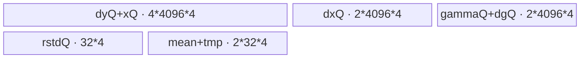

# RmsNormGrad A2/A3 ACLNN 算子知识

## 算子速览

| 项目 | 内容 |
|---|---|
| 实际入口 | `aclnnRmsNormGradGetWorkspaceSize` / `aclnnRmsNormGrad`，公开两段式 ACLNN；固定仓只有公开声明与 `ACLNNTYPE aclnn` 生成接线，inner bridge 属框架生成边界。 |
| 计算语义 | 将 `x,dy` 按 `gamma` 覆盖的尾轴折叠为 `[row,col]`；`dgamma[j]=sum_i(dy[i,j]*x[i,j]*rstd[i])`，`dx[i,j]=(dy[i,j]*gamma[j]-x[i,j]*rstd[i]*mean_i)*rstd[i]`，其中 `mean_i=sum_j(dy*gamma*x*rstd)/col`。 |
| 输入输出 | `dy/x/dx` 同 shape、同 dtype；`rstd` FP32；`gamma` 为 FP32 或与 `dy` 同 dtype；`dgamma` FP32；ND。A2/A3 binary config 公开五组 dtype 组合。 |
| 执行类型 | 单 Kernel `rms_norm_grad`，AIV_VECTOR；Host 使用 `GetCoreNumAiv()`，body 仅执行 Vector/标量/DMA/Atomic/全核同步路径，无 Cube/AIC/MIX_CV 节点。 |
| Kernel 路线 | R-001 split-N 非确定；R-002 split-N 确定；R-003 split-D 非确定；R-004 split-D 确定非分块；R-005 split-D 确定分块。 |
| 核心资源 | GM 输入输出；AIV UB 的双缓冲输入/`dx` Queue、FP32 中间区；非确定路径对 `dgamma` AtomicAdd；确定路径使用每核 FP32 workspace，分块路线另有每核 row-mean workspace。 |
| 来源闭包 | `source_closed`：公开 ACLNN 文档/生成接线→`RmsNormGrad` OpDef→`Tiling4RmsNormGrad`→POD→`rms_norm_grad` router→两个 high-precision body→公共同步/尾块 helper→A2/A3 binary/build config 已闭合。 |
| 验证状态 | 已完成源码闭包检查；本次知识提取未执行编译、真机、数值或性能测试。 |

## 接口与语义

### 计算语义

令 `gamma` 的元素数为 `col`，`x` 前导轴元素数为 `row`，则输入逻辑视为 `[row,col]`。每行先以 FP32 计算 `u=dy*gamma`、`v=x*rstd`、`mean=sum(u*v)/col`，再算 `dx=(u-v*mean)*rstd`；`dgamma` 是 `dy*x*rstd` 沿 row 轴的 FP32 和。FP16/BF16 输入在 UB 内升为 FP32，`dx` 最后降回输入 dtype；`dgamma` 始终 FP32。

### 输入、输出与属性

| 参数 | shape/layout | dtype | 约束、默认值与语义 |
|---|---|---|---|
| `dy` | 2–8 维 ND | FP16/BF16/FP32 | 与 `x`、`dxOut` shape/dtype 相同；公开 API 写支持空 Tensor，但 A2/A3 非 regbase Host 在 `row==0` 时返回失败，见限制。 |
| `x` | 同 `dy` | 同 `dy` | 被归一化输入。 |
| `rstd` | `x` 的前导轴；1–7 维 ND | FP32 | 元素数必须等于折叠后的 `row`。 |
| `gamma` | `x` 的尾轴；1–7 维 ND | FP32 或同 `dy` | 元素数为 `col`。 |
| `dxOut` | 同 `dy` | 同 `dy` | `x` 的梯度。 |
| `dgammaOut` | 同 `gamma` | FP32 | `gamma` 的梯度。 |
| `workspaceSize/executor` | 标量/句柄 | `uint64_t*` / `aclOpExecutor**` | 第一段返回；第二段必须原样携带 workspace、executor 与 stream。 |

### 入口与版本

固定 Commit 只公开一组 `aclnnRmsNormGrad` 两段式接口，无 V2/V3 版本；因此它是 A2/A3 的最新公开版本。OpDef 对 `ascend910b`、`ascend910_93` 注册五组 dtype，并以 `.AutoContiguous()` 声明四个输入的连续化边界。生成的 ACLNN inner bridge 不在仓中，算子拥有的 OpDef、Tiling、POD、Kernel 和构建接线均可见；没有把 forward、Quant 或其它 Grad 语义并入本卡。

## Host/Launcher 执行流程

### 参数校验与前处理

公开 ACLNN 第一段检查空指针、dtype、shape/layout，并由生成 executor 处理非连续输入。可见 Tiling 按顺序检查：`x` 维数 1–8、`gamma` 维数 1–8、`gamma.rank<=x.rank`、`dy.rank==x.rank`、`dx.rank==dy.rank`、`dgamma.rank==gamma.rank`；逐维检查 `dy==x==dx`，尾轴非零；`gamma/dgamma` 等于 `dy` 的尾部形状；`rstd` 对应前导形状（缺少的轴必须是 1）。随后折叠 `row=prod(x leading axes)`、`col=prod(gamma)`，并要求 `prod(rstd)==row`。`ASCEND910` 还要求 `col%64==0`，不影响本卡的 A2/A3 两个 config。

### 参数、Workspace 与生命周期

`colAlign=ceil_align(col,8)` 对 FP32，16 对 B16；`blockFactor=ceil(row/aivCoreNum)`，`blockDim=ceil(row/blockFactor)`。用户 workspace（`GetUserWorkspace` 后）与固定 16 MiB 系统区相加：

- 非确定：`user=8*blockDim*sizeof(float)=32*blockDim` bytes，用于同步/最小保留区；`dgamma` 先清零后由各核 AtomicAdd。
- 确定且不分块：`user=(colAlign+8)*blockDim*4` bytes；每核写一行局部 `dgamma`，全核同步后按固定 core 顺序归约。
- 确定且分块：`user=(chunkSize+8+blockFactor)*blockDim*4` bytes；前 `blockDim*chunkSize` 保存当前 chunk 的每核 `dgamma`，随后 `blockDim*blockFactor` 保存各核 row-mean。每个 chunk 完成确定性归约后清零并复用。

workspace 由 ACLNN 调用者持有到第二段执行完成；Device workspace slice 只在当前 Kernel 生命周期有效。stream/launch 由生成 executor 管理，固定仓未展开其 C++ bridge。

### 启动图与失败传播

单节点启动图：

```text
aclnnRmsNormGradGetWorkspaceSize
  -> generated executor / RmsNormGrad OpDef
  -> Tiling4RmsNormGrad(shape,dtype,platform,deterministic)
  -> one stream launch: rms_norm_grad<<<blockDim>>>(dy,x,rstd,gamma,dx,dgamma,workspace,tiling)
       -> key 1: RmsNormGradSplitNHighPrecision::Process
       -> key 2: RmsNormGradSplitDHighPrecision::Process
```

没有 Kernel 间 workspace 边。节点失败发生在 API 校验/Tiling；未知 key 在 router 中无 body、不会写输出。Kernel 内所有核共享同一 launch 的 `SyncAll`；非确定 AtomicAdd 的目标是 `dgammaOut`，确定路径的交接介质是用户 workspace。Tiling 失败阻止 launch，第二段返回由生成 executor 传播。

## Route 与参数设计

### 分核与资源计算

当 `col<=6080` 选 split-N：若 `colAlign<=640`，`bufferSize=floor((195584-10*colAlign)/(24*colAlign+268))*colAlign`，否则 6080；`ubFactor=min(bufferSize/colAlign,blockFactor)`，按 row tile。否则选 split-D：`ubFactor=4096`，每行按 col tile。末核用 `coreCalcTail`；tile 末尾分别用 `ubCalcTail` 或 `tailCol`。确定性 split-D 的 chunk 条件为：A2/A3 SoC、`blockDim*colAlign*4 > totalInputSize*0.05`、`totalInputSize>=500*1024*1024`；`chunkSize=floor(((0.05*totalInputSize-blockFactor*4)/(blockDim*4))/4096)*4096`，为 0 时取 4096。

### Route 选择

| 顺序 | Route | Key/模板 | 精确选择条件与优先级 | 不适用去向 |
|---:|---|---|---|---|
| 1 | R-001 split-N 非确定 | key 1 / `SplitNHighPrecision<T_DY,T_GAMMA>` | 非 regbase A2/A3，`row>0 && col<=6080 && fixed_output==0` | R-002 或 key 2 |
| 2 | R-002 split-N 确定 | key 1 / 同上 | `row>0 && col<=6080 && fixed_output==1`；key 1 强制 `need_chunk=0` | key 2 |
| 3 | R-003 split-D 非确定 | key 2 / `SplitDHighPrecision<T_DY,T_GAMMA>` | `row>0 && col>6080 && fixed_output==0` | R-004 |
| 4 | R-004 split-D 确定非分块 | key 2 / 同上 | `fixed_output==1` 且任一分块谓词不成立 | R-005 |
| 5 | R-005 split-D 确定分块 | key 2 / 同上 | `fixed_output==1 && currentWorkspace>0.05*totalInputSize && totalInputSize>=500MiB && isSoc910bc` | Tiling 失败 |

```text
shape/dtype/platform checks
  -> row==0: GRAPH_FAILED on A2/A3
  -> col<=6080: key=1
       -> deterministic ? R-002 : R-001
  -> col>6080: key=2
       -> nondeterministic: R-003
       -> deterministic and chunk predicate false: R-004
       -> deterministic and chunk predicate true: R-005
```

### 模板/实现执行矩阵

| Route | key/selector | dtype/shape/platform 完整命中条件 | 执行拓扑与 Kernel 节点 | 实际模板/body | 内存与同步特征 | tail/fallback |
|---|---|---|---|---|---|---|
| R-001 | 1 | A2/A3，合法 dtype，`0<col<=6080`，非确定 | 单 AIV node | `RmsNormGradSplitNHighPrecision<DTYPE_DY,DTYPE_GAMMA>` | row tile；局部 dgamma→GM AtomicAdd | former/tail core 与 UB tail |
| R-002 | 1 | 同上，确定 | 单 AIV node | 同上 + `FinalProcessDeterministic` | 每核 `colAlign` workspace；`SyncAll` 后按 64 列任务归约 | 尾列 mask/尾 DMA |
| R-003 | 2 | A2/A3，`col>6080`，非确定 | 单 AIV node | `RmsNormGradSplitDHighPrecision<...>` | 每行两阶段遍历 col；dgamma AtomicAdd | `tailCol` 与末核 row tail |
| R-004 | 2 | 同上，确定，`need_chunk=0` | 单 AIV node | 同上 + deterministic reducer | 每核整列 workspace；固定顺序归约 | 尾列回写 helper |
| R-005 | 2 | 同上，确定，`need_chunk=1` | 单 AIV node | `ProcessWithChunk` | chunk dgamma workspace + row mean workspace；每 chunk 多次 `SyncAll` | `chunkTail`、`tailColChunk` |

### 隐藏性能 Guard

| Guard | Host/Tiling 条件 | Device/资源原因 | 影响 Route | 不满足时去向 | 源码符号 |
|---|---|---|---|---|---|
| split-N UB | `col<=6080` | full row tile 的 UB 模板上界 | R-001/002 | key 2 | `Tiling4RmsNormGrad` |
| small-D | `colAlign<=640` | 由实际 Queue/TBuf 权重反算更大的 row tile | R-001/002 | 仍 key 1、使用 6080 | `CalcSmallDBufferSize` |
| chunk | 上述四项合取 | 限制确定性 per-core 列 workspace，并保存 row mean 供第二阶段 | R-005 | R-004 | `SetChunkWorkspace` |
| DMA tail | `calcLen%alignLen!=0` | GM 搬运以 32 B 对齐，尾部由标量/cache flush 或 `DataCopyPad` 保护 | 全部 | 同 Route tail helper | `CopyTailDataToGm`、`DataCopyCustom` |
| 空域 | A2/A3 `row==0` | 非 regbase path 明确拒绝 empty | 全部 | `GRAPH_FAILED` | `Tiling4RmsNormGrad` |

### POD/ABI

`RmsNormGradTilingData` 由 `BEGIN_TILING_DATA_DEF` 宏生成；固定仓未展开 `sizeof/alignof/offsetof`，以下 ABI 布局均为“宏声明顺序，精确 offset 不可见”。

| 结构 | 字段 | 类型/位宽 | ABI 布局 | 单位 | Host/launcher producer | Device consumer | 边界 |
|---|---|---|---|---|---|---|---|
| `RmsNormGradTilingData` | `row` | u32 | 顺序 0 | element/row | `UpdateShapeInfo` | 两 body 的行循环 | shape 乘积窄化为 u32 |
| 同上 | `col` | u32 | 顺序 1 | element/col | `UpdateShapeInfo` | 地址/归约长度 | 非零 |
| 同上 | `avg_factor` | f32 | 顺序 2 | scalar | `1.0f/col` | mean scale | FP32 |
| 同上 | `data_type` | u32 | 顺序 3 | enum 0/1/2 | dtype key-1 | align/cast | FP32/FP16/BF16 |
| 同上 | `block_factor` | u32 | 顺序 4 | row/core | `LargeN*` | core base、workspace row slice | ceil div |
| 同上 | `ub_split_dim` | u32 | 顺序 5 | enum | 0 split-N / 1 split-D | 诊断字段；body 由 key 决定 | 不跨 key 读取 |
| 同上 | `ub_factor` | u32 | 顺序 6 | row 或 col element | `LargeN*` | tile loop/UB | key-dependent unit |
| 同上 | `core_calc_num` | u32 | 顺序 7 | row | `LargeN*` | split-N | 主核 |
| 同上 | `core_calc_tail` | u32 | 顺序 8 | row | `LargeN*` | 两 body | 0 表示无特殊尾核 |
| 同上 | `block_dim` | u32 | 顺序 9 | AIV core | `SetBlockDim` 同值 | workspace/sync | `<=GetCoreNumAiv()` |
| 同上 | `ub_calc_num` | u32 | 顺序 10 | row/col | `LargeN*` | split-N loop | key 2 不使用 |
| 同上 | `ub_calc_tail` | u32 | 顺序 11 | row/col | `LargeN*` | split-N tail | 0 可不读 tail |
| 同上 | `ub_calc_loop` | u32 | 顺序 12 | loop | `LargeN*` | split-N | ceil div |
| 同上 | `ub_calc_tail_num` | u32 | 顺序 13 | row | `LargeN*` | split-N last core | 无尾核时 0 |
| 同上 | `ub_calc_tail_tail` | u32 | 顺序 14 | row | `LargeN*` | split-N last tile | 无尾核时 0 |
| 同上 | `ub_calc_tail_loop` | u32 | 顺序 15 | loop | `LargeN*` | split-N last core | 无尾核时 0 |
| 同上 | `fixed_output` | u32 | 顺序 16 | bool | `context->GetDeterministic()==1` | Atomic vs workspace reducer | 0/1 |
| 同上 | `chunk_size` | u32 | 顺序 17 | col element | `SetChunkWorkspace` | split-D chunk | 未分块=`colAlign` |
| 同上 | `chunk_num` | u32 | 顺序 18 | chunk | 同上 | `ProcessWithChunk` | 未分块=1 |
| 同上 | `chunk_tail` | u32 | 顺序 19 | col element | 同上 | last chunk | 未分块=0 |
| 同上 | `need_chunk` | u32 | 顺序 20 | bool | 同上 | split-D router in body | 0/1 |

### Route 源码闭包

| Route | Key/selector | Host/Tiling producer | POD/参数 | Kernel entry/router 节点 | Kernel body/直接依赖 | 构建接线 |
|---|---|---|---|---|---|---|
| R-001/002 | key 1 | `rms_norm_grad_tiling.cpp::Tiling4RmsNormGrad` | `RmsNormGradTilingData` | `rms_norm_grad.cpp::rms_norm_grad` | `RmsNormGradSplitNHighPrecision` + `rms_norm_grad_common.h` | A2/A3 binary JSON + `ascendc_config.json` |
| R-003/004/005 | key 2 | 同上 + `SetChunkWorkspace` | 同 POD | 同 entry | `RmsNormGradSplitDHighPrecision` + common helper | 同上 |

## Kernel 实现

### 公共执行流程

两类 body 都按 `GetBlockIdx()*blockFactor` 绑定行区间，GM→Queue 搬入 `dy/x/rstd/gamma`，在 FP32 UB 中形成 `dy*x*rstd`（供 dgamma）与 `dy*gamma*x*rstd` 的行和（供 dx），再将 dx cast 并写 GM。非确定路径将每核局部 dgamma AtomicAdd 到已清零输出；确定路径先写 workspace，`SyncAll` 后用 `FinalProcessDeterministic` 按固定 core 次序做 64 列小块归约。所有 Route 是同一 Kernel launch；Queue 的 EnQue/DeQue/FreeTensor 与显式 pipe event 保证 UB 生命周期。

### Route R-001：split-N 非确定

#### 适用条件

##### 选择证据

| 层级 | 文件 | 符号 | 源码谓词/参数 | 结果/下一跳 |
|---|---|---|---|---|
| Tiling | `op_host/rms_norm_grad_tiling.cpp` | `Tiling4RmsNormGrad` | `col_val<=6080` | key 1 |
| POD | 同上 | `SetTilingDataAndWorkspace` | `fixed_output=0` | 最小 user workspace |
| Router | `op_kernel/rms_norm_grad.cpp` | `rms_norm_grad` | `TILING_KEY_IS(1)` | `SplitNHighPrecision` |

#### Device 数据流

##### 函数级调用链

```text
rms_norm_grad(key=1) -> Init -> CopyGammaIn -> Process
  -> SubProcess -> CopyIn(row tile) -> Compute/ComputeSmallD -> CopyOut(dx)
  -> CopyDgammaOut(SetAtomicAdd)
```

##### 源码等价伪码

```text
core_rows = main ? blockFactor : coreCalcTail
gamma_fp32 = load_and_cast(gamma)
dg_local = 0
for row_tile in core_rows:
  load rstd, x, dy
  for row: v=x*rstd; p=dy*v; dg_local+=p; mean=sum(p*gamma)/col
           dx=(dy*gamma-v*mean)*rstd; store valid col
atomic_add dgamma[0:col] += dg_local
```

#### 内存与数据搬运

##### 资源与搬运表

| 层级/缓冲区 | offset/地址公式 | extent/容量公式 | dtype/layout | producer | consumer | owner/lifetime | 对齐/复用 |
|---|---|---|---|---|---|---|---|
| GM row slice | `core*blockFactor*col` | `coreRows*col` | input dtype/ND | Host tensors | body | caller | row tail |
| `inQueDY/inQueX` | UB | each `2*bufferLenSize` | physical FP32-sized | CopyIn | Compute | TPipe | depth 2 |
| `inQueRstd` | UB | `2*rstdLen*4` | FP32 | CopyIn | Compute | TPipe | aligned |
| `inQueGamma/outQueDgamma` | UB | each `colAlign*4` | FP32 | load/compute | compute/GM | TPipe | depth 1 |
| `outQueDX` | UB | `2*bufferLenSize` | output dtype in FP32-sized allocation | Compute | CopyOut | TPipe | depth 2 |

##### 分层内存布局


##### 字节账与复用顺序

```text
bufferLenSize=max(ubFactor*colAlign, blockDim*64)*4
UB_total=4*bufferLenSize + 2*rstdLen*4 + 2*bufferLenSize + 2*colAlign*4
         + [colAlign<=640 ? (ubFactor*64*4 + ubFactor*4) : 0]
workspace_total=16MiB + 32*blockDim
```

| 复用子区 | 写入者 | 读取者/消费点 | 下一次覆盖 | 同步或释放依据 | 安全条件 |
|---|---|---|---|---|---|
| input Queue slots | `CopyIn` | `Compute` | next row tile | DeQue/FreeTensor | depth 2 |
| `xLocal` | CopyIn→cast | `Muls/Mul` | FreeTensor 后 | `PIPE_V` barriers | FP32 promotion first |
| `dgammaLocal` | per-row Add | final Atomic DMA | launch end | EnQue/DeQue | only valid `col` copied |

#### 同步、精度与尾块

##### 同步与数值边界表

| 阶段 | primitive/机制 | producer | consumer/等待点 | 保护对象 | 精度/尾块 |
|---|---|---|---|---|---|
| Queue | EnQue/DeQue | DMA | Vector | UB slots | aligned padding excluded by valid length |
| scalar rstd | V_S/S_V event | vector/Scalar | next Vector | scalar read | FP32 |
| dgamma | `SetAtomicAdd<float>` | each core | GM | FP32 output | core order nondeterministic |
| dx tail | `DataCopyPad` or scalar tail helper | Vector | GM | last <32 B | only valid elements |

#### 关键实现

##### 符号证据表

| 阶段 | 文件 | 符号/模板实例 | 实现事实 |
|---|---|---|---|
| Host/Tiling producer | `op_host/rms_norm_grad_tiling.cpp` | `LargeNSmallD` | row/core/UB tile |
| Kernel entry/router | `op_kernel/rms_norm_grad.cpp` | key 1 | 模板映射 |
| Device body/helper | `op_kernel/rms_norm_grad_split_n_high_precision.h` | `Process/Compute/CopyDgammaOut` | FP32 math、Atomic、tail |

### Route R-002：split-N 确定

#### 适用条件

##### 选择证据

| 层级 | 文件 | 符号 | 源码谓词/参数 | 结果/下一跳 |
|---|---|---|---|---|
| Host | `rms_norm_grad_tiling.cpp` | `SetChunkWorkspace` | key 1 或 workspace guard | `need_chunk=0` |
| POD | 同上 | `SetTilingDataAndWorkspace` | deterministic=1 | per-core workspace |
| Body | split-N header | `Process` | `isDeterministic_==1` | workspace+fixed reduce |

#### Device 数据流

##### 函数级调用链

```text
same split-N compute -> CopyDgammaOutWorkspace
  -> SyncAll -> FinalProcessDeterministic(dCopyIn,dCompute,dCopyOut)
```

##### 源码等价伪码

```text
compute dx and per-core dg exactly as R-001
workspace[core,0:col] = dg
sync_all
each core owns strided 64-column tasks:
  load all blockDim rows -> ordered vector Add -> write dgamma task
```

#### 内存与数据搬运

##### 资源与搬运表

| 层级/缓冲区 | offset/地址公式 | extent/容量公式 | dtype/layout | producer | consumer | owner/lifetime | 对齐/复用 |
|---|---|---|---|---|---|---|---|
| UB | 同 R-001 | 同 R-001 | 同上 | body | body | TPipe | 同上 |
| workspace dgamma | `core*colAlign` | `blockDim*colAlign` FP32 | `[core,col]` | each core | deterministic reducer | caller | launch 内有效 |
| reducer buffers | reuse `inQueX/inQueDY` | each one Queue slot | FP32 | dCopyIn | dCompute/dCopyOut | TPipe | compute completed后复用 |

##### 分层内存布局


##### 字节账与复用顺序

```text
UB_total = R-001 UB_total
workspace_total = 16MiB + (colAlign+8)*blockDim*4
```

| 复用子区 | 写入者 | 读取者/消费点 | 下一次覆盖 | 同步或释放依据 | 安全条件 |
|---|---|---|---|---|---|
| X/DY Queue slot | main compute | deterministic buffers | reducer | main tensors freed + SyncAll | main loop complete |
| workspace row | core | fixed reducer | launch end | SyncAll | every core wrote once |

#### 同步、精度与尾块

##### 同步与数值边界表

| 阶段 | primitive/机制 | producer | consumer/等待点 | 保护对象 | 精度/尾块 |
|---|---|---|---|---|---|
| cross-core | `SyncAll` | all local dg rows | fixed reducer | workspace | deterministic core order |
| reducer | V/MTE events | workspace DMA | vector Add/DMA | 64-col task | last task uses `colSize` |
| math | FP32 Add | block rows | dgamma | reduction | no Atomic ordering variance |

#### 关键实现

##### 符号证据表

| 阶段 | 文件 | 符号/模板实例 | 实现事实 |
|---|---|---|---|
| Host/Tiling producer | tiling cpp | `SetTilingDataAndWorkspace` | workspace formula |
| Kernel entry/router | kernel cpp | key 1 | split-N |
| Device body/helper | split-N/common headers | `CopyDgammaOutWorkspace` / `FinalProcessDeterministic` | fixed reduction |

### Route R-003：split-D 非确定

#### 适用条件

##### 选择证据

| 层级 | 文件 | 符号 | 源码谓词/参数 | 结果/下一跳 |
|---|---|---|---|---|
| Tiling | tiling cpp | `Tiling4RmsNormGrad` | `col>6080` | key 2, `ubFactor=4096` |
| POD | 同上 | workspace producer | fixed=0 | no chunk |
| Router | kernel cpp | key 2 | true | split-D body |

#### Device 数据流

##### 函数级调用链

```text
rms_norm_grad(key=2) -> SplitD::ProcessMain
  -> SubProcess -> calcBeforeLoop(ComputeFormer + Atomic dgamma)
  -> scale mean -> calcAfterLoop(ComputeLatter + CopyDxOut)
```

##### 源码等价伪码

```text
for row group of 32:
  mean[row]=0
  for col tile: dg_tile+=dy*x*rstd; mean[row]+=sum(dg_tile*gamma)
                atomic_add dgamma[col_tile]+=dg_tile
  mean*=1/col
  for col tile: dx=(dy*gamma-x*rstd*mean)*rstd; store valid tail
```

#### 内存与数据搬运

##### 资源与搬运表

| 层级/缓冲区 | offset/地址公式 | extent/容量公式 | dtype/layout | producer | consumer | owner/lifetime | 对齐/复用 |
|---|---|---|---|---|---|---|---|
| dy/x/dx Queue | `row*col+tile` | each `2*4096*4` | promoted FP32-sized | DMA/compute | Vector/DMA | TPipe | depth 2 |
| gamma/dgamma Queue | tile | each `4096*4` | FP32-sized | DMA/compute | Vector/Atomic | TPipe | depth 1 |
| mean buffers | row group | each `32*4` | FP32 | reduce | latter pass | TPipe | two TBuf |

##### 分层内存布局



##### 字节账与复用顺序

```text
UB_total = (2+2+2+1+1)*4096*4 + (1+1+1)*32*4 = 131456 bytes
workspace_total = 16MiB + 32*blockDim
```

| 复用子区 | 写入者 | 读取者/消费点 | 下一次覆盖 | 同步或释放依据 | 安全条件 |
|---|---|---|---|---|---|
| meanBuf | before pass | after pass | next row group | PIPE_V | all col tiles accumulated |
| Queue slots | DMA/Vector | Vector/DMA | next tile | Queue protocol | depth 2 for streams |

#### 同步、精度与尾块

##### 同步与数值边界表

| 阶段 | primitive/机制 | producer | consumer/等待点 | 保护对象 | 精度/尾块 |
|---|---|---|---|---|---|
| dgamma | AtomicAdd | row group/core | GM | tile | non-deterministic order |
| mean scalar | V_S/S_V | reduce | latter pass | mean | FP32 |
| tail | `calcCol=min(4096,remain)` | DMA/Vector | GM | final col tile | UpdateMask/valid bytes |

#### 关键实现

##### 符号证据表

| 阶段 | 文件 | 符号/模板实例 | 实现事实 |
|---|---|---|---|
| Host/Tiling producer | tiling cpp | `LargeNLargeD` | key2 tile/core |
| Kernel entry/router | kernel cpp | key 2 | split-D |
| Device body/helper | split-D header | `loopColProcessBeforeReduce/AfterReduce` | two-pass dx/dgamma |

### Route R-004：split-D 确定非分块

#### 适用条件

##### 选择证据

| 层级 | 文件 | 符号 | 源码谓词/参数 | 结果/下一跳 |
|---|---|---|---|---|
| Host | tiling cpp | `SetChunkWorkspace` | any early-return guard | `need_chunk=0` |
| Body | split-D header | `ProcessMain` | deterministic | workspace local dg |
| Helper | common header | `FinalProcessDeterministic` | full col | fixed reducer |

#### Device 数据流

##### 函数级调用链

```text
same two-pass split-D compute
  -> CopyDgammaOutCommon(workspace)
  -> SyncAll -> FinalProcessDeterministic(full col)
```

##### 源码等价伪码

```text
for each core: compute dx and write local dg to workspace[core,:]
sync_all
partition columns into 64-element tasks; sum workspace rows in core order; write dgamma
```

#### 内存与数据搬运

##### 资源与搬运表

| 层级/缓冲区 | offset/地址公式 | extent/容量公式 | dtype/layout | producer | consumer | owner/lifetime | 对齐/复用 |
|---|---|---|---|---|---|---|---|
| UB | 同 R-003 | 131456 B | FP32-sized | body | body | TPipe | same |
| workspace | `core*colAlign` | `blockDim*colAlign*4` | FP32 `[core,col]` | core | fixed reducer | caller | sync protected |

##### 分层内存布局


##### 字节账与复用顺序

```text
UB_total=131456 bytes
workspace_total=16MiB+(colAlign+8)*blockDim*4
```

| 复用子区 | 写入者 | 读取者/消费点 | 下一次覆盖 | 同步或释放依据 | 安全条件 |
|---|---|---|---|---|---|
| workspace row | core | reducer | launch end | SyncAll | need_chunk=0 |

#### 同步、精度与尾块

##### 同步与数值边界表

| 阶段 | primitive/机制 | producer | consumer/等待点 | 保护对象 | 精度/尾块 |
|---|---|---|---|---|---|
| workspace | SyncAll | all cores | fixed reducer | all rows | FP32 ordered Add |
| dx | Queue/pipe | compute | GM | tail tile | cast then valid tail |

#### 关键实现

##### 符号证据表

| 阶段 | 文件 | 符号/模板实例 | 实现事实 |
|---|---|---|---|
| Host/Tiling producer | tiling cpp | `SetChunkWorkspace` | nonchunk formula |
| Kernel entry/router | kernel cpp | key2 | split-D |
| Device body/helper | split-D/common | `ProcessMain` / `FinalProcessDeterministic` | fixed output |

### Route R-005：split-D 确定分块

#### 适用条件

##### 选择证据

| 层级 | 文件 | 符号 | 源码谓词/参数 | 结果/下一跳 |
|---|---|---|---|---|
| Host | tiling cpp | `SetChunkWorkspace` | all chunk predicates true | aligned `chunkSize`, `need_chunk=1` |
| Body | split-D header | `Process` | `isDeterministic_&&needChunk_` | `ProcessWithChunk` |
| Helper | common header | `InitWorkspaceBuffers` | needChunk | two workspace regions |

#### Device 数据流

##### 函数级调用链

```text
ProcessWithChunk
  -> per chunk ProcessChunkPart1(ComputeFormer, local dg, row mean atomic workspace)
  -> FinalProcessDeterministic(chunk) -> clear dg workspace
  -> after all chunks ProcessChunkPart2(load complete mean, ComputeLatter, dx)
```

##### 源码等价伪码

```text
for chunk:
  compute partial mean and per-core dgamma(chunk)
  atomic_add rowMeanWorkspace += partial mean
  sync; fixed-reduce dgamma chunk; sync; clear reusable dg workspace; sync
for all columns:
  load complete row mean / col, recompute x,dy,gamma and emit dx
```

#### 内存与数据搬运

##### 资源与搬运表

| 层级/缓冲区 | offset/地址公式 | extent/容量公式 | dtype/layout | producer | consumer | owner/lifetime | 对齐/复用 |
|---|---|---|---|---|---|---|---|
| UB | 同 R-003 | 131456 B | FP32-sized | body | body | TPipe | per chunk reused |
| chunk dg workspace | `core*chunkSize` | `blockDim*chunkSize*4` | FP32 | Part1 | fixed reducer | caller | cleared each chunk |
| mean workspace | `blockDim*chunkSize + core*blockFactor` | `blockDim*blockFactor*4` | FP32 row | partial chunks | Part2 | caller | AtomicAdd then load |

##### 分层内存布局


##### 字节账与复用顺序

```text
UB_total=131456 bytes
workspace_total=16MiB+(chunkSize+8+blockFactor)*blockDim*4
```

| 复用子区 | 写入者 | 读取者/消费点 | 下一次覆盖 | 同步或释放依据 | 安全条件 |
|---|---|---|---|---|---|
| chunk dg slice | Part1 | deterministic reducer | zero/init next chunk | SyncAll→InitOutput→SyncAll | reducer completed |
| mean slice | each chunk AtomicAdd | Part2 | launch end | SyncAll events in chunk loop | all chunks contributed |

#### 同步、精度与尾块

##### 同步与数值边界表

| 阶段 | primitive/机制 | producer | consumer/等待点 | 保护对象 | 精度/尾块 |
|---|---|---|---|---|---|
| partial mean | AtomicAdd+MTE3_V event | each chunk/core | Part2 | row mean | FP32; chunk order fixed by loop |
| chunk dg | SyncAll | all core rows | reducer/clear | workspace | `chunkTail` valid length |
| final dx | two-phase traversal | complete mean | CopyDxOut | dx | valid `tailColChunk`/tail DMA |

#### 关键实现

##### 符号证据表

| 阶段 | 文件 | 符号/模板实例 | 实现事实 |
|---|---|---|---|
| Host/Tiling producer | tiling cpp | `SetChunkWorkspace` | chunk guard/formula |
| Kernel entry/router | kernel cpp | key2 | split-D |
| Device body/helper | split-D/common | `ProcessWithChunk` / `CopyMeanOutChunkCommon` | chunk lifecycle |

## 算子特定优化

### Trick T-001：按确定性 workspace 压力切分列 chunk

#### 触发与源码依据

- 适用 Route：R-005。
- 触发条件：key 2、确定性、A2/A3，整列 workspace 大于输入估算的 5%，且输入估算至少 500 MiB。
- Golden 来源：[`norm/rms_norm_grad/op_host/rms_norm_grad_tiling.cpp:370-392`](../../../../../../../cann-ops-raw/ascendc/ops-nn/955f8b33985b6d72989ebff341bb9c2c564a51bc/norm/rms_norm_grad/op_host/rms_norm_grad_tiling.cpp#L370-L392)

**官方源码（固定 Commit 连续逐字摘录）**：

```cpp
if (currentWorkspace <= WORKSPACE_ENABLE || totalInputSize < WORKSPACE_LIMIT || tiling_key == 1 || !isSoc910bc) {
    tiling.set_need_chunk(0);
    tiling.set_chunk_size(col_val_align);
    tiling.set_chunk_num(1);
    tiling.set_chunk_tail(0);
} else {
    tiling.set_need_chunk(1);
    uint32_t chunk_size = (WORKSPACE_ENABLE - block_factor * 4) / (blockDim * sizeof_float);
    chunk_size = (chunk_size / ALIGN_4096) * ALIGN_4096;
```

#### 机制与设计原因

整列确定性归约原本物化 `[blockDim,colAlign]`。该 Route 将它缩成 `[blockDim,chunkSize]`，并用额外 `[blockDim,blockFactor]` 保存跨 chunk 的 row mean；每个 chunk 固定归约后立即清零复用。4096 元素对齐与 split-D 的 `ubFactor=4096` 一致，避免产生额外主 tile 形态；源码可证明减少峰值 GM workspace，但没有真机收益数据。

#### 迁移边界

- 适用：确定性、超大输入、沿归一化轴分块且后续 dx 需要完整 mean 的 AIV 算子。
- 前提：每 chunk 可独立形成参数梯度；存在跨核同步；有额外 row-mean slice。
- 失效：key 1、小输入、workspace 未越阈值或非 A2/A3 时使用 R-002/R-004。
- 未验证：本次知识提取未执行编译、真机、数值或性能测试。

#### 错误做法

固定仓的可验证反例是只缩短 dgamma workspace 而不保存跨 chunk mean：`dx` 第二阶段会缺少其它 chunk 的 `sum(dy*gamma*x*rstd)`；官方实现以 `workspaceBlockFactorGm_` 明确避免该错误。

### Trick T-002：非确定 Atomic 与确定性固定次序归约共用主计算

#### 触发与源码依据

- 适用 Route：R-001–R-005。
- 触发条件：`fixed_output` 在同一 key/body 内选择输出协议。
- Golden 来源：[`norm/rms_norm_grad/op_kernel/rms_norm_grad_split_n_high_precision.h:183-197`](../../../../../../../cann-ops-raw/ascendc/ops-nn/955f8b33985b6d72989ebff341bb9c2c564a51bc/norm/rms_norm_grad/op_kernel/rms_norm_grad_split_n_high_precision.h#L183-L197)

**官方源码（固定 Commit 连续逐字摘录）**：

```cpp
if (isDeterministic_ == 1) {
    CopyDgammaOutWorkspace();
#if defined(__CCE_AICORE__) && (__CCE_AICORE__ == 200)
    LocalTensor<int32_t> workLocal = syncTmpBuf_.Get<int32_t>();
    SyncAll(syncTmpSpaceGm_, workLocal);
    AddDgamma();
#else
    SyncAll();
    doDeter();
#endif
} else {
    CopyDgammaOut();
}
```

#### 机制与设计原因

dx 和每核局部 dgamma 的 FP32 主计算完全复用；只在提交阶段选择 AtomicAdd 或 workspace→`SyncAll`→固定列任务归约。这样确定性成本不污染默认路线，同时保证开启确定性时 core 的加法顺序由 workspace 行序固定。

#### 迁移边界

- 适用：输出含跨核 reduction、而主体逐核计算相同的 AIV kernel。
- 前提：非确定输出已清零；确定 workspace 足够；所有核参与同步。
- 失效：无法提供全核同步或固定 workspace 行布局时不能直接迁移。
- 未验证：本次知识提取未执行编译、真机、数值或性能测试。

#### 错误做法

固定仓的真实错误边界是确定模式仍调用 `CopyDgammaOut()`：它启用 `SetAtomicAdd<float>()`，加法顺序不固定，违背 `fixed_output` 语义。

## 模板与实现对比

| 对比维度 | R-001/002 split-N | R-003/004 split-D | R-005 chunk | 设计选择依据 |
|---|---|---|---|---|
| 命中条件/优先级 | `col<=6080` | `col>6080` | key2+确定+workspace guard | UB 是否容纳完整 D |
| 模板与 dtype | `SplitNHighPrecision<T_DY,T_GAMMA>` | `SplitDHighPrecision<...>` | 同 split-D | 五组 config 实例化 |
| 循环与分核 | core/UB 都切 row | core 切 row、UB 切 col | col 再切 chunk | 控制 UB/workspace |
| Queue/TBuf | 动态 row tile；small-D 临时区 | 固定 4096 col tile，131456 B | 同 split-D | Host/InitBuffer 一致 |
| 内存总占用与复用 | dg local；确定时全列 ws | dg tile；确定时全列 ws | chunk ws + mean ws 循环复用 | 输出协议不同 |
| 搬运/Vector API | 多行或逐行，ReduceSum | 两遍 col tile | chunk Part1 + 全列 Part2 | mean 依赖全 D |
| 同步、精度与 tail | Atomic 或 SyncAll；FP32 | 同；尾 col helper | 每 chunk SyncAll/clear | fixed_output/need_chunk |
| fallback/失败边界 | key2 | 无更低实现 | Host 阈值回 R-004 | empty/校验失败终止 |

## 平台差异

| 项目 | A2 | A3 | 950 |
|---|---|---|---|
| 支持状态 | 支持 | 支持 | 见独立 `_950` 卡 |
| Host/Launcher | 非 regbase key 1/2；`ascend910b` binary config | 非 regbase key 1/2；`ascend910_93` binary config | regbase key 7000–9010 |
| Kernel/资源 | high-precision AIV body、确定性可 chunk | 同源码 body/config；平台资源数来自 `GetCoreNumAiv` | arch35 MicroAPI body |

## 限制与失败边界

- 公开 ACLNN 文档写 `dy/x/rstd/gamma` 支持空 Tensor；但固定 Host 对非 regbase A2/A3 在 `row==0` 明确返回 `GRAPH_FAILED`。本卡不推测运行库是否在 Tiling 前短路空输出，复用时应按源码冲突处理。
- `row/col/rstd_shape` 由 shape 乘积写入 `uint32_t`，源码没有显式溢出检查；`totalInputSize` 的部分乘法也由 u32 操作数开始。超大 shape 的窄化边界固定仓未补充。
- public API 规定 `dy/x` 2–8 维而 Tiling 最低接受 1 维；正式调用应遵循更严格的公开接口。
- unknown key 没有 else 错误写回；必须保持 Host key 1/2 与 router 同步。
- 本次知识提取未执行编译、真机、数值或性能测试。

## 源码索引

### 链路索引

| 链路阶段 | 文件 | 关键符号 | 支撑内容 |
|---|---|---|---|
| 入口声明/约束 | `norm/rms_norm_grad/docs/aclnnRmsNormGrad.md` | ACLNN prototypes | API/平台/dtype/shape |
| 入口实现 | `norm/rms_norm_grad/op_host/rms_norm_grad_def.cpp` | `ops::RmsNormGrad` | OpDef/AutoContiguous/platform config |
| Host/Tiling/Launcher | `norm/rms_norm_grad/op_host/rms_norm_grad_tiling.h` | `RmsNormGradTilingData` | POD ABI |
| Host/Tiling/Launcher | `norm/rms_norm_grad/op_host/rms_norm_grad_tiling.cpp` | `Tiling4RmsNormGrad` | 校验/route/workspace |
| Kernel entry/body | `norm/rms_norm_grad/op_kernel/rms_norm_grad.cpp` | `rms_norm_grad` | key router/launch wrapper |
| Kernel entry/body | `norm/rms_norm_grad/op_kernel/rms_norm_grad_common.h` | deterministic/tail helpers | 同步、workspace、tail |
| Kernel entry/body | `norm/rms_norm_grad/op_kernel/reduce_common.h` | reduction helpers | FP32 reduction |
| Kernel entry/body | `norm/rms_norm_grad/op_kernel/rms_norm_grad_split_n_high_precision.h` | split-N class | key1 body |
| Kernel entry/body | `norm/rms_norm_grad/op_kernel/rms_norm_grad_split_d_high_precision.h` | split-D class | key2 body/chunk |
| 构建接线 | `norm/rms_norm_grad/op_host/config/ascend910b/rms_norm_grad_binary.json` | five `op_list` entries | A2 binaries/dtype |
| 构建接线 | `norm/rms_norm_grad/op_host/config/ascend910_93/rms_norm_grad_binary.json` | five entries | A3 binaries/dtype |
| 构建接线 | `scripts/kernel/binary_config/ascendc_config.json` | `RmsNormGrad` | compute units/auto_sync=false |

### 实现复用检查

| 检查项 | 可复用事实 | 不得改变的约束 | 源码符号 |
|---|---|---|---|
| ABI/POD | 21 字段 producer/consumer | 字段顺序、key-dependent unit、u32 窄化 | `RmsNormGradTilingData` |
| 调用顺序 | compute local dg/dx 后选择输出协议 | 确定路径必须先写 workspace 再 SyncAll | `Process` |
| workspace/内存 | non-det/full/chunk 三个公式 | slice offset、4-byte FP32、16 MiB system 区 | `SetTilingDataAndWorkspace` |
| 同步 | Queue、pipe event、Atomic、SyncAll | workspace 未全写完不得归约/清零 | common helpers |
| 精度与尾块 | B16→FP32、FP32 reduce、dx cast | BF16 `CAST_RINT`、valid tail bytes | `CastAndPrepareDxOutput` |
| 失败边界 | validation→key1/2→router | empty 冲突、unknown key、shape 窄化 | `Tiling4RmsNormGrad` |
