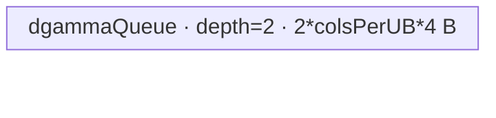

# RmsNormGrad 950 ACLNN 算子知识

## 算子速览

| 项目 | 内容 |
|---|---|
| 实际入口 | `aclnnRmsNormGradGetWorkspaceSize` / `aclnnRmsNormGrad`，固定仓最新且唯一公开版本；ACLNN inner bridge 是框架生成边界。 |
| 计算语义 | 折叠为 `[rows,cols]` 后，`dgamma[j]=sum_i(dy*x*rstd)`；`dx=(dy*gamma-x*rstd*mean(dy*gamma*x*rstd))*rstd`。空 rows Route 将 `dgamma` 写 quiet NaN。 |
| 输入输出 | `dy/x/dx` 同 shape/dtype（FP16/BF16/FP32），`rstd/dgamma` FP32，`gamma` FP32 或同 `dy`，ND；Ascend 950 config 有五组 dtype。 |
| 执行类型 | 单 Kernel `rms_norm_grad`，entry 显式 `KERNEL_TYPE_AIV_ONLY`；所有可达节点为 AIV_VECTOR，无 Cube/AIC/MIX_CV。 |
| Kernel 路线 | R-001 Empty 8000；R-002/003/004/005 常规 7000/7001/7010/7011；R-006/007 Big-M 9000/9010。 |
| 核心资源 | GM、AIV UB Queue/TBuf/RegTensor；常规仅 16 MiB system workspace；Big-M 使用 `[dgammaCore,cols]` FP32 workspace；`SyncAll` 保护跨核归约。 |
| 来源闭包 | `source_closed`：公开 API/OpDef→arch35 selector→Empty/Big-M/常规 Tiling→POD→AIV-only router→dx/dgamma/empty body→binary/config 已闭合。 |
| 验证状态 | 已完成源码闭包检查；本次知识提取未执行编译、真机、数值或性能测试。 |

## 接口与语义

### 计算语义

设 `cols=prod(gamma.shape)`，`rows=prod(x.shape[0:x.rank-gamma.rank])`。非空路线以 FP32 计算 `q=x*rstd`、`p=dy*gamma`、`mean=sum(p*q)/cols`、`dx=(p-q*mean)*rstd`、`dgamma=sum_rows(dy*x*rstd)`。Big-M 只改变 dgamma 的 M 轴切核和两阶段 reduction。若 `rows==0`，没有 dx 元素，key 8000 把 dgamma 写为 FP32 quiet NaN。

### 输入、输出与属性

| 参数 | shape/layout | dtype | 约束、默认值与语义 |
|---|---|---|---|
| `dy` | 2–8 维 ND | FP16/BF16/FP32 | 可为空；与 `x/dxOut` shape/dtype 相同。 |
| `x` | 同 `dy` | 同 `dy` | 被归一化输入。 |
| `rstd` | 前导轴，1–7 维 ND | FP32 | 元素数为 `rows`。 |
| `gamma` | 尾轴，1–7 维 ND | FP32 或同 `dy` | 元素数为 `cols`。 |
| `dxOut` | 同 `dy` | 同 `dy` | x 梯度。 |
| `dgammaOut` | 同 `gamma` | FP32 | gamma 梯度；空 rows 时 NaN。 |
| `workspaceSize/executor` | scalar/handle | u64 pointer/executor | 第一段产生，第二段连同 stream 使用。 |

### 入口与版本

公开文档明确支持 Ascend 950PR/950DT。OpDef 的 `ascend950` config 设置 `opFile.value=rms_norm_grad_apt`，binary JSON 和全局 config 同时接线 Ascend 950。固定仓无 V2/V3 接口；本卡不含 forward 或 Quant 变体。

## Host/Launcher 执行流程

### 参数校验与前处理

OpDef 对四输入启用 `.AutoContiguous()`。公共 Tiling 检查 rank、ND、`dy==x==dx`、`gamma==dgamma==x` 尾部 shape 和 rstd 前导轴关系，折叠 rows/cols。950 的 NPU arch 命中 `DAV_3510/DAV_5102` 后进入 regbase：rows 为 0 直接走 Empty；非空进入优先级模板。常规模板再次验证 ND、`dy/x` 同 dtype、`rstd=FP32`、`gamma=FP32或dy dtype`、`dx=dy dtype`、`dgamma=FP32`。

### 参数、Workspace 与生命周期

Empty/常规模板的 workspace 为 16 MiB system reserve，body 不把它当数据区。Big-M 为 `16MiB+dgammaUsedCoreNum*cols*4`；user workspace 的 `workspace[core*cols+j]` 保存 stage-0 局部 dgamma，core0 在 stage-1 消费。Big-M `blockDim=max(usedCoreNumDx,dgammaUsedCoreNum)`；常规/Empty 启动全部 AIV core，未用 core 早退。TPipe 先给 dx，`PIPE_ALL` 后 `Reset()` 给 dgamma；Big-M stage-0 后 `SyncAll()`，core0 再 Reset 给 stage-1。

### 启动图与失败传播

```text
aclnn GetWorkspaceSize -> generated executor -> Tiling4RmsNormGrad
  -> one stream launch rms_norm_grad<<<blockDim>>>
       8000: EmptyDgamma
       7000/7001/7010/7011: dx -> PIPE_ALL/Reset -> regular dgamma
       9000/9010: dx -> PIPE_ALL/Reset -> Big-M stage0
                  -> SyncAll -> core0 stage1
```

这是单 Host Kernel 节点。Big-M 的节点内 GM edge 是：producer=每个 dgamma core，consumer=core0，offset=`core*cols`，extent=`cols*4`，FP32 row-major，ordering=`SyncAll`，owner=ACLNN caller。Big-M 返回 `GRAPH_PARAM_INVALID` 时 registry 才 fall through 到 regular；其它 Tiling 失败阻止 launch。

## Route 与参数设计

### 分核与资源计算

dx：`blockFactorDx=ceil(rows/aivCoreNum)`，`usedCoreNumDx=ceil(rows/blockFactorDx)`；`cols<=6144` full-load，否则 key 加 10，并求 2 次幂 `bodyPart` 用于成对归约。常规 dgamma 以 `VL_FP32=vregSize/4` 切 col-set；若 UB 可容纳两份全 rows 输入/输出则 full-load，否则 key 加 1，并反算 2 次幂 `rowsPerUB`。Big-M priority 100 要求 `cols<=VL*C/2 && rows>=2*cols && rows>=32*C`，以 64 行 basic block 沿 M 切核；N tile 和 stage1 AInner 都由 UB 反算。regular priority 200 接住其余合法非空输入。

### Route 选择

| 顺序 | Route | Key/模板 | 精确选择条件与优先级 | 不适用去向 |
|---:|---|---|---|---|
| 1 | R-001 Empty | 8000 / Empty | regbase 且 `rows==0` | 非空进入 registry |
| 2 | R-006 Big-M full dx | 9000 / priority100 | Big-M shape+UB guards，`cols<=6144` | R-007 或 priority200 |
| 3 | R-007 Big-M split dx | 9010 / priority100 | Big-M shape+UB guards，`cols>6144` | priority200 |
| 4 | R-002 regular full/full | 7000 / priority200 | Big-M miss，`cols<=6144`，dg full | R-003 |
| 5 | R-003 regular full/large | 7001 | 同上，dg full UB 不足 | 失败 |
| 6 | R-004 regular split/full | 7010 | Big-M miss，`cols>6144`，dg full | R-005 |
| 7 | R-005 regular split/large | 7011 | 同上，dg full UB 不足 | 失败 |

```text
rows==0 -> 8000
else priority 100 Big-M:
  capable -> 9000 + (cols>6144 ? 10 : 0)
  GRAPH_PARAM_INVALID -> priority 200 regular:
    7000 + (cols>6144 ? 10 : 0) + (dgFullLoad ? 0 : 1)
```

### 模板/实现执行矩阵

| Route | key/selector | dtype/shape/platform 完整命中条件 | 执行拓扑与 Kernel 节点 | 实际模板/body | 内存与同步特征 | tail/fallback |
|---|---|---|---|---|---|---|
| R-001 | 8000 | 950，rows=0 | one AIV/only dg | `EmptyDgamma<2>` | depth2 out Queue | core/UB tail |
| R-002 | 7000 | regular/full dx/full dg | dx→dg | `RegbaseDxFullLoad`+`RegbaseDgamma<...,7000>` | Reset between phases | row/col-set tail |
| R-003 | 7001 | regular/full dx/split-row dg | dx→dg | full dx+`ProcessWithLargeRows` | binary cache | padded row tail |
| R-004 | 7010 | regular/split dx/full dg | dx→dg | `RegbaseDxSplitD`+dg7000 | multi-level dx reduce | D tail |
| R-005 | 7011 | regular/split dx/split-row dg | dx→dg | split dx+dg7001 | both caches | D+row tail |
| R-006 | 9000 | Big-M/full dx | dx→S0→S1 | full dx+`DgammaBigM` | GM ws+SyncAll | M/N/A tail |
| R-007 | 9010 | Big-M/split dx | dx→S0→S1 | split dx+`DgammaBigM` | same | D/M/N/A tail |

### 隐藏性能 Guard

| Guard | Host/Tiling 条件 | Device/资源原因 | 影响 Route | 不满足时去向 | 源码符号 |
|---|---|---|---|---|---|
| arch35 | NPU arch 3510/5102 | apt keys/router | all | legacy path | `IsRegbaseSocVersion` |
| Big-M shape | `cols<=VL*C/2 && rows>=2*cols && rows>=32*C` | M parallelism/N width | R-006/007 | priority200 | `IsCapable` |
| Big-M S0 UB | `nFactorMax>=blockSize/64` | triple Q/calc/cache | R-006/007 | priority200 | `DgammaDoTilingStg0` |
| Big-M S1 UB | `UB/2/4/(usedCores+1)>=blockSize/4` | core0 all-core tile | R-006/007 | priority200 | `DgammaDoTilingStg1` |
| dx full | `cols<=6144` | full-load UB | 7000/7001/9000 | split dx | `CalcTilingDataDx` |
| dg full | explicit double-buffer UB inequality | rows×VL residency | 7000/7010 | +1 routes | `CalcTilingDataDgamma` |
| empty tile | `2*colsPerCore*4<=UB` else power2 tile | NaN out Queue | R-001 | tiled same route | empty calc |

### POD/ABI

POD 由 Tiling 宏生成，固定仓未展开 `sizeof/alignof/offsetof`；“顺序”是声明序号。

| 结构 | 字段 | 类型/位宽 | ABI 布局 | 单位 | Host/launcher producer | Device consumer | 边界 |
|---|---|---|---|---|---|---|---|
| `DxTiling` | `rows` | i64 | 顺序0 | row | shape fold | dx/dg | >0 |
| 同上 | `cols` | i64 | 顺序1 | col | shape fold | all bodies | >0 |
| 同上 | `blockFactorDx` | i64 | 顺序2 | row/core | dx calc | dx core base | ceil div |
| 同上 | `bodyPart` | i64 | 顺序3 | col | dx calc | split dx | full inactive |
| 同上 | `usedCoreNumDx` | i64 | 顺序4 | core | dx calc | early return | <=C |
| `RegularTiling` | `dxTilingData` | struct | 顺序0 | nested | regular tiling | dx/dg | above |
| 同上 | `tailCoreNumDG` | i64 | 顺序1 | core | col split | dg tail | >=1 |
| 同上 | `colsPerCoreDG` | i64 | 顺序2 | col | col split | dg loops | VL multiple |
| 同上 | `colsLastCoreDG` | i64 | 顺序3 | col | col split | last set | <=VL |
| 同上 | `colsPerTailCoreDG` | i64 | 顺序4 | col | col split | last core | valid |
| 同上 | `rowsPerUBDG` | i64 | 顺序5 | row | UB calc | dg queues | power2 if split |
| 同上 | `powerofTwoValueDG` | i32 | 顺序6 | exponent | 固定仓未见赋值 | body未读 | inactive/default0 |
| 同上 | `rowsTailDG` | i32 | 顺序7 | row | row power2 calc | full dg tail | >=0 |
| 同上 | `totalBlockCountDG` | i32 | 顺序8 | block | row split | large dg | inactive in full |
| 同上 | `mainBlockCountDG` | i32 | 顺序9 | block | row split | large dg | same |
| 同上 | `tailBlockCountwithPadDG` | i32 | 顺序10 | block | row split | padded tail | 0/1 |
| 同上 | `powerOfTwoBlockCountDG` | i32 | 顺序11 | block | row split | cache | 2^k |
| 同上 | `tailBlockCountWithoutPadDG` | i32 | 顺序12 | block | row split | paired tail | >=0 |
| 同上 | `binaryAddKDG` | i32 | 顺序13 | level | row split | cache output | exponent |
| 同上 | `usedCoreNumDG` | u32 | 顺序14 | core | col split | early return | <=C |
| 同上 | `blockSize` | u32 | 顺序15 | byte | platform | alignment | platform value |
| 同上 | `vlFp32` | u32 | 顺序16 | lane | vreg/4 | col split | platform value |
| 同上 | `isFullLoad` | u32 | 顺序17 | bool | UB calc | metadata | key encodes |
| 同上 | `isMultiColset` | u32 | 顺序18 | bool | col split | tail mapping | 0/1 |
| `EmptyTiling` | `usedCoreNumDG` | u32 | 顺序0 | core | empty calc | early return | 1/C |
| 同上 | `colsPerCoreDG` | u64 | 顺序1 | col | empty calc | GM base | ceil div |
| 同上 | `cols` | u64 | 顺序2 | col | gamma product | extent | >=0 |
| 同上 | `ubSize` | u32 | 顺序3 | byte | platform | body未读 | info |
| 同上 | `colsPerUBDG` | u64 | 顺序4 | col | UB calc | Queue/tile | power2 if split |
| 同上 | `coreUbBlockCount` | u64 | 顺序5 | loop | empty calc | main cores | full loops |
| 同上 | `tailUbCols` | u64 | 顺序6 | col | empty calc | main tail | valid |
| 同上 | `lastCoreBlockCount` | u64 | 顺序7 | loop | empty calc | last core | full loops |
| 同上 | `lastCoreTailUbCols` | u64 | 顺序8 | col | empty calc | last tail | valid |
| 同上 | `colsLastCoreDG` | u64 | 顺序9 | col | empty calc | member | extent |
| `BigMTiling` | `dxTilingData` | struct | 顺序0 | nested | Big-M tiling | dx/dg | above |
| 同上 | `dgammaUsedCoreNum` | i64 | 顺序1 | core | S0 calc | S0/S1 | min(ceil(rows/64),C) |
| 同上 | `dgammaMPerBlock` | i64 | 顺序2 | row/core | S0 | core start | floor |
| 同上 | `dgammaMReminder` | i64 | 顺序3 | core count | S0 | main/tail core | remainder |
| 同上 | `dgammaNloop` | i64 | 顺序4 | loop | S0 | N rounds | floor |
| 同上 | `dgammaNtail` | i64 | 顺序5 | col | S0 | last N | may0 |
| 同上 | `dgammaMfactorBlockAligned` | i64 | 顺序6 | row | constant | DMA/reduce | 64 |
| 同上 | `dgammaNfactorBlockAligned` | i64 | 顺序7 | col | UB calc | buffers/stride | block aligned |
| 同上 | `dgammaMToProcessMainBlock` | i64 | 顺序8 | row | S0 | main core | m+1 |
| 同上 | `dgammaMLoopMainBlock` | i64 | 顺序9 | loop | S0 | fold | floor |
| 同上 | `dgammaMTotalLoopMainBlock` | i64 | 顺序10 | loop | S0 | cache | ceil |
| 同上 | `dgammaMTailMainBlock` | i64 | 顺序11 | row | S0 | fold tail | M%64 |
| 同上 | `dgammaBasicBlockLoopMainBlock` | i64 | 顺序12 | loop | power2 calc | main loop | power2 |
| 同上 | `dgammaMainFoldCountMainBlock` | i64 | 顺序13 | loop | S0 | fold predicate | >=0 |
| 同上 | `dgammaCacheBufferCountMainBlock` | i64 | 顺序14 | cache row | S0 | UB alloc | bit length |
| 同上 | `dgammaResultCacheIDMainBlock` | i64 | 顺序15 | cache id | S0 | final copy | valid |
| 同上 | `dgammaMToProcessTailBlock` | i64 | 顺序16 | row | S0 | tail core | m |
| 同上 | `dgammaMLoopTailBlock` | i64 | 顺序17 | loop | S0 | fold | floor |
| 同上 | `dgammaMTotalLoopTailBlock` | i64 | 顺序18 | loop | S0 | cache | ceil |
| 同上 | `dgammaMTailTailBlock` | i64 | 顺序19 | row | S0 | fold tail | M%64 |
| 同上 | `dgammaBasicBlockLoopTailBlock` | i64 | 顺序20 | loop | power2 calc | tail loop | power2 |
| 同上 | `dgammaMainFoldCountTailBlock` | i64 | 顺序21 | loop | S0 | fold predicate | >=0 |
| 同上 | `dgammaCacheBufferCountTailBlock` | i64 | 顺序22 | cache row | S0 | UB alloc | bit length |
| 同上 | `dgammaResultCacheIDTailBlock` | i64 | 顺序23 | cache id | S0 | final copy | valid |
| 同上 | `dgammaAInnerAlignedStg1` | i64 | 顺序24 | col | S1 UB calc | S1 tile | block aligned |
| 同上 | `dgammaAOuterStg1` | i64 | 顺序25 | loop | S1 calc | core0 loop | ceil |
| 同上 | `dgammaATailStg1` | i64 | 顺序26 | col | S1 calc | last tile | >0 |

### Route 源码闭包

| Route | Key/selector | Host/Tiling producer | POD/参数 | Kernel entry/router 节点 | Kernel body/直接依赖 | 构建接线 |
|---|---|---|---|---|---|---|
| R-001 | 8000 | Empty tiling | Empty POD | apt entry | EmptyDgamma | ascend950 JSON/config |
| R-002–005 | 7000–7011 | regular priority200 | Regular+Dx POD | apt entry | dx full/split+regular dg/helper | same |
| R-006/007 | 9000/9010 | Big-M priority100 | BigM+Dx POD | apt entry | dx full/split+Big-M dg/helper | same |

## Kernel 实现

### 公共执行流程

apt entry 解析 key/POD，显式声明 AIV-only。非空 Route 先按 core row slice 计算 dx：FP32 形成 `dy*gamma*x*rstd` 的行和，再输出 dx；随后 `PipeBarrier<PIPE_ALL>()`、`pipe.Reset()`，把同一 UB 交给 dgamma。常规 dgamma 按 col-set 切核，Big-M 按 rows 切核后通过 GM workspace 交给 core0。B16 输入 unpack/cast 为 FP32，dx 以 RINT 降回 B16；所有 tail 使用有效元素 mask 和有效 byte 数。

### Route R-001：Empty 8000

#### 适用条件

##### 选择证据

| 层级 | 文件 | 符号 | 源码谓词/参数 | 结果/下一跳 |
|---|---|---|---|---|
| Host | `rms_norm_grad_tiling.cpp` | `Tiling4RmsNormGrad` | regbase 且 `row==0` | Empty tiling |
| Tiling | empty tiling cpp | `DoOpTiling` | always capable | key8000 |
| Router | apt cpp | key8000 | exact match | `EmptyDgamma<2>` |

#### Device 数据流

##### 函数级调用链

```text
rms_norm_grad(8000) -> EmptyDgamma::Init -> Process
  -> CalcDgamma -> QuietNaN -> CopyDgammaToGm
```

##### 源码等价伪码

```text
if core<usedCores:
  for assigned full UB tiles: fill FP32 quiet NaN; DMA valid cols
  fill main/last-core tail tile; DMA only tail bytes
```

#### 内存与数据搬运

##### 资源与搬运表

| 层级/缓冲区 | offset/地址公式 | extent/容量公式 | dtype/layout | producer | consumer | owner/lifetime | 对齐/复用 |
|---|---|---|---|---|---|---|---|
| dgamma GM | `core*colsPerCore+tile*colsPerUB` | valid currentCols | FP32/ND | NaN Queue | caller | caller | DataCopyPad |
| `dgammaQueue` | UB | `2*colsPerUB*4` | FP32 | NaN fill | MTE3 | TPipe/iteration | depth2 |

##### 分层内存布局



##### 字节账与复用顺序

```text
UB_total=2*colsPerUBDG*4
workspace_total=16MiB
```

| 复用子区 | 写入者 | 读取者/消费点 | 下一次覆盖 | 同步或释放依据 | 安全条件 |
|---|---|---|---|---|---|
| Queue slot | NaN fill | CopyDgammaToGm | next tile | EnQue/DeQue/FreeTensor | currentCols valid |

#### 同步、精度与尾块

##### 同步与数值边界表

| 阶段 | primitive/机制 | producer | consumer/等待点 | 保护对象 | 精度/尾块 |
|---|---|---|---|---|---|
| fill→copy | Queue | Vector | MTE3 | UB slot | FP32 quiet NaN；只拷有效 tail |

#### 关键实现

##### 符号证据表

| 阶段 | 文件 | 符号/模板实例 | 实现事实 |
|---|---|---|---|
| Host/Tiling producer | empty tiling cpp | `CalcUsedCoreNumGamma` | core/UB tails |
| Kernel entry/router | apt cpp | key8000 | Empty POD/body |
| Device body/helper | empty header | `VFDuplicateRows/Process` | NaN semantics |

### Route R-002：regular dx full / dgamma full 7000

#### 适用条件

##### 选择证据

| 层级 | 文件 | 符号 | 源码谓词/参数 | 结果/下一跳 |
|---|---|---|---|---|
| Registry | registry/tiling | priority map | Big-M miss→200 | regular |
| Tiling | regular cpp | dx/dg calc | `cols<=6144` 且 dg full UB | 7000 |
| Router | apt cpp | key7000 | exact | full dx→dg Process |

#### Device 数据流

##### 函数级调用链

```text
RegbaseDxFullLoad::Process -> SubProcess -> CopyIn* -> MultiReduceSum -> CopyOutDx
  -> PIPE_ALL/Reset
RegbaseDgamma<...,7000>::Process -> CalcDgamma -> VFCalcPreDgamma
  -> binary row reduce -> CopyDgammaToGm
```

##### 源码等价伪码

```text
dx: load gamma once/core; for row tile load dy/x/rstd; FP32 mean; compute/cast/store dx
reset pipe
dg: core owns VL col sets; load all rows/set; compute dy*x*rstd; tree-reduce rows; store dg
```

#### 内存与数据搬运

##### 资源与搬运表

| 层级/缓冲区 | offset/地址公式 | extent/容量公式 | dtype/layout | producer | consumer | owner/lifetime | 对齐/复用 |
|---|---|---|---|---|---|---|---|
| dx Queue/TBuf | core row base | u=6144 FP32-sized | promoted FP32 | DMA | vector/MTE3 | pipe epoch1 | queues depth2 |
| dg Queue | `gmOffset+loop*VL` | rows×aligned VL | FP32-sized | DMA | row reducer | epoch2 | depth2 |
| GM outputs | row/col offsets | valid extent | dx dtype/dg FP32 | body | caller | caller | mask/tail DMA |

##### 分层内存布局


##### 字节账与复用顺序

```text
DX_UB=8*6144*4+3*align((6144/align(cols,128)),64)*4
DG_UB=2*align(rows*4,blockSize)+2*(3*rows+1)*align(VL*4,blockSize)
UB_peak=max(DX_UB,DG_UB)
workspace_total=16MiB
```

| 复用子区 | 写入者 | 读取者/消费点 | 下一次覆盖 | 同步或释放依据 | 安全条件 |
|---|---|---|---|---|---|
| whole TPipe | dx buffers | dx | dg InitBuffer | PIPE_ALL+Reset | dx DMA complete |
| dg slots | CopyInputs | reducer | next set | Queue FreeTensor | depth2 |

#### 同步、精度与尾块

##### 同步与数值边界表

| 阶段 | primitive/机制 | producer | consumer/等待点 | 保护对象 | 精度/尾块 |
|---|---|---|---|---|---|
| dx→dg | PIPE_ALL+Reset | dx | dg | whole UB | no overlap |
| dx reduce | `ReduceSum<AR>` | FP32 product | mean | row | padding zero |
| dg reduce | binary tree/LocalMemBar | row products | GM | col set | rowsTail padding |
| cast/tail | unpack/cast/RINT+mask | B16/FP32 | output | lanes | valid col only |

#### 关键实现

##### 符号证据表

| 阶段 | 文件 | 符号/模板实例 | 实现事实 |
|---|---|---|---|
| Host/Tiling producer | regular tiling cpp | `CalcTilingDataDx/Dgamma` | key/bytes |
| Kernel entry/router | apt cpp | key7000 | phase order |
| Device body/helper | dx full/dg headers | `SubProcess/CalcDgamma` | queues/formula/tail |

### Route R-003：regular dx full / dgamma large-row 7001

#### 适用条件

##### 选择证据

| 层级 | 文件 | 符号 | 源码谓词/参数 | 结果/下一跳 |
|---|---|---|---|---|
| Tiling | regular cpp | dg UB calc | full inequality false | +1 |
| Tiling | same | dx calc | `cols<=6144` | no +10 |
| Router | apt cpp | key7001 | exact | `ProcessWithLargeRows` |

#### Device 数据流

##### 函数级调用链

```text
same full dx -> Reset
RegbaseDgamma<...,7001>::ProcessWithLargeRows
  -> HandlingLargeRows2KAlign/UnAlign
  -> CalcLargeRowsDgamma[WithPad] -> UpdateCache -> CopyDgammaToGm
```

##### 源码等价伪码

```text
for col set:
  split rows into power-of-two UB blocks
  reduce block; fold by cacheID=popcount(i^(i+1))-1
  pair non-power-two and partial tail with zero padding
  store final cache level
```

#### 内存与数据搬运

##### 资源与搬运表

| 层级/缓冲区 | offset/地址公式 | extent/容量公式 | dtype/layout | producer | consumer | owner/lifetime | 对齐/复用 |
|---|---|---|---|---|---|---|---|
| dx epoch | same R-002 | same | same | dx | GM | epoch1 | reset |
| base dg | rowBlock/colSet | baseDG(rowsPerUB) | FP32 | DMA | reduce | epoch2 | depth2 |
| cache Q | cacheID×colAlign | `2*(binaryAddK+RESERVE)*colAlign*4` | FP32 | UpdateCache | final copy | TPipe | levels |
| second dg Q | paired tail | `2*(rowsPerUB+1)*colAlign*4` | FP32 | tail calc | pair reduce | TPipe | key7001 only |

##### 分层内存布局


##### 字节账与复用顺序

```text
DG_UB=baseDG(rowsPerUB)+2*(binaryAddK+RESERVE)*colAlign*4
      +2*(rowsPerUB+1)*colAlign*4
UB_peak=max(R-002 DX_UB,DG_UB); workspace_total=16MiB
```

| 复用子区 | 写入者 | 读取者/消费点 | 下一次覆盖 | 同步或释放依据 | 安全条件 |
|---|---|---|---|---|---|
| cache level | block reduce | fold/final DMA | next UpdateCache | reg load/store order | cacheID schedule |
| tail Q | tail block | paired reducer | next pair | FreeTensor | invalid rows zero |

#### 同步、精度与尾块

##### 同步与数值边界表

| 阶段 | primitive/机制 | producer | consumer/等待点 | 保护对象 | 精度/尾块 |
|---|---|---|---|---|---|
| cache | MicroAPI add/store | block result | fold | cache row | FP32 |
| tail | explicit zero+pair reduce | tail rows | cache | invalid lanes | POD counts |

#### 关键实现

##### 符号证据表

| 阶段 | 文件 | 符号/模板实例 | 实现事实 |
|---|---|---|---|
| Host/Tiling producer | regular tiling cpp | `CalcTilingDataDgamma` | row/cache POD |
| Kernel entry/router | apt cpp | key7001 | large-row |
| Device body/helper | dg/helper headers | `ProcessWithLargeRows/UpdateCache` | cache/tail |

### Route R-004：regular dx split-D / dgamma full 7010

#### 适用条件

##### 选择证据

| 层级 | 文件 | 符号 | 源码谓词/参数 | 结果/下一跳 |
|---|---|---|---|---|
| Tiling | regular cpp | dx calc | `cols>6144` | +10/bodyPart |
| Tiling | same | dg calc | full inequality true | +0 |
| Router | apt cpp | key7010 | exact | split dx+dg7000 |

#### Device 数据流

##### 函数级调用链

```text
RegbaseDxSplitD::Process -> FormerProcess(ComputeMul->multi-level reduce)
  -> FinalLevelReduce -> LatterProcess(ComputeLatter->CopyOutDx)
  -> Reset -> RegbaseDgamma<...,7000>::Process
```

##### 源码等价伪码

```text
for row:
  pair [colIdx,colIdx+bodyPart] tiles; zero aligned tail
  fold sums in level0/1/2; mean=sum/cols
  second col pass computes/casts/stores dx
dgamma follows R-002
```

#### 内存与数据搬运

##### 资源与搬运表

| 层级/缓冲区 | offset/地址公式 | extent/容量公式 | dtype/layout | producer | consumer | owner/lifetime | 对齐/复用 |
|---|---|---|---|---|---|---|---|
| dx queues | row/col tile | dy/x/gamma/dx depth2×4096×4; rstd depth2×VL×4 | FP32-sized | DMA | vector/MTE3 | epoch1 | depth2 |
| reduceBuf | paired tiles | `2*4096*4` | FP32 | ComputeMul | WholeReduce | TBuf | two halves |
| levels/work | local | `4*256*4+64*4` | FP32 | helpers | mean | TBuf | per row |
| dg epoch | same R-002 | same | FP32 | DMA | reducer | epoch2 | reset |

##### 分层内存布局


##### 字节账与复用顺序

```text
DX_UB=10*4096*4+2*64*4+4*256*4+64*4=168704 bytes
UB_peak=max(168704,R-002 DG_UB); workspace_total=16MiB
```

| 复用子区 | 写入者 | 读取者/消费点 | 下一次覆盖 | 同步或释放依据 | 安全条件 |
|---|---|---|---|---|---|
| reduce halves | body/tail ComputeMul | WholeReduce | next pair | PIPE_V | zero padding |
| level buffers | multi-level reduce | final mean | next row | explicit Duplicate zero | offsets valid |

#### 同步、精度与尾块

##### 同步与数值边界表

| 阶段 | primitive/机制 | producer | consumer/等待点 | 保护对象 | 精度/尾块 |
|---|---|---|---|---|---|
| dx reduction | vector barriers | paired tile | levels | TBuf | 2VL padding zero |
| output | mask+pack B16 | FP32 dx | GM | last D tile | calcCount bytes |
| dg | same R-002 | rows | GM | col-set | row tail |

#### 关键实现

##### 符号证据表

| 阶段 | 文件 | 符号/模板实例 | 实现事实 |
|---|---|---|---|
| Host/Tiling producer | regular tiling cpp | `CalcTilingDataDx` | +10/bodyPart |
| Kernel entry/router | apt cpp | key7010 | combination |
| Device body/helper | split dx/common | `FormerProcess/ComputeMultiLevel*` | paired reduction |

### Route R-005：regular dx split-D / dgamma large-row 7011

#### 适用条件

##### 选择证据

| 层级 | 文件 | 符号 | 源码谓词/参数 | 结果/下一跳 |
|---|---|---|---|---|
| Tiling | regular cpp | dx/dg calc | `cols>6144` 且 dg full UB false | 7011 |
| Router | apt cpp | key7011 | exact | split dx+large dg |

#### Device 数据流

##### 函数级调用链

```text
R-004 RegbaseDxSplitD -> PIPE_ALL/Reset
  -> R-003 RegbaseDgamma<...,7001>::ProcessWithLargeRows
```

##### 源码等价伪码

```text
execute multi-level split-D dx per row
reset entire pipe
execute row-block/cache dgamma per col set
```

#### 内存与数据搬运

##### 资源与搬运表

| 层级/缓冲区 | offset/地址公式 | extent/容量公式 | dtype/layout | producer | consumer | owner/lifetime | 对齐/复用 |
|---|---|---|---|---|---|---|---|
| dx epoch | same R-004 | 168704 B | FP32-sized | dx | GM | epoch1 | reset |
| dg epoch | same R-003 | base+cache+tail | FP32 | dg | GM | epoch2 | cache schedule |

##### 分层内存布局


##### 字节账与复用顺序

```text
UB_peak=max(168704,R-003 DG_UB)
workspace_total=16MiB
```

| 复用子区 | 写入者 | 读取者/消费点 | 下一次覆盖 | 同步或释放依据 | 安全条件 |
|---|---|---|---|---|---|
| whole UB | split dx | dx GM | large dg allocation | PIPE_ALL+Reset | phase complete |

#### 同步、精度与尾块

##### 同步与数值边界表

| 阶段 | primitive/机制 | producer | consumer/等待点 | 保护对象 | 精度/尾块 |
|---|---|---|---|---|---|
| phase edge | PIPE_ALL/Reset | dx | dg | UB | no overlap |
| combined tails | R-004+R-003 | compute | GM | D/rows | both POD tails active |

#### 关键实现

##### 符号证据表

| 阶段 | 文件 | 符号/模板实例 | 实现事实 |
|---|---|---|---|
| Host/Tiling producer | regular tiling cpp | `DoOpTiling` | +10+1 |
| Kernel entry/router | apt cpp | key7011 | phase combination |
| Device body/helper | split dx+regular dg | process methods | both tail families |

### Route R-006：Big-M dx full 9000

#### 适用条件

##### 选择证据

| 层级 | 文件 | 符号 | 源码谓词/参数 | 结果/下一跳 |
|---|---|---|---|---|
| Registry | template registry | ordered map | priority100 before 200 | Big-M first |
| Tiling | Big-M cpp | `IsCapable/DgammaDoTiling` | shape+S0/S1 UB true | base9000 |
| dx | inherited calc | `cols<=6144` | no +10 | 9000 |
| Router | apt cpp | key9000 | exact | full dx+Big-M dg |

#### Device 数据流

##### 函数级调用链

```text
RegbaseDxFullLoad -> PIPE_ALL/Reset
RmsNormGradDgammaBigM::Process
  -> ProcessStg0(Main/Fold/ReduceSum/UpdateCache)
  -> CopyOutDgammaTmpStg0(workspace) -> SyncAll
  -> core0 Reset -> ProcessStg1(ReduceSum across cores) -> dgamma
```

##### 源码等价伪码

```text
each dg core owns contiguous M rows:
  for N tile: process 64-row main/fold blocks; reduce rows; cache-fold; write workspace[core,N]
sync_all
core0 for AInner tile: strided DMA all core rows; RA ReduceSum; write dgamma
```

#### 内存与数据搬运

##### 资源与搬运表

| 层级/缓冲区 | offset/地址公式 | extent/容量公式 | dtype/layout | producer | consumer | owner/lifetime | 对齐/复用 |
|---|---|---|---|---|---|---|---|
| S0 dy/x Q | local M/N | each `3*64*N*sizeof(T)` | input | DMA | vector | epoch2 | triple |
| S0 rstd Q | local M | `3*64*4` | FP32 | DMA | vector | epoch2 | triple |
| S0 calc/cache/out | UB | `64*N*4`, `(1+cache)*N*4`, `2*N*4` | FP32 | vector/reduce | cache/MTE3 | epoch2 | cache IDs |
| workspace | `core*cols+Noffset` | `usedCores*cols*4` | FP32 [core,col] | S0 | core0 S1 | caller | SyncAll |
| S1 Q | A tile | input `2*A*usedCores*4`; out `2*A*4` | FP32 | DMA/reduce | GM | core0 epoch3 | depth2 |

##### 分层内存布局


##### 字节账与复用顺序

```text
S0_UB=6*64*N*sizeof(T)+64*N*4+3*64*4+(3+cacheCount)*N*4
S1_UB=2*A*usedCores*4+2*A*4
UB_peak=max(R-002 DX_UB,S0_UB,S1_UB)
workspace_total=16MiB+usedCores*cols*4
```

| 复用子区 | 写入者 | 读取者/消费点 | 下一次覆盖 | 同步或释放依据 | 安全条件 |
|---|---|---|---|---|---|
| whole pipe | dx | dx | S0 | PIPE_ALL+Reset | dx done |
| dg UB | S0 | workspace | S1 allocation | SyncAll+core0 Reset | all S0 DMA done |
| workspace row | S0 core | core0 S1 | launch end | SyncAll | all rows valid |

#### 同步、精度与尾块

##### 同步与数值边界表

| 阶段 | primitive/机制 | producer | consumer/等待点 | 保护对象 | 精度/尾块 |
|---|---|---|---|---|---|
| S0→S1 | SyncAll | dg cores | core0 | workspace | FP32 partial |
| reduction | `ReduceSum<RA,true>` | M/core matrix | cache/output | FP32 | M/N/A tails |
| MicroAPI | UpdateMask+ZEROING | B16/FP32 loads | stores | lanes | invalid N zero |

#### 关键实现

##### 符号证据表

| 阶段 | 文件 | 符号/模板实例 | 实现事实 |
|---|---|---|---|
| Host/Tiling producer | Big-M tiling cpp | S0/S1 tiling | M/N/A/workspace |
| Kernel entry/router | apt cpp | key9000 | full dx+Big-M |
| Device body/helper | Big-M header | `ProcessStg0/Stg1` | cross-core graph |

### Route R-007：Big-M dx split-D 9010

#### 适用条件

##### 选择证据

| 层级 | 文件 | 符号 | 源码谓词/参数 | 结果/下一跳 |
|---|---|---|---|---|
| Tiling | Big-M cpp | capability | Big-M true | base9000 |
| dx | inherited calc | `cols>6144` | +10/bodyPart | 9010 |
| Router | apt cpp | key9010 | exact | split dx+Big-M |

#### Device 数据流

##### 函数级调用链

```text
RegbaseDxSplitD (R-004) -> PIPE_ALL/Reset
  -> RmsNormGradDgammaBigM S0 -> SyncAll -> core0 S1 (R-006)
```

##### 源码等价伪码

```text
run split-D multi-level dx
reset pipe
run M-split/N-tiled S0, synchronize, core0 cross-core S1
```

#### 内存与数据搬运

##### 资源与搬运表

| 层级/缓冲区 | offset/地址公式 | extent/容量公式 | dtype/layout | producer | consumer | owner/lifetime | 对齐/复用 |
|---|---|---|---|---|---|---|---|
| dx epoch | same R-004 | 168704 B | FP32-sized | dx | GM | epoch1 | reset |
| Big-M S0/S1/ws | same R-006 | S0/S1/ws formulas | FP32 | dg | GM | epoch2/3 | barriers |

##### 分层内存布局


##### 字节账与复用顺序

```text
UB_peak=max(168704,S0_UB,S1_UB)
workspace_total=16MiB+usedCores*cols*4
```

| 复用子区 | 写入者 | 读取者/消费点 | 下一次覆盖 | 同步或释放依据 | 安全条件 |
|---|---|---|---|---|---|
| UB epochs | split dx→S0→S1 | phase consumer | next phase | PIPE_ALL/Reset; SyncAll/Reset | phase complete |

#### 同步、精度与尾块

##### 同步与数值边界表

| 阶段 | primitive/机制 | producer | consumer/等待点 | 保护对象 | 精度/尾块 |
|---|---|---|---|---|---|
| dx | multi-level barriers | D tiles | dx GM | row mean | D tail |
| dg | SyncAll/RA reduce | M cores | core0 | workspace | M/N/A tails |

#### 关键实现

##### 符号证据表

| 阶段 | 文件 | 符号/模板实例 | 实现事实 |
|---|---|---|---|
| Host/Tiling producer | Big-M+base tiling | inherited dx calc | 9010 |
| Kernel entry/router | apt cpp | key9010 | combination |
| Device body/helper | split dx+Big-M | process methods | full graph |

## 算子特定优化

### Trick T-001：Big-M 用 GM partial matrix 解耦 M 切核与跨核归约

#### 触发与源码依据

- 适用 Route：R-006、R-007。
- 触发条件：`cols<=VL*C/2 && rows>=2*cols && rows>=32*C` 且 S0/S1 UB guard 成立。
- Golden 来源：[`norm/rms_norm_grad/op_kernel/arch35/rms_norm_grad_regbase_dgamma_big_m.h:98-114`](../../../../../../../cann-ops-raw/ascendc/ops-nn/955f8b33985b6d72989ebff341bb9c2c564a51bc/norm/rms_norm_grad/op_kernel/arch35/rms_norm_grad_regbase_dgamma_big_m.h#L98-L114)

**官方源码（固定 Commit 连续逐字摘录）**：

```cpp
if (blockIdx_ < td_->dgammaUsedCoreNum) {
    ProcessStg0();
}
SyncAll();
if (blockIdx_ != 0) {
    return;
}
InitBufferStg1();
ProcessStg1();
```

#### 机制与设计原因

常规 dgamma 沿 N 切核；Big-M 改为沿 M 切核并形成 `[usedCoreNum,cols]` partial matrix。同步后 core0 按 AInner tile 做跨核 RA reduction。S0/S1 之间 Reset，使 UB 峰值是两阶段最大值而非总和；代价是 FP32 GM workspace 和全核屏障。固定源码只证明并行维度/内存行为，不提供实测收益。

#### 迁移边界

- 适用：reduce 轴很大、非 reduce 轴较小且可承担 partial matrix。
- 前提：AIV 全核同步、FP32 workspace、S1 UB 可放 `usedCores+1` 行。
- 失效：shape/UB guard 不满足回落 R-002–R-005。
- 未验证：本次知识提取未执行编译、真机、数值或性能测试。

#### 错误做法

省略 `SyncAll` 就由 core0 读 workspace 是固定仓可验证的错误边界：其它核的 S0 DMA 可能未完成。

### Trick T-002：dx 与 dgamma 以 TPipe Reset 复用整块 UB

#### 触发与源码依据

- 适用 Route：R-002–R-007。
- 触发条件：任一非空 apt key。
- Golden 来源：[`norm/rms_norm_grad/op_kernel/rms_norm_grad_apt.cpp:65-73`](../../../../../../../cann-ops-raw/ascendc/ops-nn/955f8b33985b6d72989ebff341bb9c2c564a51bc/norm/rms_norm_grad/op_kernel/rms_norm_grad_apt.cpp#L65-L73)

**官方源码（固定 Commit 连续逐字摘录）**：

```cpp
opDX.Init(dy, x, rstd, gamma, dx, dgamma);
opDX.Process();
AscendC::PipeBarrier<PIPE_ALL>();
pipe.Reset();
RmsNormGrad::RegbaseDgamma<DTYPE_DY, DTYPE_X, DTYPE_RSTD, 7000, 2> opDG(&pipe, tilingDataDgamma);
opDG.Init(dy, x, rstd, gamma, dx, dgamma);
opDG.Process();
```

#### 机制与设计原因

dx 和 dgamma 都接近占满 UB，但无需同时驻留。全 pipe barrier 后 Reset，把峰值从两阶段之和降为最大值，并维持单 Host launch；后阶段只重新读取 GM 输入，不依赖前阶段 UB。

#### 迁移边界

- 适用：同一 entry 内串行、通过 GM 交接的 AIV 阶段。
- 前提：前阶段 DMA/Vector 完成；后阶段不持有旧 UB 指针。
- 失效：需要阶段重叠或 UB 直连时不可使用。
- 未验证：本次知识提取未执行编译、真机、数值或性能测试。

#### 错误做法

无 `PIPE_ALL` 就 Reset 会在前阶段操作未完成时重新分配 UB，存在提前覆盖风险。

## 模板与实现对比

| 对比维度 | R-001 Empty | R-002–005 regular | R-006/007 Big-M | 设计选择依据 |
|---|---|---|---|---|
| 命中条件/优先级 | rows=0 | priority200 | priority100 shape+UB | empty/并行维度 |
| 模板与 dtype | FP32 dg only | typed dx+dg | typed dx+dg T=DY | binary config |
| 循环与分核 | col切核 | dx row；dg col-set | dx row；dg M→core0 | M/N 比 |
| Queue/TBuf | depth2 out | full/split dx；full/large dg | triple S0+depth2 S1 | guards |
| 内存总占用与复用 | one epoch | two epochs peak=max | three epochs+GM ws | Reset |
| 搬运/Vector API | NaN+DMA | MicroAPI/tree reduce | strided 2D DMA+RA | topology |
| 同步、精度与 tail | Queue/FP32 | PIPE_ALL/FP32/D+row tail | plus SyncAll/M/N/A tail | cross-core |
| fallback/失败边界 | nonempty registry | final template | PARAM_INVALID→regular | safe fallback |

## 平台差异

| 项目 | A2 | A3 | 950 |
|---|---|---|---|
| 支持状态 | 见无后缀卡 | 见无后缀卡 | 公开支持，source_closed |
| Host/Launcher | legacy key1/2 | legacy key1/2 | Empty+priority100/200 |
| Kernel/资源 | high-precision legacy | same family | apt AIV-only，7000–9010，Big-M ws |

## 限制与失败边界

- `powerofTwoValueDG` 写入 POD，但固定 Host 未找到赋值，body 也未读取；保持 default 0/inactive，不推测。
- Big-M dgamma 只以 `DTYPE_DY` 参数化，并把 x 解释为同类型；依赖 OpDef/Host 的 `x.dtype==dy.dtype`。
- regular 启动全部 AIV core，两个阶段分别早退；Big-M 的多余 core 必须仍到达 `SyncAll`，不能把同步放进 used-core 分支。
- shape 在公共入口先乘入 u32 rows/cols，regular 内部才用 i64；固定源码无统一溢出检查。
- unknown key 会解析 regular POD 但不命中内部四个 key，因而不写输出；Host/POD/router 必须同步。
- 本次知识提取未执行编译、真机、数值或性能测试。

## 源码索引

### 链路索引

| 链路阶段 | 文件 | 关键符号 | 支撑内容 |
|---|---|---|---|
| 入口声明/约束 | `norm/rms_norm_grad/docs/aclnnRmsNormGrad.md` | ACLNN prototypes | 950/API |
| 入口实现 | `norm/rms_norm_grad/op_host/rms_norm_grad_def.cpp` | OpDef | opFile/dtype |
| Host/Tiling/Launcher | `common/inc/op_host/tiling_util.h` | arch selector | 950 |
| Host/Tiling/Launcher | `common/inc/op_host/tiling_templates_registry.h` | registry | priority |
| Host/Tiling/Launcher | `norm/rms_norm_grad/op_host/rms_norm_grad_tiling.h` | PODs | ABI |
| Host/Tiling/Launcher | `norm/rms_norm_grad/op_host/rms_norm_grad_tiling.cpp` | common Tiling | checks/dispatch |
| Host/Tiling/Launcher | `norm/rms_norm_grad/op_host/rms_norm_grad_empty_tiling.cpp` | Empty | 8000 |
| Host/Tiling/Launcher | `norm/rms_norm_grad/op_host/rms_norm_grad_regbase_tiling.cpp` | regular | 7000–7011 |
| Host/Tiling/Launcher | `norm/rms_norm_grad/op_host/rms_norm_grad_regbase_big_m_tiling.cpp` | Big-M | 9000/9010 |
| Kernel entry/body | `norm/rms_norm_grad/op_kernel/rms_norm_grad_apt.cpp` | entry | AIV/router/graph |
| Kernel entry/body | `norm/rms_norm_grad/op_kernel/arch35/rms_norm_grad_regbase_common.h` | common | cast/reduce |
| Kernel entry/body | `norm/rms_norm_grad/op_kernel/arch35/rms_norm_grad_regbase_dx_full_load.h` | full dx | body |
| Kernel entry/body | `norm/rms_norm_grad/op_kernel/arch35/rms_norm_grad_regbase_dx_split_d.h` | split dx | body |
| Kernel entry/body | `norm/rms_norm_grad/op_kernel/arch35/rms_norm_grad_regbase_dgamma.h` | regular dg | body |
| Kernel entry/body | `norm/rms_norm_grad/op_kernel/arch35/rms_norm_grad_dgamma_regbase_helper.h` | dg helper | compressed reduce/cache |
| Kernel entry/body | `norm/rms_norm_grad/op_kernel/arch35/rms_norm_grad_regbase_dgamma_big_m.h` | Big-M | body |
| Kernel entry/body | `norm/rms_norm_grad/op_kernel/arch35/rms_norm_grad_empty_dgamma.h` | Empty | NaN |
| 构建接线 | `norm/rms_norm_grad/op_host/config/ascend950/rms_norm_grad_binary.json` | op_list | dtype |
| 构建接线 | `scripts/kernel/binary_config/ascendc_config.json` | RmsNormGrad | ascend950 |

### 实现复用检查

| 检查项 | 可复用事实 | 不得改变的约束 | 源码符号 |
|---|---|---|---|
| ABI/POD | 四组 POD 字段 | 顺序/位宽/inactive | tiling header |
| 调用顺序 | dx→barrier/reset→dg；S0→sync→S1 | exact ordering | apt/Big-M |
| workspace/内存 | regular 16MiB；Big-M matrix | core*cols FP32 | GetWorkspace/Init |
| 同步 | Queue/LocalMemBar/PIPE_ALL/SyncAll | extra core到 barrier | bodies |
| 精度与尾块 | B16→FP32→RINT；masks | D/row/M/N/A tails | common/helpers |
| 失败边界 | priority100 PARAM_INVALID→200 | unknown key no-op | registry/router |
