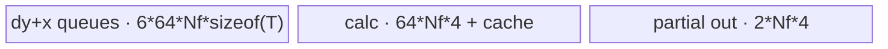
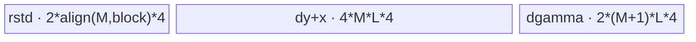

# RmsNormGradQuant 950 ACLNN 算子知识

## 算子速览

| 项目 | 内容 |
|---|---|
| 实际入口 | `aclnnRmsNormGradQuantGetWorkspaceSize` + `aclnnRmsNormGradQuant`，公开两段式 ACLNN；固定仓没有更高版本后缀入口。 |
| 计算语义 | 将 RMSNorm 反向的 `dx` 与静态量化融合，同时计算 `dgamma`。把 `x` 展平为 `[M,D]`，`M=prod(rstd_shape)`，`D=prod(gamma_shape)`。 |
| 输入输出 | `dy,x:[M,D]`；`rstd:[M]`；`gamma:[D]`；标量 `scalesX`、可选 `offsetX`；`dx:int8/hifloat8 [M,D]`，`dgamma:fp32 [D]`，均为 ND。 |
| 执行类型 | 单个 `AIV_VECTOR` Kernel entry；内部先算 `dx`，`PipeBarrier<PIPE_ALL> + pipe.Reset()` 后算 `dgamma`。Big-M 的 dgamma 在同一 entry 内含 workspace stage-0、`SyncAll`、0 核 stage-1。 |
| Kernel 路线 | R-001 空 M；R-002/R-003 Big-M + dx full/split；R-004/R-005 常规 dgamma full-load + dx full/split；R-006/R-007 large-rows dgamma + dx full/split。每条非空路线还按 `offset/div/dtype` 实例化独立编译子路线。 |
| 核心资源 | GM、AIV UB `TQue/TBuf/RegTensor`；只有 Big-M dgamma 使用 `usedCoreNumDgamma*D*4` 字节算子 workspace 切片。无 AIC/Cube、SIMT、NDDMA、通信节点。 |
| 来源闭包 | `source_closed`：公开 ACLNN→L0 launcher→OpDef/Tiling selector→POD/key→AIV entry→全部 dx/dgamma body/helper→ascend950 binary/CMake 已闭合。 |
| 验证状态 | 已完成源码闭包检查；本次知识提取未执行编译、真机、数值或性能测试。 |

## 接口与语义

### 计算语义

对第 `m` 行和第 `d` 列，令 `r_m=rstd[m]`：

```text
s_m = (1 / D) * sum_d(dy[m,d] * gamma[d] * x[m,d] * r_m)
dx_fp[m,d] = (dy[m,d] * gamma[d] - x[m,d] * r_m * s_m) * r_m
q[m,d] = dx_fp[m,d] / scalesX + offsetX    (divMode=true)
q[m,d] = dx_fp[m,d] * scalesX + offsetX    (divMode=false)
dx[m,d] = round_and_cast(q[m,d])
dgamma[d] = sum_m(dy[m,d] * x[m,d] * r_m)
```

`offsetX` 缺省时不执行加零点。Kernel 全部乘法、归约和量化中间量在 fp32 寄存器/UB 中计算；BF16/FP16 输入先升为 fp32。hifloat8 使用 `SAT + CAST_ROUND`；int8 路径依次执行 fp32→int32 `CAST_RINT`、int32→fp32、fp32→fp16 `CAST_RINT`、fp16→int8 `CAST_TRUNC`，不得简化成相同 cast。

### 输入、输出与属性

| 参数 | shape/layout | dtype | 约束、默认值与语义 |
|---|---|---|---|
| `dy` | 2–8 维 ND，逻辑 `[M,D]` | fp16/bf16/fp32 | 非空路线各维正数；与 `x` shape/dtype 相同。 |
| `x` | 同 `dy` | 同 `dy` | `rstd` 是其前缀 shape，`gamma` 是其后缀 shape，维数之和等于 `x.rank`。 |
| `rstd` | `x` 前缀，逻辑 `[M]` | fp32 | 正向保存的 reciprocal RMS；公开文档允许非连续，ACLNN 转连续。 |
| `gamma` | `x` 后缀，逻辑 `[D]` | fp32 或 `dy.dtype` | `D>0` 才下放空-M Tiling；任一 gamma 维为 0 时 ACLNN 直接成功返回。 |
| `scalesX` | `[1]` ND | fp32 或 `dy.dtype` | 必选；ACLNN 也调用 `Contiguous`，尽管公开表将非连续标为不支持。 |
| `offsetXOptional` | `[1]` ND | int32 | 可选；存在时 ACLNN `Contiguous`，Tiling 选择 `WITH_OFFSET_X`。 |
| `quantMode` | 标量属性 | string | 空指针在 L0 被转成 `"static"`；Tiling 仅接受 `"static"`。 |
| `divMode` | 标量属性 | bool | 编译期选择除 `scalesX` 或乘 `scalesX`。 |
| `dxOut` | 同 `dy`，ND | int8/hifloat8 | dtype 还作为 `dstType` 传入 L0；输出先分配内部 Tensor，最后 `ViewCopy`。 |
| `dgammaOut` | 同 `gamma`，ND | fp32 | 正常路线由各核写互斥列；Big-M 由 0 核完成 stage-1 后写出。 |

### 入口与版本

公开文档和头文件只有无版本后缀的 `aclnnRmsNormGradQuant`。README 与 ACLNN 文档的产品表均明确 950（Ascend 950PR/950DT）支持、A2/A3 不支持；`RmsNormGradQuant::AICore().AddConfig("ascend950")`、`SUPPORT_COMPUTE_UNIT "ascend950"` 和 `config/ascend950` 相互一致。固定仓因此只发布本 950 卡，不生成 A2/A3 卡。

binary config 公开 18 个 dtype 组合：9 个 `(dy/gamma/scalesX)` 组合分别对应 int8 与 hifloat8 输出；`rstd,dgamma` 恒 fp32、`offsetX` 恒 int32。key 声明将 Kernel 类型固定为 `ASCENDC_TPL_AIV_ONLY`，没有可达 Cube/AIC/MIX_CV 节点。

## Host/Launcher 执行流程

### 参数校验与前处理

`GetWorkspaceSize` 先检查 `workspaceSize/executor` 及 `dy,x,rstd,gamma,scalesX,dxOut,dgammaOut` 非空；`offsetX` 可空。若 `gamma` 任一维为 0，则 workspace=0、释放 executor 并成功返回。否则按 dy→x→rstd→gamma→scalesX→可选 offsetX 顺序创建 `Contiguous` 节点；从 `dxOut.dtype` 生成 `dstType`，分配内部 `dx_output/dgamma_output`，调用 L0 `RmsNormGradQuant`，再追加两个 `ViewCopy`。算子 shape/dtype/属性约束由 Host Tiling 再检查，失败即阻断 launch。

### 参数、Workspace 与生命周期

L0 通过 `ADD_TO_LAUNCHER_LIST_AICORE` 追加一个 `RmsNormGradQuant` AICore launcher。第一段接口的 executor 持有 Contiguous、算子和 ViewCopy 节点以及内部 Tensor；`uniqueExecutor->GetWorkspaceSize()` 返回整个执行图 workspace。第二段接口把调用者提供的 workspace、大小、executor、stream 原样交给 `CommonOpExecutorRun`。

算子 Tiling 的常规/空路线申请 `GetLibApiWorkSpaceSize()`；Big-M 申请 `usedCoreNumDgamma*D*sizeof(float)+libApiWorkspace`。Big-M Kernel 把 `workspace` 起点绑定为 `[usedCoreNumDgamma,D]` fp32 partial-dgamma；固定仓未展示高阶 API workspace 与该切片的内部 offset 契约，因此只能确定总量公式与 partial 切片基址，不能推测隐藏库区布局。

### 启动图与失败传播

```text
GetWorkspaceSize: Contiguous* -> RmsNormGradQuant launcher -> ViewCopy(dx) -> ViewCopy(dgamma)
Run(stream):
  node K0 rms_norm_grad_quant<<<blockDim, stream>>>(dy,x,rstd,gamma,scales,offset,dx,dgamma,workspace,tiling)
    normal: dx AIV -> PipeBarrier/pipe.Reset -> dgamma AIV
    big-M:  dx AIV -> PipeBarrier/pipe.Reset -> dgamma stage-0 -> SyncAll -> core0 stage-1
```

这是单 Device-Kernel launch graph；`dx→dgamma` 不是两个 Host Kernel。K0 的 workspace 由 executor/调用者持有至 stream 执行结束。Big-M stage-0 每核写 workspace `[core*D:(core+1)*D)`，`SyncAll` 建立对 0 核 stage-1 的可见性；任何 Host 前处理、launcher 添加或 ViewCopy 创建失败都会在第一段返回错误，不产生后续 executor；K0 内 `workspace==nullptr` 时直接返回。

## Route 与参数设计

### 分核与资源计算

`M=prod(x[0:x.rank-gamma.rank])`，`D=prod(gamma)`，`A=平台 AIV 核数`，`VL=VRegSize/4`，`B=UB blockSize`。

- dx：`blockFactorDx=ceil(M/A)`，`usedDx=ceil(M/blockFactorDx)`；`D<=6144` 取 full-load，否则 split-D，并令 `bodyPart` 为首个满足 `bodyPart>=D/2` 的 2 次幂。
- 常规 dgamma：按 `ceil(D/VL)` 个 colset 分核。colset 不超过 A 时一核一个 VL；否则每核多个 VL，并用 `tailCoreNumDG/colsLastCoreDG` 分配余 colset。
- dgamma full-load 判据：`UB >= 2*(align(M*4,B)*VL*2 + align(M*4,B) + align((M+1)*4,B)*VL)`；不满足时 `rowsPerUB=2^floor(log2(UB/(2*((VL*4+2)*4))))`，进入 large-rows 二分缓存路线。
- Big-M：仅当 `D<=VL*A/2 && M>=2D && M>=64*A/2` 才尝试。stage-0 以 64 行为 M factor，`usedDg=min(ceil(M/64),A)`；`nFactorMax=(UB-64*4*3)/(64*(6*sizeof(dy)+4)+4*(3+cacheCount))`，向下对齐到 `B/sizeof(dy)` 个元素并截到 D 后再向上对齐。stage-1 令 `aInnerMax=UB/2/4/(usedDg+1)`，向下对齐到 `B/4`，以 `aInner=min(D,aInnerMaxAligned)` 分片归约 partial。
- blockDim：空/常规路线设置 A，未参与核自行返回；Big-M 设置 `max(usedDx,usedDg)` 并 `SetScheduleMode(1)`。

### Route 选择

| 顺序 | Route | Key/模板 | 精确选择条件与优先级 | 不适用去向 |
|---:|---|---|---|---|
| 1 | R-001 Empty-M | `(FULL_LOAD,EMPTY,WITH_OFFSET,DIV)`；Empty priority 100 | `gamma.rank<=dy.rank` 且 dy 的前 `dy.rank-gamma.rank` 维乘积为 0。ACLNN 已先排除 `D==0`。 | 非空→priority 500。 |
| 2 | R-002 Big-M + dx full | `(FULL_LOAD,BIG_M,O,Q)`；BigM priority 500 | Big-M 三谓词成立、N/stage-1 UB 反算成功、`D<=6144`。 | Big-M 不 capable/反算 `GRAPH_PARAM_INVALID`→1000。 |
| 3 | R-003 Big-M + dx split | `(SPLIT_D,BIG_M,O,Q)` | 同 R-002，但 `D>6144`。 | 同上。 |
| 4 | R-004 Base full/full | `(FULL_LOAD,FULL_LOAD,O,Q)`；base priority 1000 | 非空、未选 Big-M，`D<=6144`，且 dgamma full-load UB 判据成立。 | UB 不足→R-006。 |
| 5 | R-005 Base split/full | `(SPLIT_D,FULL_LOAD,O,Q)` | 非空、未选 Big-M，`D>6144`，且 dgamma full-load UB 判据成立。 | UB 不足→R-007。 |
| 6 | R-006 Base full/large-rows | `(FULL_LOAD,WITH_LARGE_ROWS,O,Q)` | 非空、未选 Big-M，`D<=6144`，dgamma full-load UB 判据不成立且 `rowsPerUB>0`。 | 反算失败→Tiling 失败。 |
| 7 | R-007 Base split/large-rows | `(SPLIT_D,WITH_LARGE_ROWS,O,Q)` | 同 R-006，但 `D>6144`。 | 反算失败→Tiling 失败。 |

`O∈{WITH_OFFSET_X,WITHOUT_OFFSET_X}`，`Q∈{DIV_MODE,NOT_DIV_MODE}`；每个 `{O,Q,dtype}` 是独立编译实例，表中只合并共享 selector、POD 和资源拓扑的实现族，不表示精度/cast 行为可互换。

```text
priority 100: if M==0 -> R-001
priority 500: if D<=VL*A/2 && M>=2*D && M>=32*A
                if Big-M UB stages capable -> D<=6144 ? R-002 : R-003
                else fall through
priority 1000:
  dx = D<=6144 ? FULL_LOAD : SPLIT_D
  dg = full_load_ub_ok ? FULL_LOAD : WITH_LARGE_ROWS
  -> R-004..R-007
```

### 模板/实现执行矩阵

| Route | key/selector | dtype/shape/platform 完整命中条件 | 执行拓扑与 Kernel 节点 | 实际模板/body | 内存与同步特征 | tail/fallback |
|---|---|---|---|---|---|---|
| R-001 | EMPTY tuple | 950，M=0,D>0 | K0 只执行 EmptyDgamma | `EmptyDgamma<2>` | 2-depth output queue | 分核/UB 列尾；写 QuietNaN。 |
| R-002 | FULL+BIG_M+O+Q | Big-M 且 D≤6144，公开 dtype tuple | K0 dx→dg stage0→SyncAll→core0 stage1 | `RegbaseDxFullLoad<DTYPE_DY,DTYPE_X,DTYPE_GAMMA,DTYPE_DX,DTYPE_DGAMMA,DTYPE_SCALES_X,int32_t,O,Q>` + `RmsNormGradQuantDgammaBigM<DTYPE_DY>` | dx 后 reset；workspace partial | M/N/列尾由 POD；Big-M tiling 失败回 base。 |
| R-003 | SPLIT+BIG_M+O+Q | Big-M 且 D>6144 | 同 R-002 | `RegbaseDxSplitD<DTYPE_DY,DTYPE_X,DTYPE_GAMMA,DTYPE_DX,DTYPE_DGAMMA,DTYPE_SCALES_X,int32_t,O,Q>` + `RmsNormGradQuantDgammaBigM<DTYPE_DY>` | split-D 多级 reduce + workspace | D tile=4096；末 tile mask。 |
| R-004 | FULL+FULL+O+Q | base、D≤6144、dg full-load | K0 dx→dg | FullLoad + `RegbaseDgamma<DTYPE_DY,DTYPE_X,DTYPE_RSTD,true,2>` | 两阶段分别占 UB，pipe reset | dx 行尾；dg colset/row-tail。 |
| R-005 | SPLIT+FULL+O+Q | base、D>6144、dg full-load | K0 dx→dg | SplitD + full dgamma | 同上 | split-D 和 colset tail。 |
| R-006 | FULL+LARGE+O+Q | base、D≤6144、dg UB 不足 | K0 dx→large-row dg | FullLoad + `RegbaseDgamma<DTYPE_DY,DTYPE_X,DTYPE_RSTD,false,2>` | dg 增加 cacheQueue/dgammaQueue1 | 2^k row block、补齐/不补齐两支。 |
| R-007 | SPLIT+LARGE+O+Q | base、D>6144、dg UB 不足 | K0 dx→large-row dg | SplitD + large-row dgamma | 同 R-006 | 双重 D/M 尾块。 |

### 隐藏性能 Guard

| Guard | Host/Tiling 条件 | Device/资源原因 | 影响 Route | 不满足时去向 | 源码符号 |
|---|---|---|---|---|---|
| 平台 | `IsRegbaseSocVersion(context)` | 仅 arch35 AIV 实现 | 全部 | 记录不支持并返回；公开仅 950 | `Tiling4RmsNormGradQuant` |
| dx UB factor | `D>6144` | full-load 以 `6144/align(D,128)` 求一次行数；D 太大则为 0 | R-002/4/6 | split-D | `CalcTilingDataDx` |
| Big-M shape | `D<=VL*A/2 && M>=2D && M>=32A` | 沿 M 分核且 N 较小 | R-002/3 | base | `BigMTiling::IsCapable` |
| Big-M N UB | `nFactorMax>=B/64` | stage-0 至少容纳一个对齐 N 块 | R-002/3 | `GRAPH_PARAM_INVALID`→base | `DgammaDoTilingStg0` |
| Big-M stage-1 UB | `aInnerMax>=B/4` | 至少一个 fp32 DMA block | R-002/3 | `GRAPH_PARAM_INVALID`→base | `DgammaDoTilingStg1` |
| dgamma full-load | 上述 `UB >= 2*(inputs+output)` | 双 buffer 下全 M 行常驻 | R-004/5 | large-rows | `CalcTilingDataDgamma` |
| empty key | Empty `GetTilingKey` 只设置 DG mode | 编译表只声明 WITH_OFFSET+DIV 的 EMPTY 组合，dx 不执行 | R-001 | N/A | `EmptyTiling::GetTilingKey` |
| workspace 非空 | `workspace==nullptr` | entry 无条件检查 | 全部 | K0 无输出返回 | `rms_norm_grad_quant` |

### POD/ABI

所有结构自然对齐为 8；固定定义全部字段无序列化宏。以下 offset/size 由固定字段顺序和标准整数布局确定：Dx size 40，base size 184，BigM size 248，Empty size 80。

| 结构 | 字段 | 类型/位宽 | ABI 布局 | 单位 | Host/launcher producer | Device consumer | 边界 |
|---|---|---|---|---|---|---|---|
| Dx | `rows` | u64 | off 0,size 40 | 行 | `rows_` | dx/dg M | M>0 非空 |
| Dx | `cols` | u64 | off 8 | 元素/行 | `cols_` | 地址、mask、均值 | D>0 |
| Dx | `blockFactorDx` | u64 | off 16 | 行/核 | `ceil(M/A)` | dx core base/tail | 最后核可少 |
| Dx | `bodyPart` | u64 | off 24 | 元素 | split 的 2 次幂；full=1 | SplitD paired reduction | full inactive |
| Dx | `usedCoreNumDx` | u64 | off 32 | 核 | `ceil(M/blockFactor)` | dx inactive-core guard | ≤A |
| Base | `tailCoreNumDG` | u64 | off 0,size 184 | 核 | colset 余数 | dg tail colset | multi-colset 有效 |
| Base | `colsPerCoreDG` | u64 | off 8 | 元素 | colset 分核 | `gmOffset` | VL 倍数或一 VL |
| Base | `colsLastCoreDG` | u64 | off 16 | 元素 | D 最末 colset | 最尾核 | ≤VL |
| Base | `colsPerTailCoreDG` | u64 | off 24 | 元素 | 多/单 colset 尾核 | `curCols` | ≤主核+VL |
| Base | `rowsPerUBDG` | u64 | off 32 | 行 | full=M 或 large 2^k | dg UB tile | >0 |
| Base | `powerofTwoValueDG` | u64 | off 40 | 指数 | 固定仓 producer 未赋非零 | 固定仓 body 未读 | inactive |
| Base | `rowsTailDG` | u64 | off 48 | 行 | `M-2^floor(log2M)` | full dg tail pad | 0 表示 2 次幂 |
| Base | `totalBlockCountDG` | u64 | off 56 | row block | `ceil(M/rowsPerUB)` | 固定 body 未直接读 | large only |
| Base | `mainBlockCountDG` | u64 | off 64 | row block | 去掉非对齐尾 | large loop | large only |
| Base | `tailBlockCountwithPadDG` | u64 | off 72 | block | `M%rowsPerUB?1:0` | large 分支 | large only |
| Base | `powerOfTwoBlockCountDG` | u64 | off 80 | block | `2^binaryAddK` | large paired tail offset | large only |
| Base | `tailBlockCountWithoutPadDG` | u64 | off 88 | block | main-power2 | large paired tail loop | large only |
| Base | `binaryAddKDG` | u64 | off 96 | cache level | floor-log2(main blocks) | cache offset | large only |
| Base | `usedCoreNumDG` | u64 | off 104 | 核 | colset split | dg guard | ≤A |
| Base | `blockSize` | u64 | off 112 | 字节 | platform UB block | DMA alignment | >0 |
| Base | `vlFp32` | u64 | off 120 | fp32 lane | VRegSize/4 | Host split；Device另读硬件 VL | 固定 body字段未直接读 |
| Base | `isFullLoad` | u64 | off 128 | bool | UB 判据 | 固定 body由 key模板决定 | 记录字段未读 |
| Base | `isMultiColset` | u64 | off 136 | bool | colsets>A | dg tail branch | 0/1 |
| Base | `dxTilingData` | nested | off 144,size 40 | 见 Dx | `CalcTilingDataDx` | dx + dg M/D | 全部非空 base |
| BigM | `dgammaUsedCoreNum` | u64 | off 0,size 248 | 核 | min(ceil(M/64),A) | stage0/1 | >0 |
| BigM | `dgammaMPerBlock` | u64 | off 8 | 行 | floor(M/cores) | startM | — |
| BigM | `dgammaMReminder` | u64 | off 16 | 核 | M remainder | main/tail core split | <cores |
| BigM | `dgammaNloop` | u64 | off 24 | tile | floor(D/nfactor) | stage0 rounds | — |
| BigM | `dgammaNtail` | u64 | off 32 | 元素 | D remainder | final N mask | — |
| BigM | `dgammaMfactorBlockAligned` | u64 | off 40 | 行 | 64 | stage0 UB/copy | 常量64 |
| BigM | `dgammaNfactorBlockAligned` | u64 | off 48 | 元素 | UB反算、DMA对齐 | UB stride | ≥一 block |
| BigM | `dgammaMToProcessMainBlock` | u64 | off 56 | 行 | mPerBlock+1 | main cores | remainder cores |
| BigM | `dgammaMLoopMainBlock` | u64 | off 64 | 64-row loop | floor | fold planning | — |
| BigM | `dgammaMTotalLoopMainBlock` | u64 | off 72 | loop | ceil | 固定 body成员未决策 | — |
| BigM | `dgammaMTailMainBlock` | u64 | off 80 | 行 | remainder | fold tail | — |
| BigM | `dgammaBasicBlockLoopMainBlock` | u64 | off 88 | loop | nearest power2 | main loop | — |
| BigM | `dgammaMainFoldCountMainBlock` | u64 | off 96 | loop | mLoop-basic | fold branch | — |
| BigM | `dgammaCacheBufferCountMainBlock` | u64 | off 104 | buffer level | bit length | UB cache | ≥1 |
| BigM | `dgammaResultCacheIDMainBlock` | u64 | off 112 | cache index | `GetCacheID` | final partial | — |
| BigM | `dgammaMToProcessTailBlock` | u64 | off 120 | 行 | mPerBlock | tail cores | — |
| BigM | `dgammaMLoopTailBlock` | u64 | off 128 | loop | floor | fold planning | — |
| BigM | `dgammaMTotalLoopTailBlock` | u64 | off 136 | loop | ceil | 固定 body成员未决策 | — |
| BigM | `dgammaMTailTailBlock` | u64 | off 144 | 行 | remainder | fold tail | — |
| BigM | `dgammaBasicBlockLoopTailBlock` | u64 | off 152 | loop | nearest power2 | tail-core main loop | — |
| BigM | `dgammaMainFoldCountTailBlock` | u64 | off 160 | loop | mLoop-basic | fold branch | — |
| BigM | `dgammaCacheBufferCountTailBlock` | u64 | off 168 | level | bit length | UB cache | ≥1 |
| BigM | `dgammaResultCacheIDTailBlock` | u64 | off 176 | index | `GetCacheID` | final partial | — |
| BigM | `dgammaAInnerAlignedStg1` | u64 | off 184 | fp32 元素 | UB反算、B对齐 | stage1 stride | ≥B/4 |
| BigM | `dgammaAOuterStg1` | u64 | off 192 | tile | ceil(D/aInner) | stage1 loop | >0 |
| BigM | `dgammaATailStg1` | u64 | off 200 | 元素 | final D tail | final copy | >0 |
| BigM | `dxTilingData` | nested | off 208,size 40 | 见 Dx | dx tiling | dx/BigM D | — |
| Empty | `usedCoreNumDG` | u64 | off 0,size 80 | 核 | 1 或 A | guard | — |
| Empty | `colsPerCoreDG` | u64 | off 8 | 元素 | ceil(D/cores) | GM base | — |
| Empty | `cols` | u64 | off 16 | 元素 | D | 固定 body未读 | — |
| Empty | `ubSize` | u32 | off 24；off28 padding | 字节 | platform UB | 固定 body未读 | 窄化为 u32 |
| Empty | `colsPerUBDG` | u64 | off 32 | fp32 元素 | UB反算的2次幂 | queue capacity | >0 |
| Empty | `coreUbBlockCount` | u64 | off 40 | tile | 主核 loops-1 | main loops | — |
| Empty | `tailUbCols` | u64 | off 48 | 元素 | 主核尾 | main tail | >0 |
| Empty | `lastCoreBlockCount` | u64 | off 56 | tile | 尾核 loops-1 | last loops | — |
| Empty | `lastCoreTailUbCols` | u64 | off 64 | 元素 | 尾核尾 | last tail | >0 |
| Empty | `colsLastCoreDG` | u64 | off 72 | 元素 | D-main*(cores-1) | 仅保存，body未读 | — |

### Route 源码闭包

| Route | Key/selector | Host/Tiling producer | POD/参数 | Kernel entry/router 节点 | Kernel body/直接依赖 | 构建接线 |
|---|---|---|---|---|---|---|
| R-001 | Empty 100 | `rms_norm_grad_quant_empty_tiling.cpp::IsCapable/DoOpTiling` | Empty POD | `rms_norm_grad_quant` EMPTY branch | `EmptyDgamma` | ascend950 CMake/binary |
| R-002/3 | BigM 500 | `BigMTiling::IsCapable/DgammaDoTiling*` + inherited dx | BigM POD | BIG_M branch | Full/Split dx + `DgammaBigM` + helper | 同上 |
| R-004/5 | Base 1000 full dg | `RegbaseTiling::CalcTilingData*` | Base POD | normal branch | Full/Split dx + `RegbaseDgamma<true>` + helper | 同上 |
| R-006/7 | Base 1000 large dg | 同上 large-rows 分支 | Base POD | normal branch | Full/Split dx + `RegbaseDgamma<false>` + helper | 同上 |

## Kernel 实现

### 公共执行流程

entry 首先声明 `KERNEL_TYPE_AIV_ONLY`、解析模板匹配 POD，并拒绝空 workspace。非空路线按 key 实例化 dx full/split；完成后 `PipeBarrier<PIPE_ALL>`，`pipe.Reset()`，再实例化对应 dgamma。dx 每核处理连续 M 行：GM→双缓冲队列→MicroAPI fp32 计算/量化→dx GM。dgamma 对 M 归约、对 D 分片。entry 在 arch3510 暂存并最终恢复 overflow control；hifloat8 dx 阶段暂设为 0。

### Route R-001：Empty-M

#### 适用条件

##### 选择证据

| 层级 | 文件 | 符号 | 源码谓词/参数 | 结果/下一跳 |
|---|---|---|---|---|
| ACLNN | `op_api/aclnn_rms_norm_grad_quant.cpp` | GetWorkspaceSize | gamma 无 0 维才下放 | gamma 空直接成功 |
| Tiling | `op_host/rms_norm_grad_quant_empty_tiling.cpp` | `IsCapable` | leading-dim product `row_val==0` | EMPTY key |
| Router | `op_kernel/rms_norm_grad_quant.cpp` | entry | DG mode EMPTY | `EmptyDgamma` |

#### Device 数据流

##### 函数级调用链

```text
rms_norm_grad_quant -> EmptyDgamma::Init(dgamma) -> Process -> CalcDgamma
  -> NumericLimits<float>::QuietNaN -> queue -> DataCopyPad(dgamma GM)
```

##### 源码等价伪码

```text
if core < usedDG:
  base=core*colsPerCore
  for each full UB tile and final tile:
    outUB[0:valid]=QuietNaN
    copy outUB[0:valid] -> dgamma[base+tileOffset]
# dx 逻辑域 M*D 为 0，不写 dx
```

#### 内存与数据搬运

##### 资源与搬运表

| 层级/缓冲区 | offset/地址公式 | extent/容量公式 | dtype/layout | producer | consumer | owner/lifetime | 对齐/复用 |
|---|---|---|---|---|---|---|---|
| dgamma GM | `core*colsPerCore+tile*colsPerUB` | valid cols | fp32[D] | QuietNaN UB | output | caller | disjoint cores |
| dgammaQueue | 0 | `2*colsPerUB*4` bytes | fp32 | Duplicate | DMA out | pipe/one tile | depth=2 |

##### 分层内存布局


##### 字节账与复用顺序

```text
UB_total = 2*colsPerUB*4 <= platform UB
dynamic_ub = N/A
workspace_total = libApiWorkspace
```

| 复用子区 | 写入者 | 读取者/消费点 | 下一次覆盖 | 同步或释放依据 | 安全条件 |
|---|---|---|---|---|---|
| dgammaQueue slot | `VFDuplicateRows` | `CopyDgammaToGm` | 下一 tile | EnQue/DeQue/FreeTensor | Free 后覆盖 |

#### 同步、精度与尾块

##### 同步与数值边界表

| 阶段 | primitive/机制 | producer | consumer/等待点 | 保护对象 | 精度/尾块 |
|---|---|---|---|---|---|
| UB→GM | queue | QuietNaN | DeQue | dgamma tile | 最后核/最后 UB 使用独立 valid 长度；结果为 fp32 NaN。 |

#### 关键实现

##### 符号证据表

| 阶段 | 文件 | 符号/模板实例 | 实现事实 |
|---|---|---|---|
| Host/Tiling producer | `op_host/rms_norm_grad_quant_empty_tiling.cpp` | `CalcUsedCoreNumGamma/CalcTilingDataDgamma` | 1/A 核和 UB 列切分 |
| Kernel entry/router | `op_kernel/rms_norm_grad_quant.cpp` | EMPTY branch | 空路线跳过 dx |
| Device body/helper | `op_kernel/arch35/rms_norm_grad_quant_empty_dgamma.h` | `EmptyDgamma::Process` | 分 tile 写 QuietNaN |

### Route R-002：Big-M + dx FullLoad

#### 适用条件

##### 选择证据

| 层级 | 文件 | 符号 | 源码谓词/参数 | 结果/下一跳 |
|---|---|---|---|---|
| Tiling | `op_host/rms_norm_grad_quant_regbase_big_m_tiling.cpp` | `IsCapable` | Big-M 三谓词且 D≤6144 | FULL+BIG_M |
| Tiling | 同文件 | `DgammaDoTilingStg0/1` | N factor/aInner 至少一 DMA block | BigM POD |
| Router | `op_kernel/rms_norm_grad_quant.cpp` | BIG_M/FULL branches | `{O,Q,dtype}` | FullLoad→BigM |

#### Device 数据流

##### 函数级调用链

```text
entry -> RegbaseDxFullLoad::Process/SubProcess -> dx GM
  -> PipeBarrier/Reset -> DgammaBigM::Process
    -> ProcessStg0 -> workspace[core,D] -> SyncAll
    -> core0 InitBufferStg1/ProcessStg1 -> dgamma GM
```

##### 源码等价伪码

```text
each dx core: for row tiles, reduce dy*gamma*x*rstd over D; compute dx_fp; quantize; store dx
each dg core: for N tiles and owned 64-row blocks, compute dy*x*rstd; RA-reduce M; store partial[core,N]
SyncAll
core0: for D tiles, load partial[0:usedDG,N], RA-reduce cores, store dgamma
```

#### 内存与数据搬运

##### 资源与搬运表

| 层级/缓冲区 | offset/地址公式 | extent/容量公式 | dtype/layout | producer | consumer | owner/lifetime | 对齐/复用 |
|---|---|---|---|---|---|---|---|
| dx UB | per core | 见字节账 | mixed/fp32 | FullLoad | dx GM | pipe 至 barrier | reset 后回收 |
| partial workspace | `core*D+nOffset` | `usedDG*D*4` | fp32[core,D] | stage0 | core0 stage1 | executor/K0 | SyncAll |
| BigM stage0 UB | 0 | 见字节账 | input T/fp32 | DMA/compute | workspace | pipe stage0 | triple/double buffer |
| stage1 UB | reset 后 | 见字节账 | fp32 | workspace | dgamma GM | core0 | double buffer |

##### 分层内存布局



##### 字节账与复用顺序

```text
dxUB = 3*(2*6144*4) + 6144*4 + 6144*4 + 3*align(6144/align(D,128),VL)*4 + scalar bytes
stg0UB = 6*64*Nf*sizeof(T) + 64*Nf*4 + 3*64*4 + 2*Nf*4 + Nf*4 + CacheCount*Nf*4
stg1UB(after reset) = 2*aInner*usedDG*4 + 2*aInner*4
workspace_total = usedDG*D*4 + libApiWorkspace
```

| 复用子区 | 写入者 | 读取者/消费点 | 下一次覆盖 | 同步或释放依据 | 安全条件 |
|---|---|---|---|---|---|
| dgammaCalc | main block | fold block in-place add/RA reduce | next block | same-core program order | fold reads existing main first |
| workspace partial | each core | core0 stage1 | K0 end | `SyncAll` | disjoint producer rows |

#### 同步、精度与尾块

##### 同步与数值边界表

| 阶段 | primitive/机制 | producer | consumer/等待点 | 保护对象 | 精度/尾块 |
|---|---|---|---|---|---|
| dx→dg | `PipeBarrier<PIPE_ALL>` + reset | dx queues | dg InitBuffer | UB/GM dx completion | fp32 compute then output cast |
| dg stage0→1 | `SyncAll` | all partial stores | core0 load | workspace | Ntail mask；M remainder main/tail cores |

#### 关键实现

##### 符号证据表

| 阶段 | 文件 | 符号/模板实例 | 实现事实 |
|---|---|---|---|
| Host/Tiling producer | `op_host/rms_norm_grad_quant_regbase_big_m_tiling.cpp` | `DgammaDoTilingStg0/1` | 两阶段 factors/workspace |
| Kernel entry/router | `op_kernel/rms_norm_grad_quant.cpp` | FULL+BIG_M | 阶段顺序 |
| Device body/helper | `op_kernel/arch35/rms_norm_grad_quant_dgamma_big_m.h` | `ProcessStg0/ProcessStg1` | partial+跨核归约 |

### Route R-003：Big-M + dx SplitD

#### 适用条件

##### 选择证据

| 层级 | 文件 | 符号 | 源码谓词/参数 | 结果/下一跳 |
|---|---|---|---|---|
| Tiling | Big-M tiling | `IsCapable` | Big-M 成立且 D>6144 | SPLIT+BIG_M |
| Router | entry | SPLIT/BIG_M | `{O,Q,dtype}` | SplitD→BigM |

#### Device 数据流

##### 函数级调用链

```text
entry -> RegbaseDxSplitD::FormerProcess/FinalLevelReduce/LatterProcess -> dx
  -> barrier/reset -> DgammaBigM::ProcessStg0 -> SyncAll -> core0 ProcessStg1
```

##### 源码等价伪码

```text
for each row: pair [col,col+bodyPart] 4096-element chunks; reduce chunk sums into 3-level cache
final mean; second pass D by 4096 computes/quantizes dx; then same Big-M dgamma as R-002
```

#### 内存与数据搬运

##### 资源与搬运表

| 层级/缓冲区 | offset/地址公式 | extent/容量公式 | dtype/layout | producer | consumer | owner/lifetime | 对齐/复用 |
|---|---|---|---|---|---|---|---|
| split input queues | row*D+col | each `4096` logical, float-capacity | T | DMA | MicroAPI | pipe | depth2 |
| reduce/levels | UB | `8192 + 3*256` fp32 | fp32 | chunk reduce | final mean | pipe | hierarchical reuse |
| BigM resources | 同 R-002 | 同 R-002 | — | — | — | — | — |

##### 分层内存布局


##### 字节账与复用顺序

```text
splitDxUB = 4*(2*4096*4) + 2*VL*4 + 2*4096*4 + 3*256*4 + VL*4 + 256*4 + scalesBytes + optional 4
          = 168704 + scalesBytes + optional 4  (VL=64)
BigM/workspace = R-002 formulas
```

| 复用子区 | 写入者 | 读取者/消费点 | 下一次覆盖 | 同步或释放依据 | 安全条件 |
|---|---|---|---|---|---|
| reduceBuf halves | `ComputeMul<body/tail>` | `ReduceSumImpl` | next paired chunk | same-thread order | tail mask/zero fill |

#### 同步、精度与尾块

##### 同步与数值边界表

| 阶段 | primitive/机制 | producer | consumer/等待点 | 保护对象 | 精度/尾块 |
|---|---|---|---|---|---|
| split reduce | `LocalMemBar` in helper | work writes | merge loads | reduction cache | align to 128 fp32 and zero padding |
| cross core | `SyncAll` | partial | core0 | workspace | 同 R-002 |

#### 关键实现

##### 符号证据表

| 阶段 | 文件 | 符号/模板实例 | 实现事实 |
|---|---|---|---|
| Host/Tiling producer | base+BigM tiling | `CalcTilingDataDx/DgammaDoTiling` | bodyPart/BigM factors |
| Kernel entry/router | entry | SPLIT+BIG_M | 编译映射 |
| Device body/helper | `rms_norm_grad_quant_dx_split_d.h` | `FormerProcess/LatterProcess` | 双遍 split-D |

### Route R-004：Base dx FullLoad + dgamma FullLoad

#### 适用条件

##### 选择证据

| 层级 | 文件 | 符号 | 源码谓词/参数 | 结果/下一跳 |
|---|---|---|---|---|
| Tiling | base tiling | `CalcTilingDataDgamma/Dx` | UB full 且 D≤6144 | FULL+FULL |
| Router | entry | normal/full branches | `{O,Q,dtype}` | two phases |

#### Device 数据流

##### 函数级调用链

```text
FullLoad::SubProcess -> MultiReduceSum -> quant/copy dx
  -> barrier/reset -> RegbaseDgamma<DTYPE_DY,DTYPE_X,DTYPE_RSTD,true,2>::CalcDgamma -> dgamma
```

##### 源码等价伪码

```text
dx: tile rows so rowsTile*align(D,128)<=6144; one pass keeps dy/x/rstd and gamma, reduces each row, emits q
dg: each core owns VL-column sets; load all M rows for a set; fp32 dy*x*rstd; tree-reduce rows; emit D slice
```

#### 内存与数据搬运

##### 资源与搬运表

| 层级/缓冲区 | offset/地址公式 | extent/容量公式 | dtype/layout | producer | consumer | owner/lifetime | 对齐/复用 |
|---|---|---|---|---|---|---|---|
| Full dx UB | core row tile | 见 R-002 dxUB | mixed | GM | dx GM | phase dx | depth2 |
| dg queues | D colset/M rows | 见账 | fp32 capacity | GM | reduction/GM | phase dg | depth2 |

##### 分层内存布局



##### 字节账与复用顺序

```text
dgFullUB = 2*(align(M*4,B) + 2*M*L*4 + (M+1)*L*4), L=align(VL*4,B)/4
workspace_total = libApiWorkspace
```

| 复用子区 | 写入者 | 读取者/消费点 | 下一次覆盖 | 同步或释放依据 | 安全条件 |
|---|---|---|---|---|---|
| dgammaQueue | `VFCalcPreDgamma` then in-place tree | `CopyDgammaToGm` | next colset | queue Free | tree barriers inside helper |

#### 同步、精度与尾块

##### 同步与数值边界表

| 阶段 | primitive/机制 | producer | consumer/等待点 | 保护对象 | 精度/尾块 |
|---|---|---|---|---|---|
| dg tree | `LocalMemBar<VEC_STORE,VEC_LOAD>` | compressed levels | next level | same UB | rowsTail 用 pad-aware pair；D tail用 currentCols |

#### 关键实现

##### 符号证据表

| 阶段 | 文件 | 符号/模板实例 | 实现事实 |
|---|---|---|---|
| Host/Tiling producer | base tiling | `CalcTilingDataDgamma` | full UB gate |
| Kernel entry/router | entry | FULL+FULL | body mapping |
| Device body/helper | `rms_norm_grad_quant_dgamma.h` | `CalcDgamma/Process` | M reduce, D split |

### Route R-005：Base dx SplitD + dgamma FullLoad

#### 适用条件

##### 选择证据

| 层级 | 文件 | 符号 | 源码谓词/参数 | 结果/下一跳 |
|---|---|---|---|---|
| Tiling | base tiling | `CalcTilingDataDx/Dgamma` | D>6144 且 dg full UB | SPLIT+FULL |
| Router | entry | split/full | `{O,Q,dtype}` | two phases |

#### Device 数据流

##### 函数级调用链

```text
SplitD Former/Final/Latter -> barrier/reset -> RegbaseDgamma<true>::Process
```

##### 源码等价伪码

```text
R-003 的 split-D dx；随后 R-004 的 full-load dgamma。无跨核 workspace。
```

#### 内存与数据搬运

##### 资源与搬运表

| 层级/缓冲区 | offset/地址公式 | extent/容量公式 | dtype/layout | producer | consumer | owner/lifetime | 对齐/复用 |
|---|---|---|---|---|---|---|---|
| split dx UB | 同 R-003 | 168704+scalar bytes | mixed | dx | GM | phase dx | reset |
| full dg UB | 同 R-004 | dgFullUB | fp32 capacity | GM | dgamma | phase dg | depth2 |

##### 分层内存布局


##### 字节账与复用顺序

```text
UB_peak = max(splitDxUB,dgFullUB); workspace_total=libApiWorkspace
```

| 复用子区 | 写入者 | 读取者/消费点 | 下一次覆盖 | 同步或释放依据 | 安全条件 |
|---|---|---|---|---|---|
| whole UB arena | dx phase | dx GM | dgamma Init | barrier+pipe.Reset | dx phase complete |

#### 同步、精度与尾块

##### 同步与数值边界表

| 阶段 | primitive/机制 | producer | consumer/等待点 | 保护对象 | 精度/尾块 |
|---|---|---|---|---|---|
| phase transition | PipeBarrier/reset | dx | dg | UB arena | D split tail + M reduction tail |

#### 关键实现

##### 符号证据表

| 阶段 | 文件 | 符号/模板实例 | 实现事实 |
|---|---|---|---|
| Host/Tiling producer | base tiling | `DoOpTiling` | combined key |
| Kernel entry/router | entry | SPLIT+FULL | phase dispatch |
| Device body/helper | split/full headers | Process methods | 组合闭合 |

### Route R-006：Base dx FullLoad + dgamma LargeRows

#### 适用条件

##### 选择证据

| 层级 | 文件 | 符号 | 源码谓词/参数 | 结果/下一跳 |
|---|---|---|---|---|
| Tiling | base tiling | `CalcTilingDataDgamma` | full UB 不足，D≤6144 | FULL+LARGE |
| Router | entry | `WITH_LARGE_ROWS` | template false,2 | large process |

#### Device 数据流

##### 函数级调用链

```text
FullLoad dx -> barrier/reset -> RegbaseDgamma<false,2>::ProcessWithLargeRows
  -> HandlingLargeRows2KAlign/UnAlign -> UpdateCache -> dgamma GM
```

##### 源码等价伪码

```text
for each owned D colset:
  split M into rowsPerUB=2^k blocks
  compute each block partial; pair non-power-of-two blocks where possible
  UpdateCache(cacheID derived from loop index)
  copy final cache level to dgamma
```

#### 内存与数据搬运

##### 资源与搬运表

| 层级/缓冲区 | offset/地址公式 | extent/容量公式 | dtype/layout | producer | consumer | owner/lifetime | 对齐/复用 |
|---|---|---|---|---|---|---|---|
| dx UB | 同 R-002 | full dx | mixed | dx | GM | phase | reset |
| large dg extra | cache levels | `2*(K+32)*L*4 + 2*(R+1)*L*4` | fp32 | block partials | final GM | dg phase | queue depth2 |

##### 分层内存布局


##### 字节账与复用顺序

```text
dgLargeUB = dgFullShapeAtR + 2*((K+32)*L*4 + (R+1)*L*4), R=rowsPerUB, K=binaryAddK
workspace_total = libApiWorkspace
```

| 复用子区 | 写入者 | 读取者/消费点 | 下一次覆盖 | 同步或释放依据 | 安全条件 |
|---|---|---|---|---|---|
| binaryAddCache level | `UpdateCache` | later loop/final copy | cacheID reuse | program order/queue | cacheID folding protocol |

#### 同步、精度与尾块

##### 同步与数值边界表

| 阶段 | primitive/机制 | producer | consumer/等待点 | 保护对象 | 精度/尾块 |
|---|---|---|---|---|---|
| paired tails | two dgamma queues | pad-aware add | cache | row tails | 最后不足 R 的块以边界地址/零行保护 |

#### 关键实现

##### 符号证据表

| 阶段 | 文件 | 符号/模板实例 | 实现事实 |
|---|---|---|---|
| Host/Tiling producer | base tiling | large branch | rows/block/cache fields |
| Kernel entry/router | entry | FULL+LARGE | dispatch |
| Device body/helper | dgamma header/helper | `ProcessWithLargeRows/UpdateCache` | UB binary cache |

### Route R-007：Base dx SplitD + dgamma LargeRows

#### 适用条件

##### 选择证据

| 层级 | 文件 | 符号 | 源码谓词/参数 | 结果/下一跳 |
|---|---|---|---|---|
| Tiling | base tiling | `CalcTilingDataDx/Dgamma` | D>6144 且 full dg UB 不足 | SPLIT+LARGE |
| Router | entry | split/large | `{O,Q,dtype}` | two phases |

#### Device 数据流

##### 函数级调用链

```text
SplitD dx -> barrier/reset -> RegbaseDgamma<false,2>::ProcessWithLargeRows
```

##### 源码等价伪码

```text
R-003 的双遍 D 分片 dx；随后 R-006 的 M 分块 dgamma；两阶段只通过原输入/输出 GM 相邻，不共享 UB。
```

#### 内存与数据搬运

##### 资源与搬运表

| 层级/缓冲区 | offset/地址公式 | extent/容量公式 | dtype/layout | producer | consumer | owner/lifetime | 对齐/复用 |
|---|---|---|---|---|---|---|---|
| split dx | 同 R-003 | splitDxUB | mixed | dx | dx GM | phase dx | reset |
| large dg | 同 R-006 | dgLargeUB | fp32 | dg | dgamma GM | phase dg | cache folding |

##### 分层内存布局


##### 字节账与复用顺序

```text
UB_peak=max(splitDxUB,dgLargeUB); workspace_total=libApiWorkspace
```

| 复用子区 | 写入者 | 读取者/消费点 | 下一次覆盖 | 同步或释放依据 | 安全条件 |
|---|---|---|---|---|---|
| UB arena | split dx | dx GM | large dg | barrier/reset | phase completion |

#### 同步、精度与尾块

##### 同步与数值边界表

| 阶段 | primitive/机制 | producer | consumer/等待点 | 保护对象 | 精度/尾块 |
|---|---|---|---|---|---|
| combined tails | masks + pad-aware reduce | each phase | output DMA | D/M tails | fp32 accumulation; output cast only dx |

#### 关键实现

##### 符号证据表

| 阶段 | 文件 | 符号/模板实例 | 实现事实 |
|---|---|---|---|
| Host/Tiling producer | base tiling | `DoOpTiling` | SPLIT+LARGE key |
| Kernel entry/router | entry | split/large branches | phase dispatch |
| Device body/helper | split/large-rows headers | Process methods | 双分片闭包 |

## 算子特定优化

### Trick T-001：在 fp32 寄存器中融合 dx、量化与 pack store

#### 触发与源码依据

- 适用 Route：R-002–R-007。
- 触发条件：非空，按 `DIV_MODE/HAS_OFFSET_X/T_DX` 编译实例。
- Golden 来源：[`rms_norm_grad_quant_dx_full_load.h:188-219`](../../../../../../../cann-ops-raw/ascendc/ops-nn/955f8b33985b6d72989ebff341bb9c2c564a51bc/norm/rms_norm_grad_quant/op_kernel/arch35/rms_norm_grad_quant_dx_full_load.h#L188-L219)

**官方源码（固定 Commit 连续逐字摘录）**：

```cpp
Mul(dxReg, subReg, rstdReg, maskReg);
LoadTensorForDtypeTIn(scalesXAddr, scalesXReg, maskReg);
if constexpr (DIV_MODE) {
    Div(scalesXResultReg, dxReg, scalesXReg, maskReg);
} else {
    Mul(scalesXResultReg, dxReg, scalesXReg, maskReg);
}
if constexpr (HAS_OFFSET_X){
    LoadTensorForDtypeTIn(offsetXAddr, offsetXReg, maskReg);
    Add(scalesXResultReg, scalesXResultReg, offsetXReg, maskReg);
}
```

#### 机制与设计原因

未量化 dx 不落 GM：RMSNormGrad 的 fp32 `dxReg` 直接乘/除标量、可选加零点并 cast/pack 到 output queue，源码可证明消除一次 fp32 dx 的 GM 写回和 Quant 再读。`DIV_MODE/HAS_OFFSET_X` 是编译期分支，避免元素循环内运行时判断。

#### 迁移边界

- 适用：后处理仅依赖当前 dx lane 与广播量化参数的融合反向算子。
- 前提：950 AIV、static per-tensor scale、可选 int32 offset、相同 cast/饱和协议。
- 失效：需要动态/逐通道 scale 或保留 fp32 dx 时必须重做 ABI/搬运路线。
- 未验证：本次知识提取未执行编译、真机、数值或性能测试。

#### 错误做法

不能把 int8 四段 cast 改成 hifloat8 的直接饱和 cast；固定源码明确二者 round/saturation 管线不同。固定仓未提供真机误差反例。

### Trick T-002：Big-M 先核内归约，再用 workspace 做一次跨核归约

#### 触发与源码依据

- 适用 Route：R-002、R-003。
- 触发条件：Big-M 三 shape 谓词及两个 UB gate 均成立。
- Golden 来源：[`rms_norm_grad_quant_dgamma_big_m.h:98-114`](../../../../../../../cann-ops-raw/ascendc/ops-nn/955f8b33985b6d72989ebff341bb9c2c564a51bc/norm/rms_norm_grad_quant/op_kernel/arch35/rms_norm_grad_quant_dgamma_big_m.h#L98-L114)

**官方源码（固定 Commit 连续逐字摘录）**：

```cpp
if (blockIdx_ < td_->dgammaUsedCoreNum) {
    ProcessStg0();
}
SyncAll();
if (blockIdx_ != 0) {
    return;
}
InitBufferStg1();
ProcessStg1();
```

#### 机制与设计原因

M 很大而 D 较小时，stage-0 沿 M 分给多核，每核只向 workspace 写一行 `[D]` partial；一次 `SyncAll` 后由 0 核按 D tile 归约 `usedDG` 行。相对让每个 dgamma 列只用一核扫描全部 M，这提高了可用 AIV 核数；workspace 量严格为 `usedDG*D*4`。

#### 迁移边界

- 适用：reduce-M、D 小、允许单 Kernel 内全核 barrier 的 fp32 partial reduction。
- 前提：batch schedule 同时启动参与核；workspace 生命周期覆盖 K0；N factor 与 stage-1 aInner 均至少一 DMA block。
- 失效：任一 UB gate 失败回落 R-004–R-007；不能删除 `SyncAll`。
- 未验证：本次知识提取未执行编译、真机、数值或性能测试。

#### 错误做法

在 `SyncAll` 前让 0 核读取 partial 会破坏跨核可见性；这是固定源码存在的真实 ordering 反例边界。

### Trick T-003：large-rows 用 2 次幂块与 cacheID 折叠避免物化全部 partial

#### 触发与源码依据

- 适用 Route：R-006、R-007。
- 触发条件：dgamma full-load UB 判据失败。
- Golden 来源：[`rms_norm_grad_quant_regbase_tiling.cpp:562-585`](../../../../../../../cann-ops-raw/ascendc/ops-nn/955f8b33985b6d72989ebff341bb9c2c564a51bc/norm/rms_norm_grad_quant/op_host/rms_norm_grad_quant_regbase_tiling.cpp#L562-L585)

**官方源码（固定 Commit 连续逐字摘录）**：

```cpp
computeModeDgamma_ = ComputeModeDgamma::WITH_LARGE_ROWS;
maxRowsNumDG_ = ubSize_ / BUFFER_NUM /
    ((vlFp32_ * DGAMMA_VL_BUFFER_COUNT + TWO) * FLOAT_BYTE_SIZE);
rowsPerUBDG_ = std::pow(TWO, NearestLowerPowerOfTwo(maxRowsNumDG_));
totalBlockCountDG_ = (rows_ + rowsPerUBDG_ - 1) / rowsPerUBDG_;
binaryAddKDG_ = NearestLowerPowerOfTwo(mainBlockCountDG_);
powerOfTwoBlockCountDG_ = std::pow(TWO, binaryAddKDG_);
```

#### 机制与设计原因

Host 把行 tile 向下取为 2 次幂，Device 用 `GetCacheID(i)` 选择树形累加层；每个 block partial 立即折进有限 cache level，而不是保存 `ceil(M/R)` 个 `[VL]` partial。非 2 次幂与最终不足 R 的尾块由双 dgamma buffer 配对并 pad-aware 累加。

#### 迁移边界

- 适用：UB 放不下全部 reduce 轴、输出内轴可按 VL 切分的 fp32 累加。
- 前提：`rowsPerUB>0`，cache 层数/RESERVESIZE 与 helper 协议一致。
- 失效：反算为 0 时 Tiling 失败；UB 足够则应使用 R-004/R-005。
- 未验证：本次知识提取未执行编译、真机、数值或性能测试。

#### 错误做法

不能只改 `rowsPerUB` 而不重算 block counts、`binaryAddK` 和尾块字段，否则 `UpdateCache` 的层索引与数据布局不一致。

## 模板与实现对比

| 对比维度 | R-001 Empty | R-002/3 Big-M | R-004/5 Full dg | R-006/7 Large dg | 设计选择依据 |
|---|---|---|---|---|---|
| 命中条件/优先级 | M=0/100 | 大M小D/500 | fallback+UB足 | fallback+UB不足 | 数字越小越先尝试 |
| 模板与 dtype | 只 dgamma fp32 | dx dtype模板 + dg `DTYPE_DY` | dx模板 + dy/x/rstd模板 | 同 full但 `IS_FULL_LOAD=false` | 18 binary dtype组合 |
| 循环与分核 | D 列 | dx按M；dg stage0按M | dx按M；dg按D colset | dg再按M tile | shape/UB |
| Queue/TBuf/寄存器/dynamic UB/通信 window | output queue | triple/double queue+workspace | double queues | double queues+cache | 均无 dynamic UB/通信 |
| 内存总占用与复用 | `2*colsUB*4` | 两阶段 reset，partial GM | dx/dg reset | dx/dg reset、cache fold | phase peak而非求和 |
| 搬运/Vector API | QuietNaN | DataCopyPad、Mul、RA Reduce | MicroAPI compressed tree | 同左+UpdateCache | 无 Cube |
| 同步、精度与 tail | queue | PipeBarrier+SyncAll | PipeBarrier+LocalMemBar | 同左+双尾 buffer | tail均显式 valid length |
| fallback/失败边界 | 非空→BigM | UB gate→base | 无更低模板 | 反算失败→失败 | workspace null直接返回 |

## 平台差异

| 项目 | A2 | A3 | 950 |
|---|---|---|---|
| 支持状态 | 公开 README/API 明确不支持 | 公开 README/API 明确不支持 | Ascend 950PR/950DT 支持 |
| Host/Launcher | 无公开接线 | 无公开接线 | regbase selector，ascend950 OpDef/binary |
| Kernel/资源 | 无正式卡 | 无正式卡 | arch35 AIV-only；Big-M workspace |

## 限制与失败边界

- 非空路线要求 dy/x 2–8 维且各维正数；x=dy shape/dtype；rstd/x 前缀、gamma/x 后缀且 rank 和相等；scale/offset 为 `[1]`。
- Empty 模板自身只检查 dy=x shape、前四个输入各自属于 fp16/bf16/fp32、scale/offset shape/dtype 和输出 dtype；它没有重做非空 base 模板的 rstd/gamma 前后缀、dy/x/rstd/gamma dtype 关系和输出 shape 检查。公开调用者仍应遵守接口表，不能利用该实现缺口传入不合法空 Tensor。
- Host 的 `M,D` 乘法保存在 `int64_t`，固定源码未显式检查 shape product 溢出；若溢出，不得依赖本卡公式继续分配。
- DataCopy 的 `blockCount` 多处窄化到 u16、blockLen 到 u32；固定 Host 没有逐项显式上界检查，超范围行为不能推测。
- ACLNN 对 gamma 任一 0 维直接成功；若 M=0 但 D>0，则 Device 将 dgamma 写为 QuietNaN。不要把两种空域混为“都写 0”。
- 文档声明默认非确定性、支持系统参数开启确定性；固定算子源码未读取确定性属性，也未出现 atomic，具体框架/高阶 ReduceSum 的确定性切换不可见。
- `quantMode==nullptr` 在 L0 默认 static，但 Tiling attrs 必须存在；除 static 外失败。公开 API 文档对 `scalesX/offsetX` 非连续标为不支持，ACLNN 实现仍调用 Contiguous；以接口约束为调用边界。
- 本次知识提取未执行编译、真机、数值或性能测试。

## 源码索引

### 链路索引

| 链路阶段 | 文件 | 关键符号 | 支撑内容 |
|---|---|---|---|
| 入口声明/约束 | `README.md` | 产品支持/公式 | 950-only、语义 |
| 入口声明/约束 | `docs/aclnnRmsNormGradQuant.md` | 两段式原型/约束 | ACLNN 与 dtype组合 |
| 入口声明/约束 | `op_api/aclnn_rms_norm_grad_quant.h` | 两个公开原型 | 参数 ABI |
| 入口实现 | `op_api/aclnn_rms_norm_grad_quant.cpp` | 两个 ACLNN 函数 | 校验、Contiguous、ViewCopy、executor |
| 入口实现 | `op_api/rms_norm_grad_quant.cpp` | `l0op::RmsNormGradQuant` | 单 AICore launcher |
| Host/Tiling/Launcher | `op_host/rms_norm_grad_quant_def.cpp` | `RmsNormGradQuant` | OpDef、ascend950 dtype |
| Host/Tiling/Launcher | `op_host/rms_norm_grad_quant_tiling.cpp` | Tiling/Prepare | regbase gate、AIV/UB info |
| Host/Tiling/Launcher | `op_host/rms_norm_grad_quant_regbase_tiling.cpp` | base template | 校验、full/large/split 参数 |
| Host/Tiling/Launcher | `op_host/rms_norm_grad_quant_regbase_big_m_tiling.cpp` | BigM template | 两阶段 tiling/workspace |
| Host/Tiling/Launcher | `op_host/rms_norm_grad_quant_empty_tiling.cpp` | Empty template | M=0 路线 |
| Host/Tiling/Launcher | `common/inc/op_host/tiling_templates_registry.h` | `TilingRegistry::DoTilingImpl` | 小 priority 先尝试、fallthrough |
| Host/Tiling/Launcher | `common/inc/op_host/tiling_base.h` | `TilingBaseClass::DoTiling` | selector 生命周期/失败传播 |
| Host/Tiling/Launcher | `op_kernel/arch35/rms_norm_grad_quant_tiling_data.h` | 三 POD | ABI |
| Host/Tiling/Launcher | `op_kernel/arch35/rms_norm_grad_quant_tiling_key.h` | TPL args/sel | AIV-only key实例 |
| Kernel entry/body | `op_kernel/rms_norm_grad_quant.cpp` | entry | router/phase同步 |
| Kernel entry/body | `op_kernel/arch35/rms_norm_grad_quant_dx_full_load.h` | FullLoad | 融合 dx量化 |
| Kernel entry/body | `op_kernel/arch35/rms_norm_grad_quant_dx_split_d.h` | SplitD | D分片多级归约 |
| Kernel entry/body | `op_kernel/arch35/rms_norm_grad_quant_dgamma.h` | RegbaseDgamma | full/large rows |
| Kernel entry/body | `op_kernel/arch35/rms_norm_grad_quant_common.h` | reduce/cast helpers | dx reduction 与 cast traits |
| Kernel entry/body | `op_kernel/arch35/rms_norm_grad_quant_dgamma_helper.h` | compressed reduce helpers | dgamma tree/cache |
| Kernel entry/body | `op_kernel/arch35/rms_norm_grad_quant_dgamma_big_m.h` | DgammaBigM | workspace两阶段归约 |
| Kernel entry/body | `op_kernel/arch35/rms_norm_grad_quant_empty_dgamma.h` | EmptyDgamma | NaN空域写出 |
| 构建接线 | `op_host/config/ascend950/rms_norm_grad_quant_binary.json` | op_list | 18 dtype binaries |
| 构建接线 | `CMakeLists.txt` | SUPPORT_COMPUTE_UNIT | ascend950/arch35 |

### 实现复用检查

| 检查项 | 可复用事实 | 不得改变的约束 | 源码符号 |
|---|---|---|---|
| ABI/POD | M/D、分核、row/cache factors | 字段顺序、u64/u32 padding、单位 | tiling_data structs |
| 调用顺序 | dx 后 dgamma；BigM stage0 后 stage1 | barrier/reset/SyncAll | entry、BigM::Process |
| workspace/内存 | BigM `[usedDG,D]` fp32 partial | 总量、core*D offset、executor lifetime | BigMTiling::GetWorkspaceSize/Init |
| 同步 | queue、LocalMemBar、PipeBarrier、SyncAll | producer→consumer 不得重排 | helper/entry/BigM |
| 精度与尾块 | fp32 accumulate；两种 output cast；mask/pad tails | int8/hif8 cast不同，D/M tail字段配套 | common + dx/dg bodies |
| 失败边界 | BigM UB gate可 fall through；base反算失败终止 | workspace null、shape/dtype/quantMode检查 | selector/entry |