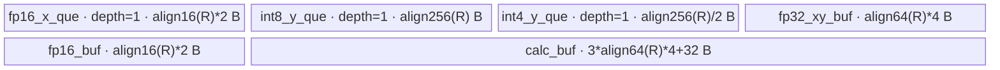

# RmsNormQuant A2/A3 ACLNN 算子知识

## 算子速览

| 项目 | 内容 |
|---|---|
| 实际入口 | `aclnnRmsNormQuantGetWorkspaceSize` / `aclnnRmsNormQuant`，公开 ACLNN 两段式接口 |
| 计算语义 | 对尾轴做 RMSNorm，再执行标量反量化尺度的 INT8/INT4 量化：`round((x / rms * gamma + beta) / scale + offset)` |
| 输入输出 | `x/gamma/beta/scale` 为 FP16 或 BF16，`offset` 为 INT8；`y` 为 INT8 或物理 INT4（ACLNN 也允许用 INT32 view 承载打包 INT4） |
| 执行类型 | 单 Kernel，唯一 Device 节点为 `AIV_VECTOR`；未发现 Cube/AIC/MIX_CV |
| Kernel 路线 | R-001 整行常驻（`numCol <= 8192`）；R-002 双遍切片（`numCol > 8192`） |
| 核心资源 | GM、单深度 `VECIN/VECOUT` Queue、三个 `TBuf`、Vector/Scalar 硬事件；算子 Kernel 不读 workspace |
| 来源闭包 | `source_closed`：公开 ACLNN → L0 `RmsNormQuant` → Tiling/POD → `rms_norm_quant` router → `RmsNormQuant::Launch`/helper → 平台 config 均闭合 |
| 验证状态 | 已完成源码闭包检查；本次知识提取未执行编译、真机、数值或性能测试。 |

## 接口与语义

### 计算语义

令 `R = x.shape[-1]`、`A = numel(x) / R`。对每行 `a`：

```text
s[a] = sum_{r=0}^{R-1} float(x[a,r])^2
rms[a] = sqrt(s[a] / R + epsilon)
z[a,r] = float(x[a,r]) / rms[a] * float(gamma[r]) + float(beta[r])
y[a,r] = cast_dst(round(z[a,r] / scale[0] + offset[0]))
```

Kernel 在初始化时把 `scale[0]` 变为 `input_scale_ = 1 / scale[0]`，所以 Device 的 `Muls(..., input_scale_)` 与公开公式的除法一致。INT8 路径先限幅到 `quantMin..127`；`quantMin` 默认 `-128`，环境变量 `ASDOPS_QUANT_MIN_NEG_127=1` 时为 `-127`。INT4 路径用 `CAST_RINT` 生成打包输出。

### 输入、输出与属性

| 参数 | shape/layout | dtype | 约束、默认值与语义 |
|---|---|---|---|
| `x` | ND，1–8 维 | FP16/BF16 | 非空；A2/A3 ACLNN 仅接受这两类 dtype |
| `gamma` | `[R]` 或 `[1,R]`，ND | 同 `x` | 非空；二维时先连续化并 reshape 为 `[R]` |
| `beta` | 与 `gamma` 相同 | 同 `x` | ACLNN 必选；二维时先连续化并 reshape 为 `[R]` |
| `scale` | 一维单元素 | 同 `x` | 非空且值不得为 0；Kernel 读取首个 32B block 中的元素 0 |
| `offset` | 与 `scale` 同 shape | INT8 | 非空；Kernel 读取元素 0 |
| `epsilon` | 标量属性 | double→float | Tiling 要求 `epsilon > 0` |
| `y` | 通常同 `x`；INT32 承载时尾轴为 `R/8` | INT8/INT4/INT32-view | INT32 仅是 INT4 物理结果的 view；`R` 必须能满足打包关系 |

### 入口与版本

A2/A3 的公开产品表明确支持 `aclnnRmsNormQuant`，而 `aclnnRmsNormQuantV3` 的公开产品表明确不支持 A2/A3，因此本卡选择无版本后缀入口作为这些平台实际支持的最新公开版本。`aclnnRmsNormQuant` 在 950 的 RegBase 分支会转向内部 `RmsNormQuantV2`，但该分支不属于本卡平台，也不用于替代 A2/A3 实现。

## Host/Launcher 执行流程

### 参数校验与前处理

`aclnnRmsNormQuantGetWorkspaceSize` 的顺序为：检查 workspace/executor 指针；创建 executor；若 `gamma/beta` 为二维则分别 `Contiguous` 后 `Reshape([dim1])`；按 SoC 选择输入/输出 dtype 白名单；校验必选指针、1–8/1–2 维、`gamma[-1] == x[-1]`、`gamma.shape == beta.shape`、`scale.shape == offset.shape` 以及输出尾轴关系；再将 `x/scale/offset/gamma/beta` 连续化。输出 dtype 为 INT32 时，launcher 属性仍传 `dstType=INT4`，最终以 `CreateView` 改成 INT32 view 并 `ViewCopy`。

### 参数、Workspace 与生命周期

L0 `RmsNormQuant` 以 `x` 的 view shape 分配临时 `y`，随后用 `ADD_TO_LAUNCHER_LIST_AICORE` 注册一个 `RmsNormQuant` 节点；属性为 float `epsilon`、`false`、`false`、`dstType`。Tiling 将 `workspaces[0]` 固定为 `16 MiB`，但 `rms_norm_quant` entry 的 `workspace` 形参没有 consumer；该预留以及 `Contiguous/ViewCopy` 的临时空间由 executor 统一拥有，第一段返回总 workspace，第二段在用户 stream 上由 `CommonOpExecutorRun` 执行。固定仓不公开 executor 内部的精确临时 slice offset。

### 启动图与失败传播

```text
aclnnRmsNormQuantGetWorkspaceSize
  -> Contiguous/Reshape framework nodes (按需)
  -> l0op::RmsNormQuant
     -> ADD_TO_LAUNCHER_LIST_AICORE(RmsNormQuant)
        -> rms_norm_quant<<<blockDim=numCore>>>(x,gamma,beta,scale,offset,y,workspace,tiling)
  -> ViewCopy(yTemp -> y)
aclnnRmsNormQuant(workspace, executor, stream)
  -> CommonOpExecutorRun：同一 executor/stream 顺序执行；任一节点失败即返回，不提交后续有效结果
```

唯一算子 Device 节点直接读五个 GM 输入、写临时 `y` GM；与框架节点的边由 executor tensor 对象持有。算子内部没有多 Kernel workspace 交接边。

## Route 与参数设计

### 分核与资源计算

Host 计算 `R = gamma.numel()`、`A = x.numel()/R`。`numCore = ceil(A / ceil(A/coreNumAiv))`，每核名义行数 `rowWork = ceil(A/numCore)`，最后核行数为 `A-(numCore-1)*rowWork`。每核 GM 基址为 `blockIdx * rowWork * R`。`sliceSize=8192`；整行路线分别把 INT8/INT4、FP16、FP32 容量向 256、16、64 元素对齐，切片路线的各容量均为 8192，另以 `align64(R)` 计算切片数。

### Route 选择

| 顺序 | Route | Key/模板 | 精确选择条件与优先级 | 不适用去向 |
|---:|---|---|---|---|
| 1 | R-001 整行常驻 | FP16 `257`，BF16 `283`；`FastComputeMode=true` | ACLNN 的 `beta` 必选，`highPrecisionMode=false`、`gemmaMode=false`，且 `R <= 8192` | `R > 8192` 转 R-002；不支持 dtype/shape 在 API/Tiling 失败 |
| 2 | R-002 双遍切片 | FP16 `321`，BF16 `347`；`FastComputeMode=false` | 同上且 `R > 8192` | 无后续 Route；参数错误失败 |

```text
if platform not in {ascend910b, ascend910_93}: fail/非本卡
validate FP16/BF16 input family and INT8/INT4 physical output
useSlice = (R > 8192)
key = (((gemma<<1 | beta)<<1 | precision)<<1 | useSlice)<<6 | ge_dtype
beta=true, gemma=false, precision=false
if !useSlice: R-001
else: R-002
```

### 模板/实现执行矩阵

| Route | key/selector | dtype/shape/platform 完整命中条件 | 执行拓扑与 Kernel 节点 | 实际模板/body | 内存与同步特征 | tail/fallback |
|---|---|---|---|---|---|---|
| R-001 整行常驻 | 257/283 | A2/A3；FP16/BF16；`R<=8192`；beta 存在 | 单 AIV Kernel | `RmsNormQuant<T,DTYPE_Y,true,true>::FastCompute/Compute` | gamma、beta 各装一次；每行 x→FP32→reduce→norm/quant；Queue+硬事件 | Vector API 以有效 `R` mask；DMA helper 处理 32B 非对齐 |
| R-002 双遍切片 | 321/347 | A2/A3；FP16/BF16；`R>8192`；beta 存在 | 单 AIV Kernel | `RmsNormQuant<T,DTYPE_Y,true,false>::SliceCompute` | 第一遍逐片平方和，第二遍逐片重读 x/gamma/beta 并量化 | `tail_copy = R-(numSlice-1)*8192`；每片有效长度驱动搬运/计算 |

INT8 与 INT4 使用相同 TilingKey，但 binary config 选择不同 `DTYPE_Y` 实例；两者在输出 Queue、cast 和 GM 字节地址上分化。FP16/BF16 也共用源码模板，但由 key 与 binary dtype 实例区分。

### 隐藏性能 Guard

| Guard | Host/Tiling 条件 | Device/资源原因 | 影响 Route | 不满足时去向 | 源码符号 |
|---|---|---|---|---|---|
| 行常驻上界 | `R <= sliceSize(8192)` | 整行 x/gamma/beta、FP32 计算与 reduce 临时区需同时驻 UB | R-001 | R-002 | `CalcNormTilingKey` / `RmsNormQuant::Launch` |
| 非空与 32 位乘积 | 各维 `>0`，`x.numel` 和 `numRow+numCore` 不溢出 uint32 | POD 的 A/R/core 字段为 32 位 | 两条 | Tiling 失败 | `NormCommonTiling` |
| INT4 长度 | Tiling 要求 `R % 8 == 0` | 输出按半字节写，INT32 view 每 8 个 INT4 合一 | 两条 INT4 实例 | Tiling/API 失败 | `NormCommonTiling` / `Int42Int32PackedTensor` |
| DMA tail | 旧架构 GM→UB 非 32B 时向上取整；UB→GM 小尾或尾块走标量/重叠块处理 | `DataCopy` 的 32B block 约束 | 两条 | helper 内部 tail 路径 | `DataCopyCustomQuant` |
| BF16 guard | `__CCE_AICORE__==220` 且非 arch3003/3113 | router 的 BF16 实例受编译 guard 控制 | 两条 BF16 | 未编译则无 body | `rms_norm_quant` |

### POD/ABI

| 结构 | 字段 | 类型/位宽 | ABI 布局 | 单位 | Host/launcher producer | Device consumer | 边界 |
|---|---|---|---|---|---|---|---|
| `NormCommonTilingData1` | `numCore` | uint32/32 | 字段顺序可见；宏展开后的 offsetof/sizeof 固定仓不可见 | core | `set_numCore(...)` | ctor 分核 | `1..min(A,coreNumAiv)` |
| 同上 | `numCol` | uint32/32 | 同上 | element | `gamma_size` | 对齐、循环、地址 | `R>0` |
| 同上 | `numRow` | uint32/32 | 同上 | row | `x.numel/gamma_size` | 每核行数 | 非空且不溢出 |
| 同上 | `avgFactor` | float/32 | 同上 | 1/element | `1.0/R` | 平方和缩放 | 正值 |
| 同上 | `epsilon` | float/32 | 同上 | 数值 | attr float | `sqrt(sum/R+epsilon)` | 必须 `>0` |
| 同上 | `sliceSize` | uint32/32 | 同上 | element | `8192` | Route/UB tile | 固定 |
| 同上 | `sliceNum` | uint32/32 | 同上 | 未使用 | 固定仓未见赋值 | 固定仓未见读取 | inactive |
| 同上 | `tailSliceSize` | uint32/32 | 同上 | 未使用 | 固定仓未见赋值 | 固定仓未见读取 | inactive |
| 同上 | `quantMin` | int32/32 | 同上 | 整数阈值 | 环境变量选择 -127/-128 | INT8 clamp | INT4 不读 |
| 同上 | `scale` | float/32 | 同上 | 未使用 | `1.0f` | 固定仓未见读取 | inactive |
| 同上 | `offset` | int32/32 | 同上 | 未使用 | `0` | 固定仓未见读取 | inactive |
| 同上 | `highPrecisionMode` | bool/实现位宽 | 同上 | flag | ACLNN 固定 false | 仅参与 key | false |
| 同上 | `gemmaMode` | bool/实现位宽 | 同上 | flag | ACLNN 固定 false | 仅参与 key | false |
| 同上 | `dstType` | int32/32 | 同上 | GE dtype enum | ACLNN `yType` | ctor 保存；实际输出由 `DTYPE_Y` 编译实例决定 | INT8/INT4 |

### Route 源码闭包

| Route | Key/selector | Host/Tiling producer | POD/参数 | Kernel entry/router 节点 | Kernel body/直接依赖 | 构建接线 |
|---|---|---|---|---|---|---|
| R-001 | 257/283 | `rms_norm_quant_common_tiling.cpp::NormCommonTiling/CalcNormTilingKey` | `NormCommonTilingData1` | `rms_norm_quant.cpp::rms_norm_quant` | `RmsNormQuant::FastCompute/Compute`、`rms_norm_quant.h` helper | `rms_norm_quant_def.cpp` + ascend910b/ascend910_93 binary JSON |
| R-002 | 321/347 | 同上 | 同上 | 同上 | `RmsNormQuant::SliceCompute/ComputeSquareSum/ComputeNormandQuant` | 同上 |

## Kernel 实现

### 公共执行流程

entry 解析 `NormCommonTilingData1`，按 key 实例化 `RmsNormQuant<T,DTYPE_Y,EN_BETA,FastComputeMode>`。构造函数绑定每核 GM slice，初始化全部 Queue/TBuf，并通过 `GetScaleAndOffset<T>` 用 MTE2→Scalar/Vector 事件读取标量 `1/scale` 与 `offset`。两 Route 均以 FP32 做平方、归约、归一化、gamma/beta 与量化仿射，最后降到 half 再 cast 为 INT8/INT4。

### Route R-001：整行常驻

#### 适用条件

##### 选择证据

| 层级 | 文件 | 符号 | 源码谓词/参数 | 结果/下一跳 |
|---|---|---|---|---|
| ACLNN | `op_host/op_api/aclnn_rms_norm_quant.cpp` | `aclnnRmsNormQuantGetWorkspaceSize` | 非 RegBase A2/A3 分支 | L0 `RmsNormQuant` |
| Tiling | `op_host/rms_norm_quant_common_tiling.cpp` | `CalcNormTilingKey` | `useSlice = numCol > sliceSize` 为 false，beta=true | 257/283 |
| Router | `op_kernel/rms_norm_quant.cpp` | `rms_norm_quant` | `TILING_KEY_IS(257/283)` | `FastComputeMode=true` |

#### Device 数据流

##### 函数级调用链

```text
rms_norm_quant
  -> RmsNormQuant<T,DTYPE_Y,true,true>::ctor
     -> InitBuffer + GetScaleAndOffset
  -> Launch -> FastCompute
     -> preload gamma -> Cast FP32; preload beta
     -> per row: CopyIn(x) -> Compute -> CopyOut
```

##### 源码等价伪码

```text
g_fp32[0:R] = cast_fp32(DMA(gamma[0:R]))
b_local[0:R] = DMA(beta[0:R])
for row in this_core_rows:
  x_local = DMA(x[row,0:R])
  x_fp32 = cast_fp32(x_local)
  sq = x_fp32 * x_fp32 * (1/R)
  sum = ReduceSum(sq); factor = 1 / sqrt(sum + epsilon)
  z = x_fp32 * factor * g_fp32 + cast_fp32(b_local)
  q = z * reciprocal(scale[0]) + offset[0]
  if DTYPE_Y == INT4: out = CAST_RINT<int4>(cast_half(q))
  else: out = cast_int8(clamp(cast_half(q), quantMin, 127))
  DMA(out -> y[row,0:R])
```

#### 内存与数据搬运

##### 资源与搬运表

| 层级/缓冲区 | offset/地址公式 | extent/容量公式 | dtype/layout | producer | consumer | owner/lifetime | 对齐/复用 |
|---|---|---|---|---|---|---|---|
| GM x/y | `blockIdx*rowWork*R + row*R` | `rowWork*R` elements | T / INT8或packed INT4 | Host tensor / CopyOut | CopyIn / caller | executor；Kernel 期间 | y INT4 地址按半字节 |
| `fp16_x_que_` | Queue | `align16(R)*2` B，depth1 | T | CopyIn | Compute | 每行 Alloc→Free | 32B |
| `int8_y_que_` | Queue | `align256(R)` B，depth1 | INT8 | Compute | CopyOut | 每行 | 即使 INT4 binary 也分配 |
| `int4_y_que_` | Queue | `align256(R)/2` B，depth1 | packed INT4 | Compute | CopyOut | 每行 | 即使 INT8 binary 也分配 |
| `fp32_xy_buf_` | TBuf | `align64(R)*4` B | FP32/别名 T | gamma load、x cast | compute | Kernel | 同区先承载 T gamma，再承载 FP32 x |
| `fp16_buf_` | TBuf | `align16(R)*2` B | T/INT8 alias | scale/offset 初始化，随后 beta | Compute | Kernel | 标量读取完成后覆盖为 beta |
| `calc_buf_` | TBuf | `3*align64(R)*4+32` B | FP32/half alias | gamma/sq/work/sum | Compute | Kernel | sum 从尾部 32B；half 临时复用 work 区 |

##### 分层内存布局



##### 字节账与复用顺序

```text
UB_total = align16(R)*2 + align256(R) + align256(R)/2
         + align64(R)*4 + align16(R)*2 + 3*align64(R)*4 + 32
dynamic_ub = N/A（AIV Queue/TBuf）
workspace_total = 16 MiB Tiling 预留 + executor 框架临时；Kernel 自身读取 0 B
=> R <= 8192 进入整行实现
```

| 复用子区 | 写入者 | 读取者/消费点 | 下一次覆盖 | 同步或释放依据 | 安全条件 |
|---|---|---|---|---|---|
| `fp32_xy_buf_` | gamma DMA / x Cast | gamma Cast / 后续计算 | 每行 x Cast | MTE2_V 与 V_MTE2 event、PIPE_V barrier | gamma FP32 已复制到 `calc_buf_` |
| `fp16_buf_` | scale/offset DMA | Scalar 取值 | beta DMA | MTE2_S/V 与 S_MTE2 event | 标量已进入成员变量 |
| `calc_buf_` work 区 | reduce work | ReduceSum | half quant 临时 | PIPE_V barrier | reduction 已完成 |

#### 同步、精度与尾块

##### 同步与数值边界表

| 阶段 | primitive/机制 | producer | consumer/等待点 | 保护对象 | 精度/尾块 |
|---|---|---|---|---|---|
| gamma/scale/offset | `SetFlag/WaitFlag` MTE2↔V/S | DMA | Cast/Scalar | TBuf | 标量取倒数后保存 FP32 |
| x pipeline | TQue EnQue/DeQue/Free | CopyIn | Compute | x Queue | 有效 R 传给所有 Vector API |
| compute | `PipeBarrier<PIPE_V>` | Cast/Mul/Reduce/Add | 下一 Vector op | 中间 FP32 | FP32 累加与仿射，最终降 half |
| output | VECOUT Queue | cast | CopyOut | y Queue | INT8 clamp；INT4 RINT；DMA helper 保护非 32B tail |

#### 关键实现

##### 符号证据表

| 阶段 | 文件 | 符号/模板实例 | 实现事实 |
|---|---|---|---|
| Host/Tiling producer | `norm/rms_norm_quant/op_host/rms_norm_quant_common_tiling.cpp` | `NormCommonTiling<true>` | 生成 A/R/core/key/16MiB workspace |
| Kernel entry/router | `norm/rms_norm_quant/op_kernel/rms_norm_quant.cpp` | `rms_norm_quant`, keys 257/283 | 映射整行实例 |
| Device body/helper | 同上 + `op_kernel/rms_norm_quant.h` | `FastCompute/Compute/GetScaleAndOffset/DataCopyCustomQuant` | 完整搬运、FP32 归约、量化和 tail |

### Route R-002：双遍切片

#### 适用条件

##### 选择证据

| 层级 | 文件 | 符号 | 源码谓词/参数 | 结果/下一跳 |
|---|---|---|---|---|
| Tiling | `op_host/rms_norm_quant_common_tiling.cpp` | `CalcNormTilingKey` | `numCol > 8192` | 321/347 |
| Router | `op_kernel/rms_norm_quant.cpp` | `rms_norm_quant` | `TILING_KEY_IS(321/347)` | `FastComputeMode=false` |
| Body | 同上 | `SliceCompute` | `numSlice=ceil(align64(R)/8192)` | 双遍切片 |

#### Device 数据流

##### 函数级调用链

```text
rms_norm_quant -> RmsNormQuant<T,DTYPE_Y,true,false>::Launch
  -> SliceCompute
     -> pass 1: CopyIn -> ComputeSquareSum (per slice)
     -> scalar factor
     -> pass 2: beta DMA + CopyInGama + CopyIn x -> ComputeNormandQuant -> CopyOut
```

##### 源码等价伪码

```text
for row:
  squareSum = 0
  for sid in [0,numSlice):
    n = tail_copy if last else 8192
    squareSum += ReduceSum(cast_fp32(DMA(x[row,sid]))^2, n)
  factor = 1 / sqrt(squareSum*(1/R)+epsilon)  # rms==0 时源码用 1.0
  for sid in [0,numSlice):
    n = tail_copy if last else 8192
    DMA beta[sid], gamma[sid], x[row,sid]
    z = cast_fp32(x)*factor*cast_fp32(gamma)+cast_fp32(beta)
    quantize and DMA exactly n elements
```

#### 内存与数据搬运

##### 资源与搬运表

| 层级/缓冲区 | offset/地址公式 | extent/容量公式 | dtype/layout | producer | consumer | owner/lifetime | 对齐/复用 |
|---|---|---|---|---|---|---|---|
| GM x first/second read | `row*R + sid*8192` | `n=min(8192,R-sid*8192)` | T ND | GM | square pass / quant pass | caller | x 被读两遍 |
| gamma/beta | `sid*8192` | n | T | GM | second pass | caller | 每片装载 |
| UB all buffers | 与 R-001 同名 | 以 `S=8192` 代替各 align 容量 | 同 R-001 | 各阶段 | 各阶段 | Kernel | 固定 tile |

##### 分层内存布局


##### 字节账与复用顺序

```text
UB_total = 8192*2 + 8192 + 8192/2 + 8192*4 + 8192*2 + 3*8192*4 + 32
         = 176160 B
dynamic_ub = N/A
workspace_total = 同 R-001
```

| 复用子区 | 写入者 | 读取者/消费点 | 下一次覆盖 | 同步或释放依据 | 安全条件 |
|---|---|---|---|---|---|
| x Queue | pass1/2 CopyIn | square/norm helper | 下一片 | Queue Free + `PIPE_ALL` barrier | 当前片消费完成 |
| `calc_buf_` | square/reduce | Scalar sum | gamma/work/half quant | V_S/S_V event 与 `PIPE_ALL` | squareSum 已累加到 Scalar |

#### 同步、精度与尾块

##### 同步与数值边界表

| 阶段 | primitive/机制 | producer | consumer/等待点 | 保护对象 | 精度/尾块 |
|---|---|---|---|---|---|
| 片间 | `PipeBarrier<PIPE_ALL>` | DMA/Vector | 下一阶段 | 复用 UB | last slice 用 `tail_copy` |
| 分片归约 | V_S event | ReduceSum | `GetValue(0)` | sum | 各片 FP32 和在 Scalar 累加 |
| 二次遍历 | Queue + barriers | gamma/beta/x load | norm/quant | 同一 UB | 无效对齐 lane 不参与有效 n |

#### 关键实现

##### 符号证据表

| 阶段 | 文件 | 符号/模板实例 | 实现事实 |
|---|---|---|---|
| Host/Tiling producer | `norm/rms_norm_quant/op_host/rms_norm_quant_common_tiling.cpp` | `CalcNormTilingKey` | `R>8192` 置 slice bit |
| Kernel entry/router | `norm/rms_norm_quant/op_kernel/rms_norm_quant.cpp` | keys 321/347 | 映射切片实例 |
| Device body/helper | 同上 | `SliceCompute/ComputeSquareSum/ComputeNormandQuant` | 双遍地址、归约、tail 与输出 |

## 算子特定优化

### Trick T-001：整行路线只装载一次 gamma/beta

#### 触发与源码依据

- 适用 Route：R-001
- 触发条件：`numCol <= sliceSize`，router 选择 `FastComputeMode=true`
- Golden 来源：[`norm/rms_norm_quant/op_kernel/rms_norm_quant.cpp:98-119`](../../../../../../../cann-ops-raw/ascendc/ops-nn/955f8b33985b6d72989ebff341bb9c2c564a51bc/norm/rms_norm_quant/op_kernel/rms_norm_quant.cpp#L98-L119)

**官方源码（固定 Commit 连续逐字摘录）**：

```cpp
AscendC::LocalTensor<T> fp16_g = fp32_xy_buf_.Get<T>(num_col_align_f32);
AscendC::LocalTensor<float> fp32_g = calc_buf_.Get<float>(num_col_align_f16);
DataCopyCustomQuant<T>(fp16_g, gm_g_, num_col_);
AscendC::SetFlag<HardEvent::MTE2_V>(EVENT_ID0);
AscendC::WaitFlag<HardEvent::MTE2_V>(EVENT_ID0);
Cast(fp32_g[OFFSET_GAMMA * num_col_align_f32], fp16_g, AscendC::RoundMode::CAST_NONE, num_col_);
```

#### 机制与设计原因

gamma 在行循环外从 GM 搬入并转为 FP32，beta 也在行循环外装入 `fp16_buf_`。因此同一 core 的多行共享参数常驻 UB，避免每行重复读取；成立前提是整行参数和计算临时区能同时容纳。

#### 迁移边界

- 适用：尾轴参数在同核多行间共享的融合 norm+quant。
- 前提：A2/A3、FP16/BF16、`R<=8192`，UB 字节账成立。
- 失效：`R>8192` 必须改用 R-002，逐片重读参数。
- 未验证：本次知识提取未执行编译、真机、数值或性能测试。

#### 错误做法

固定仓可验证的失效边界是强行让大于 8192 的行走整行实例会超出固定容量；Host 以 slice bit 阻止该组合。

### Trick T-002：长行双遍切片避免跨核归约 workspace

#### 触发与源码依据

- 适用 Route：R-002
- 触发条件：`R>8192`
- Golden 来源：[`norm/rms_norm_quant/op_kernel/rms_norm_quant.cpp:123-156`](../../../../../../../cann-ops-raw/ascendc/ops-nn/955f8b33985b6d72989ebff341bb9c2c564a51bc/norm/rms_norm_quant/op_kernel/rms_norm_quant.cpp#L123-L156)

**官方源码（固定 Commit 连续逐字摘录）**：

```cpp
for (uint64_t sid = 0; sid < num_slice_; sid++) {
    uint64_t col_offset = row_offset + sid * slice_size_;
    uint32_t copyNum = (sid == (num_slice_ - 1)) ? tail_copy_ : slice_size_;
    CopyIn(col_offset, copyNum);
    AscendC::PipeBarrier<PIPE_ALL>();
    squareSum += ComputeSquareSum(copyNum);
}
```

#### 机制与设计原因

一行始终由一个 AIV core 拥有：第一遍仅保留 Scalar `squareSum`，第二遍使用得到的 factor 重读并输出。它把 UB 上界固定为 176160B，并避免生成跨核 partial-sum workspace 或额外归并 Kernel，代价是 x 的第二次 GM 读取。

#### 迁移边界

- 适用：单行超过 UB 常驻上限、但希望保持单 Kernel/单核逐行归约的场景。
- 前提：每片不超过 8192，Scalar 累加顺序和双遍读取可接受。
- 失效：行维无法放入 uint32、输入为空或 INT4 对齐不满足时 Tiling 失败。
- 未验证：本次知识提取未执行编译、真机、数值或性能测试。

#### 错误做法

固定仓未提供可验证反例；源码只给出了整行与双遍切片两条真实路线。

## 模板与实现对比

| 对比维度 | R-001 整行常驻 | R-002 双遍切片 | 设计选择依据 |
|---|---|---|---|
| 命中条件/优先级 | `R<=8192` | `R>8192` | 单决策树 slice bit |
| 模板与 dtype | `FastComputeMode=true`，FP16/BF16、INT8/INT4 binary 实例 | `FastComputeMode=false`，同 dtype 实例 | 输入/输出 dtype 在 key和 binary config 中确定 |
| 循环与分核 | core→row | core→row→两遍 slice | 每行不跨核 |
| Queue/TBuf/寄存器/dynamic UB | 容量随 R 对齐 | 固定 8192 tile，176160B | UB 常驻能力 |
| 内存总占用与复用 | gamma/beta 跨行复用 | TBuf 跨片复用 | 搬运量与 UB 的权衡 |
| 搬运/Vector API | 每行 x 一次 | 每行 x 两遍、参数第二遍逐片 | 长行以重算/重读换 UB |
| 同步、精度与 tail | Queue、MTE/V/S event；FP32 中间 | 额外 `PIPE_ALL` 片间屏障；FP32 Scalar 片和 | 尾片 `tail_copy` |
| fallback/失败边界 | 大行转 R-002 | 无后续 | shape/dtype/溢出失败 |

## 平台差异

| 项目 | A2 | A3 | 950 |
|---|---|---|---|
| 支持状态 | 公开 `aclnnRmsNormQuant` 支持 | 公开 `aclnnRmsNormQuant` 支持 | 本卡不覆盖；最新公开版本见 `_950` 卡的 V3 |
| Host/Launcher | `ascend910b` config | `ascend910_93` config | 不适用 |
| Kernel/资源 | 共用旧 AIV template，FP16/BF16/INT8/INT4 binary | 同左 | V3 使用 RegBase FullLoad/Recompute，ABI 不兼容 |

## 限制与失败边界

- ACLNN 必选 beta；router 虽保留无 beta key 1/65/27/91，但不从本卡公开入口可达，不进入正式 Route。
- `high_precision_mode`、`gemma_mode` 在 ACLNN launcher 固定 false；其它组合不是本入口 Route。
- Tiling 对物理 INT4 要求 `R%8==0`，比公开文档“偶数”更严格；固定源码以实际 Tiling 失败为准。
- `sliceNum/tailSliceSize/scale/offset` POD 字段没有 Device consumer；不能据字段名推测行为。
- executor 内部为 Contiguous/ViewCopy 分配的 workspace slice offset 与框架调度细节固定仓不可见；算子自有 selector/POD/Kernel 已闭合。
- 本次知识提取未执行编译、真机、数值或性能测试。

## 源码索引

### 链路索引

| 链路阶段 | 文件 | 关键符号 | 支撑内容 |
|---|---|---|---|
| 入口声明/约束 | `norm/rms_norm_quant/docs/aclnnRmsNormQuant.md` | `aclnnRmsNormQuant*` | 公开语义、平台、dtype/shape |
| 入口实现 | `norm/rms_norm_quant/op_host/op_api/aclnn_rms_norm_quant.cpp` | `aclnnRmsNormQuantGetWorkspaceSize` | 校验、连续化、INT4 view、executor |
| L0 launcher | `norm/rms_norm_quant/op_host/op_api/rms_norm_quant.cpp` | `l0op::RmsNormQuant` | 单 AICore 节点与属性顺序 |
| Host/Tiling | `norm/rms_norm_quant/op_host/rms_norm_quant_common_tiling.cpp` | `NormCommonTiling/CalcNormTilingKey` | 分核、Route、workspace |
| POD | `norm/rms_norm_quant/op_host/rms_norm_quant_common_tiling.h` | `NormCommonTilingData1` | ABI 字段 |
| 平台注册 | `norm/rms_norm_quant/op_host/rms_norm_quant_def.cpp` | `RmsNormQuant::RmsNormQuant` | A2/A3 OpDef |
| Binary A2 | `norm/rms_norm_quant/op_host/config/ascend910b/rms_norm_quant_binary.json` | `op_list` | dtype binary 实例 |
| Binary A3 | `norm/rms_norm_quant/op_host/config/ascend910_93/rms_norm_quant_binary.json` | `op_list` | dtype binary 实例 |
| Kernel entry/body | `norm/rms_norm_quant/op_kernel/rms_norm_quant.cpp` | `rms_norm_quant/RmsNormQuant` | router 与两 Route body |
| Kernel helper | `norm/rms_norm_quant/op_kernel/rms_norm_quant.h` | `GetScaleAndOffset/DataCopyCustomQuant` | 标量、cast、DMA tail |
| 公共 Kernel 常量 | `norm/rms_norm/op_kernel/rms_norm_base.h` | `BUFFER_NUM/BLOCK_SIZE` | Queue depth 与 block 约束 |

### 实现复用检查

| 检查项 | 可复用事实 | 不得改变的约束 | 源码符号 |
|---|---|---|---|
| ABI/POD | A/R/core/slice/key 的生产消费 | uint32 范围、字段顺序、inactive 字段 | `NormCommonTilingData1` |
| 调用顺序 | 参数预处理→单 Kernel→ViewCopy | INT32 必须先作为 INT4 计算后建 view | `aclnnRmsNormQuantGetWorkspaceSize` |
| workspace/内存 | 单 Kernel 不消费 workspace；两套 UB 公式 | 16MiB Tiling 预留和 executor owner 不可删 | `NormCommonTiling` / ctor |
| 同步 | Queue 与 MTE/V/S event 可复用 | 标量和 TBuf 覆盖前的等待不可省 | `FastCompute/GetScaleAndOffset` |
| 精度与尾块 | FP32 归约/仿射、half 后量化 | INT8 clamp、INT4 RINT、有效 n | `Compute/ComputeNormandQuant` |
| 失败边界 | 大行切片 fallback | dtype/shape/溢出/INT4 guard | `CheckParams/NormCommonTiling` |