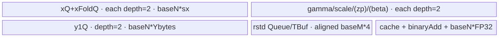

# RmsNormQuant 950 ACLNN 算子知识

## 算子速览

| 项目 | 内容 |
|---|---|
| 实际入口 | `aclnnRmsNormQuantV3GetWorkspaceSize` / `aclnnRmsNormQuantV3`，950 最新公开版本 |
| 计算语义 | RMSNorm + 可选 beta + 标量/逐元素 scale 与 zero-point 的单路量化，并可输出 FP32 `rstd` |
| 输入输出 | x/gamma 为 FP32/FP16/BF16；scale 同族；可选 offset/beta；y 为 INT8/INT4/FP8/HIF8，rstd 为 FP32 |
| 执行类型 | 单 Kernel，唯一 Device 节点为 `AIV_VECTOR`（MicroAPI/RegTensor）；tiling key 明确 `AIV_ONLY`，未发现 Cube/AIC/MIX_CV |
| Kernel 路线 | R-001 `FULL_LOAD`（优先级 100）；R-002 `RECOMPUTE`（优先级 200 fallback） |
| 核心资源 | GM、双缓冲 VECIN/VECOUT Queue、TBuf、RegTensor；用户 workspace 为 0，另含平台 LibApi 系统 workspace |
| 来源闭包 | `source_closed`：公开 V3 ACLNN → L0 launcher → V3 tiling registry → V2 shared selector/POD → V3 entry → V2 FULL_LOAD/RECOMPUTE body → ascend950 构建接线闭合 |
| 验证状态 | 已完成源码闭包检查；本次知识提取未执行编译、真机、数值或性能测试。 |

## 接口与语义

### 计算语义

令 gamma shape 对应归约域大小 `R`，其余前缀为 `A=numel(x)/R`；`q=numel(scale)` 只能为 1 或 R：

```text
rstd[a] = rsqrt(sum_r(float(x[a,r])^2)/R + epsilon)
z[a,r] = float(x[a,r]) * rstd[a] * float(gamma[r]) + (beta ? float(beta[r]) : 0)
if divMode: y[a,r] = cast_dst(round(z[a,r] / scale[q==1?0:r] + offset[q==1?0:r]))
else:       y[a,r] = cast_dst(round(z[a,r] * scale[q==1?0:r] + offset[q==1?0:r]))
```

公开 ACLNN 只提供一组 `scale/offset/y`，L0 的 `scales2/zeroPoints2/y2` 恒为空/别名；`outputRstd=false` 时传入零长度占位 rstd，Kernel 的 `rstdFlag=0` 不写 GM rstd。

### 输入、输出与属性

| 参数 | shape/layout | dtype | 约束、默认值与语义 |
|---|---|---|---|
| `x` | ND，1–8 维，非空 | FP32/FP16/BF16 | 连续化后进入 Kernel |
| `gamma` | ACLNN 为 1–2 维；shape 对应 x 尾部归约域 | 同 x | 二维先 reshape 为 `[dim1]`；Tiling 要求尾部 shape 匹配 |
| `scale` | 一维，元素数 1 或 R | FP32/FP16/BF16 | FP32 x 必须配 FP32 scale；B16 x 可配 FP32 或同 dtype |
| `offset` | 可选；shape 同 scale | FP32/FP16/BF16/INT32/INT8 | dtype 组合受 x/scale 约束 |
| `beta` | 可选；shape 同 gamma | 同 x | 二维 reshape 为 `[dim1]` |
| `epsilon` | 标量 | double→float | 默认 1e-6；进入 POD float |
| `divMode` | 标量 | bool | true 除 scale，false 乘 scale |
| `outputRstd` | 标量 | bool | 控制 rstd 的 shape 校验、Queue 与 GM 写回 |
| `y` | 同 x；INT32 view 承载时尾轴为 R/8 | INT8/INT4/INT32-view/FP8/HIF8 | INT4 需要尾轴为偶数；INT32 仅打包 view |
| `rstd` | x 前缀维同 x、归约维为 1 | FP32 | `outputRstd=true` 时有效 |

### 入口与版本

公开产品表中 `aclnnRmsNormQuantV3` 只支持 Ascend 950PR/950DT，并明确不支持 A2/A3；因此 950 选择 V3 作为本版本族实际支持的最新公开入口。V3 在 V2 数学语义上增加 `rstd` 输出，Host selector 与 Device body有意复用 V2 的两个模板，但 V3 有独立 ACLNN、OpDef、Tiling 注册和 entry。

## Host/Launcher 执行流程

### 参数校验与前处理

第一段先检查必选 `x/gamma/scale/y`，`outputRstd=true` 时还要求 `rstd` 非空；校验 gamma 1–2 维、scale 一维、INT32 view 的 `R%8==0` 与尾轴 `y[-1]=R/8`。随后把二维 gamma/beta reshape 为一维，将 x/gamma/scale 和存在的 offset/beta 连续化。更完整的尾部广播关系、dtype 组合、INT4 偶数约束和 rstd shape 由共享 V2 Tiling 的 `Check*` 系列校验。

### 参数、Workspace 与生命周期

Host 为有效 rstd 分配调用者 shape 的临时 tensor，否则分配 shape `{0}` 的 FP32 占位；L0 分配 y1，因 `scales2=nullptr` 令 y2=y1，并注册一个 `RmsNormQuantV3` AICore 节点。共享 Tiling 的 `GetWorkspaceSize` 将用户 workspace 置 0，`PostTiling` 返回 `GetLibApiWorkSpaceSize()` 系统 workspace。executor 拥有连续化、临时 y/rstd 与 ViewCopy 生命周期，第二段在给定 stream 上执行。

### 启动图与失败传播

```text
aclnnRmsNormQuantV3GetWorkspaceSize
  -> Reshape/Contiguous framework nodes
  -> l0op::RmsNormQuantV3
     -> ADD_TO_LAUNCHER_LIST_AICORE(RmsNormQuantV3)
        -> rms_norm_quant_v3<COMPUTE_MODE><<<usedCoreNum>>>
           -> rms_norm_quant_v2_impl<COMPUTE_MODE>
              -> FULL_LOAD or RECOMPUTE AIV body
  -> ViewCopy(y1 -> y)
  -> optional ViewCopy(rstdCompute -> rstd)
```

这是单算子 Kernel 图，没有算子自有跨 Kernel workspace 边。entry 的 workspace 形参未被 shared implementation 读取。launcher/框架任一步骤返回失败时 ACLNN 立即返回，不把后续 ViewCopy 视为有效完成。

## Route 与参数设计

### 分核与资源计算

共享 Base 将 x/gamma/scale shape 折叠成 `A/R/Q`，并生成 optionMask：bit0 scales2、bit1 zeroPoints1、bit2 zeroPoints2、bit3 beta、bit4 `Q==1`。公开 V3 ACLNN 恒 `scales2/zeroPoints2` 缺失，故可达低四位仅由 offset(bit1) 与 beta(bit3) 组成，bit0/bit2 为 0；仍由通用 body 的编译期分支闭合。

两 Route 均按 A 轴分核：`mPerCore=ceil(A/totalCoreNum)`，`usedCoreNum=ceil(A/mPerCore)`，末核 `mLastCore=A-(usedCoreNum-1)*mPerCore`。FULL_LOAD 再以 `ubFactor` 行为 UB tile；RECOMPUTE 以固定 `baseM=128` 行分组，并沿 R 选择从 64 开始、在 UB/归约上界内倍增的 `baseN`。

### Route 选择

| 顺序 | Route | Key/模板 | 精确选择条件与优先级 | 不适用去向 |
|---:|---|---|---|---|
| 1 | R-001 FULL_LOAD | `COMPUTE_MODE_FULL_LOAD=0`，priority 100 | `R<=16384` 且 Host UB 公式所得 `ubFactor>=1` | `IsCapable=false` 返回 PARAM_INVALID，尝试 R-002 |
| 2 | R-002 RECOMPUTE | `COMPUTE_MODE_RECOMPUTE=1`，priority 200 | `R>=baseN(initial 64)`；通常承接 FULL_LOAD 容不下的长行 | 无后续模板；不满足则 Tiling 失败 |

```text
if !IsRegbaseSocVersion: fail
run common shape/dtype/optional/rstd checks
for priority in ascending std::map order:
  100 FULL_LOAD: if R<=16384 && ubFactor>=1 -> key COMPUTE_MODE=0
  200 RECOMPUTE: if R>=64 -> key COMPUTE_MODE=1
fail if neither capable
```

### 模板/实现执行矩阵

| Route | key/selector | dtype/shape/platform 完整命中条件 | 执行拓扑与 Kernel 节点 | 实际模板/body | 内存与同步特征 | tail/fallback |
|---|---|---|---|---|---|---|
| R-001 FULL_LOAD | mode 0 | 950；合法 dtype/shape；`R<=16384`；UB 公式允许至少 1 行 | 单 AIV Kernel | `RmsNormQuantV2RegbaseFullLoad<T_X,T_Y,T_SCALES,T_ZEROPOINTS>::Process` | gamma/scale/offset/beta 预装一次；x/y/rstd 双缓冲；RegTensor quant | 行尾由 `curUbFactor`，R 尾由 mask；不适用转 R-002 |
| R-002 RECOMPUTE | mode 1 | 950；合法 dtype/shape；FULL_LOAD 失败；`R>=64` | 单 AIV Kernel | `RmsNormQuantV2RegbaseRecompute<T_X,T_Y,T_SCALES,T_ZEROPOINTS>::Process` | R 分块平方归约后重读 x 计算 y；多组双缓冲 Queue + cache/binaryAdd TBuf | `curN`、`foldTail`、`curM` 三类 tail；无后续 fallback |

### 隐藏性能 Guard

| Guard | Host/Tiling 条件 | Device/资源原因 | 影响 Route | 不满足时去向 | 源码符号 |
|---|---|---|---|---|---|
| FULL_LOAD R 上限 | `R<=16384` | 整行参数与每批多行 x/y 同驻 UB | R-001 | R-002 | `RmsNormQuantV2RegbaseTilingFullLoad::IsCapable` |
| FULL_LOAD UB | 公式所得 `ubFactor>=1` | Queue/TBuf 与预装参数总字节不得超过 maxUbSize-256 | R-001 | R-002 | 同上 |
| RECOMPUTE 下限 | `R>=64` | UB 间二分累加至少可折叠一次 | R-002 | Tiling 失败 | `RmsNormQuantV2RegbaseTilingRecompute::IsCapable` |
| baseN 倍增 | `powerSplit>1`、`2*baseN<=4*VL^2` 且总 UB 公式成立 | 控制归约规模与所有双缓冲容量 | R-002 | 停止倍增，保留当前 baseN | `GetMaxBaseN` lambda |
| 标量/逐元素 quant | optionMask bit4 = `(Q==1)` | 标量 scale/zp 广播一次，或每 VL 加载张量 | 两条 | 进入对应内部 specialization | `SetInputParams` / `QuantRoute` / `ComputeY_VF` |
| INT4 | `R%2==0`，ACLNN INT32 view 另要求 `R%8==0` | packed nibble 输出与 view 打包 | 两条 | 参数/Tiling 失败 | `CheckOutputDtype` / `CheckShapeValid` |
| output rstd | `rstdFlag=outputRstd` | true 用双缓冲 VECOUT 并写 GM；false 用 TBuf | 两条 | 条件资源布局 | `SetInputParams` / 两 body `Init` |

### POD/ABI

FULL_LOAD 结构按固定源码的自然 8B 对齐布局为 96B；RECOMPUTE 为 128B。Host 以 `memcpy_s(sizeof(tilingData))` 写入，Device 以同名结构解析。

| 结构 | 字段 | 类型/位宽 | ABI 布局 | 单位 | Host/launcher producer | Device consumer | 边界 |
|---|---|---|---|---|---|---|---|
| `RmsNormQuantV2RegbaseFullLoadTilingData` | `a` | int64/64 | off 0 | row | `tilingParams.a` | `numA` | >0 |
| 同上 | `r` | int64/64 | off 8 | element/row | `tilingParams.r` | `numR` | `<=16384` |
| 同上 | `q` | int64/64 | off 16 | element | scale numel | `numQ` | 1 或 R |
| 同上 | `blockFactor` | int64/64 | off 24 | row/core | `ceil(A/core)` | 每核 GM offset | >0 |
| 同上 | `blockTail` | int64/64 | off 32 | row | 末核余数 | `curBlockFactor` | >0 |
| 同上 | `ubFactor` | int64/64 | off 40 | row/UB loop | UB 公式后 min blockFactor | UB 循环 | >=1 |
| 同上 | `binaryAdd` | int64/64 | off 48 | element | `2^floor(log2(alignR-1))` | reduce fold | R>0 |
| 同上 | `optionMask` | uint64/64 | off 56 | bitmask | optional + Q==1 | 内部 specialization | 公开入口可达 bit1/3/4 |
| 同上 | `divMode` | int64/64 | off 64 | flag | attr | quant div/mul | 0/1 |
| 同上 | `dstDtype` | int64/64 | off 72 | GE dtype | y1 desc | 保存；binary T_Y 决定 cast | 支持列表 |
| 同上 | `epsilon` | float/32 | off 80 | value | attr | Newton-Raphson rstd | float |
| 同上 | `avgFactor` | float/32 | off 84 | 1/element | `1/R` | rstd | >0 |
| 同上 | `rstdFlag` | uint32/32 | off 88 | flag | output_rstd | buffer/writeback | 0/1 |
| `RmsNormQuantV2RegbaseRecomputeTilingData` | `numM` | int64/64 | off 0 | row | A | outer M | >0 |
| 同上 | `numN` | int64/64 | off 8 | element | R | R loops | >=64 |
| 同上 | `baseM` | int64/64 | off 16 | row | constant 128 | M tile | 128 |
| 同上 | `baseN` | int64/64 | off 24 | element | UB-aware power-of-two growth | R tile | >=64 |
| 同上 | `mPerCore` | int64/64 | off 32 | row/core | blockFactor | GM offset | >0 |
| 同上 | `mLastCore` | int64/64 | off 40 | row | blockTail | last core | >0 |
| 同上 | `nUbLoops` | int64/64 | off 48 | loop | `ceil(R/baseN)` | R loop | >=1 |
| 同上 | `binAddQuotient` | int64/64 | off 56 | element | largest power boundary below baseN | intra-tile reduce | >=1 |
| 同上 | `powerSplit` | int64/64 | off 64 | tile count | `GetPowerSplit(baseN)` | paired tile fold | >=1 |
| 同上 | `mainFoldCount` | int64/64 | off 72 | tile count | `(R-powerSplit*baseN)/baseN` | full paired loads | >=0 |
| 同上 | `foldTail` | int64/64 | off 80 | element | `R%baseN` | partial paired load | `[0,baseN)` |
| 同上 | `optionMask` | uint64/64 | off 88 | bitmask | Base producer | specialization | 同上 |
| 同上 | `divMode` | uint64/64 | off 96 | flag | attr | quant | 0/1 |
| 同上 | `dstDtype` | uint64/64 | off 104 | GE dtype | y desc | 保存/T_Y | 支持列表 |
| 同上 | `epsilon` | float/32 | off 112 | value | attr | rstd | float |
| 同上 | `avgFactor` | float/32 | off 116 | 1/element | `1/R` | rstd | >0 |
| 同上 | `rstdFlag` | uint32/32 | off 120 | flag | output_rstd | buffer/writeback | 0/1 |

### Route 源码闭包

| Route | Key/selector | Host/Tiling producer | POD/参数 | Kernel entry/router 节点 | Kernel body/直接依赖 | 构建接线 |
|---|---|---|---|---|---|---|
| R-001 FULL_LOAD | mode 0 / priority100 | V3 tiling→V2 Base+FullLoad | FullLoad 96B POD | `rms_norm_quant_v3<0>`→`rms_norm_quant_v2_impl<0>` | `rms_norm_quant_v2_regbase_full_load.h` + common reduce/helper | V3 OpDef、ascend950 binary JSON、op_kernel CMake |
| R-002 RECOMPUTE | mode 1 / priority200 | V3 tiling→V2 Base+Recompute | Recompute 128B POD | `rms_norm_quant_v3<1>`→`rms_norm_quant_v2_impl<1>` | recompute header + common reduce/helper | 同上 |

## Kernel 实现

### 公共执行流程

V3 entry 只转发参数到 `rms_norm_quant_v2_impl<COMPUTE_MODE>`。该 helper 声明 `KERNEL_TYPE_AIV_ONLY`，解析与 mode 对应的 POD，构造 FULL_LOAD 或 RECOMPUTE 类，依次调用 `Init`、`Process`。两类都以 FP32 RegTensor 计算平方和、rstd、gamma/beta 和 quant affine；`StoreTensorForDtypeTOut` 对 INT8、packed INT4、FP8、HIF8 选择不同饱和/round/store distribution。

### Route R-001：FULL_LOAD

#### 适用条件

##### 选择证据

| 层级 | 文件 | 符号 | 源码谓词/参数 | 结果/下一跳 |
|---|---|---|---|---|
| V3 Tiling | `rms_norm_quant_v3_tiling.cpp` | `Tiling4RmsNormQuantV3` | RegBase | registry |
| Selector | `rms_norm_quant_v2_tiling_regbase_full_load.cpp` | `IsCapable` | `R<=16384 && ubFactor>=1`，priority100 | mode0，否则 priority200 |
| Router | `rms_norm_quant_v2_apt.h` | `rms_norm_quant_v2_impl<0>` | compile-time mode0 | FullLoad class |

#### Device 数据流

##### 函数级调用链

```text
rms_norm_quant_v3<0>
  -> rms_norm_quant_v2_impl<0>
     -> FullLoad::Init -> InitBuffer
     -> FullLoad::Process
        -> CopyInOhters(gamma/scales/zp/beta once)
        -> per UB row batch: x DMA -> CalculateSquareReduceSum
           -> ComputeRstdNewtonRaphson
           -> QuantRoute -> ComputeQuant MicroAPI
           -> y/rstd DMA
```

##### 源码等价伪码

```text
preload gamma, scale1, optional offset, optional beta into packed otherQueue
for batch of rows (curUbFactor):
  DMA x[curUbFactor,R]
  sum[row] = FP32 vector square-reduce(x[row,:])
  rstd[row] = NewtonRaphsonRsqrt(sum[row]*(1/R)+epsilon)
  for row, for r in VL chunks:
    z = fp32(x)*broadcast(rstd)*fp32(gamma) + optional fp32(beta)
    q = divMode ? z/scale : z*scale
    q += optional offset
    cast/store q to y1; public ACLNN has no y2
  optional DMA rstd and DMA y1
```

#### 内存与数据搬运

##### 资源与搬运表

记 `AX=ceil(R,32/sizeof(X))`、`AS=ceil(R,32/sizeof(S))`、`AZ=ceil(R,32/sizeof(Z))`、`AY=ceil(R,32/sizeof(Ycopy))`，`nS=1`、`nZ=hasOffset`、`nB=hasBeta`、`nY=1`（公开 ACLNN）。

| 层级/缓冲区 | offset/地址公式 | extent/容量公式 | dtype/layout | producer | consumer | owner/lifetime | 对齐/复用 |
|---|---|---|---|---|---|---|---|
| x/y GM | `blockIdx*blockFactor*R + ubLoop*ubFactor*R` | 当前核行×R | X/Y | caller/Kernel | Kernel/caller | executor | INT4 offset/len `/2` |
| `inQueueX` | Queue | depth2 × `ubFactor*AX*sizeof(X)` | X | DMA | reduce+quant | 当前 UB loop | double buffer |
| `inQueueOhter` | packed offsets | `AX*sizeof(X)+AS*sizeof(S)+nZ*AZ*sizeof(Z)+nB*AX*sizeof(X)` | mixed | `CopyInOhters` | all loops | Kernel | depth1，参数常驻 |
| y1 Queue | Queue | depth2 × `ubFactor*AY*sizeof(Ycopy)`；INT4 再 `/2` | output | quant | DMA | UB loop | double buffer |
| rstd | Queue/TBuf | flag1: depth2×`align(ubFactor,8)*4`; flag0: ×1 | FP32 | reduce/rstd | quant/GM | UB loop | 条件分配 |
| `reduceTmpBuf` | TBuf | `ubFactor*align(ceil(binaryAdd/VLfp32),8)` B（按源码 InitBuffer 参数） | FP32 scratch | reduce | reduce | UB loop | 32B 对齐 |

##### 分层内存布局


##### 字节账与复用顺序

```text
preload = AX*sx + AS*ss + nZ*AZ*sz + nB*AX*sx
xQ      = 2*ubFactor*AX*sx
yQ      = 2*ubFactor*AY*sy   # INT4 实际 /2
rstd    = (rstdFlag ? 2 : 1)*align(ubFactor,8)*4
reduce  = ubFactor*align(ceil(binaryAdd/VLfp32),8) bytes
UB_total = preload+xQ+yQ+rstd+reduce
dynamic_ub = N/A
workspace_total = 0 user bytes + platform LibApi workspace
```

| 复用子区 | 写入者 | 读取者/消费点 | 下一次覆盖 | 同步或释放依据 | 安全条件 |
|---|---|---|---|---|---|
| `otherLocal` packed segments | `CopyInOhters` | all `ComputeQuant` calls | Kernel end | Queue EnQue/DeQue 后保持 LocalTensor，末尾 Free | 参数在所有行消费前不可覆盖 |
| x Queue slot | DMA | reduce then quant | next UB batch | DeQue 后在 quant 完成才 Free | rstd 与 y 已完成 |
| rstd Queue slot | Newton-Raphson | quant and optional GM DMA | next batch | EnQue/DeQue/Free | y 读取完成后释放 |

#### 同步、精度与尾块

##### 同步与数值边界表

| 阶段 | primitive/机制 | producer | consumer/等待点 | 保护对象 | 精度/尾块 |
|---|---|---|---|---|---|
| GM↔UB | TQue EnQue/DeQue | DMA | Vector | Queue slot | `curUbFactor` 行尾；R 由 mask |
| reduce | `LocalMemBar`/MicroAPI mask | square partial | final ReduceSum | tmp scratch | FP32；按 VL/2VL/common 分支 |
| rstd | Newton-Raphson Reg pipeline | sum | quant | rstdLocal | `sum/R+epsilon`，0/inf 有显式 Select |
| quant store | dtype CastTrait | FP32 affine | packed store | y Queue | INT8 RINT；INT4 pack；FP8 SAT+RINT；HIF8 SAT+ROUND |

#### 关键实现

##### 符号证据表

| 阶段 | 文件 | 符号/模板实例 | 实现事实 |
|---|---|---|---|
| Host/Tiling producer | `norm/rms_norm_quant_v2/op_host/rms_norm_quant_v2_tiling_regbase_full_load.cpp` | `IsCapable/DoOpTiling/PostTiling` | UB、分核、POD/workspace |
| Kernel entry/router | `norm/rms_norm_quant_v3/op_kernel/arch35/rms_norm_quant_v3.cpp` + V2 apt | `rms_norm_quant_v3<0>` / `rms_norm_quant_v2_impl<0>` | V3 到共享 body |
| Device body/helper | `.../rms_norm_quant_v2_regbase_full_load.h` | `InitBuffer/Process/ComputeQuant` | 参数常驻、行批量、MicroAPI quant |

### Route R-002：RECOMPUTE

#### 适用条件

##### 选择证据

| 层级 | 文件 | 符号 | 源码谓词/参数 | 结果/下一跳 |
|---|---|---|---|---|
| Registry | shared tiling registry | ascending priority | FullLoad 返回 PARAM_INVALID | priority200 |
| Selector | `rms_norm_quant_v2_tiling_regbase_recompute.cpp` | `IsCapable` | `R>=64` | mode1，否则失败 |
| Router | `rms_norm_quant_v2_apt.h` | `rms_norm_quant_v2_impl<1>` | compile-time mode1 | Recompute class |

#### Device 数据流

##### 函数级调用链

```text
rms_norm_quant_v3<1> -> rms_norm_quant_v2_impl<1>
  -> Recompute::Init
  -> Process
     -> per M tile/per row: ComputeOneLineXSquareSum
        -> paired x/xFold DMA -> FoldBlockVF
        -> CalculateReduceSum -> UpdateCache
     -> ComputeRstdNewtonRaphson
     -> per R tile: gamma/quant/beta DMA
        -> per row x re-DMA -> ComputeY -> ComputeY_VF -> CopyOutY
     -> optional rstd CopyOut
```

##### 源码等价伪码

```text
for M tile of <=128 rows:
  for each row:
    for r in [0,powerSplit):
      load baseN chunk x1 and optional paired x2
      fp32tmp = square(x1) + masked square(x2)
      partial = intra_tile_binary_reduce(fp32tmp)
      cache[ctz-like GetCacheId(r)] += lower cache levels
    rowSum = cache[resultCacheID][0]
  rstd[rows] = rsqrt(rowSum/R + epsilon)
  for each R tile:
    load gamma, scale/offset (or scalar once), beta
    for each row: reload x tile; compute z and quantize; DMA y tile
  optionally DMA rstd rows
```

#### 内存与数据搬运

##### 资源与搬运表

| 层级/缓冲区 | offset/地址公式 | extent/容量公式 | dtype/layout | producer | consumer | owner/lifetime | 对齐/复用 |
|---|---|---|---|---|---|---|---|
| x GM | row base + R-tile offset | baseN/curN | X | caller | reduce pass and y pass | executor | 重读换 UB |
| x/xFold/gamma queues | Queue | each depth2×`baseN*sizeof(X)` | X | DMA | Fold/quant | tile | independent DB slots |
| scale queue | Queue | depth2×`baseN*sizeof(S)` | S | DMA | quant | scalar可跨R tile | optional second absent |
| offset queue | Queue | if present depth2×`baseN*sizeof(Z)` | Z | DMA | quant | tile | conditional |
| beta queue | Queue | if present depth2×`baseN*sizeof(X)` | X | DMA | quant | tile | conditional |
| y1 queue | Queue | depth2×`baseN*sizeof(Ycopy)`；INT4 `/2` | output | quant | DMA | row/tile | double buffer |
| rstd queue/TBuf | - | flag1 depth2×align(128*4,32)，否则 depth1 | FP32 | reduce | quant/GM | M tile | conditional |
| cache/binary/xFp32 | TBuf | `align((resultCacheID+1)*4*8,32)` + `align(VLfp32*2*4,32)` + `baseN*4` | FP32 | Fold/reduce | cache merge | row | 生命周期内复用 |

##### 分层内存布局



##### 字节账与复用顺序

```text
queue_bytes = 2*baseN*(sx*(3+nB) + ss + nZ*sz + nY*Ybytes)
              # x, xFold, gamma 为 3 路；公开入口 nY=1
rstd_bytes = (rstdFlag?2:1)*align(128*4,32)
cache_bytes = align((resultCacheID+1)*4*8,32)
binary_bytes = align(VLfp32*2*4,32)
xFp32_bytes = baseN*4
UB_total = queue_bytes+rstd_bytes+cache_bytes+binary_bytes+xFp32_bytes <= maxUbSize-256
dynamic_ub = N/A
workspace_total = 0 user bytes + LibApi system workspace
```

| 复用子区 | 写入者 | 读取者/消费点 | 下一次覆盖 | 同步或释放依据 | 安全条件 |
|---|---|---|---|---|---|
| `xFp32TmpBuf_` | `FoldBlockVF`/cast-square | `CalculateReduceSum` | next paired tile | reduce完成后同循环覆盖 | partial 已进入 cache |
| `cacheBuf_` levels | `UpdateCache` | higher-level merge/final read | later row | 当前行 final值拷到 rstdLocal | 行间按顺序重建 |
| scalar scale/zp Queue | `CopyInQuant(0,1)` | all R tiles | M tile end | `isNeedBrc_` 分支末尾 Free | Q==1 |

#### 同步、精度与尾块

##### 同步与数值边界表

| 阶段 | primitive/机制 | producer | consumer/等待点 | 保护对象 | 精度/尾块 |
|---|---|---|---|---|---|
| paired load | Queue + masked `FoldBlockVF` | x/xFold DMA | square fold | two queues | `foldTail` mask；未配对部分只取 x1 |
| cache merge | MicroAPI load/add/store | tile partial | next level/final | cache levels | `GetCacheId` 决定层级 |
| y compute | Queue + RegTensor masks | x/params DMA | `ComputeY_VF` | tile | `curN` mask，scalar/elementwise 两分支 |
| output | VECOUT Queue | dtype cast | `CopyOutY` | y tile | INT4 offset/bytes除2；末 R tile精确字节 |

#### 关键实现

##### 符号证据表

| 阶段 | 文件 | 符号/模板实例 | 实现事实 |
|---|---|---|---|
| Host/Tiling producer | `norm/rms_norm_quant_v2/op_host/rms_norm_quant_v2_tiling_regbase_recompute.cpp` | `DoOpTiling/GetPowerSplit/GetCacheID` | baseN、fold、UB、POD |
| Kernel entry/router | V3 entry + `rms_norm_quant_v2_apt.h` | mode1 | 共享 Recompute 实例 |
| Device body/helper | `.../rms_norm_quant_v2_regbase_recompute.h` | `Process/ComputeOneLineXSquareSum/ComputeY_VF` | 双遍、cache归约、quant与tail |

## 算子特定优化

### Trick T-001：FULL_LOAD 参数常驻并跨行复用

#### 触发与源码依据

- 适用 Route：R-001
- 触发条件：`R<=16384 && ubFactor>=1`
- Golden 来源：[`norm/rms_norm_quant_v2/op_kernel/arch35/rms_norm_quant_v2_regbase_full_load.h:242-251`](../../../../../../../cann-ops-raw/ascendc/ops-nn/955f8b33985b6d72989ebff341bb9c2c564a51bc/norm/rms_norm_quant_v2/op_kernel/arch35/rms_norm_quant_v2_regbase_full_load.h#L242-L251)

**官方源码（固定 Commit 连续逐字摘录）**：

```cpp
LocalTensor<uint8_t> otherLocal = inQueueOhter.AllocTensor<uint8_t>();
CopyInOhters(otherLocal);
inQueueOhter.EnQue(otherLocal);
inQueueOhter.DeQue<uint8_t>();

for (int64_t i = 0; i < curUbLoops; i++) {
```

#### 机制与设计原因

gamma、scale、可选 zero-point/beta 被打包进一个 depth1 Queue，并在 UB 行批次循环外搬入；`optionMask` 再把可选组合实例化为 bool 模板参数，使 inner MicroAPI 循环不为缺失输入保留运行时加载。

#### 迁移边界

- 适用：R 轴参数在 A 行间共享且整组参数可驻 UB。
- 前提：FULL_LOAD Host 字节公式成立，optional mask 与真实指针一致。
- 失效：行太长或 UB 不足转 R-002。
- 未验证：本次知识提取未执行编译、真机、数值或性能测试。

#### 错误做法

源码明确用 `IsCapable` 拒绝 `R>16384` 或 `ubFactor<1`；绕过会破坏 Queue/TBuf 容量前提。

### Trick T-002：RECOMPUTE 用分层二分 cache 处理长归约轴

#### 触发与源码依据

- 适用 Route：R-002
- 触发条件：FULL_LOAD 不可用且 `R>=64`
- Golden 来源：[`norm/rms_norm_quant_v2/op_kernel/arch35/rms_norm_quant_v2_regbase_recompute.h:342-381`](../../../../../../../cann-ops-raw/ascendc/ops-nn/955f8b33985b6d72989ebff341bb9c2c564a51bc/norm/rms_norm_quant_v2/op_kernel/arch35/rms_norm_quant_v2_regbase_recompute.h#L342-L381)

**官方源码（固定 Commit 连续逐字摘录）**：

```cpp
for (int64_t r = 0; r < powerSplit_; ++r) {
    int64_t xGmOffset1 = offset + baseN_ * r;
    int64_t xGmOffset2 = offset + baseN_ * (r + powerSplit_);
    // ... paired load and FoldBlockVF ...
    NormCommon::NormCommonRegbase::CalculateReduceSum(
        xFp32Tmp, xFp32Tmp, binaryAddBuf_, baseN_, static_cast<uint32_t>(binAddQuotient_));
    int64_t cacheId = GetCacheId(r);
    UpdateCache(cacheLocal, xFp32Tmp, cacheId, AR_RECOMPUTE_SUM_LEN);
}
```

#### 机制与设计原因

成对加载的 R tile 先在 RegTensor 中平方相加，再做 tile 内二分归约；`GetCacheId(r)` 以二进制进位层级把 partial sum 合并到小型 cache。这样 UB 只随 baseN 和 `log2(powerSplit)` 增长，而不是随完整 R 增长；之后重读 x 做最终 quant。

#### 迁移边界

- 适用：长归约轴、允许以第二次 x GM 读取换有限 UB 的融合归一化。
- 前提：950 AIV MicroAPI、R>=64、baseN/powerSplit/foldTail POD 完全一致。
- 失效：R<64 且 FULL_LOAD 又不可用时无 Route。
- 未验证：本次知识提取未执行编译、真机、数值或性能测试。

#### 错误做法

不能把每 tile partial 直接相加到单一未同步地址；固定实现依赖 `GetCacheId` 的层次覆盖协议和最终 `resultCacheID`。

### Trick T-003：rstd 输出按属性消除无用 GM 物化

#### 触发与源码依据

- 适用 Route：R-001、R-002
- 触发条件：`outputRstd=false`
- Golden 来源：[`norm/rms_norm_quant_v2/op_kernel/arch35/rms_norm_quant_v2_regbase_full_load.h:232-236`](../../../../../../../cann-ops-raw/ascendc/ops-nn/955f8b33985b6d72989ebff341bb9c2c564a51bc/norm/rms_norm_quant_v2/op_kernel/arch35/rms_norm_quant_v2_regbase_full_load.h#L232-L236)

**官方源码（固定 Commit 连续逐字摘录）**：

```cpp
if (rstdFlag_ != 0) {
    pipe_->InitBuffer(outQueueRstd, DOUBLE_BUFFER_NUM, rstdAlign * sizeof(float));
} else {
    pipe_->InitBuffer(rstdBuf, rstdAlign * sizeof(float));
}
```

#### 机制与设计原因

无输出时 rstd 仍是 quant 的必要中间量，但只分配 depth1 TBuf 且不写 GM；有输出时改为 depth2 VECOUT 并复用同一 local 结果供 quant 与 CopyOut。它消除了无效 rstd 的 GM 物化和一倍 Queue buffer。

#### 迁移边界

- 适用：中间 rstd 可选外露的融合算子。
- 前提：Host `rstdFlag`、占位输出与 Device 条件分配一致。
- 失效：调用者要求有效 rstd 时必须使用 Queue 并写回。
- 未验证：本次知识提取未执行编译、真机、数值或性能测试。

#### 错误做法

不能在 `outputRstd=true` 时仍走 TBuf：那样固定 body 没有可排队的 VECOUT 生命周期，也不会产生有效 GM 输出。

## 模板与实现对比

| 对比维度 | R-001 FULL_LOAD | R-002 RECOMPUTE | 设计选择依据 |
|---|---|---|---|
| 命中条件/优先级 | priority100；R<=16384且UB可容纳 | priority200；R>=64 fallback | registry 按小 priority 先试 |
| 模板与 dtype | mode0，同一 dtype binary 组合 | mode1，同一组合 | simplified key 选择 dtype binary，tiling key 选 mode |
| 循环与分核 | core→UB行批→row→R-VL | core→M tile→row归约→R tile→row quant | 长行改为双遍 |
| Queue/TBuf/寄存器/dynamic UB | 参数常驻 packed Queue，x/y/rstd DB | 多路 R tile DB + cache/binary/xFp32 | UB 随整行或 baseN |
| 内存总占用与复用 | Host 直接求 ubFactor | Host 倍增 baseN 到上界 | 两种资源适配 |
| 搬运/Vector API | x 一次，参数一次 | x 两次，参数按 R tile | 重读换容量 |
| 同步、精度与 tail | Queue+MicroAPI mask；FP32 Newton/quant | 另有 LocalMemBar 与 cache merge | 行/R/fold 三类 tail |
| fallback/失败边界 | 不可用转 R-002 | 无后续 | R<64 极端组合需 FULL_LOAD 成功 |

## 平台差异

| 项目 | A2 | A3 | 950 |
|---|---|---|---|
| 支持状态 | V3 公开不支持 | V3 公开不支持 | V3 公开支持 950PR/950DT |
| Host/Launcher | 不适用 | 不适用 | V3 ACLNN + RegBase template registry |
| Kernel/资源 | 不适用 | 不适用 | `AIV_ONLY`，FULL_LOAD/RECOMPUTE，FP8/HIF8 与可选 rstd |

## 限制与失败边界

- 公开 ACLNN 的第二 quant 路始终不可达；通用 V2/V3 body 中 scales2/y2 分支只作为共享实现说明，不扩大公开接口。
- API 层只做部分校验，完整 dtype/shape/optional 关系由 Tiling 拒绝；不得仅复刻 API CheckParams。
- simplified key 由八个输入/输出 dtype 编码选择 binary；Tiling key 只编码 compute mode，两者不可混淆。
- fixed binary JSON 含大量 dtype/optional 组合；Host 可达性仍受 ACLNN 实参、OpDef 与 Tiling Check 共同限制。
- 用户 workspace 为 0 不等于 ACLNN 返回总 workspace 必为 0；连续化/ViewCopy 和平台 LibApi 系统区由 executor/框架计入，精确 slice offset 固定仓不可见。
- 本次知识提取未执行编译、真机、数值或性能测试。

## 源码索引

### 链路索引

| 链路阶段 | 文件 | 关键符号 | 支撑内容 |
|---|---|---|---|
| 入口声明/约束 | `norm/rms_norm_quant_v3/docs/aclnnRmsNormQuantV3.md` | `aclnnRmsNormQuantV3*` | 公开 950 平台与语义 |
| 入口实现 | `norm/rms_norm_quant_v3/op_api/aclnn_rms_norm_quant_v3.cpp` | `aclnnRmsNormQuantV3GetWorkspaceSize` | ACLNN 校验、前处理、ViewCopy |
| L0 launcher | `norm/rms_norm_quant_v3/op_api/rms_norm_quant_v3.cpp` | `l0op::RmsNormQuantV3` | 单 Kernel 节点 |
| V3 Tiling | `norm/rms_norm_quant_v3/op_host/rms_norm_quant_v3_tiling.cpp` | `Tiling4.../GenSimplifiedKey...` | RegBase gate、dtype key |
| Selector registry | `common/inc/op_host/tiling_templates_registry.h` | `TilingRegistry::DoTilingImpl` | priority 升序与 fallback 终点 |
| Shared Tiling 声明 | `norm/rms_norm_quant_v2/op_host/rms_norm_quant_v2_tiling.h` | `RmsNormQuantV2RegbaseTiling*` | compute mode、compile info、字段 producer 声明 |
| Shared Base | `norm/rms_norm_quant_v2/op_host/rms_norm_quant_v2_tiling_regbase_base.cpp` | `GetShapeAttrsInfo/SetInputParams` | 校验、A/R/Q、mask |
| FullLoad Tiling | `norm/rms_norm_quant_v2/op_host/rms_norm_quant_v2_tiling_regbase_full_load.cpp` | `IsCapable/DoOpTiling` | priority100 与 POD |
| Recompute Tiling | `norm/rms_norm_quant_v2/op_host/rms_norm_quant_v2_tiling_regbase_recompute.cpp` | `IsCapable/DoOpTiling` | priority200 与 fold |
| POD | `norm/rms_norm_quant_v2/op_kernel/arch35/rms_norm_quant_v2_tiling_data.h` | 两个 TilingData | Host/Device ABI |
| Tiling key | `norm/rms_norm_quant_v2/op_kernel/arch35/rms_norm_quant_v2_tiling_key.h` | `ASCENDC_TPL_SEL` | mode0/mode1 均为 AIV_ONLY |
| V3 entry | `norm/rms_norm_quant_v3/op_kernel/arch35/rms_norm_quant_v3.cpp` | `rms_norm_quant_v3` | V3→V2 impl |
| Router | `norm/rms_norm_quant_v2/op_kernel/rms_norm_quant_v2_apt.h` | `rms_norm_quant_v2_impl` | AIV_ONLY 与 mode dispatch |
| FullLoad body | `norm/rms_norm_quant_v2/op_kernel/arch35/rms_norm_quant_v2_regbase_full_load.h` | FullLoad class | 常驻路线 |
| Recompute body | `norm/rms_norm_quant_v2/op_kernel/arch35/rms_norm_quant_v2_regbase_recompute.h` | Recompute class | 分块重算路线 |
| dtype helper | `norm/rms_norm_quant_v2/op_kernel/arch35/rms_norm_quant_v2_regbase_common.h` | load/store/cast helper | dtype、round、packed store |
| reduce helper | `norm/norm_common/op_kernel/reduce_common_regbase.h` | reduce/Newton helpers | 平方归约与 rstd |
| 平台注册 | `norm/rms_norm_quant_v3/op_host/rms_norm_quant_v3_def.cpp` | `RmsNormQuantV3` | ascend950 OpDef |
| 构建接线 | `norm/rms_norm_quant_v3/op_kernel/CMakeLists.txt` | `add_kernel_sources` | ascend950、AIV entry、AUTO_SYNC false |
| Binary config | `norm/rms_norm_quant_v3/op_host/config/ascend950/rms_norm_quant_v3_binary.json` | `op_list/simplified_key` | dtype/optional 实例 |

### 实现复用检查

| 检查项 | 可复用事实 | 不得改变的约束 | 源码符号 |
|---|---|---|---|
| ABI/POD | V3 可复用 V2 两种 POD/body | mode 对应结构、96/128B 布局、字段单位 | tiling_data.h / apt |
| 调用顺序 | V3 entry 透明转发到 V2 impl | 参数顺序含 rstd/workspace/tiling，不可错位 | `rms_norm_quant_v3` |
| workspace/内存 | 用户 workspace 0；两套 UB 公式 | LibApi 系统区与所有 depth2 必须计入 | `GetWorkspaceSize/PostTiling/InitBuffer` |
| 同步 | Queue、LocalMemBar、RegTensor scope | cache覆盖和输出 Free 时点不可提前 | 两 body `Process` |
| 精度与尾块 | FP32 reduction/Newton/affine；dtype CastTrait | FP8/HIF8 sat/round、INT4 pack、curN/foldTail | common/reduce helpers |
| 失败边界 | FullLoad→Recompute fallback | priority、R/UB/optional/dtype/shape guard | registry + `IsCapable` |