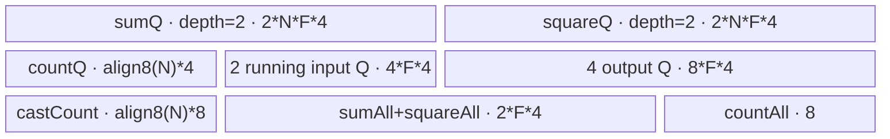
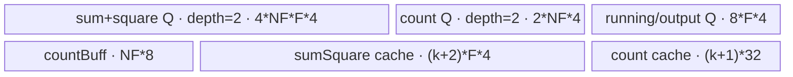
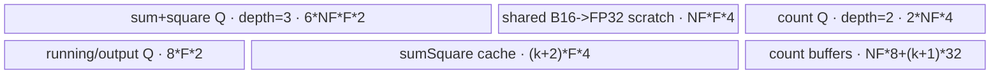

# SyncBatchNormGatherStats 950 ACLNN 算子知识

## 算子速览

| 项目 | 内容 |
|---|---|
| 实际入口 | `aclnnSyncBatchNormGatherStatsGetWorkspaceSize` + `aclnnSyncBatchNormGatherStats`，CANN 9.1.0 公开 ACLNN 两段式接口 |
| 计算语义 | 对 `totalSum[N,C]`、`totalSquareSum[N,C]` 与 `sampleCount[N]` 沿 N 归约，生成 `batchMean[C]`、`batchInvstd[C]`，并以 `momentum` 更新 running mean/variance |
| 输入输出 | ACLNN 输入允许 FP32/FP16/BF16（950）并转为连续 Tensor；owned Kernel 的 `sample_count` 固定 INT32；输出与输入统计量均为一维 C 向量 |
| 执行类型 | 单个 owned `AIV_VECTOR` Kernel；Kernel 内使用 AscendC Vector/MicroAPI，不含 Cube/AIC 或 `MIX_CV` 节点 |
| Kernel 路线 | R-001/R-002：key `10001` 整段 N 归约（FP32 / B16）；R-003/R-004：key `20001` 分块折叠归约（FP32 / B16） |
| 核心资源 | GM、AIV UB、`TQue`、`TBuf`、RegTensor；Host 固定登记 16 MiB workspace，但 owned Kernel 不读取 `workspace` |
| 来源闭包 | `source_closed`：公开 ACLNN→连续化/类型归一化→L0 launcher→950 Tiling/POD→单 AIV Kernel router→四个 dtype/资源 Route→950 构建接线均已闭合 |
| 验证状态 | 已完成源码闭包检查；本次知识提取未执行编译、真机、数值或性能测试。 |

## 接口与语义

### 计算语义

令设备/分片轴长度为 `N`，通道长度为 `C`，`countAll = Σ_i sampleCount[i]`。每个通道 `c` 的源码计算顺序为：

```text
batchMean[c] = Σ_i totalSum[i,c] / countAll
batchVar[c]  = Σ_i totalSquareSum[i,c] / countAll - batchMean[c]^2
batchInvstd[c] = 1 / sqrt(batchVar[c] + eps)
runningMeanOut[c] = runningMean[c] * (1 - momentum) + batchMean[c] * momentum
runningVarOut[c]  = runningVar[c] * (1 - momentum)
                  + batchVar[c] * countAll / (countAll - 1) * momentum
```

公开 ACLNN 将更新后的 `runningMeanOut`、`runningVarOut` 通过 `ViewCopy` 写回 `mean`、`variance`；两个显式输出是 `batchMean` 与 `batchInvstd`。Kernel 先用 INT64 累加计数，再转换成 FP32；统计量归约与后续公式都在 FP32 中进行，FP16/BF16 仅在 GM/UB 边界转换。

### 输入、输出与属性

| 参数 | shape/layout | dtype | 约束、默认值与语义 |
|---|---|---|---|
| `totalSum` | `[N,C]`；ACLNN 以 view shape 校验并连续化 | 950：FP32/FP16/BF16 | 非空；与 `totalSquareSum`、`mean`、`variance` 同 dtype |
| `totalSquareSum` | `[N,C]` | 950：FP32/FP16/BF16 | shape 与 `totalSum` 相同 |
| `sampleCount` | `[N]` | ACLNN 接受 FP32/FP16/BF16/INT32；owned op 为 INT32 | ACLNN 总是调用 `Cast(..., DT_INT32)`；N 与 `totalSum.dim0` 相同 |
| `mean` | `[C]` | 950：FP32/FP16/BF16 | running mean 输入/原地更新目标；dtype 与 `totalSum` 相同 |
| `variance` | `[C]` | 950：FP32/FP16/BF16 | running variance 输入/原地更新目标；dtype 与 `totalSum` 相同 |
| `momentum` | scalar | C++ `float` | 无范围检查；Host attr 缺失时内部默认 `0.1`，公开 ACLNN 原型要求显式传入 |
| `eps` | scalar | C++ `float` | 无范围检查；Host attr 缺失时内部默认 `1e-5`，公开 ACLNN 原型要求显式传入 |
| `batchMean` | `[C]` | 950：FP32/FP16/BF16 | 与 `batchInvstd` 同 dtype；可与输入统计 dtype 不同，ACLNN 在 owned op 后 Cast |
| `batchInvstd` | `[C]` | 950：FP32/FP16/BF16 | 与 `batchMean` 同 dtype |

ACLNN `CheckFormat` 拒绝 private format，并在错误信息中列出 ND/NCL/NCHW/NCDHW；计算依据 view shape，owned 950 OpDef 与 binary config 均登记 ND。`N==0` 明确报错；`C==0` 在第一段接口直接返回空 executor 流程，不启动 owned Kernel。

### 入口与版本

固定 Commit `955f8b33985b6d72989ebff341bb9c2c564a51bc` 公开唯一版本族 `aclnnSyncBatchNormGatherStats`。第一段入口完成校验、executor 构图和 workspace 汇总，第二段调用 `CommonOpExecutorRun` 在用户 stream 上运行。950 由 `Ops::NN::AclnnUtil::IsRegbase()` 选择含 BF16 的 dtype 白名单；L0 符号 `l0op::SyncBatchNormGatherStats` 只添加一个 owned AICore launcher。

公开文档也声明 A2/A3 支持，但固定仓的本算子 CMake、OpDef、binary config、Tiling 与 Kernel 仅登记 `ascend950`/`arch35`；因此本卡只覆盖 950，不把 950 body 外推为 A2/A3 实现。

## Host/Launcher 执行流程

### 参数校验与前处理

第一段入口按以下顺序执行：

1. `CheckNotNull` 检查七个 Tensor 指针。
2. `CheckDtypeValid` 按 `IsRegbase()` 选择 950 白名单，约束四个统计输入同 dtype、两个显式输出同 dtype。
3. `CheckFormat` 拒绝五个输入的 private format。
4. `CheckShape` 校验 `[N,C]`、`[N]`、`[C]` 维数与相等关系。
5. `N==0` 返回 `ACLNN_ERR_PARAM_INVALID`；`C==0` 直接释放空 executor 并成功返回。
6. 非空域对五个输入依次 `Contiguous`，并将 `sampleCount` Cast 为 INT32。
7. L0 分配四个中间输出，以 `ADD_TO_LAUNCHER_LIST_AICORE` 添加 `SyncBatchNormGatherStats`。
8. owned op 后分别把四个结果 Cast 到目标 dtype，再 `ViewCopy` 到 `batchMean`、`batchInvstd`、`mean`、`variance`。

`Contiguous`、ACLNN Cast/ViewCopy、executor 壳属于框架边界；本算子拥有的 selector、POD 和 Kernel 已继续闭合。

### 参数、Workspace 与生命周期

L0 中间输出由 executor 持有，shape/format 继承 `mean` 或 `variance`。Tiling 的 `GetWorkspaceSize` 固定写入 `16 * 1024 * 1024` 字节；Kernel entry 接收 `workspace` 参数但 body 不绑定或读取它。ACLNN 返回的总 `workspaceSize` 来自 executor，可能还包含 Contiguous/Cast/ViewCopy 的框架 workspace；其拼接 offset 由框架规划，固定仓不可见。用户须使 workspace 至少覆盖第一段返回值，并保持 executor、输入输出与 workspace 有效到第二段 stream 任务完成。

### 启动图与失败传播

```text
GetWorkspaceSize
  -> Contiguous(totalSum, totalSquareSum, sampleCount, mean, variance)
  -> Cast(sampleCount -> INT32)
  -> L0 SyncBatchNormGatherStats launcher
       -> TilingSyncBatchNormGatherStats / SyncBatchNormGatherStatsParse
       -> sync_batch_norm_gather_stats<<<blockNum, AIV>>>(..., workspace, tiling)
  -> Cast/ViewCopy 四路输出
Run
  -> CommonOpExecutorRun(workspace, workspaceSize, executor, stream)
```

owned launch graph 只有一个 Device 节点：Host 节点 `ADD_TO_LAUNCHER_LIST_AICORE(SyncBatchNormGatherStats, ...)`；entry 为 `sync_batch_norm_gather_stats`；`blockDim=blockNum`；POD 按 key 为 `SyncBatchNormGatherStatsTilingData` 或 `SyncBatchNormGatherStatsNNotFullLoadTilingData`；五输入、四输出均直接走 GM；无 owned Kernel 间 workspace 边。executor 保持上述节点在同一 stream 的构图顺序；任一前处理、launcher 添加或后处理失败，第一段立即返回且不形成可运行流程，第二段直接传播 `CommonOpExecutorRun` 状态。

## Route 与参数设计

### 分核与资源计算

记 `U=ubSize_`、`P=coreNum_`、`B=blockSize_`、`s=sizeof(T)`。

key `10001` 的初始 `cTile`：

```text
s=4: cTile = align_down((((U-96)/4 - 3*N) / (14 + 4*N)), 32/4)
s=2: cTile = align_down((((U-96)/2 - 6*N) / (16 + 8*N)), 32/2)
```

若 `cTile<=0` 或 `cTile*s<128`，切换 key `20001`。否则 `ubOuter=ceil(C/cTile)`，`blockFormer=ceil(ubOuter/P)`，`blockNum=ceil(ubOuter/blockFormer)`；最后一个 core 使用 `blockTail` 个 C tile，最后 tile 使用 `ubTail` 个元素。若 `blockNum<P/2`，Host 以半数 core 重新估计每核 C 长度，按 32 字节对齐并至少取 32 字节 tile，再重算以上字段。

key `20001` 先取 `cBlockFactor=max(128/s, align_up(ceil(C/P),128/s))`，`blockNum=ceil(C/cBlockFactor)`。Host 按顺序尝试 `nFactor∈{64,128,256,512}`，为 N 折叠树计算 `nLoop`、`nTail`、`cacheBufferCount` 和 UB 可容纳的 `cFactor`；`cFactor` 向下对齐到 FP32 的 128 元素或 B16 的 64 元素。后续候选若 `cFactor<=cBlockFactor`（首个 64 候选例外）或 `cFactor<=0` 即停止，并保留最近一次成功候选；没有正 `cFactor` 则 Tiling 失败。

### Route 选择

| 顺序 | Route | Key/模板 | 精确选择条件与优先级 | 不适用去向 |
|---:|---|---|---|---|
| 1 | R-001 整段 N·FP32 | `10001` / `SyncBatchNormGatherStatsNFullLoad<float>` | 950 binary dtype FP32，且上述初始 `cTile>0 && cTile*4>=128` | 资源谓词失败→R-003 |
| 2 | R-002 整段 N·B16 | `10001` / `SyncBatchNormGatherStatsNFullLoad<float16_t或bfloat16_t>` | 950 binary dtype FP16/BF16，且上述初始 `cTile>0 && cTile*2>=128` | 资源谓词失败→R-004 |
| 3 | R-003 分块折叠·FP32 | `20001` / `SyncBatchNormGatherStatsNNotFullLoad<float>` | FP32 且 key 10001 guard 失败，`DoNNotFullLoadTiling` 找到 `cFactor>0` | 否则 `GRAPH_FAILED` |
| 4 | R-004 分块折叠·B16 | `20001` / `SyncBatchNormGatherStatsNNotFullLoad<float16_t或bfloat16_t>` | FP16/BF16 且 key 10001 guard 失败，`DoNNotFullLoadTiling` 找到 `cFactor>0` | 否则 `GRAPH_FAILED` |

```text
dtype binary specialization
  -> 计算 key10001 cTile
     -> cTile>0 且 cTile*sizeof(T)>=128
        -> FP32: R-001
        -> FP16/BF16: R-002
     -> 否
        -> DoNNotFullLoadTiling
           -> cFactor>0
              -> FP32: R-003
              -> FP16/BF16: R-004
           -> 否: GRAPH_FAILED
```

### 模板/实现执行矩阵

| Route | key/selector | dtype/shape/platform 完整命中条件 | 执行拓扑与 Kernel 节点 | 实际模板/body | 内存与同步特征 | tail/fallback |
|---|---|---|---|---|---|---|
| R-001 | `10001` | 950、FP32、N/C 非空、初始 `cTile*4>=128` | 单 AIV Kernel | `SyncBatchNormGatherStatsNFullLoad<float>::Process` | N×C tile 整段入 UB；FP32 直接 ReduceSum；计数标量以 V↔S event 交接 | 最后 core/最后 C tile 使用 `blockTail/ubTail`；资源不足→R-003 |
| R-002 | `10001` | 950、FP16/BF16、N/C 非空、初始 `cTile*2>=128` | 单 AIV Kernel | `SyncBatchNormGatherStatsNFullLoad<T>::Process` | 两个额外 FP32 cast TBuf；归约和公式升精度 | mask 保护 C tail；资源不足→R-004 |
| R-003 | `20001` | 950、FP32、key10001 guard 失败、分块 tiling 成功 | 单 AIV Kernel | `SyncBatchNormGatherStatsNNotFullLoad<float>::Process` | N 分块折叠；输入 queue depth=2；cache 树原地累计 | N tail 由 `nMainFoldCount/nTail`；C tail 由 `cTail` |
| R-004 | `20001` | 950、FP16/BF16、key10001 guard 失败、分块 tiling 成功 | 单 AIV Kernel | `SyncBatchNormGatherStatsNNotFullLoad<T>::Process` | 输入 queue depth=3，B16→FP32 scratch，cache 树原地累计 | 无正 `cFactor` 时 Tiling 失败 |

### 隐藏性能 Guard

| Guard | Host/Tiling 条件 | Device/资源原因 | 影响 Route | 不满足时去向 | 源码符号 |
|---|---|---|---|---|---|
| key10001 UB guard | `cTile>0 && cTile*s>=128` | 需要同时容纳 N×C 双输入、计数、running/output queue 与 FP32 reduction buffers | R-001/R-002 | key20001 | `sync_batch_norm_gather_stats_tiling_arch35.cpp::DoOpTiling` |
| C 对齐 | key10001 对齐 `32/s`；key20001 FP32 对齐 128 元素、B16 对齐 64 元素 | DataCopyPad/ReduceSum 的行宽与 UB block/tile 账按对齐长度计算 | 全部 | 缩小 tile 或失败 | `DoOpTiling`、`DoNNotFullLoadTiling` |
| 半核重分配 | `blockNum < coreNum_/2` | 避免过大 C tile 导致使用核数少于平台 AIV 核数一半 | R-001/R-002 | 保持原分配或重算 | `DoOpTiling` |
| 分块候选停止 | `(cTileNum<=cBlockFactor && nTileNum!=64) \|\| cTileNum<=0` | 增大 N tile 会改变 N×C queue 与 cache UB 预算 | R-003/R-004 | 使用前一成功候选；无成功值失败 | `DoNNotFullLoadTiling` |
| 空域 | ACLNN `N==0` 报错，`C==0` 直接成功返回 | Kernel 的 `blockLoopNum-1`/除法路径不接受空 N/C | 全部 | 不启动 Kernel | `aclnnSyncBatchNormGatherStatsGetWorkspaceSize` |
| count 数值域 | 固定仓没有 `countAll>1` 检查 | 公式包含 `1/countAll` 与 `countAll/(countAll-1)` | 全部 | 无 fallback，可能产生 Inf/NaN | 两个 body 的 `NFullLoadBatchNormVF` |

### POD/ABI

Tiling POD 由 `BEGIN_TILING_DATA_DEF`/`TILING_DATA_FIELD_DEF` 生成；固定仓未展开宏，因此下表能确认字段顺序、源码类型和 producer/consumer，但不能可靠给出 `sizeof/alignof/offsetof`。不得按普通 C struct 推测 ABI offset。

| 结构 | 字段 | 类型/位宽 | ABI 布局 | 单位 | Host/launcher producer | Device consumer | 边界 |
|---|---|---|---|---|---|---|---|
| `SyncBatchNormGatherStatsTilingData` | `blockDim` | `uint64_t/64` | 宏展开不可见 | core | `set_blockDim(blockNum)` | constructor→最后 core 判断 | `>0` |
| 同上 | `blockFormer` | `uint64_t/64` | 同上 | C tile/core | `set_blockFormer(blockFormer)` | constructor、GM core offset | 非末核循环数 |
| 同上 | `blockTail` | `uint64_t/64` | 同上 | C tile | `set_blockTail(blockTail)` | 末核 `blockLoopNum` | `[1,blockFormer]` |
| 同上 | `nLen` | `uint64_t/64` | 同上 | element/row | `set_nLen(nLen)` | count/ReduceSum、DMA blockCount | `N>0` |
| 同上 | `cLen` | `uint64_t/64` | 同上 | element | `set_cLen(cLen)` | GM stride | `C>0` |
| 同上 | `ubFormer` | `uint64_t/64` | 同上 | C element/tile | `set_ubFormer(cTileNum_)` | queue 容量、tile offset | 初始 Route guard 至少 128B；半核重分配后仍 32B 对齐且可降至 32B |
| 同上 | `ubTail` | `uint64_t/64` | 同上 | C element | `set_ubTail(ubTail)` | 最后 tile有效长度 | `(0,ubFormer]` |
| 同上 | `momentum` | `float/32` | 同上 | scalar | `set_momentum(momentum_)` | `NFullLoadBatchNormVF` | 无范围检查 |
| 同上 | `eps` | `float/32` | 同上 | scalar | `set_eps(eps_)` | `NFullLoadBatchNormVF` | 无范围检查 |
| `SyncBatchNormGatherStatsNNotFullLoadTilingData` | `blockDim` | `int64_t/64` | 宏展开不可见 | core | `set_blockDim(blockNum)` | constructor | `>0` |
| 同上 | `cLen` | `int64_t/64` | 同上 | element | `set_cLen(cLen)` | GM row stride | `C>0` |
| 同上 | `cFactor` | `int64_t/64` | 同上 | C element/tile | `set_cFactor(cTileNum_)` | queue/cache 容量与 C offset | `>0` 且基数对齐 |
| 同上 | `cLoopMainBlock` | `int64_t/64` | 同上 | tile/core | `set_cLoopMainBlock(cLoopMain_)` | 非末核循环与 core GM offset | `>=1` |
| 同上 | `cTileMainBlock` | `int64_t/64` | 同上 | C element | `set_cTileMainBlock(cTailMain_)` | 非末核最后 tile/core span | `(0,cFactor]` |
| 同上 | `cLoopTailBlock` | `int64_t/64` | 同上 | tile | `set_cLoopTailBlock(cLoopTail_)` | 末核循环 | `>=1` |
| 同上 | `cTailTailBlock` | `int64_t/64` | 同上 | C element | `set_cTailTailBlock(cTailTail_)` | 末核最后 tile | `(0,cFactor]` |
| 同上 | `nFactor` | `int64_t/64` | 同上 | N row/chunk | `set_nFactor(nTileNum_)` | N DMA、count queue、ReduceSum | `64/128/256/512` |
| 同上 | `nLoop` | `int64_t/64` | 同上 | folding loop | `set_nLoop(basicBlockLoop_)` | Sample/SumSquare outer loop | power-of-two folding base |
| 同上 | `nMainFoldCount` | `int64_t/64` | 同上 | chunk | `set_nMainFoldCount(mainFoldCount_)` | second-chunk branch | 完整双块数 |
| 同上 | `nTail` | `int64_t/64` | 同上 | N element | `set_nTail(nTail_)` | 尾块 DMA | `[0,nFactor)` |
| 同上 | `cacheBufferCount` | `int64_t/64` | 同上 | cache level | `set_cacheBufferCount(cacheBufferCount_)` | temp/result slice offset | `>=1` |
| 同上 | `resultCacheId` | `int32_t/32` | 同上 | cache index | `set_resultCacheId(resultCacheID_)` | count/sum result读取 | `GetCacheID(nLoop-1)` |
| 同上 | `momentum` | `float/32` | 同上 | scalar | `set_momentum(momentum_)` | formula body | 无范围检查 |
| 同上 | `eps` | `float/32` | 同上 | scalar | `set_eps(eps_)` | formula body | 无范围检查 |

### Route 源码闭包

| Route | Key/selector | Host/Tiling producer | POD/参数 | Kernel entry/router 节点 | Kernel body/直接依赖 | 构建接线 |
|---|---|---|---|---|---|---|
| R-001 | `10001`, FP32 binary | `...tiling_arch35.cpp::DoOpTiling` | `SyncBatchNormGatherStatsTilingData` | `sync_batch_norm_gather_stats`→`NFullLoad<float>` | `sync_batch_norm_gather_stats_n_full_load.h` + `..._struct.h` | CMake `ascend950/arch35`、OpDef、FP32 binary config |
| R-002 | `10001`, FP16/BF16 binary | 同上 | 同上 | entry→`NFullLoad<float16_t/bfloat16_t>` | 同上，命中 B16 constexpr 分支 | FP16/BF16 binary config |
| R-003 | `20001`, FP32 binary | `...tiling_arch35.cpp::DoNNotFullLoadTiling` | `SyncBatchNormGatherStatsNNotFullLoadTilingData` | entry→`NNotFullLoad<float>` | `sync_batch_norm_gather_stats_n_not_full_load.h` + struct | FP32 binary config |
| R-004 | `20001`, FP16/BF16 binary | 同上 | 同上 | entry→`NNotFullLoad<float16_t/bfloat16_t>` | 同上，命中 B16 constexpr 分支 | FP16/BF16 binary config |

## Kernel 实现

### 公共执行流程

四条 Route 共用同一个 entry 和单 Kernel launch。router 按 `TILING_KEY_IS(10001)`/`TILING_KEY_IS(20001)`解析对应 POD，实例化 dtype binary 决定的 `DTYPE_TOTAL_SUM` 模板并执行 `Init→Process`；未知 key 不写输出。每个 core 独立负责连续 C 区间，重复归约全部 N 与 `sample_count`，因此不存在跨核 reduction/atomic。公共公式 body 用 `UpdateMask<float>(sreg)`保护最后一个 Vector register，并将 FP16/BF16 load 升到 FP32，输出用 `CAST_RINT` 降回 B16。

### Route R-001：整段 N·FP32

#### 适用条件

##### 选择证据

| 层级 | 文件 | 符号 | 源码谓词/参数 | 结果/下一跳 |
|---|---|---|---|---|
| ACLNN | `op_api/aclnn_sync_batch_norm_gather_stats.cpp` | `CheckDtypeValid` | `IsRegbase()` 且 dtype FP32 | 950 FP32 binary |
| Tiling | `op_host/arch35/...tiling_arch35.cpp` | `DoOpTiling` | FP32 公式得 `cTile>0 && cTile*4>=128` | key `10001` |
| Router | `op_kernel/sync_batch_norm_gather_stats_apt.cpp` | `sync_batch_norm_gather_stats` | `TILING_KEY_IS(10001)` | `NFullLoad<float>` |

#### Device 数据流

##### 函数级调用链

```text
ADD_TO_LAUNCHER_LIST_AICORE
  -> sync_batch_norm_gather_stats(..., tiling)
    -> SyncBatchNormGatherStatsNFullLoad<float>::Init
    -> Process
       -> CopyInN -> Cast(INT32->INT64) -> ReduceSum(count)
       -> for each local C tile: ProcessOnce
          -> CopyInSumAndSquare + CopyInRunningMeanVar
          -> ReduceSum<float, RA>(N rows)
          -> NFullLoadBatchNormVF
          -> CopyOut four C vectors
```

##### 源码等价伪码

```text
# 伪码
coreBase = blockFormer * ubFormer * blockIdx
countAll = reduce_sum_int64(sampleCount[0:N])
for tile in [0, blockLoopNum):
    validC = (tile is local last) ? ubTail : ubFormer
    gmC = coreBase + tile * ubFormer
    sumAll[0:validC] = reduce_N(totalSum[:, gmC:gmC+validC])
    squareAll[0:validC] = reduce_N(totalSquareSum[:, gmC:gmC+validC])
    for vector C chunk with tail mask:
        compute batchMean, batchInvstd, runningMeanOut, runningVarOut in FP32
    copy validC elements of four outputs to GM
```

#### 内存与数据搬运

##### 资源与搬运表

| 层级/缓冲区 | offset/地址公式 | extent/容量公式 | dtype/layout | producer | consumer | owner/lifetime | 对齐/复用 |
|---|---|---|---|---|---|---|---|
| GM sum/square | `coreBase + tile*F + n*C` | `N×validC` each | FP32 row-major `[N,C]` | caller | `CopyInSumAndSquare` | caller→Kernel | DMA `blockCount=N`, `blockLen=validC*4`, `srcStride=(C-validC)*4` |
| GM count | `0` | `N` | INT32 | caller | `CopyInN` | caller→Kernel | DataCopyPad |
| sum/square queues | UB | depth 2 × `N*F*4` each | FP32 | DMA | ReduceSum | tile lifetime | 两路各 double buffer |
| count queue | UB | `align_up(N,8)*4` | INT32 | DMA | Cast | Process count phase | depth 1 |
| running input queues | `tile*F` | depth 2 × `F*4` each | FP32 | DMA | formula | ProcessOnce | two queues |
| four output queues | `tile*F` | depth 2 × `F*4` each | FP32 | formula | CopyOut | ProcessOnce | four queues |
| castCount/countAll | UB | `align_up(N,8)*8` + 8 | INT64 | Cast/ReduceSum | scalar read | whole Process | V→S event before scalar read |
| sumAll/squareAll | UB | `F*4` each | FP32 | ReduceSum | formula | tile复用 | 每 tile 覆盖 |

##### 分层内存布局



##### 字节账与复用顺序

```text
F = ubFormer, Na = align_up(N, 8)
UB_total = 4*N*F*4 + Na*4 + 12*F*4 + Na*8 + 2*F*4 + 8
         = 16*N*F + 56*F + 12*Na + 8 bytes
dynamic_ub = N/A（AIV UB 静态按 Tiling 分配）
workspace_total(owned Kernel实际读取) = 0；Host登记 16 MiB
=> Host 使用 U-96 的保守预算求 F
```

| 复用子区 | 写入者 | 读取者/消费点 | 下一次覆盖 | 同步或释放依据 | 安全条件 |
|---|---|---|---|---|---|
| sum/square queue slot | `CopyInSumAndSquare` | ReduceSum | 下一 tile AllocTensor | `DeQue→FreeTensor` | ReduceSum 完成后释放 |
| sumAll/squareAll TBuf | ReduceSum | formula body | 下一 tile reduction | ProcessOnce 顺序 | formula 完成后方可覆盖 |
| output queue slot | formula | `CopyOut` | 下一 tile AllocTensor | `EnQue→DeQue→FreeTensor` | GM copy 完成后释放 |

#### 同步、精度与尾块

##### 同步与数值边界表

| 阶段 | primitive/机制 | producer | consumer/等待点 | 保护对象 | 精度/尾块 |
|---|---|---|---|---|---|
| count DMA→Vector | Queue | `CopyInN` | `DeQue` | count UB | INT32→INT64 |
| count Vector→Scalar | `HardEvent::V_S` | INT64 ReduceSum | `GetValue(0)` | `countAll` | 标量读取前等待 |
| scalar→后续 Vector | `HardEvent::S_V` | scalar read | C tile公式 | count scalar | 保证下一 Vector 阶段 |
| C 公式 | RegTensor mask | FP32 reductions | four output queues | tail lanes | `UpdateMask<float>(sreg)`；FP32 全程 |
| UB→GM | Queue + DataCopyPad | formula | GM outputs | validC | `blockLen=validC*4`，无效 lane 不写 |

#### 关键实现

##### 符号证据表

| 阶段 | 文件 | 符号/模板实例 | 实现事实 |
|---|---|---|---|
| Host/Tiling producer | `op_host/arch35/sync_batch_norm_gather_stats_tiling_arch35.cpp` | `DoOpTiling/SetTilingDataInfo` | cTile、分核、key 与 POD |
| Kernel entry/router | `op_kernel/sync_batch_norm_gather_stats_apt.cpp` | `sync_batch_norm_gather_stats` | key10001→NFullLoad |
| Device body/helper | `op_kernel/arch35/sync_batch_norm_gather_stats_n_full_load.h` | `Process/ProcessOnce/NFullLoadBatchNormVF` | 整段 N reduction、FP32 公式、tail mask |

### Route R-002：整段 N·B16

#### 适用条件

##### 选择证据

| 层级 | 文件 | 符号 | 源码谓词/参数 | 结果/下一跳 |
|---|---|---|---|---|
| ACLNN | `op_api/aclnn_sync_batch_norm_gather_stats.cpp` | `CheckDtypeValid` | 950 FP16/BF16 | B16 binary |
| Tiling | `...tiling_arch35.cpp` | `DoOpTiling` | B16 公式得 `cTile>0 && cTile*2>=128` | key10001 |
| Router | `sync_batch_norm_gather_stats_apt.cpp` | entry | key10001 + `DTYPE_TOTAL_SUM` | `NFullLoad<float16_t/bfloat16_t>` |

#### Device 数据流

##### 函数级调用链

```text
entry -> NFullLoad<T>::Init -> Process
  -> count INT64 reduction
  -> CopyIn B16 sum/square
  -> Cast each N×C tile B16->FP32
  -> FP32 ReduceSum + NFullLoadBatchNormVF
  -> StoreTensorForDtypeT(CAST_RINT FP32->B16)
  -> CopyOut
```

##### 源码等价伪码

```text
# 伪码；分核/地址与 R-001 相同
fp32Sum = cast_fp32(sumB16[N, validC])
fp32Square = cast_fp32(squareB16[N, validC])
sumAll = reduce_N(fp32Sum); squareAll = reduce_N(fp32Square)
compute four FP32 values with C tail mask
round-to-integral-mode cast each output register to original FP16/BF16 and store validC
```

#### 内存与数据搬运

##### 资源与搬运表

| 层级/缓冲区 | offset/地址公式 | extent/容量公式 | dtype/layout | producer | consumer | owner/lifetime | 对齐/复用 |
|---|---|---|---|---|---|---|---|
| GM/queues | 同 R-001 地址 | sum/square depth2 `N*F*2` each；running/output共 `12*F*2` | FP16/BF16 | DMA | cast/formula/CopyOut | tile lifetime | 32B tail pad |
| castSum/castSquare | UB | `F*4` each | FP32 | Cast | ReduceSum | tile复用 | B16 constexpr 条件分配 |
| sumAll/squareAll | UB | `F*4` each | FP32 | ReduceSum | formula | tile复用 | 不降精度累加 |
| count buffers | 同 R-001 | `Na*4 + Na*8 + 8` | INT32/INT64 | DMA/Cast/Reduce | scalar | Process | events 同 R-001 |

##### 分层内存布局


##### 字节账与复用顺序

```text
UB_total = 4*N*F*2 + 12*F*2 + 12*Na + 8 + 4*F*4
         = 8*N*F + 40*F + 12*Na + 8 bytes
dynamic_ub = N/A
workspace_total(owned Kernel实际读取) = 0；Host登记 16 MiB
```

| 复用子区 | 写入者 | 读取者/消费点 | 下一次覆盖 | 同步或释放依据 | 安全条件 |
|---|---|---|---|---|---|
| castSum/castSquare | B16 Cast | ReduceSum | 下一 tile Cast | ProcessOnce 顺序 | reduction 完成后覆盖 |
| B16 input queue | DMA | Cast | 下一 AllocTensor | `FreeTensor` 在 Cast/Reduce 后 | 不早于 Cast 完成 |

#### 同步、精度与尾块

##### 同步与数值边界表

| 阶段 | primitive/机制 | producer | consumer/等待点 | 保护对象 | 精度/尾块 |
|---|---|---|---|---|---|
| B16 load | `DIST_UNPACK_B16` + Cast | input queue | FP32 TBuf | N×validC | B16→FP32，mask zeroing |
| reduction/formula | FP32 ReduceSum/RegTensor | cast TBuf | output cast | statistics | FP32 累加与 sqrt/div |
| B16 store | `castTraitB32B16` | FP32 register | B16 output queue | valid lanes | `NO_SAT`、`ZEROING`、`CAST_RINT` |
| tail | DataCopyPad + mask | GM/UB | output | C tail | 仅 validC 写 GM |

#### 关键实现

##### 符号证据表

| 阶段 | 文件 | 符号/模板实例 | 实现事实 |
|---|---|---|---|
| Host/Tiling producer | `...tiling_arch35.cpp` | `DoOpTiling` | B16 UB 公式与 16 元素对齐 |
| Kernel entry/router | `sync_batch_norm_gather_stats_apt.cpp` | entry | dtype binary+key实例 |
| Device body/helper | `...n_full_load.h` | B16 constexpr、`LoadTensorForDtypeT/StoreTensorForDtypeT` | 条件 buffer、升降精度 |

### Route R-003：分块折叠·FP32

#### 适用条件

##### 选择证据

| 层级 | 文件 | 符号 | 源码谓词/参数 | 结果/下一跳 |
|---|---|---|---|---|
| Tiling | `...tiling_arch35.cpp` | `DoOpTiling` | key10001 cTile guard 失败 | `DoNNotFullLoadTiling` |
| Tiling | 同上 | `DoNNotFullLoadTiling` | FP32、某候选产生 `cFactor>0` | key20001 POD |
| Router | `sync_batch_norm_gather_stats_apt.cpp` | entry | key20001 | `NNotFullLoad<float>` |

#### Device 数据流

##### 函数级调用链

```text
entry -> NNotFullLoad<float>::Init -> Process
  -> SampleCountProcess
     -> CopyInN -> CastCount1VF/FoldCountVF -> ReduceSum -> UpdateCache<int64_t>
  -> for each local C tile: ProcessOnce
     -> SumSquareReduceProcess(sum, result slot k+1)
        -> CopyInSumSquare -> optional second chunk fold -> ReduceSum_RA -> UpdateCache<float>
     -> SumSquareReduceProcess(square, result slot k)
     -> CopyInRunningMeanVar -> NFullLoadBatchNormVF -> CopyOut
```

##### 源码等价伪码

```text
# 伪码
for j in 0 .. nLoop-1:                       # nLoop 是折叠树 base
    chunk = input[j*nFactor : (j+1)*nFactor]
    if j<nMainFoldCount: chunk += input[(j+nLoop)*nFactor : ...]
    else if j==nMainFoldCount and nTail>0: chunk += tail
    partial = reduce_rows(chunk)
    level = count_trailing_ones(j)
    partial += cache[0:level]
    cache[level] = partial
result = cache[resultCacheId]
for each C tile: 分别执行上述 sum 与 square folding，随后计算四路输出
```

#### 内存与数据搬运

##### 资源与搬运表

| 层级/缓冲区 | offset/地址公式 | extent/容量公式 | dtype/layout | producer | consumer | owner/lifetime | 对齐/复用 |
|---|---|---|---|---|---|---|---|
| core GM base | `cBlockFactor*blockIdx` | local C block | FP32 | Tiling/core mapping | all DMA | Kernel | `cBlockFactor=(cLoopMain-1)*F+cTileMain` |
| sum/square queue | `ubTimes*F + nChunk*NF*C` | depth2 × `NF*F*4` each | FP32 | DMA | fold/reduce | chunk | second chunk可占另一 slot |
| count queue | `chunk*NF` | depth2 × `NF*4` | INT32 | DMA | cast/fold | count phase | two chunks |
| running input/output queues | C tile | inputs depth2共 `4*F*4`；outputs depth1共 `4*F*4` | FP32 | DMA/formula | formula/GM | ProcessOnce | queue lifetime |
| countBuff | UB | `NF*8` | INT64 | Cast/Fold | count ReduceSum | chunk scratch | 原地 Fold |
| sumSquare cache | slots `[0,k+1]` | `(k+2)*F*4` | FP32 | ReduceSum/UpdateCache | formula | whole Process | slot k=square result，k+1=sum result |
| count cache | slots `[0,k]` | `(k+1)*32` | INT64 padded | Reduce/UpdateCache | scalar | whole Process | per-level stride=4 INT64 |

##### 分层内存布局



##### 字节账与复用顺序

```text
NF=nFactor, F=cFactor, k=cacheBufferCount
UB_total = 4*NF*F*4 + 2*NF*4 + 8*F*4 + NF*8 + (k+2)*F*4 + (k+1)*32
         = 16*NF*F + 16*NF + (4*k+40)*F + 32*k + 32 bytes
dynamic_ub = N/A
workspace_total(owned Kernel实际读取) = 0；Host登记 16 MiB
=> 与 DoNNotFullLoadTiling 的 FP32 cTileNum 分子/分母逐项一致
```

| 复用子区 | 写入者 | 读取者/消费点 | 下一次覆盖 | 同步或释放依据 | 安全条件 |
|---|---|---|---|---|---|
| input queue slots | first/second chunk DMA | Fold/ReduceSum | next chunk | `DeQue→FreeTensor` | partial已进入 cache |
| cache levels `[0,k-1]` | `UpdateCache` | later `UpdateCache` | 二进制折叠达到同 level | 同一 Vector scope顺序 | `cacheId` 决定读取更低 level 后覆盖目标 level |
| cache temp slot `k` | ReduceSum | `UpdateCache`/square final | 下一 partial或最终 copy | 顺序调用 | UpdateCache完成后复用 |
| result slots `k,k+1` | square/sum final Copy | formula | 下一 C tile | ProcessOnce 顺序 | formula完成后覆盖 |

#### 同步、精度与尾块

##### 同步与数值边界表

| 阶段 | primitive/机制 | producer | consumer/等待点 | 保护对象 | 精度/尾块 |
|---|---|---|---|---|---|
| count result | V_S/S_V events | cache tree | scalar `GetValue`/formula | INT64 countAll | 同 R-001 |
| fold cache | Vector scope顺序 | ReduceSum partial | UpdateCache | per-level UB | FP32 zeroing mask |
| N tail | branch | second chunk DMA | Fold | last N rows | `nTail>0` 时仅复制 nTail |
| C tail | DataCopyPad/mask | local last tile | output GM | currentCNum | 对齐行参与 reduction，公式/CopyOut只提交 valid C |

#### 关键实现

##### 符号证据表

| 阶段 | 文件 | 符号/模板实例 | 实现事实 |
|---|---|---|---|
| Host/Tiling producer | `...tiling_arch35.cpp` | `DoNNotFullLoadTiling/FindNearestPower2/GetCacheID` | N 候选、C tile与cache树参数 |
| Kernel entry/router | `sync_batch_norm_gather_stats_apt.cpp` | key20001 branch | POD解析和模板实例 |
| Device body/helper | `...n_not_full_load.h` | `SampleCountProcess/SumSquareReduceProcess/UpdateCache` | 分块搬运、折叠归约、cache生命周期 |

### Route R-004：分块折叠·B16

#### 适用条件

##### 选择证据

| 层级 | 文件 | 符号 | 源码谓词/参数 | 结果/下一跳 |
|---|---|---|---|---|
| Tiling | `...tiling_arch35.cpp` | `DoOpTiling/DoNNotFullLoadTiling` | B16 且 key10001 guard失败，B16 cFactor公式成功 | key20001 |
| Router | `sync_batch_norm_gather_stats_apt.cpp` | entry | key20001 + FP16/BF16 binary | `NNotFullLoad<T>` |

#### Device 数据流

##### 函数级调用链

```text
entry -> NNotFullLoad<T>::Process
  -> INT64 SampleCountProcess
  -> CopyIn B16 chunk (queue depth=3)
  -> CastSum1VF to FP32 scratch -> FoldSumSquareVF(B16 second chunk into FP32)
  -> FP32 ReduceSum/UpdateCache
  -> FP32 formula -> CAST_RINT B16 outputs -> CopyOut
```

##### 源码等价伪码

```text
# 伪码；cache树和地址同 R-003
fp32Scratch = cast(firstB16Chunk)
if second full/tail chunk exists:
    fp32Scratch += cast(secondB16Chunk)
partialFP32 = reduce_N(fp32Scratch)
cache_tree_accumulate(partialFP32)
compute FP32 statistics; masked CAST_RINT to FP16/BF16 output
```

#### 内存与数据搬运

##### 资源与搬运表

| 层级/缓冲区 | offset/地址公式 | extent/容量公式 | dtype/layout | producer | consumer | owner/lifetime | 对齐/复用 |
|---|---|---|---|---|---|---|---|
| B16 sum/square queues | 同 R-003 | each depth3 × `NF*F*2` | FP16/BF16 | DMA | cast/fold | chunk | triple buffer |
| FP32 scratch | UB | `NF*F*4` | FP32 | `CastSum1VF/FoldSumSquareVF` | ReduceSum | one input kind at a time | sum、square 顺序复用同一 TBuf |
| running/output queues | C tile | inputs depth2共 `4*F*2`；outputs depth1共 `4*F*2` | B16 | DMA/formula | formula/GM | ProcessOnce | B16边界 |
| cache/count resources | 同 R-003 | `(k+2)*F*4 + (k+1)*32 + NF*8 + 2*NF*4` | FP32/INT64/INT32 | reduction | formula | Process | cache FP32 |

##### 分层内存布局



##### 字节账与复用顺序

```text
UB_total = 6*NF*F*2 + NF*F*4 + 2*NF*4 + 8*F*2 + NF*8
           + (k+2)*F*4 + (k+1)*32
         = 16*NF*F + 16*NF + (4*k+24)*F + 32*k + 32 bytes
dynamic_ub = N/A
workspace_total(owned Kernel实际读取) = 0；Host登记 16 MiB
=> 与 DoNNotFullLoadTiling 的 B16 cTileNum 公式逐项一致
```

| 复用子区 | 写入者 | 读取者/消费点 | 下一次覆盖 | 同步或释放依据 | 安全条件 |
|---|---|---|---|---|---|
| shared FP32 scratch | sum first/fold | sum ReduceSum | square first Cast | `SumSquareReduceProcess(sum)`返回后 | sum partial已写 cache/result |
| B16 queue slots | DMA | Cast/Fold | next N chunk | `FreeTensor` | B16数据已合入 scratch |
| FP32 cache | Reduce/UpdateCache | formula | next C tile | 与 R-003 同序 | sum/square final slots均就绪 |

#### 同步、精度与尾块

##### 同步与数值边界表

| 阶段 | primitive/机制 | producer | consumer/等待点 | 保护对象 | 精度/尾块 |
|---|---|---|---|---|---|
| B16 first chunk | unpack Cast | queue | FP32 scratch | NF×alignedC | zeroing mask |
| B16 second/tail | unpack Cast+Add | second queue | scratch | `nFactor`或`nTail` | 只 fold 有效 N 行 |
| cache/formula | FP32 Vector | scratch | output Cast | statistics | FP32 累加 |
| output | `CAST_RINT` + packed store | formula | output queue | C tail | mask阻止无效 lane提交 |

#### 关键实现

##### 符号证据表

| 阶段 | 文件 | 符号/模板实例 | 实现事实 |
|---|---|---|---|
| Host/Tiling producer | `...tiling_arch35.cpp` | B16 branch in `DoNNotFullLoadTiling` | triple-buffer/scratch对应 UB 预算 |
| Kernel entry/router | `sync_batch_norm_gather_stats_apt.cpp` | key20001 | B16模板实例 |
| Device body/helper | `...n_not_full_load.h` | `Init/CastSum1VF/FoldSumSquareVF` | 条件buffer、FP32折叠、tail |

## 算子特定优化

### Trick T-001：由完整 UB 字节预算自动切换整段 N 与折叠 Route

#### 触发与源码依据

- 适用 Route：R-001～R-004
- 触发条件：key10001 的 dtype-specific `cTileNum_` 计算结果是否为正且至少覆盖 128 字节。
- Golden 来源：[`op_host/arch35/sync_batch_norm_gather_stats_tiling_arch35.cpp:656-668`](../../../../../../../cann-ops-raw/ascendc/ops-nn/955f8b33985b6d72989ebff341bb9c2c564a51bc/norm/sync_batch_norm_gather_stats/op_host/arch35/sync_batch_norm_gather_stats_tiling_arch35.cpp#L656-L668)

**官方源码（固定 Commit 连续逐字摘录）**：

```cpp
    if (dTypeSize == FLOAT_DTYPE_SIZE) {
        cTileNum_ = ((ubSize_ - UBSIZE_RSV) / dTypeSize - CACL_UBSIZE_SAMPLE_COUNT_TYPE32 * nLen) /
            (INPUT_SIZE_TYPE32 + BIG_INPUT_SIZE_TYPE32 * nLen);
    } else {
        cTileNum_ = ((ubSize_ - UBSIZE_RSV) / dTypeSize - CACL_UBSIZE_SAMPLE_COUNT_TYPE16 * nLen) /
            (INPUT_SIZE_TYPE16 + BIG_INPUT_SIZE_TYPE16 * nLen);
    }
    cTileNum_ = cTileNum_ / (ALIGN_DIM_LEN_LINE / dTypeSize) * (ALIGN_DIM_LEN_LINE / dTypeSize);

    if (cTileNum_ <= 0 || cTileNum_ * dTypeSize < ALIGN_FACTOR_BASE_BYTE_LEN) {
        cTileNum_ = 0;
        return DoNNotFullLoadTiling();
    }
```

#### 机制与设计原因

Host 将 N×C 双输入 queue、running/output queue、count buffer 与 B16 FP32 scratch 全部折算到 `cTileNum_`，并按 32 字节向下对齐。资源足够时一次载入某 C tile 的全部 N，直接 ReduceSum；不足时进入 N 分块+cache tree，而不是让 Device 运行时溢出 UB 或执行未对齐小 tile。常数 14/16 与 4N/8N 分别编码固定 C 缓冲和随 N 增长的缓冲倍数。

#### 迁移边界

- 适用：同时存在“整轴归约”和“分块折叠归约”的 Vector 算子。
- 前提：950 AIV、相同 queue/TBuf 拓扑、正确纳入 dtype size、depth 与 alignment。
- 失效：UB 分配结构改变时必须重新推导公式；不能复用旧常数。
- 未验证：本次知识提取未执行编译、真机、数值或性能测试。

#### 错误做法

固定仓提供的真实失败终点是 `DoNNotFullLoadTiling` 仍无法得到正 `cTileNum_` 时返回 `GRAPH_FAILED`；不得绕过 guard 强行选择 key10001。

### Trick T-002：B16 输入先升到 FP32 再归约与计算

#### 触发与源码依据

- 适用 Route：R-002
- 触发条件：`T` 为 `float16_t` 或 `bfloat16_t`。
- Golden 来源：[`op_kernel/arch35/sync_batch_norm_gather_stats_n_full_load.h:141-154`](../../../../../../../cann-ops-raw/ascendc/ops-nn/955f8b33985b6d72989ebff341bb9c2c564a51bc/norm/sync_batch_norm_gather_stats/op_kernel/arch35/sync_batch_norm_gather_stats_n_full_load.h#L141-L154)

**官方源码（固定 Commit 连续逐字摘录）**：

```cpp
        int64_t currentCAlignNum = (currentCNum + (BLOCK_SIZE / sizeof(T)) - 1) / (BLOCK_SIZE / sizeof(T)) * (BLOCK_SIZE / sizeof(T));
        uint32_t shape[] = { static_cast<uint32_t>(this->nLen), static_cast<uint32_t>(currentCAlignNum)};
        if constexpr (std::is_same<T, float16_t>::value || std::is_same<T, bfloat16_t>::value) {
            LocalTensor<float> fp32SumUb = castSumBuff.Get<float>();
            Cast(fp32SumUb, sumUb, RoundMode::CAST_NONE, this->nLen * currentCAlignNum);
            ReduceSum<float, AscendC::Pattern::Reduce::RA, true>(sumAllUb, fp32SumUb, shape, false);

            LocalTensor<float> fp32SquareSumUb = castSquareSumBuff.Get<float>();
            Cast(fp32SquareSumUb, squareSumUb, RoundMode::CAST_NONE, this->nLen * currentCAlignNum);
            ReduceSum<float, AscendC::Pattern::Reduce::RA, true>(squareSumAllUb, fp32SquareSumUb, shape, false);
        } else {
```

#### 机制与设计原因

B16 Route 为两个 N×C tile 各分配 FP32 scratch，`Cast(..., CAST_NONE)` 后才按 RA 模式沿 N 归约；batch variance、sqrt/div 和 running stats 更新继续在 FP32 RegTensor 中进行，最终才 `CAST_RINT`。这改变了累加精度并避免 B16 归约中间结果反复舍入，代价已纳入 Host UB guard。

#### 迁移边界

- 适用：FP16/BF16 输入且统计归约对精度敏感的 AIV 算子。
- 前提：UB 能容纳 FP32 scratch；padding lane在 ReduceSum 前为安全值。
- 失效：UB 不足时必须使用 R-004 的共享 scratch/分块折叠，不能删除精度转换。
- 未验证：本次知识提取未执行编译、真机、数值或性能测试。

#### 错误做法

固定仓未提供可验证反例。

### Trick T-003：按 trailing-ones 层级原地合并 N 分块 cache

#### 触发与源码依据

- 适用 Route：R-003/R-004
- 触发条件：key20001；每个 `basicBlockIdx` 完成一份局部 ReduceSum 后。
- Golden 来源：[`op_kernel/arch35/sync_batch_norm_gather_stats_n_not_full_load.h:245-259`](../../../../../../../cann-ops-raw/ascendc/ops-nn/955f8b33985b6d72989ebff341bb9c2c564a51bc/norm/sync_batch_norm_gather_stats/op_kernel/arch35/sync_batch_norm_gather_stats_n_not_full_load.h#L245-L259)

**官方源码（固定 Commit 连续逐字摘录）**：

```cpp
        __VEC_SCOPE__
        {
            uint32_t sreg = static_cast<uint32_t>(count);
            RegTensor<U> aReg, bReg;
            MaskReg pMask;
            for (uint16_t i = 0; i < outerLoopTimes; ++i) {
                pMask = UpdateMask<U>(sreg);
                DataCopy(aReg, (__local_mem__ U*)src + i * outerLoopStride);
                for (uint16_t j = 0; j < innerLoopTimes; ++j) {
                    DataCopy(bReg, (__local_mem__ U*)dst + i * outerLoopStride + j * innerLoopStride);
                    Add<U, AscendC::MicroAPI::MaskMergeMode::ZEROING>(aReg, aReg, bReg, pMask);
                }
                DataCopy((__local_mem__ U*)cache + i * outerLoopStride, aReg, pMask);
            }
        }
```

#### 机制与设计原因

`cacheId = popcount(idx xor (idx+1))-1` 等价于当前块索引的 trailing-ones 数量。新 partial 先读取所有更低 cache level 并相加，再写入目标 level；因此只保留对数级 cache，而非物化所有 N chunk partial。模板 `U` 同时服务 INT64 count 与 FP32 sum/square，`stride` 分别是 32 字节内的 INT64 数量或 `cFactor`。

#### 迁移边界

- 适用：顺序产生 partial、允许固定顺序二叉折叠的归约。
- 前提：Host 与 Device 使用完全一致的 `cacheId/resultCacheId/cacheBufferCount`，且目标 level 覆盖发生在低 level消费之后。
- 失效：需要跨核归约、不同确定性顺序或异步 producer 时，必须增加显式同步/GM workspace，不能直接搬用本 cache。
- 未验证：本次知识提取未执行编译、真机、数值或性能测试。

#### 错误做法

固定仓未提供可验证反例。

## 模板与实现对比

| 对比维度 | R-001 整段FP32 | R-002 整段B16 | R-003 折叠FP32 | R-004 折叠B16 | 设计选择依据 |
|---|---|---|---|---|---|
| 命中条件/优先级 | key10001 FP32 | key10001 B16 | key10001 guard失败 | 同左，B16 | 先尝试整 N，UB不足再折叠 |
| 模板与 dtype | `NFullLoad<float>` | `NFullLoad<half/bf16>` | `NNotFullLoad<float>` | `NNotFullLoad<half/bf16>` | binary config 决定 `DTYPE_TOTAL_SUM` |
| 循环与分核 | core→C tile，单次归约全 N | 同左 | core→C tile→N fold | 同左 | C 跨核独立，无 atomic |
| Queue/TBuf/寄存器/dynamic UB/通信 window | input depth2，无 cast scratch | input depth2，双 FP32 scratch | input depth2，cache tree | input depth3，共享 FP32 scratch+cache | 均无 dynamic UB/通信 window |
| 内存总占用与复用 | `16NF+56F+12Na+8` | `8NF+40F+12Na+8` | `16NF+16N+(4k+40)F+32k+32` | `16NF+16N+(4k+24)F+32k+32` | Host公式对应真实 InitBuffer |
| 搬运/Vector/SIMT/NDDMA/通信 API | DataCopyPad、Cast count、ReduceSum | 加 B16 Cast | 分块 DataCopyPad、MicroAPI Add、ReduceSum | 加 unpack/cast/fold | 仅 AIV_VECTOR |
| 同步、精度与 tail | V_S/S_V，FP32，C tail | 同步同左，FP32中间/B16输出 | 加 N tail与cache顺序 | 同左+B16边界 | 无跨核同步 |
| fallback/失败边界 | →R-003 | →R-004 | cFactor无正值失败 | 同左 | unknown key无输出 |

## 平台差异

| 项目 | A2 | A3 | 950 |
|---|---|---|---|
| 支持状态 | 公开文档声明支持，但固定仓无公开 Host/Tiling→Kernel 闭包，不发布卡 | 同 A2 | 公开支持且 `source_closed` |
| Host/Launcher | ACLNN 有非 Regbase FP32/FP16 白名单；实际 owned Host/Tiling/构建源码缺失 | 同 A2 | `IsRegbase` 增加 BF16；arch35 Tiling 两 key |
| Kernel/资源 | 固定仓不可见 | 固定仓不可见 | 单 AIV Kernel，整 N/折叠 N 四 Route |

## 限制与失败边界

- `N`、`C` 必须满足公开入口 shape 关系；`N==0` 报错，`C==0` 成功但不启动 Kernel。
- 固定源码不检查 `countAll>1`、`eps` 正值或 `momentum` 范围；零计数/单计数可使除法产生 Inf/NaN。
- Host/Device 将 N、C 和 tile 长度在若干 ReduceSum shape/mask 参数处窄化为 `uint32_t`，固定仓没有额外上界或溢出检查；不得假定超大维安全。
- unknown TilingKey 的 router 无 fallback/错误写回，正常 Host 只产生 10001/20001。
- Host 固定登记 16 MiB workspace，owned Kernel 不使用；ACLNN 框架节点的具体 workspace offset、内部 event 与生成 launcher ABI 属于固定仓外框架边界。
- A2/A3 虽有公开支持声明，但此 Commit 中只存在 950 活动实现接线；无后缀卡因 `source_closed` 不足而未生成。
- 本次知识提取未执行编译、真机、数值或性能测试。

## 源码索引

### 链路索引

| 链路阶段 | 文件 | 关键符号 | 支撑内容 |
|---|---|---|---|
| 入口声明/约束 | `norm/sync_batch_norm_gather_stats/docs/aclnnSyncBatchNormGatherStats.md` | API原型/产品支持表 | 公开性、A2/A3/950声明、语义和参数 |
| 入口声明/约束 | `norm/sync_batch_norm_gather_stats/op_api/aclnn_sync_batch_norm_gather_stats.h` | `aclnnSyncBatchNormGatherStatsGetWorkspaceSize/aclnnSyncBatchNormGatherStats` | 导出符号与两段式 C ABI |
| 入口实现 | `norm/sync_batch_norm_gather_stats/op_api/aclnn_sync_batch_norm_gather_stats.cpp` | `CheckParams/SyncBatchNormGatherStatsFun/aclnnSyncBatchNormGatherStats*` | 校验、前后处理、executor |
| L0 launcher | `norm/sync_batch_norm_gather_stats/op_api/sync_batch_norm_gather_stats.cpp` | `l0op::SyncBatchNormGatherStats` | 四中间输出与单 owned launch |
| Host/Tiling | `norm/sync_batch_norm_gather_stats/op_host/arch35/sync_batch_norm_gather_stats_tiling_arch35.h` | 两个 TilingData | POD字段 |
| Host/Tiling | `norm/sync_batch_norm_gather_stats/op_host/arch35/sync_batch_norm_gather_stats_tiling_arch35.cpp` | `DoOpTiling/DoNNotFullLoadTiling/PostTiling` | selector、tile、block、workspace |
| Kernel entry/body | `norm/sync_batch_norm_gather_stats/op_kernel/sync_batch_norm_gather_stats_apt.cpp` | `sync_batch_norm_gather_stats` | key router |
| Kernel entry/body | `norm/sync_batch_norm_gather_stats/op_kernel/arch35/sync_batch_norm_gather_stats_n_full_load.h` | `SyncBatchNormGatherStatsNFullLoad` | R-001/R-002 |
| Kernel entry/body | `norm/sync_batch_norm_gather_stats/op_kernel/arch35/sync_batch_norm_gather_stats_n_not_full_load.h` | `SyncBatchNormGatherStatsNNotFullLoad` | R-003/R-004 |
| Kernel helper | `norm/sync_batch_norm_gather_stats/op_kernel/arch35/sync_batch_norm_gather_stats_struct.h` | Vector常数/CastTrait | VReg、UB block、round mode |
| Kernel helper | `common/inc/op_kernel/platform.h` | `platform::GetUbBlockSize/GetVRegSize` | 950 UB block与Vector register宽度来源 |
| Kernel helper | `common/inc/op_kernel/kernel_utils.h` | `ops::CeilDiv` | Device tile/repeat向上取整语义 |
| 构建接线 | `norm/sync_batch_norm_gather_stats/op_host/sync_batch_norm_gather_stats_def.cpp` | `SyncBatchNormGatherStats::SyncBatchNormGatherStats` | 950 OpDef与apt kernel名 |
| 构建接线 | `norm/sync_batch_norm_gather_stats/op_host/config/ascend950/sync_batch_norm_gather_stats_binary.json` | 三个 binary条目 | FP32/FP16/BF16 specialization |
| 构建接线 | `norm/sync_batch_norm_gather_stats/CMakeLists.txt` | `SUPPORT_COMPUTE_UNIT/SUPPORT_TILING_DIR` | 仅 ascend950/arch35 活动构建 |

### 实现复用检查

| 检查项 | 可复用事实 | 不得改变的约束 | 源码符号 |
|---|---|---|---|
| ABI/POD | 两 key 各自独立 POD | 字段顺序、signedness、位宽、key对应结构不能混用 | 两个 `BEGIN_TILING_DATA_DEF` |
| 调用顺序 | count reduction→sum→square→formula→CopyOut | count scalar必须先经 V_S/S_V event；sum/square final slot均就绪后才能计算 | 两个 `Process/ProcessOnce` |
| workspace/内存 | owned Kernel无需 workspace；UB公式可复用 | queue depth、条件 scratch、cache slot k/k+1 与 32B level stride不能改变 | 两个 `Init`、`GetWorkspaceSize` |
| 同步 | Queue生命周期与 V_S/S_V 标量交接 | 不能提前覆盖 queue/cache；无跨核 atomic可补成跨核归约 | `SetFlag/WaitFlag/UpdateCache` |
| 精度与尾块 | INT64 count、FP32 reduction/formula、B16最终 CAST_RINT | N tail、C mask、DataCopyPad有效长度必须保持 | `CastTrait`、`NFullLoadBatchNormVF` |
| 失败边界 | UB不足由 key20001承接 | cFactor仍失败、空 N、unknown key不得猜测 fallback | `DoOpTiling/DoNNotFullLoadTiling`、router |
