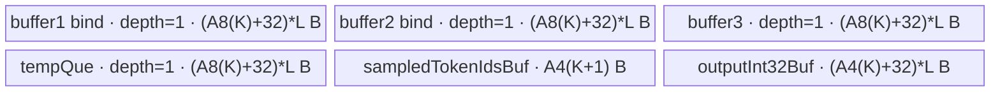

# AdvanceStep A2/A3 ACLNN 算子知识

## 算子速览

| 项目 | 内容 |
|---|---|
| 实际入口 | `aclnnAdvanceStepV2GetWorkspaceSize` / `aclnnAdvanceStepV2`；同族最新公开 V2 ACLNN 入口 |
| 计算语义 | 按 request 接受的投机 token 数推进位置和长度，重算物理 slot，并把 sampled/spec token 写回下一步输入 |
| 输入输出 | 8 个 `INT64/ND` Tensor：6 个必选输入/原地对象与 V2 的 `specToken`、`acceptedNum`；属性为 `numSeqs`、`numQueries`、`blockSize` |
| 执行类型 | 单 Kernel、单 AIV 节点 `AIV_VECTOR`；可达链路不含 Cube/AIC、MIX_CV、SIMT、NDDMA 或 AICPU |
| Kernel 路线 | R-001：V2 full-load speculative route，`TilingKey=2`，`KernelAdvanceStepSpec<int64_t>` |
| 核心资源 | GM + 4 个 depth=1 Queue + 2 个 TBuf；32 MiB 保留 workspace 由 Host 上报但 Kernel 不读取 |
| 来源闭包 | `source_closed`：公开 V2 声明（生成式 ACLNN bridge 为框架边界）→ `AdvanceStep` OpDef V2 输入→`Tiling4AdvanceStep`→key=2 router→完整 AIV body→A2/A3 binary config 闭合 |
| 验证状态 | 已完成源码闭包检查；本次知识提取未执行编译、真机、数值或性能测试。 |

## 接口与语义

### 计算语义

令 request 为 `s∈[0,numSeqs)`，`K=specNum+1`，列为 `j∈[0,K)`。V2 Device 的实际顺序是：

```text
p'[s,j] = int32(inputPositions[s,j]) + int32(acceptedNum[s]) + 1
seqLens'[s,j] = p'[s,j] + 1
bt = int32(blockTables[s, p'[s,j] / int32(blockSize)])
slotMapping'[s,j] = int64(bt * int32(blockSize) + p'[s,j] % int32(blockSize))

在 sampledTokenIds[s,0:K] 后补 -1，经 ReduceMin 找到最小值索引 m：
inputTokens'[s,0] = sampledTokenIds[s,m-1]
inputTokens'[s,1:K] = specToken[s,0:specNum]
```

公开文档给出的是旧版逐核简式；V2 的 `acceptedNum/specToken` 语义必须以 `KernelAdvanceStepSpec` 的上述实际数据流为准。文档要求 token 值为正数，因此追加的 `-1` 是最小值，正常有效域内 `m=K`，第一列取 sampled 行的最后一项。四个输出通过输入 GM 原地更新；OpDef 的图输出只用于形状/类型传播。

### 输入、输出与属性

| 参数 | shape/layout | dtype | 约束、默认值与语义 |
|---|---|---|---|
| `inputTokens` | Host storage `[numSeqs*K]`，逻辑 `[numSeqs,K]`，ND | INT64 | 原地写回；公开 V2 表格写 2-D，但 Host `CheckInputOutputShape` 实际要求 1-D 展平 storage |
| `sampledTokenIds` | `[numSeqs,K]`，ND | INT64 | 每行用于选择第一列 token；公开有效域为正数，不支持空 Tensor |
| `inputPositions` | Host storage `[numSeqs*K]`，ND | INT64 | 原地写回 `old+acceptedNum+1`；公开表格称 1-D 长度为 `numSeqs`，与 V2 Host 实现冲突 |
| `seqLens` | 与 `inputTokens` 完全同 shape，ND | INT64 | 输入被搬入，但实际结果由更新后的 `inputPositions+1` 覆盖 |
| `slotMapping` | 与 `inputTokens` 完全同 shape，ND | INT64 | 由更新位置和 `blockTables` 重算 |
| `blockTables` | `[numSeqs,blockTablesStride]`，ND | INT64 | 第二维由 Host 写入 POD；公开要求覆盖最大位置对应 block |
| `specToken` | `[numSeqs,specNum]`，ND | INT64 | V2 必选公开参数，对应 OpDef version 2 optional slot；写入 `inputTokens` 后 `specNum` 列 |
| `acceptedNum` | `[numSeqs]`，ND | INT64 | V2 必选公开参数；每行广播到 K 个位置 |
| `numSeqs` | 标量 | int64_t API / Host `Int` | Host 检查 `>0`；决定分核和所有第一维 |
| `numQueries` | 标量 | int64_t API / Host `Int` | Host 仅检查 `>0` 并写入 POD；R-001 Device 不读取。公开文档同时出现“大于/等于 numQueries”的矛盾描述 |
| `blockSize` | 标量 | int64_t API / Host `Int` | Host 检查 `>0`；Device 转 `int32_t` 后参与除、模和乘法 |

### 入口与版本

同一公开版本族包含 `aclnnAdvanceStep` 与 `aclnnAdvanceStepV2`。A2/A3 均公开支持 V2，因此本卡只提取各架构实际支持的最新公开 `aclnnAdvanceStepV2`。`AdvanceStep` OpDef 将 `spec_token`、`accepted_num` 标记为 `.Version(2)`；V2 的非空 ACLNN 参数使 Host 进入 speculative 分支。固定仓未提交自动生成的 ACLNN bridge 实现，故两段式 executor 构造、ACLNN 到 OpDef 的机械映射视为框架边界；算子拥有的 V2 OpDef、Tiling、POD、router、body 与 binary 接线均已闭合。

## Host/Launcher 执行流程

### 参数校验与前处理

1. 公开 `GetWorkspaceSize` 声明要求 8 个 Tensor 非空、均为 INT64/ND、不支持非连续 Tensor，并返回 executor 与 workspace 大小。
2. 生成式 ACLNN bridge 的源码在固定仓不可见；没有源码证据表明它会 reshape/contiguous。传入 storage shape 必须满足实际 Host 检查。
3. `AdvanceStepTilingHelper::GetBaseInfo` 读取 AIV 核数 `aivNum` 与 UB 字节数 `ubSize`。
4. `CheckAttrs` 依次读取三个属性并拒绝 `numSeqs<1`、`numQueries<1`、`blockSize<1`。
5. `GetInputsOutputs` 取得 6 个必选 storage shape；V2 两个 optional slot 只有在指针存在且 origin shape 元素数大于 0 时才算存在。
6. `CheckOptionalInputs` 校验 `specToken=[numSeqs,specNum]`、`acceptedNum=[numSeqs]`。V2 两者均存在，继续 `CheckInputOutputShape` 与 `CheckInputOutputDType`；任一缺失会转到旧版路径，而该路径不属于最新 V2 Route。
7. shape 检查强制展平的四个原地 Tensor 长度为 `numSeqs*K`、sampled 为 `[numSeqs,K]`、blockTables 第一维为 `numSeqs`；dtype 检查强制八路均 INT64。任一失败返回 `GRAPH_FAILED`。

### 参数、Workspace 与生命周期

`Tiling4Seqs` 先计算核分片和单循环 UB 上限；`PostTiling` 写 POD、设置 `blockDim=needCoreNum`、`TilingKey=2`，并上报固定 `32*1024*1024` 字节 workspace。ACLNN 调用者持有第一段返回的 executor，按其 workspaceSize 分配 Device workspace，再在同一 executor 上以指定 stream 调用第二段。Kernel entry 把 `workspace` 参数忽略并将 `userWs=nullptr` 传入 body，所以这 32 MiB 对本 Kernel 没有 producer/consumer，生命周期止于 ACLNN 执行完成。

### 启动图与失败传播

```text
aclnnAdvanceStepV2GetWorkspaceSize(...)  # 生成式 bridge，固定仓不可见
  -> AdvanceStep(version=2)
    -> Tiling4AdvanceStep
      -> DoTiling -> Tiling4Seqs -> PostTiling(key=2, blockDim=needCoreNum)
aclnnAdvanceStepV2(workspace, workspaceSize, executor, stream)
  -> [同一 stream] advance_step(..., spec_token, accepted_num, workspace, tiling)
    -> KernelAdvanceStepSpec<int64_t>::Init
    -> KernelAdvanceStepSpec<int64_t>::Process
```

单一 Device 节点直接从 8 路 GM 读写，无 Kernel 间 workspace 边。Tiling 的 `GRAPH_FAILED` 阻断 launch；ACLNN 第二段在传入 stream 上排队，外部何时同步由调用者决定。Kernel 未实现 unknown-key fallback：非 1/2 key 时 entry 不写输出；R-001 固定由 Host 产生 key=2。

## Route 与参数设计

### 分核与资源计算

设 `A8(x)=32*ceil(8x/32)`、`A4(x)=32*ceil(4x/32)`（字节），`K=specNum+1`：

```text
perCoreSeqs = ceil(numSeqs / aivNum)
needCoreNum = ceil(numSeqs / perCoreSeqs)
lastCoreSeqs = numSeqs - (needCoreNum-1)*perCoreSeqs

hostPerRow = 4*A8(K+4) + A4(K+4)
tempBytes = A4(K+1)
available = ubSize - tempBytes - 768
perLoopMaxSeqs = floor(available / hostPerRow)
```

Host 要求 `available>hostPerRow`，否则失败。每核处理连续的 `perCoreSeqs` 行，尾核用 `lastCoreSeqs`；每核再以 `perLoopSeqs=min(perLoopMaxSeqs,curCoreSeqs)` 分 loop。所有公式单位已标为行或字节；`needCoreNum<=aivNum`。Host 未对 `numSeqs*K`、对齐乘法、`uint16_t blockCount` 和 `uint32_t blockLen` 的窄化做额外保护。

### Route 选择

| 顺序 | Route | Key/模板 | 精确选择条件与优先级 | 不适用去向 |
|---:|---|---|---|---|
| 1 | R-001 V2 speculative full-load | key=2 / `KernelAdvanceStepSpec<int64_t>` | `specTokenExist && acceptedNumExist`，随后所有 shape/dtype/UB 检查成功 | 任一检查失败为 `GRAPH_FAILED`；任一 V2 optional 不存在则进入旧 API legacy key=1，不属于本卡入口 |

```text
specTokenExists && acceptedNumExists?
  no  -> legacy TilingKey=1（aclnnAdvanceStep 路线，本卡不发布）
  yes -> CheckInputOutputShape
      -> CheckInputOutputDType
      -> Tiling4Seqs
      -> FULL_LOAD / TilingKey=2 / R-001
      -> 任一步失败：GRAPH_FAILED，不启动 Kernel
```

### 模板/实现执行矩阵

| Route | key/selector | dtype/shape/platform 完整命中条件 | 执行拓扑与 Kernel 节点 | 实际模板/body | 内存与同步特征 | tail/fallback |
|---|---|---|---|---|---|---|
| R-001 V2 speculative full-load | key=2 | 两个 V2 optional 均存在；八路 INT64；shape 满足 Host 展平规则；A2/A3 `__CCE_AICORE__==220`；UB guard 成功 | 单 AIV Kernel `advance_step` | `KernelAdvanceStepSpec<int64_t>::Init/Process` 及 8 个阶段方法 | 4 Queue + 2 TBuf；DataCopyPad、Vector、scalar GM gather、HardEvent/PIPE_V；workspace 未使用 | 每核 lastCore、每 loop lastLoop；无其他 V2 fallback |

### 隐藏性能 Guard

| Guard | Host/Tiling 条件 | Device/资源原因 | 影响 Route | 不满足时去向 | 源码符号 |
|---|---|---|---|---|---|
| UB 可用量 | `ubSize-A4(K+1)-768 > 4*A8(K+4)+A4(K+4)` | 为逐行 Queue/TBuf 留空间 | R-001 | `GRAPH_FAILED` | `advance_step_tiling.cpp::Tiling4Seqs` |
| AIV 数量 | `aivNum>0` 隐含于 `perCoreSeqs>0` | 生成合法分核 | R-001 | `perCoreSeqs<=0` 失败 | `AdvanceStepTilingHelper::GetBaseInfo/Tiling4Seqs` |
| 32B 行对齐 | `align = (A8(K)/2) % 32 != 0`，即实际由 K 的 64B 周期决定 | 对不满足内部行距的情况，DataCopyPad `src/dstStride=1` 补一个 32B block | R-001 | 同 Route 的 aligned 子行为 | `KernelAdvanceStepSpec::Init/CopyIn/CopyOut` |
| DMA 字段位宽 | `seqsNum→uint16_t`，`K*8/specNum*8→uint32_t` | `DataCopyExtParams` 字段宽度固定 | R-001 | 溢出行为固定仓无额外保护 | `CopyIn/CopyOut/CopyInInputTokens/CopyOutInputTokens` |
| int32 计算域 | position、acceptedNum、blockSize、block table 值及 offset 均转为 `int32_t/int` | V2 Vector 计算与 scalar gather 使用 int32 临时区 | R-001 | 超界会窄化；无 int64 fallback | `Compute/ComputeSlotMapping` |
| 平台编译 guard | `__CCE_AICORE__ == 220` | entry 的两条 body 只在该 guard 内编译 | R-001 | 其他值 entry 无实现 | `advance_step.cpp::advance_step` |

### POD/ABI

`AdvanceStepTilingData` 由固定仓外 `tilingdata_base.h` 宏展开；固定仓能确定声明顺序、字段类型均为 64 位、Host producer 与 Device consumer，但不能从本仓确定宏展开后的 `sizeof/alignof/offsetof`，故不推测数值。

| 结构 | 字段 | 类型/位宽 | ABI 布局 | 单位 | Host/launcher producer | Device consumer | 边界 |
|---|---|---|---|---|---|---|---|
| `AdvanceStepTilingData` | `needCoreNum` | int64_t/64 | 固定仓不可见 | core | `PostTiling:set_needCoreNum(needCoreNum_)` | `Init` 判尾核 | V2 为 `ceil(numSeqs/perCoreSeqs)` |
| 同上 | `blockTablesStride` | int64_t/64 | 固定仓不可见 | int64 元素/行 | `CheckInputOutputShape:GetDim(1)` | GM row base、索引生成 | Device 中进入 int32 progression |
| 同上 | `numSeqs` | int64_t/64 | 固定仓不可见 | request | `CheckAttrs`→`PostTiling` | `Init` 保存但 R-001 后续未读 | `>0` |
| 同上 | `numQueries` | int64_t/64 | 固定仓不可见 | query | `CheckAttrs`→`PostTiling` | R-001 不读取 | 只校验 `>0` |
| 同上 | `blockSize` | int64_t/64 | 固定仓不可见 | token/物理 block | `CheckAttrs`→`PostTiling` | slot 除、模、乘 | `>0`，随后窄化 int32 |
| 同上 | `perCoreSeqs` | int64_t/64 | 固定仓不可见 | request/core | `Tiling4Seqs` | 非尾核行数及 GM `seqOffset` | `ceil(numSeqs/aivNum)` |
| 同上 | `lastCoreSeqs` | int64_t/64 | 固定仓不可见 | request | `Tiling4Seqs` | 尾核行数 | 正数 |
| 同上 | `perLoopMaxSeqs` | int64_t/64 | 固定仓不可见 | request/loop | `Tiling4Seqs:floor(available/hostPerRow)` | `Init:min(...,curCoreSeqs)` | Host guard 保证正数 |
| 同上 | `specNum` | int64_t/64 | 固定仓不可见 | token/request，不含主 token | `CheckOptionalInputs:GetDim(1)` | `tokenEachReqs=specNum+1`、DMA、ReduceMin | V2 specToken 非空，因此 `specNum>0` |

### Route 源码闭包

| Route | Key/selector | Host/Tiling producer | POD/参数 | Kernel entry/router 节点 | Kernel body/直接依赖 | 构建接线 |
|---|---|---|---|---|---|---|
| R-001 V2 speculative full-load | optional 双存在→key=2 | `op_host/advance_step_tiling.cpp::DoTiling/Tiling4Seqs/PostTiling` | `op_host/advance_step_tiling_def.h::AdvanceStepTilingData` | `op_kernel/advance_step.cpp::advance_step` key=2 | `op_kernel/advance_step_spec.h::KernelAdvanceStepSpec<int64_t>`；`advance_step_common.h::Align/AlignBytes/Min/SetWaitFlag` | A2 `ascend910b/advance_step_binary.json`、A3 `ascend910_93/advance_step_binary.json`、`ascendc_config.json` |

## Kernel 实现

### 公共执行流程

最新 V2 只有 R-001。`advance_step` 解析 POD，在 `__CCE_AICORE__==220` 且 key=2 时构造本地 `TPipe` 和 `KernelAdvanceStepSpec<int64_t>`。每核绑定连续 request 行；每 loop 严格执行位置/长度更新→slot 更新→token 更新，前一阶段通过同一 Queue/TBuf 和显式 HardEvent 向下一阶段交接。没有多 Kernel、跨节点 workspace 或通信边。

### Route R-001：V2 speculative full-load

#### 适用条件

##### 选择证据

| 层级 | 文件 | 符号 | 源码谓词/参数 | 结果/下一跳 |
|---|---|---|---|---|
| API | `optim/advance_step/docs/aclnnAdvanceStepV2.md` | `aclnnAdvanceStepV2GetWorkspaceSize/aclnnAdvanceStepV2` | 8 Tensor + 3 attrs，两段式调用 | 生成 executor 后在 stream 执行 V2 |
| OpDef | `optim/advance_step/op_host/advance_step_def.cpp` | `AdvanceStep::AdvanceStep` | `spec_token/accepted_num.Version(2)`；`ascend910b/ascend910_93` | 绑定 AdvanceStep V2 与 A2/A3 |
| Host/Tiling | `optim/advance_step/op_host/advance_step_tiling.cpp` | `DoTiling` | `specTokenExist && acceptedNumExist` | shape/dtype/UB 成功后 key=2 |
| Router | `optim/advance_step/op_kernel/advance_step.cpp` | `advance_step` | `__CCE_AICORE__==220 && TILING_KEY_IS(2)` | `KernelAdvanceStepSpec<int64_t>` |

#### Device 数据流

##### 函数级调用链

```text
Tiling4AdvanceStep
  -> DoTiling -> Tiling4Seqs -> PostTiling(key=2, blockDim=needCoreNum)
advance_step(8 GM inputs, unused workspace, tiling)
  -> KernelAdvanceStepSpec<int64_t>::Init
  -> Process
    -> CopyIn                 # inputPositions, seqLens, acceptedNum GM→Queue
    -> Compute                # int64→int32，广播 acceptedNum，更新 positions/lens
    -> CopyOut                # positions/lens Queue→GM；Queue 继续交接
    -> ComputeSlotMapping     # row offset + position/blockSize，scalar GM gather，Vector 组合
    -> CopyOutSlotMapping
    -> CopyInInputTokens      # sampledTokenIds/specToken GM→复用 Queue
    -> ComputeInputTokens     # sentinel + ReduceMin 找最后有效 sampled token
    -> CopyOutInputTokens     # 两次 strided DMA 写首列和后续列
```

##### 源码等价伪码

```text
# 伪码；保留实际分核、loop、对齐和地址关系
coreRows = (blockIdx == needCoreNum-1) ? lastCoreSeqs : perCoreSeqs
seqBase = blockIdx * perCoreSeqs
L = min(perLoopMaxSeqs, coreRows)
for each full loop and optional tail loop with rows:
  elemStride64 = align32(K*8)/8 + (align ? 4 : 0)
  elemCount32 = rows * elemStride64

  DMA rows of inputPositions/seqLens (blockLen=K*8); DMA acceptedNum (rows*8)
  p32 = cast_int32(inputPositions64, elemCount32)
  lens32 = cast_int32(seqLens64, elemCount32)
  for row: Adds(p32[rowBase], p32[rowBase], int32(acceptedNum[row]), K)
  Adds(p32, p32, 1, elemCount32)
  Adds(lens32, p32, 1, elemCount32)
  cast p32/lens32 back to int64; DMA K valid values/row to GM

  rowOffset32 = ArithProgression(0, blockTablesStride, rows)
  broadcast each row offset to K lanes
  for every padded lane: quotient = p32 / int32(blockSize)
  index = rowOffset + quotient
  for valid row,j: bt = int32(blockTables[loopRowBase, index[row,j]])
  slot32 = bt*int32(blockSize) + p32%int32(blockSize)
  cast slot32 to int64; DMA K valid values/row to GM

  DMA sampledTokenIds rows(K); DMA specToken rows(specNum)
  for row:
    cast sampled row to float, append -1
    (_, minIndex) = ReduceMin(K+1 values)
    lastToken[row] = originalInt64Sampled[minIndex-1]
  strided DMA lastToken rows to inputTokens[:,0]
  strided DMA specToken rows to inputTokens[:,1:K]
```

#### 内存与数据搬运

##### 资源与搬运表

| 层级/缓冲区 | offset/地址公式 | extent/容量公式 | dtype/layout | producer | consumer | owner/lifetime | 对齐/复用 |
|---|---|---|---|---|---|---|---|
| 8 路 GM | `seqBase*K`；blockTables 为 `seqBase*stride`；accepted 为 `seqBase` | 每核 `curCoreSeqs` 行 | INT64/ND | 调用者 | 各 Copy/Compute | 调用者持有；Kernel 期间有效 | 连续 request 分片 |
| `buffer1` bind Queue | UB 子区 | `(A8(K)+32)*L` | INT64；也以 int32 view 使用 | `CopyIn` positions；后复用 sampled | `Compute/CopyOut`；后 `ComputeInputTokens` | `TPipe`，depth=1 | VECIN/VECOUT bind，跨阶段复用 |
| `buffer2` bind Queue | UB 子区 | `(A8(K)+32)*L` | INT64 | seqLens→slot temp→specToken | `Compute/CopyOut/ComputeSlotMapping/CopyOutSlotMapping/CopyOutInputTokens` | `TPipe`，depth=1 | 同一物理 Queue 串行复用 |
| `buffer3` Queue | UB 子区 | `(A8(K)+32)*L` | INT64/int32 view | acceptedNum→slot scratch→lastToken | `Compute/ComputeSlotMapping/ComputeInputTokens/CopyOutInputTokens` | `TPipe`，depth=1 | 依靠 EnQue/DeQue 交接 |
| `tempQue_` | UB 子区 | `(A8(K)+32)*L` | int32 | `Compute` 的 position32 | `ComputeSlotMapping` | `TPipe`，depth=1 | 消费后 `FreeTensor` |
| `sampledTokenIdsBuf_` | UB TBuf | `A4(K+1)` | FP32 | sampled row cast + sentinel | `ReduceMin` | Kernel 全生命周期 | 所有行复用同一行 scratch |
| `outputInt32Buf_` | UB TBuf | `(A4(K)+32)*L` | INT32 | lens32；后 slot32 | cast 回 INT64 | Kernel 全生命周期 | 阶段间覆盖复用 |
| workspace | entry 收到但传 `nullptr` | Host 固定 32 MiB | N/A | ACLNN/Host 预留 | 无 Device consumer | executor/调用者 | 不参与 Kernel 数据流 |

##### 分层内存布局



##### 字节账与复用顺序

```text
Device_UB_total = 4*(A8(K)+32)*L + (A4(K)+32)*L + A4(K+1)
Host_budgeted   = [4*A8(K+4) + A4(K+4)]*perLoopMaxSeqs + A4(K+1) + 768
dynamic_ub      = N/A（AIV TPipe 静态分配）
workspace_total = 32*1024*1024 B（保留但 Device 未使用）
```

`A8(K+4)=A8(K)+32` 恒成立；但 `A4(K+4)` 并不对所有 K 恒等于 `A4(K)+32`。因此 Host 的 int32 行预算与 Device `outputInt32Buf_` 公式存在最多每行 32B 的可证明差异，768B reserve 是否足以覆盖所有 `L` 固定仓未证明；不能把 Host guard 直接当作严格 `Device_UB_total<=ubSize` 证明。

| 复用子区 | 写入者 | 读取者/消费点 | 下一次覆盖 | 同步或释放依据 | 安全条件 |
|---|---|---|---|---|---|
| `buffer1` | positions CopyIn/Compute | CopyOut | sampledTokenIds CopyIn | Queue DeQue/EnQue + `MTE3_MTE2` 间接阶段顺序 | Process 固定顺序，不得并行重排 |
| `buffer2` | seqLens CopyIn/Compute | CopyOut→slot compute/out | specToken CopyIn | `MTE3_V`、`MTE3_MTE2`、Queue 交接 | slotMapping 写完后才能覆盖 |
| `buffer3` | acceptedNum CopyIn | Compute | slot scratch，再 lastToken | Queue 交接、S/V events | acceptedNum 消费完后覆盖 |
| `tempQue_` | position32 | slot compute | 下一 loop | `FreeTensor` at end of `ComputeSlotMapping` | slot 计算完成 |
| `outputInt32Buf_` | seqLens32 | cast to seqLens64 | slotMapping32 | `V_MTE3` 后阶段顺序 | lens cast 完成后覆盖 |
| `sampledTokenIdsBuf_` | 每行 sampled FP32 + sentinel | 同行 ReduceMin | 下一行 | V/S event 成对等待 | 当前行 `minIndex` 已读取 |

#### 同步、精度与尾块

##### 同步与数值边界表

| 阶段 | primitive/机制 | producer | consumer/等待点 | 保护对象 | 精度/尾块 |
|---|---|---|---|---|---|
| GM→Queue | `DataCopyPad` + EnQue/DeQue | MTE2 | Vector/Scalar | positions/lens/accepted | `blockCount=rows`，`blockLen=K*8`；align 时 `dstStride=1` |
| position update | `Cast`, `Adds`, `PIPE_V`, `V_S/S_V` | Vector/Scalar | 后续 Vector/GM | int32 scratch | INT64 先窄化 INT32，`CAST_NONE`；padding lane 也计算但不写 GM |
| GM copyout | `V_MTE3`, `MTE3_V` | Vector | MTE3/下一 Vector | positions/lens | 只写每行 K 个有效 int64；align 时 `srcStride=1` |
| slot gather | `ArithProgression/Duplicate/Add` + scalar `GetValue` | Vector/Scalar | Muls/Add/Cast | index、block table | 有效 j 才 gather；中间 offset/value/blockSize 均 int32 |
| slot copyout | `V_MTE3`, `MTE3_MTE2` | Vector/MTE3 | 下一次 MTE2 | slot buffer | 只写 K 有效 lane |
| token selection | `Cast(CAST_RINT)` + sentinel `-1` + `ReduceMin(...,K+1,true)` | Vector/Scalar | minIndex scalar read | 单行 FP32 scratch | token 值本体从原 INT64 取，FP32 仅决定索引；依赖公开正数域 |
| tail | `lastCoreSeqs` + `lastLoopSeqs>0` | Host/POD | Process 分支 | 最后一核/最后一 loop | 只对实际 `rows` 发 DMA；无空域 Route |

#### 关键实现

##### 符号证据表

| 阶段 | 文件 | 符号/模板实例 | 实现事实 |
|---|---|---|---|
| Host/Tiling producer | `optim/advance_step/op_host/advance_step_tiling.cpp` | `DoTiling/Tiling4Seqs/PostTiling` | 双 optional 选择 V2、生成分核/loop/UB 参数、key=2、32 MiB workspace |
| POD | `optim/advance_step/op_host/advance_step_tiling_def.h` | `AdvanceStepTilingData` | 9 个 int64 字段的声明顺序 |
| Kernel entry/router | `optim/advance_step/op_kernel/advance_step.cpp` | `advance_step` | `__CCE_AICORE__==220` 下 key=2 映射到 `KernelAdvanceStepSpec<int64_t>` |
| Device init/body | `optim/advance_step/op_kernel/advance_step_spec.h` | `Init/Process` | GM 分片、6 个 UB 对象、full/tail loop 与八阶段顺序 |
| Device helper | `optim/advance_step/op_kernel/advance_step_common.h` | `Align/AlignBytes/Min/SetWaitFlag` | 32B 对齐、loop clamp 和 HardEvent 配对 |

## 算子特定优化

### Trick T-001：两段 strided DMA 直接拼成下一步 inputTokens

#### 触发与源码依据

- 适用 Route：R-001。
- 触发条件：V2 key=2；每行 `K=specNum+1`，首列已经由 `ReduceMin` 选出 lastToken，后 `specNum` 列来自 `specToken`。
- Golden 来源：[`optim/advance_step/op_kernel/advance_step_spec.h:361-372`](../../../../../../../cann-ops-raw/ascendc/ops-nn/955f8b33985b6d72989ebff341bb9c2c564a51bc/optim/advance_step/op_kernel/advance_step_spec.h#L361-L372)

**官方源码（固定 Commit 连续逐字摘录）**：

```cpp
// 搬运lastToken到inputTokens的第1列
int64_t offset = loop * perLoopSeqs_ * tokenEachReqs_;
DataCopyExtParams lastTokenDataCopyParams{
    static_cast<uint16_t>(seqsNum), static_cast<uint32_t>(sizeof(T)), 0,
    static_cast<uint32_t>((specNum_) * sizeof(T)), 0};
DataCopyPad(inputTokensGm_[offset], lastTokensLocal, lastTokenDataCopyParams);

// // 搬运specToke到inputTokens的后specNum列
DataCopyExtParams specTokenDataCopyParams{
    static_cast<uint16_t>(seqsNum), static_cast<uint32_t>(specNum_ * sizeof(T)), 0,
    static_cast<uint32_t>(sizeof(T)), 0};
DataCopyPad(inputTokensGm_[offset + 1], specTokenLocal, specTokenDataCopyParams);
```

#### 机制与设计原因

第一条 DMA 每行只写一个 `T`，目的行 stride 为 `specNum*sizeof(T)`，恰好跨过后续列；第二条 DMA 从 `offset+1` 起每行写连续 `specNum` 个 `T`，目的 stride 为一个 `T`。两次搬运直接形成 `[lastToken, specToken...]`，无需再申请 K 列完整的 output Queue 或先在 UB 拼接。这改变了内存物化与搬运路径；`blockCount=seqsNum` 来自当前 loop，两个 `blockLen` 分别为 8B 与 `specNum*8B`。

#### 迁移边界

- 适用：目标是“少量前缀列 + 连续剩余列”拼接且 GM 输出行距固定的场景。
- 前提：A2/A3 V2、INT64、ND、每行 K 列；`seqsNum` 与字节 stride 能装入 `DataCopyExtParams` 字段。
- 失效：列布局不是 `[1,specNum]` 两段、目标非规则行距或任一 DMA 字段溢出时，必须重新设计搬运；本 Route 无 fallback。
- 未验证：本次知识提取未执行编译、真机、数值或性能测试。

#### 错误做法

固定仓未提供可验证反例；但不能把两条 DMA 合并成一次连续拷贝，因为首列和后续列来自不同 UB buffer。

## 模板与实现对比

| 对比维度 | R-001 V2 speculative full-load | 设计选择依据 |
|---|---|---|
| 命中条件/优先级 | 两个 V2 optional 均存在，检查全部成功，key=2 | V2 是 A2/A3 最新公开版本 |
| 模板与 dtype | `KernelAdvanceStepSpec<int64_t>`；内部 INT32/FP32 scratch | 接口数据 INT64；Vector/Reduce 使用较窄临时类型 |
| 循环与分核 | 连续 request 分核，UB 决定每 loop 行数，独立 tail core/loop | 控制单核 UB 占用并覆盖任意正 `numSeqs` |
| Queue/TBuf/寄存器 | 4×depth1 Queue + 2 TBuf | 同一子区跨位置、slot、token 阶段复用 |
| 内存总占用与复用 | `4*(A8(K)+32)L+(A4(K)+32)L+A4(K+1)` | Host 预算与 int32 TBuf 公式存在边界差异 |
| 搬运/Vector API | DataCopyPad、Cast、Adds、ArithProgression、Duplicate、Add、Muls、ReduceMin | 行批量 DMA + Vector 更新；blockTables 为 scalar GM gather |
| 同步、精度与 tail | Queue + HardEvent + PIPE_V；INT64→INT32→INT64；FP32 仅找索引 | 显式处理 pipeline hazard 和尾行 |
| fallback/失败边界 | 无 V2 fallback；检查失败终止，unknown key 静默不写 | 不把 legacy key=1 混入最新 V2 Route |

## 平台差异

| 项目 | A2 | A3 | 950 |
|---|---|---|---|
| 支持状态 | 公开支持；`ascend910b` config | 公开支持；`ascend910_93` config | 公开文档明确不支持；不生成 `_950` 卡 |
| Host/Launcher | 共用 `AdvanceStep` OpDef/Tiling，`__CCE_AICORE__==220` | 同 A2 | N/A |
| Kernel/资源 | 同一 binary 名、同一 `KernelAdvanceStepSpec<int64_t>` 与 UB 公式；实际 `aivNum/ubSize` 运行时读取 | 同 A2 | 无公开可达实现 |

## 限制与失败边界

- 公开 V2 文档的 shape/`numQueries` 描述内部矛盾，且与实际 Host storage 检查不完全一致：实现要求四个原地 Tensor 展平为 `[numSeqs*K]`、sampled 第一维等于 `numSeqs`，并未检查 `numSeqs==numQueries`。复用实现时必须以 Host 谓词为准，同时把该发布文档冲突视为接口风险。
- V2 内部将 positions、acceptedNum、blockSize、block-table 值和索引窄化到 int32；固定仓没有范围检查或 int64 fallback。公开“INT64/正数”不等于完整 int64 计算域。
- token 选择依赖 appended `-1` 是每行最小值；公开正数约束满足此前提。超出公开有效域时 `minIndex-1` 可能改变，甚至下溢，固定仓无保护。
- `DataCopyExtParams.blockCount` 为 uint16，`blockLen/stride` 为 uint32；Host 未证明 `perLoopSeqs/K/specNum` 不会窄化。
- Host UB 预算中的 `A4(K+4)` 与 Device `A4(K)+32` 并非总相等；固定 768B reserve 是否覆盖所有行数没有源码证明。
- `blockTables` 第二维只被读取为 stride；Host 不验证其足以覆盖更新位置索引。越界责任留在调用方公开约束。
- 32 MiB workspace 被 Host 固定上报但 Kernel 明确不使用；不要把它误认为跨阶段 scratch。
- 固定仓未提交 ACLNN 生成 bridge 的实现、tiling 宏展开的 ABI offset 或 runtime stream 错误传播细节；它们是明确框架边界，不对其内部行为作推测。
- 本次知识提取未执行编译、真机、数值或性能测试。

## 源码索引

### 链路索引

| 链路阶段 | 文件 | 关键符号 | 支撑内容 |
|---|---|---|---|
| 入口声明/约束 | `optim/advance_step/docs/aclnnAdvanceStepV2.md` | `aclnnAdvanceStepV2GetWorkspaceSize/aclnnAdvanceStepV2` | V2 签名、产品支持、参数、错误与两段式调用 |
| Host OpDef | `optim/advance_step/op_host/advance_step_def.cpp` | `AdvanceStep::AdvanceStep` | version 2 optional 输入与 A2/A3 config |
| Host/Tiling | `optim/advance_step/op_host/advance_step_tiling.cpp` | `AdvanceStepTilingHelper::*`、`Tiling4AdvanceStep` | 校验、分核、UB、key、workspace |
| POD | `optim/advance_step/op_host/advance_step_tiling_def.h` | `AdvanceStepTilingData` | POD 字段与 Route enum |
| Kernel entry | `optim/advance_step/op_kernel/advance_step.cpp` | `advance_step` | 平台 guard 和 key=2 router |
| Kernel body | `optim/advance_step/op_kernel/advance_step_spec.h` | `KernelAdvanceStepSpec<int64_t>` | UB、循环、搬运、计算、同步、tail |
| Device helper | `optim/advance_step/op_kernel/advance_step_common.h` | `Align/AlignBytes/Min/SetWaitFlag` | 对齐和事件 helper |
| A2 binary | `optim/advance_step/op_host/config/ascend910b/advance_step_binary.json` | `AdvanceStep_b66329fcd4da47a2ea4563aedd1f6bfa` | A2 输入签名与 binary |
| A3 binary | `optim/advance_step/op_host/config/ascend910_93/advance_step_binary.json` | `AdvanceStep_b66329fcd4da47a2ea4563aedd1f6bfa` | A3 输入签名与 binary |
| 全局 Kernel 接线 | `scripts/kernel/binary_config/ascendc_config.json` | `name=AdvanceStep` | 仅 `ascend910b/ascend910_93`，`auto_sync=false` |

### 实现复用检查

| 检查项 | 可复用事实 | 不得改变的约束 | 源码符号 |
|---|---|---|---|
| ABI/POD | 9 个 int64 字段按声明顺序由 Host 写、Device 读 | 宏展开 ABI 数值固定仓不可见；不得自行重排或猜 offset | `AdvanceStepTilingData` |
| 调用顺序 | positions/lens→slot→tokens，单 Kernel 单 stream | Queue/TBuf 跨阶段复用要求此顺序 | `KernelAdvanceStepSpec::Process` |
| workspace/内存 | 32 MiB workspace 未使用；6 个 UB 对象按公式分配 | depth、额外 32B 行 padding、Host/Device 预算差异 | `PostTiling`、`Init` |
| 同步 | Queue + V/S/MTE HardEvent + PIPE_V | 不得在 producer/consumer 间删除或重排 event/barrier | `Compute/ComputeSlotMapping/ComputeInputTokens` |
| 精度与尾块 | INT32 中间计算、FP32 仅选索引；lastCore/lastLoop | int32 范围、正 token sentinel 前提、只写 K 有效列 | `Init/Process/Compute*` |
| 失败边界 | Host 检查失败不 launch；V2 无 fallback | optional 缺失进入旧版，不得当成 V2 Route；unknown key 不写输出 | `DoTiling`、`advance_step` |