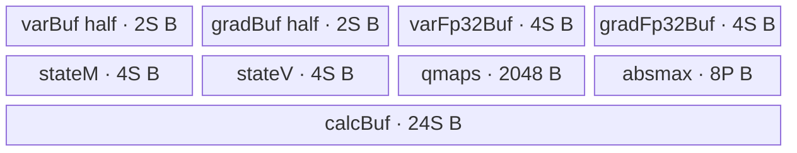
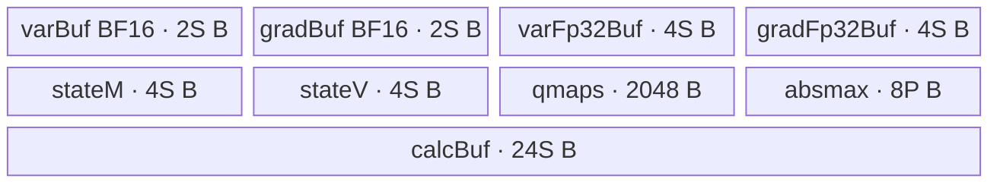

# ApplyAdamWQuant A2/A3 ACLNN 算子知识

## 算子速览

| 项目 | 内容 |
|---|---|
| 实际入口 | `aclnnApplyAdamWQuantGetWorkspaceSize` + `aclnnApplyAdamWQuant`，公开两段式 ACLNN；固定仓只公开这一版本族。 |
| 计算语义 | 按 256 元素块由 `uint8` 索引与 qmap/absmax 反量化 m、v，执行 AdamW 更新，再按块求 absmax、归一化并量化回索引。 |
| 输入输出 | var/grad：同 shape 的 ND `float32/float16/bfloat16`；m/v：同 shape 的 ND `uint8`；qmapM/qmapV：256 个 `float32`；absmaxM/absmaxV：每 256 元素一个 `float32`；step：单个 `int64`。var、m、v、absmaxM、absmaxV 为引用更新。 |
| 执行类型 | 单 Kernel：`apply_adam_w_quant`，AIV_VECTOR；无 AIC/Cube、MIX_CV、SIMT、NDDMA 或 AICPU 可达节点。 |
| Kernel 路线 | R-001 FP32（key 100）；R-002 FP16→FP32（key 200）；R-003 BF16→FP32（key 300）。 |
| 核心资源 | GM + 单 `TPipe` + 9 个（FP32）或 11 个（FP16/BF16）VECCALC `TBuf`；无 `TQue`；Device `workspace` 参数未读。 |
| 来源闭包 | `source_closed`：公开 ACLNN 文档/生成式 ACLNN 边界 → `ApplyAdamWQuant` OpDef/InferShape/Tiling → POD → entry/router → 三个模板实例/body/helper → A2/A3 binary config/CMake 闭合。 |
| 验证状态 | 已完成源码闭包检查；本次知识提取未执行编译、真机、数值或性能测试。 |

## 接口与语义

### 计算语义

令量化块长 `D=256`。对块 `b` 内元素 `i`，输入索引首先反量化：

```text
m[i] = qmapM[mRef[i]] * absmaxM[b]
v[i] = qmapV[vRef[i]] * absmaxV[b]
g[i] = grad[i] * gnormScale
t     = float(step[0]) + 1
m[i]  = beta1 * m[i] + (1-beta1) * g[i]
v[i]  = beta2 * v[i] + (1-beta2) * g[i]^2
c2    = sqrt(1-beta2^t)
stepSize = -lr*c2/(1-beta1^t)
var[i] = var[i] + stepSize*m[i]/(sqrt(v[i]) + eps*c2)
if weightDecay > 0:
    var[i] = var[i] * (1-lr*weightDecay)
```

随后分别令 `absmaxM[b]=max_i(abs(m[i]))`、`absmaxV[b]=max_i(abs(v[i]))`，将状态除以对应 absmax，在升序 256 项 qmap 中做固定 7 轮二分，并比较相邻上下界距离选最近索引。m 路线另用 `CheckSign/CheckSignFp32`：若所选 qmap 值与归一化 m 符号不同，负 qmap 索引减 1、正 qmap 索引加 1；v 路线不做该修正。

上述是 Device 的实际运算顺序。特别地，源码使用 `step+1`，且 weight decay 乘在自适应更新后的 var 上；复用实现时不得只照接口文档公式改写顺序。

### 输入、输出与属性

| 参数 | shape/layout | dtype | 约束、默认值与语义 |
|---|---|---|---|
| `varRef` / inner `var` | ND，1–8 维 | FLOAT32/FLOAT16/BFLOAT16 | 引用输入输出；与 grad/m/v 同 shape。OpDef 启用 `AutoContiguous`。 |
| `grad` | 同 var，ND | 与 var 相同 | 输入梯度；Kernel 原地复用其 UB 副本，不修改输入 GM。 |
| `mRef` / inner `m` | 同 var，ND | UINT8 | qmapM 的索引，引用更新。 |
| `vRef` / inner `v` | 同 var，ND | UINT8 | qmapV 的索引，引用更新。 |
| `qmapM` | `[256]`，ND | FLOAT32 | 升序量化映射表；Tiling 只检查两 qmap shape 相同且元素数为 256。 |
| `qmapV` | `[256]`，ND | FLOAT32 | 升序量化映射表。 |
| `absmaxMRef` | 一维；每块一项 | FLOAT32 | 文档约束 `var.size/blockSize = absmaxMRef.size`，引用更新；Tiling 未再次核对。 |
| `absmaxVRef` | 一维；每块一项 | FLOAT32 | 文档约束 `var.size/blockSize = absmaxVRef.size`，引用更新；Tiling 未再次核对。 |
| `step` | `[1]`，ND | INT64 | 文档要求大于 0；Tiling 只检查 shape，Device 转 `float` 后加 1。 |
| `lr` | scalar | ACLNN `double`，inner attr `float` | OpDef 默认 0.001；Tiling 读取 float。 |
| `beta1` | scalar | ACLNN `double`，inner attr `float` | OpDef 默认 0.9。 |
| `beta2` | scalar | ACLNN `double`，inner attr `float` | OpDef 默认 0.999。 |
| `weightDecay` | scalar | ACLNN `double`，inner attr `float` | OpDef 默认 1.0；仅 `>0` 时执行衰减分支。 |
| `eps` | scalar | ACLNN `double`，inner attr `float` | OpDef 默认 `1e-8`。 |
| `gnormScale` | scalar | ACLNN `double`，inner attr `float` | OpDef 默认 1.0。 |
| `quantModeOptional` | scalar string | `char*` | 文档称保留参数；OpDef 默认 `BLOCKWISE`，Tiling 不读取。 |
| `blockSize` | scalar | INT64 | 必须恰为 256，否则 Tiling 返回 `GRAPH_FAILED`。 |

### 入口与版本

公开入口是文档中唯一的无版本后缀 `aclnnApplyAdamWQuantGetWorkspaceSize/aclnnApplyAdamWQuant`。第一段完成参数检查、把非连续输入纳入自动连续化执行图并返回 workspace 大小和 executor；第二段在给定 stream 上执行。固定仓不包含自动生成的 ACLNN inner bridge 源文件，故其通用 executor/引用输出接线作为框架生成边界；算子拥有的 OpDef、InferShape、Tiling、POD、Kernel 与构建均已下钻。

公开产品表明确支持 Atlas A2 与 A3；`ApplyAdamWQuant::ApplyAdamWQuant` 只 `AddConfig("ascend910b")`、`AddConfig("ascend910_93")`，两个 binary JSON 与 Kernel CMake 也只接这两平台。固定仓没有更高版本 ACLNN 入口或复用旧 body 的版本关系。

## Host/Launcher 执行流程

### 参数校验与前处理

1. ACLNN 公开契约要求非空、受支持 dtype/format、各引用 tensor 的 shape 关系以及 qmap/absmax/step/属性约束；第一段生成式校验的精确代码与判断顺序在固定仓不可见，不能据文档反推其内部实现。
2. OpDef 将 9 个 inner 输入标为 `AutoContiguous`，声明三组 var dtype 与对应输出 dtype，m/v 为 UINT8，其余表和 absmax 为 FLOAT32、step 为 INT64。
3. `InferShape4ApplyAdamWQuant` 分别把 var/m/v/absmaxM/absmaxV 输入 shape 复制给 5 个输出；`InferDataType4ApplyAdamWQuant` 同样复制 dtype。
4. `Tiling4ApplyAdamWQuant` 依次读取属性、要求 `block_size==256`、检查 var/grad/m/v 同 shape、qmapM/qmapV 同 shape且 qmapM 元素数 256、step shape `[1]`；任一步失败即 `GRAPH_FAILED`。
5. dtype 选择 key 100/200/300，计算 UB 分块与核分配，序列化 POD，设置 `blockDim=use_num_core`。

Tiling 对不在三种 dtype 中的值会留下 key 0 而非立即失败；正常公开入口/OpDef 已限制 dtype。Tiling 不检查 absmax shape、qmap 单调性、step 数值、beta/eps/gnorm 范围，也没有最终 partial-256 块的 Device mask。

### 参数、Workspace 与生命周期

设平台 UB 字节数为 `U`、var 元素数为 `N`、AIV 核数为 `A`：

```text
D = block_size = 256
qmap_bytes = 256 * 4 * 2 = 2048
budget_per_quant_block = 256 * (4*10 + 2 + 4) + 2*4 = 11784 bytes
P = floor((U - 2048) / 11784)                # 每次循环处理的量化块数
B = ceil(N / 256)                            # 量化块总数
C = ceil(B / P)                              # 长为 P 块的工作行数
K = ceil(C / ceil(C / A))                    # use_num_core，K<=A（C>0）
L = floor(C / K)                             # 后 K-E 核的工作行数
E = C - L*K                                  # 前 E 核多处理一行
last_core_last_block(local) = B - (C-1)*P    # Host局部量；未写入POD，Device也不消费
```

`P==0`、`K==0` 或 POD 容量不足均失败。`U-2048` 使用无符号减法，固定源码没有 `U<2048` 的前置检查；受支持硬件的真实 UB 大于该常数。

Kernel 形参包含 `workspace`，entry 和所有 body 都不读取它；Tiling 也未设置算子私有 workspace slice。因此算子 Kernel 自身 `workspace_total=0`。ACLNN 第一段可能因 `AutoContiguous`/引用回写框架节点返回非零 workspace，其精确公式、owner 与临时 tensor 生命周期属于固定仓不可见的生成框架边界；executor 持有执行图至第二段提交，用户提供的 workspace 至 stream 执行完成前必须有效。

### 启动图与失败传播

```text
aclnnApplyAdamWQuantGetWorkspaceSize
  -> [generated ACLNN validation / AutoContiguous / reference-output graph]
  -> ApplyAdamWQuant OpDef + InferShape/InferDataType
  -> Tiling4ApplyAdamWQuant
       key 100 | 200 | 300, blockDim=K, ApplyAdamWQuantTilingData
aclnnApplyAdamWQuant(workspace, executor, stream)
  -> one stream-ordered node: apply_adam_w_quant<<<K>>>(9 inputs, 5 outputs, workspace, tiling)
       -> exactly one AIV_VECTOR template body
  -> [generated reference-output/ViewCopy boundary if required]
```

| 节点/边 | producer / consumer | 介质与范围 | ordering | owner/lifetime | 失败传播 |
|---|---|---|---|---|---|
| ACLNN→inner op | 生成式 executor → `ApplyAdamWQuant` | 连续化后的 9 输入、5 引用输出；精确框架临时区固定仓不可见 | 同一 executor/stream | executor 与调用者 workspace 持有至执行完成 | 第一段检查失败不生成可执行节点；第二段返回 stream 提交状态。 |
| Tiling→Kernel | `Tiling4ApplyAdamWQuant` → `apply_adam_w_quant` | POD + key + `blockDim=K` | runtime launch ABI | runtime 拥有 tiling buffer至 launch 消费 | Tiling 任一 `GRAPH_FAILED` 阻断 launch。 |
| Kernel→引用输出 | `apply_adam_w_quant` → 生成式引用回写边界 | var/m/v：N 个逻辑元素；absmax：B 项；但 Device 实际按完整 `P*256` 行搬运 | 同 stream；节点内由 pipe event 保证 | 输出 tensor/框架临时区至 stream 完成 | Kernel entry 对未知 key 无 body、无显式错误；正常 OpDef 路线只产生 100/200/300。 |

这是单 Device Kernel，没有 Kernel 间 workspace 边、event 或中间 GM owner。

## Route 与参数设计

### 分核与资源计算

前 `E=not_last_core_num` 个核各做 `L+1=not_last_pre_core_row_work` 行，其余核各做 `L=last_pre_core_row_work` 行。每行固定 `P=one_core_do_block_num_per_row` 个 256 元素块，`S=256P` 元素。核 `k` 的起始工作行序号：

```text
rowBase(k) = k*(L+1),                         k < E
           = E*(L+1) + (k-E)*L,              k >= E
gmOffset(k)     = rowBase(k) * P * 256        # 元素
absmaxOffset(k) = rowBase(k) * P              # float 项
```

核内循环第 `n` 行访问 `gmOffset + n*S` 与 `absmaxOffset + n*P`。`DoTiling` 虽计算局部参数 `last_core_last_block`，`GetTilingData` 没有把它写入同名 POD 字段，三个 Device body 也均未解析该字段，故最后一行仍搬运/计算/写回 S 个元素和 P 个 absmax。固定源码仅在 `B` 恰为 P 的整数倍时证明这些范围完全落在逻辑 tensor 内；文档的 `var.size/blockSize=absmax.size` 还要求 N 与 256 的整块关系。

### Route 选择

| 顺序 | Route | Key/模板 | 精确选择条件与优先级 | 不适用去向 |
|---:|---|---|---|---|
| 1 | R-001 FP32 | 100 / `ApplyAdamWQuant<float,int64_t>` | `var.dtype == DT_FLOAT` | 否则判断 FP16。 |
| 2 | R-002 FP16→FP32 | 200 / `ApplyAdamWQuant16<float,int64_t,half>` | `var.dtype == DT_FLOAT16` | 否则判断 BF16。 |
| 3 | R-003 BF16→FP32 | 300 / `ApplyAdamWQuant16<float,int64_t,bfloat16_t>` | `var.dtype == DT_BF16` | 否则 key 保持 0；router 无 body。 |

```text
if dtype == DT_FLOAT:   key = 100 -> FP32 body
else if dtype == DT_FLOAT16: key = 200 -> half storage + FP32 body
else if dtype == DT_BF16:    key = 300 -> bfloat16 storage + FP32 body
else: key = 0 -> entry matches no branch
```

### 模板/实现执行矩阵

| Route | key/selector | dtype/shape/platform 完整命中条件 | 执行拓扑与 Kernel 节点 | 实际模板/body | 内存与同步特征 | tail/fallback |
|---|---|---|---|---|---|---|
| R-001 FP32 | 100 | var/grad FLOAT32，m/v UINT8，其余固定 dtype；A2/A3；shape 检查通过 | 单 AIV node | `ApplyAdamWQuant<float,int64_t>::Init/Process` | 9 TBuf；全 FP32；`MTE2_V/V_MTE3/MTE3_MTE2` | 无 final-row mask；未知 key 无输出。 |
| R-002 FP16→FP32 | 200 | var/grad FLOAT16；其余同上 | 单 AIV node | `ApplyAdamWQuant16<float,int64_t,half>::Init/Process` | 11 TBuf；输入升 FP32，输出 `CAST_NONE` 降 half | 同上。 |
| R-003 BF16→FP32 | 300 | var/grad BFLOAT16；其余同上 | 单 AIV node | `ApplyAdamWQuant16<float,int64_t,bfloat16_t>::Init/Process` | 11 TBuf；输入升 FP32，输出 `CAST_RINT` 降 BF16 | 同上。 |

### 隐藏性能 Guard

| Guard | Host/Tiling 条件 | Device/资源原因 | 影响 Route | 不满足时去向 | 源码符号 |
|---|---|---|---|---|---|
| 单行 UB 预算 | `P=floor((U-2048)/11784)>0` | 两个 qmap 常驻 2048 B，预算覆盖三 route 的所有 TBuf | 全部 | `P==0` 时 `GRAPH_FAILED` | `apply_adam_w_quant_tiling.cpp::DoTiling` |
| 固定量化块 | `block_size==256` | reduce/broadcast shape、qmap 大小与二分轮数均编译期绑定 256 | 全部 | `GRAPH_FAILED` | `GetTilingAttr`；`Normlize*`；`BinarySearch*` |
| qmap 规模 | qmapM/qmapV 同 shape且 qmapM size 256 | 索引域 `[0,255]`，7 轮二分 | 全部 | `GRAPH_FAILED` | `CheckInputShape` |
| 完整工作行 | 固定源码可证明安全需 `B % P == 0`，但 Host 未作为 guard | body 总按 P 块搬运；局部 `last_core_last_block` 未序列化，同名 POD 字段也未消费 | 全部 | 无 fallback/mask；属于调用与实现边界 | `DoTiling`；`GetTilingData`；`ParseTilingData*`；`Process` |
| Vector repeat 整除 | `S=256P` | binary select 使用 `S/64`，sign select 使用 `S/128`，reduce mask=64 FP32 元素 | 全部 | 由 blockSize 256 自动满足 | `BinarySearch*`；`CheckSign*`；`Normlize*` |
| weight decay | `weightDecay>0` | 避免非正系数时发射衰减 `Muls` | 全部 | 保持 adaptive update 结果 | `UpdateStateAndParam*` |
| dtype/router | key 100/200/300 | 决定 GM storage type、cast 与 body | 各自 route | key 0/未知 key 静默不执行 body | `Tiling4ApplyAdamWQuant`；`apply_adam_w_quant` |

### POD/ABI

`ApplyAdamWQuantTilingData` 由外部 `register/tilingdata_base.h` 宏生成；固定仓能确认字段声明顺序和源码类型，但宏展开、结构整体 `sizeof/alignof` 与精确 `offsetof` 不在仓内，故不推测数值。Host 通过 setter/`SaveToBuffer` 生产，Device 用 `GET_TILING_DATA` 后按同名成员读取。

| 结构 | 字段 | 类型/位宽 | ABI 布局 | 单位 | Host/launcher producer | Device consumer | 边界 |
|---|---|---|---|---|---|---|---|
| `ApplyAdamWQuantTilingData` | `use_num_core` | uint64/64 | 第1字段；精确 offset/整体布局固定仓不可见 | core | `DoTiling: use_num_core=K` | entry launch 的 `SetBlockDim`；body不读 | 必须 >0 |
| 同上 | `last_pre_core_row_work` | uint64/64 | 第2字段 | 工作行/core | `L=floor(C/K)` | `ParseTilingData*`→核内 loop | 后 K-E 核使用 |
| 同上 | `not_last_core_num` | uint64/64 | 第3字段 | core | `E=C-LK` | `Init/Process` former-core 分支 | `[0,K)` |
| 同上 | `not_last_pre_core_row_work` | uint64/64 | 第4字段 | 工作行/core | `L+1` | `Init` former-core offset | 前 E 核使用 |
| 同上 | `last_core_last_block` | uint64/64 | 第5字段 | 256元素块 | `GetTilingData` 没有调用 setter；字段值不能由固定源码确定 | 无 Device consumer | inactive；`DoTiling` 只计算同名 Host 局部参数 |
| 同上 | `lr` | float/32 | 第6字段 | scalar | `GetTilingAttr` 从 attr float | `ParseTilingData*`→stepSize/decay | ACLNN double 到 inner float |
| 同上 | `beta1` | float/32 | 第7字段 | scalar | attr float | correction1、m 更新 | 无值域检查 |
| 同上 | `beta2` | float/32 | 第8字段 | scalar | attr float | correction2、v 更新 | 无值域检查 |
| 同上 | `weight_decay` | float/32 | 第9字段 | scalar | attr float | `if (>0)` 衰减 | 非正时 inactive |
| 同上 | `eps` | float/32 | 第10字段 | scalar | attr float | 分母 `eps*correction2` | 无正值检查 |
| 同上 | `gnorm_scale` | float/32 | 第11字段 | scalar | attr float | 首次 `Muls(grad)` | 无值域检查 |
| 同上 | `block_size` | int64/64 | 第12字段 | element/block | attr；必须 256 | body 成员窄化为 uint32，reduce/broadcast | 固定 256 |
| 同上 | `one_core_do_block_num_per_row` | uint64/64 | 第13字段 | 256元素块/工作行 | `P=floor((U-2048)/11784)` | `singleBlockNum=P`、`singleSize=256P` | body 分别窄化为 int32/int64 |
| 同上 | `tiling_key` | uint64/64 | 第14字段 | selector | dtype→100/200/300 | Device body不读；entry用 runtime `TILING_KEY_IS` | POD 中冗余保存 |

### Route 源码闭包

| Route | Key/selector | Host/Tiling producer | POD/参数 | Kernel entry/router 节点 | Kernel body/直接依赖 | 构建接线 |
|---|---|---|---|---|---|---|
| R-001 FP32 | 100 / DT_FLOAT | `apply_adam_w_quant_tiling.cpp::Tiling4ApplyAdamWQuant/DoTiling` | `ApplyAdamWQuantTilingData` | `apply_adam_w_quant.cpp::apply_adam_w_quant` | `apply_adam_w_quant_fp32.h::ApplyAdamWQuant<float,int64_t>` + `apply_adam_w_quant_base.h` | OpDef A2/A3；两平台 JSON FP32 bin；Kernel CMake；global binary config |
| R-002 FP16→FP32 | 200 / DT_FLOAT16 | 同上 | 同上 | 同上 | `apply_adam_w_quant_fp16.h::ApplyAdamWQuant16<float,int64_t,half>` + base | 两平台 JSON FP16 bin；其余同上 |
| R-003 BF16→FP32 | 300 / DT_BF16 | 同上 | 同上 | 同上 | `apply_adam_w_quant_fp16.h::ApplyAdamWQuant16<float,int64_t,bfloat16_t>` + base | 两平台 JSON BF16 bin；其余同上 |

## Kernel 实现

### 公共执行流程

entry 解析 POD 后以 key 选择一个模板，构造对象并调用 `Init→Process`。每个核计算自己的 GM/absmax 基址，初始化全部 TBuf，从 GM 标量读取 step 并在 `calcBuf` 头两个 32B 区计算 bias correction。`Process` 把两个 qmap 各搬一次到 UB，然后按分配的工作行循环：状态索引和 absmax CopyIn→反量化→var/grad CopyIn→AdamW→var CopyOut→m/v 归一化和量化→四路状态/absmax CopyOut。无 Device workspace、跨核 reduce 或 atomic；每个 256 元素块由唯一核拥有。

公共 helper 的关键参数均由 `S=256P`、固定块长 256 或当前循环变量直接产生：

| helper/primitive | 实参与来源 | 实现效果与边界 |
|---|---|---|
| `DataCopyIn/Out<T>` | `DataCopyExtParams{blockCount=1, blockLen=count*sizeof(T), srcStride=0, dstStride=0, rsv=0}`；count 分别为 256、S 或 P | 单段连续 GM↔UB 搬运；blockLen 窄化为 uint32 字节。CopyIn 使用不补 pad 的 `DataCopyPadExtParams`。 |
| `DeQuant*` | U8 先 cast half，再以 `CAST_RINT` cast int32，乘 `sizeof(float)=4` 得 Gather 字节 offset；Broadcast shape `[P,1]→[P,256]` | `qmap[index]*absmax` 写入 state TBuf 的 FP32 reinterpret view。 |
| `Normlize*` | `mask=ONE_REPEAT_BYTE_SIZE/4=64`、`repeat=S/64`；`BlockReduceMax(...,srcRepStride=8)` 后 `WholeReduceMax` 的每块长度为 `256/(32/4)=32` 个 block-reduce 输出、repeat=P、srcRepStride=4 | 每 256 元素产生一个绝对值最大值，再 Broadcast 回 `[P,256]` 并原地除法。源码没有 absmax==0 分支。 |
| `BinarySearch*` | lower=0、upper=255、pivot=127；初次 compare 后再循环7次；Gather offset=`pivot*4`；FP32 `Select` mask=64、repeat=`S/64`、strides `{1,1,1,8,8,8}` | 覆盖 256 项索引域；最终分别 Gather lower/upper，比较绝对距离，LE 时选 lower，否则 upper，再经 int32→int16→half→U8 cast。 |
| `CheckSign*`（仅m） | U8 index→int16，构造 index±1；qmap[selected] 与 normState 分别 `Sign`；half `Select` mask=128、repeat=`S/128`、同样 strides | 仅在符号不同且所选 qmap 为负/正时分别减/加1；没有显式 0/255 饱和 guard，是否触边取决于 qmap/归一化值。 |
| `UpdateStateAndParam*` | scalar 均来自 POD；`tmpVar` 是 calcBuf 首4S B，`tmpVar1` alias grad FP32 view | 按源码顺序原地更新 m/v/grad/var；weightDecay 分支只由 `>0` 控制。 |

`calcBuf` 的最大阶段布局来自 BinarySearch：`lower[4S] | upper[4S] | pivot[4S] | gatherOffset[4S] | stateTmp[4S] | mask[S/8]`，小于分配的 `24S` B；DeQuant/Normalize 各最多使用前三个 4S 区，Update 只用首 4S 区。CheckSign 使用 `dqState[4S] | gatherOffset[4S] | ori/neg/pos index[2S each] | three masks[S/8 each]`，也落在同一 24S B 内。阶段同步调用且由 Vector barrier 隔开，因而可以覆盖复用。

### Route R-001：FP32 原生计算

#### 适用条件

##### 选择证据

| 层级 | 文件 | 符号 | 源码谓词/参数 | 结果/下一跳 |
|---|---|---|---|---|
| API | `docs/aclnnApplyAdamWQuant.md` | product/input table | A2/A3 支持；var FLOAT32 合法 | 进入 `ApplyAdamWQuant` |
| Host | `op_host/apply_adam_w_quant_tiling.cpp` | `Tiling4ApplyAdamWQuant` | `dtype==DT_FLOAT` | key 100 |
| Router | `op_kernel/apply_adam_w_quant.cpp` | `apply_adam_w_quant` | `TILING_KEY_IS(100)` | `ApplyAdamWQuant<float,int64_t>` |

#### Device 数据流

##### 函数级调用链

```text
Tiling4ApplyAdamWQuant -> apply_adam_w_quant(key=100, blockDim=K)
  -> ApplyAdamWQuant<float,int64_t>::Init
     -> ParseTilingDataFp32 -> InitBuffer* -> PowS(beta1/beta2)
  -> Process
     -> DataCopyIn(qmaps once)
     -> each work row:
        DataCopyIn(m/v/absmax) -> DeQuantFp32(m) -> DeQuantFp32(v)
        -> DataCopyIn(var/grad) -> UpdateStateAndParamFp32
        -> DataCopyOut(var) -> QuantMFp32 -> QuantVFp32
        -> DataCopyOut(absmaxM/absmaxV/m/v)
```

##### 源码等价伪码

```text
# 伪码；S=256P
rowBase = blockIdx<E ? blockIdx*(L+1) : E*(L+1)+(blockIdx-E)*L
bind GM at varOffset=rowBase*S, absOffset=rowBase*P
t=float(step[0])+1; correction1=1-beta1^t; correction2=sqrt(1-beta2^t)
stepSize=-lr*correction2/correction1
copy qmapM[256], qmapV[256] to UB
rows = L + (blockIdx<E)
for n in [0, rows):
  copy mIndex[S], vIndex[S], absM[P], absV[P]; wait MTE2->V
  m = gather(qmapM,mIndex)*broadcast(absM,[P,256])
  v = gather(qmapV,vIndex)*broadcast(absV,[P,256])
  copy var[S],grad[S]; wait MTE2->V
  update m,v,var in FP32; wait V->MTE3; copy var[S]
  absM=max(abs(m),axis=256); m/=broadcast(absM); mIndex=nearest_qmap+sign_fix
  absV=max(abs(v),axis=256); v/=broadcast(absV); vIndex=nearest_qmap
  wait V->MTE3; copy absM[P],absV[P],mIndex[S],vIndex[S]
  wait MTE3->MTE2; advance S/P
```

#### 内存与数据搬运

##### 资源与搬运表

| 层级/缓冲区 | offset/地址公式 | extent/容量公式 | dtype/layout | producer | consumer | owner/lifetime | 对齐/复用 |
|---|---|---|---|---|---|---|---|
| GM var/grad/m/v | `rowBase*S+n*S` | 每迭代 S 元素 | FP32/FP32/U8/U8 ND-linear | caller | CopyIn | caller；stream 完成前 | `DataCopyPad`, blockCount=1, blockLen=`count*sizeof(T)` bytes |
| GM qmapM/V | 0 | 各256项 | FP32 | caller | Gather | caller | 每核只 CopyIn 一次 |
| GM absmaxM/V | `rowBase*P+n*P` | 每迭代 P 项 | FP32 | caller | CopyIn/CopyOut | 引用 tensor | 无 partial-P mask |
| `varBuf`,`gradBuf` | 独立 TBuf | 各 `4S` B | FP32 linear | MTE2 | Vector/MTE3 | 单核全 Process | grad 计算中原地复用为平方/`tmpVar1` |
| `stateMBuf`,`stateVBuf` | 独立 TBuf | 各 `4S` B | 先 U8，后 reinterpret FP32 | MTE2→DeQuant | update/quant→MTE3 | 单核全 Process | 4S 分配使反量化结果原地覆盖索引区 |
| `qMapMBuf`,`qMapVBuf` | 独立 TBuf | 各1024 B | FP32[256] | MTE2 | Gather | 跨全部 row loop | 常驻复用 |
| `absMaxMBuf`,`absMaxVBuf` | 独立 TBuf | 各 `4P` B | FP32[P] | MTE2/reduce | broadcast/MTE3 | 每迭代覆盖 | 输入 absmax 被输出 absmax 原地覆盖 |
| `calcBuf` | helper 按 offset 取 view | `24S` B | FP32/int32/int16/U8 mask aliases | 各 helper | 下一 helper | 单一 TBuf；阶段间复用 | 最大 BinarySearch 视图不超过 6×4S |

##### 分层内存布局


##### 字节账与复用顺序

```text
S=256P
UB_total_FP32 = 4S*4 + 1024*2 + 4P*2 + 24S
              = 40S + 8P + 2048
              = 10248P + 2048 bytes
Host_budget   = 11784P + 2048 bytes
UB_total_FP32 <= Host_budget <= U
dynamic_ub = N/A（AIV TBuf 静态容量）
workspace_total = 0（Kernel 不读 workspace）
```

| 复用子区 | 写入者 | 读取者/消费点 | 下一次覆盖 | 同步或释放依据 | 安全条件 |
|---|---|---|---|---|---|
| stateM/V TBuf 同一物理区 | MTE2 写 U8 索引；`DeQuantFp32` 写 FP32 reinterpret | update/quant | quant 写回 U8；下一迭代 MTE2 | `MTE2_V`、Vector barrier、`MTE3_MTE2` | 分配为4S B而非逻辑 U8 的 S B |
| gradBuf | MTE2 grad → scale → square → `tmpVar1=m*stepSize` | v 更新、var 更新 | 下一迭代 MTE2 | Vector barriers；尾部 `MTE3_MTE2` | 原 grad 在 m/v 更新之后不再需要 |
| calcBuf | PowS/DeQuant/Update/Normalize/BinarySearch/CheckSign | 当前 helper | 下一个 helper | 同步调用 + `PipeBarrier`/hard event | helper 生命周期不重叠 |
| absMaxM/V | MTE2 输入 absmax | DeQuant | Normalize reduce 输出覆盖 | DeQuant 完成后的 Vector barriers | 输出覆盖前输入只用于反量化 |

#### 同步、精度与尾块

##### 同步与数值边界表

| 阶段 | primitive/机制 | producer | consumer/等待点 | 保护对象 | 精度/尾块 |
|---|---|---|---|---|---|
| qmap+状态 CopyIn | `SetFlag/WaitFlag<MTE2_V>` | MTE2 | DeQuant Vector | qmap、m/v、absmax | qmap索引经 U8→half→int32 转换为字节 offset |
| scalar power | `Power` + `V_S` + `PIPE_ALL` | Vector | scalar `GetValue(0)` | correction scratch | step int64→float，可能丢失大整数精度 |
| Vector chain | `PipeBarrier<PIPE_V>` | 前一 Vector op | 后一 Vector op | calc aliases、m/v/var | 全 FP32；无 NaN/零 absmax guard |
| var CopyOut | `V_MTE3` | update Vector | MTE3 | varBuf | S 个元素，无 final-row tail |
| 状态 CopyOut→下一 CopyIn | `V_MTE3`、`MTE3_MTE2` | quant Vector/MTE3 | 下一迭代 MTE2 | state/absmax TBuf与GM | 总按 S/P 写回 |

#### 关键实现

##### 符号证据表

| 阶段 | 文件 | 符号/模板实例 | 实现事实 |
|---|---|---|---|
| Host/Tiling producer | `op_host/apply_adam_w_quant_tiling.cpp` | `DoTiling`,`Tiling4ApplyAdamWQuant` | P/K/L/E、key100、blockDim、POD |
| Kernel entry/router | `op_kernel/apply_adam_w_quant.cpp` | `apply_adam_w_quant`, key100 branch | 映射到 FP32 模板 |
| Device body/helper | `op_kernel/apply_adam_w_quant_fp32.h` | `ApplyAdamWQuant<float,int64_t>::Init/Process` 及全部私有 helper | GM offset、TBuf、AdamW、量化、同步、无 tail |
| Direct helper | `op_kernel/apply_adam_w_quant_base.h` | `DataCopyIn/Out`,`PipeSync`,`PowS` | 单 block byte-length DMA、hard event、scalar power |

### Route R-002：FP16 存储、FP32 计算

#### 适用条件

##### 选择证据

| 层级 | 文件 | 符号 | 源码谓词/参数 | 结果/下一跳 |
|---|---|---|---|---|
| API | `docs/aclnnApplyAdamWQuant.md` | input table | var/grad FLOAT16 | 进入 inner op |
| Host | `op_host/apply_adam_w_quant_tiling.cpp` | `Tiling4ApplyAdamWQuant` | `dtype==DT_FLOAT16` | key 200 |
| Router | `op_kernel/apply_adam_w_quant.cpp` | `apply_adam_w_quant` | `TILING_KEY_IS(200)` | `ApplyAdamWQuant16<float,int64_t,half>` |

#### Device 数据流

##### 函数级调用链

```text
apply_adam_w_quant(key=200)
  -> ApplyAdamWQuant16<float,int64_t,half>::Init
  -> Process
     -> common dequant in FP32
     -> DataCopyIn<half>(var/grad)
     -> CastF16ToFp32 twice -> UpdateStateAndParam<float>
     -> CastFp32ToF16<half,float>(CAST_NONE) -> var CopyOut
     -> common FP32 state quantization and CopyOut
```

##### 源码等价伪码

```text
# 分核、反量化、状态量化与 R-001 相同
var16=copy GM[S]; grad16=copy GM[S]
var32=Cast<float>(var16, CAST_NONE); grad32=Cast<float>(grad16, CAST_NONE)
update m32,v32,var32 entirely in FP32
var16=Cast<half>(var32, CAST_NONE); copy var16 to GM
```

#### 内存与数据搬运

##### 资源与搬运表

| 层级/缓冲区 | offset/地址公式 | extent/容量公式 | dtype/layout | producer | consumer | owner/lifetime | 对齐/复用 |
|---|---|---|---|---|---|---|---|
| GM/offset | 与 R-001 相同 | var/grad 每行 S；状态同 R-001 | half storage | caller | Kernel | caller | 无 final-row mask |
| `varBuf`,`gradBuf` | 独立 | 各2S B | half | MTE2 / cast-out | Cast / MTE3 | 全 Process | storage buffer |
| `varFp32Buf`,`gradFp32Buf` | 独立 | 各4S B | FP32 | Cast | AdamW | 每迭代覆盖 | 避免半精度累积 |
| state/qmap/absmax/calc | 与 R-001 相同 | `4S*2 + 2048 + 8P +24S` | FP32/U8 alias | 同 R-001 | 同 R-001 | 同 R-001 | 同 R-001 |

##### 分层内存布局



##### 字节账与复用顺序

```text
UB_total_FP16 = 2S*2 + 4S*4 + 24S + 8P + 2048
               = 44S + 8P + 2048
               = 11272P + 2048 bytes
UB_total_FP16 <= 11784P+2048 <= U
dynamic_ub = N/A
workspace_total = 0
```

| 复用子区 | 写入者 | 读取者/消费点 | 下一次覆盖 | 同步或释放依据 | 安全条件 |
|---|---|---|---|---|---|
| gradFp32Buf | input cast → scale/square → `tmpVar1` | m/v/var update | 下一 row cast | `PIPE_V` + loop-end hard events | 与 R-001 gradBuf 相同的阶段复用 |
| state/calc/absmax | 同 R-001 | 同 R-001 | 同 R-001 | 同 R-001 | 同 R-001 |

#### 同步、精度与尾块

##### 同步与数值边界表

| 阶段 | primitive/机制 | producer | consumer/等待点 | 保护对象 | 精度/尾块 |
|---|---|---|---|---|---|
| half CopyIn→cast | `MTE2_V` | MTE2 | Cast | varBuf/gradBuf | half 升 FP32 |
| FP32 update→half | `PIPE_V` + `V_MTE3` | Update/Cast | MTE3 | varFp32→varBuf | `CAST_NONE`；仅最终 var 降精度 |
| 状态与 tail | 同 R-001 | 同 R-001 | 同 R-001 | 同 R-001 | m/v 全程 FP32；无 final-row mask |

#### 关键实现

##### 符号证据表

| 阶段 | 文件 | 符号/模板实例 | 实现事实 |
|---|---|---|---|
| Host/Tiling producer | `op_host/apply_adam_w_quant_tiling.cpp` | `Tiling4ApplyAdamWQuant` | FP16→key200，共用分块 |
| Kernel entry/router | `op_kernel/apply_adam_w_quant.cpp` | key200 branch | half 模板实例 |
| Device body/helper | `op_kernel/apply_adam_w_quant_fp16.h` | `ApplyAdamWQuant16<float,int64_t,half>` | storage/calc 双缓冲族、CAST_NONE、FP32状态算法 |

### Route R-003：BF16 存储、FP32 计算

#### 适用条件

##### 选择证据

| 层级 | 文件 | 符号 | 源码谓词/参数 | 结果/下一跳 |
|---|---|---|---|---|
| API | `docs/aclnnApplyAdamWQuant.md` | input table | var/grad BFLOAT16 | 进入 inner op |
| Host | `op_host/apply_adam_w_quant_tiling.cpp` | `Tiling4ApplyAdamWQuant` | `dtype==DT_BF16` | key 300 |
| Router | `op_kernel/apply_adam_w_quant.cpp` | `apply_adam_w_quant` | `TILING_KEY_IS(300)` | `ApplyAdamWQuant16<float,int64_t,bfloat16_t>` |

#### Device 数据流

##### 函数级调用链

```text
apply_adam_w_quant(key=300)
  -> ApplyAdamWQuant16<float,int64_t,bfloat16_t>::Init
  -> Process
     -> BF16 CopyIn -> FP32 casts -> FP32 AdamW/state quantization
     -> CastFp32ToF16<bfloat16_t,float>(CAST_RINT) -> var CopyOut
```

##### 源码等价伪码

```text
# 与 R-002 相同，仅 storage type 与最终 round mode 不同
var32=float(varBF16); grad32=float(gradBF16)
update in FP32
varBF16=Cast<bfloat16_t>(var32, CAST_RINT)
```

#### 内存与数据搬运

##### 资源与搬运表

| 层级/缓冲区 | offset/地址公式 | extent/容量公式 | dtype/layout | producer | consumer | owner/lifetime | 对齐/复用 |
|---|---|---|---|---|---|---|---|
| GM var/grad | 同 R-002 | 各 S 项 | BF16 | caller | MTE2/MTE3 | caller | 2S B each |
| UB 全部缓冲 | 同 R-002 | `44S+8P+2048` B | BF16 storage + FP32 compute | Kernel | Kernel | 单核 Process | 最终 `CAST_RINT` |

##### 分层内存布局



##### 字节账与复用顺序

```text
UB_total_BF16 = UB_total_FP16 = 11272P+2048 bytes
UB_total_BF16 <= 11784P+2048 <= U
dynamic_ub = N/A
workspace_total = 0
```

| 复用子区 | 写入者 | 读取者/消费点 | 下一次覆盖 | 同步或释放依据 | 安全条件 |
|---|---|---|---|---|---|
| 所有分阶段 alias | 同 R-002 | 同 R-002 | 同 R-002 | 同 R-002 | BF16 与 half 都是2字节，布局相同 |

#### 同步、精度与尾块

##### 同步与数值边界表

| 阶段 | primitive/机制 | producer | consumer/等待点 | 保护对象 | 精度/尾块 |
|---|---|---|---|---|---|
| BF16 CopyIn→FP32 | `MTE2_V` + Cast | MTE2 | Update | var/grad | FP32 update |
| FP32→BF16 | `Cast(...CAST_RINT)` + `V_MTE3` | Vector | MTE3 | var output | round-to-integral mode由 BF16 specialization 固定 |
| tail | 同 R-001 | 同 R-001 | 同 R-001 | 最后一工作行 | 无 mask/fallback |

#### 关键实现

##### 符号证据表

| 阶段 | 文件 | 符号/模板实例 | 实现事实 |
|---|---|---|---|
| Host/Tiling producer | `op_host/apply_adam_w_quant_tiling.cpp` | `Tiling4ApplyAdamWQuant` | BF16→key300 |
| Kernel entry/router | `op_kernel/apply_adam_w_quant.cpp` | key300 branch | bfloat16 模板实例 |
| Device body/helper | `op_kernel/apply_adam_w_quant_fp16.h` | `ApplyAdamWQuant16<float,int64_t,bfloat16_t>`；`CastFp32ToF16` | FP32主体、BF16 `CAST_RINT` |

## 算子特定优化

### Trick T-001：qmap 每核常驻并跨工作行复用

#### 触发与源码依据

- 适用 Route：R-001、R-002、R-003。
- 触发条件：任一正常 key；单核有一个或多个工作行。
- Golden 来源：[`optim/apply_adam_w_quant/op_kernel/apply_adam_w_quant_fp32.h:96-107`](../../../../../../../cann-ops-raw/ascendc/ops-nn/955f8b33985b6d72989ebff341bb9c2c564a51bc/optim/apply_adam_w_quant/op_kernel/apply_adam_w_quant_fp32.h#L96-L107)

**官方源码（固定 Commit 连续逐字摘录）**：

```cpp
__aicore__ inline void Process()
{
    DataCopyIn<T>(qMapM, qMapMGm, Q_MAP_SIZE);
    DataCopyIn<T>(qMapV, qMapVGm, Q_MAP_SIZE);

    int64_t perCoreRowWork = lastPreCoreRowWork;
    if (this->blockIdx < notLastCoreNum) {
        perCoreRowWork += 1;
    }
    uint64_t blockOffset = 0;
    uint64_t absMaxBlockOffset = 0;
    for (int64_t n = 0; n < perCoreRowWork; n++) {
```

#### 机制与设计原因

两个 256×FP32 qmap 在行循环外各搬一次，共占固定 2048 B；循环内的 m/v 反量化、二分量化都直接 Gather 这两个常驻 TBuf。与每行重复从 GM 载入相比，源码明确减少 `2*256*4*(rows-1)` 字节的每核重复搬运；后续状态 CopyIn 之后的 `MTE2_V` 同时覆盖先前 qmap DMA 的可见性。

#### 迁移边界

- 适用：小型只读查表被同核多 tile/row 重复访问的 Vector 算子。
- 前提：qmap 固定 256×FP32，UB 预算预留 2048 B，整个 Process 内不修改。
- 失效：表过大、每行表不同或 UB 不足时必须重新分块/搬运；本算子 P==0 直接 Tiling 失败。
- 未验证：本次知识提取未执行编译、真机、数值或性能测试。

#### 错误做法

固定仓未提供可验证反例；迁移时若把 qmap CopyIn 移进 row loop，会改变可证明的 GM 搬运量。

### Trick T-002：状态索引 TBuf 原地扩展为 FP32 状态

#### 触发与源码依据

- 适用 Route：R-001、R-002、R-003。
- 触发条件：正常状态反量化路径。
- Golden 来源：[`optim/apply_adam_w_quant/op_kernel/apply_adam_w_quant_fp32.h:68-80`](../../../../../../../cann-ops-raw/ascendc/ops-nn/955f8b33985b6d72989ebff341bb9c2c564a51bc/optim/apply_adam_w_quant/op_kernel/apply_adam_w_quant_fp32.h#L68-L80)

**官方源码（固定 Commit 连续逐字摘录）**：

```cpp
pipe.InitBuffer(stateMBuf, singleSize * sizeof(T));
pipe.InitBuffer(stateVBuf, singleSize * sizeof(T));
pipe.InitBuffer(qMapMBuf, Q_MAP_SIZE * sizeof(T));
pipe.InitBuffer(qMapVBuf, Q_MAP_SIZE * sizeof(T));
pipe.InitBuffer(absMaxMBuf, oneCoreDoBlockNumPerRow * sizeof(T));
pipe.InitBuffer(absMaxVBuf, oneCoreDoBlockNumPerRow * sizeof(T));
pipe.InitBuffer(calcBuf, CALC_BUF_NUM * singleSize * sizeof(float));

this->qMapM = qMapMBuf.Get<T>();
this->qMapV = qMapVBuf.Get<T>();
this->stateM = stateMBuf.Get<uint8_t>();
this->stateV = stateVBuf.Get<uint8_t>();
```

#### 机制与设计原因

state TBuf 按 `4S` 字节分配但先以 `uint8` view 接收 S 个索引；`DeQuant*` 随后通过 `state.template ReinterpretCast<float>()` 将反量化 FP32 状态写回同一物理区。量化完成又把索引写回该区首 S 字节，省去独立 m/v FP32 状态 TBuf。安全性来自阶段顺序：索引在 Gather 后不再需要，FP32 状态在最终量化后不再需要，且 MTE2/Vector/MTE3 hard event 包围覆盖点。

#### 迁移边界

- 适用：压缩索引→宽类型计算→压缩索引的严格阶段式流水。
- 前提：物理分配按最宽 view 容量；旧 view 在覆盖前已完全消费；地址/对齐满足 ReinterpretCast。
- 失效：两个 view 生命周期重叠、需要保留原索引或异步消费者未完成时必须拆 buffer。
- 未验证：本次知识提取未执行编译、真机、数值或性能测试。

#### 错误做法

若按逻辑 `uint8` 大小只分配 S B 后仍 reinterpret 为 S 个 FP32，会越过 TBuf；官方实现明确按 `sizeof(T)` 分配 4S B。

### Trick T-003：半精度存储只在边界转换，AdamW 与状态量化统一 FP32

#### 触发与源码依据

- 适用 Route：R-002、R-003。
- 触发条件：key 200 或 300。
- Golden 来源：[`optim/apply_adam_w_quant/op_kernel/apply_adam_w_quant_fp16.h:122-134`](../../../../../../../cann-ops-raw/ascendc/ops-nn/955f8b33985b6d72989ebff341bb9c2c564a51bc/optim/apply_adam_w_quant/op_kernel/apply_adam_w_quant_fp16.h#L122-L134)

**官方源码（固定 Commit 连续逐字摘录）**：

```cpp
DataCopyIn<T_VAR_GRAD>(var, varGm[blockOffset], singleSize);
DataCopyIn<T_VAR_GRAD>(grad, gradGm[blockOffset], singleSize);
PipeSync<AscendC::HardEvent::MTE2_V>();
CastF16ToFp32<T, T_VAR_GRAD>(varFp32, var, singleSize);
CastF16ToFp32<T, T_VAR_GRAD>(gradFp32, grad, singleSize);
AscendC::PipeBarrier<PIPE_V>();
UpdateStateAndParam(
    stateM.template ReinterpretCast<T>(), stateV.template ReinterpretCast<T>(), gradFp32, varFp32, calcBuf,
    singleBlockNum);
AscendC::PipeBarrier<PIPE_V>();
CastFp32ToF16<T_VAR_GRAD, T>(var, varFp32, singleSize);
PipeSync<AscendC::HardEvent::V_MTE3>();
DataCopyOut<T_VAR_GRAD>(varRefGm[blockOffset], var, singleSize);
```

#### 机制与设计原因

half/BF16 只承担 GM 与 storage TBuf，反量化状态、bias correction、m/v 更新、sqrt/div 与量化都用 FP32。每行 var/grad 各升精度一次，var 仅在最终输出前降精度一次；BF16 用 `CAST_RINT`，half 用 `CAST_NONE`。这以额外 `8S` 字节 FP32 var/grad buffer 换取可由源码证明的 FP32 计算顺序。

#### 迁移边界

- 适用：存储为 FP16/BF16、优化器状态和非线性更新要求 FP32 中间值的路线。
- 前提：UB 能容纳 `44S+8P+2048`，round mode 与目标 dtype 匹配。
- 失效：UB 不足时需缩小 P；不能在不改变数值语义的情况下把中间更新降为半精度。
- 未验证：本次知识提取未执行编译、真机、数值或性能测试。

#### 错误做法

固定仓没有半精度中间计算 fallback；直接以 half/BF16 执行 m/v、sqrt/div 会改变官方实现的精度顺序。

## 模板与实现对比

| 对比维度 | R-001 FP32 | R-002 FP16→FP32 | R-003 BF16→FP32 | 设计选择依据 |
|---|---|---|---|---|
| 命中条件/优先级 | DT_FLOAT/key100 | DT_FLOAT16/key200 | DT_BF16/key300 | 单 dtype if/else 顺序 |
| 模板与 dtype | `ApplyAdamWQuant<float,int64_t>` | `ApplyAdamWQuant16<float,int64_t,half>` | `ApplyAdamWQuant16<float,int64_t,bfloat16_t>` | GM storage type决定模板 |
| 循环与分核 | K/L/E/P/S 相同 | 相同 | 相同 | Host 使用统一保守预算 |
| Queue/TBuf/寄存器/dynamic UB/通信 window | 9 TBuf；无 Queue/dynamic UB | 11 TBuf | 11 TBuf | 半精度增加 var/grad FP32 buffer |
| 内存总占用与复用 | `10248P+2048` | `11272P+2048` | `11272P+2048` | 均受 `11784P+2048` Host预算覆盖 |
| 搬运/Vector API | FP32 GM；Gather/reduce/broadcast | half GM + Cast；其余FP32 | BF16 GM + Cast；其余FP32 | 减少存储字节、保留FP32主体 |
| 同步、精度与 tail | 全FP32；无 final-row mask | FP32主体，half CAST_NONE；无 mask | FP32主体，BF16 CAST_RINT；无 mask | round mode按 specialization |
| fallback/失败边界 | 未知key无body | 同左 | 同左 | 无 Device fallback |

## 平台差异

| 项目 | A2 | A3 | 950 |
|---|---|---|---|
| 支持状态 | 公开支持；`ascend910b` | 公开支持；`ascend910_93` | 公开文档明确不支持（Ascend 950 行为 `x`），未生成 950 卡 |
| Host/Launcher | 共用 OpDef/Tiling，A2 binary JSON 三 dtype | 共用代码；A3 binary JSON 与 A2 内容一致 | 无 AddConfig、binary JSON 或 Kernel CMake 接线 |
| Kernel/资源 | 同一三个模板与按 runtime UB/AIV 数计算的 P/K | 同一代码，资源值由 A3 platform info 实例化 | N/A |

## 限制与失败边界

- 固定 Commit 为 `955f8b33985b6d72989ebff341bb9c2c564a51bc`；所有结论仅覆盖该版本的 A2/A3 最新公开无后缀 ACLNN。
- `blockSize` 只能为 256；qmap 必须各有 256 项并升序。源码不检查 qmap 单调性。
- 文档要求 var/grad/m/v 同 shape，且每 256 元素对应一个 absmax；Tiling 未核对 absmax shape，也未显式检查 N 对 256 整除。
- `DoTiling` 计算局部 `last_core_last_block`，但 `GetTilingData` 未写入同名 POD 字段，Device 也不消费。最后工作行总处理 P 个块，固定源码没有 partial-P 或 partial-256 mask；仅 `B%P==0` 且输入满足完整256元素块时可从源码证明无越界。没有 fallback。
- `step` 从 int64 GM 转 float 再加 1；大 step 可能失去整数精度。beta1/beta2/eps/gnormScale/weightDecay 没有 Tiling 数值域检查；`beta1^t==1`、负根号域、零 absmax、零分母等没有 Device guard。
- `singleBlockNum/singleSize` 在 Device 为 int32，而 Host P 为 uint64；固定源码无显式窄化检查。受真实 UB 限制时 P 很小，但不得把这一硬件事实替代通用 ABI 检查。
- `DataCopyIn/Out` 把 `count*sizeof(T)` 窄化为 uint32 byte length；同样无显式溢出 guard。
- unknown key 的 entry 没有 else/error；正常 OpDef dtype gate 避免该路径。
- ACLNN 生成式 inner bridge、AutoContiguous/ViewCopy 的精确 workspace 公式和引用输出临时区不在固定仓；它们作为框架边界。算子 Kernel 自身 workspace 为 0。
- 本次知识提取未执行编译、真机、数值或性能测试。

## 源码索引

### 链路索引

| 链路阶段 | 文件 | 关键符号 | 支撑内容 |
|---|---|---|---|
| 入口声明/约束 | `optim/apply_adam_w_quant/docs/aclnnApplyAdamWQuant.md` | 两段式原型、产品表、参数表、约束 | ACLNN 公开性、A2/A3 支持、950 不支持、语义与错误 |
| OpDef/入口实现边界 | `optim/apply_adam_w_quant/op_host/apply_adam_w_quant_def.cpp` | `ops::ApplyAdamWQuant` | dtype/layout、AutoContiguous、attrs、A2/A3 config |
| InferShape | `optim/apply_adam_w_quant/op_host/apply_adam_w_quant_infershape.cpp` | `InferShape4ApplyAdamWQuant`,`InferDataType4ApplyAdamWQuant` | 5 路引用输出 shape/dtype |
| Host/Tiling | `optim/apply_adam_w_quant/op_host/apply_adam_w_quant_tiling.cpp` | `GetTilingAttr`,`CheckInputShape`,`DoTiling`,`Tiling4ApplyAdamWQuant` | 校验、key、UB、分核、POD、blockDim |
| POD | `optim/apply_adam_w_quant/op_host/apply_adam_w_quant_tiling_def.h` | `ApplyAdamWQuantTilingData` | ABI字段与顺序 |
| Kernel router | `optim/apply_adam_w_quant/op_kernel/apply_adam_w_quant.cpp` | `apply_adam_w_quant` | key→三个模板实例 |
| Kernel helper | `optim/apply_adam_w_quant/op_kernel/apply_adam_w_quant_base.h` | `DataCopyIn/Out`,`Cast*`,`PipeSync`,`PowS` | DMA、cast、同步、标量 power |
| FP32 body | `optim/apply_adam_w_quant/op_kernel/apply_adam_w_quant_fp32.h` | `ApplyAdamWQuant<float,int64_t>` | FP32完整实现 |
| FP16/BF16 body | `optim/apply_adam_w_quant/op_kernel/apply_adam_w_quant_fp16.h` | `ApplyAdamWQuant16<float,int64_t,T_VAR_GRAD>` | 半精度存储、FP32完整实现 |
| 构建接线 | `optim/apply_adam_w_quant/op_kernel/CMakeLists.txt` | `add_kernel_sources` | 仅 ascend910b/ascend910_93 |
| A2 binary | `optim/apply_adam_w_quant/op_host/config/ascend910b/apply_adam_w_quant_binary.json` | 三个 `bin_filename` | FP32/FP16/BF16 binary 入口 |
| A3 binary | `optim/apply_adam_w_quant/op_host/config/ascend910_93/apply_adam_w_quant_binary.json` | 三个 `bin_filename` | 与 A2 同样三路线 |
| 全局 binary config | `scripts/kernel/binary_config/ascendc_config.json` | `ApplyAdamWQuant` 条目 | compute_units A2/A3、auto_sync |

### 实现复用检查

| 检查项 | 可复用事实 | 不得改变的约束 | 源码符号 |
|---|---|---|---|
| ABI/POD | K/L/E/P 与 scalar attrs 可直接复用 | 字段顺序/位宽；`last_core_last_block` 没有 setter 且当前 inactive；宏布局不可臆测 | `ApplyAdamWQuantTilingData`,`GetTilingData` |
| 调用顺序 | qmap once→每行反量化→AdamW→var输出→量化→状态输出 | step先+1；m有sign修正、v没有；decay最后乘 | `Process`,`UpdateStateAndParam*`,`QuantM/V*` |
| workspace/内存 | 保守 P 公式覆盖三 dtype；calc/state phase alias | state TBuf 必须4S B；qmap常驻2048 B；最后行当前无mask | `DoTiling`,`Init` |
| 同步 | MTE2_V、V_MTE3、MTE3_MTE2 与 PIPE_V 顺序可复用 | 覆盖前必须维持 producer→consumer event/barrier | `PipeSync`,`Process` |
| 精度与尾块 | FP16/BF16 主体统一FP32；BF16 CAST_RINT | 不得将中间更新降精度；不得假设 `last_core_last_block` 生效 | `CastFp32ToF16`,`Process` |
| 失败边界 | attr/shape/P/POD容量失败阻断launch | unknown key静默、零absmax与partial row无fallback | `Tiling4ApplyAdamWQuant`,`apply_adam_w_quant` |