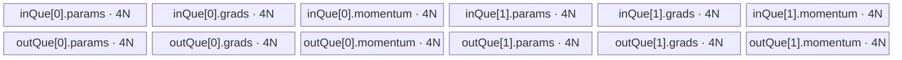
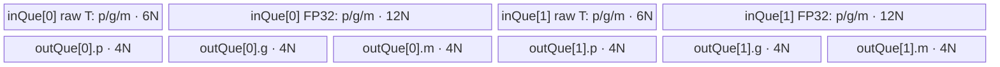

# FusedSgd A2/A3 ACLNN 算子知识

## 算子速览

| 项目 | 内容 |
|---|---|
| 实际入口 | `aclnnFusedSgdGetWorkspaceSize` + `aclnnFusedSgd`，公开、无版本后缀的两段式 ACLNN；固定仓未出现更高版本入口。 |
| 计算语义 | 可选梯度缩放与最大化符号翻转后，加权重衰减，按可选 momentum/dampening/Nesterov 更新，再执行 `param -= lr * finalGrad`；缩放后的原始梯度作为 `grads` 更新值。 |
| 输入输出 | 动态 TensorList `paramsRef`、`gradsRef`，可选动态 TensorList `momentumBufferListOptionalRef`，可选标量 `gradScaleOptional`；列表张量为 ND、同 dtype/同索引 shape，支持 FLOAT32/FLOAT16/BFLOAT16。 |
| 执行类型 | 算子自有节点为单个 `AIV_VECTOR` Kernel：`fused_sgd`；ACLNN 的 `Cast`、`Contiguous`、`ViewCopy` 是框架前后处理边界。无 SIMT、NDDMA、AICPU、Cube/AIC 或 MIX_CV 节点。 |
| Kernel 路线 | R-001 `FLOAT32` 原 dtype 计算；R-002 `FLOAT16/BFLOAT16` 升至 FP32 计算并 `CAST_RINT` 回写。二者 TilingKey 都为 0，由 binary dtype 与 `ORIG_DTYPE_PARAMS` 分派。 |
| 核心资源 | 每核动态 TensorList 描述符、GM 原地/中间张量、depth=2 的 `VECIN`/`VECOUT` 队列；F32 为 `48*N` 字节 UB，F16/BF16 为 `60*N` 字节 UB；Kernel 不访问 workspace，Tiling 仍登记系统库 workspace。 |
| 来源闭包 | `source_closed`：公开 ACLNN→自定义 L0 launcher→OpDef/Tiling/POD→单 AIV entry→两种 dtype body→A2/A3 binary/CMake 接线均闭合；框架 `Cast/Contiguous/ViewCopy/CommonOpExecutorRun` 按框架边界标注。 |
| 验证状态 | 已完成源码闭包检查；本次知识提取未执行编译、真机、数值或性能测试。 |

## 接口与语义

### 计算语义

对列表中第 `i` 个张量及其每个元素，令参数为 `p`、梯度为 `g`、可选动量为 `v`：

```text
g_scaled = gradScaleOptional 存在 ? g / gradScaleOptional[0] : g
g_hat    = maximize ? -g_scaled : g_scaled
g_decay  = g_hat + weightDecay * p

if momentumBufferListOptionalRef 存在:
    v_new = isFirstStep ? g_decay
                        : momentum * v + (1 - dampening) * g_decay
    g_final = nesterov ? g_decay + momentum * v_new : v_new
else:
    g_final = g_decay

p_new = p - lr * g_final
```

`paramsRef` 更新为 `p_new`。有 grad scale 时，`gradsRef` 回写 `g_scaled`；无 grad scale 时 Kernel 不改写梯度，L0 输出与输入使用同一 contiguous TensorList，因此梯度保持原值。有 momentum 时回写 `v_new`；无 momentum 时不产生公开 momentum 输出。R-002 在 FP32 中完成 `g_scaled` 到 `p_new` 的计算，只在写回梯度、动量和参数时降为原 dtype。

### 输入、输出与属性

| 参数 | shape/layout | dtype | 约束、默认值与语义 |
|---|---|---|---|
| `paramsRef` | 非空动态 TensorList；每个 Tensor 为 ND、维数不超过 8 | FLOAT32/FLOAT16/BFLOAT16 | 输入/输出参数；列表长度是分核域。公开文档不支持空 Tensor。 |
| `gradsRef` | 与 `paramsRef` 等长，同索引 shape 相同，ND | 与 `paramsRef` 全列表同 dtype | 输入/输出梯度；仅 grad scale 存在时由核心 Kernel 显式写缩放结果。 |
| `momentumBufferListOptionalRef` | 可空；存在时与 `paramsRef` 等长且同索引 shape 相同，ND | 与 `paramsRef` 同 dtype | 输入/输出动量。空列表先归一化为 `nullptr`；存在时 ACLNN 要求 `momentum >= 1e-6`，不存在时要求 `abs(momentum) < 1e-6`。 |
| `gradScaleOptional` | 可空；公开约束 shape `[1]`，API 在 L0 前 Cast 为 FLOAT32 | 文档参数表允许 FLOAT32/FLOAT16/BFLOAT16；头文件注释写 FLOAT | 缩放因子；应非 0。固定 API 实现未显式检查其 dtype、shape 或零值。 |
| `weightDecay` | 标量属性 | FLOAT | 必须 `>=0`，默认 0。 |
| `momentum` | 标量属性 | FLOAT | 必须 `>=0`，默认 0；与 momentum TensorList 是否存在联动。 |
| `lr` | 标量属性 | FLOAT | 必须 `>=0`；OpDef 默认 `0.001`，binary JSON 默认 `0.01`，公开 README 默认 `1e-3`，ACLNN 调用总是显式传值。 |
| `dampening` | 标量属性 | FLOAT | 公开约束 `>=0`，默认 0；固定 ACLNN `CheckAttr` 未实现负值检查。Nesterov 时要求 `abs(dampening)<1e-6`。 |
| `nesterov` | 标量属性 | BOOL | 默认 false；true 时要求 momentum TensorList 存在、`momentum>0` 且 dampening 近零。 |
| `maximize` | 标量属性 | BOOL | 默认 false；true 时在缩放后把梯度乘 `-1`。 |
| `isFirstStep` | 标量属性 | BOOL | 默认 true；仅 momentum 路线消费，首步令 `v_new=g_decay`。 |
| `workspaceSize`/`executor` | 标量输出 | `uint64_t*`/`aclOpExecutor**` | 第一段返回框架聚合 workspace 与包含完整节点序列的 executor。 |
| `workspace`/`stream` | Device buffer/ACL stream | 指针/handle | 第二段交给 `CommonOpExecutorRun`，按 executor 顺序在给定 stream 执行。 |

### 入口与版本

公开入口声明位于 `op_api/aclnn_fused_sgd.h`，实现位于 `op_api/aclnn_fused_sgd.cpp`。固定仓只存在无后缀 `aclnnFusedSgd`，未发现 V2 或其它同语义新版本，因此它是 A2/A3 实际支持的最新公开版本。README 与 ACLNN 文档的产品表同时标记 Atlas A2、Atlas A3 支持；OpDef 配置 `ascend910b`、`ascend910_93`，两份 binary JSON 内容一致。公开产品表明确 Ascend 950PR/950DT 不支持，故本卡不覆盖 950。

## Host/Launcher 执行流程

### 参数校验与前处理

第一段接口按源码执行：

1. 创建 executor。随后在任何 `CheckNotNull` 之前执行 `paramsRef->Size()`；合法公开输入要求 `paramsRef` 非空指针。
2. 若 `paramsRef->Size()==0`，直接释放 executor 给调用者并返回成功，但没有写 `workspaceSize`；这与公开“不支持空 Tensor/List”域不一致，不应依赖该路径。
3. 空 momentum list 归一化为 `nullptr`，空 `gradScaleOptional` Tensor 归一化为 `nullptr`。
4. `CheckAttr` 校验 weight decay、momentum、lr，校验 Nesterov 与 momentum/dampening 组合，并校验 momentum 属性与 optional list 是否匹配。
5. `CheckNotNull` 遍历所有必选列表元素及存在的 momentum 元素；`CheckTensorListCount` 校验列表数；`CheckDtype` 校验所有列表 Tensor 同 dtype 且属于当前架构列表；`CheckShape` 校验每个参数张量维数不超过 8、同索引 shape 一致。
6. optional grad scale 先由框架 `l0op::Cast(..., DT_FLOAT)` 转为 FLOAT32。
7. `MakeContiguousTensorList` 对三个列表逐元素调用 `l0op::Contiguous`，跳过空 Tensor，再以 `FlattenDims` 创建一维 view；这是 executor 内的框架数据准备边界。
8. `l0op::FusedSgd` 把一个 `FusedSgd` AICore launcher 加入 executor。momentum 不存在时，L0 为输入构造 shape `[0]` 占位列表、为输出构造 shape `[1]` 占位列表，但最终公开返回 momentum 为 `nullptr`。
9. `ViewCopyTensorList` 把核心输出复制/回视图到原始 params、grads 和可选 momentum Tensor；空 Tensor 仍被跳过。

### 参数、Workspace 与生命周期

`uniqueExecutor` 拥有 Cast、Contiguous、FusedSgd launcher、ViewCopy 的节点描述与中间 Tensor，第一段最后以 `GetWorkspaceSize()` 返回整个 executor 的聚合 Device workspace，并把所有权交给调用者的 `executor`。固定算子源码没有公开框架聚合 workspace 的逐 slice 公式。

核心 Tiling 从 `PlatformAscendC` 获取 `GetLibApiWorkSpaceSize()`，把这一系统库字节数写到唯一 workspace 项；`fused_sgd` entry 接收 `workspace` 参数但不读取。用户 workspace 必须至少为第一段返回值，在第二段完成前保持有效；executor 与所有框架中间张量同样持续到 `CommonOpExecutorRun` 完成。

### 启动图与失败传播

```text
aclnnFusedSgdGetWorkspaceSize
  -> optional l0op::Cast(gradScale -> FLOAT32)                 # 框架边界
  -> per-input l0op::Contiguous + FlattenDims                 # 框架边界
  -> ADD_TO_LAUNCHER_LIST_AICORE(FusedSgd)
       -> Tiling4FusedSgd
       -> fused_sgd<<<blockDim=usedCoreNum, stream>>>
  -> per-output l0op::ViewCopy                                # 框架边界
  -> GetWorkspaceSize + ReleaseTo(executor)

aclnnFusedSgd(workspace, workspaceSize, executor, stream)
  -> CommonOpExecutorRun                                      # 按 executor 顺序执行
```

| 节点/边 | producer→consumer | 介质与范围 | ordering/owner/lifetime | 失败传播 |
|---|---|---|---|---|
| optional Cast | 原 `gradScaleOptional`→FLOAT32 scalar | executor 中间 Tensor，1 个标量 | executor 拥有；先于核心 launcher | 返回空指针后续检查失败。 |
| Contiguous/Flatten | 原列表 Tensor→一维 contiguous TensorList | 每个非空 Tensor 的全部元素 | executor 拥有；先于核心 launcher | 任一 Contiguous 为空则第一段返回内部错误。 |
| 核心 Kernel | contiguous params/grads/momentum→同一 L0 输出列表 | 单 AIV Kernel；`blockDim=usedCoreNum`；workspace 指针未消费 | executor 在同一 stream 的顺序保证核心先于 ViewCopy；TensorList buffer 覆盖到核心完成 | launcher 添加失败返回空 tuple，第一段转为内部错误；Tiling 任一步失败阻断 launch。 |
| ViewCopy | 核心输出→调用者原始 view | 每个非空输出 Tensor 全范围 | executor 持有源中间 Tensor，目标由调用者拥有 | wrapper 为 `void`，固定算子文件未提供逐次返回码。 |
| phase 2 | executor→Device stream | 调用者提供 workspace | `CommonOpExecutorRun` 管理执行期；完成后 workspace 才可复用 | 原样返回 `CommonOpExecutorRun` 状态。 |

核心算子拓扑只有一个 Device 节点；节点内部直接原地更新 L0 contiguous buffers，没有 Kernel 间 workspace 边。

## Route 与参数设计

### 分核与资源计算

设 TensorList 长度为 `L=tensorNum`、平台 AIV 核数为 `C=coreNum`、UB 字节数为 `U=ubSize`：

```text
usedCoreNum   = min(L, C)
tensorsPerCore = ceil(L / usedCoreNum)
block k 的 Tensor 索引域 = [k*tensorsPerCore,
                            min((k+1)*tensorsPerCore, L))
```

该切分按 Tensor 个数而不是元素数均衡。由于 `tensorsPerCore` 是 ceiling，尾部 block 可能得到空区间；每个非空 Tensor 再独立按 `coreCalcMax=N` 切 tile。

Host 预留 `64=BUFFER_NUM*32` 字节后计算容量：

```text
F32:       N = floor((U - 64) / 48 / 8)  * 8   elements
F16/BF16: N = floor((U - 64) / 60 / 16) * 16  elements
```

8 个 FLOAT32 或 16 个 16-bit 元素都是 32-byte 对齐。每 Tensor 的 `loopNum=ceil(elementCount/N)`，前 `loopNum-1` 个 tile 长度为 `N`，最后长度为 `elementCount-N*(loopNum-1)`。空 Tensor 被 `Process` 跳过。Tiling 未显式检查 `U>64` 或 `N>0`，这些是成功执行的隐含平台资源前提。

### Route 选择

| 顺序 | Route | Key/模板 | 精确选择条件与优先级 | 不适用去向 |
|---:|---|---|---|---|
| 1 | R-001 FLOAT32 | binary `FusedSgd_2`；TilingKey 0；`FusedSgdF32<float>` | A2/A3 binary config 匹配 params/grads/momentum 为 `float32`，entry 编译条件 `ORIG_DTYPE_PARAMS == DT_FLOAT32` | dtype 为 16-bit 时进入 R-002；其它 dtype 在 ACLNN/OpDef/binary 选择阶段失败。 |
| 2 | R-002 FLOAT16/BFLOAT16 | binary `FusedSgd_1`/`FusedSgd_0`；TilingKey 0；`FusedSgdF16Bf16<half/bfloat16_t>` | binary config 分别匹配全列表 `float16`/`bfloat16`，entry 编译条件分别为 `DT_FLOAT16`/`DT_BF16` | 其它 dtype 无 fallback。 |

```text
公开 ACLNN CheckDtype（A2/A3: FLOAT32/FLOAT16/BFLOAT16）
  -> A2 ascend910b / A3 ascend910_93 binary config
     -> FLOAT32: FusedSgd_2 -> TilingKey 0 -> ORIG_DTYPE_PARAMS==DT_FLOAT32 -> R-001
     -> FLOAT16: FusedSgd_1 -> TilingKey 0 -> ORIG_DTYPE_PARAMS==DT_FLOAT16 -> R-002<half>
     -> BFLOAT16: FusedSgd_0 -> TilingKey 0 -> ORIG_DTYPE_PARAMS==DT_BF16 -> R-002<bfloat16_t>
     -> otherwise: 参数或 binary 选择失败，无 Device fallback
```

### 模板/实现执行矩阵

| Route | key/selector | dtype/shape/platform 完整命中条件 | 执行拓扑与 Kernel 节点 | 实际模板/body | 内存与同步特征 | tail/fallback |
|---|---|---|---|---|---|---|
| R-001 FLOAT32 | `FusedSgd_2`, key 0 | A2/A3；三列表 dtype FLOAT32；同索引 shape；optional 条件合法 | 单节点 `fused_sgd`，AIV_VECTOR | `FusedSgdF32<float>::Init/Process/Compute` | 两个 depth=2 队列，总 `48*N`；MTE2↔V↔MTE3 hard event 与 Vector barrier | `DataCopyPad` 用精确尾字节；空 Tensor 跳过；无其它 Kernel fallback。 |
| R-002 FLOAT16/BFLOAT16 | `FusedSgd_1`/`_0`, key 0 | A2/A3；三列表 dtype 全 FLOAT16 或全 BFLOAT16；其它条件同上 | 单节点 `fused_sgd`，AIV_VECTOR | `FusedSgdF16Bf16<half>` / `<bfloat16_t>`，相同 body | 原 dtype 与 FP32 共置于 inQue，FP32 outQue；总 `60*N`；降精度 `CAST_RINT` | 16-element 对齐容量，尾部 `DataCopyPad`；无其它 Kernel fallback。 |

### 隐藏性能 Guard

| Guard | Host/Tiling 条件 | Device/资源原因 | 影响 Route | 不满足时去向 | 源码符号 |
|---|---|---|---|---|---|
| 平台公开支持 | 产品为 Atlas A2/A3，且 OpDef config 为 `ascend910b`/`ascend910_93` | 只有两平台 binary 与构建接线 | 全部 | 950/其它产品不发布、不 launch | `README.md` 产品表；`FusedSgd::FusedSgd` |
| UB 非零 | `coreNum_!=0 && ubSize_!=0` | 必须产生 blockDim 与 tile 容量 | 全部 | Tiling `GRAPH_FAILED` | `FusedSgdTiling::GetPlatformInfo` |
| tile 容量 | F32 `N=floor((U-64)/48/8)*8`；16-bit `N=floor((U-64)/60/16)*16` | `InitBuffer` 的真实 depth 与三分区容量 | R-001/R-002 | 固定代码无 fallback；`N==0` 会令 `ceil(elementCount/N)` 无效 | `CalculateOutputInfo`、两个 `Init` |
| DMA blockLen 窄化 | `dataCount*sizeof(T) <= UINT16_MAX` | `DataCopyParams.blockLen` 被显式 cast 到 `uint16_t`，单位为字节 | 全部 | 固定代码无运行时检查/fallback | 两个 `Compute` 的 `copyParams` |
| 32-byte 容量对齐 | F32 `N%8==0`；16-bit `N%16==0` | 完整 tile 对齐 32 字节；尾 tile 由 Pad API 处理 | 全部 | 容量公式直接向下取整，无独立 route | `CalculateOutputInfo` |
| dtype compile guard | `ORIG_DTYPE_PARAMS` 为 BF16/F16/F32 | entry 只实例化三个模板 | 全部 | 未匹配时 entry 无 body 调用；正常由 Host 拒绝 | `fused_sgd` |
| optional momentum | `useMomentum` 由 momentum 第一个 Tensor 的 storage shape 判定 | 控制 GM descriptor 绑定、动量读取/写回与计算 | 全部 | false 走无 momentum 分支，不是另一 Kernel | `CheckOptionalInputs`、两个 `Compute` |
| optional grad scale | optional Tensor 存在且 storage shape 无零维度元素 | 控制标量 GM 读取与梯度回写 | 全部 | false 保留原梯度，不 launch 外部 fallback | `CheckOptionalInputs`、两个 `Init/Compute` |
| 空 Tensor | `tensorDataNum==0` | 避免 `loopNum-1` 下溢和零字节 DMA | 全部 | 当前 Tensor `continue` | 两个 `Process` |

### POD/ABI

`FusedSgdTilingData` 是标准字段顺序的 POD：4 个 `float` 后接 9 个 `uint64_t`；按这些类型的自然对齐，`alignof=8`、`sizeof=88`。Host 先将 88 字节清零再逐字段赋值，Device 通过 `GET_TILING_DATA_WITH_STRUCT` 解析同一头文件。

| 结构 | 字段 | 类型/位宽 | ABI 布局 | 单位 | Host/launcher producer | Device consumer | 边界 |
|---|---|---|---|---|---|---|---|
| `FusedSgdTilingData` | `weightDecay` | float/32 | offset 0 | 标量 | `SetTilingData: weightDecay_` | `InitData`→两个 `Compute` 权重衰减 | `>=0` 由 ACLNN 校验。 |
| 同上 | `momentum` | float/32 | offset 4 | 标量 | `momentum_` | 非首步动量与 Nesterov | 无 momentum 时计算分支不读。 |
| 同上 | `lr` | float/32 | offset 8 | 标量 | `lr_` | 参数更新 `Muls` | `>=0`。 |
| 同上 | `dampening` | float/32 | offset 12 | 标量 | `dampening_` | 非首步 `(1-dampening)` | 首步或无 momentum 时 inactive。 |
| 同上 | `nesterov` | uint64/64 | offset 16 | 0/1 | bool→`uint32_t`→uint64 赋值 | Nesterov 分支 | 仅 momentum 路线读取。 |
| 同上 | `maximize` | uint64/64 | offset 24 | 0/1 | bool→`uint32_t`→uint64 赋值 | 梯度乘 `-1` 分支 | false inactive。 |
| 同上 | `isFirstStep` | uint64/64 | offset 32 | 0/1 | bool→`uint32_t`→uint64 赋值 | 动量首步分支 | 无 momentum 时 inactive。 |
| 同上 | `useGradScale` | uint64/64 | offset 40 | 0/1 | `CheckOptionalInputs` | `Init` 读取标量、`Compute` 缩放 | false 时 `gradScale` GM 指针不绑定。 |
| 同上 | `useMomentum` | uint64/64 | offset 48 | 0/1 | `CheckOptionalInputs` | descriptor 绑定和动量分支 | false 时占位 momentum 不读取。 |
| 同上 | `tensorNum` | uint64/64 | offset 56 | Tensor 个数 | input instance count | entry 截断 `tensorEnd`；base 中副本未再使用 | 必须 >0。 |
| 同上 | `tensorsPerCore` | uint64/64 | offset 64 | Tensor/核 | `ceil(tensorNum/usedCoreNum)` | entry 计算 `[tensorStart,tensorEnd)`；base 中副本未再使用 | 可能使尾部 block 空闲。 |
| 同上 | `usedCoreNum` | uint64/64 | offset 72 | AIV core 个数 | `min(tensorNum, coreNum)` | entry 不读；`InitData` 仅保存、body 未消费 | 真正 launch blockDim 由 `context_->SetBlockDim` 单独设置。 |
| 同上 | `coreCalcMax` | uint64/64 | offset 80 | 元素/tile | UB 公式向下对齐 | buffer 容量、offset、loop 与 DMA | 必须非零且 DMA 字节数可放入 uint16。 |

### Route 源码闭包

| Route | Key/selector | Host/Tiling producer | POD/参数 | Kernel entry/router 节点 | Kernel body/直接依赖 | 构建接线 |
|---|---|---|---|---|---|---|
| R-001 FLOAT32 | `FusedSgd_2` + key 0 + `DT_FLOAT32` | `fused_sgd_tiling.cpp::Tiling4FusedSgd/CalculateOutputInfo/SetTilingData` | `FusedSgdTilingData`，`coreCalcMax` 与 attrs/flags | `fused_sgd.cpp::fused_sgd`→`FusedSgdF32<float>` | `fused_sgd_base.h::InitData`；`fused_sgd_f32.h::Init/Process/Compute` | A2/A3 binary JSON；`fused_sgd/CMakeLists.txt::add_modules_sources`；`custom_kernel.cmake::add_custom_kernel_library` |
| R-002 FLOAT16/BFLOAT16 | `FusedSgd_1/_0` + key 0 + `DT_FLOAT16/DT_BF16` | 同上，dtypeSize=2 路线 | 同一 POD，16-element 对齐 `coreCalcMax` | `fused_sgd`→`FusedSgdF16Bf16<half/bfloat16_t>` | `InitData`；`fused_sgd_f16_bf16.h::Init/Process/Compute` | 同上，两平台 config 内容相同且各含 3 个 dtype binary |

## Kernel 实现

### 公共执行流程

`fused_sgd` 声明 `KERNEL_TYPE_AIV_ONLY`，解析 POD，以 `blockIdx*tensorsPerCore` 得到当前核的 TensorList 区间；随后按编译期输入 dtype 构造 R-001 或 R-002 对象。两条路线都先绑定 ListTensorDesc，在每个 Tensor 上由 shape 乘积求元素数，跳过零元素 Tensor，绑定该 Tensor 的 GM 指针，再以 `coreCalcMax` 切 tile。

每个 tile 在一块 inQueue buffer 中拼放 params、grads、momentum 三个等长 slice，在 outQueue buffer 中复用三个等长工作 slice。optional 分支只改变计算和 GM 绑定，不改变 UB 分配。所有结果写回 L0 输出列表；该列表与核心输入列表相同，所以是 tile 级原地更新。读入一个 tile 完成后才覆盖同一 GM tile，下一 tile 使用不同 GM offset。

### Route R-001：FLOAT32 原 dtype 计算

#### 适用条件

##### 选择证据

| 层级 | 文件 | 符号 | 源码谓词/参数 | 结果/下一跳 |
|---|---|---|---|---|
| API | `op_api/aclnn_fused_sgd.cpp` | `GetDtypeSupportListFromSocVersion`、`CheckDtype` | A2/A3 dtype 列表含 FLOAT，所有列表元素必须同 dtype | 允许进入 FusedSgd L0。 |
| binary | `op_host/config/ascend910b/fused_sgd_binary.json`、`ascend910_93/...` | `FusedSgd_2` | params/grads/momentum/output 均 `float32` | 选择 FLOAT32 binary。 |
| Tiling | `op_host/fused_sgd_tiling.cpp` | `SetTilingData` | 无 dtype key 分支，恒 `SetTilingKey(0)` | key 0。 |
| Router | `op_kernel/fused_sgd.cpp` | `fused_sgd` | `ORIG_DTYPE_PARAMS == DT_FLOAT32` | 实例化 `FusedSgdF32<float>`。 |

#### Device 数据流

##### 函数级调用链

```text
ADD_TO_LAUNCHER_LIST_AICORE(FusedSgd)
  -> Tiling4FusedSgd -> key=0, blockDim=usedCoreNum
  -> fused_sgd(paramsList, gradsList, momentumList, gradScale,
               paramsOutList, gradsOutList, momentumOutList, workspace, tiling)
    -> FusedSgdF32<float>::Init
       -> FusedSgdBase<float>::InitData
       -> InitBuffer(inQue/outQue)
    -> FusedSgdF32<float>::Process
       -> per Tensor: bind GM + per tile FusedSgdF32<float>::Compute
          -> DataCopyPad CopyIn
          -> Muls/Add/Sub + optional branches
          -> DataCopyPad CopyOut
```

##### 源码等价伪码

```text
# 伪码；所有 slice 长度 N=coreCalcMax，当前 tile 有 dataCount 个有效元素
tensorStart = blockIdx * tensorsPerCore
tensorEnd = min(tensorStart + tensorsPerCore, tensorNum)
for idx in [tensorStart, tensorEnd):
    count = product(paramsList[idx].shape)
    if count == 0: continue
    bind param/grad/(optional momentum) input and output GM for idx
    for tile in [0, ceil(count/N)):
        valid = min(N, count - tile*N)
        gmOffset = tile*N
        alloc inLocal=float[3*N], outLocal=float[3*N]
        wait MTE3->MTE2, S->MTE2, V->MTE2
        copy_pad param, grad, optional momentum GM[gmOffset:valid] -> inLocal slices
        wait MTE2->V
        if useGradScale:
            grad *= 1/gradScaleValue
            wait V->MTE3; copy_pad grad -> gradsOut; wait MTE3->V
        if maximize: grad *= -1
        if weightDecay != 0: temp = param*weightDecay; grad += temp
        if useMomentum:
            vNew = isFirstStep ? grad : momentum*v + (1-dampening)*grad
            wait V->MTE3; copy_pad vNew -> momentumOut; wait MTE3->V
            grad = nesterov ? grad + momentum*vNew : vNew
        scaled = lr*grad
        paramNew = param-scaled
        wait V->MTE3; copy_pad paramNew -> paramsOut
        free both LocalTensor handles
```

#### 内存与数据搬运

##### 资源与搬运表

| 层级/缓冲区 | offset/地址公式 | extent/容量公式 | dtype/layout | producer | consumer | owner/lifetime | 对齐/复用 |
|---|---|---|---|---|---|---|---|
| GM params | ListTensor `idx`, tile offset `tile*N` | `valid` elements | float/flattened ND | API Contiguous or caller contiguous buffer | CopyIn，最后 paramsOut 原地覆盖 | executor/caller；整个 Kernel | 先全 tile CopyIn 后 CopyOut，允许输入输出别名。 |
| GM grads | 同上 | `valid` | float | grads input | CopyIn；有 scale 时 CopyOut | 同上 | 无 scale 时不覆盖。 |
| GM momentum | 同上 | `valid`，仅 `useMomentum` | float | momentum input | CopyIn/动量输出 | 同上 | 输入输出可别名。 |
| GM grad scale | element 0 | 1 float | float scalar | optional Cast | `Init::GetValue(0)` | executor；Init 后值保存在 scalar | 每核读取一次。 |
| `inQue` buffer | params `0`; grads `N`; momentum `2N` elements | 每 buffer `3*N*4=12N` bytes，depth 2 | float | MTE2 CopyIn | Vector 管线 | `TPipe`，Kernel 全期；LocalTensor 每 tile alloc/free | 三 slice 固定分区；即使 optional 不用仍分配。 |
| `outQue` buffer | params `0`; grads `N`; momentum `2N` | 每 buffer `12N` bytes，depth 2 | float | Vector 临时/结果 | MTE3 CopyOut 或后续 Vector | 同上 | params/grads/momentum slice 随阶段复用。 |
| workspace | entry 参数 | Tiling 项为 `sysWorkspaceSize` | bytes | Host | Kernel 不消费 | executor | 核心节点 N/A；系统库保留。 |

##### 分层内存布局



##### 字节账与复用顺序

```text
inQue  = depth 2 * (3 * N * 4) = 24N bytes
outQue = depth 2 * (3 * N * 4) = 24N bytes
UB_total = 48N bytes
N = floor((UB_size - 64) / 48 / 8) * 8
UB_total <= UB_size - 64 < UB_size
dynamic_ub = N/A（AIV TPipe 静态 InitBuffer）
workspace_total(core node) = sysWorkspaceSize；Kernel body 未访问 workspace
```

| 复用子区 | 写入者 | 读取者/消费点 | 下一次覆盖 | 同步或释放依据 | 安全条件 |
|---|---|---|---|---|---|
| `inLocal.grads` | MTE2 CopyIn；随后 Vector 原地 Muls/Add | scale CopyOut、momentum、参数更新 | 下一 tile CopyIn | MTE2_V、每步 `PipeBarrier<PIPE_V>`、tile 末 FreeTensor | 当前 Vector 消费完成后才允许下一变换。 |
| `outLocal.grads` | weight-decay temp 或 `lr*grad` | Add 或 Sub | 后续阶段/下一 tile | Vector barrier | 不跨 barrier 提前覆盖。 |
| `outLocal.params` | 非首步 dampening temp；最终 paramNew | momentum Add；params CopyOut | 阶段完成/下一 tile | Vector barrier、V_MTE3 | momentum Add 完成后才可复用。 |
| `outLocal.momentum` | vNew | momentum CopyOut、Nesterov/grad 替换 | 下一 tile | V_MTE3 后 MTE3_V，再参与后续 Vector | GM 写回完成且 Vector 消费按 barrier 排序。 |

#### 同步、精度与尾块

##### 同步与数值边界表

| 阶段 | primitive/机制 | producer | consumer/等待点 | 保护对象 | 精度/尾块 |
|---|---|---|---|---|---|
| tile CopyIn | `MTE3_MTE2`、`S_MTE2`、`V_MTE2`，随后 `MTE2_V` | 前 tile MTE3/标量/Vector 与当前 MTE2 | 当前 Vector | in/out queue 复用及 GM→UB 可见性 | `DataCopyPad` 的 blockLen=`valid*4` bytes；非 32B 尾块由 pad API 处理。 |
| Vector 步骤 | `PipeBarrier<PIPE_V>` | 每个 Muls/Add/Sub | 下一 Vector op | 原地/复用 slice | 全程 FLOAT32；条件分支完全跳过 inactive 计算。 |
| 梯度/动量 CopyOut | `V_MTE3`，写后 `MTE3_V` | Vector result | 后续可能复用该 UB slice的 Vector | grads/momentum output | 只复制 `valid` 元素。 |
| 参数 CopyOut | `V_MTE3` | final Sub | MTE3 写出；下一 tile 开头的 `MTE3_MTE2` | params output | 固定 body 在 FreeTensor/返回前没有显式 MTE3 completion wait；后续 tile 的开头事件建立复用顺序。 |
| 空 Tensor | `if (tensorDataNum==0) continue` | shape product | loop | 避免 `loopNum-1` 下溢 | 不写任何输出；公开域本就不支持空 Tensor。 |

#### 关键实现

##### 符号证据表

| 阶段 | 文件 | 符号/模板实例 | 实现事实 |
|---|---|---|---|
| Host/Tiling producer | `optim/fused_sgd/op_host/fused_sgd_tiling.cpp` | `CalculateOutputInfo`、`SetTilingData` | F32 `48 bytes/element`、8-element 对齐、key 0、blockDim。 |
| Kernel entry/router | `optim/fused_sgd/op_kernel/fused_sgd.cpp` | `fused_sgd`、`FusedSgdF32<float>` | AIV-only；block 到 TensorList 区间；编译期 FLOAT32 分派。 |
| Device body/helper | `optim/fused_sgd/op_kernel/fused_sgd_f32.h` | `Init/Process/Compute` | 两个 depth=2 队列、GM/UB 地址、FLOAT32 管线、optional 分支、tail。 |
| Device body/helper | `optim/fused_sgd/op_kernel/fused_sgd_base.h` | `FusedSgdBase<float>::InitData`、namespace helper `FusedSgd::PipeSync` | POD 字段复制和 hard-event SetFlag/WaitFlag。 |

### Route R-002：FLOAT16/BFLOAT16 升精度计算

#### 适用条件

##### 选择证据

| 层级 | 文件 | 符号 | 源码谓词/参数 | 结果/下一跳 |
|---|---|---|---|---|
| API | `op_api/aclnn_fused_sgd.cpp` | `CheckDtype` | A2/A3 dtype 列表含 FLOAT16/BFLOAT16，且三列表全同 dtype | 允许进入。 |
| binary | 两平台 `fused_sgd_binary.json` | `FusedSgd_1` / `FusedSgd_0` | 全列表分别为 float16 / bfloat16 | 选择对应 binary。 |
| Tiling | `op_host/fused_sgd_tiling.cpp` | `CalculateOutputInfo` | params dtype 非 FLOAT→`dtypeSize_=2`；key 恒 0 | 60 bytes/element、16-element 对齐。 |
| Router | `op_kernel/fused_sgd.cpp` | `fused_sgd` | `DT_FLOAT16` / `DT_BF16` | `FusedSgdF16Bf16<half>` / `<bfloat16_t>`。 |

#### Device 数据流

##### 函数级调用链

```text
ADD_TO_LAUNCHER_LIST_AICORE(FusedSgd)
  -> Tiling4FusedSgd -> key=0, blockDim=usedCoreNum
  -> fused_sgd(...)
    -> FusedSgdF16Bf16<T>::Init
       -> FusedSgdBase<T>::InitData
       -> InitBuffer(inQue: original+FP32, outQue: FP32)
    -> FusedSgdF16Bf16<T>::Process
       -> per Tensor/per tile FusedSgdF16Bf16<T>::Compute
          -> DataCopyPad original dtype CopyIn
          -> Cast<T,float>(CAST_NONE)
          -> FP32 Muls/Add/Sub
          -> Cast<float,T>(CAST_RINT) + DataCopyPad CopyOut
```

##### 源码等价伪码

```text
# 伪码；分核、Tensor 循环和 tile 地址同 R-001
alloc inLocal bytes = [T params N][T grads N][T momentum N]
                    + [float params N][float grads N][float momentum N]
alloc outLocal float = [params N][grads N][momentum N]
copy_pad original T inputs into first half
cast params T->float, grads T->float
cast momentum T->float                         # 固定 body 无条件执行
if useGradScale:
    fp32Grad *= 1/gradScale
    cast_rint fp32Grad -> T grads slice
    copy_pad T grads -> gradsOut
if maximize: fp32Grad *= -1
if weightDecay != 0: fp32Grad += fp32Param*weightDecay
if useMomentum:
    fp32VNew = first ? fp32Grad : momentum*fp32V + (1-dampening)*fp32Grad
    cast_rint fp32VNew -> T momentum slice; copy_pad -> momentumOut
    fp32Grad = nesterov ? fp32Grad + momentum*fp32VNew : fp32VNew
fp32Grad *= lr
fp32Grad = fp32Param - fp32Grad               # 复用 fp32 grads slice 存 paramNew
cast_rint fp32Grad -> T params slice
copy_pad T params -> paramsOut
```

#### 内存与数据搬运

##### 资源与搬运表

| 层级/缓冲区 | offset/地址公式 | extent/容量公式 | dtype/layout | producer | consumer | owner/lifetime | 对齐/复用 |
|---|---|---|---|---|---|---|---|
| GM inputs/outputs | ListTensor `idx` + `tile*N` | `valid` elements | half 或 bfloat16/flattened ND | framework/caller | MTE2/MTE3 | executor/caller | input/output 同列表，tile 级安全原地覆盖。 |
| GM grad scale | element 0 | 1 float | float | optional Cast | `Init::GetValue` | executor | 每核一次 scalar。 |
| `inQue` 原 dtype 区 | params byte 0；grads `2N`；momentum `4N` | 每 buffer `3*N*2=6N` bytes | T | MTE2 | Cast；也作为降精度 CopyOut staging | TPipe；每 tile alloc/free | 同一物理 slice 先存输入，消费后可被 CAST_RINT 输出覆盖。 |
| `inQue` FP32 区 | base `6N` bytes；params/grads/momentum 再按 `4N` bytes 分区 | 每 buffer `12N` bytes | float | Cast | FP32 optimizer pipeline | 同上 | 由 `inLocal[3N].ReinterpretCast<float>()` 创建 view。 |
| `outQue` FP32 | params/grads/momentum offsets `0/N/2N` float | 每 buffer `12N` bytes | float | FP32 temp/result | 后续 Vector 或 cast | 同上 | 三工作区跨阶段复用。 |
| workspace | entry 参数 | `sysWorkspaceSize` | bytes | Host | Kernel 不消费 | executor | N/A + 系统库保留。 |

##### 分层内存布局



##### 字节账与复用顺序

```text
inQue per buffer = 3N*(2+4) = 18N bytes
inQue depth 2 = 36N bytes
outQue per buffer = 3N*4 = 12N bytes
outQue depth 2 = 24N bytes
UB_total = 60N bytes
N = floor((UB_size - 64) / 60 / 16) * 16
UB_total <= UB_size - 64 < UB_size
dynamic_ub = N/A（AIV TPipe 静态 InitBuffer）
workspace_total(core node) = sysWorkspaceSize；Kernel 未访问
```

| 复用子区 | 写入者 | 读取者/消费点 | 下一次覆盖 | 同步或释放依据 | 安全条件 |
|---|---|---|---|---|---|
| raw T grads | MTE2 CopyIn | T→FP32 Cast | grad scale 后 FP32→T `CAST_RINT` | MTE2_V、Vector barrier | 原始梯度已完成升精度后才能覆盖。 |
| raw T momentum | MTE2 CopyIn | T→FP32 Cast | vNew FP32→T `CAST_RINT` | Vector barrier | 仅 momentum 输出时覆盖有语义；buffer 总是分配。 |
| FP32 grads | T→FP32 Cast | scale/maximize/decay/momentum | 最终原地变为 `lr*grad` 再变为 paramNew | 每步 Vector barrier | 写回 grads 的降精度发生在后续 maximize/decay 前，不改变 FP32 工作副本。 |
| out FP32 params | dampening temp | momentum Add | 之后不再需要/下一 tile | Vector barrier | 仅非首步 momentum 分支写。 |
| out FP32 momentum | vNew | momentum Cast、Nesterov | 下一 tile | V_MTE3/MTE3_V 与 Vector barrier | 输出 Cast 完成后仍保留 FP32 vNew 供 Nesterov。 |

#### 同步、精度与尾块

##### 同步与数值边界表

| 阶段 | primitive/机制 | producer | consumer/等待点 | 保护对象 | 精度/尾块 |
|---|---|---|---|---|---|
| CopyIn | 与 R-001 相同的 hard events | MTE2 | Cast/Vector | raw T 三 slice | blockLen=`valid*2` bytes；尾 tile由 `DataCopyPad`。 |
| 升精度 | `Cast(..., CAST_NONE)` + `PIPE_V` barrier | raw T | FP32 算法 | FP32 inQue 分区 | params、grads、momentum 都 Cast；momentum Cast 不受 `useMomentum` 保护。 |
| 梯度回写 | `CAST_RINT`→`V_MTE3`→`MTE3_V` | FP32 scaled grad | GM grads / 后续 FP32 grad | raw grads slice | 存储梯度先舍入，但优化器继续使用未舍入 FP32 值。 |
| 动量回写 | `CAST_RINT`→barrier→MTE3 | FP32 vNew | GM momentum、Nesterov | raw momentum + FP32 vNew | 参数更新使用 FP32 vNew。 |
| 参数回写 | `CAST_RINT`→barrier→MTE3 | FP32 paramNew | GM params | raw params slice | 最后一步才降精度；尾部只写 valid 元素。 |

#### 关键实现

##### 符号证据表

| 阶段 | 文件 | 符号/模板实例 | 实现事实 |
|---|---|---|---|
| Host/Tiling producer | `optim/fused_sgd/op_host/fused_sgd_tiling.cpp` | `CalculateOutputInfo` | 非 FLOAT 走 60 bytes/element 与 16-element 对齐容量。 |
| Kernel entry/router | `optim/fused_sgd/op_kernel/fused_sgd.cpp` | `FusedSgdF16Bf16<half/bfloat16_t>` | 两个编译期 dtype guard 指向同一实现族。 |
| Device body/helper | `optim/fused_sgd/op_kernel/fused_sgd_f16_bf16.h` | `Init/Process/Compute` | 原 dtype/FP32 共置、升降精度、FP32 优化器顺序、tail。 |
| Device body/helper | `optim/fused_sgd/op_kernel/fused_sgd_base.h` | `InitData`、`PipeSync` | 公共 POD 与 hard-event helper。 |

## 算子特定优化

### Trick T-001：低精度输入在同一 inQueue 内升至 FP32 并延迟降精度

#### 触发与源码依据

- 适用 Route：R-002。
- 触发条件：binary dtype 为 FLOAT16 或 BFLOAT16，entry 实例化 `FusedSgdF16Bf16<T>`。
- Golden 来源：[`optim/fused_sgd/op_kernel/fused_sgd_f16_bf16.h:136-153`](../../../../../../../cann-ops-raw/ascendc/ops-nn/955f8b33985b6d72989ebff341bb9c2c564a51bc/optim/fused_sgd/op_kernel/fused_sgd_f16_bf16.h#L136-L153)

**官方源码（固定 Commit 连续逐字摘录）**：

```cpp
LocalTensor<float> inLocalC = inLocal[this->coreCalcMax * 3].template ReinterpretCast<float>();
Cast(inLocalC[paramsOffset], inLocal[paramsOffset], RoundMode::CAST_NONE, dataCount);
PipeBarrier<PIPE_V>();
Cast(inLocalC[gradsOffset], inLocal[gradsOffset], RoundMode::CAST_NONE, dataCount);
PipeBarrier<PIPE_V>();
Cast(inLocalC[momentumOffset], inLocal[momentumOffset], RoundMode::CAST_NONE, dataCount);
PipeBarrier<PIPE_V>();

// Step 1: 梯度缩放，并Cast回原始类型写回
if (hasGradScale) {
    float invGradScale = 1.0f / gradScaleValue;
    Muls(inLocalC[gradsOffset], inLocalC[gradsOffset], invGradScale, dataCount);
    PipeBarrier<PIPE_V>();
    Cast(inLocal[gradsOffset], inLocalC[gradsOffset], RoundMode::CAST_RINT, dataCount);
    PipeSync<AscendC::HardEvent::V_MTE3>();
    DataCopyPad(gmGradsRef[offset], inLocal[gradsOffset], copyParams);
    PipeSync<AscendC::HardEvent::MTE3_V>();
}
```

#### 机制与设计原因

`InitBuffer` 为每个 inQueue buffer 一次性分配 `3N*(sizeof(T)+sizeof(float))` 字节。raw 三分区被 CopyIn 后，代码从 `inLocal[3N]` 创建 FP32 view，避免另建第三个 Queue/TBuf；params/grads/momentum 都升至 FP32。缩放梯度用 FP32 `Muls`，`1/gradScaleValue` 来自每核一次 GM scalar 读取；只有公开 `grads` 输出立即以 `CAST_RINT` 降精度，后续最大化、衰减、动量和参数更新继续消费 FP32 工作副本。该设计从源码可证明减少单独 FP32 输入工作 buffer 的物化，并把低精度舍入推迟到各状态真正写回时。

#### 迁移边界

- 适用：低精度状态需要多个逐元素优化步骤、同时还要回写某个中间状态的 AIV 算子。
- 前提：A2/A3、FLOAT16/BFLOAT16、`N` 满足 16-element 对齐容量，UB 可容纳 `60N` 字节，输出舍入语义允许 `CAST_RINT`。
- 失效：FLOAT32 使用 R-001；UB 无法得到非零 `N` 时固定代码没有 fallback；若算法要求每一步都按低精度舍入，则不能复用该精度顺序。
- 未验证：本次知识提取未执行编译、真机、数值或性能测试。

#### 错误做法

固定仓未提供可验证反例。迁移时不得把写回 `grads` 的低精度值重新载入作为后续优化器输入，否则会改变源码中“FP32 工作副本继续计算”的精度顺序。

### Trick T-002：Host 以真实 UB 字节账生成对齐 tile 容量

#### 触发与源码依据

- 适用 Route：R-001、R-002。
- 触发条件：Tiling 成功取得平台 UB；按输入 dtype 选择每元素资源公式。
- Golden 来源：[`optim/fused_sgd/op_host/fused_sgd_tiling.cpp:264-280`](../../../../../../../cann-ops-raw/ascendc/ops-nn/955f8b33985b6d72989ebff341bb9c2c564a51bc/optim/fused_sgd/op_host/fused_sgd_tiling.cpp#L264-L280)

**官方源码（固定 Commit 连续逐字摘录）**：

```cpp
dtypeSize_ = context_->GetDynamicInputDesc(INPUT_PARAMS_IDX, 0)->GetDataType() == ge::DT_FLOAT ? FP32_DTYPE_SIZE : FP16_BF16_DTYPE_SIZE;
uint64_t tBuffersize = BUFFER_NUM * BYTE_ONE_BLK;
uint64_t bufferSize = ubSize_ - tBuffersize;
// 计算处理一个元素所需的ub大小
uint64_t coreOnesize;
if (dtypeSize_ == FP32_DTYPE_SIZE) {
    coreOnesize = FP32_DTYPE_SIZE * NUM_THREE * NUM_TWO * BUFFER_NUM;
} else {
    coreOnesize = ((dtypeSize_ + FP32_DTYPE_SIZE) * NUM_THREE + FP32_DTYPE_SIZE * NUM_THREE) * BUFFER_NUM;
}
uint64_t alignSize = dtypeSize_ == FP32_DTYPE_SIZE ? ONE_BLK_NUM_FP32 : ONE_BLK_NUM;
OP_LOGI(context_, "bufferSize = %lu", bufferSize);
OP_LOGI(context_, "coreOnesize = %lu", coreOnesize);
OP_LOGI(context_, "alignSize = %lu", alignSize);
// 计算ub一次最多能处理的数据量
coreCalcMax_ = bufferSize / coreOnesize / alignSize * alignSize;
OP_LOGI(context_, "coreCalcMax_ = %lu", coreCalcMax_);
```

#### 机制与设计原因

Host 不使用固定元素 tile，而是把 Queue depth、三路 slice、低精度额外 FP32 区全部折算为每元素 48 或 60 字节，再从平台 UB 扣 64 字节保守余量、向下对齐到一个 32-byte 数据块。`coreCalcMax` 同时驱动 `InitBuffer`、三路 UB offset、GM tile offset 和循环尾块，使 Host 资源上界与 Device 分区保持同一参数。源码可证明该机制在不同平台 UB 容量上尽量扩大单次有效 DMA/Vector 区间，同时避免完整 tile 越过 UB。

#### 迁移边界

- 适用：buffer 数和每元素工作区可静态列账、由 Host 生成统一 tile 参数的逐元素 AIV Kernel。
- 前提：`ubSize>64`、计算得到 `coreCalcMax>0`，并确保 `coreCalcMax*sizeof(T)<=UINT16_MAX` 以适配当前 `DataCopyParams` 窄字段。
- 失效：buffer 布局、depth 或 dtype 工作区变化时必须同步改 `coreOnesize`；固定实现没有小 UB fallback。
- 未验证：本次知识提取未执行编译、真机、数值或性能测试。

#### 错误做法

固定仓未提供可验证反例。迁移时若只按逻辑有效 Tensor 长度估 UB、漏乘 depth=2 或漏算低精度 FP32 区，会破坏 Host `coreCalcMax` 与 Device `InitBuffer` 的资源闭包。

## 模板与实现对比

| 对比维度 | R-001 FLOAT32 | R-002 FLOAT16/BFLOAT16 | 设计选择依据 |
|---|---|---|---|
| 命中条件/优先级 | `FusedSgd_2` + `DT_FLOAT32` | `FusedSgd_1/_0` + `DT_FLOAT16/DT_BF16` | binary dtype 是外层 selector；TilingKey 均为 0，无运行时优先级。 |
| 模板与 dtype | `FusedSgdF32<float>` | `FusedSgdF16Bf16<half/bfloat16_t>` | 16-bit 两模板除 T 类型外 body、布局、同步相同，故合并 Route。 |
| 循环与分核 | 按 TensorList 分核，Tensor 内按 N tile | 同左 | 公共 entry/Process 结构相同；N 公式不同。 |
| Queue/TBuf/寄存器/dynamic UB/通信 window | depth=2 in/out Queues；无显式 TBuf；scalar attrs/gradScale；dynamic UB N/A | 同类资源，inQue 增加 FP32 分区 | 都是 AIV TPipe；无 SIMT/NDDMA/通信。 |
| 内存总占用与复用 | `48N`；out 三 slice 跨阶段复用 | `60N`；raw T slice 兼作降精度 staging，FP32 grads 原地演进 | Host 按真实 dtype 布局选择 N。 |
| 搬运/Vector/SIMT/NDDMA/通信 API | `DataCopyPad`、FLOAT32 Muls/Add/Sub | `DataCopyPad`、Cast、FP32 Muls/Add/Sub | 低精度用额外 Cast 换取 FP32 算法顺序。 |
| 同步、精度与 tail | hard events + Vector barrier；全 FP32；Pad tail | 同步图相同；`CAST_NONE` 升精度、`CAST_RINT` 回写 | tail 只按有效字节搬运。 |
| fallback/失败边界 | dtype/资源不满足无 Device fallback | 同左；无 momentum 时仍执行 momentum Cast | Host/API 应在 launch 前阻断不支持输入。 |

## 平台差异

| 项目 | A2 | A3 | 950 |
|---|---|---|---|
| 支持状态 | 公开支持；OpDef `ascend910b`；有 binary config | 公开支持；OpDef `ascend910_93`；有 binary config | 公开 README/API 文档明确不支持；不生成 `_950` 卡。 |
| Host/Launcher | 共用 ACLNN、L0、Tiling；运行时读取 AIV core/UB/系统 workspace | 同左 | API dtype helper 含 `DAV_3510` 分支，但无 OpDef `ascend950`、无 binary config，且与公开不支持结论冲突，不能据此发布。 |
| Kernel/资源 | 两 Route 共用源码，容量由实际平台 UB 动态产生 | 同左；两份 binary JSON 与 A2 内容逐字相同 | 无公开可达 Kernel 构建链。 |

## 限制与失败边界

- 公开域要求 params/grads 与存在的 momentum 列表等长、全列表同 dtype、同索引 shape、维数不超过 8、非空；输入 format 为 ND。核心按 storage shape 与 flattened view 处理。
- `paramsRef` 在 null check 前被解引用；空列表早返回又不写 `workspaceSize`。调用者必须遵守公开非空约束，不得把这条实现路径视作正式空域语义。
- 文档声明 grad scale 非 0、shape `[1]`，但 `CheckParams` 未检查 grad scale；Kernel 直接计算 `1.0f/gradScaleValue`。零值、非标量或不支持 dtype 的失败/数值行为不能由该算子固定源码补齐。
- 文档要求 `dampening>=0`，固定 `CheckAttr` 只在 Nesterov 时检查其绝对值，没有一般负值检查。应以公开约束为调用前提。
- A2/A3 API dtype helper 由 `DAV_2201` 选择 BF16 支持；默认/DAV_1001 列表不含 BF16。平台识别失败会退回较窄列表。
- R-002 无条件对 momentum raw slice执行 T→FP32 Cast，即使 `useMomentum==0`；该 slice 未由 MTE2 填充，结果后续不消费。迁移实现应保持对外语义，但不得推测这一无效 Cast 的数值。
- `DataCopyParams.blockLen` 把 `dataCount*sizeof(T)` 窄化为 `uint16_t`；Tiling 没有显式上限检查。正确执行依赖平台 UB 推导出的 N 使字节数不溢出。
- Tiling 对 `ubSize-64` 使用无符号减法且未检查 `coreCalcMax>0`；固定支持平台应提供足够 UB，但固定仓未给出数值断言或 fallback。
- TensorList 按个数而非元素量分核，Tensor 尺寸极不均衡时负载可能不均；ceiling 分组也可能产生尾部空 block。固定源码没有元素级跨核拆分。
- 核心 Kernel 不消费 workspace；ACLNN 总 workspace 还包含框架 Cast/Contiguous/ViewCopy 的 executor 开销，其精确 slice 公式属于固定仓外框架边界。
- 本次知识提取未执行编译、真机、数值或性能测试。

## 源码索引

### 链路索引

| 链路阶段 | 文件 | 关键符号 | 支撑内容 |
|---|---|---|---|
| 入口声明/约束 | `optim/fused_sgd/docs/aclnnFusedSgd.md` | 产品支持表、函数原型、参数与错误约束 | A2/A3 公开、950 不支持、公式与正式调用域。 |
| 入口声明/约束 | `optim/fused_sgd/op_api/aclnn_fused_sgd.h` | `aclnnFusedSgdGetWorkspaceSize`、`aclnnFusedSgd` | C ABI、参数顺序与两段式入口。 |
| 入口实现 | `optim/fused_sgd/op_api/aclnn_fused_sgd.cpp` | `Check*`、`MakeContiguousTensorList`、`FlattenDims`、两段式实现 | API 校验、框架前后处理、workspace/executor、失败传播。 |
| 入口实现 | `optim/fused_sgd/op_api/fused_sgd.cpp` | `l0op::FusedSgd` | optional momentum 占位、AICore launcher、输出别名。 |
| Host 注册 | `optim/fused_sgd/op_host/fused_sgd_def.cpp` | `FusedSgd::FusedSgd` | OpDef dtype/layout/default attr 与 A2/A3 config。 |
| Host/Tiling | `optim/fused_sgd/op_host/fused_sgd_tiling.cpp` | `GetPlatformInfo`、`CheckOptionalInputs`、`GetInputTensorInfo`、`CalculateOutputInfo`、`SetTilingData` | 平台资源、参数校验、分核、UB 容量、POD、key/workspace。 |
| POD | `optim/fused_sgd/op_kernel/fused_sgd_tiling_data.h` | `FusedSgdTilingData` | Host/Device ABI 字段顺序与位宽。 |
| Kernel entry | `optim/fused_sgd/op_kernel/fused_sgd.cpp` | `fused_sgd` | AIV-only、block 映射、编译期 dtype router。 |
| Kernel helper | `optim/fused_sgd/op_kernel/fused_sgd_base.h` | `FusedSgdBase<T>::InitData`、namespace helper `FusedSgd::PipeSync` | POD 消费与 hard-event 同步。 |
| Kernel body | `optim/fused_sgd/op_kernel/fused_sgd_f32.h` | `FusedSgdF32::Init/Process/Compute` | R-001 全部循环、内存、Vector、同步与 tail。 |
| Kernel body | `optim/fused_sgd/op_kernel/fused_sgd_f16_bf16.h` | `FusedSgdF16Bf16::Init/Process/Compute` | R-002 升精度、复用、降精度与 tail。 |
| binary config | `optim/fused_sgd/op_host/config/ascend910b/fused_sgd_binary.json` | `FusedSgd_0/_1/_2` | A2 三 dtype binary selector。 |
| binary config | `optim/fused_sgd/op_host/config/ascend910_93/fused_sgd_binary.json` | `FusedSgd_0/_1/_2` | A3 三 dtype binary selector。 |
| Host 构建 | `optim/fused_sgd/CMakeLists.txt` | `add_modules_sources` | op_api、OpDef、Infer/Tiling 源加入模块构建。 |
| Kernel 构建 | `cmake/custom_kernel.cmake` | `add_custom_kernel_library` | 按 compute unit 找 binary JSON，并把 `fused_sgd.cpp` 接入 AscendC kernel library。 |

### 实现复用检查

| 检查项 | 可复用事实 | 不得改变的约束 | 源码符号 |
|---|---|---|---|
| ABI/POD | 4 个 float + 9 个 uint64，88-byte POD；Host/Device 共用定义 | 字段顺序、位宽、offset、0/1 flags、元素/核单位 | `FusedSgdTilingData`、`SetTilingData`、`InitData` |
| 调用顺序 | Cast→Contiguous/Flatten→核心→ViewCopy；核心内 scale→maximize→decay→momentum→param | `grads` 写回发生在 maximize/decay 前；momentum 写回发生在 Nesterov 前但 FP32 vNew 仍保留 | `aclnnFusedSgdGetWorkspaceSize`、两个 `Compute` |
| workspace/内存 | F32 `48N`、16-bit `60N`；N 从 `UB-64` 向下对齐 | depth=2、三 slice、raw/FP32 offset、workspace owner/lifetime | `CalculateOutputInfo`、两个 `Init` |
| 同步 | MTE2→V、V→MTE3、必要的 MTE3→V/下一 tile MTE3→MTE2 | 原地/复用 slice 不能跨 hard event 或 Vector barrier 提前覆盖 | `PipeSync`、两个 `Compute` |
| 精度与尾块 | F32 直算；低精度先升 FP32，写回 `CAST_RINT`；DataCopyPad 精确 valid bytes | 不得让后续优化器步骤重新使用已降精度 grads；保留 tail 的 `dataCount` | `FusedSgdF16Bf16::Compute`、两个 `Process` |
| 失败边界 | Host/API 拒绝 dtype/shape/attr/资源错误，无 Device fallback | 不补造 950、零 UB、小 UB、DMA 窄化或 grad scale 零值 fallback | `CheckParams`、`Tiling4FusedSgd`、`fused_sgd` |
