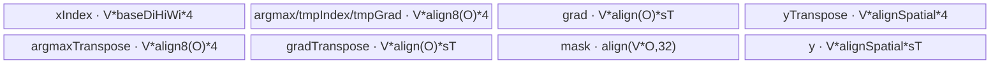
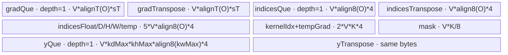

# AdaptiveMaxPool2dBackward A2/A3 ACLNN 算子知识

## 算子速览

| 项目 | 内容 |
|---|---|
| 实际入口 | `aclnnAdaptiveMaxPool2dBackwardGetWorkspaceSize` + `aclnnAdaptiveMaxPool2dBackward`，公开 ACLNN，两段式接口，无更高版本后缀。 |
| 计算语义 | 对每个 `gradOutput[n,c,oh,ow]`，读取正向 `indices[n,c,oh,ow]` 指向的 `self[n,c,h,w]` 平面位置，并累加到同 shape 于 `self` 的 `gradInput`；未命中位置为 0。 |
| 输入输出 | 3D `CHW` 或 4D `NCHW` 逻辑张量；值类型 FP16/FP32/BF16，indices 为 INT32/INT64；内部统一为 5D `NCDHW` 且 `D=1`、indices INT32。 |
| 执行类型 | 单 Device Kernel；R-001/R-002 启动 `max_pool3d_grad_with_argmax` AIV_VECTOR，R-003/R-004 启动 `adaptive_max_pool3d_grad` AIV_VECTOR。entry 对 `g_coreType == AIC` 直接返回，不存在可达 Cube/MIX_CV body。 |
| Kernel 路线 | R-001 整除固定窗口 Normal；R-002 整除固定窗口 Scatter；R-003 非整除自适应 Normal-overlap；R-004 非整除自适应 Scatter-overlap。 |
| 核心资源 | GM 输入/输出；Normal 使用整块 `TBuf` 或多组 `TQue/TBuf` 做转置、mask、Select；Scatter 使用 grad/argmax VECIN Queue 与 32B 标量输出 Queue；非整除 FP16/BF16 使用 FP32 workspace。 |
| 来源闭包 | `source_closed`：公开 ACLNN → shape/view/cast 框架节点 → `selectLevelZeroOperation` → 两个 L0 AICore launcher → 两套 Host/Tiling/POD → 两个 AIV entry/router → Normal/Scatter 真实 body 与公共 helper → A2/A3 binary/OpDef 接线。 |
| 验证状态 | 已完成源码闭包检查；本次知识提取未执行编译、真机、数值或性能测试。 |

## 接口与语义

### 计算语义

设逻辑输入为 `self[N,C,H,W]`（3D 输入等价于隐含 `N=1`），正向输出空间为 `Ho×Wo`。每个输出窗口的正向最大值坐标由 `indices[n,c,oh,ow]` 给出，索引在单个 `H×W` 平面内展开。反向结果为：

```text
gradInput[n,c,h,w] = Σ gradOutput[n,c,oh,ow]
  for all (oh,ow) whose indices[n,c,oh,ow] == h*W+w
```

自适应窗口边界是 `floor(o*I/O)` 到 `ceil((o+1)*I/O)`。当 `H % Ho == 0 && W % Wo == 0` 时，Host 将其等价改写为 `kernel=stride=(H/Ho,W/Wo)` 的无 padding 固定窗口反向；否则走真正的自适应 overlap 实现。内部增加的 D 维恒为 1，因此 D 轴恒整除。

### 输入、输出与属性

| 参数 | shape/layout | dtype | 约束、默认值与语义 |
|---|---|---|---|
| `gradOutput` | 3D/4D，ND；内部连续 NCDHW `[N,C,1,Ho,Wo]` | FP16/FP32/BF16 | shape 与 `indices` 相同，值类型与 `self`、`gradInput` 相同。 |
| `self` | 3D/4D，ND；内部连续 NCDHW `[N,C,1,H,W]` | FP16/FP32/BF16 | 只提供输出 shape/dtype 与窗口尺寸；Kernel 不读取其数值。A2/A3 要求 `H*W <= INT32_MAX`。 |
| `indices` | 与 `gradOutput` 相同 | INT32/INT64 | INT64 在 ACLNN executor 中先 Cast 为 INT32；索引语义是单个 HW 平面偏移。 |
| `gradInput` | 与 `self` 相同，可非连续 | FP16/FP32/BF16 | 最终通过 `ViewCopy` 写回调用者提供的 view。 |

### 入口与版本

固定 Commit 只公开无后缀 `aclnnAdaptiveMaxPool2dBackward` 版本。公开文档明确支持 Atlas A2 与 A3，明确不支持 Ascend 950PR/950DT；因此本卡覆盖 A2/A3，不能据 `ascend950` 内部 OpDef/config 推导公开 950 支持。A2/A3 的 L0 OpDef 与 binary config 都包含 FP16/FP32/BF16 + INT32 NCDHW 组合，ACLNN 对 INT64 indices 的支持由入口 Cast 到 INT32 实现。

## Host/Launcher 执行流程

### 参数校验与前处理

1. `CheckParams` 检查四个 tensor 非空、值 tensor dtype 一致且属于 FP16/FP32/BF16、indices 属于 INT32/INT64，并检查 `gradOutput.shape == indices.shape`、`self.shape == gradInput.shape`。
2. `CheckFormat` 要求四者 storage format 相同、不是 private format，且 rank 都是 3 或 4。A2/A3 的 `CheckSelfShapeSupport` 约束 `H*W <= 2^31-1`。
3. 任一输入为空时返回成功、workspace 为 0，不加入核心 Kernel。
4. 对 `self/gradOutput/indices` 分别加入 `Contiguous`。3D NCL 先在 dim 0 增维为 4D NCHW；INT64 indices 加入 Cast(INT32)。
5. 三个 4D tensor 在 dim 2 增加 D=1，并 ReFormat 为 NCDHW。`Unsqueeze/ReFormat/Contiguous/Cast` 是 executor 框架节点，其内部 Kernel 不属于本算子拥有的 selector/POD。
6. `selectLevelZeroOperation` 选择固定窗口或自适应 L0 节点。结果去掉 D 维，3D 原输入再去掉临时 N 维，校验推导 shape 后 `ViewCopy` 到 `gradInput`。

### 参数、Workspace 与生命周期

`uniqueExecutor` 拥有全部临时 view、连续 tensor、INT32 indices、内部 NCDHW 输出和 Kernel launcher；第一段接口返回其总 workspace 字节数并转移 executor 所有权，调用者申请 workspace 后在同一 executor 上执行第二段接口。框架节点的各 slice offset 由 executor 实现管理，固定仓未公开逐节点 offset；算子拥有的核心 user workspace 如下：

| Route | 核心 user workspace | 系统 workspace | owner/lifetime |
|---|---|---|---|
| R-001/R-002 | 0 | `MaxPool3DGradWithArgmaxTilingBase::GetWorkspaceSize` 加入 `PlatformAscendC::GetLibApiWorkSpaceSize()` | executor workspace；从 launch 开始到该节点完成。 |
| R-003/R-004 FP32 | 0 | 固定加入 16 MiB | executor workspace；从 launch 开始到该节点完成。 |
| R-003/R-004 FP16/BF16 | `N*C*H*W*sizeof(float)` | 固定加入 16 MiB | 先清零并累加 FP32，全部贡献完成后 cast 到 `gradInput`；Kernel 结束前不可覆盖。 |

### 启动图与失败传播

```text
ACLNN first stage
  -> Contiguous(self, gradOutput, indices)
  -> [3D only] Unsqueeze/ReFormat to NCHW
  -> [indices INT64] Cast to INT32
  -> Unsqueeze D=1/ReFormat to NCDHW
  -> selector
       all spatial input sizes divisible by output sizes
         -> MaxPool3DGradWithArgmax AICore node (R-001/R-002)
       otherwise
         -> AdaptiveMaxPool3DGrad AICore node (R-003/R-004)
  -> Squeeze/ReFormat
  -> ViewCopy(gradInput)
ACLNN second stage -> CommonOpExecutorRun(..., stream)
```

核心 launch graph 对每条 Route 都只有一个 Device 节点。`ADD_TO_LAUNCHER_LIST_AICORE` 将 NCDHW `self,gradOutput,indices`、输出、attrs/POD 和同一 stream 加入 executor；框架保证同一 executor 节点按依赖顺序执行，核心输出是后续 Squeeze/ViewCopy 的 GM producer。任一校验、临时 tensor 分配、L0 launcher 加入或 shape 校验失败都会返回错误/空指针并阻断后续节点；第二段直接传播 `CommonOpExecutorRun` 状态。

## Route 与参数设计

### 分核与资源计算

记 `NC=N*C`，内部 `Di=Do=1`。A2/A3 Host 从平台取得 AIV core 数 `Cores` 与 UB 字节 `UBmax`。

- 固定窗口分支设置 `kd=sd=1, kh=sh=H/Ho, kw=sw=W/Wo, pad=0, dilation=1, ceil=false`。CutK 模板 priority 10 的白名单要求 `kd=5, do=1, ho=6, wo=8...`，与 `kd=1` 不相容；故可达候选仅 Normal(priority 12) 与 Scatter(priority 16)。
- 自适应分支计算 `kdMax=max_o(ceil((o+1)I/O)-floor(oI/O))`（H/W 同理）、`dGcd=gcd(Do,Di)`，并令 `isOverlap = (Di%Do || Hi%Ho || Wi%Wo)`。该分支由 API 的“不全整除”条件进入，故必有 `isOverlap=true`。
- Normal 先按 NC（向量宽度通常 64）跨核，再按 D/H/W 扩核，并用 Host UB 公式与二分搜索选择 `baseDo/baseHo/baseWo`；最小块也放不下时 fallthrough。
- Scatter 用 `effectiveUb=UBmax`（固定窗口额外减 32B），依次尝试不切、切 NC、D、H、W；每核独占一段 NC，`ncRound/ncRoundTail/preCoreNum` 决定轮数。

### Route 选择

| 顺序 | Route | Key/模板 | 精确选择条件与优先级 | 不适用去向 |
|---:|---|---|---|---|
| 1 | R-001 固定窗口 Normal | key 0；`MaxPool3DGradWithArgmaxNormalTiling`, priority 12 | A2/A3 且 `H%Ho==0 && W%Wo==0`；Normal `CalUBTotalSize(1,1,1,false) <= UBmax`。CutK priority 10 因 `kd=1 != 5` 不可用。 | R-002。 |
| 2 | R-002 固定窗口 Scatter | key 2；`MaxPool3DGradWithArgmaxScatterTiling`, priority 16 | 同一整除入口；Normal 不可容纳最小块；Scatter 五级切分任一成功。 | tiling 失败。 |
| 3 | R-003 自适应 Normal-overlap | key 100；`AdaptiveMaxPool3DGradNormalTiling`, priority 10 | `H%Ho!=0 \|\| W%Wo!=0` 且 `CalUBTotalSize(1,1,1) <= UBmax`。 | R-004。 |
| 4 | R-004 自适应 Scatter-overlap | key 102；`AdaptiveMaxPool3DGradScatterTiling`, priority 20 | 同一非整除入口；Normal 不可容纳最小块；Scatter 五级切分任一成功。 | tiling 失败。 |

```text
if H % Ho == 0 && W % Wo == 0:          # D=1 恒整除
    attrs = {k:s=(1,H/Ho,W/Wo), pad=0, dilation=1, ceil=false}
    if fixed-window Normal.IsCapable(): key=0
    else if Scatter.IsCapable():         key=2
    else: fail
else:
    if adaptive Normal.IsCapable():      key=100
    else if Scatter.IsCapable():         key=102
    else: fail
```

### 模板/实现执行矩阵

| Route | key/selector | dtype/shape/platform 完整命中条件 | 执行拓扑与 Kernel 节点 | 实际模板/body | 内存与同步特征 | tail/fallback |
|---|---|---|---|---|---|---|
| R-001 固定窗口 Normal | 0 | A2/A3；整除；FP16/FP32/BF16；INT32 internal；Normal UB capable | 单 Kernel `max_pool3d_grad_with_argmax` | `MaxPool3DGradWithArgmaxNormal<DTYPE_X,DTYPE_X,int32_t,DTYPE_X,false>` | 单 `totalBuf`; GM→transpose→Compare/Select→FP32 col2img→GM；无 atomic/workspace | former/tail NC/D/H/W；最小 UB 不足去 R-002。 |
| R-002 固定窗口 Scatter | 2 | A2/A3；整除；R-001 不可用 | 单 Kernel `max_pool3d_grad_with_argmax` | `MaxPoolGradWithArgScatter<DTYPE_X,DTYPE_X,int32_t,DTYPE_X>` → `MaxPool3DGradScatterUnified` | grad/argmax Queue；每核清零独占 NC 输出片，标量 DataCopy 写命中位置 | base/tail 四轴；切分失败则 tiling 失败。 |
| R-003 自适应 Normal-overlap | 100 | A2/A3；H/W 至少一轴非整除；Normal UB capable | 单 Kernel `adaptive_max_pool3d_grad` | `AdaptiveMaxPool3DGradNormal<DTYPE_X,DTYPE_GRAD,DTYPE_ARGMAX,DTYPE_Y,true>` | 多 Queue/TBuf；window-local index；atomic add；b16 经 FP32 workspace | tail NC/D/H/W/W-window；最小 UB 不足去 R-004。 |
| R-004 自适应 Scatter-overlap | 102 | A2/A3；非整除；R-003 不可用 | 单 Kernel `adaptive_max_pool3d_grad` | `AdaptiveMaxPool3DGradScatterOverlap<DTYPE_X,DTYPE_GRAD,DTYPE_ARGMAX,DTYPE_Y>` → common overlap unified | 每核独占 NC；标量 GM read-modify-write；b16 FP32 workspace + cast | base/tail 四轴；切分失败则 tiling 失败。 |

### 隐藏性能 Guard

| Guard | Host/Tiling 条件 | Device/资源原因 | 影响 Route | 不满足时去向 | 源码符号 |
|---|---|---|---|---|---|
| 整除 specialization | 三个内部空间轴都满足 `isizes[d] % osizes[d] == 0` | 将自适应边界变成固定 `kernel==stride`，避免运行时计算自适应窗口 | R-001/R-002 vs R-003/R-004 | 自适应分支 | `adaptive_max_pool_common.cpp::selectLevelZeroOperation` |
| INT32 平面索引 | A2/A3 `H*W <= INT32_MAX`；内部 5D 为 `D=1` | indices 在 Kernel 内为 INT32，地址展开不能越界 | 全部 | ACLNN 参数错误 | `CheckSelfShapeSupport` / 两套 `CheckInputValid` |
| Normal 最小 UB | `CalUBTotalSize(1,1,1,...) <= UBmax` | 至少容纳一块转置、mask、选择与输出区 | R-001/R-003 | 对应 Scatter | 两个 `NormalTiling::IsCapable` |
| NC 向量粒度 | Normal `singleCoreNc` 通常 64；固定窗口可降为按 16 对齐的 VL | 转置地址表和 Vector mask 以 16/8 元素块组织 | R-001/R-003 | 调小 VL/base 或 Scatter | `CalcBaseNc` / `SetNormalTilingParams` |
| stride repeat 位宽 | 固定窗口 `sw < 32` 才走多 repeat `Img2ColPartWAdds/Col2ImgPartWAdd` | repeat stride 为 uint8，`sw*8 <= 255` | R-001 | `sw>=32` 改逐 wo 循环 | `MaxPool3DGradWithArgmaxNormal::Img2ColPart/Col2ImgPart` |
| Scatter UB 切分 | 依次 `tryNoCut → tryCutNc → tryCutDo → tryCutHo → tryCutWo` | 两路输入 Queue 必须同时容纳 grad 与 argmax；固定窗口保留 32B 输出 Queue | R-002/R-004 | tiling 失败 | `CalculateScatterTilingParams` |
| b16 overlap workspace | `dtype_size != 4 && isOverlap` | 累加在 FP32 GM workspace 中完成后统一降精度 | R-003/R-004 | FP32 直接写输出 | `SetOtherTilingParams` / `CalculateRoundParams` |
| AIV-only entry | `workspace != nullptr && GetUserWorkspace(workspace) != nullptr && g_coreType != AIC` | binary 的语义 body 只在 Vector core 执行 | 全部 | entry 直接返回 | 两个 Kernel entry |

### POD/ABI

两个 POD 都由 `BEGIN_TILING_DATA_DEF/TILING_DATA_FIELD_DEF` 生成，字段源码类型全为 `uint64_t`。字段顺序可由固定仓确认；宏定义来自仓外构建头，因此精确 `sizeof/alignof/offsetof` 固定仓不可见。下表每个字段单列，Normal/Scatter 未使用字段仍被序列化但不读取。

| 结构 | 字段 | 类型/位宽 | ABI 布局 | 单位 | Host/launcher producer | Device consumer | 边界 |
|---|---|---|---|---|---|---|---|
| Adaptive POD | `ncDim` | uint64/64 | 序号 0；精确 offset 不可见 | 元素轴长 | `SetBaseTilingData` | 两类 `InitParams` | `N*C` |
| Adaptive POD | `diDim` | uint64/64 | 序号 1 | 元素 | 同上 | 输出平面地址 | 2D 路径恒 1 |
| Adaptive POD | `hiDim` | uint64/64 | 序号 2 | 元素 | 同上 | index 分解/地址 | `H` |
| Adaptive POD | `wiDim` | uint64/64 | 序号 3 | 元素 | 同上 | index 分解/地址 | `W` |
| Adaptive POD | `doDim` | uint64/64 | 序号 4 | 元素 | 同上 | 循环/窗口 | 2D 路径恒 1 |
| Adaptive POD | `hoDim` | uint64/64 | 序号 5 | 元素 | 同上 | 循环/窗口 | `Ho` |
| Adaptive POD | `woDim` | uint64/64 | 序号 6 | 元素 | 同上 | 循环/窗口 | `Wo` |
| Adaptive POD | `kdMax` | uint64/64 | 序号 7 | 元素 | `GetMaxK` | kernel-index buffer | 2D 路径为 1 |
| Adaptive POD | `khMax` | uint64/64 | 序号 8 | 元素 | `GetMaxK` | kernel-index buffer | 最大自适应 H 窗口 |
| Adaptive POD | `kwMax` | uint64/64 | 序号 9 | 元素 | `GetMaxK` | kernel-index buffer | 最大自适应 W 窗口 |
| Adaptive POD | `baseNc` | uint64/64 | 序号 10 | 元素 | Normal/Scatter tiling | 分块 | Normal body主要使用 `singleCoreNc` |
| Adaptive POD | `baseDo` | uint64/64 | 序号 11 | 元素 | tiling | 块循环 | ≥1 |
| Adaptive POD | `baseHo` | uint64/64 | 序号 12 | 元素 | tiling | 块循环 | ≥1 |
| Adaptive POD | `baseWo` | uint64/64 | 序号 13 | 元素 | UB 二分/Scatter | 块循环 | ≥1 |
| Adaptive POD | `singleCoreNc` | uint64/64 | 序号 14 | 元素 | Normal tiling | Normal 分核/UB | Scatter inactive |
| Adaptive POD | `singleCoreDo` | uint64/64 | 序号 15 | 元素 | Normal tiling | Normal 分核 | Scatter inactive |
| Adaptive POD | `singleCoreHo` | uint64/64 | 序号 16 | 元素 | Normal tiling | Normal 分核 | Scatter inactive |
| Adaptive POD | `singleCoreWo` | uint64/64 | 序号 17 | 元素 | Normal tiling | Normal 分核 | Scatter inactive |
| Adaptive POD | `ncTail` | uint64/64 | 序号 18 | 元素 | tiling | 尾 NC | >0 |
| Adaptive POD | `doTail` | uint64/64 | 序号 19 | 元素 | tiling | 尾 D | >0 |
| Adaptive POD | `hoTail` | uint64/64 | 序号 20 | 元素 | tiling | 尾 H | >0 |
| Adaptive POD | `woTail` | uint64/64 | 序号 21 | 元素 | tiling | 尾 W | >0 |
| Adaptive POD | `ncCnt` | uint64/64 | 序号 22 | block 数 | tiling | 分核循环 | ceil-div |
| Adaptive POD | `doCnt` | uint64/64 | 序号 23 | block 数 | tiling | 分核循环 | ceil-div |
| Adaptive POD | `hoCnt` | uint64/64 | 序号 24 | block 数 | tiling | 分核循环 | ceil-div |
| Adaptive POD | `woCnt` | uint64/64 | 序号 25 | block 数 | tiling | 分核循环 | ceil-div |
| Adaptive POD | `totalCnt` | uint64/64 | 序号 26 | block 数 | tiling | Normal `totalIndex` | 四个 count 乘积 |
| Adaptive POD | `usedCoreNum` | uint64/64 | 序号 27 | core | tiling | 记录/Scatter | 同时设 blockDim |
| Adaptive POD | `totalUBSize` | uint64/64 | 序号 28 | 字节 | platform producer | UB 分配/cast tile | `UBmax` |
| Adaptive POD | `ncRound` | uint64/64 | 序号 29 | round | Scatter tiling | Scatter `InitParams` | Normal inactive |
| Adaptive POD | `ncRoundTail` | uint64/64 | 序号 30 | round | Scatter tiling | 后部 core | Normal inactive |
| Adaptive POD | `totalRound` | uint64/64 | 序号 31 | round | Scatter tiling | 仅记录 | Normal inactive |
| Adaptive POD | `preCoreNum` | uint64/64 | 序号 32 | core | Scatter tiling | NC owner 划分 | Normal inactive |
| Fixed POD | `ncDim` | uint64/64 | 序号 0；精确 offset 不可见 | 元素轴长 | `SetBaseTilingData` | Normal/Scatter | `N*C` |
| Fixed POD | `diDim` | uint64/64 | 序号 1 | 元素 | 同上 | 地址 | 恒 1 |
| Fixed POD | `hiDim` | uint64/64 | 序号 2 | 元素 | 同上 | 地址 | `H` |
| Fixed POD | `wiDim` | uint64/64 | 序号 3 | 元素 | 同上 | 地址 | `W` |
| Fixed POD | `doDim` | uint64/64 | 序号 4 | 元素 | 同上 | 循环 | 恒 1 |
| Fixed POD | `hoDim` | uint64/64 | 序号 5 | 元素 | 同上 | 循环 | `Ho` |
| Fixed POD | `woDim` | uint64/64 | 序号 6 | 元素 | 同上 | 循环 | `Wo` |
| Fixed POD | `kd` | uint64/64 | 序号 7 | 元素 | API attr/tiling | window loop | 恒 1 |
| Fixed POD | `kh` | uint64/64 | 序号 8 | 元素 | `H/Ho` | window loop | 整除 |
| Fixed POD | `kw` | uint64/64 | 序号 9 | 元素 | `W/Wo` | window loop | 整除 |
| Fixed POD | `sd` | uint64/64 | 序号 10 | 元素 | 等于 kd | 地址 | 恒 1 |
| Fixed POD | `sh` | uint64/64 | 序号 11 | 元素 | 等于 kh | 地址 | 无 overlap |
| Fixed POD | `sw` | uint64/64 | 序号 12 | 元素 | 等于 kw | 地址/repeat | 无 overlap |
| Fixed POD | `padDTop` | uint64/64 | 序号 13 | 元素 | attr 0 | depad/address | 0 |
| Fixed POD | `padHTop` | uint64/64 | 序号 14 | 元素 | attr 0 | depad/address | 0 |
| Fixed POD | `padWTop` | uint64/64 | 序号 15 | 元素 | attr 0 | depad/address | 0 |
| Fixed POD | `padDBottom` | uint64/64 | 序号 16 | 元素 | `SetOtherInputParams` | valid extent | 0 |
| Fixed POD | `padHBottom` | uint64/64 | 序号 17 | 元素 | 同上 | valid extent | 0 |
| Fixed POD | `padWBottom` | uint64/64 | 序号 18 | 元素 | 同上 | valid extent | 0 |
| Fixed POD | `baseNc` | uint64/64 | 序号 19 | 元素 | tiling | UB/Scatter | >0 |
| Fixed POD | `baseDo` | uint64/64 | 序号 20 | 元素 | tiling | 块循环 | >0 |
| Fixed POD | `baseHo` | uint64/64 | 序号 21 | 元素 | tiling | 块循环 | >0 |
| Fixed POD | `baseWo` | uint64/64 | 序号 22 | 元素 | tiling | 块循环 | >0 |
| Fixed POD | `ncTail` | uint64/64 | 序号 23 | 元素 | tiling | 尾块 | >0 |
| Fixed POD | `doTail` | uint64/64 | 序号 24 | 元素 | tiling | 尾块 | >0 |
| Fixed POD | `hoTail` | uint64/64 | 序号 25 | 元素 | tiling | 尾块 | >0 |
| Fixed POD | `woTail` | uint64/64 | 序号 26 | 元素 | tiling | 尾块 | >0 |
| Fixed POD | `ncCnt` | uint64/64 | 序号 27 | block | tiling | 循环 | ceil-div |
| Fixed POD | `doCnt` | uint64/64 | 序号 28 | block | tiling | 循环 | ceil-div |
| Fixed POD | `hoCnt` | uint64/64 | 序号 29 | block | tiling | 循环 | ceil-div |
| Fixed POD | `woCnt` | uint64/64 | 序号 30 | block | tiling | 循环 | ceil-div |
| Fixed POD | `totalCnt` | uint64/64 | 序号 31 | block | tiling | Normal | 四 count 乘积 |
| Fixed POD | `usedCoreNum` | uint64/64 | 序号 32 | core | tiling | 记录 | 同时设 blockDim |
| Fixed POD | `totalUBSize` | uint64/64 | 序号 33 | 字节 | platform | `totalBuf`/cast | `UBmax` |
| Fixed POD | `singleCoreNc` | uint64/64 | 序号 34 | 元素 | Normal tiling | Normal | Scatter inactive |
| Fixed POD | `singleCoreDo` | uint64/64 | 序号 35 | 元素 | Normal tiling | Normal | Scatter inactive |
| Fixed POD | `singleCoreHo` | uint64/64 | 序号 36 | 元素 | Normal tiling | Normal | Scatter inactive |
| Fixed POD | `singleCoreWo` | uint64/64 | 序号 37 | 元素 | Normal tiling | Normal | Scatter inactive |
| Fixed POD | `ncRound` | uint64/64 | 序号 38 | round | Scatter tiling | Scatter | Normal inactive |
| Fixed POD | `ncRoundTail` | uint64/64 | 序号 39 | round | Scatter tiling | Scatter | Normal inactive |
| Fixed POD | `totalRound` | uint64/64 | 序号 40 | round | Scatter tiling | 仅记录 | Normal inactive |
| Fixed POD | `preCoreNum` | uint64/64 | 序号 41 | core | Scatter tiling | owner 划分 | Normal inactive |

### Route 源码闭包

| Route | Key/selector | Host/Tiling producer | POD/参数 | Kernel entry/router 节点 | Kernel body/直接依赖 | 构建接线 |
|---|---|---|---|---|---|---|
| R-001 固定窗口 Normal | API 整除；key 0 | `adaptive_max_pool_common.cpp::selectLevelZeroOperation`; `max_pool3d_grad_with_argmax_normal_tiling.cpp` | `MaxPool3DGradWithArgmaxTilingData` | `max_pool3d_grad_with_argmax.cpp::max_pool3d_grad_with_argmax` | `MaxPool3DGradWithArgmaxNormal` + common transpose helpers | `max_pool3d_grad_with_argmax_def.cpp`; ascend910b/910_93 binary JSON |
| R-002 固定窗口 Scatter | API 整除；key 2 | 同上；`max_pool3d_grad_with_argmax_scatter_tiling.cpp` | 同一 Fixed POD | 同一 entry | `MaxPoolGradWithArgScatter` → common scatter base/unified | 同上 |
| R-003 自适应 Normal-overlap | API 非整除；key 100 | `adaptive_max_pool3d_grad_normal_tiling.cpp` | `AdaptiveMaxPool3DGradTilingData` | `adaptive_max_pool3d_grad.cpp::adaptive_max_pool3d_grad` | `AdaptiveMaxPool3DGradNormal<DTYPE_X,DTYPE_GRAD,DTYPE_ARGMAX,DTYPE_Y,true>` + `max_pool3d_grad_common.h` | `adaptive_max_pool3d_grad_def.cpp`; ascend910b/910_93 binary JSON |
| R-004 自适应 Scatter-overlap | API 非整除；key 102 | `adaptive_max_pool3d_grad_scatter_tiling.cpp` + tiling common | 同一 Adaptive POD | 同一 entry | adaptive scatter wrapper → common scatter base/overlap unified | 同上 |

## Kernel 实现

### 公共执行流程

两个 entry 的参数顺序均为 `(x, grad, argmax, y, workspace, tiling)`；`x` 只用于接口/shape，不被四条 A2/A3 body 取值。entry 先拒绝空 workspace/user-workspace 与 AIC core，再解析 POD。Normal 将 `(NC,Do,Ho,Wo)` block 以 `totalIndex % blockNum` 映射到 core；Scatter 只按 NC 段分配 owner，core 内顺序处理 D/H/W block。所有 Route 先得到全零输出，再把每个 `grad` 放到 `argmax` 指向的位置；差异在于 Vector mask/transpose 批处理还是标量 Scatter，以及 collision 用 atomic 还是同 core 顺序累加。

### Route R-001：固定窗口 Normal

#### 适用条件

##### 选择证据

| 层级 | 文件 | 符号 | 源码谓词/参数 | 结果/下一跳 |
|---|---|---|---|---|
| API | `adaptive_max_pool_common.cpp` | `selectLevelZeroOperation` | H/W 均整除，且 A2/A3 `!IsRegbase()` | `MaxPool3DGradWithArgmax`，k=s、pad=0 |
| Tiling | `max_pool3d_grad_with_argmax_cutk_tiling.cpp` | `IsCapable` | 白名单要求 kd=5；当前 kd=1 | priority 10 跳过 |
| Tiling | `max_pool3d_grad_with_argmax_normal_tiling.cpp` | `IsCapable` | dilation 全 1 且最小 UB 公式 ≤ UBmax | key 0 |
| Router | `max_pool3d_grad_with_argmax.cpp` | entry | `TILING_KEY_IS(0)` | `MaxPool3DGradWithArgmaxNormal<DTYPE_X,DTYPE_X,int32_t,DTYPE_X,false>` |

#### Device 数据流

##### 函数级调用链

```text
MaxPool3DGradWithArgmaxAiCore -> max_pool3d_grad_with_argmax(..., Fixed POD)
  -> MaxPool3DGradWithArgmaxNormal<DTYPE_X,DTYPE_X,int32_t,DTYPE_X,false>::Init
     -> InitParams -> InitInputsOutputs -> InitUbBuffer
  -> Process -> [optional zero init] -> GenXInitIndex
     -> SubProcess -> CalcBlock
        -> CopyInArgmax/CopyInGrad -> transpose
        -> Img2ColPart(index) -> Compare -> SelectGrad
        -> Col2ImgPart(FP32) -> DePad -> cast/transpose -> CopyOut(y)
```

##### 源码等价伪码

```text
for assigned (nc,do,ho,wo) core tile:
  for baseDo/baseHo/baseWo sub-tile:
    DMA argmax and grad, transpose [NC,O] -> [O,NC]
    y_fp32[local input window,NC] = 0
    for kd in [0,1), kh in [0,H/Ho), kw in [0,W/Wo):
      expected = flattened GM index of this window coordinate
      mask = (expected == argmax)
      selected = mask ? grad : 0
      y_fp32[window coordinate] += selected
    cast FP32 to FP16/BF16 when needed
    transpose [input-spatial,NC] -> [NC,input-spatial]
    DMA valid H/W region to y GM
```

#### 内存与数据搬运

##### 资源与搬运表

| 层级/缓冲区 | offset/地址公式 | extent/容量公式 | dtype/layout | producer | consumer | owner/lifetime | 对齐/复用 |
|---|---|---|---|---|---|---|---|
| grad GM | `core.offsetGrad+block.offsetGrad` | `ncShape*dohowoShape` | T/[NC,O] | ACLNN | CopyInGrad | external | row stride skips full O |
| argmax GM | 同 grad | 同上 | int32/[NC,O] | Cast/ACLNN | CopyInArgmax | executor | 32B DMA |
| `totalBuf:xIndex` | 0 | `V*baseDiHiWi*4` | int32/[input,NC] | GenXInitIndex | Compare | pipe | persistent per Kernel |
| argmax + transpose | xIndex 后 | 各 `V*align8(O)*4` | int32 | DMA/transpose | Compare | pipe | tmpIndex aliases argmax after transpose |
| grad + transpose | 顺序子区 | 各 `V*align(O)*sizeof(T)` | T | DMA/transpose | Select | pipe | tmpGrad aliases argmax region |
| yTranspose | 顺序子区 | `V*alignSpatial*4` | FP32 | Col2Img | output transpose | pipe | FP32 accumulation |
| mask | gradTranspose 后 | `align(V*O,32)` bytes | bit mask | Compare | Select | pipe | 32B aligned |
| y | mask 后 | `V*alignSpatial*sizeof(T)` | T/[NC,input] | transpose/cast | DMA out | pipe | final local output |

##### 分层内存布局



##### 字节账与复用顺序

```text
logical_UB = V*baseDiHiWi*4
           + 2*V*align8(O)*4
           + 2*V*alignT(O)*sT
           + V*alignSpatial*4 + V*alignSpatial*sT
           + align(V*O,32) + 20 KiB reserved
logical_UB <= UBmax
actual totalBuf allocation = UBmax
dynamic_ub = N/A
core_user_workspace = 0
```

| 复用子区 | 写入者 | 读取者/消费点 | 下一次覆盖 | 同步或释放依据 | 安全条件 |
|---|---|---|---|---|---|
| argmax / tmpIndex / tmpGrad | DMA argmax；随后 Img2Col/Select 临时量 | transpose/Compare/Col2Img | 下一 CalcBlock | MTE2→V event 与 V barrier | 原 argmax 已转置到独立区后才覆盖 |
| yTranspose | Duplicate/Col2Img | cast/output transpose | 下一 CalcBlock | V barrier、V→MTE3 event | CopyOut 前不可覆盖 |

#### 同步、精度与尾块

##### 同步与数值边界表

| 阶段 | primitive/机制 | producer | consumer/等待点 | 保护对象 | 精度/尾块 |
|---|---|---|---|---|---|
| DMA→Vector | `MTE2_V` flag | CopyIn | transpose | grad/argmax subregion | `dohowoShape`，padding 到 align8/16 |
| mask/select | `PipeBarrier<PIPE_V>` | Img2Col/Compare | Select/Col2Img | tmp/mask | FP16/BF16 selected grad cast 到 FP32 后累加 |
| Vector→DMA | `V_MTE3` flag | cast/transpose | CopyOut | y local | BF16 `CAST_RINT`，FP16 `CAST_NONE` |
| tail | explicit `nc/do/ho/wo Tail` | tiling | nested loops | GM valid region | DMA blockLen 仅写 `wiValid`，无效 lane 不提交 |

#### 关键实现

##### 符号证据表

| 阶段 | 文件 | 符号/模板实例 | 实现事实 |
|---|---|---|---|
| Host/Tiling producer | `max_pool3d_grad_with_argmax_normal_tiling.cpp` | `CalUBTotalSize/SetNormalTilingParams` | VL、分核、UB 二分 |
| Kernel entry/router | `max_pool3d_grad_with_argmax.cpp` | key 0 branch | `MaxPool3DGradWithArgmaxNormal<DTYPE_X,DTYPE_X,int32_t,DTYPE_X,false>` 映射 |
| Device body/helper | `max_pool3d_grad_with_argmax_normal.h` | `CalcBlock/Img2ColPart/Col2ImgPart` | 批量 mask-select 与 FP32 col2img |

### Route R-002：固定窗口 Scatter

#### 适用条件

##### 选择证据

| 层级 | 文件 | 符号 | 源码谓词/参数 | 结果/下一跳 |
|---|---|---|---|---|
| API | `adaptive_max_pool_common.cpp` | `selectLevelZeroOperation` | H/W 均整除 | 固定窗口 L0 |
| Tiling | `max_pool3d_grad_with_argmax_normal_tiling.cpp` | `IsCapable` | 最小 Normal UB > UBmax | priority 12 fallthrough |
| Tiling | `max_pool3d_grad_with_argmax_scatter_tiling.cpp` | `IsCapable/DoOpTiling` | `IsCapable=true`，五级 UB 切分成功 | key 2 |
| Router | `max_pool3d_grad_with_argmax.cpp` | entry | `TILING_KEY_IS(2)` | `MaxPoolGradWithArgScatter` |

#### Device 数据流

##### 函数级调用链

```text
max_pool3d_grad_with_argmax(..., Fixed POD)
  -> MaxPoolGradWithArgScatter::Init
     -> common Base::InitParams/InitInputsOutputs/InitUbBuffer
     -> InitYGMGlobalMemory -> InitBuffer(yQue,32B)
  -> Process -> ProcessCommon
     -> CalcBlock -> CopyInGrad/CopyInArgmax
     -> CalcOutOffset -> scalar DataCopyPad(y[argmax], grad)
```

##### 源码等价伪码

```text
core owns contiguous NC blocks selected by ncRound/preCoreNum
zero y[owned NC input planes]
for owned nc block, do block, ho block, wo block:
  DMA grad and argmax tile to UB queues
  wait MTE2 -> scalar
  for each (nc, dhw) in tile:
    outOffset = ownedNCBase*H*W + argmax[nc,dhw]
    y_scalar[0] = grad[nc,dhw]
    wait scalar -> MTE3; DMA sizeof(T) to y[outOffset]; wait MTE3 -> scalar
```

#### 内存与数据搬运

##### 资源与搬运表

| 层级/缓冲区 | offset/地址公式 | extent/容量公式 | dtype/layout | producer | consumer | owner/lifetime | 对齐/复用 |
|---|---|---|---|---|---|---|---|
| owned y GM | `ncIndex*baseNc*H*W` | `initLen` elements | T/NCHW | InitGlobalMemory | scalar writes/ViewCopy | one core | NC-disjoint，无 atomic |
| gradQue | 0 | `baseNc*baseDo*baseHo*baseWo*sT` | T | DataCopyPad | scalar GetValue | pipe/tile | depth 1 |
| argmaxQue | next | `baseNc*baseDo*baseHo*baseWo*4` | int32 | DataCopyPad | address generation | pipe/tile | depth 1 |
| yQue | independent | 32B | T scalar staging | SetValue | DataCopyPad | pipe/element | depth 1 |

##### 分层内存布局


##### 字节账与复用顺序

```text
UB_total = baseNc*baseDo*baseHo*baseWo*(sT+4) + 32
UB_total <= UBmax
dynamic_ub = N/A
workspace_total = platform lib-api system workspace; core user slice = 0
```

| 复用子区 | 写入者 | 读取者/消费点 | 下一次覆盖 | 同步或释放依据 | 安全条件 |
|---|---|---|---|---|---|
| gradQue/argmaxQue | CopyIn | CalcOutOffset | next tile | `DeQue` 后 `FreeTensor` | 当前 tile 标量循环完成 |
| yQue 32B | SetValue | one-element DMA | next element | S→MTE3 与 MTE3→S event | DMA 完成后覆盖 |

#### 同步、精度与尾块

##### 同步与数值边界表

| 阶段 | primitive/机制 | producer | consumer/等待点 | 保护对象 | 精度/尾块 |
|---|---|---|---|---|---|
| zero init | MTE3→S flag | InitGlobalMemory | scalar loop | owned y slice | 全 slice 归零 |
| input DMA | MTE2→S flag | CopyIn | GetValue | queues | base/tail shape 精确循环 |
| scalar output | S→MTE3→S | SetValue | DMA/next overwrite | yQue[0] | 原 dtype 直接写；固定窗口不重叠，无累加冲突 |

#### 关键实现

##### 符号证据表

| 阶段 | 文件 | 符号/模板实例 | 实现事实 |
|---|---|---|---|
| Host/Tiling producer | `max_pool3d_grad_with_argmax_scatter_tiling.cpp` | `SetScatterTilingParams` | 五级 UB 切分、key 2 |
| Kernel entry/router | `max_pool3d_grad_with_argmax.cpp` | key 2 branch | Scatter wrapper 映射 |
| Device body/helper | `pool_3d_common/.../max_pool3d_grad_scatter_unified.h` | `CalcOutOffset` | 每个 grad 直接写 argmax 地址 |

### Route R-003：自适应 Normal-overlap

#### 适用条件

##### 选择证据

| 层级 | 文件 | 符号 | 源码谓词/参数 | 结果/下一跳 |
|---|---|---|---|---|
| API | `adaptive_max_pool_common.cpp` | `selectLevelZeroOperation` | H 或 W 非整除 | `AdaptiveMaxPool3DGrad` |
| Tiling | `adaptive_max_pool3d_grad_tiling_base.cpp` | `SetInputParams/GetTilingKey` | `isOverlap=true`；Normal type 0 + 100 | key 100 |
| Tiling | `adaptive_max_pool3d_grad_normal_tiling.cpp` | `IsCapable` | 最小 UB ≤ UBmax | priority 10 命中 |
| Router | `adaptive_max_pool3d_grad.cpp` | entry | `TILING_KEY_IS(100)` | `AdaptiveMaxPool3DGradNormal<DTYPE_X,DTYPE_GRAD,DTYPE_ARGMAX,DTYPE_Y,true>` |

#### Device 数据流

##### 函数级调用链

```text
AdaptiveMaxPool3DGradAiCore -> adaptive_max_pool3d_grad(..., Adaptive POD)
  -> AdaptiveMaxPool3DGradNormal<DTYPE_X,DTYPE_GRAD,DTYPE_ARGMAX,DTYPE_Y,true>::Init
     -> InitParams -> InitInputsOutputs(zero y/workspace + SyncAll) -> InitUbBuffer
  -> Process -> GenkernelIndex -> SubProcess -> CalcBlock
     -> CopyInArgmax/Grad -> transpose
     -> CalcIndices -> CalcIndicesInWindow
     -> Compare -> SelectGrad -> CalcY -> transpose -> Atomic CopyOut
  -> [FP16/BF16] SyncAll -> Reset pipe -> workspace FP32 to output cast
```

##### 源码等价伪码

```text
global output accumulator = 0                         # y for FP32, workspace for b16
SyncAll()
kernelIdx = [0 .. kdMax*khMax*kwMax-1], replicated over NC lanes
for assigned adaptive output tile:
  DMA/transpose grad and argmax
  decompose flat argmax -> (d,h,w) by FP32 div/floor
  subtract floor(output_index*input/output) window starts
  windowIndex = localD*khMax*kwMax + localH*kwMax + localW
  for each wo lane:
    mask = (kernelIdx == windowIndex)
    selected = mask ? grad : 0
    transpose selected window to input layout
    atomic_add accumulator[adaptive window GM region]
if b16:
  SyncAll(); tile-load FP32 workspace; Cast; DMA to y
```

#### 内存与数据搬运

##### 资源与搬运表

| 层级/缓冲区 | offset/地址公式 | extent/容量公式 | dtype/layout | producer | consumer | owner/lifetime | 对齐/复用 |
|---|---|---|---|---|---|---|---|
| gradQue + gradTranspose | block output offset | each `V*alignT(O)*sT` | T/[NC,O]↔[O,NC] | DMA/transpose | Select | pipe/tile | Queue depth 1 |
| indicesQue + transpose | same offset | each `V*align8(O)*4` | int32 | DMA/transpose | CalcIndices | pipe/tile | Queue depth 1 |
| index float buffers | local | five `V*align8(O)*4` | FP32 | Cast/div/sub | window index | pipe/tile | temp reused across D/H/W |
| kernelIdx/tempGrad/mask | local | `V*K*4`, `V*K*4`, `V*K/8` | FP32/T/mask | generated/Select | CalcY | pipe/kernel or tile | K=`kdMax*khMax*kwMax` |
| yQueue+yTranspose | adaptive window GM base | each `V*kdMax*khMax*align8(kwMax)*4` | FP32 | CalcY/transpose | atomic DMA | pipe/tile | overlap 总是 FP32 |
| workspace GM b16 | flat NC*H*W | `NC*H*W*4` | FP32 | atomic adds | final cast | executor/Kernel | FP32 accumulation |

##### 分层内存布局



##### 字节账与复用顺序

```text
O = baseDo*baseHo*baseWo; K = kdMax*khMax*kwMax
UB_actual = 2*V*alignT(O)*sT
          + 7*V*align8(O)*4
          + 2*V*K*4 + V*K/8
          + 2*V*kdMax*khMax*align8(kwMax)*4
Host capability uses the same major terms plus SELECT_RESERVED_UB_SIZE
and a conservative 32B-aligned mask term.
UB_actual <= UBmax
workspace_user = (sT==2 ? NC*H*W*4 : 0)
```

| 复用子区 | 写入者 | 读取者/消费点 | 下一次覆盖 | 同步或释放依据 | 安全条件 |
|---|---|---|---|---|---|
| tempGrad second half | Copy/Select b16 | Cast to FP32 | next wo | V barrier | b16 overlap source and FP32 destination offsets不重叠 |
| FP32 accumulator | atomic CopyOut | final Cast | pipe reset after SyncAll | `SyncAll` | 所有 core 原子贡献完成 |
| cast queues | workspace DMA/Cast | y DMA | next cast tile | Queue EnQue/DeQue/Free | `calcNum` tail 精确 |

#### 同步、精度与尾块

##### 同步与数值边界表

| 阶段 | primitive/机制 | producer | consumer/等待点 | 保护对象 | 精度/尾块 |
|---|---|---|---|---|---|
| zero→compute | `SyncAll` | core 0 InitGlobalMemory | all cores | y/workspace | 空域已在 ACLNN 返回；非空全清零 |
| Vector pipeline | Queue + V barriers | DMA/transpose/div/mask | 下一 Vector op | UB intermediates | INT32 先 Cast FP32，`CAST_FLOOR` 分解索引 |
| overlap output | `SetAtomicAdd<T>` | yQueue | GM accumulator | adaptive window region | FP32 或 FP32 workspace 原子加，默认非确定顺序 |
| final cast | `SyncAll`, Queue | atomic phase | cast phase | FP32 workspace | FP16 `CAST_NONE`; BF16 `CAST_RINT`; tail `calcTail` |

#### 关键实现

##### 符号证据表

| 阶段 | 文件 | 符号/模板实例 | 实现事实 |
|---|---|---|---|
| Host/Tiling producer | `adaptive_max_pool3d_grad_normal_tiling.cpp` | `CalUBTotalSize/SetNormalTilingParams` | 自适应最大窗口与 workspace |
| Kernel entry/router | `adaptive_max_pool3d_grad.cpp` | key 100 | overlap Normal 实例 |
| Device body/helper | `adaptive_max_pool3d_grad_normal.h` | `CalcIndices/CalcY/CopyOut/ProcessCast` | window-local mask、atomic、FP32 workspace |

### Route R-004：自适应 Scatter-overlap

#### 适用条件

##### 选择证据

| 层级 | 文件 | 符号 | 源码谓词/参数 | 结果/下一跳 |
|---|---|---|---|---|
| API | `adaptive_max_pool_common.cpp` | `selectLevelZeroOperation` | H/W 非整除 | adaptive L0 |
| Tiling | `adaptive_max_pool3d_grad_normal_tiling.cpp` | `IsCapable` | Normal 最小 UB > UBmax | fallthrough |
| Tiling | `adaptive_max_pool3d_grad_scatter_tiling.cpp` | `IsCapable/DoOpTiling` | always capable；五级切分成功；type 2 + overlap 100 | key 102 |
| Router | `adaptive_max_pool3d_grad.cpp` | entry | `TILING_KEY_IS(102)` | overlap Scatter wrapper |

#### Device 数据流

##### 函数级调用链

```text
adaptive_max_pool3d_grad(..., Adaptive POD)
  -> AdaptiveMaxPool3DGradScatterOverlap::Init
     -> common Base::InitParams/InitInputsOutputs
     -> InitOutGlobalMemory -> Base::InitUbBuffer
  -> Process -> ProcessCommon
     -> CalcBlock -> CopyInGrad/Argmax -> CalcOutOffset
        -> DataCacheCleanAndInvalid -> GM read/add/write -> cache clean
  -> [FP16/BF16] Reset pipe -> ProcessCast(workspace -> y)
```

##### 源码等价伪码

```text
core owns one disjoint set of NC planes
zero owned y(FP32) or workspace(b16) slice
for every grad/argmax base tile in owned NC:
  DMA both inputs to UB
  for each element sequentially:
    offset = ownedNCPlaneBase + argmax
    clean/invalidate accumulator cache
    accumulator[offset] = accumulator[offset] + to_float(grad)
    clean/invalidate accumulator cache
if b16:
  for owned flat slice tiles: workspace FP32 -> Cast -> y
```

#### 内存与数据搬运

##### 资源与搬运表

| 层级/缓冲区 | offset/地址公式 | extent/容量公式 | dtype/layout | producer | consumer | owner/lifetime | 对齐/复用 |
|---|---|---|---|---|---|---|---|
| owned accumulator GM | `initOffset=ncIndex*baseNc*H*W` | `initLen` elements | FP32 | zero/scalar RMW | final y/cast | one core | NC-disjoint，无跨核 atomic |
| gradQue | tile offset | `baseTile*sT` | T | DMA | scalar loop | pipe/tile | depth 1 |
| argmaxQue | same | `baseTile*4` | int32 | DMA | scalar loop | pipe/tile | depth 1 |
| cast wsQue/yQue | owned flat offset | `maxCalcNum*4` + `maxCalcNum*2` | FP32/T | DMA/Cast | y DMA | pipe/cast phase | `maxCalcNum=UBmax/6` |

##### 分层内存布局


cast 阶段 `pipe.Reset()` 后改为 `wsQue=maxCalcNum*4` 与 `yQue=maxCalcNum*2`，二者总计不超过 UBmax；FP32 Route 不建立 cast Queue。

##### 字节账与复用顺序

```text
scatter_UB = baseNc*baseDo*baseHo*baseWo*(sT+4)
cast_UB_b16 = floor(UBmax/6)*(4+2) <= UBmax
workspace_user_b16 = NC*H*W*4
workspace_user_fp32 = 0
```

| 复用子区 | 写入者 | 读取者/消费点 | 下一次覆盖 | 同步或释放依据 | 安全条件 |
|---|---|---|---|---|---|
| input queues | DMA | scalar RMW | next tile | FreeTensor + PIPE_ALL | 当前 tile 完成 |
| accumulator cache line | scalar GM store | later collision/final cast | next RMW | `DataCacheCleanAndInvalid` 前后 | 同一 NC 仅一个 core，循环顺序唯一 |
| UB after reset | input queues → cast queues | final cast | cast tile | `pipe.Reset()` after compute | compute 已结束 |

#### 同步、精度与尾块

##### 同步与数值边界表

| 阶段 | primitive/机制 | producer | consumer/等待点 | 保护对象 | 精度/尾块 |
|---|---|---|---|---|---|
| input | `PIPE_ALL`, Queue | DMA | scalar loop | grad/argmax UB | base/tail exact shape |
| collision | cache clean/invalidate | prior scalar GM store | next load/store | FP32 accumulator line | sequential FP32 addition in owned NC |
| cast | Queue | workspace DMA | Cast/CopyOut | owned slice | FP16 `CAST_NONE`, BF16 `CAST_RINT`, exact calcTail |

#### 关键实现

##### 符号证据表

| 阶段 | 文件 | 符号/模板实例 | 实现事实 |
|---|---|---|---|
| Host/Tiling producer | `adaptive_max_pool3d_grad_scatter_tiling.cpp` | `SetScatterTilingParams/SetOtherTilingParams` | NC owner、UB 切分、workspace |
| Kernel entry/router | `adaptive_max_pool3d_grad.cpp` | key 102 | overlap Scatter 映射 |
| Device body/helper | `pool_3d_common/.../max_pool3d_grad_scatter_overlap_unified.h` | `CalcOutOffset/ProcessCast` | cache-coherent scalar累加与 b16 cast |

## 算子特定优化

### Trick T-001：整除自适应窗口改写为固定窗口

#### 触发与源码依据

- 适用 Route：R-001、R-002
- 触发条件：内部 D/H/W 每轴 `isizes[dim] % osizes[dim] == 0` 且 A2/A3 `!IsRegbase()`。
- Golden 来源：[`pooling/adaptive_max_pool3d_grad/op_api/adaptive_max_pool_common.cpp:150-179`](../../../../../../../cann-ops-raw/ascendc/ops-nn/955f8b33985b6d72989ebff341bb9c2c564a51bc/pooling/adaptive_max_pool3d_grad/op_api/adaptive_max_pool_common.cpp#L150-L179)

**官方源码（固定 Commit 连续逐字摘录）**：

```cpp
for (size_t dim = 0; dim < SPATIAL_DIM_NUM; ++dim) {
    if (isizes[dim] % osizes[dim] == 0) {
        kernelSize[dim] = isizes[dim] / osizes[dim];
        stride[dim] = isizes[dim] / osizes[dim];
        useMaxPool3DGradWithArgmax = true;
    } else {
        useMaxPool3DGradWithArgmax = false;
        break;
    }
}
```

#### 机制与设计原因

整除时每个自适应窗口边界正好等于固定大小、无重叠窗口，Host 直接生产 `kernelSize=stride=input/output`、padding 0、dilation 1。这把 Device 的逐输出 `floor/ceil` 与 flat index 分解改成预生成固定窗口索引，允许使用固定窗口 Normal 的批量 Img2Col/Col2Img 或无冲突 Scatter。

#### 迁移边界

- 适用：所有内部空间轴整除的自适应最大池化反向。
- 前提：A2/A3、D=1、indices 语义与固定窗口一致。
- 失效：任一轴不整除必须进入 R-003/R-004，不能强制固定 k/s。
- 未验证：本次知识提取未执行编译、真机、数值或性能测试。

#### 错误做法

源码给出的真实反例是任一 `%` 非零即清除 `useMaxPool3DGradWithArgmax` 并进入自适应实现；此时固定 k/s 会改变窗口边界。

### Trick T-002：overlap 的 FP32 原子累加与一次性降精度

#### 触发与源码依据

- 适用 Route：R-003
- 触发条件：非整除导致 `IsOverlap=true`；FP16/BF16 时输出目标为 FP32 workspace。
- Golden 来源：[`pooling/adaptive_max_pool3d_grad/op_kernel/adaptive_max_pool3d_grad_normal.h:519-544`](../../../../../../../cann-ops-raw/ascendc/ops-nn/955f8b33985b6d72989ebff341bb9c2c564a51bc/pooling/adaptive_max_pool3d_grad/op_kernel/adaptive_max_pool3d_grad_normal.h#L519-L544)

**官方源码（固定 Commit 连续逐字摘录）**：

```cpp
if constexpr (IsOverlap) {
    SetAtomicAdd<T>();
}
DataCopyExtParams copyParamsY;
copyParamsY.blockCount = block_.deltaH;
copyParamsY.blockLen = block_.deltaW * sizeof(T);
copyParamsY.srcStride = 0;
copyParamsY.dstStride = (params_.wiDim - block_.deltaW) * sizeof(T);
```

#### 机制与设计原因

不同输出窗口可能把梯度写到同一输入位置，Normal 又会跨核切输出域，因此 CopyOut 用 atomic add 保证贡献不丢失。FP16/BF16 不在低精度目标上逐次累加，而是在 `NC*H*W*4` 的 FP32 workspace 中完成所有 atomic add，`SyncAll` 后只做一次 FP16/BF16 Cast，控制累计舍入次数。

#### 迁移边界

- 适用：输出域跨核且目标地址可能 collision 的 scatter-add。
- 前提：先清零目标、atomic dtype 可用、b16 workspace 足够且 final cast 在全核同步后。
- 失效：去掉 atomic 会丢贡献；去掉全核同步会让 cast 读取未完成的累加。
- 未验证：本次知识提取未执行编译、真机、数值或性能测试。

#### 错误做法

固定仓的真实错误边界是 entry/body 对非 overlap 使用普通 CopyOut；把同一路径误用于 overlap 会产生并发覆盖。

### Trick T-003：Scatter 按 NC 独占输出，消除跨核原子

#### 触发与源码依据

- 适用 Route：R-002、R-004
- 触发条件：Normal 最小 UB 不可容纳；Scatter tiling 按 `ncRound/preCoreNum` 给每个 core 分配不重叠 NC 平面。
- Golden 来源：[`pooling/pool_3d_common/op_kernel/arch32/max_pool3d_grad_scatter_unified.h:63-90`](../../../../../../../cann-ops-raw/ascendc/ops-nn/955f8b33985b6d72989ebff341bb9c2c564a51bc/pooling/pool_3d_common/op_kernel/arch32/max_pool3d_grad_scatter_unified.h#L63-L90)

**官方源码（固定 Commit 连续逐字摘录）**：

```cpp
uint64_t outOffset = ncOffset + (uint64_t)argmaxUb.GetValue(ubOffset);
TGrad gradValue = gradUb.GetValue(ubOffset);
yUb.SetValue(0, gradValue);

event_t eventSToMTE3 = static_cast<event_t>(GetTPipePtr()->FetchEventID(HardEvent::S_MTE3));
SetFlag<HardEvent::S_MTE3>(eventSToMTE3);
WaitFlag<HardEvent::S_MTE3>(eventSToMTE3);

DataCopyPad(this->yGm[outOffset], yUb, {1, static_cast<uint16_t>(sizeof(TGrad)), 0, 0});
```

#### 机制与设计原因

Scatter 不为每个可能输入位置建立大 Vector 中间矩阵，只保留 grad/argmax tile 和一个 32B 标量 staging buffer。按 NC 划分确保不同 core 不访问同一输入平面；R-002 的窗口不重叠可直接覆盖，R-004 的同平面 collision 在单 core 顺序 GM read-modify-write，避免跨核 atomic 和大 UB。

#### 迁移边界

- 适用：输出可按独立 batch/channel plane 分区，且每个 plane 的全部贡献交给同一 core。
- 前提：owner 划分不能把同一 plane 拆给多个 core；overlap 版本必须做累加而非覆盖。
- 失效：若沿空间轴跨核拆同一输出平面，必须恢复 atomic 或另设归并节点。
- 未验证：本次知识提取未执行编译、真机、数值或性能测试。

#### 错误做法

固定仓提供了 overlap/non-overlap 两个真实 body：在 R-004 误用 R-002 的直接覆盖 `DataCopyPad` 会丢失相同 index 的后续累加。

## 模板与实现对比

| 对比维度 | R-001 固定 Normal | R-002 固定 Scatter | R-003 自适应 Normal | R-004 自适应 Scatter | 设计选择依据 |
|---|---|---|---|---|---|
| 命中条件/优先级 | 整除；priority 12 | 整除；priority 16 fallback | 非整除；priority 10 | 非整除；priority 20 fallback | API 先分算法，Tiling 再按 UB 选实现 |
| 模板与 dtype | key0 `MaxPool3DGradWithArgmaxNormal<DTYPE_X,DTYPE_X,int32_t,DTYPE_X,false>` | key2 unified | key100 `AdaptiveMaxPool3DGradNormal<DTYPE_X,DTYPE_GRAD,DTYPE_ARGMAX,DTYPE_Y,true>` | key102 overlap unified | internal indices 均 INT32 |
| 循环与分核 | 输出块跨 NC/D/H/W | core 独占 NC，标量元素循环 | 输出块跨 NC/D/H/W/窗口 | core 独占 NC，标量元素循环 | Normal 批量 Vector；Scatter 低 UB |
| Queue/TBuf/寄存器/dynamic UB/通信 window | `totalBuf=UBmax` 多逻辑子区 | 2 input Queue + 32B output Queue | 多 Queue/TBuf | 2 input Queue；cast phase reset | 无 SIMT/NDDMA/通信 |
| 内存总占用与复用 | 大，tmp alias argmax | 近似 tile*(sT+4)+32 | 最大窗口 K 驱动，b16 FP32 workspace | tile*(sT+4)，b16 FP32 workspace | Normal 用空间换 Vector 并行 |
| 搬运/Vector/SIMT/NDDMA/通信 API | DMA, TransData, Compare, Select, Add | DMA + scalar | DMA, TransData, Div/Floor, Compare, Select, Atomic | DMA + scalar/cache RMW | 全部 AIV_VECTOR |
| 同步、精度与 tail | events/barriers；FP32 col2img | S/MTE events；原 dtype | atomic + SyncAll；FP32 accumulate | cache clean；FP32 accumulate | b16 统一末尾 cast |
| fallback/失败边界 | UB不足→R-002 | 切分失败→tiling失败 | UB不足→R-004 | 切分失败→tiling失败 | 无 AICPU/Cube fallback |

## 平台差异

| 项目 | A2 | A3 | 950 |
|---|---|---|---|
| 支持状态 | 公开支持 | 公开支持 | 公开 ACLNN 文档明确不支持，未生成 `_950` 卡 |
| Host/Launcher | ascend910b config；同一 API selector/Tiling | ascend910_93 config；与 A2 源码相同 | 内部 `ascend950/arch35` 实现信号不能覆盖公开“不支持” |
| Kernel/资源 | arch32 AIV Normal/Scatter | arch32 AIV Normal/Scatter | 不进入本卡；不得据 SIMT/internal OpDef 推导公开链路 |

## 限制与失败边界

- 只支持 rank 3/4、相同 storage format、非 private format；值 tensor dtype 必须一致且为 FP16/FP32/BF16；indices 仅 INT32/INT64。
- A2/A3 要求 `H*W <= INT32_MAX`。非整除场景的公开文档另约束 shape 不超过 `2^24`；固定源码未把该文档上限展开为独立 Host 布尔式，不能推测其具体检查位置。
- 空输入提前成功且不启动核心 Kernel；Normal/Scatter 最小 UB 或 Scatter 最末级切分失败会导致 tiling 失败，无 AICPU fallback。
- Normal overlap 使用 atomic，默认结果的加法顺序非确定；公开接口可由运行时系统参数开启确定性，但固定算子仓未公开该系统参数到所有 Route 的最终调度保证，不能承诺逐位一致。
- executor 中 Contiguous/Cast/Unsqueeze/ReFormat/Squeeze/ViewCopy 的精确 workspace slice offset、内部 Kernel 与 stream event 属于框架边界，固定仓不可见；核心节点的 user workspace、POD 与同步已闭合。
- POD 生成宏定义位于仓外构建头，故字段顺序/类型可证，而精确 `sizeof/alignof/offsetof` 不可见。
- 本次知识提取未执行编译、真机、数值或性能测试。

## 源码索引

### 链路索引

| 链路阶段 | 文件 | 关键符号 | 支撑内容 |
|---|---|---|---|
| 入口声明/约束 | `pooling/adaptive_max_pool3d_grad/docs/aclnnAdaptiveMaxPool2dBackward.md` | 产品支持表/接口约束 | A2/A3 支持、950 不支持、dtype/shape |
| 入口实现 | `pooling/adaptive_max_pool3d_grad/op_api/aclnn_adaptive_max_pool2d_backward.cpp` | 两段 ACLNN / `View4Das3D` | 校验、前后处理、executor |
| 入口实现 | `pooling/adaptive_max_pool3d_grad/op_api/adaptive_max_pool_common.cpp` | `selectLevelZeroOperation` | 整除 specialization 与 L0 分流 |
| 入口实现 | `pooling/pool_3d_common/op_api/pool_3d_util.cpp` | `View3Das4D/View4Das5D/View5Das4D` | 3D/4D/5D view 变换 |
| Host/Tiling/Launcher | `pooling/adaptive_max_pool3d_grad/op_host/adaptive_max_pool3d_grad_tiling.h` | Adaptive POD/classes | 字段与模板身份 |
| Host/Tiling/Launcher | `pooling/adaptive_max_pool3d_grad/op_host/adaptive_max_pool3d_grad_tiling_base.cpp` | base selector/POD producer | shape、key、workspace |
| Host/Tiling/Launcher | `pooling/adaptive_max_pool3d_grad/op_host/adaptive_max_pool3d_grad_normal_tiling.cpp` | Normal tiling | UB/分核 |
| Host/Tiling/Launcher | `pooling/adaptive_max_pool3d_grad/op_host/adaptive_max_pool3d_grad_scatter_tiling.cpp` | Scatter tiling | fallback、UB 切分、workspace |
| Kernel entry/body | `pooling/adaptive_max_pool3d_grad/op_kernel/adaptive_max_pool3d_grad.cpp` | entry | key100/102 router |
| Kernel entry/body | `pooling/adaptive_max_pool3d_grad/op_kernel/adaptive_max_pool3d_grad_normal.h` | Adaptive Normal | window index、atomic、cast |
| Kernel entry/body | `pooling/pool_3d_common/op_kernel/arch32/max_pool3d_grad_scatter_unified.h` | common Scatter | NC-owner direct scatter |
| Kernel entry/body | `pooling/pool_3d_common/op_kernel/arch32/max_pool3d_grad_scatter_overlap_unified.h` | common overlap Scatter | FP32 GM 顺序累加与 cast |
| Host/Tiling/Launcher | `pooling/max_pool3d_grad_with_argmax/op_host/max_pool3d_grad_with_argmax_tiling.h` | Fixed POD/classes | 固定窗口字段 |
| Host/Tiling/Launcher | `pooling/max_pool3d_grad_with_argmax/op_host/max_pool3d_grad_with_argmax_normal_tiling.cpp` | Fixed Normal tiling | priority/UB/分核 |
| Host/Tiling/Launcher | `pooling/max_pool3d_grad_with_argmax/op_host/max_pool3d_grad_with_argmax_scatter_tiling.cpp` | Fixed Scatter tiling | fallback 与 UB 切分 |
| Kernel entry/body | `pooling/max_pool3d_grad_with_argmax/op_kernel/max_pool3d_grad_with_argmax.cpp` | entry | key0/2 router |
| Kernel entry/body | `pooling/max_pool3d_grad_with_argmax/op_kernel/max_pool3d_grad_with_argmax_normal.h` | Fixed Normal | Img2Col/mask/Col2Img |
| 构建接线 | `pooling/adaptive_max_pool3d_grad/op_host/config/ascend910b/adaptive_max_pool3d_grad_binary.json` | op_list | A2 adaptive dtype/binary |
| 构建接线 | `pooling/adaptive_max_pool3d_grad/op_host/config/ascend910_93/adaptive_max_pool3d_grad_binary.json` | op_list | A3 adaptive dtype/binary |
| 构建接线 | `pooling/max_pool3d_grad_with_argmax/op_host/config/ascend910b/max_pool3d_grad_with_argmax_binary.json` | op_list | A2 fixed-window dtype/binary |
| 构建接线 | `pooling/max_pool3d_grad_with_argmax/op_host/config/ascend910_93/max_pool3d_grad_with_argmax_binary.json` | op_list | A3 fixed-window dtype/binary |

### 实现复用检查

| 检查项 | 可复用事实 | 不得改变的约束 | 源码符号 |
|---|---|---|---|
| ABI/POD | 两套 POD 全为按声明顺序的 uint64 字段 | 不得混用 Adaptive/Fixed POD；Normal/Scatter inactive 字段不能被误读 | 两个 tiling header |
| 调用顺序 | view/cast → 单核心 Kernel → squeeze/viewcopy | INT64 Cast 必须在 A2/A3 Kernel 前；D=1 变换不可丢 | ACLNN GetWorkspaceSize |
| workspace/内存 | b16 overlap 用 `NC*H*W*4` FP32 workspace | 必须清零、全贡献完成后再 cast；owner/lifetime 到 Kernel 结束 | Normal/Scatter workspace producers |
| 同步 | Normal overlap atomic+SyncAll；Scatter NC owner | 不能让两个 core 拥有同一 NC plane 而仍用非 atomic RMW | `CopyOut` / `InitParams` |
| 精度与尾块 | FP32 累加；FP16 CAST_NONE、BF16 CAST_RINT | DMA 只提交 valid tail；无效 lane 不得写 GM | `ProcessCast`, `CopyOut` |
| 失败边界 | 整除/非整除算法分支与 Normal→Scatter fallback | 950 公开不支持；不得启用 arch35 internal route | public doc / selector / tiling registry |
