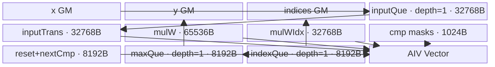
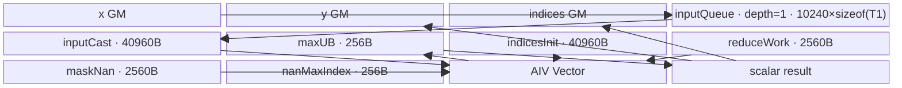

# AdaptiveMaxPool3d A2/A3 ACLNN 算子知识

## 算子速览

| 项目 | 内容 |
|---|---|
| 实际入口 | `aclnnAdaptiveMaxPool3dGetWorkspaceSize` + `aclnnAdaptiveMaxPool3d`，公开 ACLNN 两段式接口，无更高版本后缀。 |
| 计算语义 | 对 N/C 不变的每个输出 `(od,oh,ow)`，在三轴自适应区间内取最大值，并输出该值在单个 D×H×W 平面内的扁平索引。 |
| 输入输出 | `self`: 4D CDHW 或 5D NCDHW，FP32/FP16/BF16；`outputSize`: A2/A3 必须含 3 个正整数；`outputOut` 同输入 dtype；`indicesOut` 为 INT32。 |
| 执行类型 | 四条 Route 均为单 Kernel `AIV_VECTOR`；整除分支调用 `MaxPool3DWithArgmaxV2` 的 Vector body，非整除分支调用 `AdaptiveMaxPool3d` 的 Vector body。 |
| Kernel 路线 | R-001 整除/NoExpandIndices；R-002 整除/BigKernel；R-003 非整除/Adaptive small-pool；R-004 非整除/Adaptive big-pool。 |
| 核心资源 | GM + AIV UB；R-001 为 Host 计算的双份 Queue/TBuf 字节账，R-002/R-004 为固定 `maxCount=10240` 的 Queue/TBuf，R-003 固定 185 KiB UB；核心 Kernel 不消费用户 workspace。 |
| 来源闭包 | `source_closed`：公开 ACLNN→分支 selector→两个算子 Host/Tiling/POD→两个 entry/router→四个可达 body/helper→A2/A3 binary config/CMake 均闭合。 |
| 验证状态 | 已完成源码闭包检查；本次知识提取未执行编译、真机、数值或性能测试。 |

## 接口与语义

### 计算语义

令输入空间维为 `(D,H,W)`、输出空间维为 `(Do,Ho,Wo)`。对输出坐标 `(od,oh,ow)`：

```text
d0 = floor(od * D / Do), d1 = ceil((od + 1) * D / Do)
h0 = floor(oh * H / Ho), h1 = ceil((oh + 1) * H / Ho)
w0 = floor(ow * W / Wo), w1 = ceil((ow + 1) * W / Wo)
output[n,c,od,oh,ow] = max self[n,c,d,h,w]
indices[n,c,od,oh,ow] = argmax(d * H * W + h * W + w)
```

区间均按左闭右开理解。Device 用商余分解计算边界，避免直接乘法在部分编译器路径被 32 位截断。比较路线在遇到 NaN 时更新值/索引，因此源码遍历次序下保留最后一个 NaN 的位置；公开文档声明默认确定性。

### 输入、输出与属性

| 参数 | shape/layout | dtype | 约束、默认值与语义 |
|---|---|---|---|
| `self` | 4D CDHW 或 5D NCDHW；storage format 为 NCHW/NCDHW | FP32/FP16/BF16 | 非首维均须 ≥1；`D*H*W <= INT32_MAX`；可非连续，入口先 `Contiguous`。 |
| `outputSize` | A2/A3 长度固定为 3 | `aclIntArray` 元素为 int64 表示 | 三项均 >0，且必须逐项等于两个输出的空间 shape。 |
| `outputOut` | 与 `self` 同 rank，前导 N/C 相同，空间为 `(Do,Ho,Wo)` | 与 `self` 相同 | format 必须与 `self` 一致；可非连续，末尾以 `ViewCopy` 提交。 |
| `indicesOut` | 与 `outputOut` 同 shape | INT32 | A2/A3 明确不支持 INT64；索引相对单个 D×H×W 平面。 |
| `workspaceSize/executor` | 标量/句柄 | N/A | 第一段由 `aclOpExecutor::GetWorkspaceSize` 返回；空输入快速返回 0。 |
| `workspace/workspaceSize/stream` | Device 地址、字节、stream | N/A | 第二段交给 `CommonOpExecutorRun`，同一 executor 中的节点按该 stream 执行。 |

### 入口与版本

公开声明是 `aclnnAdaptiveMaxPool3dGetWorkspaceSize` 与 `aclnnAdaptiveMaxPool3d`。A2 对应 `ASCEND910B/ascend910b`，A3 对应 `ASCEND910_93/ascend910_93`；README、ACLNN 文档、OpDef、binary config 均给出支持，两个平台复用同一 Host/Kernel 源码和三种 dtype binary。固定仓没有同语义的更高版本 ACLNN 入口，因此本卡取无后缀版本。Backward、2D 和其它变体不属于本卡。

## Host/Launcher 执行流程

### 参数校验与前处理

`aclnnAdaptiveMaxPool3dGetWorkspaceSize` 按 `CheckNotNull`→`CheckInputOutputDims`→`CheckDtypeValid`→`CheckFormat`→`CheckOutShape`→`checkDtypeSame`→`checkPlatformValid`→`checkExceptiveValue` 的顺序失败即返回。A2/A3 仅接受 910B/910_93、FP32/FP16/BF16、INT32 indices、长度 3 的正 `outputSize`，并检查 `D*H*W <= INT32_MAX`。仅允许首维形成空 tensor；它在校验后返回空 executor 路线和 `workspaceSize=0`，A2/A3 的零输出尺寸会在此前校验失败。

非空输入先 `l0op::Contiguous`。4D CDHW 以 `UnsqueezeNd(dim=0)` 与 `ReFormat(NCDHW)` 建立 5D view；5D 直接继续。核心输出后，4D 结果经 `SqueezeNd(dim=0)`/`ReFormat` 恢复，5D 整除路线也按目标 format `ReFormat`，最后两个输出分别 `ViewCopy` 到用户 tensor。上述通用节点是 Skill 允许的框架边界。

### 参数、Workspace 与生命周期

Host 把空间整除性作为第一层分发：若 `D%Do==0 && H%Ho==0 && W%Wo==0`，生成 `kernelSize=stride=(D/Do,H/Ho,W/Wo)`、`padding=(0,0,0)`、`dilation=(1,1,1)`、`ceilMode=false`、`dataFormat="NCDHW"` 并加入 `MaxPool3DWithArgmaxV2` launcher；否则加入 `AdaptiveMaxPool3d` launcher。

两种核心 Host/Tiling 基类都向 runtime 申报 16 MiB 系统 workspace。R-002/R-004 entry 取得 `GetUserWorkspace(workspace)` 但 body 没有读写该指针；R-001/R-003 entry 也不消费用户 workspace。ACLNN 返回值是 executor 汇总后的真实大小，可能还包括 `Contiguous/ViewCopy` 等框架节点，固定仓未公开 executor 的逐 slice 聚合布局，调用者必须使用第一段返回值，不能硬编码 16 MiB。executor 在第二段执行完成前持有中间 tensor 与 launcher 参数。

### 启动图与失败传播

```text
aclnnAdaptiveMaxPool3dGetWorkspaceSize
  -> Contiguous / optional 4D->5D view
  -> SelectAdaptiveMaxPool3D
     -> [整除] MaxPool3DWithArgmaxV2 (R-001 或 R-002，单 AIV Kernel)
     -> [非整除] AdaptiveMaxPool3d (R-003 或 R-004，单 AIV Kernel)
  -> optional format/view restore -> ViewCopy(output) -> ViewCopy(indices)
aclnnAdaptiveMaxPool3d
  -> CommonOpExecutorRun(workspace, workspaceSize, executor, stream)
```

| Route | Host 启动函数 | Kernel entry | blockDim | POD | 核心 I/O | workspace |
|---|---|---|---|---|---|---|
| R-001 | `l0op::MaxPool3DWithArgmaxV2` | `max_pool3d_with_argmax_v2` | `coreNums=ceil(totalIdx/blockFactor)` | `MaxPool3DWithArgmaxV2NoExpandIndicesTilingData` | x→y+indices | Host 登记 16 MiB；body 不读 user workspace |
| R-002 | 同上 | 同上 | `totalIdx<coreNum ? totalIdx : coreNum` | `MaxPool3DWithArgmaxV2BigKernelTilingData` | x→y+indices | 同上 |
| R-003 | `l0op::AdaptiveMaxPool3d` | `adaptive_max_pool3d` | `ceil(totalIdx/blockFactor)` | `AdaptiveMaxPool3dSmallPoolTilingData` | x→y+indices | Host 登记 16 MiB；body 不读 user workspace |
| R-004 | 同上 | 同上 | `totalIdx<coreNum ? totalIdx : coreNum` | `AdaptiveMaxPool3dBigPoolTilingData` | x→y+indices | 同上 |

| 边 | offset/extent | dtype/layout | ordering | owner/lifetime | 失败传播 |
|---|---|---|---|---|---|
| contiguous/view→核心 x | executor tensor 全 extent；4D 增加 N=1 view | FP32/FP16/BF16，核心统一 NCDHW | 同 stream 前驱完成后启动 | executor 持有至核心消费 | 任一前处理返回 null 即停止 |
| 核心→y/indices view/copy | 输出全 extent | self dtype + INT32，NCDHW→目标 NCHW/NCDHW | 核心完成后同 stream 消费 | executor 中间 tensor 至 ViewCopy 完成 | 核心/格式恢复/ViewCopy 任一失败即返回错误 |

核心分支互斥，没有 Kernel 间 workspace 边。每个核心节点的 input/output 是 executor 所有的连续 GM tensor，输出后由同一 executor/stream 上的 framework view/copy 节点消费；任一参数分配、launcher 建立、shape 检查或 view/copy 返回空都会立即阻断后续节点并返回对应 ACLNN 错误。

## Route 与参数设计

### 分核与资源计算

- R-001：`ncFactor=min(N*C,(32/inputCastBytes)*8)`，并对 NC 向 16 对齐；Host 从 `(dy,hy,wy)=(1,1,1)` 起计算十个 Queue/TBuf 的总量，在常量 `UB_SIZE=192 KiB-8 KiB-256 B=188160 B` 内按 W→H→D 扩大。`totalIdx=ncOuter*dyOuter*hyOuter*wyOuter`，`blockFactor=ceil(totalIdx/coreNum)`，`coreNums=ceil(totalIdx/blockFactor)`。
- R-002：`totalIdx=N*C*Do*Ho*Wo`，`blockFactor=floor(totalIdx/coreNum)`，`blockTail=totalIdx%coreNum`；若 `blockFactor==0` 则 `coreNums=totalIdx`，否则使用全部 core。每个输出点的窗口再按固定 `maxCount=10240` 元素切段。
- R-003：最大窗口 `k?Max` 逐输出计算；当输出轴 >10000 时用 `ceil(input/output)+1` 保守上界。`ncFactor=256/sizeof(float)=64`，随后由 128 元素窗口上限和 W≤16 推导 `woFactor/hoFactor/doFactor`，最后对 `[NC,Do,Ho,Wo]` 的 UB 块按 `ceil(totalIdx/coreNum)` 分核。
- R-004：分核同 R-002，但窗口由自适应边界逐输出动态得到，并按 10240 元素切段。

### Route 选择

| 顺序 | Route | Key/模板 | 精确选择条件与优先级 | 不适用去向 |
|---:|---|---|---|---|
| 1 | R-001 整除/NoExpandIndices | key `300001`; `MaxPool3DWithArgmaxV2NoExpandIndices<DTYPE_X,T2,PAD_DISABLE>` | `D%Do=H%Ho=W%Wo=0`；MaxPool priority 10；非 RegBase、dilation 全 1，最小 `(dy,hy,wy)=(1,1,1)` 的 `tmpTotalSize<=188160`。本调用 padding 固定 0。 | 最小 UB 块超限时 R-002。 |
| 2 | R-002 整除/BigKernel | `311110/311111/311112` 对 FP32/FP16/BF16 | 同一整除分支；R-001 不 capable；priority 11，非 RegBase 且 dilation 全 1，因此必然承接。 | 固定仓该调用约束下无更低 fallback。 |
| 3 | R-003 非整除/Adaptive small-pool | `320000/321000/322000` | 至少一个余数非 0；Adaptive priority 3；`kDMax*kHMax*align8(kWMax)<128 && kWMax<=16`。 | 不满足时 R-004。 |
| 4 | R-004 非整除/Adaptive big-pool | `310000/311000/312000` | 至少一个余数非 0；R-003 不 capable；priority 4 的 `IsCapable()` 恒真。 | 无更低 fallback。 |

```text
if D%Do==0 && H%Ho==0 && W%Wo==0:
    derive k=stride=(D/Do,H/Ho,W/Wo), pad=0, dilation=1
    if NoExpandIndices::min_ub_total <= 188160: R-001
    else: R-002
else:
    compute kDMax/kHMax/kWMax
    if kDMax*kHMax*align8(kWMax)<128 && kWMax<=16: R-003
    else: R-004
```

### 模板/实现执行矩阵

| Route | key/selector | dtype/shape/platform 完整命中条件 | 执行拓扑与 Kernel 节点 | 实际模板/body | 内存与同步特征 | tail/fallback |
|---|---|---|---|---|---|---|
| R-001 | `300001` | A2/A3；FP32/FP16/BF16；空间全整除；NoExpand UB 最小块可容纳 | 单节点 `max_pool3d_with_argmax_v2` | `MaxPool3DWithArgmaxV2NoExpandIndices<DTYPE_X,DTYPE_X,false>`；BF16 为 `<bfloat16_t,float,false>` | Host 精确给出 10 个 buffer；depth=1；当前块转置后释放输入 Queue，再预取下一块 | NC/D/H/W 各自 factor/tail；MTE stride >UINT32 时显式循环；不 capable→R-002。 |
| R-002 | `311110/311111/311112` | A2/A3；整除；R-001 超 UB | 单节点 `max_pool3d_with_argmax_v2` | `MaxPool3DWithArgmaxBigKernel<float,float,false,uint16_t>` / `<half,half,...>` / `<bfloat16_t,float,...>` | 固定 10240 元素分段 ReduceMax；V↔S、V↔MTE3、S↔MTE3 event | former/tail core；DHW/HW/W 三种连续性搬运；大窗口继续按 10240 分段。 |
| R-003 | `320000/321000/322000` | A2/A3；非整除；small-pool 谓词成立 | 单节点 `adaptive_max_pool3d` | `AdaptiveMaxPool3dSmallPool<float/half/bfloat16_t>` | 固定 185 KiB UB；输入转置后按 W→H→D 三阶段归约；Queue 与 PipeBarrier | NC/D/H/W 块尾；预取下一 UB 块；不 capable→R-004。 |
| R-004 | `310000/311000/312000` | A2/A3；非整除；small-pool 不成立 | 单节点 `adaptive_max_pool3d` | `AdaptiveMaxPool3dBigPool<float,float>` / `<half,half>` / `<bfloat16_t,float>` | 固定 10240 元素分段 ReduceMax；同步同 R-002 | former/tail core；窗口按自适应边界；大窗口分段，无后续 fallback。 |

### 隐藏性能 Guard

| Guard | Host/Tiling 条件 | Device/资源原因 | 影响 Route | 不满足时去向 | 源码符号 |
|---|---|---|---|---|---|
| ACLNN 整除 specialization | 三个 `%` 均为 0 | 自适应窗口退化为无 padding、stride=kernel 的普通 MaxPool，可复用专用 body | R-001/R-002 | 任一非 0→R-003/R-004 | `aclnn_adaptive_max_pool3d.cpp::SelectAdaptiveMaxPool3D` |
| NoExpand UB gate | 初始 `tmpTotalSize<=188160` | 即使单个输出块也必须同时容纳双份 input/max/indices/temp/mask | R-001 | R-002 | `MaxPool3DWithArgmaxV2NoExpandIndicesTiling::IsCapable` |
| NoExpand 向量 stride | `sw*curNcFactorAlign/(32/sizeof(T2))<=255` | repeat stride 为 uint8；超限时 `vecRepeatTimes=1` 并循环 W 输出 | R-001 | Route 内 fallback | `PoolMaxAndIndices` |
| NoExpand MTE stride | 字节 stride `<=UINT32_MAX` | `DataCopyExtParams` GM stride 上限 | R-001 | Route 内逐块循环 | `CopyInput*Repeat`、`Copy*Out*Repeat` |
| Adaptive small 窗口 | `kDMax*kHMax*align8(kWMax)<128 && kWMax<=16` | 固定 UB 与 W/H/D 向量 repeat/stride 的容量边界 | R-003 | R-004 | `AdaptiveMaxPool3dSmallPoolTiling::IsCapable` |
| Adaptive small factor | `doFactor,hoFactor,woFactor>0` | 后续 outer/tail 与 UB 地址依赖非零 factor | R-003 | Tiling 失败，不回退 | `AdaptiveMaxPool3dSmallPoolTiling::DoOpTiling` |
| BF16 编译 guard | 非 `__NPU_ARCH__==3003/3113` | router 在这两个架构不实例化 BF16；A2/A3 binary config 均包含 BF16 | 全部 BF16 Route | 不支持架构无输出 | 两个 Kernel entry 的 `#if` guard |
| 大窗口 DMA 对齐 | W/HW/DHW 连续块向 `32/sizeof(T)` 对齐，padding=`-inf` | ReduceMax 不得让补齐 lane 赢得最大值 | R-002/R-004 | Route 内切片 | `dhwCopyInput/hwCopyInput/wCopyInput` |

### POD/ABI

下表的所有标量均按声明顺序序列化；仓内未包含 `register/tilingdata_base.h` 对 `BEGIN_TILING_DATA_DEF` 的展开，因此 `sizeof/alignof/offsetof` 固定仓不可见，不能据字段类型臆测 ABI 偏移。

| 结构 | 字段 | 类型/位宽 | ABI 布局 | 单位 | Host/launcher producer | Device consumer | 边界 |
|---|---|---|---|---|---|---|---|
| `AdaptiveMaxPool3dSmallPoolTilingData` | `N` | uint64/64 | 固定仓不可见 | 元素维 | `set_N(input_.N)` | `InitTiling→poolVars.N` | ≥1 |
| 同上 | `C` | uint64/64 | 同上 | 元素维 | `set_C(input_.C)` | `poolVars.C` | ≥1 |
| 同上 | `Di` | uint64/64 | 同上 | 元素维 | `set_Di(input_.Di)` | `poolVars.Di` | ≥1 |
| 同上 | `Hi` | uint64/64 | 同上 | 元素维 | `set_Hi(input_.Hi)` | `poolVars.Hi` | ≥1 |
| 同上 | `Wi` | uint64/64 | 同上 | 元素维 | `set_Wi(input_.Wi)` | `poolVars.Wi` | ≥1 |
| 同上 | `Do` | uint64/64 | 同上 | 元素维 | `set_Do(input_.Do)` | `poolVars.Do` | >0 |
| 同上 | `Ho` | uint64/64 | 同上 | 元素维 | `set_Ho(input_.Ho)` | `poolVars.Ho` | >0 |
| 同上 | `Wo` | uint64/64 | 同上 | 元素维 | `set_Wo(input_.Wo)` | `poolVars.Wo` | >0 |
| 同上 | `coreNums` | uint64/64 | 同上 | core | `set_coreNums(input_.coreNum)` | 未读取 | 冗余字段 |
| 同上 | `useCoreNum` | uint64/64 | 同上 | core | `set_useCoreNum(calInfo_.useCoreNum)` | `InitTiling`/越界保护 | 同时为 blockDim |
| 同上 | `totalIdx` | uint64/64 | 同上 | UB 块 | `ncOuter*doOuter*hoOuter*woOuter` | `InitPoolVars` | >0 |
| 同上 | `blockFactor` | uint64/64 | 同上 | UB 块/core | `ceil(totalIdx/coreNum)` | `Init` | 非尾核上限 |
| 同上 | `blockTail` | uint64/64 | 同上 | UB 块 | `totalIdx-(useCoreNum-1)*blockFactor` | 最后一核 | >0 |
| 同上 | `ncFactor` | uint64/64 | 同上 | NC 元素 | `64` | `CalcBlockVar/地址` | 尾块读 `ncTail` |
| 同上 | `doFactor` | uint64/64 | 同上 | 输出 D | UB 公式推导 | `CalcBlockVar` | >0 |
| 同上 | `hoFactor` | uint64/64 | 同上 | 输出 H | UB 公式推导 | `CalcBlockVar` | >0 |
| 同上 | `woFactor` | uint64/64 | 同上 | 输出 W | UB 公式推导 | `CalcBlockVar` | >0 |
| 同上 | `ncOuter` | uint64/64 | 同上 | 块数 | `ceil(N*C/ncFactor)` | `CalcBlockVar` | ≥1 |
| 同上 | `doOuter` | uint64/64 | 同上 | 块数 | `ceil(Do/doFactor)` | `CalcBlockVar` | ≥1 |
| 同上 | `hoOuter` | uint64/64 | 同上 | 块数 | `ceil(Ho/hoFactor)` | `CalcBlockVar` | ≥1 |
| 同上 | `woOuter` | uint64/64 | 同上 | 块数 | `ceil(Wo/woFactor)` | `CalcBlockVar` | ≥1 |
| 同上 | `ncTail` | uint64/64 | 同上 | NC 元素 | `N*C-(ncOuter-1)*ncFactor` | 尾 NC 块 | 1..factor |
| 同上 | `doTail` | uint64/64 | 同上 | 输出 D | `Do-(doOuter-1)*doFactor` | 尾 D 块 | 1..factor |
| 同上 | `hoTail` | uint64/64 | 同上 | 输出 H | `Ho-(hoOuter-1)*hoFactor` | 尾 H 块 | 1..factor |
| 同上 | `woTail` | uint64/64 | 同上 | 输出 W | `Wo-(woOuter-1)*woFactor` | 尾 W 块 | 1..factor |
| `AdaptiveMaxPool3dBigPoolTilingData` | `N` | uint64/64 | 固定仓不可见 | 维 | `set_N(input_.N)` | 未单独读取 | `N*C` 已反映在 totalIdx |
| 同上 | `C` | uint64/64 | 同上 | 维 | `set_C(input_.C)` | 未单独读取 | 同上 |
| 同上 | `Di` | uint64/64 | 同上 | 维 | `set_Di(input_.Di)` | `Init→d` | ≥1 |
| 同上 | `Hi` | uint64/64 | 同上 | 维 | `set_Hi(input_.Hi)` | `Init→h` | ≥1 |
| 同上 | `Wi` | uint64/64 | 同上 | 维 | `set_Wi(input_.Wi)` | `Init→w` | ≥1 |
| 同上 | `Do` | uint64/64 | 同上 | 维 | `set_Do(input_.Do)` | `Init→dout` | >0 |
| 同上 | `Ho` | uint64/64 | 同上 | 维 | `set_Ho(input_.Ho)` | `Init→ho` | >0 |
| 同上 | `Wo` | uint64/64 | 同上 | 维 | `set_Wo(input_.Wo)` | `Init→wo` | >0 |
| 同上 | `coreNums` | uint64/64 | 同上 | core | `set_coreNums(input_.coreNum)` | 未读取 | blockDim 使用 `useCoreNum` |
| 同上 | `useCoreNum` | uint64/64 | 同上 | core | `totalIdx` 或 `coreNum` | 未读取 | 作为 blockDim |
| 同上 | `totalIdx` | uint64/64 | 同上 | 输出点 | `N*C*Do*Ho*Wo` | `Init/Process` | >0 |
| 同上 | `blockFactor` | uint64/64 | 同上 | 输出点/core | `floor(totalIdx/coreNum)` | `Process` | 可为 0 |
| 同上 | `blockTail` | uint64/64 | 同上 | core 数 | `totalIdx%coreNum` | `Process` | 前 `blockTail` 核多 1 点 |
| `MaxPool3DWithArgmaxV2BigKernelTilingData` | `inputShapes[3]` | uint32×3 | 固定仓不可见 | D/H/W 元素 | 由 `inputData.inputShape` 窄化 | `Init→d/h/w` | ACLNN 已限制 DHW 乘积 INT32；单维仍显式窄化 |
| 同上 | `outShapes[3]` | uint32×3 | 同上 | D/H/W 元素 | 由 `inputData.outShape` 窄化 | `Init→dout/ho/wo` | 显式 uint32 窄化 |
| 同上 | `kD` | uint32/32 | 同上 | 元素 | `D/Do` | `Init→kd` | >0 |
| 同上 | `kW` | uint32/32 | 同上 | 元素 | `W/Wo` | `Init→kw` | >0 |
| 同上 | `kH` | uint32/32 | 同上 | 元素 | `H/Ho` | `Init→kh` | >0 |
| 同上 | `sD` | uint32/32 | 同上 | 元素 | `kD` | `Init→sd` | 等于 kD |
| 同上 | `sW` | uint32/32 | 同上 | 元素 | `kW` | `Init→sw` | 等于 kW |
| 同上 | `sH` | uint32/32 | 同上 | 元素 | `kH` | `Init→sh` | 等于 kH |
| 同上 | `pD` | uint32/32 | 同上 | 元素 | `0` | `Init→pd` | 固定 0 |
| 同上 | `pW` | uint32/32 | 同上 | 元素 | `0` | `Init→pw` | 固定 0 |
| 同上 | `pH` | uint32/32 | 同上 | 元素 | `0` | `Init→ph` | 固定 0 |
| 同上 | `dD` | uint32/32 | 同上 | 间隔 | `1` | body 未读 | 固定 1 |
| 同上 | `dW` | uint32/32 | 同上 | 间隔 | `1` | body 未读 | 固定 1 |
| 同上 | `dH` | uint32/32 | 同上 | 间隔 | `1` | body 未读 | 固定 1 |
| 同上 | `blockFactor` | uint64/64 | 同上 | 输出点/core | `floor(totalIdx/coreNum)` | `Process` | 可为 0 |
| 同上 | `blockTail` | uint64/64 | 同上 | core 数 | `totalIdx%coreNum` | `Process` | former core 数 |
| 同上 | `totalIdx` | uint64/64 | 同上 | 输出点 | `batches*Do*Ho*Wo` | `Init` | >0 |
| 同上 | `coreNums` | uint64/64 | 同上 | core | `min(totalIdx,coreNum)` | 未读取 | 作为 blockDim |
| `MaxPool3DWithArgmaxV2NoExpandIndicesTilingData` | `nc` | uint64/64 | 固定仓不可见 | NC | `inputData.batches=N*C` | `Init` | >0 |
| 同上 | `dx` | uint64/64 | 同上 | D | 输入 D | `Init`/地址 | >0 |
| 同上 | `hx` | uint64/64 | 同上 | H | 输入 H | `Init`/地址 | >0 |
| 同上 | `wx` | uint64/64 | 同上 | W | 输入 W | `Init`/地址 | >0 |
| 同上 | `kd` | uint64/64 | 同上 | 元素 | `D/Do` | `PoolMaxAndIndices` | >0 |
| 同上 | `kh` | uint64/64 | 同上 | 元素 | `H/Ho` | `PoolMaxAndIndices` | >0 |
| 同上 | `kw` | uint64/64 | 同上 | 元素 | `W/Wo` | `PoolMaxAndIndices` | >0 |
| 同上 | `sd` | uint64/64 | 同上 | 元素 | `kd` | 输入/输出地址 | 等于 kd |
| 同上 | `sh` | uint64/64 | 同上 | 元素 | `kh` | 输入/输出地址 | 等于 kh |
| 同上 | `sw` | uint64/64 | 同上 | 元素 | `kw` | 输入/输出地址 | 等于 kw |
| 同上 | `pf` | uint64/64 | 同上 | 元素 | `0` | padding 分支 inactive | 固定 0 |
| 同上 | `pb` | uint64/64 | 同上 | 元素 | `0` | padding 分支 inactive | 固定 0 |
| 同上 | `pl` | uint64/64 | 同上 | 元素 | `0` | padding 分支 inactive | 固定 0 |
| 同上 | `pr` | uint64/64 | 同上 | 元素 | `0` | padding 分支 inactive | 固定 0 |
| 同上 | `pt` | uint64/64 | 同上 | 元素 | `0` | padding 分支 inactive | 固定 0 |
| 同上 | `pd` | uint64/64 | 同上 | 元素 | `0` | padding 分支 inactive | 固定 0 |
| 同上 | `dy` | uint64/64 | 同上 | 输出 D | `Do` | `Init` | >0 |
| 同上 | `hy` | uint64/64 | 同上 | 输出 H | `Ho` | `Init` | >0 |
| 同上 | `wy` | uint64/64 | 同上 | 输出 W | `Wo` | `Init` | >0 |
| 同上 | `ncFactor` | uint64/64 | 同上 | NC | `min(nc,ncMaxFactor)` | 当前块 | 64/128 上限取决于计算 dtype |
| 同上 | `ncTail` | uint64/64 | 同上 | NC | `nc%factor`，0 改 factor | 尾块 | 1..factor |
| 同上 | `ncOuter` | uint64/64 | 同上 | 块数 | `ceil(nc/factor)` | 块解码 | ≥1 |
| 同上 | `dyFactor` | uint64/64 | 同上 | 输出 D | UB 搜索 | 当前/下一块 | ≥1 |
| 同上 | `dyTail` | uint64/64 | 同上 | 输出 D | `dy%factor`，0 改 factor | 尾块 | 1..factor |
| 同上 | `dyOuter` | uint64/64 | 同上 | 块数 | `ceil(dy/factor)` | 块解码 | ≥1 |
| 同上 | `hyFactor` | uint64/64 | 同上 | 输出 H | UB 搜索 | 当前/下一块 | ≥1 |
| 同上 | `hyTail` | uint64/64 | 同上 | 输出 H | `hy%factor`，0 改 factor | 尾块 | 1..factor |
| 同上 | `hyOuter` | uint64/64 | 同上 | 块数 | `ceil(hy/factor)` | 块解码 | ≥1 |
| 同上 | `wyFactor` | uint64/64 | 同上 | 输出 W | UB 搜索优先扩大 W | 当前/下一块 | ≥1 |
| 同上 | `wyTail` | uint64/64 | 同上 | 输出 W | `wy%factor`，0 改 factor | 尾块 | 1..factor |
| 同上 | `wyOuter` | uint64/64 | 同上 | 块数 | `ceil(wy/factor)` | 块解码 | ≥1 |
| 同上 | `blockFactor` | uint64/64 | 同上 | UB 块/core | `ceil(totalIdx/coreNum)` | `Process` | >0 |
| 同上 | `blockTail` | uint64/64 | 同上 | UB 块 | `totalIdx%blockFactor`，0 改 factor | body 未读 | 冗余 |
| 同上 | `totalIdx` | uint64/64 | 同上 | UB 块 | 四个 outer 乘积 | `Process` | >0 |
| 同上 | `coreNums` | uint64/64 | 同上 | core | `ceil(totalIdx/blockFactor)` | 越界保护 | 同时为 blockDim |
| 同上 | `inputBufferSize` | uint64/64 | 同上 | 字节 | `align256(ncAlign*dxF*hxF*wxAlign*inputCastBytes)` | input Queue/TBuf | 两份计入 UB |
| 同上 | `outputMaxBufferSize` | uint64/64 | 同上 | 字节 | `align256(ncAlign*dyF*hyF*wyAlign*inputCastBytes)` | max Queue/TBuf | 两份计入 UB |
| 同上 | `outputIndiceBufferSize` | uint64/64 | 同上 | 字节 | `align256(ncMax*dyF*hyF*wyAlign*4)` | indices Queue/TBuf | 两份计入 UB |
| 同上 | `indiceTempBufferSize` | uint64/64 | 同上 | 字节 | `align256(ncMax*wyAlign*4)` | update/template TBuf | 两份计入 UB |
| 同上 | `maskBufferSize` | uint64/64 | 同上 | 字节 | `align256(align32(ncMax/16*2)*wyAlign)` | gt/ge TBuf | 两份计入 UB |

### Route 源码闭包

| Route | Key/selector | Host/Tiling producer | POD/参数 | Kernel entry/router 节点 | Kernel body/直接依赖 | 构建接线 |
|---|---|---|---|---|---|---|
| R-001 | ACLNN 整除 + MaxPool priority 10→`300001` | `SelectAdaptiveMaxPool3D`；`MaxPool3DWithArgmaxV2NoExpandIndicesTiling::{IsCapable,DoUBTiling,DoBlockTiling}` | `MaxPool3DWithArgmaxV2NoExpandIndicesTilingData` | `max_pool3d_with_argmax_v2` key 300001 | `MaxPool3DWithArgmaxV2NoExpandIndices::{Process,BaseCompute,CopyInput,Transpose,PoolMaxAndIndices,CopyMaxOut,CopyIndicesOut}` | adaptive CMake dependency `max_pool3d_with_argmax_v2` + 两算子 ascend910b/ascend910_93 binary config |
| R-002 | ACLNN 整除 + priority 11→`311110/1/2` | `MaxPool3DWithArgmaxV2BigKernelTiling` | `MaxPool3DWithArgmaxV2BigKernelTilingData` | `max_pool3d_with_argmax_v2` keys 311110/1/2 | `MaxPool3DWithArgmaxBigKernel::{Process,Prepare,BaseCompute,*CopyInput,Compute,*ContinueProcess,Copy*Out}` | 同上 |
| R-003 | ACLNN 非整除 + Adaptive priority 3→`320000/1/2` | `AdaptiveMaxPool3dSmallPoolTiling` | `AdaptiveMaxPool3dSmallPoolTilingData` | `adaptive_max_pool3d` keys 320000/1/2 | `AdaptiveMaxPool3dSmallPool` + `Pool3dMemCommon` helper | adaptive binary config + `pool_3d_common` dependency |
| R-004 | ACLNN 非整除 + Adaptive priority 4→`310000/1/2` | `AdaptiveMaxPool3dBigPoolTiling` | `AdaptiveMaxPool3dBigPoolTilingData` | `adaptive_max_pool3d` keys 310000/1/2 | `AdaptiveMaxPool3dBigPool::{Process,Prepare,BaseCompute,*CopyInput,Compute,*ContinueProcess,Copy*Out}` | adaptive binary config/CMake |

## Kernel 实现

### 公共执行流程

四条公开可达 Route 均为单 AIV Kernel。入口按 tiling key 与输入 dtype 实例化 body；body 从 GM 取连续块到 UB，完成池化最大值及扁平化 `D*H*W` 索引，再分别回写值和 `int32` 索引。R-001/R-003 以输出块为粒度进行多级转置和向量归约，R-002/R-004 以单个输出点为粒度处理其输入窗口；四条 Route 都在首块处理前预取或建立当前块状态，并在循环中把搬运与计算交错。

### Route R-001：整除窗口 NoExpandIndices 向量路径

#### 适用条件

##### 选择证据

| 层级 | 文件 | 符号 | 源码谓词/参数 | 结果/下一跳 |
|---|---|---|---|---|
| ACLNN | `pooling/adaptive_max_pool3d/op_api/aclnn_adaptive_max_pool3d.cpp` | `SelectAdaptiveMaxPool3D` | `D%Do==0 && H%Ho==0 && W%Wo==0` | 调用 `DoMaxPool3D`；否则进入 Adaptive 路径 |
| Tiling | `pooling/max_pool3d_with_argmax_v2/op_host/max_pool3d_with_argmax_v2_no_expand_indices_tiling.cpp` | `IsCapable` | 非 RegBase；shape/参数合法；dilation 全 1；最小 tile 的 `tmpTotalSize<=188160` | priority 10 命中；失败到 priority 11 |
| Router | `pooling/max_pool3d_with_argmax_v2/op_kernel/max_pool3d_with_argmax_v2.cpp` | `max_pool3d_with_argmax_v2` | tiling key `300001` | 实例化 NoExpand body |

#### Device 数据流

##### 函数级调用链

```text
max_pool3d_with_argmax_v2(key=300001)
└─ MaxPool3DWithArgmaxV2NoExpandIndices::Process
   ├─ Init
   ├─ CopyInput → TransposeInput
   ├─ BaseCompute
   │  ├─ CopyInput(next) → TransposeInput(next)
   │  └─ PoolMaxAndIndices → UpdateMaxWithMask
   ├─ TransposeMax / TransposeIndices
   └─ CopyMaxOut / CopyIndicesOut
```

##### 源码等价伪码

```cpp
for (block = core_begin; block < core_end; ++block) {
  Decode(block, ncIdx, dIdx, hIdx, wIdx);
  CopyInput(current);             // GM→VECIN
  TransposeInput(current);        // [NC,D,H,W]→按 NC 向量化布局
  CopyInput(next);                // 双缓冲预取
  max = -inf; index = 0;
  for (kd, kh, kw) {
    candidate = input[kd][kh][kw];
    mask = (candidate > max) || isnan(candidate);
    max = select(mask, candidate, max);
    index = select(mask, flattened_dhw, index);
  }
  TransposeMaxAndIndices();
  CopyMaxOut(); CopyIndicesOut(); // VECOUT→GM
}
```

#### 内存与数据搬运

##### 资源与搬运表

| 层级/缓冲区 | offset/地址公式 | extent/容量公式 | dtype/layout | producer | consumer | owner/lifetime | 对齐/复用 |
|---|---|---|---|---|---|---|---|
| GM `x` | `nc/dy/hy/wy` 解码后按 `sd/sh/sw` 求输入块首址 | 当前 `nc×dxF×hxF×wxF` 有效域 | T1/NCDHW | ACLNN 输入 | `CopyInput` | 用户/整次调用 | 非连续 stride 过大时逐段搬运 |
| VECIN `inputQueue` | Queue 槽 | `inputBufferSize` | T2/GM 块布局；BF16 已转 FP32 | `CopyInput` | `TransposeInput` | Kernel/当前或下一 tile | depth=1；与 input TBuf 各一份 |
| UB `inputBuffer` | TBuf 基址 | `inputBufferSize` | T2/NC 向量布局 | `TransposeInput` | `PoolMaxAndIndices` | Kernel/当前 tile | 256B 字节账；BF16 cast FP32 |
| UB/VECOUT `max` | tile-local | 各 `outputMaxBufferSize` | T2/转置前后布局 | `PoolMaxAndIndices` | `TransposeMax`/`CopyMaxOut` | Kernel/当前 tile | TBuf+Queue 各一份，Queue depth=1 |
| UB/VECOUT `indices` | tile-local | 各 `outputIndiceBufferSize` | int32/转置前后布局 | `UpdateMaxWithMask` | `TransposeIndices`/`CopyIndicesOut` | Kernel/当前 tile | TBuf+Queue 各一份，Queue depth=1 |
| UB `update/template` | tile-local | 各 `indiceTempBufferSize` | int32/NC×W | body 初始化/候选索引 | `UpdateMaxWithMask` | Kernel/归约期 | 两个 TBuf，逐 W/H/D 复用 |
| UB `gt/ge` | tile-local | 各 `maskBufferSize` | uint8 bit mask | `Compare`/NaN 检测 | `Select` | Kernel/单次比较 | 两个 TBuf，逐比较覆盖 |
| GM `y/indices` | 输出 tile 解码地址 | 当前有效输出 tile | T1 + int32/NCDHW | `CopyMaxOut`/`CopyIndicesOut` | 用户输出 | 用户/整次调用 | 尾块仅写有效域 |

##### 分层内存布局

```mermaid
block-beta
  columns 4
  block:GM:4
    X["x GM"] Y["y GM"] I["indices GM"] E[""]
  end
  block:UB:4
    IQ["inputQueue · depth=1 · inputBufferSize"] IT["input TBuf · inputBufferSize"] MQ["maxQueue · depth=1 · outputMaxBufferSize"] MT["max TBuf · outputMaxBufferSize"]
    OQ["indexQueue · depth=1 · outputIndiceBufferSize"] OT["index TBuf · outputIndiceBufferSize"] UP["update+template · 2×indiceTempBufferSize"] MK["gt+ge · 2×maskBufferSize"]
  end
  V["AIV Vector"]
  X --> IQ
  IQ --> IT
  IT --> V
  UP --> V
  MK --> V
  V --> MT
  V --> OT
  MT --> MQ
  OT --> OQ
  MQ --> Y
  OQ --> I
```

##### 字节账与复用顺序

```text
UB_total = 2 × (inputBufferSize + outputMaxBufferSize
             + outputIndiceBufferSize + indiceTempBufferSize + maskBufferSize)
UB_limit = 192 KiB - 8 KiB - 256 B = 188160 B
```

| 复用子区 | 写入者 | 读取者/消费点 | 下一次覆盖 | 同步或释放依据 | 安全条件 |
|---|---|---|---|---|---|
| inputQueue | `CopyInput` | `TransposeInput` | 下一 tile 预取 | `DeQue/FreeTensor` | 完成本 tile 转置后释放 |
| input TBuf | `TransposeInput` | `PoolMaxAndIndices` | 下一 tile 转置 | Vector 执行顺序/pipe | 当前归约读完 |
| max/index TBuf | `PoolMaxAndIndices` | 输出转置 | 下一 tile 归约 | Vector 顺序 | 转置消费完成 |
| update/template + gt/ge | 索引初始化/Compare | `UpdateMaxWithMask` | 下一候选窗口点 | Vector 顺序 | 值与索引使用同一 mask |
| max/index Queue | 输出转置 | `Copy*Out` | 下一 tile 输出 | `DeQue/FreeTensor` | MTE3 回写完成 |

#### 同步、精度与尾块

##### 同步与数值边界表

| 阶段 | primitive/机制 | producer | consumer/等待点 | 保护对象 | 精度/尾块 |
|---|---|---|---|---|---|
| GM→Queue | `EnQue/DeQue` | `CopyInput` | `TransposeInput` | inputQueue | 当前有效 NC/D/H/W；MTE stride 超限逐段搬运 |
| 转置→归约 | Queue release + pipe 顺序 | `TransposeInput` | `PoolMaxAndIndices` | input TBuf | BF16→FP32；repeat stride>255 按 W 循环 |
| 值/索引更新 | `Compare`+`Select` | candidate 与 max | `UpdateMaxWithMask` | max/index TBuf | GT mask 并入 `candidate!=candidate` NaN mask |
| 输出 | VECOUT Queue | 输出转置 | `Copy*Out` 后 FreeTensor | max/index Queue | factor/tail 限制有效域；BF16 `CAST_ROUND` |
| core guard | 入口判断 | blockIdx | `Process` | 全部 UB | `blockIdx>=coreNums` 直接退出；padding 固定 0 |

#### 关键实现

##### 符号证据表

| 阶段 | 文件 | 符号/模板实例 | 实现事实 |
|---|---|---|---|
| Host/Tiling producer | `pooling/max_pool3d_with_argmax_v2/op_host/max_pool3d_with_argmax_v2_no_expand_indices_tiling.cpp` | `GetUBSize,DoUBTiling,DoBlockTiling` | 精确 UB 字节账、W→H→D tile 搜索和 core 切分 |
| Kernel entry/router | `pooling/max_pool3d_with_argmax_v2/op_kernel/max_pool3d_with_argmax_v2.cpp` | key `300001` | dtype 对应 NoExpand 模板；BF16 的 T2 为 float |
| Device body/helper | `pooling/max_pool3d_with_argmax_v2/op_kernel/max_pool3d_with_argmax_v2_no_expand_indices.h` | `Process,BaseCompute,PoolMaxAndIndices,UpdateMaxWithMask` | 双缓冲、转置、值/索引联合更新与尾块 |

### Route R-002：整除窗口 BigKernel 向量路径

#### 适用条件

##### 选择证据

| 层级 | 文件 | 符号 | 源码谓词/参数 | 结果/下一跳 |
|---|---|---|---|---|
| ACLNN | `pooling/adaptive_max_pool3d/op_api/aclnn_adaptive_max_pool3d.cpp` | `SelectAdaptiveMaxPool3D` | 三维整除 | 进入 MaxPool3DWithArgmaxV2 |
| Tiling | `pooling/max_pool3d_with_argmax_v2/op_host/max_pool3d_with_argmax_v2_tiling_bigkernel.cpp` | `IsCapable` | priority 10 失败；非 RegBase；dilation 三维均为 1 | priority 11 命中 |
| Router | `pooling/max_pool3d_with_argmax_v2/op_kernel/max_pool3d_with_argmax_v2.cpp` | `max_pool3d_with_argmax_v2` | dtype FP32/FP16/BF16 对应 key `311110/311111/311112` | 实例化 BigKernel body |

#### Device 数据流

##### 函数级调用链

```text
max_pool3d_with_argmax_v2(key=311110/1/2)
└─ MaxPool3DWithArgmaxBigKernel::Process
   ├─ Init
   ├─ Prepare(outputIndex)
   └─ BaseCompute
      ├─ CopyInput / CopyInputHW / CopyInputW
      ├─ Compute → ReduceMax + index restoration
      ├─ ContinueProcess (window > 10240)
      └─ CopyMaxOut / CopyIndicesOut
```

##### 源码等价伪码

```cpp
for (outputIndex : this_core_outputs) {
  Prepare(outputIndex); // 整除路径下 start=output*kernel, len=kernel
  max = -inf; index = 0;
  for (segment : Split(window, 10240)) {
    CopyContiguousWindow(segment); // D/H/W 三种连续度选择搬运函数
    PadTailWithNegInf();
    localMax, localIndex = ReduceMax(segment);
    HandleNaNAndRestoreFlattenedIndex();
    UpdateGlobalMax(localMax, localIndex);
  }
  CopyMaxOut(); CopyIndicesOut();
}
```

#### 内存与数据搬运

##### 资源与搬运表

| 层级/缓冲区 | offset/地址公式 | extent/容量公式 | dtype/layout | producer | consumer | owner/lifetime | 对齐/复用 |
|---|---|---|---|---|---|---|---|
| GM `x` | `n,c` base + `startD*H*W+startH*W+startW` | 当前窗口/分段 | T1/NCDHW | ACLNN 输入 | `CopyInput*` | 用户/整次调用 | 按 DHW/HW/W 连续性选搬运 |
| VECIN `inputQueue` | Queue 槽 | FP32 40960 B；FP16/BF16 20480 B | T1/连续段 | `CopyInput*` | `Compute` | Kernel/单段 | depth=1；≤10240 元素 |
| UB `inputCast` | TBuf 基址 | 40960 B | FP32 | BF16 cast 或 NaN 索引临时值 | BF16 `ReduceMax` 或 `GetIndexWithLastNan` | Kernel/单段 | FP16/FP32 正常归约不以此为输入；各段覆盖 |
| UB `maxUB` | TBuf 基址 | 256 B | FP32 scalar/vector | `Compute/UpdateMax` | 跨段合并/回写 | Kernel/单输出点 | 跨段保留 |
| UB `indicesInit` | TBuf 基址 | 40960 B | int32 | 索引初始化 | ReduceMax/RestoreIndex | Kernel/单段 | 各段覆盖 |
| UB `reduceWork` | TBuf 基址 | 2560 B | FP32 | ReduceMax | ReduceMax | Kernel/单段 | 工作区复用 |
| UB `maskNan` | TBuf 基址 | 2560 B | bit mask | NaN 比较 | NaN 索引选择 | Kernel/单段 | 与输入段复用 |
| UB `nanMaxIndex` | TBuf 基址 | 256 B | int32 | NaN 索引归约 | `UpdateMax` | Kernel/单段 | 跨段更新前消费 |
| GM `y/indices` | 当前输出线性 index | 1 value + 1 int32 | T1 + int32 | `CopyMaxOut/CopyIndicesOut` | 用户输出 | 用户/整次调用 | 每输出点一次提交 |

##### 分层内存布局


##### 字节账与复用顺序

```text
FP32 UB = 40960 + 40960 + 256 + 40960 + 2560 + 2560 + 256 = 128512 B
FP16/BF16 UB = 20480 + 40960 + 256 + 40960 + 2560 + 2560 + 256 = 108032 B
```

| 复用子区 | 写入者 | 读取者/消费点 | 下一次覆盖 | 同步或释放依据 | 安全条件 |
|---|---|---|---|---|---|
| inputQueue | `CopyInput*` | `Compute` | 下一 segment | Queue `DeQue/FreeTensor` | 本段 cast/归约已取数 |
| inputCast/indicesInit | BF16 cast/NaN 索引临时值/索引初始化 | BF16 `ReduceMax`/NaN 索引恢复 | 下一 segment | Vector 顺序 | 局部值与局部 index 已形成 |
| reduceWork/maskNan/nanMaxIndex | `Compute` | 局部归约/NaN 选择 | 下一 segment | Vector/event 顺序 | `UpdateMax` 已消费局部结果 |
| maxUB | `Compute/UpdateMax` | 下一 segment 或输出 | 下一 output | S↔V/MTE3 event | 全窗口各段已合并后才回写 |

#### 同步、精度与尾块

##### 同步与数值边界表

| 阶段 | primitive/机制 | producer | consumer/等待点 | 保护对象 | 精度/尾块 |
|---|---|---|---|---|---|
| 分核 | former/tail core | Host `DoOpTiling` | `Process` | 输出点区间 | 前 `blockTail` core 多一个输出点 |
| 取数 | Queue + `CopyInput/CopyInputHW/CopyInputW` | GM | `Compute` | inputQueue | 不足对齐段填 `-inf` |
| 归约 | Vector `ReduceMax` | xLocal（FP16/FP32）或 inputCast（BF16） | scalar/update 阶段 | reduceWork | FP16 保持 FP16、FP32 保持 FP32、BF16→FP32；独立 NaN mask/index |
| 跨段 | `UpdateMax` + V↔S event | 局部值/索引 | 下一段/输出 | maxUB 与 index scalar | 每段≤10240；保持全局索引 |
| 回写 | S↔MTE3 event + DataCopy | final scalar | GM | y/indices | 仅一个有效值和 int32 index；BF16 使用 `CAST_RINT` |

#### 关键实现

##### 符号证据表

| 阶段 | 文件 | 符号/模板实例 | 实现事实 |
|---|---|---|---|
| Host/Tiling producer | `pooling/max_pool3d_with_argmax_v2/op_host/max_pool3d_with_argmax_v2_tiling_bigkernel.cpp` | `MaxPool3DWithArgmaxV2BigKernelTiling::{IsCapable,DoOpTiling}` | dilation guard、dtype key、former/tail core |
| Kernel entry/router | `pooling/max_pool3d_with_argmax_v2/op_kernel/max_pool3d_with_argmax_v2.cpp` | keys `311110/1/2` | FP32/FP16/BF16 BigKernel 实例 |
| Device body/helper | `pooling/max_pool3d_with_argmax_v2/op_kernel/max_pool3d_with_argmax_big_kernel.h` | `Prepare,CopyInput*,Compute,ContinueProcess,UpdateMax` | 连续度搬运、10240 分段、值索引合并 |

### Route R-003：非整除 SmallPool 向量路径

#### 适用条件

##### 选择证据

| 层级 | 文件 | 符号 | 源码谓词/参数 | 结果/下一跳 |
|---|---|---|---|---|
| ACLNN | `pooling/adaptive_max_pool3d/op_api/aclnn_adaptive_max_pool3d.cpp` | `SelectAdaptiveMaxPool3D` | 任一空间维不能整除 | 调用 `DoAdaptiveMaxPool3D` |
| Tiling | `pooling/adaptive_max_pool3d/op_host/adaptive_max_pool3d_small_pool_tiling.cpp` | `CalKernelMax,IsCapable` | `kDMax*kHMax*align8(kWMax)<128 && kWMax<=16` | priority 3 命中；失败到 priority 4 |
| Router | `pooling/adaptive_max_pool3d/op_kernel/adaptive_max_pool3d.cpp` | `adaptive_max_pool3d` | dtype FP32/FP16/BF16 对应 key `320000/321000/322000` | 实例化 SmallPool body |

#### Device 数据流

##### 函数级调用链

```text
adaptive_max_pool3d(key=320000/321000/322000)
└─ AdaptiveMaxPool3dSmallPool::Process
   ├─ Init
   ├─ CopyInput → Pool3dMemCommon::TransposeInput
   ├─ ComputeW → ComputeH → ComputeD
   │  └─ Compare/Select + NaN mask + index propagation
   ├─ TransposeOutput / TransposeIndices
   └─ CopyOutput / CopyIndices
```

##### 源码等价伪码

```cpp
for (tile : this_core_tiles) {
  CopyInput(tile);
  Transpose([NC,D,H,W], [D,H,W,VL]);
  for (od, oh, ow) {
    ds=floor(od*D/Do); de=ceil((od+1)*D/Do);
    hs=floor(oh*H/Ho); he=ceil((oh+1)*H/Ho);
    ws=floor(ow*W/Wo); we=ceil((ow+1)*W/Wo);
    ReduceWThenHThenD([ds,de),[hs,he),[ws,we));
    PropagateFlattenedIndexAndNaN();
  }
  TransposeBack();
  DataCopyPad(y, indices);
}
```

#### 内存与数据搬运

##### 资源与搬运表

| 层级/缓冲区 | offset/地址公式 | extent/容量公式 | dtype/layout | producer | consumer | owner/lifetime | 对齐/复用 |
|---|---|---|---|---|---|---|---|
| GM `x` | tile 的 NC/D/H/W 解码首址 | 当前输入 tile 有效域 | T1/NCDHW | ACLNN 输入 | `CopyInput` | 用户/整次调用 | DataCopyPad 处理尾部 |
| VECIN `inputQue` | Queue 槽 | 32768 B | T1/NCDHW tile | `CopyInput` | `TransposeInput` | Kernel/当前 tile | depth=1 |
| UB `inputTrans` | TBuf 基址 | 32768 B | FP32 `[D,H,W,VL]` | transpose/cast | W 归约 | Kernel/当前 tile | 逐 tile 覆盖 |
| UB `mulW` | TBuf 基址 | 65536 B | FP32/分级归约 | W/H/D 计算 | 下一级归约 | Kernel/当前 tile | 三维阶段复用 |
| UB `mulWIdx` | TBuf 基址 | 32768 B | int32 | 索引初始化/Select | 下一级索引归约 | Kernel/当前 tile | 与值 mask 同步更新 |
| UB `cmpMask/cmpNanMask` | 两个 TBuf | 512+512 B | bit mask | Compare/NaN 检测 | Select | Kernel/单次比较 | 每候选覆盖 |
| UB `reset/nextCmp` | 两个 TBuf | 4096+4096 B | FP32/工作布局 | body | 各维归约 | Kernel/当前归约 | 三维阶段复用 |
| VECOUT `maxQue/indexQue` | Queue 槽 | 8192+8192 B | T1 + int32/输出 tile | 输出转置 | `CopyOutput/CopyIndices` | Kernel/当前 tile | 各 depth=1 |
| GM `y/indices` | 输出 tile 首址 | 当前有效输出 tile | T1 + int32/NCDHW | DataCopyPad | 用户输出 | 用户/整次调用 | 只写 tail 有效域 |

##### 分层内存布局



##### 字节账与复用顺序

```text
UB = 32768 + 8192 + 8192 + 512 + 512 + 32768
   + 4096 + 4096 + 32768 + 65536
   = 189440 B (185 KiB)
```

| 复用子区 | 写入者 | 读取者/消费点 | 下一次覆盖 | 同步或释放依据 | 安全条件 |
|---|---|---|---|---|---|
| inputQue | `CopyInput` | `TransposeInput` | 下一 tile 预取 | `DeQue/FreeTensor` | 当前转置完成 |
| inputTrans | transpose/cast | `ComputeW` | 下一 tile 转置 | PipeBarrier/Vector 顺序 | W 归约读取完成 |
| mulW/mulWIdx | W/H/D 阶段 | 下一维归约/输出转置 | 下一阶段或 tile | PipeBarrier | 值与索引同 mask 消费完成 |
| cmp masks/reset/nextCmp | Compare/body | Select/下一维 | 下一候选/阶段 | Vector 顺序 | 当前选择完成 |
| maxQue/indexQue | 输出转置 | `CopyOutput/CopyIndices` | 下一 tile | `DeQue/FreeTensor` | MTE3 写回完成 |

#### 同步、精度与尾块

##### 同步与数值边界表

| 阶段 | primitive/机制 | producer | consumer/等待点 | 保护对象 | 精度/尾块 |
|---|---|---|---|---|---|
| 分核 | ceil block factor | Host `DoOpTiling` | `Process` | tile 线性区间 | 末 core 越界 tile 跳过 |
| 输入/转置 | Queue + PipeBarrier | `CopyInput/TransposeInput` | `ComputeW` | inputQue/inputTrans | FP16/BF16→FP32；NC/D/H/W tail |
| W→H→D | Compare/Select + PipeBarrier | 上一维结果 | 下一维 | mulW/mulWIdx | 商余数边界；GT + self-NE NaN mask |
| 输出 | VECOUT Queue + DataCopyPad | 输出转置 | GM | maxQue/indexQue | `CAST_ROUND`；仅写有效 tile |

#### 关键实现

##### 符号证据表

| 阶段 | 文件 | 符号/模板实例 | 实现事实 |
|---|---|---|---|
| Host/Tiling producer | `pooling/adaptive_max_pool3d/op_host/adaptive_max_pool3d_small_pool_tiling.cpp` | `CalKernelMax,IsCapable,DoOpTiling` | 窗口 guard、factor 与 ceil 分核、dtype key |
| Kernel entry/router | `pooling/adaptive_max_pool3d/op_kernel/adaptive_max_pool3d.cpp` | keys `320000/321000/322000` | 三 dtype SmallPool 实例 |
| Device body/helper | `pooling/adaptive_max_pool3d/op_kernel/adaptive_max_pool3d_small_pool.h` + `pool_3d_memory_optimized_utils.h` | `ComputeW,ComputeH,ComputeD` 与转置 helper | 输入输出转置、三级值索引归约、NaN/tail |

### Route R-004：非整除 BigPool 向量路径

#### 适用条件

##### 选择证据

| 层级 | 文件 | 符号 | 源码谓词/参数 | 结果/下一跳 |
|---|---|---|---|---|
| ACLNN | `pooling/adaptive_max_pool3d/op_api/aclnn_adaptive_max_pool3d.cpp` | `SelectAdaptiveMaxPool3D` | 非整除 | 保持 AdaptiveMaxPool3D |
| Tiling | `pooling/adaptive_max_pool3d/op_host/adaptive_max_pool3d_big_pool_tiling.cpp` | `IsCapable` | priority 3 Small guard 失败；BigPool 返回 true | priority 4 命中，无后续 fallback |
| Router | `pooling/adaptive_max_pool3d/op_kernel/adaptive_max_pool3d.cpp` | `adaptive_max_pool3d` | dtype FP32/FP16/BF16 对应 key `310000/311000/312000` | 实例化 BigPool body |

#### Device 数据流

##### 函数级调用链

```text
adaptive_max_pool3d(key=310000/311000/312000)
└─ AdaptiveMaxPool3dBigPool::Process
   ├─ Init
   ├─ Prepare(outputIndex)
   └─ BaseCompute
      ├─ CopyInput / CopyInputHW / CopyInputW
      ├─ Compute → ReduceMax + adaptive index restoration
      ├─ ContinueProcess (window > 10240)
      └─ CopyMaxOut / CopyIndicesOut
```

##### 源码等价伪码

```cpp
for (outputIndex : this_core_outputs) {
  od,oh,ow = DecodeOutput(outputIndex);
  ds=floor(od*D/Do); de=ceil((od+1)*D/Do);
  hs=floor(oh*H/Ho); he=ceil((oh+1)*H/Ho);
  ws=floor(ow*W/Wo); we=ceil((ow+1)*W/Wo);
  max=-inf; index=0;
  for (segment : SplitWindow([ds,de),[hs,he),[ws,we), 10240)) {
    CopyByContiguity(segment); PadTailWithNegInf();
    ReduceMaxAndNaNIndex(); RestoreDHWIndex();
    UpdateMaxAcrossSegments();
  }
  StoreOneValueAndIndex();
}
```

#### 内存与数据搬运

##### 资源与搬运表

| 层级/缓冲区 | offset/地址公式 | extent/容量公式 | dtype/layout | producer | consumer | owner/lifetime | 对齐/复用 |
|---|---|---|---|---|---|---|---|
| GM `x` | `n,c` base + adaptive `startD/H/W` | 当前自适应窗口/分段 | T1/NCDHW | ACLNN 输入 | `CopyInput*` | 用户/整次调用 | 按 DHW/HW/W 连续性选搬运 |
| VECIN `inputQueue` | Queue 槽 | FP32 40960 B；FP16/BF16 20480 B | T1/连续段 | `CopyInput*` | `Compute` | Kernel/单段 | depth=1；≤10240 元素 |
| UB `inputCast` | TBuf 基址 | 40960 B | FP32 | BF16 cast 或 NaN 索引临时值 | BF16 `ReduceMax` 或 `GetIndexWithLastNan` | Kernel/单段 | FP16/FP32 正常归约不以此为输入；每段覆盖 |
| UB `maxUB/indicesInit` | TBuf 基址 | 256+40960 B | FP32 + int32 | `Compute` | `UpdateMax/RestoreIndex` | Kernel/单输出点/单段 | max 跨段保留，indices 每段复用 |
| UB `reduceWork/maskNan/nanMaxIndex` | 各 TBuf 基址 | 2560+2560+256 B | FP32/mask/int32 | `Compute` | 局部值索引选择 | Kernel/单段 | 每段覆盖 |
| GM `y/indices` | 当前输出线性 index | 1 value + 1 int32 | T1 + int32 | `CopyMaxOut/CopyIndicesOut` | 用户输出 | 用户/整次调用 | 每输出点一次提交 |

##### 分层内存布局



##### 字节账与复用顺序

```text
FP32 UB = 128512 B
FP16/BF16 UB = 108032 B
maxCount = 10240 elements per segment
```

| 复用子区 | 写入者 | 读取者/消费点 | 下一次覆盖 | 同步或释放依据 | 安全条件 |
|---|---|---|---|---|---|
| inputQueue | `CopyInput*` | `Compute` | 下一 segment | Queue `DeQue/FreeTensor` | 本段已完成 cast/取数 |
| inputCast/indicesInit | BF16 cast/NaN 索引临时值/索引初始化 | BF16 ReduceMax/RestoreIndex | 下一 segment | Vector 顺序 | 局部结果已形成 |
| reduceWork/maskNan/nanMaxIndex | `Compute` | 局部归约/NaN 选择 | 下一 segment | Vector/event 顺序 | `UpdateMax` 已消费 |
| maxUB | `Compute/UpdateMax` | 下一 segment 或输出 | 下一 output | S↔V/MTE3 event | 当前窗口全部段合并完成 |

#### 同步、精度与尾块

##### 同步与数值边界表

| 阶段 | primitive/机制 | producer | consumer/等待点 | 保护对象 | 精度/尾块 |
|---|---|---|---|---|---|
| 分核 | former/tail core | Host `DoOpTiling` | `Process` | 输出点区间 | 前 `blockTail` core 多一个输出点 |
| 窗口边界 | 商余数 floor/ceil | `Prepare` | `CopyInput*` | 当前六边界 | int64 计算，避免窄乘法溢出 |
| 取数/归约 | Queue + ReduceMax | GM/xLocal 或 BF16 inputCast | `Compute` | 输入段与工作区 | FP16 保持 FP16、FP32 保持 FP32、BF16→FP32；尾段填 `-inf` |
| 跨段 | `ContinueProcess/UpdateMax` + event | 局部结果 | 下一段/回写 | maxUB/index | 每段≤10240，NaN mask/index 同步维护 |
| 回写 | S↔MTE3 event + DataCopy | final scalar | GM | y/indices | 一个有效值与 int32 index；BF16 使用 `CAST_RINT` |

#### 关键实现

##### 符号证据表

| 阶段 | 文件 | 符号/模板实例 | 实现事实 |
|---|---|---|---|
| Host/Tiling producer | `pooling/adaptive_max_pool3d/op_host/adaptive_max_pool3d_big_pool_tiling.cpp` | `AdaptiveMaxPool3dBigPoolTiling::{IsCapable,DoOpTiling}` | 无条件 fallback、dtype key 与 former/tail core |
| Kernel entry/router | `pooling/adaptive_max_pool3d/op_kernel/adaptive_max_pool3d.cpp` | keys `310000/311000/312000` | 三 dtype BigPool 实例 |
| Device body/helper | `pooling/adaptive_max_pool3d/op_kernel/adaptive_max_pool3d_big_pool.h` | `Prepare,CopyInput*,Compute,ContinueProcess,UpdateMax` | 自适应窗口、连续度搬运、10240 分段与 NaN/index |

## 算子特定优化

### Trick T-001：ACLNN 整除特化为固定窗口 MaxPool

#### 触发与源码依据

- 适用 Route：R-001、R-002。
- 触发条件：`dValueRemainder == 0 && hValueRemainder == 0 && wValueRemainder == 0`。
- Golden 来源：[`aclnn_adaptive_max_pool3d.cpp:426-440`](../../../../../../../cann-ops-raw/ascendc/ops-nn/955f8b33985b6d72989ebff341bb9c2c564a51bc/pooling/adaptive_max_pool3d/op_api/aclnn_adaptive_max_pool3d.cpp#L426-L440)

**官方源码（固定 Commit 连续逐字摘录）**：

```cpp
if (dValueRemainder == 0 && hValueRemainder == 0 && wValueRemainder == 0) {
    return DoMaxPool3D(self, outputSize3, out, indices, executor);
}
return DoAdaptiveMaxPool3D(self, outputSize3, out, indices, executor);
```

#### 机制与设计原因

自适应 bin 在整除时退化为互不重叠的固定窗口。该改写复用 MaxPool 已有的 NoExpand 小窗口路径；只有该路径 UB 不可行时才退到逐输出点 BigKernel。

#### 迁移边界

- 必须三个空间维都整除；不能只检查单维。
- 必须保持 padding=0、dilation=1、ceilMode=false 与 NCDHW。
- 输出索引仍是输入空间内的扁平 `D*H*W` 索引。
- 未验证：本次知识提取未执行编译、真机、数值或性能测试。

#### 错误做法

把非整除维度用整数商直接设为 kernel/stride，会遗漏或重复自适应窗口覆盖范围，语义不等价。

### Trick T-002：商余数形式计算自适应边界

#### 触发与源码依据

- 适用 Route：R-003、R-004。
- 触发条件：计算每个输出 bin 的自适应起止位置。
- Golden 来源：[`adaptive_max_pool3d_small_pool.h:32-52`](../../../../../../../cann-ops-raw/ascendc/ops-nn/955f8b33985b6d72989ebff341bb9c2c564a51bc/pooling/adaptive_max_pool3d/op_kernel/adaptive_max_pool3d_small_pool.h#L32-L52)

**官方源码（固定 Commit 连续逐字摘录）**：

```cpp
__aicore__ inline int64_t PoolStartIndex(int64_t v, int64_t inLen, int64_t outLen)
{
    if (outLen == 0) {
        return 0;
    }
    // floor(v * inLen / outLen)
    int64_t q = inLen / outLen;
    int64_t r = inLen - q * outLen;
    return v * q + (v * r) / outLen;
}
```

#### 机制与设计原因

实现把 `outputIndex*inputSize/outputSize` 分解为 quotient 与 remainder 的组合，得到与 floor/ceil 相同的整数结果，同时避免大 shape 下中间乘法溢出。

#### 迁移边界

- 输入、输出尺寸必须为正，符合 ACLNN 前置校验。
- 起点用 floor，终点用 ceil，二者不可交换。
- Host 与 Kernel 必须使用一致的整数宽度和边界定义。
- 未验证：本次知识提取未执行编译、真机、数值或性能测试。

#### 错误做法

先用窄整数计算 `outputIndex*inputSize` 再除法，即使最终坐标可表示，中间积也可能溢出。

### Trick T-003：NoExpand 在固定 UB 预算内按 W→H→D 搜索 tile

#### 触发与源码依据

- 适用 Route：R-001；不满足时转 R-002。
- 触发条件：整除分支进入 priority 10 NoExpand，且最小 tile 字节账不超过 188160 B。
- Golden 来源：[`max_pool3d_with_argmax_v2_no_expand_indices_tiling.cpp:248-265`](../../../../../../../cann-ops-raw/ascendc/ops-nn/955f8b33985b6d72989ebff341bb9c2c564a51bc/pooling/max_pool3d_with_argmax_v2/op_host/max_pool3d_with_argmax_v2_no_expand_indices_tiling.cpp#L248-L265)

**官方源码（固定 Commit 连续逐字摘录）**：

```cpp
if (bufferData.lbWyFactor < bufferData.ubWyFactor) {
    bufferData.tmpWyFactor = (bufferData.lbWyFactor + bufferData.ubWyFactor + 1UL) / MID_FACTOR;
    bufferData.tmpWyFactorAlign = CeilAlign(bufferData.tmpWyFactor, TRANS_ALIGN);
} else if (bufferData.lbHyFactor < bufferData.ubHyFactor) {
    bufferData.tmpHyFactor = (bufferData.lbHyFactor + bufferData.ubHyFactor + 1UL) / MID_FACTOR;
} else {
    bufferData.tmpDyFactor = (bufferData.lbDyFactor + bufferData.ubDyFactor + 1UL) / MID_FACTOR;
}
DoBufferCalculate();
```

#### 机制与设计原因

Host 先求最小 tile 字节账，再以二分方式优先扩大 W、继而 H、最后 D；目标是不超过 188160 B，并尽量使剩余空间落在 2 KiB 内，从而提高连续搬运与单 tile 产出。

#### 迁移边界

- 字节账包含五类对象的各两份，不能只统计 Queue。
- 对齐同时受 32B、256B 和计算 dtype 影响。
- 最小 tile 已超预算时必须让 priority 11 接管。
- 未验证：本次知识提取未执行编译、真机、数值或性能测试。

#### 错误做法

按元素数量而非对齐后的实际字节做搜索，会让 Host 判定可行而 Kernel 实际 UB 超配。

### Trick T-004：10240 元素分段处理超大池化窗口

#### 触发与源码依据

- 适用 Route：R-002、R-004。
- 触发条件：单个输入窗口的对齐元素数大于 `maxCount=10240`。
- Golden 来源：[`adaptive_max_pool3d_big_pool.h:646-665`](../../../../../../../cann-ops-raw/ascendc/ops-nn/955f8b33985b6d72989ebff341bb9c2c564a51bc/pooling/adaptive_max_pool3d/op_kernel/adaptive_max_pool3d_big_pool.h#L646-L665)

**官方源码（固定 Commit 连续逐字摘录）**：

```cpp
int64_t dhwLoops = (curkDHW + maxCount - 1) / maxCount;
int32_t dhwFactor = maxCount;
int32_t dhwTail = curkDHW % maxCount;
if (dhwTail == 0) {
    dhwTail = dhwFactor;
}
for (int32_t dhwLoop = 0; dhwLoop < dhwLoops; dhwLoop++) {
    int32_t curFactor = dhwLoop == dhwLoops - 1 ? dhwTail : dhwFactor;
    int32_t dataCount = dhwCopyInput(inputOffset, curFactor);
    int32_t index = Compute(dataCount);
    UpdateMax(kernelOffset + index, maxValue, maxIndex);
}
```

#### 机制与设计原因

每次只搬入固定上限的窗口片段，在 UB 内完成局部最大值和索引归约，再与已保存结果合并；因此 BigPool/BigKernel 的 UB 开销不随窗口体积增长。

#### 迁移边界

- 段内索引必须恢复为原输入的全局 `D*H*W` 索引。
- NaN 值与 NaN 索引必须跨段一起合并。
- 最后一段填充的 `-inf` 不得生成有效索引。
- 未验证：本次知识提取未执行编译、真机、数值或性能测试。

#### 错误做法

只合并分段最大值而不携带相同选择 mask 对应的索引，会产生值正确、indices 错误的结果。

## 模板与实现对比

| 对比维度 | R-001 NoExpand | R-002 MaxPool Big | R-003 Adaptive Small | R-004 Adaptive Big | 设计选择依据 |
|---|---|---|---|---|---|
| 命中条件/优先级 | 整除、priority 10、最小 UB 可容纳 | 整除、priority 11 | 非整除、priority 3、小窗口 guard | 非整除、priority 4 | ACLNN 先按整除分流；各 Tiling 集合再按 priority |
| 模板与 dtype | BF16 以 FP32；其余同 dtype | FP16/FP32 同 dtype，BF16→FP32 | 三 dtype 均 FP32 归约 | FP16/FP32 同 dtype，BF16→FP32 | 保持入口 dtype；仅源码明确的路径扩大计算 dtype |
| 循环与分核 | NC/D/H/W tile，ceil 分核 | 单输出点，former/tail | NC/D/H/W tile，ceil 分核 | 单输出点，former/tail | 小窗口增加 tile 产出，大窗口控制单点资源 |
| Queue/TBuf/寄存器/dynamic UB/通信 window | 10 个 Host 定长对象 | 7 个固定对象 | 10 个固定对象 | 7 个固定对象 | 四条均无 dynamic UB/通信 window |
| 内存总占用与复用 | ≤188160 B，输入预取 | 128512/108032 B，逐段复用 | 189440 B，三级归约复用 | 128512/108032 B，逐段复用 | UB 不随 Big 路径窗口体积增长 |
| 搬运/Vector/SIMT/NDDMA/通信 API | 转置+Vector Compare/Select | 连续度搬运+ReduceMax | 转置+W/H/D Compare/Select | 连续度搬运+ReduceMax | 均为 AIV；无 SIMT/NDDMA/通信 |
| 同步、精度与 tail | Queue/pipe；四维 tail | Queue+event；分段 tail | Queue/PipeBarrier；四维 tail | Queue+event；分段 tail | 值与索引共享选择边界和 NaN 处理 |
| fallback/失败边界 | UB 失败→R-002 | 最终整除 fallback | guard 失败→R-004 | 最终非整除 fallback | 两个分支各自闭合 |

## 平台差异

| 项目 | A2 | A3 | 950 |
|---|---|---|---|
| 支持状态 | README/API 文档均支持；本卡发布 | README/API 文档均支持；本卡发布 | README 标记 950PR/950DT 不支持，API 文档却标记 950 支持；冲突，跳过 `_950` 卡 |
| Host/Launcher | OpDef `ascend910b`；ACLNN 同源 | OpDef `ascend910_93`；ACLNN 同源 | OpDef/binary 有 950 接线，但不能消解公开支持表冲突 |
| Kernel/资源 | Adaptive 与 MaxPool A2 binary 闭合；四条 AIV Route | Adaptive 与 MaxPool A3 binary 闭合；四条 AIV Route | 不发布正式 Route/资源结论 |

## 限制与失败边界

- 仅覆盖公开 API `aclnnAdaptiveMaxPool3d`；不覆盖 Backward、2D 或其他语义变体。
- A2/A3 输入与 `selfRef/out` 仅支持 FP32、FP16、BF16；`indices` 仅支持 INT32。API 文档明确不支持 A2/A3 的 INT64 indices。
- 输入必须是 4D 或 5D，`outputSize` 长度必须为 3 且每项大于 0；输入空间乘积 `D*H*W` 不得超过 `INT32_MAX`。
- 支持输入 storage format NCHW/NCDHW；4D 输入通过 Unsqueeze/ReFormat 进入 5D NCDHW 计算，输出再 Squeeze/ReFormat。这些框架节点的 workspace 由 ACLNN executor 汇总，调用者必须使用 GetWorkspaceSize 返回的总值。
- Adaptive 与 MaxPool Host tiling 都登记 16 MiB system workspace；R-002/R-004 body 接收 user-workspace GM 指针但公开 body 未读取它，不能据此把 ACLNN 总 workspace 推断为 0 或固定 16 MiB。
- 首维为空形成的空 tensor 由 ACLNN 快路返回、workspace size 为 0，不启动上述四个核心 Kernel；A2/A3 的 `outputSize` 任一项为 0 会在快路前报参数错误。
- 所有公开可达 body 均为 AIV/Vector；本算子链路未发现 Cube/AIC/MIX_CV，故适用 VV 卡而非 CV 卡。
- 950 的公开支持表存在冲突，缺口未消除前不发布 950 正式知识卡。

## 源码索引

### 链路索引

| 链路阶段 | 文件 | 关键符号 | 支撑内容 |
|---|---|---|---|
| 入口声明/约束 | [`pooling/adaptive_max_pool3d/README.md`](../../../../../../../cann-ops-raw/ascendc/ops-nn/955f8b33985b6d72989ebff341bb9c2c564a51bc/pooling/adaptive_max_pool3d/README.md) | 平台支持表 | A2/A3 支持；950 README 冲突侧证 |
| 入口声明/约束 | [`pooling/adaptive_max_pool3d/docs/aclnnAdaptiveMaxPool3d.md`](../../../../../../../cann-ops-raw/ascendc/ops-nn/955f8b33985b6d72989ebff341bb9c2c564a51bc/pooling/adaptive_max_pool3d/docs/aclnnAdaptiveMaxPool3d.md) | ACLNN 约束表 | dtype、shape、平台、indices 限制 |
| 入口实现 | [`pooling/adaptive_max_pool3d/op_api/aclnn_adaptive_max_pool3d.cpp`](../../../../../../../cann-ops-raw/ascendc/ops-nn/955f8b33985b6d72989ebff341bb9c2c564a51bc/pooling/adaptive_max_pool3d/op_api/aclnn_adaptive_max_pool3d.cpp) | `GetWorkspaceSize,SelectAdaptiveMaxPool3D` | 校验、4D/5D、整除选择、executor |
| 入口实现 | [`pooling/adaptive_max_pool3d/op_api/adaptive_max_pool3d.cpp`](../../../../../../../cann-ops-raw/ascendc/ops-nn/955f8b33985b6d72989ebff341bb9c2c564a51bc/pooling/adaptive_max_pool3d/op_api/adaptive_max_pool3d.cpp) | `l0op::AdaptiveMaxPool3D` | Adaptive level-0 launcher |
| Host/Tiling/Launcher | [`pooling/adaptive_max_pool3d/op_host/adaptive_max_pool3d_def.cpp`](../../../../../../../cann-ops-raw/ascendc/ops-nn/955f8b33985b6d72989ebff341bb9c2c564a51bc/pooling/adaptive_max_pool3d/op_host/adaptive_max_pool3d_def.cpp) | `AdaptiveMaxPool3D` OpDef | 平台 AICore config |
| Host/Tiling/Launcher | [`pooling/adaptive_max_pool3d/op_host/adaptive_max_pool3d_tiling.cpp`](../../../../../../../cann-ops-raw/ascendc/ops-nn/955f8b33985b6d72989ebff341bb9c2c564a51bc/pooling/adaptive_max_pool3d/op_host/adaptive_max_pool3d_tiling.cpp) | Tiling base | shape/dtype/workspace 公共处理 |
| Host/Tiling/Launcher | [`pooling/adaptive_max_pool3d/op_host/adaptive_max_pool3d_tiling.h`](../../../../../../../cann-ops-raw/ascendc/ops-nn/955f8b33985b6d72989ebff341bb9c2c564a51bc/pooling/adaptive_max_pool3d/op_host/adaptive_max_pool3d_tiling.h) | Small/Big POD | Device ABI 字段 |
| Host/Tiling/Launcher | [`pooling/adaptive_max_pool3d/op_host/adaptive_max_pool3d_small_pool_tiling.cpp`](../../../../../../../cann-ops-raw/ascendc/ops-nn/955f8b33985b6d72989ebff341bb9c2c564a51bc/pooling/adaptive_max_pool3d/op_host/adaptive_max_pool3d_small_pool_tiling.cpp) | `CalKernelMax,IsCapable,DoOpTiling` | R-003 guard/factor/key |
| Host/Tiling/Launcher | [`pooling/adaptive_max_pool3d/op_host/adaptive_max_pool3d_big_pool_tiling.cpp`](../../../../../../../cann-ops-raw/ascendc/ops-nn/955f8b33985b6d72989ebff341bb9c2c564a51bc/pooling/adaptive_max_pool3d/op_host/adaptive_max_pool3d_big_pool_tiling.cpp) | `IsCapable,DoOpTiling` | R-004 分核/key |
| Kernel entry/body | [`pooling/adaptive_max_pool3d/op_kernel/adaptive_max_pool3d.cpp`](../../../../../../../cann-ops-raw/ascendc/ops-nn/955f8b33985b6d72989ebff341bb9c2c564a51bc/pooling/adaptive_max_pool3d/op_kernel/adaptive_max_pool3d.cpp) | `adaptive_max_pool3d` | 六个 adaptive key 路由 |
| Kernel entry/body | [`pooling/adaptive_max_pool3d/op_kernel/adaptive_max_pool3d_small_pool.h`](../../../../../../../cann-ops-raw/ascendc/ops-nn/955f8b33985b6d72989ebff341bb9c2c564a51bc/pooling/adaptive_max_pool3d/op_kernel/adaptive_max_pool3d_small_pool.h) | `AdaptiveMaxPool3dSmallPool` | 转置、三级归约、NaN/tail |
| Kernel entry/body | [`pooling/adaptive_max_pool3d/op_kernel/adaptive_max_pool3d_big_pool.h`](../../../../../../../cann-ops-raw/ascendc/ops-nn/955f8b33985b6d72989ebff341bb9c2c564a51bc/pooling/adaptive_max_pool3d/op_kernel/adaptive_max_pool3d_big_pool.h) | `AdaptiveMaxPool3dBigPool` | 单输出、10240 分段 |
| Kernel entry/body | [`pooling/pool_3d_common/op_kernel/arch32/pool_3d_memory_optimized_utils.h`](../../../../../../../cann-ops-raw/ascendc/ops-nn/955f8b33985b6d72989ebff341bb9c2c564a51bc/pooling/pool_3d_common/op_kernel/arch32/pool_3d_memory_optimized_utils.h) | memory optimized helper | R-003 转置依赖 |
| 入口实现 | [`pooling/max_pool3d_with_argmax_v2/op_api/max_pool3d_with_argmax_v2.cpp`](../../../../../../../cann-ops-raw/ascendc/ops-nn/955f8b33985b6d72989ebff341bb9c2c564a51bc/pooling/max_pool3d_with_argmax_v2/op_api/max_pool3d_with_argmax_v2.cpp) | `l0op::MaxPool3DWithArgmaxV2` | 整除分支 level-0 launcher |
| Host/Tiling/Launcher | [`pooling/max_pool3d_with_argmax_v2/op_host/max_pool3d_with_argmax_v2_tiling_base.h`](../../../../../../../cann-ops-raw/ascendc/ops-nn/955f8b33985b6d72989ebff341bb9c2c564a51bc/pooling/max_pool3d_with_argmax_v2/op_host/max_pool3d_with_argmax_v2_tiling_base.h) | NoExpand/Big POD | 整除分支 ABI |
| Host/Tiling/Launcher | [`pooling/max_pool3d_with_argmax_v2/op_host/max_pool3d_with_argmax_v2_tiling_base.cpp`](../../../../../../../cann-ops-raw/ascendc/ops-nn/955f8b33985b6d72989ebff341bb9c2c564a51bc/pooling/max_pool3d_with_argmax_v2/op_host/max_pool3d_with_argmax_v2_tiling_base.cpp) | MaxPool Tiling base | shape/dtype/16 MiB workspace 公共处理 |
| Host/Tiling/Launcher | [`pooling/max_pool3d_with_argmax_v2/op_host/max_pool3d_with_argmax_v2_no_expand_indices_tiling.cpp`](../../../../../../../cann-ops-raw/ascendc/ops-nn/955f8b33985b6d72989ebff341bb9c2c564a51bc/pooling/max_pool3d_with_argmax_v2/op_host/max_pool3d_with_argmax_v2_no_expand_indices_tiling.cpp) | `IsCapable,DoUBTiling` | R-001 priority 10/UB/key |
| Host/Tiling/Launcher | [`pooling/max_pool3d_with_argmax_v2/op_host/max_pool3d_with_argmax_v2_tiling_bigkernel.cpp`](../../../../../../../cann-ops-raw/ascendc/ops-nn/955f8b33985b6d72989ebff341bb9c2c564a51bc/pooling/max_pool3d_with_argmax_v2/op_host/max_pool3d_with_argmax_v2_tiling_bigkernel.cpp) | `IsCapable,DoOpTiling` | R-002 priority 11/dtype keys |
| Kernel entry/body | [`pooling/max_pool3d_with_argmax_v2/op_kernel/max_pool3d_with_argmax_v2.cpp`](../../../../../../../cann-ops-raw/ascendc/ops-nn/955f8b33985b6d72989ebff341bb9c2c564a51bc/pooling/max_pool3d_with_argmax_v2/op_kernel/max_pool3d_with_argmax_v2.cpp) | `max_pool3d_with_argmax_v2` | NoExpand/BigKernel router |
| Kernel entry/body | [`pooling/max_pool3d_with_argmax_v2/op_kernel/max_pool3d_with_argmax_v2_no_expand_indices.h`](../../../../../../../cann-ops-raw/ascendc/ops-nn/955f8b33985b6d72989ebff341bb9c2c564a51bc/pooling/max_pool3d_with_argmax_v2/op_kernel/max_pool3d_with_argmax_v2_no_expand_indices.h) | NoExpand body | 双缓冲/转置/值索引归约 |
| Kernel entry/body | [`pooling/max_pool3d_with_argmax_v2/op_kernel/max_pool3d_with_argmax_big_kernel.h`](../../../../../../../cann-ops-raw/ascendc/ops-nn/955f8b33985b6d72989ebff341bb9c2c564a51bc/pooling/max_pool3d_with_argmax_v2/op_kernel/max_pool3d_with_argmax_big_kernel.h) | BigKernel body | 单输出/分段归约 |
| 构建接线 | [`pooling/adaptive_max_pool3d/op_host/config/ascend910b/adaptive_max_pool3d_binary.json`](../../../../../../../cann-ops-raw/ascendc/ops-nn/955f8b33985b6d72989ebff341bb9c2c564a51bc/pooling/adaptive_max_pool3d/op_host/config/ascend910b/adaptive_max_pool3d_binary.json) | A2 adaptive entries | R-003/R-004 binary |
| 构建接线 | [`pooling/adaptive_max_pool3d/op_host/config/ascend910_93/adaptive_max_pool3d_binary.json`](../../../../../../../cann-ops-raw/ascendc/ops-nn/955f8b33985b6d72989ebff341bb9c2c564a51bc/pooling/adaptive_max_pool3d/op_host/config/ascend910_93/adaptive_max_pool3d_binary.json) | A3 adaptive entries | R-003/R-004 binary |
| 构建接线 | [`pooling/max_pool3d_with_argmax_v2/op_host/config/ascend910b/max_pool3d_with_argmax_v2_binary.json`](../../../../../../../cann-ops-raw/ascendc/ops-nn/955f8b33985b6d72989ebff341bb9c2c564a51bc/pooling/max_pool3d_with_argmax_v2/op_host/config/ascend910b/max_pool3d_with_argmax_v2_binary.json) | A2 MaxPool entries | R-001/R-002 binary |
| 构建接线 | [`pooling/max_pool3d_with_argmax_v2/op_host/config/ascend910_93/max_pool3d_with_argmax_v2_binary.json`](../../../../../../../cann-ops-raw/ascendc/ops-nn/955f8b33985b6d72989ebff341bb9c2c564a51bc/pooling/max_pool3d_with_argmax_v2/op_host/config/ascend910_93/max_pool3d_with_argmax_v2_binary.json) | A3 MaxPool entries | R-001/R-002 binary |
| 构建接线 | [`pooling/adaptive_max_pool3d/CMakeLists.txt`](../../../../../../../cann-ops-raw/ascendc/ops-nn/955f8b33985b6d72989ebff341bb9c2c564a51bc/pooling/adaptive_max_pool3d/CMakeLists.txt) | `DEPENDENCIES` | 接入 `pool_3d_common` 与 MaxPool |

### 实现复用检查

| 检查项 | 可复用事实 | 不得改变的约束 | 源码符号 |
|---|---|---|---|
| ABI/POD | Adaptive Small/Big 与 MaxPool NoExpand/Big POD 可供同架构移植参考 | 字段顺序/位宽固定仓不可见部分须保留“不可见”，inactive dilation 仍不可删 | 两个 `*_tiling.h` |
| 调用顺序 | 整除时复用 MaxPool level-0 全链路 | ACLNN 的三维整除判断必须先于两个 Tiling priority 集合 | `SelectAdaptiveMaxPool3D` |
| workspace/内存 | R-003 复用公共转置；Big 两路复用固定分段思想 | ACLNN 总 workspace 必须使用返回值；UB 字节账/对齐不能缩写 | `GetWorkspaceSize,InitBuffer` |
| 同步 | Queue/pipe/event 模式可按相同 body 复用 | 必须保持 producer→consumer 的 EnQue/DeQue、flag/wait 顺序 | 各 body `Process/BaseCompute` |
| 精度与尾块 | R-003 的 FP16/BF16→FP32、其余 Route 的 BF16→FP32，以及 NaN/index 联动可复用 | R-001/R-003 BF16 `CAST_ROUND`、Big 路径 BF16 `CAST_RINT`、有效 mask、全局 DHW index 与 tail 不能改变 | `Compute*,UpdateMaxWithMask,RestoreIndex` |
| 失败边界 | Small/NoExpand 失败都有公开 Big fallback | 不得把 Backward/2D 纳入；950 冲突未消解前不得发布 | 各 `IsCapable`；README/API 支持表 |
