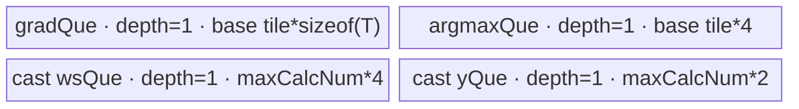

# AdaptiveMaxPool3dBackward A2/A3 ACLNN 算子知识

## 算子速览

| 项目 | 内容 |
|---|---|
| 实际入口 | `aclnnAdaptiveMaxPool3dBackwardGetWorkspaceSize` + `aclnnAdaptiveMaxPool3dBackward`，公开 ACLNN 两段式接口 |
| 计算语义 | 先将 `gradInput` 清零，再对每个 `gradOutput[n,c,od,oh,ow]` 按 `indices` 指定的 DHW 平面偏移回填；同一偏移被多个窗口命中时求和 |
| 输入输出 | 4D CDHW 或 5D NCDHW；`gradOutput/self/gradInput` 为 FP16/BF16/FP32 且 dtype 相同，A2/A3 的 `indices` 仅 INT32 |
| 执行类型 | 四条核心路线均为单 `AIV_VECTOR` Kernel；ACLNN 的 `Contiguous/ReFormat/View/ViewCopy` 是框架边界，按输入连续性可能在同 stream 前后增加框架节点 |
| Kernel 路线 | R-001 整除 MaxPool Normal；R-002 整除 MaxPool Scatter；R-003 非整除 Adaptive Normal overlap；R-004 非整除 Adaptive Scatter overlap |
| 核心资源 | GM 输入/输出；AIV UB 的 Queue/TBuf；overlap 的 FP16/BF16 路线使用 FP32 user workspace；固定 16 MiB system workspace |
| 来源闭包 | `source_closed`：公开 ACLNN→API selector→两个 L0 Host producer→各自 Tiling/POD→四个 AIV body→binary/CMake 接线均在固定仓闭合 |
| 验证状态 | 已完成源码闭包检查；本次知识提取未执行编译、真机、数值或性能测试。 |

## 接口与语义

### 计算语义

设 `S = Di*Hi*Wi`，正向输出空间为 `Do*Ho*Wo`，`p = indices[n,c,od,oh,ow]` 是当前 `(n,c)` DHW 平面的线性偏移，则：

```text
gradInput[n,c,q] = sum(gradOutput[n,c,od,oh,ow]
                       for every (od,oh,ow) whose indices[...] == q), 0 <= q < S
```

`self` 的数值不参与 Device 计算，只提供输出 shape/dtype 和 L0 输入 ABI。4D CDHW 在 API 层以 N=1 的 view 扩为 NCDHW，计算后再 view 回 CDHW。

### 输入、输出与属性

| 参数 | shape/layout | dtype | 约束、默认值与语义 |
|---|---|---|---|
| `gradOutput` | CDHW/NCDHW，ND，可非连续 | FP16/BF16/FP32 | shape 与 `indices` 相同；N、C 与 `self` 相同 |
| `self` | CDHW/NCDHW，ND，可非连续 | 同 `gradOutput` | 只决定 `gradInput` shape；A2/A3 要求 `Di*Hi*Wi <= INT32_MAX` |
| `indices` | 同 `gradOutput` | INT32 | 每项是对应 NC 平面内的 DHW 线性位置；A2/A3 不支持 INT64 |
| `gradInput` | 同 `self`，ND，可非连续 | 同 `self` | API 最终通过 `ViewCopy` 写入；相同 index 的贡献相加 |

### 入口与版本

固定 Commit 只有不带版本后缀的公开入口。API 文档产品表明确支持 Atlas A2、A3；OpDef 分别接入 `ascend910b` 和 `ascend910_93`，两个 binary config 均实例化 FP16/BF16/FP32 + INT32。没有更高公开版本可替代。

## Host/Launcher 执行流程

### 参数校验与前处理

`GetWorkspaceSize` 依次创建 executor，执行空指针、dtype、shape 关系、`Di*Hi*Wi <= INT32_MAX`、相同 storage format、非私有 format、4/5 维和 A2/A3 INT32 indices 校验。任一输入为空时返回 workspace 0 和空 executor，不启动核心 Kernel。非空时依次 `Contiguous(gradOutput)`、`Contiguous(indices)`、`Contiguous(self)`；4D 以 `ViewCDHWas5D` 扩维，5D 以 `ReFormat(...NCDHW)` 建立视图。

`selectLevelZeroOperation` 对 D/H/W 逐维计算 `isizes[i] % osizes[i]`。全部整除时令 `kernelSize=stride=isizes/osizes`、padding=0、dilation=1、ceilMode=false，调用 `MaxPool3DGradWithArgmax`；否则调用 `AdaptiveMaxPool3DGrad`。计算结果按目标 format 重解释，校验输出 shape，最后 `ViewCopy` 到用户 `gradInput`。

### 参数、Workspace 与生命周期

executor 拥有连续化临时张量、view、L0 输出和所有 launch 描述；第一段用 `GetWorkspaceSize()` 汇总，第二段把用户 workspace、大小和 stream 交给 `CommonOpExecutorRun`。两个核心 Tiling 的 `PostTiling` 都在 user workspace 后追加固定 `16*1024*1024` system workspace。R-003/R-004 的 FP16/BF16 overlap 另需 `N*C*Di*Hi*Wi*4` 字节 FP32 user slice；FP32 不需该 slice。R-001/R-002 因 `kernelSize==stride` 且 padding=0，`isOverlap=false`，无需该 FP32 slice。

### 启动图与失败传播

```text
optional Contiguous/ReFormat/View nodes (framework, executor-owned)
  -> selector
     -> divisible D/H/W: MaxPool3DGradWithArgmax(x, grad, indices) [one AIV Kernel]
     -> otherwise:       AdaptiveMaxPool3DGrad(x, grad, indices)   [one AIV Kernel]
  -> optional ReFormat/View + ViewCopy (framework)
```

所有节点由同一 executor 按同一 `aclrtStream` 排序；任一 API/L0 节点返回 null 会阻断后继节点。核心 entry 参数固定为 `(x, grad, argmax, y, workspace, tiling)`；`GetUserWorkspace(workspace)` 是 user slice 起点，system workspace 的 owner/lifetime 由 executor 管理。框架生成的 Contiguous/ViewCopy Kernel body 属允许的框架边界，固定仓不展开其内部 POD。

## Route 与参数设计

### 分核与资源计算

R-001/R-002 的 `MaxPool3DGradWithArgmax` 输入属性被固定为 `kd=sd=Di/Do`、`kh=sh=Hi/Ho`、`kw=sw=Wi/Wo`、padding=0、dilation=1，因此窗口不重叠。其模板优先级为 CutK(10)→Normal(12)→Scatter(16)；CutK 白名单要求 `(kd,kh,kw)=(5,1,6)` 且 `(sd,sh,sw)=(8,13,18)`，与 `k==s` 不相容，所以 Host 可达路线只有 Normal 与 Scatter。Normal 用 `vl=64`（必要时降到 16 或 NC 的 16 对齐值）切 NC/Do/Ho/Wo；Scatter 先令 `ncPerCore=ceil(NC/coreNum)`，再按 UB 依次尝试 no-cut、cut-NC、cut-Do、cut-Ho、cut-Wo。

R-003/R-004 的 Adaptive Host 固定 `vl=64`，计算 `kMax=max_o(ceil((o+1)*I/O)-floor(o*I/O))`。Normal(10) 先尝试，最小 UB 不足才到 Scatter(20)。Normal 先按 NC、再按 Do 分核，UB 内只继续切 Wo；Scatter 使用相同的五级切分。`blockDim=usedCoreNum`。

### Route 选择

| 顺序 | Route | Key/模板 | 精确选择条件与优先级 | 不适用去向 |
|---:|---|---|---|---|
| 1 | R-001 整除 MaxPool Normal | key 0，priority 12 | 三个 `I%O==0`；CutK priority 10 必然不命中；`dilation==1` 且 Normal 最小 UB `<= maxUbSize` | R-002 |
| 2 | R-002 整除 MaxPool Scatter | key 2，priority 16 | 三个 `I%O==0` 且 R-001 不可用；Scatter `IsCapable=true` 并须五级切分之一成功 | tiling 失败 |
| 3 | R-003 非整除 Adaptive Normal overlap | key 100，priority 10 | 至少一个 `I%O!=0`，且 `CalUBTotalSize(1,1,1)<=maxUbSize` | R-004 |
| 4 | R-004 非整除 Adaptive Scatter overlap | key 102，priority 20 | 至少一个 `I%O!=0` 且 R-003 不可用；Scatter `IsCapable=true` 并须五级切分之一成功 | tiling 失败 |

```text
if any input empty: success, no Kernel
else if Di%Do==0 && Hi%Ho==0 && Wi%Wo==0:
    try MaxPool CutK (whitelist impossible because k==s)
    try R-001 Normal; otherwise R-002 Scatter
else:
    try R-003 Adaptive Normal overlap; otherwise R-004 Adaptive Scatter overlap
```

### 模板/实现执行矩阵

| Route | key/selector | dtype/shape/platform 完整命中条件 | 执行拓扑与 Kernel 节点 | 实际模板/body | 内存与同步特征 | tail/fallback |
|---|---|---|---|---|---|---|
| R-001 | 0 | A2/A3，INT32 index，全空间整除，Normal UB 可容纳 | 单 AIV | `MaxPool3DGradWithArgmaxNormal<T,T,int32_t,T,false>` | 单 `totalBuf` 手工分区；输出先清零；无 atomic/workspace accumulation | NC/Do/Ho/Wo tail；失败到 R-002 |
| R-002 | 2 | 同上但 Normal 不可用 | 单 AIV | `MaxPoolGradWithArgScatter<T,T,int32_t,T>` | grad/argmax Queue + 32B y Queue；逐 scalar index 写回 | 五级 UB 切分 tail；无更后 fallback |
| R-003 | 100 | A2/A3，至少一轴非整除，Normal 最小 UB 可容纳 | 单 AIV | `AdaptiveMaxPool3DGradNormal<T,T,int32_t,T,true>` | UB 向量比较/选择；FP32 atomic 到 y 或 FP32 workspace；全核同步后 cast | NC/Do/Wo tail；失败到 R-004 |
| R-004 | 102 | 同上但 Normal 不可用 | 单 AIV | `AdaptiveMaxPool3DGradScatterOverlap<T,T,int32_t,T>` | grad/argmax Queue；scalar cache-coherent read-add-write；FP16/BF16 经 FP32 workspace | NC/Do/Ho/Wo tail；失败终点 |

### 隐藏性能 Guard

| Guard | Host/Tiling 条件 | Device/资源原因 | 影响 Route | 不满足时去向 | 源码符号 |
|---|---|---|---|---|---|
| API 整除短路 | 三轴均 `I%O==0` | 等价固定 kernel/stride，可复用 MaxPool body | R-001/R-002 | Adaptive routes | `selectLevelZeroOperation` |
| A2/A3 index 上限 | `Di*Hi*Wi <= INT32_MAX` | INT32 线性 DHW index | 全部 | ACLNN 参数错误 | `CheckSelfShapeSupport` |
| Adaptive Normal UB | `CalUBTotalSize(1,1,1)<=maxUbSize` | 最小向量工作集含 7 组 B32 输出域缓存和 kernel mask | R-003 | R-004 | `AdaptiveMaxPool3DGradNormalTiling::IsCapable` |
| Scatter UB 次序 | no-cut→NC→Do→Ho→Wo | 保持最外连续搬运，最后才切 W | R-002/R-004 | tiling 失败 | `CalculateScatterTilingParams` |
| overlap 精度 workspace | `sizeof(T)!=4 && isOverlap` | FP16/BF16 冲突累加先在 FP32 中进行 | R-003/R-004 | FP32 直接写 y | `SetOtherTilingParams` / `CalculateRoundParams` |
| Device 核型 | `g_coreType != AIC` 且 workspace/user workspace 非空 | body 只在 AIV 执行 | 全部 | entry 直接返回 | 两个 kernel entry |

### POD/ABI

两种 POD 都由 `BEGIN_TILING_DATA_DEF` 生成，字段按声明顺序序列化；每项均为 `uint64_t`、8 字节。宏展开后的结构 `sizeof/alignof/offsetof` 在固定仓不可见；Device 以同名结构读取。下表的 producer 均为对应 `SetBaseTilingData`/专用 setter。

| 结构 | 字段 | 类型/位宽 | ABI 布局 | 单位 | Host/launcher producer | Device consumer | 边界 |
|---|---|---|---|---|---|---|---|
| Adaptive POD | `ncDim` | uint64/64 | 声明序 0 | element | `N*C` | GM extent/core mapping | >0 |
| Adaptive POD | `diDim` | uint64/64 | 声明序 1 | element | self D | output offset | `DHW<=INT32_MAX` |
| Adaptive POD | `hiDim` | uint64/64 | 声明序 2 | element | self H | index decode | 同上 |
| Adaptive POD | `wiDim` | uint64/64 | 声明序 3 | element | self W | index decode/output stride | 同上 |
| Adaptive POD | `doDim` | uint64/64 | 声明序 4 | element | grad D | loop/window start | >0 |
| Adaptive POD | `hoDim` | uint64/64 | 声明序 5 | element | grad H | loop/window start | >0 |
| Adaptive POD | `woDim` | uint64/64 | 声明序 6 | element | grad W | loop/window start | >0 |
| Adaptive POD | `kdMax` | uint64/64 | 声明序 7 | element | `max CalKIndexLen(D)` | kernel index buffer | positive |
| Adaptive POD | `khMax` | uint64/64 | 声明序 8 | element | `max CalKIndexLen(H)` | kernel index buffer | positive |
| Adaptive POD | `kwMax` | uint64/64 | 声明序 9 | element | `max CalKIndexLen(W)` | kernel index buffer | positive |
| Adaptive POD | `baseNc` | uint64/64 | 声明序 10 | element | Normal/Scatter selector | UB tile | <=NC |
| Adaptive POD | `baseDo` | uint64/64 | 声明序 11 | element | selector | inner D tile | >=1 |
| Adaptive POD | `baseHo` | uint64/64 | 声明序 12 | element | selector | inner H tile | >=1 |
| Adaptive POD | `baseWo` | uint64/64 | 声明序 13 | element | UB binary search/five-way cut | inner W tile | >=1 |
| Adaptive POD | `singleCoreNc` | uint64/64 | 声明序 14 | element/core | Normal=64 | Normal core loop | Scatter inactive |
| Adaptive POD | `singleCoreDo` | uint64/64 | 声明序 15 | element/core | Normal core split | Normal core loop | Scatter inactive |
| Adaptive POD | `singleCoreHo` | uint64/64 | 声明序 16 | element/core | Normal=`Ho` | Normal loop | Scatter inactive |
| Adaptive POD | `singleCoreWo` | uint64/64 | 声明序 17 | element/core | Normal=`Wo` | Normal loop | Scatter inactive |
| Adaptive POD | `ncTail` | uint64/64 | 声明序 18 | element | remainder | last NC tile | positive |
| Adaptive POD | `doTail` | uint64/64 | 声明序 19 | element | remainder | last D tile | positive |
| Adaptive POD | `hoTail` | uint64/64 | 声明序 20 | element | remainder | last H tile | positive |
| Adaptive POD | `woTail` | uint64/64 | 声明序 21 | element | remainder | last W tile | positive |
| Adaptive POD | `ncCnt` | uint64/64 | 声明序 22 | tile | ceil-div | loop/core mapping | >=1 |
| Adaptive POD | `doCnt` | uint64/64 | 声明序 23 | tile | ceil-div | loop | >=1 |
| Adaptive POD | `hoCnt` | uint64/64 | 声明序 24 | tile | ceil-div | loop | >=1 |
| Adaptive POD | `woCnt` | uint64/64 | 声明序 25 | tile | ceil-div | loop | >=1 |
| Adaptive POD | `totalCnt` | uint64/64 | 声明序 26 | tile | product of counts | modulo core schedule | >=1 |
| Adaptive POD | `usedCoreNum` | uint64/64 | 声明序 27 | AIV core | min(work, coreNum) | block/grid assumptions | blockDim |
| Adaptive POD | `totalUBSize` | uint64/64 | 声明序 28 | byte | platform UB | UB allocation/cast tile | >0 |
| Adaptive POD | `ncRound` | uint64/64 | 声明序 29 | round | Scatter ceil-div | per-core NC ownership | Normal inactive |
| Adaptive POD | `ncRoundTail` | uint64/64 | 声明序 30 | round | Scatter remainder | tail cores | Normal inactive |
| Adaptive POD | `totalRound` | uint64/64 | 声明序 31 | round | Scatter product | diagnostic/loop state | Normal inactive |
| Adaptive POD | `preCoreNum` | uint64/64 | 声明序 32 | core | `ncCnt%usedCoreNum` | former/tail core branch | Normal inactive |
| MaxPool POD | `ncDim..woDim` | uint64/64 each | 声明序 0..6 | element | input/output shapes | both bodies | fields individually declared |
| MaxPool POD | `kd,kh,kw` | uint64/64 each | 声明序 7..9 | element | API `I/O` | Normal window geometry | fixed equal stride |
| MaxPool POD | `sd,sh,sw` | uint64/64 each | 声明序 10..12 | element | API `I/O` | Normal offsets | equal K |
| MaxPool POD | `padDTop..padWBottom` | uint64/64 each | 声明序 13..18 | element | API zeros | Normal offsets | all zero |
| MaxPool POD | `baseNc..baseWo` | uint64/64 each | 声明序 19..22 | element | selected tile | UB/loops | positive |
| MaxPool POD | `ncTail..woTail` | uint64/64 each | 声明序 23..26 | element | remainder | tail loops | positive |
| MaxPool POD | `ncCnt..woCnt` | uint64/64 each | 声明序 27..30 | tile | ceil-div | loops | >=1 |
| MaxPool POD | `totalCnt` | uint64/64 | 声明序 31 | tile | count product | block scheduling | >=1 |
| MaxPool POD | `usedCoreNum` | uint64/64 | 声明序 32 | core | min(work, coreNum) | block mapping | blockDim |
| MaxPool POD | `totalUBSize` | uint64/64 | 声明序 33 | byte | platform UB | `totalBuf`/scatter buffers | >0 |
| MaxPool POD | `singleCoreNc..singleCoreWo` | uint64/64 each | 声明序 34..37 | element/core | Normal split | Normal loops | Scatter inactive |
| MaxPool POD | `ncRound,ncRoundTail,totalRound,preCoreNum` | uint64/64 each | 声明序 38..41 | round/core | Scatter split | Scatter core mapping | Normal inactive |

### Route 源码闭包

| Route | Key/selector | Host/Tiling producer | POD/参数 | Kernel entry/router 节点 | Kernel body/直接依赖 | 构建接线 |
|---|---|---|---|---|---|---|
| R-001 | MaxPool key 0 | `selectLevelZeroOperation`; `MaxPool3DGradWithArgmaxNormalTiling` | MaxPool POD | `max_pool3d_grad_with_argmax` key 0 | `MaxPool3DGradWithArgmaxNormal<...,false>` | dependency + 910b/910_93 binary |
| R-002 | MaxPool key 2 | same selector; Scatter tiling | MaxPool POD | same entry key 2 | `MaxPoolGradWithArgScatter` + common scatter template | same |
| R-003 | Adaptive key 100 | Adaptive Normal tiling | Adaptive POD | `adaptive_max_pool3d_grad` key 100 | `AdaptiveMaxPool3DGradNormal<...,true>` | Adaptive CMake + binary |
| R-004 | Adaptive key 102 | Adaptive Scatter tiling | Adaptive POD | same entry key 102 | `AdaptiveMaxPool3DGradScatterOverlap` + unified/common templates | same |

## Kernel 实现

### 公共执行流程

四条路线都只启动一个算子自有 Device 节点。两个 entry 都先检查 `workspace`、`GetUserWorkspace(workspace)` 和 `g_coreType != AIC`，再解析 POD、构造模板、`Init`、`Process`。`x` 仅维持 ABI；实际搬运来自 `grad/argmax`，输出到 `y` 或 FP32 workspace。所有 Queue 通过 Alloc→EnQue→DeQue→FreeTensor 建立 MTE/Vector 生命周期；显式 `PipeBarrier`、event flag 和 `SyncAll` 保护跨流水阶段与跨核初始化。

### Route R-001：整除 MaxPool Normal

#### 适用条件

##### 选择证据

| 层级 | 文件 | 符号 | 源码谓词/参数 | 结果/下一跳 |
|---|---|---|---|---|
| API | `adaptive_max_pool_common.cpp` | `selectLevelZeroOperation` | 每轴 `I%O==0`，构造 `K=S=I/O,P=0,Dilation=1` | MaxPool L0 |
| Tiling | `max_pool3d_grad_with_argmax_normal_tiling.cpp` | `IsCapable` | dilation 全 1 且最小 UB 可容纳 | key 0 |
| Router | `max_pool3d_grad_with_argmax.cpp` | `TILING_KEY_IS(0)` | binary key 0 | Normal false-overlap body |

#### Device 数据流

##### 函数级调用链

```text
MaxPool3DGradWithArgmaxAiCore -> max_pool3d_grad_with_argmax(key=0)
  -> MaxPool3DGradWithArgmaxNormal::Init
  -> Process: InitOutput -> per assigned NC/Do/Ho/Wo tile
     -> CopyIn grad/argmax -> transpose -> compare/select -> transpose -> CopyOut y
```

##### 源码等价伪码

```text
zero(y)
for tile assigned to this block:
  load grad and argmax; transpose NC-major lanes
  build input-window linear index image for K==S, padding=0
  mask = (window_index == argmax)
  selected = mask ? grad : 0
  transpose selected window to NCDHW output and copy valid D/H/W tail
```

#### 内存与数据搬运

##### 资源与搬运表

| 层级/缓冲区 | offset/地址公式 | extent/容量公式 | dtype/layout | producer | consumer | owner/lifetime | 对齐/复用 |
|---|---|---|---|---|---|---|---|
| GM grad/argmax | NC + output tile offset | tile NC*Do*Ho*Wo | T/INT32 NCDHW | API | CopyIn | caller | padded DMA |
| `totalBuf` | 0 | `totalUBSize` | byte UB | InitBuffer | all phases | Kernel | manual subregions |
| xIndex | 0 | `baseNc*baseDiHiWi*4` | INT32 | index generator | Compare | within tile | prefix region |
| argmax/grad | computed offsets | aligned output tile | INT32/T | CopyIn | transpose | within tile | argmax aliases tmpIndex/tmpGrad after consume |
| yTran/y | computed offsets | aligned input window | FP32/T | select/reduce | CopyOut | within tile | no overlap atomic |

##### 分层内存布局


##### 字节账与复用顺序

```text
UB_total = NormalTiling::CalUBTotalSize(baseDo,baseHo,baseWo,false)
         <= platform maxUbSize
dynamic_ub = N/A
workspace_total = 16 MiB system workspace + framework temporaries
```

| 复用子区 | 写入者 | 读取者/消费点 | 下一次覆盖 | 同步或释放依据 | 安全条件 |
|---|---|---|---|---|---|
| argmax/tmpIndex/tmpGrad | CopyIn argmax | transpose/compare | later temporary phases | phase order + barriers | argmax已转存 |

#### 同步、精度与尾块

##### 同步与数值边界表

| 阶段 | primitive/机制 | producer | consumer/等待点 | 保护对象 | 精度/尾块 |
|---|---|---|---|---|---|
| output init | schedule mode + global init | block 0/framework | all blocks | y | zero before write |
| transpose/vector | PipeBarrier/events | DMA/Vector | next phase | totalBuf regions | NC 16/64 alignment |
| CopyOut | DataCopyPad | y UB | GM | valid tail | only valid D/H/W copied |

#### 关键实现

##### 符号证据表

| 阶段 | 文件 | 符号/模板实例 | 实现事实 |
|---|---|---|---|
| Host/Tiling producer | `max_pool3d_grad_with_argmax_normal_tiling.cpp` | `CalUBTotalSize`, `SetNormalTilingParams` | UB 与分核 |
| Kernel entry/router | `max_pool3d_grad_with_argmax.cpp` | key 0 | false-overlap 实例 |
| Device body/helper | `max_pool3d_grad_with_argmax_normal.h` | `InitUbBuffer`, `Process` | 手工 UB 分区和窗口选择 |

### Route R-002：整除 MaxPool Scatter

#### 适用条件

##### 选择证据

| 层级 | 文件 | 符号 | 源码谓词/参数 | 结果/下一跳 |
|---|---|---|---|---|
| API | `adaptive_max_pool_common.cpp` | `selectLevelZeroOperation` | 三轴整除 | MaxPool L0 |
| Tiling | `max_pool3d_grad_with_argmax_scatter_tiling.cpp` | `IsCapable` | Normal 失败后恒 true，五级切分成功 | key 2 |
| Router | `max_pool3d_grad_with_argmax.cpp` | key 2 | key 2 | Scatter body |

#### Device 数据流

##### 函数级调用链

```text
max_pool3d_grad_with_argmax(key=2)
  -> MaxPoolGradWithArgScatter::Init
  -> ProcessCommon -> CopyInGrad/CopyInArgmax -> CalcOutOffset -> direct GM write
```

##### 源码等价伪码

```text
zero(owned y NC range)
for owned NC and each Do/Ho/Wo tile:
  load grad and argmax tile
  for each element: y[nc*S + argmax] = grad
```

#### 内存与数据搬运

##### 资源与搬运表

| 层级/缓冲区 | offset/地址公式 | extent/容量公式 | dtype/layout | producer | consumer | owner/lifetime | 对齐/复用 |
|---|---|---|---|---|---|---|---|
| gradQue | 0 | `baseNc*baseDo*baseHo*baseWo*sizeof(T)` | T | DMA | scalar loop | per tile | depth 1 |
| argmaxQue | next UB | same elements*4 | INT32 | DMA | address loop | per tile | depth 1 |
| yQue | fixed | 32 B | T | scalar `SetValue` | one-element DataCopyPad | per element | reused after event |
| GM y | `nc*S+argmax` | one T per write | T NCDHW | yQue | output | caller | windows non-overlap |

##### 分层内存布局


##### 字节账与复用顺序

```text
UB_total = baseTile*(sizeof(T)+4) + 32B adjustment
UB_total <= maxUbSize
workspace_total = 16 MiB system workspace + framework temporaries
```

| 复用子区 | 写入者 | 读取者/消费点 | 下一次覆盖 | 同步或释放依据 | 安全条件 |
|---|---|---|---|---|---|
| yQue scalar slot | SetValue | DataCopyPad | next element | S_MTE3/MTE3_S events | previous GM write complete |

#### 同步、精度与尾块

##### 同步与数值边界表

| 阶段 | primitive/机制 | producer | consumer/等待点 | 保护对象 | 精度/尾块 |
|---|---|---|---|---|---|
| CopyIn→scalar | MTE2_S event | DMA | GetValue | Queue | exact T value |
| scalar→GM | S_MTE3/MTE3_S | SetValue/DataCopyPad | next reuse | 32B slot | one valid element |
| core ownership | NC partition | Host | block loop | disjoint y NC ranges | former/tail rounds |

#### 关键实现

##### 符号证据表

| 阶段 | 文件 | 符号/模板实例 | 实现事实 |
|---|---|---|---|
| Host/Tiling producer | `pool_3d_common/op_host/arch32/max_pool3d_grad_tiling_common.h` | `CalculateScatterTilingParams` | 五级 UB cut |
| Kernel entry/router | `max_pool3d_grad_with_argmax.cpp` | key 2 | Scatter 实例 |
| Device body/helper | `pool_3d_common/op_kernel/arch32/max_pool3d_grad_scatter_unified.h` | `CalcOutOffset` | index 直接定位 GM |

### Route R-003：非整除 Adaptive Normal overlap

#### 适用条件

##### 选择证据

| 层级 | 文件 | 符号 | 源码谓词/参数 | 结果/下一跳 |
|---|---|---|---|---|
| API | `adaptive_max_pool_common.cpp` | `selectLevelZeroOperation` | 任一 `I%O!=0` | Adaptive L0 |
| Tiling | `adaptive_max_pool3d_grad_normal_tiling.cpp` | `IsCapable` | 最小 UB 可容纳 | key `0+100` |
| Router | `adaptive_max_pool3d_grad.cpp` | key 100 | overlap | Normal `<...,true>` |

#### Device 数据流

##### 函数级调用链

```text
AdaptiveMaxPool3DGradAiCore -> adaptive_max_pool3d_grad(key=100)
  -> InitParams/InitInputsOutputs/InitUbBuffer
  -> Process -> GenkernelIndex
  -> per tile: CopyInArgmax/Grad -> transpose -> CalcIndices -> CalcIndicesInWindow
     -> Compare -> SelectGrad -> CalcY -> transpose -> atomic CopyOut
  -> FP16/BF16 only: SyncAll -> workspace FP32 to output cast
```

##### 源码等价伪码

```text
block0 zeroes y(fp32) or workspace(fp16/bf16); SyncAll
kernelIndex = [0..kdMax*khMax*kwMax) broadcast over 64 NC lanes
for block assigned by totalIndex % blockNum:
  decode argmax to d/h/w in FP32, subtract adaptive window starts
  localIndex = d*khMax*kwMax + h*kwMax + w
  for each output W: mask = kernelIndex == localIndex
  selected = mask ? grad : 0
  transpose selected values to input window and atomic-add to y/workspace
if b16: SyncAll; cast workspace FP32 to y (FP16 none, BF16 RINT)
```

#### 内存与数据搬运

##### 资源与搬运表

| 层级/缓冲区 | offset/地址公式 | extent/容量公式 | dtype/layout | producer | consumer | owner/lifetime | 对齐/复用 |
|---|---|---|---|---|---|---|---|
| gradQue/transpose | output tile offset | `64*alignT(baseDoHoWo)*sizeof(T)` each | T | DMA/transpose | Select | tile | depth 1 + TBuf |
| indices Queue/temps | same offset | `64*align8(baseDoHoWo)*4` for seven B32 regions | INT32/FP32 | DMA/decode | Compare | tile | distinct TBuf |
| kernelIdx/tempGrad/mask | local | `64*kMax*4`, `64*kMax*4`, `64*kMax/8` | FP32/bit | generator/Select | CalcY | Kernel/tile | reused each W |
| yQue/yTranspose | adaptive input window | each `64*kdMax*khMax*align8(kwMax)*4` | FP32 | CalcY | atomic CopyOut | tile | depth 1 |
| FP32 workspace | `nc*S` | `NC*S*4` | FP32 | atomic accumulation | cast pass | executor | only b16 overlap |

##### 分层内存布局


##### 字节账与复用顺序

```text
UB_total = 2*64*alignT(Otile)*sizeof(T)
         + 7*64*align8(Otile)*4
         + 2*64*kMax*4 + 64*kMax/8
         + 2*64*kdMax*khMax*align8(kwMax)*4 + 8192
UB_total <= maxUbSize
workspace_total = (T!=FP32 ? NC*S*4 : 0) + 16 MiB system + framework temporaries
```

| 复用子区 | 写入者 | 读取者/消费点 | 下一次覆盖 | 同步或释放依据 | 安全条件 |
|---|---|---|---|---|---|
| tempGrad | `SelectGrad` | `CalcY` | next W | `PIPE_V` barrier | prior CalcY consumed |
| FP32 workspace | atomic CopyOut | cast pass | executor release | `SyncAll` | all AIV blocks complete accumulation |

#### 同步、精度与尾块

##### 同步与数值边界表

| 阶段 | primitive/机制 | producer | consumer/等待点 | 保护对象 | 精度/尾块 |
|---|---|---|---|---|---|
| global zero | `SyncAll` | block0 | all blocks | y/workspace | zero identity |
| vector stages | `PipeBarrier<PIPE_V>` | decode/compare/select | next stage | TBuf | padded lanes masked |
| overlap write | `SetAtomicAdd` | y Queue | GM | colliding indices | FP32 accumulation for b16 |
| cast pass | `SyncAll`, Queue | all atomics | cast/copy | workspace | FP16 CAST_NONE; BF16 CAST_RINT; last loop `calcTail` |

#### 关键实现

##### 符号证据表

| 阶段 | 文件 | 符号/模板实例 | 实现事实 |
|---|---|---|---|
| Host/Tiling producer | `adaptive_max_pool3d_grad_normal_tiling.cpp` | `CalUBTotalSize`, `SetNormalTilingParams` | UB/NC-Do-Wo split |
| Kernel entry/router | `adaptive_max_pool3d_grad.cpp` | key 100 | overlap template |
| Device body/helper | `adaptive_max_pool3d_grad_normal.h` | `CalcBlock`, `SelectGrad`, `CopyOut` | decode/compare/select/atomic/cast |

### Route R-004：非整除 Adaptive Scatter overlap

#### 适用条件

##### 选择证据

| 层级 | 文件 | 符号 | 源码谓词/参数 | 结果/下一跳 |
|---|---|---|---|---|
| API | `adaptive_max_pool_common.cpp` | selector | 任一轴非整除 | Adaptive L0 |
| Tiling | `adaptive_max_pool3d_grad_scatter_tiling.cpp` | `IsCapable/DoOpTiling` | Normal 失败，Scatter true 且切分成功 | key 102 |
| Router | `adaptive_max_pool3d_grad.cpp` | key 102 | overlap | ScatterOverlap body |

#### Device 数据流

##### 函数级调用链

```text
adaptive_max_pool3d_grad(key=102)
  -> AdaptiveMaxPool3DGradScatterOverlap::Init
  -> ProcessCommon -> CopyInGrad/Argmax -> CalcOutOffset(read-add-write)
  -> FP16/BF16: barrier/cache clean -> ProcessCast(workspace->y)
```

##### 源码等价伪码

```text
zero owned y or FP32 workspace NC range
for each owned output tile:
  load grad and argmax
  for each element:
    q = nc*S + argmax
    fp32_target[q] = fp32_target[q] + float(grad)
    clean/invalidate data cache around GM update
if b16: stream through owned FP32 workspace, cast and copy y
```

#### 内存与数据搬运

##### 资源与搬运表

| 层级/缓冲区 | offset/地址公式 | extent/容量公式 | dtype/layout | producer | consumer | owner/lifetime | 对齐/复用 |
|---|---|---|---|---|---|---|---|
| gradQue | tile output offset | `baseNc*baseDo*baseHo*baseWo*sizeof(T)` | T | DMA | scalar add | tile | depth 1 |
| argmaxQue | same | elements*4 | INT32 | DMA | address | tile | depth 1 |
| y/workspace GM | `nc*S+argmax` | owned NC extent | FP32/T | scalar cache op | output/cast | executor | NC-disjoint across cores |
| cast wsQue/yQue | reset UB | `maxCalcNum*4` + `maxCalcNum*2` | FP32/T | DMA/Cast | output DMA | cast loop | `maxCalcNum=UB/(4+2)` |

##### 分层内存布局



##### 字节账与复用顺序

```text
scatter_phase_UB = baseTile*(sizeof(T)+4)
cast_phase_UB = maxCalcNum*(4+2) <= totalUBSize
workspace_total = (T!=FP32 ? NC*S*4 : 0) + 16 MiB system + framework temporaries
```

| 复用子区 | 写入者 | 读取者/消费点 | 下一次覆盖 | 同步或释放依据 | 安全条件 |
|---|---|---|---|---|---|
| entire UB after scatter | grad/argmax queues | scalar loop | `pipe.Reset` then cast queues | `ProcessCommon` complete + barrier | no live Queue tensor |
| FP32 workspace | scalar read-add-write | cast | executor release | cache clean + PIPE_ALL | each NC owned by one core |

#### 同步、精度与尾块

##### 同步与数值边界表

| 阶段 | primitive/机制 | producer | consumer/等待点 | 保护对象 | 精度/尾块 |
|---|---|---|---|---|---|
| DMA→scalar | MTE2_S/PIPE_ALL | CopyIn | GetValue | queues | valid tile extent |
| GM accumulation | cache clean/invalidate | scalar read-add-write | next read | GM cache line | FP32 accumulator for b16 |
| cast | Queue + PIPE_ALL | workspace | y GM | owned NC slice | FP16 none, BF16 RINT, `calcTail` |

#### 关键实现

##### 符号证据表

| 阶段 | 文件 | 符号/模板实例 | 实现事实 |
|---|---|---|---|
| Host/Tiling producer | `adaptive_max_pool3d_grad_scatter_tiling.cpp` | `SetScatterTilingParams` | common five-way split |
| Kernel entry/router | `adaptive_max_pool3d_grad.cpp` | key 102 | overlap Scatter |
| Device body/helper | `pool_3d_common/op_kernel/arch32/max_pool3d_grad_scatter_overlap_unified.h` | `CalcOutOffset`, `ProcessCast` | FP32 read-add-write and cast |

## 算子特定优化

### Trick T-001：整除自适应池化退化为固定 MaxPool3DGrad

#### 触发与源码依据

- 适用 Route：R-001、R-002
- 触发条件：D/H/W 三轴全部 `inputSize % outputSize == 0`
- Golden 来源：[`adaptive_max_pool_common.cpp:145-180`](../../../../../../../cann-ops-raw/ascendc/ops-nn/955f8b33985b6d72989ebff341bb9c2c564a51bc/pooling/adaptive_max_pool3d_grad/op_api/adaptive_max_pool_common.cpp#L145-L180)

**官方源码（固定 Commit 连续逐字摘录）**：

```cpp
for (size_t dim = 0; dim < SPATIAL_DIM_NUM; ++dim) {
    if (isizes[dim] % osizes[dim] == 0) {
        kernelSize[dim] = isizes[dim] / osizes[dim];
        stride[dim] = isizes[dim] / osizes[dim];
        useMaxPool3DGradWithArgmax = true;
    } else {
        useMaxPool3DGradWithArgmax = false;
        break;
    }
}
```

#### 机制与设计原因

整除时每个自适应窗口宽度恒定且互不重叠，Host 把它改写为 `kernelSize=stride=I/O`、零 padding、单位 dilation 的固定池化反向。这样 Device 不再计算 `floor/ceil` 自适应窗口边界；Normal 或 Scatter body 直接使用固定 K/S 地址公式。

#### 迁移边界

- 适用：三维自适应窗口三轴都可整除的反向回填。
- 前提：A2/A3、INT32 indices、三轴输出长度非零。
- 失效：任一轴不整除必须转 R-003/R-004，不能用固定 stride 模拟重叠窗口。
- 未验证：本次知识提取未执行编译、真机、数值或性能测试。

#### 错误做法

固定仓给出的真实反例是 selector 的 `break`：任一轴不整除即禁止该改写，否则窗口边界与正向 indices 语义不一致。

### Trick T-002：overlap 的低精度输出先在 FP32 workspace 累加

#### 触发与源码依据

- 适用 Route：R-003、R-004 的 FP16/BF16
- 触发条件：`xDtypeSize != 4 && isOverLap`
- Golden 来源：[`adaptive_max_pool3d_grad_normal_tiling.cpp:169-174`](../../../../../../../cann-ops-raw/ascendc/ops-nn/955f8b33985b6d72989ebff341bb9c2c564a51bc/pooling/adaptive_max_pool3d_grad/op_host/adaptive_max_pool3d_grad_normal_tiling.cpp#L169-L174)

**官方源码（固定 Commit 连续逐字摘录）**：

```cpp
if (maxPoolGradParams.xDtypeSize != DTYPE_LEN_B32 && maxPoolGradParams.isOverLap) {
    maxPoolGradParams.workspaceSize = maxPoolGradParams.ncDim * maxPoolGradParams.diDim * maxPoolGradParams.hiDim *
                                      maxPoolGradParams.wiDim * sizeof(float);
} else {
    maxPoolGradParams.workspaceSize = 0UL;
}
```

#### 机制与设计原因

多个 adaptive 窗口可能命中同一输入位置。FP16/BF16 不直接做冲突累加，而是申请完整输出大小的 FP32 workspace，先在其中求和；所有核完成后，FP16 用 `CAST_NONE`、BF16 用 `CAST_RINT` 一次性降精度。源码可证明它改变了累加精度顺序并避免每次贡献都提前舍入。

#### 迁移边界

- 适用：低精度、存在窗口 overlap、需要相同索引求和的 scatter/reduce。
- 前提：可提供 `NC*Di*Hi*Wi*4` 字节 user workspace，并保留全核完成到 cast 的同步。
- 失效：FP32 输出直接在 y 中累加；非 overlap 不应额外物化 workspace。
- 未验证：本次知识提取未执行编译、真机、数值或性能测试。

#### 错误做法

不能在任一核尚未完成累加时开始 cast，也不能把 workspace 缩成单 tile 后跨核无协议复用；固定实现用完整输出 extent 与 `SyncAll`/core ownership 保证生命周期。

## 模板与实现对比

| 对比维度 | R-001 MaxPool Normal | R-002 MaxPool Scatter | R-003 Adaptive Normal overlap | R-004 Adaptive Scatter overlap | 设计选择依据 |
|---|---|---|---|---|---|
| 命中条件/优先级 | 整除，Normal UB 可容纳 | 整除，Normal 失败 | 非整除，Normal UB 可容纳 | 非整除，Normal 失败 | API 先按整除分支，Tiling 再按 UB fallback |
| 模板与 dtype | Vector Normal，INT32 | scalar Scatter，INT32 | Vector Normal overlap | scalar Scatter overlap | A2/A3 indices 固定 INT32 |
| 循环与分核 | NC/Do/Ho/Wo tile | NC ownership + output tile | modulo tile-to-core | NC ownership + output tile | overlap 路线避免跨 NC owner 冲突 |
| Queue/TBuf/寄存器/dynamic UB/通信 window | 单 totalBuf 多分区 | 2 input Queue + scalar y Queue | 多 Queue/TBuf | 2 Queue；二阶段 cast Queue | 无 dynamic UB/通信 |
| 内存总占用与复用 | Host 精确公式 | baseTile*(T+4)+32 | Host 精确公式+可选全量 FP32 WS | baseTile*(T+4)，再 reset UB cast | Normal 以 UB 换向量化，Scatter 是兜底 |
| 搬运/Vector/SIMT/NDDMA/通信 API | DMA+Transpose+Compare/Select | DMA+scalar DataCopyPad | DMA+Transpose+Compare/Select+Atomic | DMA+scalar cache read-add-write | 均 AIV，无 SIMT/NDDMA/通信 |
| 同步、精度与 tail | pipe/event，dtype 直接输出 | per-element event | SyncAll/Atomic；b16 FP32→cast | cache/PIPE_ALL；b16 FP32→cast | overlap 决定累加协议 |
| fallback/失败边界 | 到 R-002 | tiling 失败 | 到 R-004 | tiling 失败 | Scatter 是最终 IsCapable 路线 |

## 平台差异

| 项目 | A2 | A3 | 950 |
|---|---|---|---|
| 支持状态 | 支持 | 支持 | 本卡不发布；固定仓公开 README 与 ACLNN 文档冲突 |
| Host/Launcher | `ascend910b`，INT32 index，四 Route | `ascend910_93`，同实现 | arch35 SIMT 实现存在，但不能消解公开支持冲突 |
| Kernel/资源 | AIV Vector，910b binary | AIV Vector，910_93 binary | 不在本卡外推 |

## 限制与失败边界

- A2/A3 只支持 INT32 indices，且 `Di*Hi*Wi <= 2^31-1`；API 文档另列非整除场景 shape 不超过 `2^24`，固定源码中没有同名显式 Host guard，不能把文档约束改写成具体乘积维度。
- 空 tensor 返回成功但不启动 Kernel；四个核心输入必须同 storage format 且不能是私有 format。
- Kernel entry 对空 workspace/user workspace 或 AIC 核直接返回；launcher 必须保留 system workspace 约定。
- 默认非确定性；固定 MaxPool Tiling 可读取 deterministic 状态，但 ACLNN 文档仅保证可通过上下文开关请求确定性，本文不推测数值逐 bit 一致性。
- Tiling POD 宏的最终 C++ `sizeof/alignof/offsetof` 在固定仓不可见；字段顺序、类型及 Host/Device 同结构可追溯。
- 本次知识提取未执行编译、真机、数值或性能测试。

## 源码索引

### 链路索引

| 链路阶段 | 文件 | 关键符号 | 支撑内容 |
|---|---|---|---|
| 入口声明/约束 | `pooling/adaptive_max_pool3d_grad/docs/aclnnAdaptiveMaxPool3dBackward.md` | 产品表、函数原型、约束 | A2/A3 公开支持与 API 约束 |
| 入口实现 | `pooling/adaptive_max_pool3d_grad/op_api/aclnn_adaptive_max_pool3d_backward.cpp` | 两段式 API | 校验、连续化、view、executor |
| API selector | `pooling/adaptive_max_pool3d_grad/op_api/adaptive_max_pool_common.cpp` | `selectLevelZeroOperation` | 整除分支与两 L0 节点 |
| Host/Tiling | `pooling/adaptive_max_pool3d_grad/op_host/adaptive_max_pool3d_grad_tiling.h` | Adaptive POD/classes | POD 与模板声明 |
| Host/Tiling | `pooling/adaptive_max_pool3d_grad/op_host/adaptive_max_pool3d_grad_normal_tiling.cpp` | Normal tiling | UB、分核、workspace |
| Kernel entry/body | `pooling/adaptive_max_pool3d_grad/op_kernel/adaptive_max_pool3d_grad.cpp` | `adaptive_max_pool3d_grad` | key 100/102 路由 |
| Kernel entry/body | `pooling/adaptive_max_pool3d_grad/op_kernel/adaptive_max_pool3d_grad_normal.h` | Normal body | Vector overlap 实现 |
| Kernel helper | `pooling/pool_3d_common/op_kernel/arch32/max_pool3d_grad_scatter_overlap_unified.h` | ScatterOverlap | read-add-write 与 cast |
| 依赖 Host/Tiling | `pooling/max_pool3d_grad_with_argmax/op_host/max_pool3d_grad_with_argmax_normal_tiling.cpp` | MaxPool Normal | 整除路线 UB/fallback |
| 依赖 Kernel entry | `pooling/max_pool3d_grad_with_argmax/op_kernel/max_pool3d_grad_with_argmax.cpp` | MaxPool router | key 0/2 路由 |
| 构建接线 | `pooling/adaptive_max_pool3d_grad/CMakeLists.txt` | `add_modules_sources` | Host、ACLNN 与 MaxPool dependency |

### 实现复用检查

| 检查项 | 可复用事实 | 不得改变的约束 | 源码符号 |
|---|---|---|---|
| ABI/POD | 两个 uint64 POD 的 shape/tile/count 字段 | 字段顺序、单位、Normal/Scatter inactive 字段 | 两个 Tiling header |
| 调用顺序 | Contiguous/view→selector→单核心 Kernel→view copy | selector 必须先完成三轴整除检查 | ACLNN GetWorkspaceSize |
| workspace/内存 | b16 overlap 使用完整 FP32 output slice | user/system workspace 偏移和生命周期 | `PostTiling`, `SetOtherTilingParams` |
| 同步 | output init、atomic/cache accumulation、cast 的先后 | cast 不得早于所有贡献 | Normal/ScatterOverlap `Process` |
| 精度与尾块 | BF16 RINT、FP16 NONE；各 count 最后一块用 tail | padded lane 不写 GM | `ComputeCast`, CopyOut |
| 失败边界 | Normal→Scatter；空 tensor no-op | Scatter 失败后不得静默选择未知 key | `IsCapable`, router |