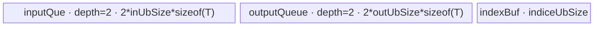

# AvgPool2d 950 ACLNN 算子知识

## 算子速览

| 项目 | 内容 |
|---|---|
| 实际入口 | `aclnnAvgPool2dGetWorkspaceSize` / `aclnnAvgPool2d`，公开 ACLNN 两段式接口；950 分支调用内部 `AvgPoolV2`。 |
| 计算语义 | 对 NCHW/NCL 输入的每个二维窗口求和，再按 `divisorOverride`、是否包含 padding 或窗口内有效元素数取平均。 |
| 输入输出 | 3D NCL 或 4D NCHW；`FLOAT16/FLOAT32/BFLOAT16`；输出 dtype/format 与输入一致。3D 在 Host 侧临时扩为 4D。 |
| 执行类型 | 单 Device Kernel。R-001～R-004 为 `AIV_VECTOR`，R-005～R-006 为 `SIMT`；公开 950 路径无 Cube/AIC/MIX_CV。 |
| Kernel 路线 | R-001 无 padding 小窗口；R-002 固定除数 padding 小窗口；R-003 动态除数 padding 小窗口；R-004 NCHW 大窗口；R-005 SIMT/int32 索引；R-006 SIMT/int64 索引。 |
| 核心资源 | 小窗口使用双缓冲 VECIN/VECOUT、index/tmp/divisor TBuf；大窗口使用双缓冲 VECIN、FP32 reduction TBuf 和 1024 元素输出 staging；SIMT 使用 256B tiling UB 与 8×索引类型参数 UB。 |
| 来源闭包 | `source_closed`：公开 ACLNN → 950 `IsRegbase` → `AvgPoolV2AiCore` → `TilingRegistry` → 六条 Host 可达 Route → `avg_pool_v2` router → 实际 Vector/SIMT body 与构建配置均闭合。 |
| 验证状态 | 已完成源码闭包检查；本次知识提取未执行编译、真机、数值或性能测试。 |

## 接口与语义

### 计算语义

令输入为 `x[n,c,h,w]`，窗口左上角为 `(oh*sH-padT, ow*sW-padL)`。先把窗口裁到有效输入域，得到有效集合 `V`；若 `divisorOverride != 0`，除数为该值；否则 `countIncludePad=true` 时除数包含落在声明 padding 内的窗口面积，`false` 时为 `|V|`。输出为 `sum(x[V]) / divisor`。`ceilMode` 采用向上取整候选输出，并删除起点已经落到输入右侧/下侧的最后一窗。

### 输入、输出与属性

| 参数 | shape/layout | dtype | 约束、默认值与语义 |
|---|---|---|---|
| `self` | 3D NCL 或 4D NCHW | FP16/FP32/BF16 | 非 batch 维不得为 0；支持非连续输入，由 `Contiguous` 处理。 |
| `kernelSize` | 长度 1 或 2 | INT64 | `kH,kW>0`；长度 1 时两轴相同。 |
| `strides` | 长度 0、1 或 2 | INT64 | 空数组表示 `sH=kH,sW=kW`；否则值必须大于 0。 |
| `paddings` | 长度 1 或 2 | INT64 | 非负，且每轴 padding 不超过对应 kernel 的一半；ACLNN 扩为 `{padH,padH,padW,padW}`。 |
| `ceilMode` | scalar | BOOL | 控制输出 shape 的向上取整和末窗修正。 |
| `countIncludePad` | scalar | BOOL | `true` 时零 padding 参与除数；传给 `AvgPoolV2` 的属性为 `exclusive=!countIncludePad`。 |
| `divisorOverride` | scalar | INT64 | 0 表示关闭；非 0 时直接作为除数。 |
| `cubeMathType` | scalar | INT8 | ACLNN 仍做合法性检查；950 `IsRegbase` 路线不执行 Cube，也不做入口中的 Cube dtype 转换。 |
| `out` | 与推导结果一致，NCL/NCHW | 与 `self` 相同 | 支持非连续输出，最终由 `ViewCopy` 写回。 |

### 入口与版本

固定 Commit 只公开 `aclnnAvgPool2d` 这一版本族。公开文档明确支持 Ascend 950PR/950DT；`AvgPoolV2` OpDef 仅给 `ascend950` 注册 AICore 配置，`CMakeLists.txt` 的 `SUPPORT_COMPUTE_UNIT` 与 binary config 也包含 `ascend950`。入口在 `Ops::NN::AclnnUtil::IsRegbase()` 为真时直接调用最新 `l0op::AvgPoolV2` body，早于旧平台的 global/Cube/AICPU/2D→3D 分支。

## Host/Launcher 执行流程

### 参数校验与前处理

`CheckParams` 依次检查空指针、SoC dtype 列表、NCL/NCHW 与输入输出一致性、维度值、3D/4D shape、输出 shape、padding 上限及 `cubeMathType`。空 tensor 在第一段接口直接返回 workspace 0。非空输入先 `Contiguous`；3D NCL 通过 `UnsqueezeNd(dim=0)` 和 `ReFormat(NCHW)` 形成 4D。Host 将属性规范化为 `kernel4={1,1,kH,kW}`、`stride4={1,1,sH,sW}`、`pads4={padH,padH,padW,padW}`。

### 参数、Workspace 与生命周期

950 分支调用 `l0op::AvgPoolV2(self4d,...,"CALCULATED",...,"NCHW",false,ceilMode,!countIncludePad,divisorOverride)`。L0 重新推导 `outH/outW`，分配临时输出，并通过 `ADD_TO_LAUNCHER_LIST_AICORE(AvgPoolV2,...)` 加入 executor。R-001～R-003 和 R-005～R-006 的 Tiling workspace 为 16 MiB 系统 workspace；R-004 为 0。ACLNN 的 `uniqueExecutor->GetWorkspaceSize()` 汇总框架 `Contiguous/ViewCopy` 与算子 workspace，`ReleaseTo(executor)` 转移 owner；第二段接口用同一 workspace、executor 和 stream 调用 `CommonOpExecutorRun`。

### 启动图与失败传播

```text
aclnnAvgPool2dGetWorkspaceSize
  -> Contiguous(self) [必要时框架节点]
  -> AvgPoolV2AiCore: 单节点 avg_pool_v2(x, y, workspace, tiling)
  -> ViewCopy(AvgPoolV2 临时输出, out) [3D 时先建立 NCL view]
aclnnAvgPool2d
  -> CommonOpExecutorRun(..., stream)
```

`AvgPoolV2` 节点由 executor 分配输出并持有至 `ViewCopy` 消费；同一 executor/stream 保证节点顺序。每个 `CHECK_RET` 或 launcher 添加失败都立即返回，不继续添加或执行下游节点。算子 Kernel 本身不读 workspace；16 MiB 是 tiling 写入的系统 workspace 配额，owner 为 executor/runtime。

## Route 与参数设计

### 分核与资源计算

小窗口先在 priority 0 模板中计算：`indiceUbSize=ceil(kH*kW/maxGatherScatterElm)*VRegBytes`，可选 `divisorUbSize` 为 0、至少 1024B、至多 64KiB，或按 tile 动态计算；`availableUb=(UB-indice-divisor-512)/dtypeSize`（元素）。buffer 判定使用双份输入/输出；padding 再加一份输入大小作为 `tmpBuf`。UB 切分按 batch→row→column 依次尝试，并迭代缩减可用 UB 直到 `nLoop*hLoop*wLoop>=coreNum`。`totalLoop=nLoop*hLoop*wLoop`，`blockFactor=totalLoop/coreNum`，前 `blockTail=totalLoop%coreNum` 个核多处理一份。

大窗口 priority 2 令 `totalIdx=(N*C)*Ho*Wo`（NCHW 在 Host 中折叠为 `batches=N*C,channels=1`），`blockFactor=totalIdx/coreNum`、`blockTail=totalIdx%coreNum`。`maxCount=floor_align(((UB-dtypeSize*1024)/2-256)/divisor, ubBlockBytes)/dtypeSize`，其中 FP16/BF16 的 `divisor=3`（输入队列加 FP32 cast buffer），FP32 为 1。

SIMT priority 19 使用全部 AIV core 作为 grid；每 core 内固定 512 threads（FPGA 为 128）。NCHW 的 int32 key 要求输入和输出元素总数都不超过 `INT32_MAX`，否则用 int64 索引。

### Route 选择

| 顺序 | Route | Key/模板 | 精确选择条件与优先级 | 不适用去向 |
|---:|---|---|---|---|
| 1 | R-001 无 padding 小窗口 | `300001`，`AvgPoolV2NCHWSmallKernelTiling` priority 0 | priority-0 `IsCapable` 成立，且无显式 padding/ceil 越界；固定除数为 `kH*kW` 或 override。 | R-004 |
| 2 | R-002 padding 固定除数 | `300002`，同上 | priority-0 成立，`isPadding=true`，且 `divisorOverride!=0` 或所有窗口 padding 均完整计入且 `countIncludePad=true`。 | R-004 |
| 3 | R-003 padding 动态除数 | `300003`，同上 | priority-0 成立，`isPadding=true` 且不能形成全局固定除数。 | R-004 |
| 4 | R-004 NCHW 大窗口 | `511110`，`AvgPoolV2BigKernelTiling` priority 2 | priority 0 返回 `GRAPH_PARAM_INVALID`；大窗口 `IsCapable` 成立。 | R-005/R-006 |
| 5 | R-005 SIMT int32 | `911100`，`AvgPoolV2SimtTiling` priority 19 | 前两模板均不支持；`xSize<=INT32_MAX && ySize<=INT32_MAX`。 | R-006 |
| 6 | R-006 SIMT int64 | `911110`，同上 | 前两模板均不支持；上述 int32 条件不成立。 | tiling 失败（仅非 NCHW/NHWC 会得到 key 0；ACLNN 950 不可达）。 |

```text
priority 0 small-NCHW IsCapable?
  yes -> isPadding ? (divisor==0 ? 300003 : 300002) : 300001
  no  -> priority 2 big-NCHW IsCapable?
           yes -> 511110
           no  -> priority 19 SIMT(always capable)
                    xSize<=INT32_MAX && ySize<=INT32_MAX ? 911100 : 911110
```

### 模板/实现执行矩阵

| Route | key/selector | dtype/shape/platform 完整命中条件 | 执行拓扑与 Kernel 节点 | 实际模板/body | 内存与同步特征 | tail/fallback |
|---|---|---|---|---|---|---|
| R-001 | 300001 | 950、NCHW、工作份数≥coreNum、非专门 SIMT overlap 区、非大 stride sparse 拒绝区、最小 tile 可装 UB、无 padding | 单 `avg_pool_v2` | `AvgPoolSmallKernel<DTYPE_X>` | 双 VECIN/VECOUT + index TBuf；queue 同步 | former/tail core；n/h/w 尾 tile；失败→priority 2 |
| R-002 | 300002 | R-001 资源谓词，padding 且固定 divisor | 单 `avg_pool_v2` | `AvgPoolNCHWSmallPadKernel<DTYPE_X,false>` | R-001 + tmp/scatter；padding 先清零再 scatter/copy | 有效输入裁剪，尾 tile mask；失败→priority 2 |
| R-003 | 300003 | R-001 资源谓词，padding 且 `divisor=0` | 单 `avg_pool_v2` | `AvgPoolNCHWSmallPadKernel<DTYPE_X,true>` | R-002 + divisor TBuf；B16 输出区可承载 FP32 中间值 | divisor 可预计算或逐 tile 重算；失败→priority 2 |
| R-004 | 511110 | priority 0 失败，NCHW，且 big-kernel 谓词成立 | 单 `avg_pool_v2` | `AvgPoolBigKernel<DTYPE_X>` | 双 VECIN、cast/reduce/result/output TBuf，V↔MTE3 event | kernel 超 `maxCount` 分段；失败→SIMT |
| R-005 | 911100 | 前两模板失败，NCHW，x/y 元素数均≤INT32_MAX | 单 `avg_pool_v2` → 512-thread SIMT | `AvgPoolSimtImpl<DTYPE_X,int32_t,NCHW>` | 288B UB；`DataSyncBarrier<UB>` 后 VF call | grid-stride 每线程尾保护 |
| R-006 | 911110 | 前两模板失败，NCHW，x 或 y 元素数>INT32_MAX | 同 R-005 | `AvgPoolSimtImpl<DTYPE_X,int64_t,NCHW>` | 320B UB；同上 | 64-bit grid-stride；无下一实现 |

### 隐藏性能 Guard

| Guard | Host/Tiling 条件 | Device/资源原因 | 影响 Route | 不满足时去向 | 源码符号 |
|---|---|---|---|---|---|
| 小窗口并行度 | `batches*Ho*Wo >= coreNum` | priority 0 至少需要足够 tile 供核分配 | R-001～003 | R-004 | `AvgPoolCommonNCHWSmallKernelTiling::IsCapable` |
| overlap 专门区 | `3600<=kH*kW<=4900 && 58<=sH*sW<=64 && batches>=64 && (kH/sH>=30 \|\| kW/sW>=30)` | 主动让出给后续实现 | R-001～003 | R-004/SIMT | 同上 |
| sparse stride | `Ho>1 && sH>=2*kH`，或 `Wo>1 && sW>=2*kW && sW>128` | 小窗口连续装载不适合极离散访问 | R-001～003 | R-004/SIMT | 同上 |
| 小窗口 UB | `IsBufferCapable()`，包含 double buffer、padding tmp、index/divisor | 保证最小向量并行 tile 可放入 UB | R-001～003 | R-004 | `CalcBufferSize`、`IsBufferCapable` |
| 大窗口选择 | 若 `(sW<kW/8 \|\| sW<32) && kH*kW<5000 && outputs>8400` 则拒绝；否则 outputs<`2*coreNum` 直接接受，或需 `kH*kW*dtypeSize>=256` | 平衡逐输出 reduction 与 SIMT | R-004 | R-005/R-006 | `AvgPoolCommonBigKernelTiling::IsCapable` |
| 索引宽度 | `xSize,ySize<=INT32_MAX` | SIMT magic division/index 不溢出 | R-005/R-006 | int64 Route | `PoolSimtTiling::GetTilingKey` |

### POD/ABI

所有结构都是同一 namespace 下连续公开数据成员。固定仓没有 `static_assert(sizeof/alignof/offsetof)`；按纯 `int64_t` 自然布局，alignof 为 8，以下 offset 逐字段递增 8B。

| 结构 | 字段 | 类型/位宽 | ABI 布局 | 单位 | Host/launcher producer | Device consumer | 边界 |
|---|---|---|---|---|---|---|---|
| `AvgPoolNCHWSmallKernelTilingData` | `hInDim` | int64/64 | size=256, off=0 | element | `SetTilingData=inputShape[H]` | tile 地址/边界 | >0 |
| 同上 | `wInDim` | int64/64 | off=8 | element | `inputShape[W]` | 行 stride | >0 |
| 同上 | `nOutDim` | int64/64 | off=16 | folded N*C | `inputData.batches` | batch 尾块 | >0 |
| 同上 | `hOutDim` | int64/64 | off=24 | element | `outShape[H]` | tile/offset | >0 |
| 同上 | `wOutDim` | int64/64 | off=32 | element | `outShape[W]` | tile/offset | >0 |
| 同上 | `kW` | int64/64 | off=40 | element | `kernelSize[W]` | gather/reduce | >0 |
| 同上 | `kH` | int64/64 | off=48 | element | `kernelSize[H]` | gather/reduce | >0 |
| 同上 | `sW` | int64/64 | off=56 | element | `stride[W]` | gather index | >0 |
| 同上 | `sH` | int64/64 | off=64 | element | `stride[H]` | row offset | >0 |
| 同上 | `tPad` | int64/64 | off=72 | element | `pad[top]` | pad crop | ≥0 |
| 同上 | `bottomPad` | int64/64 | off=80 | element | `pad[bottom]` | pad/divisor | ≥0 |
| 同上 | `lPad` | int64/64 | off=88 | element | `pad[left]` | pad crop | ≥0 |
| 同上 | `rPad` | int64/64 | off=96 | element | `pad[right]` | pad/divisor | ≥0 |
| 同上 | `blockFactor` | int64/64 | off=104 | tile/core | `totalLoop/coreNum` | core begin/end | ≥0 |
| 同上 | `blockTail` | int64/64 | off=112 | core count | `totalLoop%coreNum` | former core branch | `<blockDim` |
| 同上 | `ubFactorN` | int64/64 | off=120 | batch/tile | UB tiling | n tile | >0 on nonempty |
| 同上 | `outUbFactorH` | int64/64 | off=128 | output rows/tile | UB tiling | h tile | >0 |
| 同上 | `outUbFactorW` | int64/64 | off=136 | output cols/tile | UB tiling | w tile | >0 |
| 同上 | `nLoop` | int64/64 | off=144 | loop | UB tiling | tile decode | >0 |
| 同上 | `hLoop` | int64/64 | off=152 | loop | UB tiling | tile decode | >0 |
| 同上 | `wLoop` | int64/64 | off=160 | loop | UB tiling | tile decode | >0 |
| 同上 | `inUbSize` | int64/64 | off=168 | T elements | `DoBlockTiling` | VECIN/tmp allocation | aligned capacity |
| 同上 | `outUbSize` | int64/64 | off=176 | T elements | `DoBlockTiling` | VECOUT allocation | B16 dynamic-divisor 时×2 |
| 同上 | `indiceUbSize` | int64/64 | off=184 | byte | `InitializationVars` | index TBuf | VReg 对齐 |
| 同上 | `gatherMode` | int64/64 | off=192 | enum | `CalcGatherMode` | Process specialization | 0..3 |
| 同上 | `copyMode` | int64/64 | off=200 | enum | `CalcCopyMode` | pad staging | 0..2；R-001不读 |
| 同上 | `onceCopyRow` | int64/64 | off=208 | row | `DoBlockTiling` | scatter-multi-row | ≥1 |
| 同上 | `splitMode` | int64/64 | off=216 | enum | UB tiling | tile layout | 1..3 |
| 同上 | `divisor` | int64/64 | off=224 | scalar | `CalcDivisor` | vector divide | 0 表示动态 |
| 同上 | `divisorMode` | int64/64 | off=232 | bit enum | `CalcDivisorMode` | `ComputeDivisorCommon` | R-003 active |
| 同上 | `realCalcDivisor` | int64/64 | off=240 | bool | `CalcDivisorMode` | precompute/tile compute | R-003 active |
| 同上 | `divisorUbSize` | int64/64 | off=248 | byte | `CalcDivsiorUbSize/DoBlockTiling` | divisor TBuf | R-003 active |
| `AvgPoolBigKernelTilingData` | `hInDim` | int64/64 | size=160, off=0 | element | `SetTilingData=inputShape[H]` | index decode/window crop | >0 |
| 同上 | `wInDim` | int64/64 | off=8 | element | `inputShape[W]` | GM row stride | >0 |
| 同上 | `hOutDim` | int64/64 | off=16 | element | `outShape[H]` | output index decode | >0 |
| 同上 | `wOutDim` | int64/64 | off=24 | element | `outShape[W]` | output index decode | >0 |
| 同上 | `kH` | int64/64 | off=32 | element | `kernelSize[H]` | window/reduction | >0 |
| 同上 | `kW` | int64/64 | off=40 | element | `kernelSize[W]` | window/reduction | >0 |
| 同上 | `sH` | int64/64 | off=48 | element | `stride[H]` | window origin | >0 |
| 同上 | `sW` | int64/64 | off=56 | element | `stride[W]` | window origin | >0 |
| 同上 | `tPad` | int64/64 | off=64 | element | `pad[top]` | `CalcKernelSize` | ≥0 |
| 同上 | `bPad` | int64/64 | off=72 | element | `pad[bottom]` | `CalcKernelSize` | ≥0 |
| 同上 | `lPad` | int64/64 | off=80 | element | `pad[left]` | `CalcKernelSize` | ≥0 |
| 同上 | `rPad` | int64/64 | off=88 | element | `pad[right]` | `CalcKernelSize` | ≥0 |
| 同上 | `divisorOverride` | int64/64 | off=96 | scalar | 同上 | `mulsFactor_` | 0=inactive |
| 同上 | `countIncludePad` | int64/64 | off=104 | bool | 同上 | divisor branch | 0/1 |
| 同上 | `blockFactor` | int64/64 | off=112 | output/core | `DoUBTiling` | begin/end | ≥0 |
| 同上 | `blockTail` | int64/64 | off=120 | core count | 同上 | former core branch | `<coreNums` |
| 同上 | `totalIdx` | int64/64 | off=128 | output element | 同上 | 审计/tiling；body 不读 | >0 |
| 同上 | `coreNums` | int64/64 | off=136 | core | 同上 | 审计；body 用 blockDim | >0 |
| 同上 | `maxCount` | int64/64 | off=144 | T elements | UB 公式 | queue capacity/split | >0 |
| 同上 | `isSigOut` | int64/64 | off=152 | bool | `Ho==1&&Wo==1` | 固定仓 body 未读取 | inactive |
| `AvgPoolSimtTilingData` | `nDim` | int64/64 | size=144, off=0 | batch | `SetTilingData=batches` | output size/index | >0 |
| 同上 | `cDim` | int64/64 | off=8 | channel | `channels` | output size/index | NCHW ACLNN 中为 1，因为 N*C 已折叠入 nDim |
| 同上 | `hInDim` | int64/64 | off=16 | element | `inputShape[H]` | valid crop/GM stride | >0 |
| 同上 | `wInDim` | int64/64 | off=24 | element | `inputShape[W]` | valid crop/GM stride | >0 |
| 同上 | `hOutDim` | int64/64 | off=32 | element | `outShape[H]` | magic decode | >0 |
| 同上 | `wOutDim` | int64/64 | off=40 | element | `outShape[W]` | magic decode | >0 |
| 同上 | `kH` | int64/64 | off=48 | element | `kernelSize[H]` | window end | >0 |
| 同上 | `kW` | int64/64 | off=56 | element | `kernelSize[W]` | window end | >0 |
| 同上 | `sH` | int64/64 | off=64 | element | `stride[H]` | window start | >0 |
| 同上 | `sW` | int64/64 | off=72 | element | `stride[W]` | window start | >0 |
| 同上 | `dH` | int64/64 | off=80 | inactive | Host 未赋值 | body 不读取 | 固定仓缺失初始化但不可达消费 |
| 同上 | `dW` | int64/64 | off=88 | inactive | Host 未赋值 | body 不读取 | 固定仓缺失初始化但不可达消费 |
| 同上 | `tPad` | int64/64 | off=96 | element | `pad[top]` | crop/divisor | ≥0 |
| 同上 | `bPad` | int64/64 | off=104 | element | `pad[bottom]` | crop/divisor | ≥0 |
| 同上 | `lPad` | int64/64 | off=112 | element | `pad[left]` | crop/divisor | ≥0 |
| 同上 | `rPad` | int64/64 | off=120 | element | `pad[right]` | crop/divisor | ≥0 |
| 同上 | `divisorOverride` | int64/64 | off=128 | scalar | 同上 | divisor | 0=inactive |
| 同上 | `countIncludePad` | int64/64 | off=136 | bool | 同上 | divisor | 0/1 |

### Route 源码闭包

| Route | Key/selector | Host/Tiling producer | POD/参数 | Kernel entry/router 节点 | Kernel body/直接依赖 | 构建接线 |
|---|---|---|---|---|---|---|
| R-001 | 300001/p0 | `avg_pool_common_nchw_small_kernel_tiling.cpp` | small POD | `avg_pool_v2_apt.cpp::avg_pool_v2` | `AvgPoolSmallKernel` + `avg_pool_common.h` | `avg_pool_v2/CMakeLists.txt` + ascend950 binary JSON |
| R-002 | 300002/p0 | 同上 | small POD | 同上 | `AvgPoolNCHWSmallPadKernel<T,false>` + common helpers | 同上 |
| R-003 | 300003/p0 | 同上 | small POD | 同上 | `AvgPoolNCHWSmallPadKernel<T,true>` + divisor helpers | 同上 |
| R-004 | 511110/p2 | `avg_pool_big_kernel_tiling.cpp` | big POD | 同上 | `AvgPoolBigKernel` + `CalcKernelSizeCore` | 同上 |
| R-005 | 911100/p19 | `avg_pool_simt_tiling.cpp` | SIMT POD + 32-bit magic params | 同上 | `AvgPoolSimtImpl<T,int32_t,NCHW>` | 同上 |
| R-006 | 911110/p19 | 同上 | SIMT POD + 64-bit magic params | 同上 | `AvgPoolSimtImpl<T,int64_t,NCHW>` | 同上 |

## Kernel 实现

### 公共执行流程

所有 Route 是同一 stream 上的单 `avg_pool_v2` 节点。router 用 `TILING_KEY_IS` 解析对应 POD，实例化 body，顺序调用 `Init(x,y)`、`Process()`；未命中任何已列 key 时函数无输出且没有显式 error write-back。ACLNN 950 只传 NCHW，因此 router 中 NHWC key 对本入口不可达。

### Route R-001：无 padding 小窗口

#### 适用条件

##### 选择证据

| 层级 | 文件 | 符号 | 源码谓词/参数 | 结果/下一跳 |
|---|---|---|---|---|
| ACLNN | `pooling/avg_pool3_d/op_api/aclnn_avgpool2d.cpp` | `aclnnAvgPool2dGetWorkspaceSize` | `IsRegbase()` | `AvgPoolV2` |
| Host | `pooling/avg_pool/op_host/arch35/avg_pool_common_nchw_small_kernel_tiling.cpp` | `IsCapable` | 小窗口全部资源/shape guard 成立 | p0 |
| Tiling | 同上 | `GetTilingKey` | `isPadding_==false` | 300001 |
| Router | `pooling/avg_pool_v2/op_kernel/avg_pool_v2_apt.cpp` | `avg_pool_v2` | key 300001 | `AvgPoolSmallKernel<T>` |

#### Device 数据流

##### 函数级调用链

```text
avg_pool_v2 -> AvgPoolSmallKernel::Init -> Process
  -> BaseCompute<computeType,indexType,gatherMode>
     -> GenGatherIndex*
     -> CopyInMultiRows[ Sparse]
     -> ComputeSingleRow/MultiRow/MultiBatch/SingleKernel
        -> AvgPoolSplitW/H/Batch or AvgPoolSingleKernel*
     -> CopyMaxOut
```

##### 源码等价伪码

```text
decode block's [startIdx,endIdx) with blockFactor/blockTail
precompute gather index for this gatherMode
for tile idx:
  decode nIdx,hIdx,wIdx and tail n/rows/cols
  src = nTile*Hi*Wi + rowStart*Wi + colStart
  dst = nTile*Ho*Wo + hTile*HoStride + wTile
  DMA valid NCHW region to inputQueue (sparse route skips stride gaps)
  gather kH*kW values per output, FP32-accumulate B16/BF16, divide by fixed divisor
  enqueue output and DMA only n*rows*cols valid values to GM
```

#### 内存与数据搬运

##### 资源与搬运表

| 层级/缓冲区 | offset/地址公式 | extent/容量公式 | dtype/layout | producer | consumer | owner/lifetime | 对齐/复用 |
|---|---|---|---|---|---|---|---|
| GM x | `nTile*Hi*Wi+rowStart*Wi+colStart` | tile valid region | T/NCHW | caller | CopyIn | caller | column tile block aligned in UB |
| `inputQue_` | 0 | `2*inUbSize*sizeof(T)` | T | DMA | vector gather | TPipe/tile | depth 2 |
| `maxUBOutput_` | 0 | `2*outUbSize*sizeof(T)` | T | vector | DMA out | TPipe/tile | depth 2 |
| `indexBuf_` | 0 | `indiceUbSize` bytes | uint16 for B16、uint32 for B32 | `GenGatherIndex*` | MicroAPI gather | TPipe/kernel | VReg-sized chunks |

##### 分层内存布局



##### 字节账与复用顺序

```text
UB_total = 2*inUbSize*sizeof(T) + 2*outUbSize*sizeof(T) + indiceUbSize
UB_total <= platform UB - 512B reserved
dynamic_ub = N/A
workspace_total = 16 MiB system workspace (kernel data workspace=0)
```

| 复用子区 | 写入者 | 读取者/消费点 | 下一次覆盖 | 同步或释放依据 | 安全条件 |
|---|---|---|---|---|---|
| input queue slot | CopyIn | Compute | 下一 tile CopyIn | `EnQue→DeQue→FreeTensor` | depth 2 |
| output queue slot | Compute | CopyMaxOut | 下一 tile Compute | `EnQue→DeQue→FreeTensor` | 仅搬有效 tail |
| index TBuf | kernel 前置生成 | 每个 tile gather | kernel 结束 | 只读，生成后才进入循环 | gatherMode 固定 |

#### 同步、精度与尾块

##### 同步与数值边界表

| 阶段 | primitive/机制 | producer | consumer/等待点 | 保护对象 | 精度/尾块 |
|---|---|---|---|---|---|
| CopyIn→Compute | TQue | DMA | DeQue | input slot | tail rows/cols 由 tile 参数控制 |
| Compute | MicroAPI mask | gather/index | vector reduce/div | register lanes | B16/BF16 interleave 后升 FP32 累加，`CAST_RINT` 降精度 |
| Compute→CopyOut | TQue | EnQue | DeQue | output slot | `blockLen=n*rows*cols*sizeof(T)` |

#### 关键实现

##### 符号证据表

| 阶段 | 文件 | 符号/模板实例 | 实现事实 |
|---|---|---|---|
| Host/Tiling producer | `pooling/avg_pool/op_host/arch35/avg_pool_common_nchw_small_kernel_tiling.cpp` | `DoUBTiling/DoBlockTiling/CalcGatherMode` | tile、核和 mode |
| Kernel entry/router | `pooling/avg_pool_v2/op_kernel/avg_pool_v2_apt.cpp` | key 300001 | body 映射 |
| Device body/helper | `pooling/avg_pool/op_kernel/arch35/avg_pool_nchw_small_kernel.h` | `AvgPoolSmallKernel::BaseCompute` | 地址、DMA、tail |
| Device body/helper | `pooling/avg_pool/op_kernel/arch35/avg_pool_common.h` | `AvgPoolSplit*`、`AvgPoolSingleKernel*` | gather、升精度归约、mask |

### Route R-002：padding 固定除数小窗口

#### 适用条件

##### 选择证据

| 层级 | 文件 | 符号 | 源码谓词/参数 | 结果/下一跳 |
|---|---|---|---|---|
| Tiling | `avg_pool_common_nchw_small_kernel_tiling.cpp` | `CalcDivisor/GetTilingKey` | padding 且 `divisor_!=0` | 300002 |
| Router | `avg_pool_v2_apt.cpp` | key 300002 | `OUT_DIV=false` | pad body |

#### Device 数据流

##### 函数级调用链

```text
AvgPoolNCHWSmallPadKernel<T,false>::Process -> InitDivisor(no-op)
  -> BaseCompute -> CopyIn valid crop -> CopyAndPad(zero + copy/scatter)
  -> AvgPoolSplit*/SingleKernel(fixed divisor) -> CopyMaxOut
```

##### 源码等价伪码

```text
for tile: compute valid [hLower,hUpper)×[wLower,wUpper)
DMA only valid GM rectangle; zero tmpBuf expected window footprint
copy/scatter valid rectangle at (rowStart,colStart)
gather-reduce padded tile; divide by fixed override or kH*kW
write valid output tile
```

#### 内存与数据搬运

##### 资源与搬运表

| 层级/缓冲区 | offset/地址公式 | extent/容量公式 | dtype/layout | producer | consumer | owner/lifetime | 对齐/复用 |
|---|---|---|---|---|---|---|---|
| input/output/index | 同 R-001 | 同 R-001 | T/NCHW | DMA/vector | vector/DMA | tile | depth 2 |
| `tmpBuf_` | 0 | `inUbSize*sizeof(T)` | padded T tile | zero+scatter/copy | gather | TPipe/tile | 每 tile 覆盖 |
| `scatterIndexBuf_` | 0 | 256B | index | `GenScatterIndex` | scatter copy | TPipe/kernel | fixed 256B |

##### 分层内存布局


##### 字节账与复用顺序

```text
UB_total = 3*inUbSize*sizeof(T) + 2*outUbSize*sizeof(T) + indiceUbSize + 256
workspace_total = 16 MiB system workspace
```

| 复用子区 | 写入者 | 读取者/消费点 | 下一次覆盖 | 同步或释放依据 | 安全条件 |
|---|---|---|---|---|---|
| tmpBuf | `CustomDuplicate` 后 `CustomCopy*` | gather | next tile | `LocalMemBar<VEC_STORE,VEC_STORE>` 位于清零和 scatter 间；compute 完成后顺序复用 | valid crop 不得越界 |

#### 同步、精度与尾块

##### 同步与数值边界表

| 阶段 | primitive/机制 | producer | consumer/等待点 | 保护对象 | 精度/尾块 |
|---|---|---|---|---|---|
| pad materialize | local memory barrier | zero fill | copy/scatter | tmpBuf | 无效区保持 0 |
| reduction | TQue + mask | padded tile | fixed-div vector | input/output | B16/BF16 FP32 accumulate |

#### 关键实现

##### 符号证据表

| 阶段 | 文件 | 符号/模板实例 | 实现事实 |
|---|---|---|---|
| Host/Tiling producer | `pooling/avg_pool/op_host/arch35/avg_pool_common_nchw_small_kernel_tiling.cpp` | `CalcCopyMode/CalcDivisor` | copy mode 与固定除数 |
| Kernel entry/router | `pooling/avg_pool_v2/op_kernel/avg_pool_v2_apt.cpp` | `AvgPoolNCHWSmallPadKernel<T,false>` | key 300002 |
| Device body/helper | `pooling/avg_pool/op_kernel/arch35/avg_pool_nchw_small_kernel_pad.h` | `CopyAndPad/BaseCompute` | zero/scatter/crop |

### Route R-003：padding 动态除数小窗口

#### 适用条件

##### 选择证据

| 层级 | 文件 | 符号 | 源码谓词/参数 | 结果/下一跳 |
|---|---|---|---|---|
| Tiling | `avg_pool_common_nchw_small_kernel_tiling.cpp` | `CalcDivisor/CalcDivisorMode/GetTilingKey` | `isPadding && divisor_==0` | 300003 |
| Router | `avg_pool_v2_apt.cpp` | key 300003 | `OUT_DIV=true` | dynamic-div pad body |

#### Device 数据流

##### 函数级调用链

```text
AvgPoolNCHWSmallPadKernel<T,true>::InitDivisor
  -> ComputeDivisorCommon(precompute if possible)
BaseCompute -> padded gather with NO_DIV -> FP32 sum in output storage
  -> DivComputeNCHWPad(precomputed/per-tile divisor) -> cast T -> CopyMaxOut
```

##### 源码等价伪码

```text
if divisor table fits/lifetime covers: precompute valid window counts
for tile:
  materialize zero-padded input as R-002
  gather and accumulate without dividing (B16 uses FP32 output capacity)
  select divisor slice; if realCalcDivisor, regenerate for current output offset
  FP32 divide, cast to T, write valid tail
```

#### 内存与数据搬运

##### 资源与搬运表

| 层级/缓冲区 | offset/地址公式 | extent/容量公式 | dtype/layout | producer | consumer | owner/lifetime | 对齐/复用 |
|---|---|---|---|---|---|---|---|
| R-002 resources | 同 R-002 | 同 R-002 | T | 同 R-002 | 同 R-002 | tile | 同上 |
| `divisorBuf_` | whole batch or current tile | `divisorUbSize` bytes | FP32 | `ComputeDivisorCommon` | `AvgPoolDiv*` | kernel/tile | 0、1KiB..64KiB 或 tile aligned |
| output queue intermediate | 0 | `outUbSize*sizeof(T)` where B16 host doubles elements | FP32 sum then T result | gather | divisor/copy | tile | same physical queue region |

##### 分层内存布局


##### 字节账与复用顺序

```text
UB_total = 3*inUbSize*sizeof(T) + 2*outUbSize*sizeof(T)
         + indiceUbSize + 256 + divisorUbSize
workspace_total = 16 MiB system workspace
```

| 复用子区 | 写入者 | 读取者/消费点 | 下一次覆盖 | 同步或释放依据 | 安全条件 |
|---|---|---|---|---|---|
| output queue | gather FP32 sum | `DivComputeNCHWPad` | final T result in same allocation | sequential vector scope before EnQue | B16 `outUbSize` 已×2 |
| divisorBuf | precompute/tile compute | `AvgPoolDivNorm/MultiBatch` | next dynamic tile | function order | `realCalcDivisor` 与 offset 一致 |

#### 同步、精度与尾块

##### 同步与数值边界表

| 阶段 | primitive/机制 | producer | consumer/等待点 | 保护对象 | 精度/尾块 |
|---|---|---|---|---|---|
| sum→divide | vector program order | NO_DIV gather | divisor helper | output queue | B16/BF16 sum 保持 FP32 至最后 cast |
| divisor | bit-mode specialized helper | shape/pad POD | divide | divisor table | int32/int64 shape mode；tile tail mask |

#### 关键实现

##### 符号证据表

| 阶段 | 文件 | 符号/模板实例 | 实现事实 |
|---|---|---|---|
| Host/Tiling producer | `avg_pool_common_nchw_small_kernel_tiling.cpp` | `CalcDivsiorUbSize/CalcDivisorMode` | divisor buffer 与预计算策略 |
| Kernel entry/router | `avg_pool_v2_apt.cpp` | `AvgPoolNCHWSmallPadKernel<T,true>` | key 300003 |
| Device body/helper | `avg_pool_nchw_small_kernel_pad.h` | `InitDivisor/DivComputeNCHWPad` | divisor 生命周期 |
| Device body/helper | `avg_pool_common.h` | `ComputeDivisorCommon/AvgPoolDiv*` | 窗口除数与 cast |

### Route R-004：NCHW 大窗口归约

#### 适用条件

##### 选择证据

| 层级 | 文件 | 符号 | 源码谓词/参数 | 结果/下一跳 |
|---|---|---|---|---|
| Registry | `tiling_templates_registry.h` | `DoTilingImpl` | priority 0 返回 PARAM_INVALID | 尝试 p2 |
| Tiling | `avg_pool_big_kernel_tiling.cpp` | `IsCapable/GetTilingKey` | NCHW 大窗口谓词 | 511110 |
| Router | `avg_pool_v2_apt.cpp` | key 511110 | POD parse | `AvgPoolBigKernel<T>` |

#### Device 数据流

##### 函数级调用链

```text
AvgPoolBigKernel::Init -> Process
  -> BaseCompute<kernelArea>maxCount>
     -> CalcKernelSize
     -> [CopyInMultiRows | SplitKernelProcess(CopyIn rows/columns)]
     -> ComputeSum -> ComputeAvg
     -> CopyResultToUb -> batched CopyAvgOut
```

##### 源码等价伪码

```text
for output idx owned by core:
  decode nc,oh,ow; crop window and derive divisor factor
  zero FP32 loop accumulator
  if valid window <= maxCount: DMA compact multi-row once
  else split by rows, or by rows then column chunks
  cast B16/BF16 input to FP32; ReduceSum each chunk; accumulate
  multiply by reciprocal; CAST_ROUND to T when needed
  stage at localCurIdx; flush up to 1024 outputs to GM
```

#### 内存与数据搬运

##### 资源与搬运表

| 层级/缓冲区 | offset/地址公式 | extent/容量公式 | dtype/layout | producer | consumer | owner/lifetime | 对齐/复用 |
|---|---|---|---|---|---|---|---|
| input queue | cropped `curInOffset` | `2*maxCount*sizeof(T)` | compact window chunks | DMA | ReduceSum | TPipe/chunk | depth 2 |
| `ubSizeCast_` | 0 | `maxCount*4` B if T!=FP32 | FP32 | Cast | ReduceSum | TPipe/chunk | conditional allocation |
| `ubLoopReduce_` | 0 | 128B | FP32 | chunk reductions | ComputeAvg | per output | first scalar used |
| `ubLoopResult_` | 0 | 128B | T | ComputeAvg | staging copy | per output | first scalar used |
| `uBOutput_` | modulo 1024 | `1024*sizeof(T)` | T | scalar staging | GM DMA | up to 1024 outputs | event before reuse/flush |

##### 分层内存布局


##### 字节账与复用顺序

```text
FP32: UB_total = 2*maxCount*4 + 1024*4 + 128 + 128
B16:  UB_total = 2*maxCount*2 + maxCount*4 + 1024*2 + 128 + 128
workspace_total = 0 for AvgPoolV2 node
```

| 复用子区 | 写入者 | 读取者/消费点 | 下一次覆盖 | 同步或释放依据 | 安全条件 |
|---|---|---|---|---|---|
| input queue slot | DMA | ComputeSum | next chunk | EnQue/DeQue/FreeTensor | depth 2 |
| loop reduce scalar | ComputeSum | ComputeAvg | next output zeroing | sequential order | `InitOutLocal` first zeros it |
| output staging | `CopyResultToUb` | `CopyAvgOut` | next 1024 group | `MTE3_V` before new group and `V_MTE3` before flush | valid length=`localCurIdx+1` |

#### 同步、精度与尾块

##### 同步与数值边界表

| 阶段 | primitive/机制 | producer | consumer/等待点 | 保护对象 | 精度/尾块 |
|---|---|---|---|---|---|
| staging reuse | `MTE3_V` | prior GM write | vector clear/write | output staging | prevents overwrite |
| staging flush | `V_MTE3` | vector result | GM DMA | output staging | flush at 1024 or core tail |
| reduction | Queue + FP32 cast | DMA | reduce | input chunk | B16/BF16 FP32 accumulation；final `CAST_ROUND` |

#### 关键实现

##### 符号证据表

| 阶段 | 文件 | 符号/模板实例 | 实现事实 |
|---|---|---|---|
| Host/Tiling producer | `avg_pool_big_kernel_tiling.cpp` | `DoUBTiling/SetTilingData` | maxCount、分核、0 workspace |
| Kernel entry/router | `avg_pool_v2_apt.cpp` | key 511110 | body 映射 |
| Device body/helper | `avg_pool_big_kernel.h` | `SplitKernelProcess/ComputeSum/ComputeAvg` | 分段 reduction 与同步 |

### Route R-005：SIMT int32 索引

#### 适用条件

##### 选择证据

| 层级 | 文件 | 符号 | 源码谓词/参数 | 结果/下一跳 |
|---|---|---|---|---|
| Registry | `tiling_templates_registry.h` | `DoTilingImpl` | p0/p2 PARAM_INVALID | p19 |
| Tiling | `avg_pool_simt_tiling.cpp` | `GetTilingKey` | NCHW，x/y size≤INT32_MAX | 911100 |
| Router | `avg_pool_v2_apt.cpp` | key 911100 | TYPE_T=int32 | SIMT body |

#### Device 数据流

##### 函数级调用链

```text
AvgPoolSimtImpl<T,int32,NCHW>::Init -> Process
  -> copy POD to UB; generate magic/shift for Ho,Wo,C
  -> DataSyncBarrier<UB>
  -> asc_vf_call<AvgPoolNcSimtCompute>(512 threads)
```

##### 源码等价伪码

```text
for i = blockIdx*512 + threadIdx; i < N*C*Ho*Wo; i += gridDim*512:
  decode nc,oh,ow by magic unsigned division
  compute padded bounds, then clamp to [0,Hi)×[0,Wi)
  if empty: y[i]=0
  divisor = override ?: (includePad ? paddedPoolSize : validSize)
  FP32 sum valid GM elements; y[i]=cast<T>(sum/divisor)
```

#### 内存与数据搬运

##### 资源与搬运表

| 层级/缓冲区 | offset/地址公式 | extent/容量公式 | dtype/layout | producer | consumer | owner/lifetime | 对齐/复用 |
|---|---|---|---|---|---|---|---|
| GM x/y | flat NCHW i mapping | whole tensor | T/NCHW | caller/thread | thread/output | caller | direct scalar GM access |
| tiling UB | 0 | `32*8=256B` | int64 array | AIV prologue | SIMT threads | TPipe/kernel | first 18 entries active |
| param UB | 0 | `8*4=32B` | int32 | magic generation | SIMT threads | TPipe/kernel | first 6 active |

##### 分层内存布局

SIMT 使用 288B 参数 UB，不使用 AIV TQue；计算直接从 GM 读、向 GM 写。

##### 字节账与复用顺序

```text
UB_total = 256 + 32 = 288B
dynamic_ub = N/A（固定 TBuf）
workspace_total = 16 MiB system workspace
```

| 复用子区 | 写入者 | 读取者/消费点 | 下一次覆盖 | 同步或释放依据 | 安全条件 |
|---|---|---|---|---|---|
| tiling/param UB | AIV prologue | SIMT VF | kernel end | `DataSyncBarrier<MemDsbT::UB>` | barrier 在 VF call 前 |

#### 同步、精度与尾块

##### 同步与数值边界表

| 阶段 | primitive/机制 | producer | consumer/等待点 | 保护对象 | 精度/尾块 |
|---|---|---|---|---|---|
| prologue→SIMT | UB DSB | AIV writes | VF call | parameters | all threads see POD/magic |
| thread loop | grid-stride guard | thread | itself | output index | `i<outSize`；窗口为空写 0 |
| math | scalar FP32 | GM loads | output cast | sum | all input dtype cast to float for sum/divide |

#### 关键实现

##### 符号证据表

| 阶段 | 文件 | 符号/模板实例 | 实现事实 |
|---|---|---|---|
| Host/Tiling producer | `avg_pool_simt_tiling.cpp` | `GetTilingKey/SetTilingData` | 32-bit key、POD、grid |
| Kernel entry/router | `avg_pool_v2_apt.cpp` | `AvgPoolSimtImpl<T,int32,NCHW>` | key 911100 |
| Device body/helper | `avg_pool_simt.h` | `Process/AvgPoolNcSimtCompute` | magic division、线程循环、tail |

### Route R-006：SIMT int64 索引

#### 适用条件

##### 选择证据

| 层级 | 文件 | 符号 | 源码谓词/参数 | 结果/下一跳 |
|---|---|---|---|---|
| Tiling | `avg_pool_simt_tiling.cpp` | `GetTilingKey` | NCHW 且 x/y size 不同时满足 int32 上限 | 911110 |
| Router | `avg_pool_v2_apt.cpp` | key 911110 | TYPE_T=int64 | SIMT64 body |

#### Device 数据流

##### 函数级调用链

```text
AvgPoolSimtImpl<T,int64,NCHW>::Init -> Process
  -> uint64 magic/shift -> UB barrier
  -> AvgPoolNcSimtCompute<T,int64,NCHW>
```

##### 源码等价伪码

与 R-005 相同，但扁平 index、维度中间值、magic/shift 与 grid-stride 均为 64-bit 路径，避免大 tensor 的 32-bit 地址解码溢出。

#### 内存与数据搬运

##### 资源与搬运表

| 层级/缓冲区 | offset/地址公式 | extent/容量公式 | dtype/layout | producer | consumer | owner/lifetime | 对齐/复用 |
|---|---|---|---|---|---|---|---|
| GM x/y | 同 R-005 | whole tensor | T/NCHW | caller/thread | thread/output | caller | 64-bit index |
| tiling UB | 0 | 256B | int64 | prologue | SIMT | kernel | read-only after barrier |
| param UB | 0 | `8*8=64B` | int64 | magic generation | SIMT | kernel | first 6 active |

##### 分层内存布局

SIMT 使用 320B 参数 UB，不使用 AIV TQue。

##### 字节账与复用顺序

```text
UB_total = 256 + 64 = 320B
dynamic_ub = N/A
workspace_total = 16 MiB system workspace
```

| 复用子区 | 写入者 | 读取者/消费点 | 下一次覆盖 | 同步或释放依据 | 安全条件 |
|---|---|---|---|---|---|
| tiling/param UB | AIV prologue | SIMT VF | kernel end | UB DSB | 与 R-005 相同 |

#### 同步、精度与尾块

##### 同步与数值边界表

| 阶段 | primitive/机制 | producer | consumer/等待点 | 保护对象 | 精度/尾块 |
|---|---|---|---|---|---|
| 参数可见性 | UB DSB | prologue | VF | POD/magic | 64-bit magic |
| thread tail | grid-stride guard | SIMT | GM | output | `i<outSize`，empty window=0 |

#### 关键实现

##### 符号证据表

| 阶段 | 文件 | 符号/模板实例 | 实现事实 |
|---|---|---|---|
| Host/Tiling producer | `avg_pool_simt_tiling.cpp` | `GetTilingKey` | int64 fallback |
| Kernel entry/router | `avg_pool_v2_apt.cpp` | `AvgPoolSimtImpl<T,int64,NCHW>` | key 911110 |
| Device body/helper | `avg_pool_simt.h` | `AvgPoolNcSimtCompute` | 64-bit grid-stride 与窗口计算 |

## 算子特定优化

### Trick T-001：按 UB 容量在 batch、row、column 三层自适应切分

#### 触发与源码依据

- 适用 Route：R-001～R-003。
- 触发条件：priority 0 小窗口路线通过最小 tile UB 检查。
- Golden 来源：[`pooling/avg_pool/op_host/arch35/avg_pool_common_nchw_small_kernel_tiling.cpp:304-338`](../../../../../../../cann-ops-raw/ascendc/ops-nn/955f8b33985b6d72989ebff341bb9c2c564a51bc/pooling/avg_pool/op_host/arch35/avg_pool_common_nchw_small_kernel_tiling.cpp#L304-L338)

**官方源码（固定 Commit 连续逐字摘录）**：

```cpp
if (oneBacthBuffer <= availableUb_ && oneBatchInputSize <= MAX_INPUT_ELEMENTS) {
    CalcSplitMaxBatch(oneBacthBuffer, oneBatchInputSize);
    return;
}
if (oneRowsBuffer <= availableUb_ && maxInCols <= MAX_INPUT_ELEMENTS) {
    CalcSplitMaxRows(maxInCols);
    return;
}
CalcSplitMaxCols(minInRows);
```

#### 机制与设计原因

优先整批空间加载，失败后保留整行宽度，再失败才沿列切分；这让同一 body 在 UB 允许时复用更大的输入区域并减少重复 GM 装载，同时以 `MAX_INPUT_ELEMENTS=uint16_max` 约束 gather index。Host 把最终 tile 写入 `ubFactorN/outUbFactorH/outUbFactorW`，Device 用它们生成 gather index 和尾块。

#### 迁移边界

- 适用：规则窗口、NCHW、可用 gather index 的 Vector pooling/reduction。
- 前提：完整计入 double buffer、padding tmp、index/divisor buffer，且最小 tile 可装入 UB。
- 失效：最小 tile 不可装或专门 guard 命中时必须落到 R-004/R-005/R-006。
- 未验证：本次知识提取未执行编译、真机、数值或性能测试。

#### 错误做法

只按逻辑有效元素估 UB、漏乘 depth=2，会使 `IsBufferCapable` 与实际 `InitBuffer` 不一致；固定仓的 Host 公式显式把输入输出 double buffer 计入。

### Trick T-002：B16/BF16 升至 FP32 累加并延迟降精度

#### 触发与源码依据

- 适用 Route：R-001～R-004，输入 `sizeof(T)==2`。
- 触发条件：FP16/BF16 Vector body。
- Golden 来源：[`pooling/avg_pool/op_kernel/arch35/avg_pool_common.h:291-331`](../../../../../../../cann-ops-raw/ascendc/ops-nn/955f8b33985b6d72989ebff341bb9c2c564a51bc/pooling/avg_pool/op_kernel/arch35/avg_pool_common.h#L291-L331)

**官方源码（固定 Commit 连续逐字摘录）**：

```cpp
MicroAPI::Interleave(tmpLeft, tmpRight,  vd1, zero);
MicroAPI::Cast<float32_t, T, castTraitB16ToB32>(left, tmpLeft, maskAll);
MicroAPI::Cast<float32_t, T, castTraitB16ToB32>(right, tmpRight, maskAll);
MicroAPI::Add(tmpRes1, tmpRes1, left, maskAll);
MicroAPI::Add(tmpRes2, tmpRes2, right, maskAll);
```

#### 机制与设计原因

B16/BF16 gather 后拆成两组并转 FP32，窗口累加和除法都在 FP32 完成，最后用 `CAST_RINT` 降回 T。R-003 的 Host 同时把 `outUbSize` 乘 2，使同一 output queue 的物理字节可承载未除法的 FP32 中间和，避免另建一份大中间区。

#### 迁移边界

- 适用：B16/BF16 窗口归约。
- 前提：UB 字节账必须按 FP32 中间容量计算；cast trait 与尾 mask 保持一致。
- 失效：FP32 输入不走这组 cast；SIMT 路线使用标量 FP32 sum。
- 未验证：本次知识提取未执行编译、真机、数值或性能测试。

#### 错误做法

直接以 B16/BF16 累加会改变固定源码的溢出和舍入边界；不得在迁移中提前降精度。

### Trick T-003：SIMT 用 magic division 解码扁平输出索引

#### 触发与源码依据

- 适用 Route：R-005、R-006。
- 触发条件：Vector 模板均拒绝后进入 SIMT；按 tensor 规模选 32/64-bit。
- Golden 来源：[`pooling/avg_pool/op_kernel/arch35/avg_pool_simt.h:89-113`](../../../../../../../cann-ops-raw/ascendc/ops-nn/955f8b33985b6d72989ebff341bb9c2c564a51bc/pooling/avg_pool/op_kernel/arch35/avg_pool_simt.h#L89-L113)

**官方源码（固定 Commit 连续逐字摘录）**：

```cpp
GetUintDivMagicAndShift<DIV_T>(magicH, shiftH, SimtTilingData(4));
GetUintDivMagicAndShift<DIV_T>(magicW, shiftW, SimtTilingData(5));
GetUintDivMagicAndShift<DIV_T>(magicC, shiftC, SimtTilingData(1));
DataSyncBarrier<MemDsbT::UB>();
asc_vf_call<AvgPoolNcSimtCompute<X_T, TYPE_T, FORMAT_TYPE>>(dim3(THREAD_NUM),
```

#### 机制与设计原因

AIV prologue 为 `Ho/Wo/C` 生成 magic/shift 并写入参数 UB；SIMT 线程用 `UintDiv` 解码 `nc,oh,ow`，避免每个窗口反复执行普通整数除法。Host 以 x/y 元素上限选择 int32 或 int64，参数写入后用 UB DSB 再启动 VF。

#### 迁移边界

- 适用：每个输出可由独立线程完成的 pooling fallback。
- 前提：索引宽度选择必须同时覆盖输入和输出扁平空间；保持 512-thread launch 与 grid-stride。
- 失效：超过 int32 上限必须切换 R-006，不得继续使用 911100。
- 未验证：本次知识提取未执行编译、真机、数值或性能测试。

#### 错误做法

省略 `DataSyncBarrier<MemDsbT::UB>` 会破坏参数 producer→SIMT consumer 的源码同步协议。

## 模板与实现对比

| 对比维度 | R-001 | R-002 | R-003 | R-004 | R-005 | R-006 | 设计选择依据 |
|---|---|---|---|---|---|---|---|
| 命中条件/优先级 | p0/no pad | p0/pad/fixed div | p0/pad/dynamic div | p2/big | p19/int32 | p19/int64 | 小窗口优先，大窗口次之，SIMT 保底 |
| 模板与 dtype | Vector T | Vector T | Vector T + OUT_DIV | Vector T | SIMT T/int32 | SIMT T/int64 | shape/resource 和索引宽度 |
| 循环与分核 | n/h/w tile | 同左+crop | 同左+divisor | output/core + kernel chunk | thread grid-stride | 同左 | 复用或独立输出 |
| Queue/TBuf | 2Q+index | +tmp/scatter | +divisor/FP32 output | inputQ+cast/reduce/stage | 288B UB | 320B UB | padding/精度/索引需求 |
| 内存总占用与复用 | 最小 | 增加 pad staging | 最大 small route | 条件 cast buffer | 固定小参数 UB | 固定小参数 UB | Host 与 InitBuffer 一致 |
| 搬运/计算 | bulk/sparse DMA+gather | crop+zero/scatter+gather | 同左+动态 divide | chunk DMA+ReduceSum | scalar GM loop | scalar GM loop | 窗口大小与访问离散度 |
| 同步、精度与 tail | queue/mask/FP32 B16 | +local bar | +divisor order | queue+events/FP32 | UB DSB/thread guard | 同左 | 保护复用与尾块 |
| fallback/失败边界 | p2 | p2 | p2 | p19 | N/A | N/A | registry 按升序 priority |

## 平台差异

| 项目 | A2 | A3 | 950 |
|---|---|---|---|
| 支持状态 | 公开 API 支持，但 VV 审计发现常规非全局路径可达 Cube，未生成无后缀卡 | 同 A2 | 公开支持，且本卡全链路 source_closed |
| Host/Launcher | 可达 `BuildAvgPoolGraph→Pooling5Hd`，也存在 Vector/AICPU/2D→3D 条件分支 | 同 A2/A3 的 `DAV_2201` 入口分流 | `IsRegbase` 最先短路到单 `AvgPoolV2` AICore 节点 |
| Kernel/资源 | 应改用 CV Skill 完整审计，VV 不展开 | 应改用 CV Skill 完整审计，VV 不展开 | 四条 AIV Vector route + 两条 SIMT route，无 Cube/AIC/MIX_CV |

## 限制与失败边界

- 950 入口虽保留 `cubeMathType` 参数和合法性检查，但 `IsRegbase` 路线不读取它来改变 Device 数值路径。
- ACLNN 仅向 950 `AvgPoolV2` 传 NCHW；同一 router 的 NHWC keys/bodies不是本入口可达 Route。
- `AvgPoolSimtTilingData::dH/dW` 在 Host 未赋值，但当前 NCHW SIMT body 不读取；迁移 ABI 时不得把它们擅自用于语义。
- router 对未知 key 没有显式错误分支；闭包依赖 Host registry 只产生列出的可达 key。
- 第一段返回的 workspace 还可能含框架 `Contiguous/ViewCopy` 所需空间；固定仓框架内部没有给出可独立重建的聚合公式，因此只记录 executor 的真实 owner 和 `GetWorkspaceSize()` 边界。
- A2/A3 无后缀卡未生成：公开入口的可达 `BuildAvgPoolGraph` 明确通过 Cube `Pooling5Hd`，应切换 CV Skill；这不是平台不支持。
- 本次知识提取未执行编译、真机、数值或性能测试。

## 源码索引

### 链路索引

| 链路阶段 | 文件 | 关键符号 | 支撑内容 |
|---|---|---|---|
| 入口声明/约束 | `pooling/avg_pool3_d/docs/aclnnAvgPool2d.md` | 产品支持表、参数表 | 950 公开支持与 API 语义 |
| 入口声明/约束 | `pooling/avg_pool3_d/op_api/aclnn_avgpool2d.h` | 两段式函数声明 | ABI |
| 入口实现 | `pooling/avg_pool3_d/op_api/aclnn_avgpool2d.cpp` | `aclnnAvgPool2dGetWorkspaceSize/aclnnAvgPool2d` | 校验、950 分流、executor |
| 入口实现 | `pooling/avg_pool3_d/op_api/avgpool_v2.cpp` | `AvgPoolV2/AvgPoolV2AiCore` | L0 输出 shape 与 launcher |
| Host/Tiling | `pooling/avg_pool_v2/op_host/avg_pool_v2_def.cpp` | `AvgPoolV2` OpDef | ascend950/dtype/AutoContiguous |
| Host/Tiling | `pooling/avg_pool_v2/op_host/arch35/avg_poolv2_tiling_arch35.cpp` | `TilingForAvgPoolV2` | tiling 入口 |
| Host/Tiling | `pooling/avg_pool_v2/op_host/arch35/avg_pool_v2_common_tiling.cpp` | `GetAvgPoolV2ShapeAttrsInfo` | attrs/shape/platform producer |
| Host/Tiling | `common/inc/op_host/tiling_base.h` | `TilingBaseClass::DoTiling` | IsCapable/失败语义 |
| Host/Tiling | `common/inc/op_host/tiling_templates_registry.h` | `TilingRegistry::DoTilingImpl` | priority 顺序与 fallthrough |
| Host/Tiling | `pooling/avg_pool/op_host/arch35/avg_pool_common_nchw_small_kernel_tiling.cpp` | small template | p0 routes/POD/UB |
| Host/Tiling | `pooling/avg_pool/op_host/arch35/avg_pool_big_kernel_tiling.cpp` | big template | p2 route/POD/UB |
| Host/Tiling | `pooling/avg_pool/op_host/arch35/avg_pool_simt_tiling.cpp` | SIMT template | p19 keys/POD/workspace |
| Kernel entry/body | `pooling/avg_pool_v2/op_kernel/avg_pool_v2_apt.cpp` | `avg_pool_v2` | key→body router |
| Kernel entry/body | `pooling/avg_pool/op_kernel/arch35/avg_pool_struct.h` | 三种 tiling POD | ABI 字段 |
| Kernel entry/body | `pooling/avg_pool/op_kernel/arch35/avg_pool_common.h` | gather/divisor/cast helpers | 公共 Vector 实现 |
| Kernel entry/body | `pooling/avg_pool/op_kernel/arch35/avg_pool_nchw_small_kernel.h` | `AvgPoolSmallKernel` | R-001 |
| Kernel entry/body | `pooling/avg_pool/op_kernel/arch35/avg_pool_nchw_small_kernel_pad.h` | `AvgPoolNCHWSmallPadKernel` | R-002/R-003 |
| Kernel entry/body | `pooling/avg_pool/op_kernel/arch35/avg_pool_big_kernel.h` | `AvgPoolBigKernel` | R-004 |
| Kernel entry/body | `pooling/avg_pool/op_kernel/arch35/avg_pool_simt.h` | `AvgPoolSimtImpl/AvgPoolNcSimtCompute` | R-005/R-006 |
| 构建接线 | `pooling/avg_pool_v2/CMakeLists.txt` | `SUPPORT_COMPUTE_UNIT` | ascend950 build |
| 构建接线 | `pooling/avg_pool_v2/op_host/config/ascend950/avg_pool_v2_binary.json` | AvgPoolV2 binaries | 三 dtype binary config |

### 实现复用检查

| 检查项 | 可复用事实 | 不得改变的约束 | 源码符号 |
|---|---|---|---|
| ABI/POD | 三种纯 int64 POD 和 key 映射 | 字段顺序、offset、未使用 dH/dW 仍占 ABI | `avg_pool_struct.h`、router |
| 调用顺序 | ACLNN→AvgPoolV2→ViewCopy；body Init→Process | executor/stream ordering 与失败短路 | ACLNN/L0 实现 |
| workspace/内存 | small/SIMT 16MiB system workspace，big 0；Kernel 不读 workspace | depth=2、条件 buffer、owner/lifetime | 三个 tiling + InitBuffer |
| 同步 | TQue、local barrier、大窗口 V/MTE events、SIMT UB DSB | producer→consumer 顺序不可删 | 各 body |
| 精度与尾块 | B16/BF16 FP32 accumulate、mask、former/tail core | cast trait、动态 divisor、有效输出长度 | `avg_pool_common.h` 等 |
| 失败边界 | priority 0→2→19；unknown key 无显式 body | `GRAPH_PARAM_INVALID` 才 fallthrough；其他失败立即终止 | registry/base/router |
