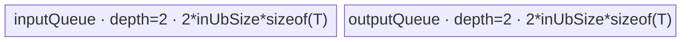
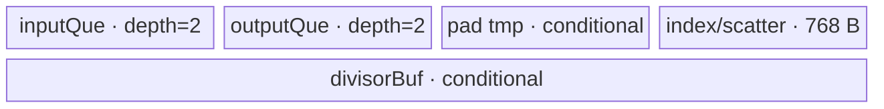
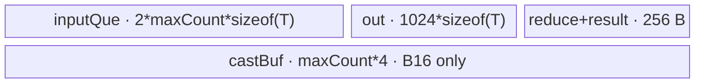

# AvgPool3d 950 ACLNN 算子知识

## 算子速览

| 项目 | 内容 |
|---|---|
| 实际入口 | `aclnnAvgPool3dGetWorkspaceSize` + `aclnnAvgPool3d`，公开两段式 ACLNN；内部最新节点为 `AvgPool3D`。 |
| 计算语义 | 对 NCDHW 的每个输出窗口求 FP32 累加均值；除数优先为 `divisorOverride`，否则由 `countIncludePad` 决定是否计入 pad。 |
| 输入输出 | `self/out` 为 4D `C,D,H,W` 或 5D `N,C,D,H,W` ND Tensor，FLOAT/FLOAT16/BFLOAT16；shape/dtype/format 必须匹配。 |
| 执行类型 | 单个算子自有 Device 节点；R-001/R-003 为 `NDDMA+AIV_VECTOR`，R-002 为 `NDDMA/AIV_VECTOR` gather，R-004 为 `SIMT`。950 entry 设置 `KERNEL_TYPE_AIV_ONLY`，无 Cube/AIC/MIX_CV。 |
| Kernel 路线 | R-001 `100001` ksize-one；R-002 `300001/300002/300003/300004` NCDHW small；R-003 `511110` NCDHW big；R-004 `911100/911110` SIMT fallback。 |
| 核心资源 | GM、AIV UB `TQue/TBuf` 或 SIMT dynamic UB；每条 Route 节点 workspace 均为 `WS_SYS_SIZE=16 MiB`。 |
| 来源闭包 | `source_closed`：公开 ACLNN、950 NCDHW 图编排、优先级 selector、POD、950 entry、四条公开可达 body 与构建接线闭合；框架 `Contiguous/Reshape/ViewCopy` 按框架边界标注。 |
| 验证状态 | 已完成源码闭包检查；本次知识提取未执行编译、真机、数值或性能测试。 |

## 接口与语义

### 计算语义

对输出位置 `(n,c,od,oh,ow)`，窗口起点为 `(od*sD-pD, oh*sH-pH, ow*sW-pW)`；只累加落在输入域内的元素。`divisorOverride!=0` 时用该值，否则 `countIncludePad=true` 使用含 pad 的窗口体积，`false` 使用有效元素数。4D 输入先 view 成 `1,C,D,H,W`，末尾 view 回 4D。

### 输入、输出与属性

| 参数 | shape/layout | dtype | 约束、默认值与语义 |
|---|---|---|---|
| `self` | 4D/5D ND，允许非连续 | FLOAT/FLOAT16/BFLOAT16 | 非空指针；kernel 每维必须在 `(0,input_dim]`。 |
| `kernelSize` | 长度 1 或 3 | INT64 | 归一为 `{kD,kH,kW}`，各值大于 0。 |
| `stride` | 长度 0、1 或 3 | INT64 | 空时等于 kernel；其余归一为 `{sD,sH,sW}`，各值大于 0。 |
| `padding` | 长度 1 或 3 | INT64 | 各值范围 `[0,k/2]`，归一为对称 `{pD,pH,pW}`。 |
| `ceilMode` | Host bool | BOOL | 控制输出 shape 向上取整，若最后窗口起点越过右边界则再减 1。 |
| `countIncludePad` | Host bool | BOOL | 无 override 时决定除数是否包含 pad。 |
| `divisorOverride` | Host scalar | INT64 | `0` 表示不覆盖；非零直接作为除数。 |
| `out` | 与计算所得 4D/5D shape 相同 | 与 `self` 相同 | 最终由框架 `ViewCopy` 写入，允许非连续。 |

### 入口与版本

公开文档明确支持 Ascend 950PR/950DT。第一段 API 在固定仓中没有更高编号版本；950 L0 `IsAiCoreSupport` 经 `IsRegbase(curArch)` 命中 `AvgPool3D`，OpDef 的 `ascend950` 配置把 `opFile.value` 指向 `avg_pool3_d_apt`。950 `IsEnableNCDHW` 因 `isRegbase` 恒为真，因此 ACLNN 的 950 非空路线不会添加前后 `Transpose`，始终把 `data_format="NCDHW"` 传给算子节点。

## Host/Launcher 执行流程

### 参数校验与前处理

`aclnnAvgPool3dGetWorkspaceSize` 先检查公共输出指针，创建 executor，再由 `CheckParams` 检查空指针、dtype/format、rank、kernel/stride/pad 和输出 shape。空 Tensor 返回 workspace 0。非空时依次执行框架 `Contiguous`；4D 输入再 `Reshape` 为 5D；调用 `l0op::AvgPool3D(...,"NCDHW")`；4D 输出再 `Reshape` 回原 rank；最后 `ViewCopy` 到用户输出。任一中间返回空指针立即失败。

### 参数、Workspace 与生命周期

`l0op::AvgPool3D` 分配同 dtype/format 的中间输出，并通过 `ADD_TO_LAUNCHER_LIST_AICORE(AvgPool3D,...)` 加入 executor。四个 Tiling 模板都把节点 workspace 设置为 `WS_SYS_SIZE=16*1024*1024` 字节；Kernel body 不把它作为跨 Kernel 中间结果。框架节点额外 workspace、slice offset 与 executor 内部 event 固定仓不可见；总量由 `uniqueExecutor->GetWorkspaceSize()` 返回，owner 为调用者，生命期覆盖第二段 `CommonOpExecutorRun`。

### 启动图与失败传播

```text
self -> F0 Contiguous -> [F1 Reshape(4D only)]
     -> K0 AvgPool3D / avg_pool3_d [one of R-001..R-004]
     -> [F2 Reshape(4D only)] -> F3 ViewCopy -> out
```

K0 是单 Kernel 节点，entry 参数为 `(x,y,workspace,tiling)`；blockDim 由命中模板产生。所有节点在同一 executor/stream 的依赖图中有序执行；任一 Host 添加或运行失败阻断后继。固定仓没有公开 executor 的 event 实现。

## Route 与参数设计

### 分核与资源计算

模板注册表按 priority 从小到大尝试；`DoTiling` 对 `IsCapable=false` 返回 `GRAPH_PARAM_INVALID` 才继续。公共解析把 NCDHW 的 `N*C` 折叠为 `batches`、`channels=1`，校验输出 shape，必要时对输出为 1 的轴执行 `RefineShape`。各 Route 再独立计算 UB tile 和 blockDim：R-001 对 `nLoop*dLoop*hLoop*wLoop` 均分；R-002 同样按 tile loop 均分；R-003 对 `N*C*Do*Ho*Wo` 均分；R-004 直接用平台 coreNum。

### Route 选择

| 顺序 | Route | Key/模板 | 精确选择条件与优先级 | 不适用去向 |
|---:|---|---|---|---|
| 1 | R-001 ksize-one | `100001`, priority 0 | `kD==kH==kW==1`；950 NCDHW 不受 NDHWC channel guard 影响。 | R-002 |
| 2 | R-002 NCDHW small | `300001/2/3/4`, priority 10 | NCDHW；D/H 不同时满足 `dilation>=3 && stride>=3`；输出点数 `N*C*Do*Ho*Wo >= coreNum`；padding 离散 guard 通过；`IsBufferCapable()`。 | R-003 |
| 3 | R-003 NCDHW big | `511110`, priority 11 | NCDHW，且 `output_points < 2*coreNum`，或 `kD*kH*kW*dtypeSize >= 256`。 | R-004 |
| 4 | R-004 SIMT | `911100/911110`, priority 19 | `IsCapable()` 恒 true；NCDHW 输入输出总元素都不超过 `INT32_MAX` 用 int32，否则 int64。 | 无；公共解析失败则整体失败。 |

```text
if kD==1 && kH==1 && kW==1 -> R-001
else if small.IsCapable && small.IsBufferCapable -> R-002
else if output_points < 2*coreNum || kernel_volume*dtypeSize >= 256 -> R-003
else -> R-004
```

### 模板/实现执行矩阵

| Route | key/selector | dtype/shape/platform 完整命中条件 | 执行拓扑与 Kernel 节点 | 实际模板/body | 内存与同步特征 | tail/fallback |
|---|---|---|---|---|---|---|
| R-001 | `100001` | 上述 priority 0 条件；FP16/BF16/FP32 | 单 K0 | `Pool3DKsizeOneKernel<DTYPE_X,OP_TYPE_AVG_POOL_3D>` | NDDMA gather；双缓冲输入/输出 Queue | 按最后 n/d/h/w tile 算有效长度 |
| R-002 | `300001/2/3/4` | small `IsCapable`，key 再由 pad/除数/sparse 分化 | 单 K0 | `Pool3DNcdhwSmallKernel` 或 `Pool3DNcdhwSmallKernelPad` | 双 Queue、index/tmp/divisor TBuf；Queue 同步 | split batch/depth/row/col 与有效 mask |
| R-003 | `511110` | big guard | 单 K0 | `Pool3DNcdhwBigKernel<DTYPE_X,AVG>` | NDDMA 三维搬运；FP32 reduce；event V→MTE3 | kernel 可全载或按 D/H/W 分段 |
| R-004 | `911100/911110` | fallback；总元素决定索引位宽 | 单 K0 | `AvgPool3DSimtImpl<DTYPE_X,int32_t/int64_t,NCDHW>` | dynamic UB 保存 POD 与 8 个 magic/shift；512 threads | grid-stride loop + 每线程边界裁剪 |

### 隐藏性能 Guard

| Guard | Host/Tiling 条件 | Device/资源原因 | 影响 Route | 不满足时去向 | 源码符号 |
|---|---|---|---|---|---|
| ksize-one | 三轴 kernel 都为 1 | 可用 NDDMA 直接采样，省去窗口归约 | R-001 | R-002 | `Pool3DOneKsizeTiling::IsCapable` |
| small UB | `CalcBufferSize(...) <= availableUb_` 并满足输入元素上限 | Queue、pad tmp、FP32 output/divisor 必须同时驻留 | R-002 | R-003 | `IsBufferCapable` |
| small 离散轴 | D/H 的 dilation 与 stride 不同时 `>=3`；pad 大步长受限 | gather/scatter tile 不处理高度离散窗口 | R-002 | R-003 | `Pool3DNcdhwSmallKernelTiling::IsCapable` |
| big kernel | `out_points<2*C \|\| volume*dtypeSize>=256` | 为低并行或大归约窗口选逐输出分块 reduce | R-003 | R-004 | `Pool3DNcdhwBigKernelTiling::IsCapable` |
| SIMT 索引 | `xSize,ySize<=INT32_MAX` | magic division 与地址索引位宽 | R-004 | int64 key | `Pool3DSimtTiling::GetTilingKey` |
| SIMT local memory | `localMemory=platformUB-128KiB` | 预留 DCache 后承载 POD/参数 | R-004 | 设置失败则整体失败 | `Pool3DSimtTiling::PostTiling` |

### POD/ABI

所有宏定义 POD 按声明顺序序列化；固定仓未显式给出 C++ `alignof/offsetof`，因此这里只给出字段类型/顺序，不能推测 padding。

| 结构 | 字段 | 类型/位宽 | ABI 布局 | 单位 | Host/launcher producer | Device consumer | 边界 |
|---|---|---|---|---|---|---|---|
| `Pool3DOneKsizeTilingData` | `inUbSize` | int64/64 | 声明序第1 | 元素 | `DoBlockTiling` | 两个 `InitBuffer` | 向 block 对齐 |
| 同上 | `dataFormat` | int64/64 | 第2 | enum | `InitializationVars` | `CopyInMultiRows` | 950 为 NCDHW=0 |
| 同上 | `blockFactor`,`blockTail` | 各 int64/64 | 第3～4 | loop | `DoBlockTiling` | `Process` | former/tail core |
| 同上 | `ubFactorN`,`outUbFactorD/H/W` | 各 int64/64 | 第5～8 | 元素 | `DoUBTilingSingle` | `Process` | 尾 tile 重算有效长 |
| 同上 | `nLoop`,`dLoop`,`hLoop`,`wLoop` | 各 int64/64 | 第9～12 | loop | `DoUBTilingSingle` | `Process` | 乘积为总 tile |
| 同上 | `channel` | int64/64 | 第13 | 元素 | 公共解析 | 地址公式 | 950 NCDHW 为1 |
| 同上 | `dInDim`,`hInDim`,`wInDim` | 各 int64/64 | 第14～16 | 元素 | 公共 shape | NDDMA stride | 正值 |
| 同上 | `nOutDim`,`dOutDim`,`hOutDim`,`wOutDim` | 各 int64/64 | 第17～20 | 元素 | 公共 shape | tile tail | 正值 |
| 同上 | `sD`,`sH`,`sW` | 各 int64/64 | 第21～23 | 元素 | attrs | NDDMA source stride | 正值 |
| 同上 | `divisor` | int64/64 | 第24 | scalar | `CalcDivisor` | `ComputeAvg` | ksize=1 时 override 或1 |
| `Pool3DNcdhwSmallKernelTilingData` | `dInDim,hInDim,wInDim` | 各 int64/64 | 第1～3 | 元素 | 公共 shape | 地址/stride | 正值 |
| 同上 | `nOutDim,dOutDim,hOutDim,wOutDim,channel` | 各 int64/64 | 第4～8 | 元素 | 公共 shape | `BaseCompute` | N*C 已折为 nOutDim |
| 同上 | `kD,kH,kW`,`sD,sH,sW`,`dD,dH,dW` | 各 int64/64 | 第9～17 | 元素 | attrs/refine | index/gather | dilation 950 ACLNN 为1 |
| 同上 | `frontPad,backendPad,topPad,bottomPad,leftPad,rightPad` | 各 int64/64 | 第18～23 | 元素 | attrs/refine | pad/index | 对称 API 输入，refine 可清零 |
| 同上 | `divisor` | int64/64 | 第24 | scalar | `CalcDivisor` | avg helper | 0 表示逐位置计算 |
| 同上 | `blockFactor,blockTail` | 各 int64/64 | 第25～26 | tile | `DoBlockTiling` | `BaseCompute` | former/tail core |
| 同上 | `ubFactorN,outUbFactorD/H/W` | 各 int64/64 | 第27～30 | 元素 | UB tiling | `BaseCompute` | 有效 tile |
| 同上 | `nLoop,dLoop,hLoop,wLoop` | 各 int64/64 | 第31～34 | loop | UB tiling | `BaseCompute` | 总 loop |
| 同上 | `inUbSize,outUbSize,divisorUbSize` | 各 int64/64 | 第35～37 | 元素/字节 | `DoBlockTiling` | `InitBuffer` | divisorUbSize 是字节，其余为元素 |
| 同上 | `gatherMode,splitMode,divisorMode,realCalcDivisor,useTraiTwo,sparseMode` | 各 int32/32 | 第38～43 | enum/flag | `Calc*` | template/branch | inactive 分支不读 |
| `Pool3DNcdhwBigKernelTilingData` | `dInDim,hInDim,wInDim,dOutDim,hOutDim,wOutDim` | 各 int64/64 | 声明顺序 | 元素 | `SetTilingData` | `CalcKernelSize` | 正值 |
| 同上 | `kD,kH,kW,sD,sH,sW,dD,dH,dW` | 各 int64/64 | 后续顺序 | 元素 | attrs | NDDMA/窗口裁剪 | dilation=1 |
| 同上 | `fPad,bkPad,tPad,bPad,lPad,rPad` | 各 int64/64 | 后续顺序 | 元素 | attrs/refine | `CalcKernelSize` | 非负 |
| 同上 | `divisorOverride,countIncludePad` | 各 int64/64 | 后续顺序 | scalar/flag | attrs | `CalcKernelSize` | 决定 `mulsFactor_` |
| 同上 | `blockFactor,blockTail,totalIdx,coreNums,maxCount,isSigOut` | 各 int64/64 | 尾部顺序 | loop/元素/flag | `DoUBTiling` | `Init/Process` | maxCount 按 UB 对齐 |
| `Pool3DSimtTilingData` | `nDim,cDim,dInDim,hInDim,wInDim,dOutDim,hOutDim,wOutDim` | 各 int64/64 | 第1～8 | 元素 | `SetTilingData` | SIMT address | NCDHW 下 cDim=1、nDim=N*C |
| 同上 | `kD,kH,kW,sD,sH,sW,dD,dH,dW` | 各 int64/64 | 第9～17 | 元素 | attrs | SIMT window | body 未使用 dilation 字段 |
| 同上 | `fPad,bkPad,tPad,bPad,lPad,rPad` | 各 int64/64 | 第18～23 | 元素 | attrs/refine | SIMT clamp | 非负 |
| 同上 | `divisorOverride,countIncludePad` | 各 int64/64 | 第24～25 | scalar/flag | attrs | SIMT divisor | override 非零优先 |

### Route 源码闭包

| Route | Key/selector | Host/Tiling producer | POD/参数 | Kernel entry/router 节点 | Kernel body/直接依赖 | 构建接线 |
|---|---|---|---|---|---|---|
| R-001 | `100001` | `pool_3d_one_kize_tiling.cpp` | `Pool3DOneKsizeTilingData` | `avg_pool3_d_apt.cpp::avg_pool3_d` | `pool_3d_ksize_one_kernel.h` | OpDef `avg_pool3_d_apt` + binary config |
| R-002 | `300001..4` | `pool_3d_ncdhw_small_kernel_tiling.cpp` | `Pool3DNcdhwSmallKernelTilingData` | 同上 | `pool_3d_ncdhw_small_kernel{,_pad}.h`, `pool_3d_common.h` | 同上 |
| R-003 | `511110` | `pool_3d_ncdhw_big_kernel_tiling.cpp` | `Pool3DNcdhwBigKernelTilingData` | 同上 | `pool_3d_ncdhw_big_kernel.h` | 同上 |
| R-004 | `911100/911110` | `pool_3d_simt_tiling.cpp` | `Pool3DSimtTilingData` | 同上 | `avg_pool_3d_simt.h` | 同上 |

## Kernel 实现

### 公共执行流程

entry 先构造 `TPipe` 并设置 `KERNEL_TASK_TYPE_DEFAULT(KERNEL_TYPE_AIV_ONLY)`，再按 tiling key 解析对应 POD、构造实现类、`Init(x,y)`、`Process()`。每条 Route 都是单 Device 节点，未识别 key 时无 body 执行。FP16/BF16 平均值路径均以 FP32 累加或除法后再降精度；FP32 直接计算。

### Route R-001：ksize-one NDDMA 采样

#### 适用条件

##### 选择证据

| 层级 | 文件 | 符号 | 源码谓词/参数 | 结果/下一跳 |
|---|---|---|---|---|
| Tiling | `pool_3d_one_kize_tiling.cpp` | `IsCapable` | `kD==kH==kW==1` | key `100001` |
| Router | `avg_pool3_d_apt.cpp` | `avg_pool3_d` | `TILING_KEY_IS(100001)` | `Pool3DKsizeOneKernel<DTYPE_X,AVG>` |

#### Device 数据流

##### 函数级调用链

```text
avg_pool3_d -> Pool3DKsizeOneKernel::Init -> Process
  -> CopyInMultiRows(NDDMA 4D) -> ComputeAvg -> CopyMaxOut
```

##### 源码等价伪码

```text
for tile in this_core_former_or_tail_range:
  decode tile -> n/d/h/w tile; clamp last factors
  NDDMA gather strides=(sW,sH*Win,sD*Hin*Win,Din*Hin*Win)
  for vector chunk: fp16/bf16 -> fp32; dst=src/divisor; cast back
  DataCopyPad(valid_elements) -> y
```

#### 内存与数据搬运

##### 资源与搬运表

| 层级/缓冲区 | offset/地址公式 | extent/容量公式 | dtype/layout | producer | consumer | owner/lifetime | 对齐/复用 |
|---|---|---|---|---|---|---|---|
| inputQueue | tile source offset | `2*inUbSize*sizeof(T)` | T/NCDHW sample | NDDMA | ComputeAvg | TPipe/tile | depth=2 |
| outputQueue | tile output offset | `2*inUbSize*sizeof(T)` | T | ComputeAvg | CopyMaxOut | TPipe/tile | depth=2 |
| GM y | decoded dstOffset | valid tile elements | T/NCDHW | CopyMaxOut | caller | caller | tail uses byte length |

##### 分层内存布局



##### 字节账与复用顺序

```text
UB_total = 4*inUbSize*sizeof(T)
workspace_total = 16 MiB system slice
```

| 复用子区 | 写入者 | 读取者/消费点 | 下一次覆盖 | 同步或释放依据 | 安全条件 |
|---|---|---|---|---|---|
| inputQueue slot | NDDMA | ComputeAvg | 下一 tile | EnQue/DeQue/FreeTensor | depth=2 |
| outputQueue slot | ComputeAvg | CopyMaxOut | 下一 tile | EnQue/DeQue/FreeTensor | 有效长度已裁剪 |

#### 同步、精度与尾块

##### 同步与数值边界表

| 阶段 | primitive/机制 | producer | consumer/等待点 | 保护对象 | 精度/尾块 |
|---|---|---|---|---|---|
| 搬入→计算 | TQue | CopyIn | DeQue | input slot | last tile clamp |
| 计算→搬出 | TQue | ComputeAvg | DeQue | output slot | B16 升 FP32 除法再 cast |

#### 关键实现

##### 符号证据表

| 阶段 | 文件 | 符号/模板实例 | 实现事实 |
|---|---|---|---|
| Host/Tiling producer | `pool_3d_one_kize_tiling.cpp` | `DoUBTiling/DoBlockTiling` | UB tile 与分核 |
| Kernel entry/router | `avg_pool3_d_apt.cpp` | key `100001` | AIV-only 路由 |
| Device body/helper | `pool_3d_ksize_one_kernel.h` | `Process/CopyInMultiRows/ComputeAvg` | NDDMA 稀疏采样和 Vector 除法 |

### Route R-002：NCDHW small gather/pad

#### 适用条件

##### 选择证据

| 层级 | 文件 | 符号 | 源码谓词/参数 | 结果/下一跳 |
|---|---|---|---|---|
| Registry | `pool_3d_ncdhw_small_kernel_tiling.cpp` | registration | priority 10 | 在 big/SIMT 前尝试 |
| Tiling | 同上 | `IsCapable/GetTilingKey` | NCDHW、离散 guard、并行度、buffer guard | keys `300001..4` |

#### Device 数据流

##### 函数级调用链

```text
avg_pool3_d
 -> Pool3DNcdhwSmallKernel[Pad]::Init
 -> Process -> BaseCompute<index,gatherMode>
 -> [Sparse]CopyInMultiRows -> GenGatherIndex -> Pool3DWithOneLoop
 -> optional ComputeDivisor/AvgPoolDiv* -> CopyMaxOut
```

##### 源码等价伪码

```text
decode core tile; derive valid input and output extents
copy compact input tile (pad route also materializes pad tmp)
generate uint16/uint32 gather indices for 1 row / rows / planes / batches
for each output lane: gather kD*kH*kW, FP32 reduce-sum
if divisor==0 compute per-position divisor; else use scalar divisor
cast/store only valid output tail
```

#### 内存与数据搬运

##### 资源与搬运表

| 层级/缓冲区 | offset/地址公式 | extent/容量公式 | dtype/layout | producer | consumer | owner/lifetime | 对齐/复用 |
|---|---|---|---|---|---|---|---|
| inputQue | tile input offset | `2*inUbSize*sizeof(T)` | T compact NCDHW | DataCopy/NDDMA | gather | TPipe/tile | depth=2 |
| outputQue | tile output offset | `2*outUbSize*sizeof(T)` allocation formula; B16 real-div may hold FP32 bytes | T/FP32 temp | reduce | CopyOut | TPipe/tile | depth=2 |
| tmpBuf | N/A | `inUbSize*sizeof(T)` | T | pad scatter | gather | pad route | no-pad absent |
| index/scatter | N/A | `2*256 + 256` bytes | uint16/uint32 | GenIndex | gather | kernel | fixed |
| divisorBuf | N/A | `divisorUbSize` bytes | FP32 | ComputeDivisor | AvgPoolDiv* | conditional | only real divisor |

##### 分层内存布局



##### 字节账与复用顺序

```text
UB_total(no-pad)=2*inUbSize*sizeof(T)+2*outUbSize*sizeof(T)+512
UB_total(pad)=above+inUbSize*sizeof(T)+256+divisorUbSize
workspace_total=16 MiB
```

| 复用子区 | 写入者 | 读取者/消费点 | 下一次覆盖 | 同步或释放依据 | 安全条件 |
|---|---|---|---|---|---|
| Queue slots | CopyIn/reduce | gather/CopyOut | next tile | Queue lifecycle | Host buffer guard |
| divisorBuf | ComputeDivisor | normalization | next batch/tile | sequential Vector scope | `realCalcDivisor`/mode |

#### 同步、精度与尾块

##### 同步与数值边界表

| 阶段 | primitive/机制 | producer | consumer/等待点 | 保护对象 | 精度/尾块 |
|---|---|---|---|---|---|
| Copy/Compute | TQue | CopyIn | DeQue | input | compact pad and valid shape |
| gather/reduce | MicroAPI mask | index generator | Pool3DWithOneLoop | lanes | B16 accumulate FP32 |
| divisor | mode + mask | ComputeDivisor | AvgPoolDiv | divisor lanes | includePad/valid window |

#### 关键实现

##### 符号证据表

| 阶段 | 文件 | 符号/模板实例 | 实现事实 |
|---|---|---|---|
| Host/Tiling producer | `pool_3d_ncdhw_small_kernel_tiling.cpp` | `IsCapable/CalcBufferSize/CalcGatherMode` | 完整 selector 与资源上界 |
| Kernel entry/router | `avg_pool3_d_apt.cpp` | keys `300001..4` | no-pad/pad/div/sparse 路由 |
| Device body/helper | `pool_3d_ncdhw_small_kernel{,_pad}.h` | `BaseCompute/Compute*` | gather、pad、divisor、tail |

### Route R-003：NCDHW big-window 分段归约

#### 适用条件

##### 选择证据

| 层级 | 文件 | 符号 | 源码谓词/参数 | 结果/下一跳 |
|---|---|---|---|---|
| Tiling | `pool_3d_ncdhw_big_kernel_tiling.cpp` | `IsCapable` | NCDHW 且低输出并行或 `volume*dtypeSize>=256` | `511110` |

#### Device 数据流

##### 函数级调用链

```text
avg_pool3_d -> Pool3DNcdhwBigKernel::Init -> Process
 -> BaseCompute -> CalcKernelSize
 -> CopyInMultiItems(NDDMA) -> ComputeSum -> ComputeAvg -> CopyMaxOut
```

##### 源码等价伪码

```text
for output idx owned by core:
  clip D/H/W window; choose divisor
  if valid_volume<=maxCount: one 3D NDDMA copy
  else split first by D, then H, finally W so each chunk<=maxCount
  FP32 ReduceSum each chunk into one accumulator
  multiply reciprocal, cast once, batch outputs in 1024-element UB buffer
```

#### 内存与数据搬运

##### 资源与搬运表

| 层级/缓冲区 | offset/地址公式 | extent/容量公式 | dtype/layout | producer | consumer | owner/lifetime | 对齐/复用 |
|---|---|---|---|---|---|---|---|
| inputQue | clipped window base | `2*maxCount*sizeof(T)` | T compact window | 3D NDDMA | ReduceSum | TPipe/chunk | depth=2 |
| output batch | idx mod 1024 | `1024*sizeof(T)` | T | ComputeAvg | MTE3 | TPipe/core | flush at full/tail |
| reduce/result | N/A | 128 B each | FP32/T | ReduceSum | ComputeAvg | TPipe/output | scalar live value |
| castBuf | N/A | `maxCount*sizeof(float)` | FP32 | Cast | ReduceSum | conditional B16 | absent FP32 |

##### 分层内存布局



##### 字节账与复用顺序

```text
UB_total(FP32)=2*maxCount*4+1024*4+256
UB_total(B16)=2*maxCount*2+1024*2+256+maxCount*4
workspace_total=16 MiB
```

| 复用子区 | 写入者 | 读取者/消费点 | 下一次覆盖 | 同步或释放依据 | 安全条件 |
|---|---|---|---|---|---|
| inputQueue | NDDMA | ComputeSum | next chunk | FreeTensor | chunk<=maxCount |
| output batch | ComputeAvg | CopyMaxOut | next batch | V_MTE3 event | flush full/tail |

#### 同步、精度与尾块

##### 同步与数值边界表

| 阶段 | primitive/机制 | producer | consumer/等待点 | 保护对象 | 精度/尾块 |
|---|---|---|---|---|---|
| output flush | `SetFlag/WaitFlag<V_MTE3>` | Vector | MTE3 | output UB | last partial uses exact bytes |
| accumulation | Queue + ReduceSum | NDDMA | Vector | chunk | B16 cast FP32, one final cast |

#### 关键实现

##### 符号证据表

| 阶段 | 文件 | 符号/模板实例 | 实现事实 |
|---|---|---|---|
| Host/Tiling producer | `pool_3d_ncdhw_big_kernel_tiling.cpp` | `DoUBTiling` | maxCount 与 former/tail core |
| Kernel entry/router | `avg_pool3_d_apt.cpp` | key `511110` | big body |
| Device body/helper | `pool_3d_ncdhw_big_kernel.h` | `SplitKernelProcess/ComputeSum` | D/H/W 分段 NDDMA 与 FP32 reduce |

### Route R-004：SIMT fallback

#### 适用条件

##### 选择证据

| 层级 | 文件 | 符号 | 源码谓词/参数 | 结果/下一跳 |
|---|---|---|---|---|
| Registry | `pool_3d_simt_tiling.cpp` | registration/`IsCapable` | priority 19、恒 true | fallback |
| Tiling | 同上 | `GetTilingKey` | NCDHW 且 x/y size 是否均 `<=INT32_MAX` | `911100` 或 `911110` |

#### Device 数据流

##### 函数级调用链

```text
avg_pool3_d -> AvgPool3DSimtImpl::Init -> Process
 -> populate POD/magic-shift UB
 -> asc_vf_call<AvgPool3dNcSimtCompute>(dim3(512))
```

##### 源码等价伪码

```text
for i = blockIdx*blockDim+threadIdx; i < output_size; i += gridDim*blockDim:
  decode i by magic division into nc,d,h,w
  clamp window to input; if empty write 0
  divisor = override ? override : (includePad ? padded_volume : valid_volume)
  float sum=0; scalar-loop valid D/H/W; y[i]=cast<T>(sum/divisor)
```

#### 内存与数据搬运

##### 资源与搬运表

| 层级/缓冲区 | offset/地址公式 | extent/容量公式 | dtype/layout | producer | consumer | owner/lifetime | 对齐/复用 |
|---|---|---|---|---|---|---|---|
| GM x/y | direct scalar addresses | logical tensors | T/NCDHW | caller/thread | thread/caller | caller | bounds-clamped |
| tilingBuf | UB | `32*sizeof(int64)` | POD | wrapper | SIMT | TPipe/kernel | zero padded |
| paramBuf | UB | `8*sizeof(TYPE_T)` | int32/int64 magic/shift | wrapper | SIMT | TPipe/kernel | key-selected width |

##### 分层内存布局

N/A（未使用 AIV Queue）；替代路径是 dynamic UB 中 `tilingBuf` 与 `paramBuf`，Host 设 local memory 为 `platformUB-128KiB`。

##### 字节账与复用顺序

```text
explicit_param_UB = 256 + 8*sizeof(index_t)
dynamic_ub = platform_UB - 128 KiB
workspace_total = 16 MiB
```

| 复用子区 | 写入者 | 读取者/消费点 | 下一次覆盖 | 同步或释放依据 | 安全条件 |
|---|---|---|---|---|---|
| tiling/param UB | wrapper | all SIMT threads | kernel end | `asc_vf_call` launch scope | launch 前全部填充 |

#### 同步、精度与尾块

##### 同步与数值边界表

| 阶段 | primitive/机制 | producer | consumer/等待点 | 保护对象 | 精度/尾块 |
|---|---|---|---|---|---|
| thread map | grid-stride loop | launch | each thread | output element | `i<outSize` guard |
| arithmetic | thread-local scalar | GM reads | GM write | one output | FP32 sum/division；无 atomic/barrier |

#### 关键实现

##### 符号证据表

| 阶段 | 文件 | 符号/模板实例 | 实现事实 |
|---|---|---|---|
| Host/Tiling producer | `pool_3d_simt_tiling.cpp` | `GetTilingKey/PostTiling` | 索引位宽、blockDim、dynamic UB |
| Kernel entry/router | `avg_pool3_d_apt.cpp` | `911100/911110` | NCDHW int32/int64 |
| Device body/helper | `avg_pool_3d_simt.h` | `AvgPool3dNcSimtCompute` | 512-thread grid-stride 标量窗口归约 |

## 算子特定优化

### Trick T-001：ksize-one 用 NDDMA 直接稀疏采样

#### 触发与源码依据

- 适用 Route：R-001
- 触发条件：`kD==kH==kW==1`
- Golden 来源：[`pool_3d_ksize_one_kernel.h:116-152`](../../../../../../../cann-ops-raw/ascendc/ops-nn/955f8b33985b6d72989ebff341bb9c2c564a51bc/pooling/pool_3d_common/op_kernel/arch35/pool_3d_ksize_one_kernel.h#L116-L152)

**官方源码（固定 Commit 连续逐字摘录）**：

```cpp
loopInfo.loopSrcStride[ZERO] = tilingData_->sW;
loopInfo.loopSrcStride[ONE] = tilingData_->sH * tilingData_->wInDim;
loopInfo.loopSrcStride[TWO] = tilingData_->sD * tilingData_->hInDim * tilingData_->wInDim;
loopInfo.loopDstStride[ZERO] = 1;
```

#### 机制与设计原因

窗口体积为 1 时无需加载连续邻域再归约；四维 NDDMA 直接按 stride 采样并紧凑写 UB，随后只做 override 除法。它减少无效 GM 搬运与窗口循环。

#### 迁移边界

- 适用：规则多维稀疏采样且每个输出只对应一个输入点。
- 前提：NDDMA loop size/stride 可表达、输出不重叠、tile 满足 UB。
- 失效：任一 kernel 轴大于 1 时转 R-002/R-003/R-004。
- 未验证：本次知识提取未执行编译、真机、数值或性能测试。

#### 错误做法

固定仓未提供可验证反例。

### Trick T-002：大窗口按 D→H→W 层级分段且只做一次降精度

#### 触发与源码依据

- 适用 Route：R-003
- 触发条件：窗口有效体积超过 `maxCount`
- Golden 来源：[`pool_3d_ncdhw_big_kernel.h:338-378`](../../../../../../../cann-ops-raw/ascendc/ops-nn/955f8b33985b6d72989ebff341bb9c2c564a51bc/pooling/pool_3d_common/op_kernel/arch35/pool_3d_ncdhw_big_kernel.h#L338-L378)

**官方源码（固定 Commit 连续逐字摘录）**：

```cpp
if (curkHW <= maxCount) {
    int64_t dFactor = maxCount / curkHW;
    // split D
} else if (curkW <= maxCount) {
    int64_t hFactor = maxCount / curkW;
    // split H
} else {
    int64_t wFactor = maxCount;
}
```

#### 机制与设计原因

优先保留完整 HW 平面，其次完整 W 行，最后才切 W，使每次 NDDMA 尽可能搬运规则连续区域；所有 chunk 累加到 FP32 scalar 后才乘倒数并 cast，避免分块间反复量化。

#### 迁移边界

- 适用：大三维窗口、可逐输出独立归约。
- 前提：`maxCount>0`，窗口地址可由三维 stride 表达。
- 失效：big selector 不命中时由 small 或 SIMT 处理。
- 未验证：本次知识提取未执行编译、真机、数值或性能测试。

#### 错误做法

固定仓未提供可验证反例。

## 模板与实现对比

| 对比维度 | R-001 ksize-one | R-002 small | R-003 big | R-004 SIMT | 设计选择依据 |
|---|---|---|---|---|---|
| 命中条件/优先级 | k=1 / 0 | buffer/离散 guard / 10 | 低并行或大 volume / 11 | 恒 true / 19 | 从专用到通用 |
| 模板与 dtype | NDDMA+Vector，三 dtype | gather/pad Vector，三 dtype | NDDMA Reduce，三 dtype | int32/int64 index | shape/resource |
| 循环与分核 | tile loop | tile+gather mode | 每核连续输出 idx | 512-thread grid-stride | 并行域差异 |
| Queue/TBuf/dynamic UB | 2 Queue | Queue+tmp/index/div | Queue+reduce/cast | dynamic UB POD/param | 实际 body |
| 内存总占用与复用 | `4*inUb*T` | Host 精确 buffer 账 | Host `maxCount` 公式 | UB-128KiB | 资源上界 |
| 搬运/计算 API | NDDMA+Div | DataCopyPad+gather | 3D NDDMA+ReduceSum | scalar GM loop | 窗口规模 |
| 同步、精度与 tail | Queue；FP32 div | Queue/mask；FP32 sum | event；FP32 sum | 无 barrier；FP32 sum | 输出边界 |
| fallback/失败边界 | →small | →big | →SIMT | 公共解析失败 | priority fallthrough |

## 平台差异

| 项目 | A2 | A3 | 950 |
|---|---|---|---|
| 支持状态 | 公开支持，但非本卡；其 ACLNN 有条件式外部 Transpose | 公开支持，但非本卡；同左 | 公开支持且本卡闭合 |
| Host/Launcher | legacy AscendC selector | legacy AscendC selector | Regbase priority registry，NCDHW 恒可用 |
| Kernel/资源 | `avg_pool3_d.cpp` Vector body | 同左 | `avg_pool3_d_apt.cpp`，AIV Vector/NDDMA/SIMT |

## 限制与失败边界

- ACLNN 仅接受 4D/5D、支持 dtype、合法 kernel/stride/pad 和精确输出 shape；空 Tensor 不启动 Kernel。
- `divisorOverride` 在 API 层只以非零表示生效；固定仓未额外禁止负值，本文不推测其数值意图。
- unknown tiling key 在 entry 中没有显式错误写出；正常 Host selector 不应产生它。
- executor 通用节点的 workspace slice/event 细节固定仓不可见，按框架边界处理。
- 本次知识提取未执行编译、真机、数值或性能测试。

## 源码索引

### 链路索引

| 链路阶段 | 文件 | 关键符号 | 支撑内容 |
|---|---|---|---|
| 入口声明/约束 | `pooling/avg_pool3_d/docs/aclnnAvgPool3d.md` | `aclnnAvgPool3d*` | 公开平台、接口、约束 |
| 入口实现 | `pooling/avg_pool3_d/op_api/aclnn_avgpool3d.cpp` | `BuildAvgPool3dGraph` | 校验与 executor 图 |
| L0 launcher | `pooling/avg_pool3_d/op_api/avgpool3d.cpp` | `AvgPool3D/AvgPool3DAiCore` | 950 Regbase launch |
| Host/Tiling | `pooling/avg_pool3_d/op_host/avg_pool3_d_tiling.cpp` | `Tiling4AvgPool3DNNRegBase` | 进入 registry |
| selector | `pooling/pool_3d_common/op_host/arch35/pool_tiling_templates_registry.h` | `DoTilingImpl` | priority/fallthrough |
| small Tiling | `pooling/pool_3d_common/op_host/arch35/pool_3d_ncdhw_small_kernel_tiling.cpp` | `IsCapable` | R-002 |
| big Tiling | `pooling/pool_3d_common/op_host/arch35/pool_3d_ncdhw_big_kernel_tiling.cpp` | `IsCapable` | R-003 |
| SIMT Tiling | `pooling/pool_3d_common/op_host/arch35/pool_3d_simt_tiling.cpp` | `GetTilingKey` | R-004 |
| Kernel entry/body | `pooling/avg_pool3_d/op_kernel/avg_pool3_d_apt.cpp` | `avg_pool3_d` | 950 router |
| SIMT body | `pooling/pool_3d_common/op_kernel/arch35/avg_pool_3d_simt.h` | `AvgPool3dNcSimtCompute` | fallback body |
| 构建接线 | `pooling/avg_pool3_d/op_host/avg_pool3_d_def.cpp` | `AddConfig("ascend950")` | `avg_pool3_d_apt` |
| binary config | `pooling/avg_pool3_d/op_host/config/ascend950/avg_pool3_d_binary.json` | `op_type=AvgPool3D` | 950 三 dtype 二进制项 |
| kernel config | `scripts/kernel/binary_config/ascendc_config.json` | `name=AvgPool3D` | `ascend950` 编译单元 |
| 构建接线 | `pooling/avg_pool3_d/CMakeLists.txt` | `add_modules_sources` | 模块依赖 |

### 实现复用检查

| 检查项 | 可复用事实 | 不得改变的约束 | 源码符号 |
|---|---|---|---|
| ABI/POD | 四类 POD 可直接映射 | 字段顺序、位宽、单位与 key 必须一致 | 各 `BEGIN_TILING_DATA_DEF` |
| 调用顺序 | `Init -> Process` 单节点 | selector priority 0/10/11/19 不可重排 | registry `DoTilingImpl` |
| workspace/内存 | 每节点 16 MiB system slice | UB buffer depth、字节/元素单位不可混淆 | `GetWorkspaceSize/InitBuffer` |
| 同步 | Queue、V_MTE3 event、SIMT launch | Queue 释放与 event 等待不可省 | 各 body |
| 精度与尾块 | B16 FP32 累加/除法后 cast | divisor、mask、有效窗口裁剪不可改变 | `ComputeAvg/Pool3DWithOneLoop/SIMT` |
| 失败边界 | `GRAPH_PARAM_INVALID` 才 fallthrough | 其它失败必须中止 | `TilingBaseClass::DoTiling` |
