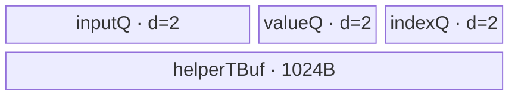

# MaxPool2dWithIndices 950 ACLNN 算子知识

## 算子速览

| 项目 | 内容 |
|---|---|
| 实际入口 | `aclnnMaxPool2dWithIndicesGetWorkspaceSize` + `aclnnMaxPool2dWithIndices`，950/RegBase 最新公开分支 |
| 计算语义 | 2D H/W 最大池化，同时输出输入 H×W 平面中的最大值索引 |
| 输入输出 | 3D/4D，NCHW/NHWC/ND；self/out FP16/BF16/FP32，indices INT32/INT64；dilation > 0 |
| 执行类型 | 单 Kernel；entry 为 `KERNEL_TYPE_MIX_AIV_1_0`，R-001/2/3/4 的可达 body 为 `AIV_VECTOR`，R-005 为 `SIMT`；无 Cube/AIC/MIX_CV 可达节点 |
| Kernel 路线 | R-001 Gather；R-002 BigKernelMulCore；R-003 BigKernel；R-004 NHWC small/large-C；R-005 SIMT fallback |
| 核心资源 | GM、双缓冲 TQue/TBuf/寄存器；R-002 额外 768 B 算法 workspace 与 `SyncAll`；SIMT 无 AIV UB |
| 来源闭包 | `source_closed`：公开 ACLNN→RegBase V3 API→MaxPoolWithArgmaxV3 Host priority selector→全部五条可达 route→POD/router/body/config 闭合 |
| 验证状态 | 已完成源码闭包检查；本次知识提取未执行编译、真机、数值或性能测试。 |

## 接口与语义

### 计算语义

对输出 `(n,c,oh,ow)`，窗口起点为 `(oh*sH-pH, ow*sW-pW)`，沿 H/W 以 dilation 采样；有效输入中的最大值写 `out`，其 `ih*Win+iw` 写 `indices`。相等值不覆盖已有 index；NaN 使用各 body 明确的 NaN mask/index 更新顺序。输出 shape 与 ceilMode 规则同 A2/A3 卡，但 950 允许正 dilation。

### 输入、输出与属性

| 参数 | shape/layout | dtype | 约束、默认值与语义 |
|---|---|---|---|
| self | CHW/HWC/NCHW/NHWC，3/4维 | FP16/BF16/FP32 | 非连续先 Contiguous；非空 |
| kernelSize | 长度1/2 | INT64数组 | >0，单值扩为 H/W |
| stride | 长度0/1/2 | INT64数组 | 空取 kernel；>0 |
| padding | 长度1/2 | INT64数组 | `0<=pad<=kernel/2` |
| dilation | 长度1/2 | INT64数组 | 950 每项 >0 |
| ceilMode | 标量 | BOOL | 控制输出尺寸 |
| out | 推导 shape/layout | 同 self | ViewCopy 到用户 storage |
| indices | 与 out 同 shape/layout | INT32/INT64 | dtype 直接下传 V3，避免主节点后的类型转换 |

### 入口与版本

公开产品表支持 Ascend 950PR/950DT。API 的 `IsRegbase()` 分支调用 `ExecMaxPool2dWithIndicesGetWorkspaceSizeV3`，其 L0 节点是 `MaxPoolWithArgmaxV3`；这比非 RegBase 的 V2 body 更新，且是 950 实际支持的最新公开版本。V3 OpDef 仅注册 `ascend950`，binary config 覆盖三种输入 dtype×两种 index dtype。

## Host/Launcher 执行流程

### 参数校验与前处理

先执行空指针、dtype、format、3/4维、属性长度和值、输出 shape/dtype/format 校验；RegBase dilation 只要求正数。空 tensor 返回 workspace 0。否则 `Contiguous(self)`；3D 输入在 dim0 `Unsqueeze` 成 4D；根据 storage format 下传 `NCHW` 或 `NHWC`；L0 规范化所有属性为长度2、infer shape、分配 out 与所请求 dtype 的 indices，并添加 `MaxPoolWithArgmaxV3` AICore launcher；最后 Squeeze（如需）并分别 ViewCopy。

### 参数、Workspace 与生命周期

除 R-002 外，Host 基类设置 `16 MiB` system workspace；R-002 设置 `16 MiB + 64*4 + 64*8 = 16 MiB + 768 B`，其中前 256 B 保存最多 64 个 FP32 局部最大值，随后 512 B 保存最多 64 个 INT64 宽度的局部 index。executor 拥有临时 tensor 与 launcher，第二段在传入 stream 顺序执行。框架 Contiguous/ViewCopy 的具体 workspace slice 固定仓不可见。

### 启动图与失败传播

```text
ACLNN executor (single stream)
  -> optional Contiguous / Unsqueeze
  -> one MaxPoolWithArgmaxV3 kernel
       selector priority 0 -> 4 -> 6 -> 20 -> 100
  -> optional Squeeze / ViewCopy(y, indices)
```

每条 route 都是单 Device 节点。R-002 的多核阶段发生在同一 Kernel 内：各参与核写 workspace，`SyncAll` 后负责汇总的核读取局部值/index 再写最终 GM；它不是多 Kernel。任一 Host/L0 节点失败阻断后续 copy。

## Route 与参数设计

### 分核与资源计算

R-001/R-004 从输出 tile 反推输入 tile并二分搜索满足 UB 与目标核数的最大 inner；buffer 总量都是双缓冲 input+value+index 加 1024 B helper。R-002 在输出数极少、窗口面积至少1024时让多个核协作一个输出。R-003 把连续输出展平成 `totalIdx` 均分到 `min(totalIdx,coreNum)` 核，并按 `maxCount` 切窗口。R-005 令 `threads=min(outputCount,256)`、`blockNum=min(ceil(outputCount/threads),coreNum)`。

### Route 选择

| 顺序 | Route | Key/模板 | 精确选择条件与优先级 | 不适用去向 |
|---:|---|---|---|---|
| 1 | R-001 Gather NCHW | 300001/300002 | priority0；NCHW；dH=dW=1；`kW*inputBytes<128`；最小 tile `totalBufferSize<=availableUb/32` | R-002 |
| 2 | R-002 BigKernelMulCore | 400001..400006 | priority4；NCHW；dilation=1；pad=0；`totalIdx/coreNum==0` 且 `totalIdx<16`；`kH*kW>=1024` | R-003 |
| 3 | R-003 BigKernel | 311110 | priority6；NCHW；dilation=1；`maxCount>1024`；`kW*dtypeSize>128` | R-004 |
| 4 | R-004 NHWC | 700001/2 small-C；800001/2 large-C | priority20；NHWC；dilation=1；small/large 由 `2*C > vregSize/indexBytes` 及 split reroute 决定 | R-005 |
| 5 | R-005 SIMT | 500001/2/11/12 | priority100 的 base `IsCapable=true` fallback；NCHW/NHWC，含 dilation>1 | tiling失败仅限公共 shape/attr 校验失败 |

```text
try Gather.IsCapable()
else try BigKernelMulCore.IsCapable()
else try BigKernel.IsCapable()
else try Nhwc.IsCapable()
else SIMT
```

### 模板/实现执行矩阵

| Route | key/selector | dtype/shape/platform 完整命中条件 | 执行拓扑与 Kernel 节点 | 实际模板/body | 内存与同步特征 | tail/fallback |
|---|---|---|---|---|---|---|
| R-001 | 300001/2 | 950 NCHW、dilation1、小 W window、最小 UB gate | 单 AIV | `GatherKernel<T1,T2,PAD>` | depth2 queues；pad 时额外 input TBuf | 四维 tile tail；失败去 R-002 |
| R-002 | 400001..6 | 950 NCHW、pad0、极少输出、超大窗口，key按T1/TINDEX | 单 AIV，核间 workspace reduction | `BigKernelMulCore<T1,T2,TINDEX>` | depth1 input；多个 TBuf；768 B；`SyncAll` | H 或 W 分核 tail；失败去 R-003 |
| R-003 | 311110 | 950 NCHW、dilation1、大 kW，key binary dtype 选择实例 | 单 AIV | `BigKernel<DTYPE_X,float,DTYPE_ARGMAX>` | depth2 input；value/index output TBuf | chunk/window/block tail；失败去 R-004 |
| R-004 | 700001/2,800001/2 | 950 NHWC、dilation1 | 单 AIV | `SmallC` 或 `NhwCKernel` | depth2 input/value/index，helper TBuf | N/H/W/C/kernel/tail；失败去 R-005 |
| R-005 | 500001/2/11/12 | 公共有效域内其余 NCHW/NHWC | 单 SIMT | `MaxPoolWithArgmaxV3<T1,T2,Format,useINT64Index>` | GM direct，无 AIV UB；256 threads/block | thread grid-stride + bounds clip |

### 隐藏性能 Guard

| Guard | Host/Tiling 条件 | Device/资源原因 | 影响 Route | 不满足时去向 | 源码符号 |
|---|---|---|---|---|---|
| Gather cache line | `kW*inputBytes<128` | gather 一行窗口小于 cache line | R-001 | R-002 | `GatherTiling::IsCapable` |
| Gather density | min buffer `<=UB/32` | 至少保留 32 输出的资源密度 | R-001 | R-002 | 同上 |
| collaborative reduction | `totalIdx<min(coreNum,16)` 且 area>=1024 | 空闲核足够按窗口 H/W 切片 | R-002 | R-003 | `BigKernelMulCoreTiling::IsCapable` |
| BigKernel UB | `maxCount=floorAlign((UB-12*1024)/2,vregSize)/dtypeSize >1024` | 双缓冲 chunk 与固定 value/index 输出 | R-003 | R-004/5 | `BigKernelTiling::IsCapable` |
| NHWC template | `2*C > vregSize/indexBytes` | index 位宽决定并行 channel 数 | R-004 | small/large body | `NhwcTiling::InitializationVars` |
| SIMT index width | `outputCount<=INT32_MAX` | 地址累加类型范围 | R-005 | key 500011/12 使用 int64 累加 | `TilingSIMT::GetTilingKey` |

### POD/ABI

所有 V3 POD 由 Tiling 宏序列化；固定仓不可见 `sizeof/alignof/offsetof`，以下字段均按声明顺序，每个是 int64/64 位。

| 结构 | 字段 | 类型/位宽 | ABI 布局 | 单位 | Host/launcher producer | Device consumer | 边界 |
|---|---|---|---|---|---|---|---|
| Gather | `hInput,wInput,hOutput,wOutput` | int64/64 | 顺序字段 | 元素 | `SetTilingData` | address/loop | 正数 |
| Gather | `hKernel,wKernel,hStride,wStride` | int64/64 | 顺序字段 | 元素 | attrs | gather loop/index | 正数 |
| Gather | `padLeft,padTop,isPad` | int64/64 | 顺序字段 | 元素/bool | Initialization | PAD body | ceil 尾也可令 isPad=1 |
| Gather | `highAxisInner,Tail,Outer` | int64/64 | 顺序字段 | 元素/循环 | UB search | ScalarCompute | tail有效 |
| Gather | `hOutputInner,Tail,Outer` | int64/64 | 顺序字段 | 元素/循环 | UB search | loop | tail有效 |
| Gather | `wOutputInner,Tail,Outer` | int64/64 | 顺序字段 | 元素/循环 | UB search | loop | tail有效 |
| Gather | `normalCoreProcessNum,tailCoreProcessNum,usedCoreNum` | int64/64 | 顺序字段 | block/core | BlockTiling | Process | 尾核 |
| Gather | `inputBufferSize,maxValueBufferSize,argmaxBufferSize` | int64/64 | 顺序字段 | bytes | DoBufferCalculate | InitBuffer | depth2 |
| Gather | `hDilation,wDilation` | int64/64 | 顺序字段 | 元素 | attrs | gather index | 本 route=1 |
| BigMul | `hInDim,wInDim,hOutDim,wOutDim` | int64/64 | 顺序字段 | 元素 | SetTilingData | address | 正数 |
| BigMul | `kW,kH,sW,sH,pW,pH,dW,dH` | int64/64 | 顺序字段 | 元素 | attrs | copy/index | pad0,dilation1 |
| BigMul | `coreNums,multiCoreNum` | int64/64 | 顺序字段 | core | DoUBTiling | block mapping | grid=乘积 |
| BigMul | `kernelBlockFactorH,tailKernelBlockFactorH` | int64/64 | 顺序字段 | rows | DoUBTiling | H split | splitW=0 |
| BigMul | `splitW,wSplitSize,tailWSplitSize,splitSlice` | int64/64 | 顺序字段 | flag/elements | DoUBTiling | W split | splitW=1 |
| BigMul | `maxCountLength,valueBufferLength,indexBufferLength` | int64/64 | 顺序字段 | elements/bytes | DoUBTiling/constants | InitBuffer | 64 对齐 |
| Big | `hInDim,wInDim,hOutDim,wOutDim` | int64/64 | 顺序字段 | 元素 | SetTilingData | Prepare | 正数 |
| Big | `kW,kH,sW,sH,pW,pH,dW,dH` | int64/64 | 顺序字段 | 元素 | attrs | copy/compute | dilation1 |
| Big | `blockFactor,blockTail,totalIdx,coreNums` | int64/64 | 顺序字段 | output/core | DoUBTiling | Init/Process | former/tail |
| Big | `maxCount,isSigOut` | int64/64 | 顺序字段 | elements/flag | IsCapable/DoUBTiling | chunk/body branch | maxCount>1024 |
| NHWC | `cInput,hInput,wInput,hOutput,wOutput` | int64/64 | 顺序字段 | 元素 | Initialization | address/loop | 正数 |
| NHWC | `hKernel,wKernel,hStride,wStride,padLeft,padTop,hDilation,wDilation` | int64/64 | 顺序字段 | 元素 | attrs | copy/compute | dilation1 |
| NHWC | `nOutputInner,Tail,Outer` | int64/64 | 顺序字段 | elements/loops | search | Process | tail |
| NHWC | `hOutputInner,Tail,Outer` | int64/64 | 顺序字段 | elements/loops | search | Process | tail |
| NHWC | `wOutputInner,Tail,Outer` | int64/64 | 顺序字段 | elements/loops | search | Process | tail |
| NHWC | `cOutputInner,Tail,Outer` | int64/64 | 顺序字段 | elements/loops | splitC | Process | vreg-aligned |
| NHWC | `normalCoreProcessNum,tailCoreProcessNum,usedCoreNum` | int64/64 | 顺序字段 | block/core | BlockTiling | Process | tail core |
| NHWC | `inputBufferSize,maxValueBufferSize,argmaxBufferSize` | int64/64 | 顺序字段 | bytes | buffer calc | InitBuffer | depth2 |
| NHWC | `isPad,isSplitKernel` | int64/64 | 顺序字段 | flag | Tiling | PAD/kernel outer loops | 0/1 |
| NHWC | `hKernelInner,Tail,Outer,wKernelInner,Tail,Outer` | int64/64 | 顺序字段 | elements/loops | SplitKernel | large-C body | inactive时 outer=1 |
| NHWC | `tilingKey` | int64/64 | 最后字段 | key | RerouteTemplateBySplit | body mode | 与 context key一致 |
| SIMT | `threadNums,blockNums` | int64/64 | 顺序字段 | threads/blocks | DoOpTiling | `simt::VF_CALL` | threads<=256 |
| SIMT | `nDim,cDim,hInDim,wInDim,hOutDim,wOutDim` | int64/64 | 顺序字段 | 元素 | shapes | grid-stride/index | 正数 |
| SIMT | `kSizeH,kSizeW,stridesH,stridesW,padH,padW,dilationH,dilationW` | int64/64 | 顺序字段 | 元素 | attrs | window bounds/loops | dilation>0 |
| SIMT | `ceilMode` | int64/64 | 最后字段 | bool | attr | shape context only | 0/1 |

### Route 源码闭包

| Route | Key/selector | Host/Tiling producer | POD/参数 | Kernel entry/router 节点 | Kernel body/直接依赖 | 构建接线 |
|---|---|---|---|---|---|---|
| R-001 | 300001/2 | `max_pool_with_argmax_v3_gather_tiling.cpp` | GatherTilingData | `op_kernel/max_pool_with_argmax_v3.cpp` | `...gather_kernel.h` | ascend950 binary json |
| R-002 | 400001..6 | `...big_kernel_mul_core_tiling.cpp` | BigKernelMulCoreTilingData | 同一 router | `...big_kernel_mul_core.h` | 同上 |
| R-003 | 311110 | `...big_kernel_tiling.cpp` | BigKernelTilingData | 同一 router | `...big_kernel.h` | 同上 |
| R-004 | 700001/2,800001/2 | `...nhwc_tiling.cpp` | NhwcTilingData | 同一 router | `...nhwc_small_c.h`、`...nhwc_big_c.h` | 同上 |
| R-005 | 500001/2/11/12 | `...simt_tiling.cpp` | SimtTilingData | 同一 router | `...simt.h` | 同上 |

## Kernel 实现

### 公共执行流程

`max_pool_with_argmax_v3(x,y,argmax,workspace,tiling)` 设置精确的 `KERNEL_TYPE_MIX_AIV_1_0` 默认任务宏并按 key 路由；该宏不是 `MIX_CV`，且 router 的全部可达实例均为本文闭合的 Vector 或 SIMT body，没有 Cube/AIC body。SIMT route 在 entry 内通过 `simt::VF_CALL` 启动 256-thread 函数；Vector routes 共享“GM→Queue/TBuf→MicroAPI/Vector→Queue/TBuf→GM”，SIMT 直接读写 GM。

### Route R-001：NCHW Gather

#### 适用条件

##### 选择证据

| 层级 | 文件 | 符号 | 源码谓词/参数 | 结果/下一跳 |
|---|---|---|---|---|
| Tiling | `op_host/arch35/max_pool_with_argmax_v3_gather_tiling.cpp` | `IsCapable` | NCHW,dilation1,kW*bytes<128,minBuffer<=UB/32 | 300001/2或R-002 |
| Router | `op_kernel/max_pool_with_argmax_v3.cpp` | key300001/2 | isPad | PAD模板 |

#### Device 数据流

##### 函数级调用链

```text
entry -> GatherKernel::Init -> Process -> ScalarCompute
  -> CopyIn -> Compute -> SingleRowGather/MultiRowGather/MultiNcGather
  -> ProcessW(DataCopyGather,Compare,Select,Max) -> CopyOut
```

##### 源码等价伪码

```text
for baseBlock assigned to core:
  derive NC/H/W actual tail; DataCopyPad input tile
  if PAD: duplicate -Inf and compact-copy into aligned calc buffer
  choose single-row, multi-row or multi-NC vector layout
  gather each (kh,kw), update max and first/NaN-aware flattened index
  copy valid y and argmax rows to GM
```

#### 内存与数据搬运

##### 资源与搬运表

| 层级/缓冲区 | offset/地址公式 | extent/容量公式 | dtype/layout | producer | consumer | owner/lifetime | 对齐/复用 |
|---|---|---|---|---|---|---|---|
| inputQue | tile GM offset | `2*inputBufferSize` | T1/NCHW | CopyIn | Compute | loop | depth2 |
| inputCalcBuff | 0 | `inputBufferSize` only PAD | T1 compact pad | Dup/copy | Gather | loop | conditional TBuf |
| maxValueQue | output tile | `2*maxValueBufferSize` | T1 | Compute | CopyOut | loop | depth2 |
| argmaxQue | output tile | `2*argmaxBufferSize` | T2 | Compute | CopyOut | loop | depth2 |

##### 分层内存布局


##### 字节账与复用顺序

```text
UB_actual = 2*(inputBufferSize + maxValueBufferSize + argmaxBufferSize)
            + (isPad ? inputBufferSize : 0)
Host totalBufferSize = UB_actual + 2048（HELPER_BUFFER_SIZE=1024 被双倍保守计入，body 未分配对应 TBuf）
Host totalBufferSize <= availableUb
dynamic_ub=N/A; workspace_total=16 MiB system
```

| 复用子区 | 写入者 | 读取者/消费点 | 下一次覆盖 | 同步或释放依据 | 安全条件 |
|---|---|---|---|---|---|
| queue slots | CopyIn/Compute | Compute/CopyOut | 两迭代后 | EnQue/DeQue/FreeTensor | depth2 |
| calc buffer | pad compact copy | Gather | 下一 tile | 当前 Compute 完成 | 仅 PAD实例分配 |

#### 同步、精度与尾块

##### 同步与数值边界表

| 阶段 | primitive/机制 | producer | consumer/等待点 | 保护对象 | 精度/尾块 |
|---|---|---|---|---|---|
| pipeline | TQue | DataCopyPad | Compute/CopyOut | double buffer | actual H/W/NC tail |
| compute | MicroAPI mask | Gather/Compare | Select/Max | vreg lanes | 无 cast；NaN通过NE mask；无效lane predicate |

#### 关键实现

##### 符号证据表

| 阶段 | 文件 | 符号/模板实例 | 实现事实 |
|---|---|---|---|
| Host/Tiling producer | `...gather_tiling.cpp` | `IsCapable/DoBufferCalculate/SearchBestTiling` | gate、tile与字节账 |
| Kernel entry/router | `op_kernel/max_pool_with_argmax_v3.cpp` | key300001/2 | pad实例 |
| Device body/helper | `...gather_kernel.h` | `ProcessW/*Gather/CopyOut` | gather、NaN/index与tail |

### Route R-002：BigKernelMulCore

#### 适用条件

##### 选择证据

| 层级 | 文件 | 符号 | 源码谓词/参数 | 结果/下一跳 |
|---|---|---|---|---|
| Tiling | `...big_kernel_mul_core_tiling.cpp` | `IsCapable` | NCHW,dilation1,pad0,totalIdx<min(coreNum,16),area>=1024 | dtype/index key或R-003 |
| Router | `op_kernel/max_pool_with_argmax_v3.cpp` | key400001..6 | T1/TINDEX | collaborative body |

#### Device 数据流

##### 函数级调用链

```text
entry -> BigKernelMulCore::Init -> Process
  -> BaseCompute -> Copy window slice -> Compute local max/index
  -> CopyMaxOut/CopyIndicesOut to workspace
  -> SyncAll
  -> CopyInMulCore -> ComputeMulCore -> CopyOut final GM
```

##### 源码等价伪码

```text
map block to output id and H/W kernel slice
reduce local slice; write local value/index to workspace[block]
SyncAll()
if block is reducer for this output:
  read all slice results; reduce with NaN/tie semantics; restore index
  write final value/index
```

#### 内存与数据搬运

##### 资源与搬运表

| 层级/缓冲区 | offset/地址公式 | extent/容量公式 | dtype/layout | producer | consumer | owner/lifetime | 对齐/复用 |
|---|---|---|---|---|---|---|---|
| value workspace | `blockIdx*sizeof(float)` | 256 B | FP32 | local reducers | final reducer | executor/kernel | valid through SyncAll |
| index workspace | `256+blockIdx*sizeof(TINDEX)` | 512 B reserved | INT32/64 | local reducers | final reducer | executor/kernel | max width INT64 |
| inputQue | local slice | `maxCountLength*sizeof(T1)` | T1 | copy | local reduce | kernel | depth1 |
| seven TBuf | local | value/index/mask/cast capacities from POD | mixed | compute | compute/output | kernel | event-protected |

##### 分层内存布局


##### 字节账与复用顺序

```text
UB_total = inputQ + 3*valueBufferLength + 2*indexBufferLength
         + maxCountLength*4 + maxCountLength/4 + other declared result buffers
maxCountLength=floor((UB - 3*valueLen - 2*indexLen)*4/65,64)
workspace_total=16 MiB + 768 B
```

| 复用子区 | 写入者 | 读取者/消费点 | 下一次覆盖 | 同步或释放依据 | 安全条件 |
|---|---|---|---|---|---|
| workspace slots | local core | reducer core | kernel结束 | `SyncAll` | 所有参与核到达 barrier |
| mask/cast TBuf | Compare/Cast | Select/ScalarCast | 下一 chunk | MTE2_V/V_S events | scalar index已读 |

#### 同步、精度与尾块

##### 同步与数值边界表

| 阶段 | primitive/机制 | producer | consumer/等待点 | 保护对象 | 精度/尾块 |
|---|---|---|---|---|---|
| local→global reduction | `SyncAll` | all slice cores | reducer | 768B workspace | H/W tail slice |
| vector→scalar/GM | HardEvent | Reduce/Cast | scalar/DataCopy | local buffers | BF16升FP32，FP16原精度；INT32/64 output |

#### 关键实现

##### 符号证据表

| 阶段 | 文件 | 符号/模板实例 | 实现事实 |
|---|---|---|---|
| Host/Tiling producer | `...big_kernel_mul_core_tiling.cpp` | `IsCapable/DoUBTiling/GetWorkspaceSize` | 极少输出 gate、窗口切核、768B |
| Kernel entry/router | `op_kernel/max_pool_with_argmax_v3.cpp` | key400001..6 | dtype/index实例 |
| Device body/helper | `...big_kernel_mul_core.h` | `Process/ComputeMulCore/SyncAll` | workspace交接与汇总 |

### Route R-003：BigKernel chunk

#### 适用条件

##### 选择证据

| 层级 | 文件 | 符号 | 源码谓词/参数 | 结果/下一跳 |
|---|---|---|---|---|
| Tiling | `...big_kernel_tiling.cpp` | `IsCapable` | NCHW,dilation1,maxCount>1024,kW*bytes>128 | 311110或R-004 |
| Router | `op_kernel/max_pool_with_argmax_v3.cpp` | key311110 | binary DTYPE_X/ARGMAX | BigKernel |

#### Device 数据流

##### 函数级调用链

```text
entry -> BigKernel::Init -> Process -> BaseCompute
  -> CopyInSingleRow/CopyInMultiRows -> NoSplitKernelProcess/SplitKernelProcess
  -> ComputeSingle(MicroAPI reduce/update) -> CopyMaxOut
```

##### 源码等价伪码

```text
for output in core range:
  clip padded window; divide into <=maxCount chunks
  DataCopyPad one/multiple rows; vector reduce each chunk
  merge chunk maximum/index with NaN-aware order
  accumulate up to 1024 output scalars then burst-copy value/index GM
```

#### 内存与数据搬运

##### 资源与搬运表

| 层级/缓冲区 | offset/地址公式 | extent/容量公式 | dtype/layout | producer | consumer | owner/lifetime | 对齐/复用 |
|---|---|---|---|---|---|---|---|
| inputQue | clipped window | `2*maxCount*sizeof(T1)` | T1 | CopyIn | ComputeSingle | kernel/chunk | depth2 |
| maxUBOutput | local output | `1024*sizeof(T1)` | T1 | compute | CopyMaxOut | kernel | batched outputs |
| indexUBOutput | local output | `1024*sizeof(TINDEX)` | index | compute | CopyMaxOut | kernel | batched outputs |

##### 分层内存布局


##### 字节账与复用顺序

```text
UB_total=2*maxCount*sizeof(T1)+1024*sizeof(T1)+1024*sizeof(TINDEX)
maxCount=floorAlign((UB-(4+8)*1024)/2,vregSize)/sizeof(T1)
dynamic_ub=N/A; workspace_total=16 MiB
```

| 复用子区 | 写入者 | 读取者/消费点 | 下一次覆盖 | 同步或释放依据 | 安全条件 |
|---|---|---|---|---|---|
| inputQ slot | CopyIn | ComputeSingle | 两chunk后 | Queue lifecycle | depth2 |
| output TBuf | ComputeSingle | burst CopyOut | next 1024 batch | V_MTE3 event | batch已提交 |

#### 同步、精度与尾块

##### 同步与数值边界表

| 阶段 | primitive/机制 | producer | consumer/等待点 | 保护对象 | 精度/尾块 |
|---|---|---|---|---|---|
| chunk pipeline | Queue | MTE2 | Vector | input chunk | last chunk mask |
| output | V_MTE3 | compute | DataCopyPad | 1024 scalar batch | blockTail与最后batch |

#### 关键实现

##### 符号证据表

| 阶段 | 文件 | 符号/模板实例 | 实现事实 |
|---|---|---|---|
| Host/Tiling producer | `...big_kernel_tiling.cpp` | `IsCapable/DoUBTiling` | UB、分核、key |
| Kernel entry/router | `op_kernel/max_pool_with_argmax_v3.cpp` | key311110 | body映射 |
| Device body/helper | `...big_kernel.h` | `BaseCompute/ComputeSingle/CopyMaxOut` | chunk归约与批量输出 |

### Route R-004：NHWC channel-vector

#### 适用条件

##### 选择证据

| 层级 | 文件 | 符号 | 源码谓词/参数 | 结果/下一跳 |
|---|---|---|---|---|
| Tiling | `...nhwc_tiling.cpp` | `IsCapable/InitializationVars/RerouteTemplateBySplit` | NHWC,dilation1；按C并发与split选择small/large | 700/800 key |
| Router | `op_kernel/max_pool_with_argmax_v3.cpp` | key700001/2,800001/2 | small/large×pad | 相应body |

#### Device 数据流

##### 函数级调用链

```text
small-C: entry -> SmallC::MaxPoolWithArgmaxV3SmallCProcess
  -> ComputeSingleRow/MultiRow/MultiBatch -> GatherImpl
large-C: entry -> NhwcKernel::Process -> CopyIn
  -> MaxPoolAndArgmaxV3VF[/ForPad] -> CopyOut
```

##### 源码等价伪码

```text
for N/H/W/C baseBlock:
  copy NHWC input tile with C aligned to max(inputBlock,indexBlock)
  vector lanes span C; for each output and kh/kw update value and ih*W+iw
  if C is small, gather/scatter multiple outputs into one vector
  if kernel split, preserve partial max/index in helper and iterate kernel outer tiles
  write actual C tail only
```

#### 内存与数据搬运

##### 资源与搬运表

| 层级/缓冲区 | offset/地址公式 | extent/容量公式 | dtype/layout | producer | consumer | owner/lifetime | 对齐/复用 |
|---|---|---|---|---|---|---|---|
| inputQue | NHWC tile | `2*inputBufferSize` | T1/NHWC | CopyIn | VF | loop | depth2 |
| maxValueQue | output tile | `2*maxValueBufferSize` | T1 | VF | CopyOut | loop | depth2 |
| argmaxQue | output tile | `2*argmaxBufferSize` | T2 | VF | CopyOut | loop | depth2 |
| helperTBuf | 0 | 1024 B | value+index partial | init/kernel tile | next kernel tile | kernel | split-kernel state |

##### 分层内存布局



##### 字节账与复用顺序

```text
UB_actual=2*(inputBufferSize+maxValueBufferSize+argmaxBufferSize)+1024
Host totalBufferSize=2*(inputBufferSize+maxValueBufferSize+argmaxBufferSize+1024)
Host IsMeetUBSize uses the conservative totalBufferSize<=availableUb
dynamic_ub=N/A; workspace_total=16 MiB
```

| 复用子区 | 写入者 | 读取者/消费点 | 下一次覆盖 | 同步或释放依据 | 安全条件 |
|---|---|---|---|---|---|
| helper | prior kernel inner tile | next tile VF | next output block | same-core sequential loop | isSplitKernel时才跨tile复用 |
| queues | copy/VF | VF/copyout | two iterations | Queue lifecycle | depth2 |

#### 同步、精度与尾块

##### 同步与数值边界表

| 阶段 | primitive/机制 | producer | consumer/等待点 | 保护对象 | 精度/尾块 |
|---|---|---|---|---|---|
| channel vector | predicates | Gather/DataCopy | Compare/Scatter | C lanes | C tail predicate；INT64独立helper路径 |
| split kernel | same-core order | helper write | next inner tile read | partial max/index | H/W kernel tails |

#### 关键实现

##### 符号证据表

| 阶段 | 文件 | 符号/模板实例 | 实现事实 |
|---|---|---|---|
| Host/Tiling producer | `...nhwc_tiling.cpp` | `SearchBestTiling/SplitC/SplitKernel` | N/H/W/C/kernel split与key reroute |
| Kernel entry/router | `op_kernel/max_pool_with_argmax_v3.cpp` | 700/800 keys | small/large/pad映射 |
| Device body/helper | `...nhwc_small_c.h`、`...nhwc_big_c.h` | `GatherImpl`、`MaxPoolAndArgmaxV3VF` | C-vector、gather/scatter、helper与tail |

### Route R-005：SIMT fallback

#### 适用条件

##### 选择证据

| 层级 | 文件 | 符号 | 源码谓词/参数 | 结果/下一跳 |
|---|---|---|---|---|
| Tiling | `...tiling_base.cpp` | `BaseTiling::IsCapable` | `true`，priority100 | fallback |
| Tiling | `...simt_tiling.cpp` | `DoOpTiling/GetTilingKey` | format与count决定block/thread/index width | 500001/2/11/12 |
| Router | `op_kernel/max_pool_with_argmax_v3.cpp` | four SIMT keys | Format/useINT64Index | SIMT body |

#### Device 数据流

##### 函数级调用链

```text
entry -> MaxPoolWithArgmaxV3::Init -> Process -> Compute
  -> simt::VF_CALL<MaxPoolForwardNchw/Nhwc, dim3(256)>
    -> per-thread grid-stride output loop -> window loops -> CycleUpdate -> GM writes
```

##### 源码等价伪码

```text
thread_global = blockIdx*256 + threadIdx
for index=thread_global; index<outputCount; index+=blockNum*256:
  decode n,c,oh,ow by format
  clip hstart/wstart/hend/wend to input
  max=-Inf; maxidx=-1
  for h in [hstart,hend) step dilationH:
    for w in [wstart,wend) step dilationW:
      CycleUpdate(x[offset], h*Win+w, max, maxidx)
  y[index]=max; argmax[index]=maxidx
```

#### 内存与数据搬运

##### 资源与搬运表

| 层级/缓冲区 | offset/地址公式 | extent/容量公式 | dtype/layout | producer | consumer | owner/lifetime | 对齐/复用 |
|---|---|---|---|---|---|---|---|
| GM x | format-specific flattened offset | full input | VALUE_T | caller | thread | caller | bounds-clipped |
| thread registers | scalar max/index | one output | float/value + int32/64 accumulator | window loop | GM store | thread | no sharing |
| GM y/argmax | flattened output index | one each/thread | output dtype | thread | caller | caller | unique writer |

##### 分层内存布局

N/A：SIMT route 不分配 AIV TQue/TBuf 或 dynamic UB；实际替代路径是每线程寄存器标量与直接 GM load/store。

##### 字节账与复用顺序

```text
UB_total=N/A
dynamic_ub=0（Host 未生产 dynUBufSize，VF_CALL 只给 dim3(256)）
workspace_total=16 MiB system workspace
```

| 复用子区 | 写入者 | 读取者/消费点 | 下一次覆盖 | 同步或释放依据 | 安全条件 |
|---|---|---|---|---|---|
| thread max/index registers | current window loop | final store | next grid-stride output | 单线程程序顺序 | 每输出唯一线程 |

#### 同步、精度与尾块

##### 同步与数值边界表

| 阶段 | primitive/机制 | producer | consumer/等待点 | 保护对象 | 精度/尾块 |
|---|---|---|---|---|---|
| thread mapping | grid-stride loop | scheduler | thread | output ownership | `index<count` tail guard |
| window | no barrier/atomic | thread loads | same thread | scalar state | bounds clip与dilation；唯一写无需atomic |

#### 关键实现

##### 符号证据表

| 阶段 | 文件 | 符号/模板实例 | 实现事实 |
|---|---|---|---|
| Host/Tiling producer | `...simt_tiling.cpp` | `DoOpTiling/GetTilingKey` | 256线程、block数与32/64位地址 |
| Kernel entry/router | `op_kernel/max_pool_with_argmax_v3.cpp` | keys500001/2/11/12 | format/index-width模板 |
| Device body/helper | `...simt.h` | `MaxPoolForwardNchw/Nhwc/CycleUpdate` | thread mapping、窗口、边界、GM写 |

## 算子特定优化

### Trick T-001：小 W 窗口用 Gather 批量复用输入 tile

#### 触发与源码依据

- 适用 Route：R-001
- 触发条件：NCHW、dilation1、`kW*inputBytes<128`、最小 tile `<=UB/32`。
- Golden 来源：[`max_pool_with_argmax_v3_gather_tiling.cpp:73-89`](../../../../../../../cann-ops-raw/ascendc/ops-nn/955f8b33985b6d72989ebff341bb9c2c564a51bc/pooling/max_pool_with_argmax_v3/op_host/arch35/max_pool_with_argmax_v3_gather_tiling.cpp#L73-L89)

**官方源码（固定 Commit 连续逐字摘录）**：

```cpp
if (baseData_.wKernel * baseData_.inputBytes >= CACHE_LINE_SIZE) {
    return false;
}
splitData_.hOutputInner = 1;
splitData_.wOutputInner = 1;
splitData_.highAxisInner = 1;
DoBufferCalculate();
return splitData_.totalBufferSize <= baseData_.availableUb / MIN_OUTPUT_THRESHOLD;
```

#### 机制与设计原因

Host 只在一行窗口小于 128 B 且 UB 足以承载至少 32 份最小输出资源时选择 Gather；Device 通过 `DataCopyGather` 在寄存器中组合多个窗口位置，同一 input tile 服务多个输出，避免大窗口 route 的逐输出分段归约。

#### 迁移边界

- 适用：NCHW、小连续 W 窗口、dilation1。
- 前提：完整双缓冲+helper 字节账满足阈值。
- 失效：按 selector 顺序转 R-002/R-003/最终 SIMT。
- 未验证：本次知识提取未执行编译、真机、数值或性能测试。

#### 错误做法

固定仓的真实 fallback 表明仅按 `kW` 小就强制 Gather 是错误的：还必须检查 dtype 字节和完整 UB 密度 gate。

### Trick T-002：极少输出时按窗口切核并在单 Kernel 内归约

#### 触发与源码依据

- 适用 Route：R-002
- 触发条件：pad0/dilation1/NCHW、输出少于 core 且少于16、窗口面积至少1024。
- Golden 来源：[`max_pool_with_argmax_v3_big_kernel_mul_core.h:249-278`](../../../../../../../cann-ops-raw/ascendc/ops-nn/955f8b33985b6d72989ebff341bb9c2c564a51bc/pooling/max_pool_with_argmax_v3/op_kernel/arch35/max_pool_with_argmax_v3_big_kernel_mul_core.h#L249-L278)

**官方源码（固定 Commit 连续逐字摘录）**：

```cpp
if (cBlockIdx < coreNums * multiCoreNum) {
    BaseCompute(cBlockIdx / multiCoreNum);
}
SyncAll();
if (cBlockIdx < coreNums) {
    ComputeMulCore(index);
    CopyOut(cBlockIdx, index);
}
```

#### 机制与设计原因

普通“一个输出一个核”在输出极少时无法利用核数；该 route 把同一大窗口的 H/W slice 分给多个核，先把局部 value/index 写入固定 768 B workspace，经 `SyncAll` 后由每输出的 reducer 核二次归约。增加少量 workspace，换取窗口内部并行。

#### 迁移边界

- 适用：输出极少但单输出归约域巨大。
- 前提：单 Kernel 全核 barrier 可用，workspace slot 数覆盖参与核，pad=0。
- 失效：输出数≥16/≥core 或窗口<1024时走 R-003/其它 route。
- 未验证：本次知识提取未执行编译、真机、数值或性能测试。

#### 错误做法

固定仓的 fallback 证明在多输出场景无条件切窗口会使 `factor>0` 并被拒绝；此时应保持一核处理若干输出或走 Gather/SIMT。

### Trick T-003：NHWC 按 index 位宽自适应 channel 并发

#### 触发与源码依据

- 适用 Route：R-004
- 触发条件：NHWC、dilation1。
- Golden 来源：[`max_pool_with_argmax_v3_nhwc_tiling.cpp:75-89`](../../../../../../../cann-ops-raw/ascendc/ops-nn/955f8b33985b6d72989ebff341bb9c2c564a51bc/pooling/max_pool_with_argmax_v3/op_host/arch35/max_pool_with_argmax_v3_nhwc_tiling.cpp#L75-L89)

**官方源码（固定 Commit 连续逐字摘录）**：

```cpp
baseData_.concurrentCount = Ops::Base::GetVRegSize(context_) / baseData_.indexBytes;
baseData_.templateMode =
    DOUBLE * baseData_.cInput > baseData_.concurrentCount ? TEMPLATE_MODE_LARGE_C : TEMPLATE_MODE_SMALL_C;
```

#### 机制与设计原因

NHWC 的连续轴是 C，value 与 index 必须成对更新；Host 用更宽的 index dtype 决定寄存器可同时容纳的 channel 数，再选择将多个输出 gather/scatter 到一个向量的 small-C body，或直接沿 C 循环的 large-C body，避免 INT64 index 下错误高估并发。

#### 迁移边界

- 适用：channel-contiguous 的 value+index 联合归约。
- 前提：并发数按两种输出中更宽者计算，C tail 有 predicate。
- 失效：dilation>1 转 SIMT。
- 未验证：本次知识提取未执行编译、真机、数值或性能测试。

#### 错误做法

固定仓未提供可验证反例。

## 模板与实现对比

| 对比维度 | R-001 Gather | R-002 MulCore | R-003 Big | R-004 NHWC | R-005 SIMT | 设计选择依据 |
|---|---|---|---|---|---|---|
| 命中条件/优先级 | 0，小W | 4，少输出大窗 | 6，大W | 20，NHWC | 100 fallback | priority顺序 |
| 模板与 dtype | T1/T2/PAD | T1/T2/TINDEX六key | binary dtype | small/large/PAD | format/index width | layout/资源 |
| 循环与分核 | tile blocks | 多核/输出 | 输出/核+chunk | N/H/W/C/kernel | thread grid-stride | 并行域 |
| Queue/TBuf/寄存器 | depth2+pad calc | depth1+多TBuf | depth2+out TBuf | depth2+helper | thread registers | 算法资源 |
| 内存总占用与复用 | UB search | UB+768B WS | chunk UB | UB search | no UB | 资源 gate |
| 搬运/API | Gather | DataCopy+Reduce | row copy+MicroAPI | gather/scatter/C vector | direct GM | layout |
| 同步、精度与 tail | Queue/predicate | SyncAll/events | Queue/events | Queue/helper | no barrier | ownership |
| fallback/失败边界 | R-002 | R-003 | R-004/5 | R-005 | shape校验失败 | 完整闭合 |

## 平台差异

| 项目 | A2 | A3 | 950 |
|---|---|---|---|
| 支持状态 | 支持，见无后缀卡 | 支持，见无后缀卡 | 支持 |
| Host/Launcher | 2D→NCDHW V2 | 同 A2 | 直接 2D V3，indices dtype 下传 |
| Kernel/资源 | 两条 legacy AIV route | 同 A2 | 四类 AIV + SIMT，含单Kernel核间workspace |

## 限制与失败边界

- R-001/R-002/R-003/R-004 只支持 dilation=1；所有其它合法 dilation 最终由 R-005 SIMT 闭合。
- R-002 workspace offset 固定为 value 0..255 B、index 从 256 B 起，预留按 64×INT64；更改参与核上限必须同时改 workspace ABI。
- SIMT Host 写 `threadNums`，Device `VF_CALL` 的编译期 `THREAD_DIM` 固定256；当前 Host 也以256封顶，二者必须一致。
- 各 Vector body 对 NaN 与相等值 index 的更新顺序属于语义的一部分；不得只替换 Max primitive而忽略 mask。
- 框架 Contiguous/Unsqueeze/Squeeze/ViewCopy 的内部 kernel 与 workspace slice 属于固定仓不可见框架边界；算子自有 V3 链路已闭合。
- unknown tiling key 没有 router fallback；正常 Host selector 不生产未知 key。

## 源码索引

### 链路索引

| 链路阶段 | 文件 | 关键符号 | 支撑内容 |
|---|---|---|---|
| 入口声明/约束 | `pooling/max_pool3d_with_argmax_v2/docs/aclnnMaxPool2dWithIndices.md` | 产品表/接口 | 950公开支持 |
| 入口实现 | `pooling/max_pool3d_with_argmax_v2/op_api/aclnn_max_pool2d_with_indices.cpp` | `Exec...V3` | RegBase executor图 |
| L0 launcher | `pooling/max_pool_with_argmax_v3/op_api/max_pool_with_argmax_v3.cpp` | `MaxPoolWithArgmaxV3` | attrs、infer、launcher |
| Host base | `pooling/max_pool_with_argmax_v3/op_host/arch35/max_pool_with_argmax_v3_tiling_base.cpp` | `GetShapeAttrsInfo` | 公共参数、system WS |
| Host/Tiling | `pooling/max_pool_with_argmax_v3/op_host/arch35/max_pool_with_argmax_v3_gather_tiling.cpp` | GatherTiling | R-001 |
| Host/Tiling | `pooling/max_pool_with_argmax_v3/op_host/arch35/max_pool_with_argmax_v3_big_kernel_mul_core_tiling.cpp` | BigKernelMulCoreTiling | R-002 |
| Host/Tiling | `pooling/max_pool_with_argmax_v3/op_host/arch35/max_pool_with_argmax_v3_big_kernel_tiling.cpp` | BigKernelTiling | R-003 |
| Host/Tiling | `pooling/max_pool_with_argmax_v3/op_host/arch35/max_pool_with_argmax_v3_nhwc_tiling.cpp` | NhwcTiling | R-004 |
| Host/Tiling | `pooling/max_pool_with_argmax_v3/op_host/arch35/max_pool_with_argmax_v3_simt_tiling.cpp` | TilingSIMT | R-005 |
| POD | `pooling/max_pool_with_argmax_v3/op_host/arch35/max_pool_with_argmax_v3_gather_tiling.h` | GatherTilingData | R-001 ABI |
| POD | `pooling/max_pool_with_argmax_v3/op_host/arch35/max_pool_with_argmax_v3_big_kernel_mul_core_tiling.h` | BigKernelMulCoreTilingData | R-002 ABI |
| POD | `pooling/max_pool_with_argmax_v3/op_host/arch35/max_pool_with_argmax_v3_big_kernel_tiling.h` | BigKernelTilingData | R-003 ABI |
| POD | `pooling/max_pool_with_argmax_v3/op_host/arch35/max_pool_with_argmax_v3_nhwc_tiling.h` | NhwcTilingData | R-004 ABI |
| POD | `pooling/max_pool_with_argmax_v3/op_host/arch35/max_pool_with_argmax_v3_simt_tiling.h` | SimtTilingData | R-005 ABI |
| Kernel entry | `pooling/max_pool_with_argmax_v3/op_kernel/max_pool_with_argmax_v3.cpp` | `max_pool_with_argmax_v3` | 全key router |
| Kernel body | `pooling/max_pool_with_argmax_v3/op_kernel/arch35/max_pool_with_argmax_v3_gather_kernel.h` | GatherKernel | R-001 |
| Kernel body | `pooling/max_pool_with_argmax_v3/op_kernel/arch35/max_pool_with_argmax_v3_big_kernel_mul_core.h` | BigKernelMulCore | R-002 |
| Kernel body | `pooling/max_pool_with_argmax_v3/op_kernel/arch35/max_pool_with_argmax_v3_big_kernel.h` | BigKernel | R-003 |
| Kernel body | `pooling/max_pool_with_argmax_v3/op_kernel/arch35/max_pool_with_argmax_v3_nhwc_big_c.h` | NhwcKernel | R-004 large-C |
| Kernel body | `pooling/max_pool_with_argmax_v3/op_kernel/arch35/max_pool_with_argmax_v3_nhwc_small_c.h` | SmallC/GatherImpl | R-004 small-C |
| Kernel body | `pooling/max_pool_with_argmax_v3/op_kernel/arch35/max_pool_with_argmax_v3_simt.h` | SIMT functions | R-005 |
| 构建接线 | `pooling/max_pool_with_argmax_v3/op_host/config/ascend950/max_pool_with_argmax_v3_binary.json` | six dtype pairs | 950 binary接线 |
| 分发框架 | `common/inc/op_host/tiling_templates_registry.h` | `REGISTER_OPS_TILING_TEMPLATE`、`TilingRegistry::DoTilingImpl` | 数字越小优先、首个成功模板终止选择 |

### 实现复用检查

| 检查项 | 可复用事实 | 不得改变的约束 | 源码符号 |
|---|---|---|---|
| ABI/POD | 五个 route 的字段生产/消费可复用 | 宏字段顺序、int64位宽、key对应不变 | 各 tiling header/router |
| 调用顺序 | executor单流图 | 主节点必须先于Squeeze/ViewCopy | `Exec...V3` |
| workspace/内存 | R-002固定768B算法区；其它UB字节公式 | workspace offset、depth2、helper1024不可漏 | GetWorkspaceSize/InitBuffer |
| 同步 | Queue、HardEvent、SyncAll、thread ownership | R-002 barrier与workspace生命周期不可拆 | 各body |
| 精度与尾块 | NaN mask、INT32/64 index、各轴tail | tie/NaN更新和valid lane不可改 | Compare/Select/CycleUpdate |
| 失败边界 | priority0→4→6→20→100 | 不得把 dormant key或另一逻辑算子并入 | REGISTER templates |