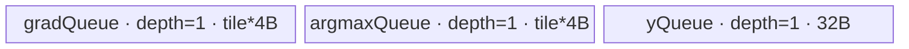
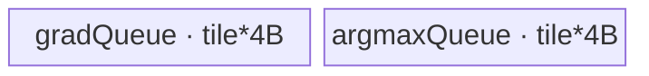

# MaxPool2dWithIndicesBackward A2/A3 ACLNN 算子知识

## 算子速览

| 项目 | 内容 |
|---|---|
| 实际入口 | `aclnnMaxPool2dWithIndicesBackwardGetWorkspaceSize` + `aclnnMaxPool2dWithIndicesBackward`，公开 ACLNN 两段式接口 |
| 计算语义 | 将 `gradOutput[n,c,oh,ow]` 按 `indices[n,c,oh,ow]` 指定的平面索引回填到 `gradInput[n,c,h,w]`；索引重复时求和，未命中位置为 0 |
| 输入输出 | 3D CHW 或 4D NCHW；A2/A3 的 `self/gradOutput/gradInput` 为 FLOAT，`indices` 为 INT32，`dilation=(1,1)` |
| 执行类型 | 单 Kernel `AIV_VECTOR`；无 Cube/AIC/MIX_CV 可达节点 |
| Kernel 路线 | R-001 normal/no-cross-core-overlap；R-002 normal/cross-core-overlap；R-003 scatter/no-window-overlap；R-004 scatter/window-overlap |
| 核心资源 | GM + 单块 `TBuf totalBuf` 或 scatter `gradQue/argmaxQue/yQue`；A2/A3 FLOAT 路线的用户 workspace 为 0 |
| 来源闭包 | `source_closed`：公开 ACLNN → 2D→`D=1` 适配 → `MaxPool3DGradWithArgmax` Host/Tiling → router → Vector body → binary/OpDef |
| 验证状态 | 已完成源码闭包检查；本次知识提取未执行编译、真机、数值或性能测试。 |

## 接口与语义

### 计算语义

令输入平面大小为 `H_in*W_in`。每个输出梯度元素 `g=gradOutput[n,c,oh,ow]` 携带前向最大值的平面索引 `p=indices[n,c,oh,ow]`，本算子执行 `gradInput[n,c,p] += g`，并把未被任何索引命中的位置保持为 0。ACLNN 先把 2D 问题扩成 `N,C,D=1,H,W`，且 `kD=sD=dilationD=1,pD=0`；这只是实现复用，不改变逻辑算子身份。

### 输入、输出与属性

| 参数 | shape/layout | dtype | 约束、默认值与语义 |
|---|---|---|---|
| `gradOutput` | CHW/NCHW；与 `indices` 同 shape | FLOAT | 上游梯度，允许非连续，入口先 `Contiguous` |
| `self` | CHW/NCHW | FLOAT | 前向输入，仅 shape/layout 用于输出与索引域，允许非连续 |
| `indices` | 与 `gradOutput` 同 shape | INT32 | 前向平面索引，允许非连续 |
| `kernelSize` | 长度 1 或 2 | INT64 数组 | 值均大于 0；长度 1 时复制到 H/W |
| `stride` | 长度 0、1 或 2 | INT64 数组 | 空数组表示等于 kernel；值均大于 0 |
| `padding` | 长度 1 或 2 | INT64 数组 | 非负且每轴不大于 `kernel/2` |
| `dilation` | 长度 1 或 2 | INT64 数组 | A2/A3 仅 `(1,1)` |
| `ceilMode` | 标量 | BOOL | 控制前向输出 shape 的向上/向下取整 |
| `gradInput` | 与 `self` 同 shape/layout | FLOAT | 回填并累加后的输入梯度 |

### 入口与版本

固定仓公开版本只有上述无版本后缀 ACLNN；A2/A3 由公开产品表、`DAV_2201` dtype 分支、`ascend910b/ascend910_93` OpDef 与 binary config 共同闭合。`IsRegbase=false` 时入口调用 `ExecMaxPool3dWithIndicesBackwardGetWorkspaceSize`，而不是 950 的 V3 body。

## Host/Launcher 执行流程

### 参数校验与前处理

`CheckParams` 依次执行非空、同 dtype、格式/维数、属性与输出 shape 校验。空 `self` 直接返回 `workspaceSize=0`。非空时三输入先 `Contiguous`；CHW 视图补 N 轴，NCHW 直接补 D 轴，形成 NCDHW；`ProcessAttrTo3DParams` 生成 `{1,kH,kW}`、`{1,sH,sW}`、`{0,pH,pW}`、`{1,1,1}`。内部结果删除 D/N 适配轴后由 `ViewCopy` 写回用户 `gradInput`。

### 参数、Workspace 与生命周期

Executor 拥有 contiguous 临时张量、属性数组、内部输出及 `ViewCopy` 节点；`GetWorkspaceSize()` 汇总框架与内核 workspace。对公开 A2/A3 FLOAT 路线，Tiling 中 `xDtypeSize==4`，normal/scatter 的 overlap 用户 workspace 条件均不成立，因此算子自有 `usrWorkspace=0`；框架系统 workspace 大小仍由 executor 返回，不可硬编码为 0。

### 启动图与失败传播

```text
ACLNN GetWorkspaceSize
  -> Contiguous(self, gradOutput, indices)
  -> View: CHW/NCHW -> NCDHW(D=1)
  -> MaxPool3DGradWithArgmax launcher
       -> one AIV kernel max_pool3d_grad_with_argmax(x, grad, argmax, y, workspace, tiling)
  -> View: NCDHW -> CHW/NCHW
  -> ViewCopy(gradInput)
ACLNN phase 2 -> CommonOpExecutorRun(same stream)
```

所有节点由同一 executor 按同一 stream 排序；任一 `CHECK_RET` 或 launcher/infer/tiling 失败会阻断后续节点并返回对应 ACLNN 错误。无跨 Kernel workspace 边。

## Route 与参数设计

### 分核与资源计算

2D 适配后 `ncDim=N*C, di=do=kd=sd=1`。normal 从 `vl=64` 开始，按 NC→DO→HO→WO 切核，再按 DO→HO→WO 顺序缩 UB tile；`usedCoreNum=min(totalCnt,totalCoreNum)`。scatter 依次尝试 no-cut、cut-NC、cut-DO、cut-HO、cut-WO，UB 有效容量为 `maxUbSize-32B`，并按 NC round 分核。

### Route 选择

| 顺序 | Route | Key/模板 | 精确选择条件与优先级 | 不适用去向 |
|---:|---|---|---|---|
| 1 | R-001 normal/no-cross-core-overlap | key 0 | `dilationD/H/W==1`、normal 最小 UB 账 `<=maxUbSize`，且 tiling 后 `isOverLap=false`；既包括原始窗口不重叠，也包括整 H/W 留在同一 NC core tile、由 `SetNormalParamsNotCutUB(...,false)` 消除跨核冲突的场景 | tiling 后仍有跨核冲突则 R-002；normal 不 capable 则 scatter |
| 2 | R-002 normal/cross-core-overlap | key 100 | normal capable，原始 `kh>sh \|\| kw>sw` 且分核/切 UB 后 `isOverLap` 仍为 true | normal 不 capable 则 scatter |
| 3 | R-003 scatter/no-overlap | key 2 | normal 不 capable；scatter `IsCapable=true`；无 overlap | overlap 则 R-004 |
| 4 | R-004 scatter/overlap | key 102 | normal 不 capable；scatter fallback；存在 H/W overlap | tiling 失败 |

```text
priority 10 CutK: 2D 适配 kd=1，不满足白名单 kd=5 -> skip
priority 12 Normal: dilation==1 && minimum_normal_UB<=UB
  -> SetNormalTilingParams may clear overlap when a whole conflicting output domain stays core-local
  -> key = 0 + (post-tiling isOverLap ? 100 : 0)
priority 16 Scatter: always capable
  -> key = 2 + (overlap ? 100 : 0)
```

### 模板/实现执行矩阵

| Route | key/selector | dtype/shape/platform 完整命中条件 | 执行拓扑与 Kernel 节点 | 实际模板/body | 内存与同步特征 | tail/fallback |
|---|---|---|---|---|---|---|
| R-001 | 0 | A2/A3 FLOAT/INT32；normal UB 可容纳；tiling 后无跨核输出冲突 | 单 AIV | `MaxPool3DGradWithArgmaxNormal<float,float,int32_t,float,false>` | `totalBuf`，Vector transpose/compare/select/col2img；直接写 y | former/tail core 与 D/H/W tail |
| R-002 | 100 | 同上但 tiling 后仍有跨核输出 overlap | 单 AIV | 同模板，`IsOverlap=true` | FP32 y 暂存并以 atomic-add 写目标；事件保护复用 | 同 key 0；不满足转 scatter |
| R-003 | 2 | normal UB 不足；无 overlap | 单 AIV | `MaxPoolGradWithArgScatter<float,float,int32_t,float>` | 两路 VECIN queue + 32B yQueue；标量索引散写 | 五级 UB 切分尾块 |
| R-004 | 102 | normal UB 不足且 overlap | 单 AIV | `MaxPoolGradWithArgScatterOverlap<float,float,int32_t,float>` | 先清零 y，cache clean/invalidate 后 read-add-write | 五级 UB 切分尾块 |

### 隐藏性能 Guard

| Guard | Host/Tiling 条件 | Device/资源原因 | 影响 Route | 不满足时去向 | 源码符号 |
|---|---|---|---|---|---|
| normal 最小 UB | `CalUBTotalSize(1,1,1,isOverlap)<=maxUbSize` | 保证 index/mask/grad/y 转置区和 8192B reserve 同时存在 | R-001/2 | scatter | `MaxPool3DGradWithArgmaxNormalTiling::IsCapable` |
| overlap | 原始窗口条件 `kh>sh \|\| kw>sw`；normal key 使用 tiling 后可能被清零的 `isOverLap` | 原始 overlap 表示窗口冲突；只有跨核冲突才要求 normal atomic key 100 | R-001/2/4 | core-local 时 key 0，否则 overlap 路线 | `SetAttrParams`、`SetNormalTilingParams` |
| scatter DMA | `baseWo==woDim` 走连续块，否则逐 NC 以 H blockCount 搬运 | 保持 GM stride 与 UB 紧凑布局一致 | R-003/4 | 对应循环搬运 | `CopyInDataGeneric` |
| 索引域 | `H*W<=INT32_MAX` | INT32 平面索引有效域 | 全部 | tiling 失败 | `CheckInputValid` |

### POD/ABI

`MaxPool3DGradWithArgmaxTilingData` 全字段均为连续 `uint64_t`；宏生成布局的具体 `sizeof/alignof/offsetof` 在固定仓不可见。字段 producer 是 `SetBaseTilingData`、`SetNormalTilingData`、`SetScatterTilingDataCommon`，consumer 是 normal/scatter 的 `InitParams`。

| 结构 | 字段 | 类型/位宽 | ABI 布局 | 单位 | Host/launcher producer | Device consumer | 边界 |
|---|---|---|---|---|---|---|---|
| TilingData | `ncDim/diDim/hiDim/wiDim` | uint64/64 | 宏生成，offset 不可见 | element | `SetBaseTilingData` | GM extent/offset | `diDim=1` |
| TilingData | `doDim/hoDim/woDim` | uint64/64 | 同上 | element | `SetBaseTilingData` | grad/argmax extent | `doDim=1` |
| TilingData | `kd/kh/kw` | uint64/64 | 同上 | element | `SetBaseTilingData` | kernel loops | `kd=1` |
| TilingData | `sd/sh/sw` | uint64/64 | 同上 | element | `SetBaseTilingData` | offset formulas | `sd=1` |
| TilingData | `pad*Top/pad*Bottom` | uint64/64 | 同上 | element | `SetBaseTilingData` | depad/offset | D pads 0 |
| TilingData | `baseNc/baseDo/baseHo/baseWo` | uint64/64 | 同上 | element | normal/scatter tiling | per-tile loops/UB | 均 >0 |
| TilingData | `nc/do/ho/woTail` | uint64/64 | 同上 | element | `SetCntTailTilingParams` | final tile | 最后 tile 有效量 |
| TilingData | `nc/do/ho/woCnt,totalCnt` | uint64/64 | 同上 | tile | Host tiling | core/tile mapping | 乘法未显式溢出检查 |
| TilingData | `usedCoreNum,totalUBSize` | uint64/64 | 同上 | core/byte | platform + tiling | block guard/buffer | `usedCoreNum<=AIV cores` |
| TilingData | `singleCoreNc/Do/Ho/Wo` | uint64/64 | 同上 | element | normal tiling | normal core mapping | scatter inactive |
| TilingData | `ncRound/ncRoundTail/totalRound/preCoreNum` | uint64/64 | 同上 | round/core | scatter tiling | scatter core mapping | normal inactive |

### Route 源码闭包

| Route | Key/selector | Host/Tiling producer | POD/参数 | Kernel entry/router 节点 | Kernel body/直接依赖 | 构建接线 |
|---|---|---|---|---|---|---|
| R-001/2 | 0/100 | `max_pool3d_grad_with_argmax_normal_tiling.cpp` | `MaxPool3DGradWithArgmaxTilingData` | `max_pool3d_grad_with_argmax.cpp` | `max_pool3d_grad_with_argmax_normal.h` + common | OpDef + ascend910b/910_93 binary config |
| R-003/4 | 2/102 | `max_pool3d_grad_with_argmax_scatter_tiling.cpp` + common tiling | 同上 | 同 entry | scatter base/unified/overlap unified | 同上 |

## Kernel 实现

### 公共执行流程

Kernel entry 拒绝空 workspace、空 user-workspace 指针与 `g_coreType==AIC`，因此只在 AIV 上运行。router 解析同一 POD，根据 key 实例化一个 body。所有路线先确定 `GetBlockIdx()` 对应的 NC/DO/HO/WO tile，再搬入 `grad/argmax`，生成输出位置并写回 y；单 Kernel 无跨节点同步边。

### Route R-001：normal/no-cross-core-overlap

#### 适用条件

##### 选择证据

| 层级 | 文件 | 符号 | 源码谓词/参数 | 结果/下一跳 |
|---|---|---|---|---|
| API | `op_api/aclnn_max_pool2d_with_indices_backward.cpp` | ACLNN GetWorkspaceSize | `!IsRegbase` | 2D→3D adapter |
| Tiling | `op_host/max_pool3d_grad_with_argmax_normal_tiling.cpp` | `IsCapable/SetNormalTilingParams` | dilation 全 1、min UB 足够，且最终 `isOverLap=false` | key 0 |
| Router | `op_kernel/max_pool3d_grad_with_argmax.cpp` | entry | `TILING_KEY_IS(0)` | normal `<...,false>` |

#### Device 数据流

##### 函数级调用链

```text
MaxPool3DGradWithArgmax launch -> max_pool3d_grad_with_argmax
  -> Normal::Init -> Normal::Process -> SubProcess
    -> CopyInArgmax -> transpose -> CopyInGrad -> transpose
    -> Img2ColPart -> Compare(EQ) -> SelectGrad -> Col2ImgPart
    -> DePad -> transpose back -> CopyOut(y)
```

##### 源码等价伪码

```text
for tile assigned to core:
  zero fp32 yTile
  load+transpose argmax and grad
  for kh,kw (kd=1):
    expectedIndex = Img2Col(input coordinate)
    mask = expectedIndex == argmax
    selected = mask ? grad : 0
    accumulate selected into fp32 yTile
  remove padding, transpose NC back, DMA valid tail to y
```

#### 内存与数据搬运

##### 资源与搬运表

| 层级/缓冲区 | offset/地址公式 | extent/容量公式 | dtype/layout | producer | consumer | owner/lifetime | 对齐/复用 |
|---|---|---|---|---|---|---|---|
| GM grad/argmax | core + tile offsets | `baseNc*baseDo*baseHo*baseWo` | float/int32 NCDHW | API | CopyIn | caller | W 按 32B pad |
| `totalBuf` | source-calculated suboffsets | `para_.ubSize` | mixed | `InitBuffer` | all stages | kernel | 子区复用受 V/MTE events 保护 |
| GM y | input-plane tile offset | valid `baseNc*baseDi*baseHi*baseWi` | float NCDHW | CopyOut | user | executor | tail valid bytes only |

##### 分层内存布局


##### 字节账与复用顺序

```text
UB_total = vl*diHiWi*4 + 2*vl*diHiWiAlign8*4
         + align(vl*doHoWo,32)*1 + 2*vl*doHoWoAlign8*4
         + 2*vl*doHoWoAlign8*4 + 8192
UB_total <= platform maxUbSize; dynamic_ub=N/A; workspace_total=0 user bytes
```

| 复用子区 | 写入者 | 读取者/消费点 | 下一次覆盖 | 同步或释放依据 | 安全条件 |
|---|---|---|---|---|---|
| `totalBuf` transpose/calculation regions | MTE2/Vector | Compare/Select/Col2Img | next tile | `MTE2_V`, `PIPE_V`, `V_MTE3` events | event wait 完成后覆盖 |

#### 同步、精度与尾块

##### 同步与数值边界表

| 阶段 | primitive/机制 | producer | consumer/等待点 | 保护对象 | 精度/尾块 |
|---|---|---|---|---|---|
| load | MTE2→V event | DMA | Vector | grad/argmax UB | DataCopyPad 保护 W/tail |
| compute | `PipeBarrier<PIPE_V>` | compare/select | col2img | mask/tmp/y | FLOAT 全程 FP32 |
| store | V→MTE3 event | transpose | CopyOut | y tile | 仅有效 tail 写回 |

#### 关键实现

##### 符号证据表

| 阶段 | 文件 | 符号/模板实例 | 实现事实 |
|---|---|---|---|
| Host/Tiling producer | `op_host/max_pool3d_grad_with_argmax_normal_tiling.cpp` | `SetNormalTilingParams` | 分核、UB cut、key |
| Kernel entry/router | `op_kernel/max_pool3d_grad_with_argmax.cpp` | key 0 branch | body 实参固定 |
| Device body/helper | `op_kernel/max_pool3d_grad_with_argmax_normal.h` | `SubProcess` | transpose→compare→select→col2img |

### Route R-002：normal/cross-core-overlap

#### 适用条件

##### 选择证据

| 层级 | 文件 | 符号 | 源码谓词/参数 | 结果/下一跳 |
|---|---|---|---|---|
| Tiling | `max_pool3d_grad_with_argmax_tiling_base.cpp` + normal tiling | `SetAttrParams/SetNormalTilingParams` | 原始 `kh>sh \|\| kw>sw` 且最终未消除跨核 overlap | overlap=true |
| Router | `max_pool3d_grad_with_argmax.cpp` | key 100 | `TILING_KEY_IS(100)` | normal `<...,true>` |

#### Device 数据流

##### 函数级调用链

```text
same normal pipeline as R-001 -> CopyOut(y) with SetAtomicAdd<float>()
```

##### 源码等价伪码

```text
build fp32 yTile exactly as R-001; because core/window tiles may overlap,
atomic-add each valid output block to the pre-initialized y plane; disable atomic mode afterwards
```

#### 内存与数据搬运

##### 资源与搬运表

| 层级/缓冲区 | offset/地址公式 | extent/容量公式 | dtype/layout | producer | consumer | owner/lifetime | 对齐/复用 |
|---|---|---|---|---|---|---|---|
| `totalBuf` | source suboffsets | overlap UB formula | mixed | kernel | kernel | kernel | y storage is FP32-aligned |
| GM y | possibly shared target | input shape | float | atomic CopyOut | user | executor | overlapping writers |

##### 分层内存布局


##### 字节账与复用顺序

```text
UB_total = normal overlap CalUBTotalSize(baseDo,baseHo,baseWo,true) <= maxUbSize
dynamic_ub=N/A; workspace_total=0 (FLOAT)
```

| 复用子区 | 写入者 | 读取者/消费点 | 下一次覆盖 | 同步或释放依据 | 安全条件 |
|---|---|---|---|---|---|
| y transpose region | Col2Img | atomic CopyOut | next tile | V→MTE3 wait | atomic mode disabled after store |

#### 同步、精度与尾块

##### 同步与数值边界表

| 阶段 | primitive/机制 | producer | consumer/等待点 | 保护对象 | 精度/尾块 |
|---|---|---|---|---|---|
| cross-core store | `SetAtomicAdd<float>` | each core | GM | duplicate indices | FP32 add；顺序非确定 |

#### 关键实现

##### 符号证据表

| 阶段 | 文件 | 符号/模板实例 | 实现事实 |
|---|---|---|---|
| Host/Tiling producer | `op_host/max_pool3d_grad_with_argmax_normal_tiling.cpp` | `SetOtherTilingParams` | overlap key/workspace 条件 |
| Kernel entry/router | `op_kernel/max_pool3d_grad_with_argmax.cpp` | key 100 | overlap template |
| Device body/helper | `op_kernel/max_pool3d_grad_with_argmax_normal.h` | `CopyOut` | atomic add + atomic none |

### Route R-003：scatter/no-overlap

#### 适用条件

##### 选择证据

| 层级 | 文件 | 符号 | 源码谓词/参数 | 结果/下一跳 |
|---|---|---|---|---|
| Tiling | `max_pool3d_grad_with_argmax_scatter_tiling.cpp` | `IsCapable` | fallback true，overlap=false | key 2 |
| Router | `max_pool3d_grad_with_argmax.cpp` | key 2 | `TILING_KEY_IS(2)` | scatter unified |

#### Device 数据流

##### 函数级调用链

```text
Scatter::Init -> zero y slice -> ProcessCommon -> CopyInGrad/Argmax
  -> CalcOutOffset -> scalar indexed DataCopyPad(y[index], grad) -> PipeBarrier
```

##### 源码等价伪码

```text
zero core-owned y slice; for every grad/argmax tile:
  for nc and pooled dhw: y[nc*H*W + argmax] = grad
```

#### 内存与数据搬运

##### 资源与搬运表

| 层级/缓冲区 | offset/地址公式 | extent/容量公式 | dtype/layout | producer | consumer | owner/lifetime | 对齐/复用 |
|---|---|---|---|---|---|---|---|
| gradQueue | tile offset | `baseNc*baseDo*baseHo*baseWo*4` | float | DMA | scalar scatter | kernel/tile | depth 1 |
| argmaxQueue | same tile | same elements*4 | int32 | DMA | scalar scatter | kernel/tile | depth 1 |
| yQueue | 0 | 32B | float | scalar | one-element DMA | kernel/tile | depth 1 |

##### 分层内存布局



##### 字节账与复用顺序

```text
UB_total = tileElems*(4+4) + 32 <= maxUbSize
dynamic_ub=N/A; workspace_total=0
```

| 复用子区 | 写入者 | 读取者/消费点 | 下一次覆盖 | 同步或释放依据 | 安全条件 |
|---|---|---|---|---|---|
| three queues | CopyIn/scalar | CalcOutOffset/CopyOut | next tile | EnQue/DeQue/FreeTensor + PIPE_ALL | tile fully consumed |

#### 同步、精度与尾块

##### 同步与数值边界表

| 阶段 | primitive/机制 | producer | consumer/等待点 | 保护对象 | 精度/尾块 |
|---|---|---|---|---|---|
| y init | MTE3→S event | InitGlobalMemory | scalar store | y visibility | FP32 zero |
| per element | S↔MTE3 events | scalar yQueue | GM DMA | single element | tail from block shape |

#### 关键实现

##### 符号证据表

| 阶段 | 文件 | 符号/模板实例 | 实现事实 |
|---|---|---|---|
| Host/Tiling producer | `pool_3d_common/op_host/arch32/max_pool3d_grad_tiling_common.h` | `CalculateScatterTilingParams` | five-level UB fallback |
| Kernel entry/router | `op_kernel/max_pool3d_grad_with_argmax.cpp` | key 2 | scatter body |
| Device body/helper | `pool_3d_common/op_kernel/arch32/max_pool3d_grad_scatter_unified.h` | `CalcOutOffset` | indexed one-element write |

### Route R-004：scatter/overlap

#### 适用条件

##### 选择证据

| 层级 | 文件 | 符号 | 源码谓词/参数 | 结果/下一跳 |
|---|---|---|---|---|
| Tiling | `max_pool3d_grad_with_argmax_scatter_tiling.cpp` | fallback | normal rejected且 overlap | key 102 |
| Router | `max_pool3d_grad_with_argmax.cpp` | key 102 | `TILING_KEY_IS(102)` | overlap unified |

#### Device 数据流

##### 函数级调用链

```text
ScatterOverlap::Init -> zero y -> ProcessCommon
  -> CopyIn -> cache invalidate -> GM read + grad -> GM write -> cache invalidate
```

##### 源码等价伪码

```text
for each pooled element:
  offset = planeBase + argmax
  invalidate cache; y[offset] = y[offset] + grad; clean/invalidate cache
```

#### 内存与数据搬运

##### 资源与搬运表

| 层级/缓冲区 | offset/地址公式 | extent/容量公式 | dtype/layout | producer | consumer | owner/lifetime | 对齐/复用 |
|---|---|---|---|---|---|---|---|
| grad/argmax queues | tile | tile*(4+4) | float/int32 | DMA | scalar read-add-write | kernel | depth 1 |
| GM y | `nc*H*W+argmax` | self shape | float | all writers | user | executor | cache maintenance |

##### 分层内存布局



##### 字节账与复用顺序

```text
UB_total = tileElems*(4+4) <= maxUbSize
dynamic_ub=N/A; workspace_total=0
```

| 复用子区 | 写入者 | 读取者/消费点 | 下一次覆盖 | 同步或释放依据 | 安全条件 |
|---|---|---|---|---|---|
| queues | DMA | scalar loop | next tile | queue lifetime + PIPE_ALL | all elements consumed |

#### 同步、精度与尾块

##### 同步与数值边界表

| 阶段 | primitive/机制 | producer | consumer/等待点 | 保护对象 | 精度/尾块 |
|---|---|---|---|---|---|
| overlap accumulation | `DataCacheCleanAndInvalid` + GM read/write | cores | next access | shared cache line | FP32，非确定顺序 |

#### 关键实现

##### 符号证据表

| 阶段 | 文件 | 符号/模板实例 | 实现事实 |
|---|---|---|---|
| Host/Tiling producer | `op_host/max_pool3d_grad_with_argmax_scatter_tiling.cpp` | `DoOpTiling` | key base 2 + overlap 100 |
| Kernel entry/router | `op_kernel/max_pool3d_grad_with_argmax.cpp` | key 102 | overlap body |
| Device body/helper | `pool_3d_common/op_kernel/arch32/max_pool3d_grad_scatter_overlap_unified.h` | `CalcOutOffset` | cache-coherent read-add-write |

## 算子特定优化

### Trick T-001：normal 路线以 Vector compare/select/col2img 替代逐元素散写

#### 触发与源码依据

- 适用 Route：R-001、R-002
- 触发条件：dilation 全 1 且最小 normal UB 账可容纳
- Golden 来源：[`max_pool3d_grad_with_argmax_normal.h:402-427`](../../../../../../../cann-ops-raw/ascendc/ops-nn/955f8b33985b6d72989ebff341bb9c2c564a51bc/pooling/max_pool3d_grad_with_argmax/op_kernel/max_pool3d_grad_with_argmax_normal.h#L402-L427)

**官方源码（固定 Commit 连续逐字摘录）**：

```cpp
for (uint64_t kdId = 0; kdId < para_.kd; kdId++) {
    for (uint64_t khId = 0; khId < para_.kh; khId++) {
        for (uint64_t kwId = 0; kwId < para_.kw; kwId++) {
            Img2ColPart(tmpIndexUb, xIndexUb[offsetIn]);
            Compare(maskUb, tmpIndexUb, argmaxTranUb, CMPMODE::EQ,
                    AlignUp(block_.dohowoShape * para_.baseNc, B32_VECTOR_MASK));
            SelectGrad(tmpGradUb, maskUb, gradTranUb);
            Col2ImgPart(yTranUbFp32[offsetOut], tmpGradUbFp32);
        }
    }
}
```

#### 机制与设计原因

argmax 与 grad 先转成 pooled-position-major × NC 的连续布局，窗口坐标批量生成期望索引；`Compare(EQ)` 产生 mask，`SelectGrad` 筛出当前窗口坐标对应的梯度，再由 `Col2ImgPart` 累加到 FP32 y tile。这样 normal 路线用宽 Vector 批次处理，避免 scatter fallback 的逐元素 GM 地址写。

#### 迁移边界

- 适用：索引回填、窗口几何规则且 UB 能容纳转置与中间矩阵的算子。
- 前提：A2/A3 FLOAT、INT32 index、dilation=1、normal UB guard 成立。
- 失效：UB 不足时必须进入 scatter；overlap 时保留 atomic-add 写回。
- 未验证：本次知识提取未执行编译、真机、数值或性能测试。

#### 错误做法

固定仓提供的真实 fallback 是在 normal 最小 UB 不可容纳时进入 scatter；强行保留 normal 会违反 `CalUBTotalSize<=maxUbSize`。

## 模板与实现对比

| 对比维度 | R-001 normal/no-overlap | R-002 normal/overlap | R-003 scatter/no-overlap | R-004 scatter/overlap | 设计选择依据 |
|---|---|---|---|---|---|
| 命中条件/优先级 | normal capable，tiling 后无跨核 overlap | normal capable，tiling 后有跨核 overlap | normal UB 失败，无窗口 overlap | normal UB 失败，有窗口 overlap | priority 12→16 |
| 模板与 dtype | Vector normal FP32 | 同，IsOverlap=true | scalar scatter FP32 | scalar read-add-write FP32 | A2/A3 公开 dtype 固定 |
| 循环与分核 | NC/DO/HO/WO tile | 同 | NC rounds + five-level UB cut | 同 | UB/冲突域 |
| Queue/TBuf/寄存器/dynamic UB/通信 window | totalBuf | totalBuf | 3 queues | 2 queues | 无 dynamic UB/通信 |
| 内存总占用与复用 | normal formula | overlap normal formula | tile*8+32 | tile*8 | Host guard |
| 搬运/Vector/SIMT/NDDMA/通信 API | transpose/compare/select | +atomic DMA | DataCopyPad+scalar | +cache maintenance | 无 SIMT/NDDMA |
| 同步、精度与 tail | events/FP32/tile tail | atomic FP32 | S/MTE events | cache coherence | 冲突决定写回协议 |
| fallback/失败边界 | scatter | scatter overlap | tiling failure | tiling failure | min UB/index guards |

## 平台差异

| 项目 | A2 | A3 | 950 |
|---|---|---|---|
| 支持状态 | 支持 | 支持 | 支持，见 `_950` 卡 |
| Host/Launcher | 共用 2D→NCDHW adapter | 同 A2 | `IsRegbase` 走 V3，不走本卡 body |
| Kernel/资源 | ascend910b/910_93 Vector normal/scatter | 同一实现族 | SIMT + RegBase Vector routes |

## 限制与失败边界

- 本卡只覆盖公开 `aclnnMaxPool2dWithIndicesBackward`，不覆盖 WithMask 或公开 3D API。
- A2/A3 仅 FLOAT + INT32、CHW/NCHW、dilation=(1,1)；`H*W` 必须不超过 INT32 索引域。
- overlap 累加次序不是固定数学顺序；公开文档将默认实现标为非确定性。
- Tiling 连乘未见统一溢出保护；除明确的索引范围检查外不得外推超大 shape 安全性。
- 本次知识提取未执行编译、真机、数值或性能测试。

## 源码索引

### 链路索引

| 链路阶段 | 文件 | 关键符号 | 支撑内容 |
|---|---|---|---|
| 入口声明/约束 | `pooling/max_pool3d_grad_with_argmax/docs/aclnnMaxPool2dWithIndicesBackward.md` | 产品表/API | A2/A3 公开支持与约束 |
| 入口实现 | `pooling/max_pool3d_grad_with_argmax/op_api/aclnn_max_pool2d_with_indices_backward.cpp` | ACLNN/adapter | 校验、2D→3D、executor |
| Host/Tiling/Launcher | `pooling/max_pool3d_grad_with_argmax/op_host/max_pool3d_grad_with_argmax_normal_tiling.cpp` | normal tiling | selector/UB/分核 |
| Host/Tiling/Launcher | `pooling/max_pool3d_grad_with_argmax/op_host/max_pool3d_grad_with_argmax_scatter_tiling.cpp` | scatter tiling | fallback |
| Kernel entry/body | `pooling/max_pool3d_grad_with_argmax/op_kernel/max_pool3d_grad_with_argmax.cpp` | entry/router | key→body |
| Kernel entry/body | `pooling/max_pool3d_grad_with_argmax/op_kernel/max_pool3d_grad_with_argmax_normal.h` | normal body | Vector pipeline |
| Kernel entry/body | `pooling/pool_3d_common/op_kernel/arch32/max_pool3d_grad_scatter_base_template.h` | scatter base | queue/DMA |
| 构建接线 | `pooling/max_pool3d_grad_with_argmax/op_host/max_pool3d_grad_with_argmax_def.cpp` | OpDef | A2/A3 config |

### 实现复用检查

| 检查项 | 可复用事实 | 不得改变的约束 | 源码符号 |
|---|---|---|---|
| ABI/POD | uint64 POD 字段与 key 映射 | 字段顺序/单位、inactive 字段 | TilingData definition |
| 调用顺序 | contiguous→view→launcher→viewcopy | 单 stream 失败即阻断 | ACLNN adapter |
| workspace/内存 | A2/A3 自有 user workspace 0 | executor 系统 workspace 仍由框架返回 | `GetWorkspaceSize` |
| 同步 | normal events；scatter S/MTE/cache | overlap 写回协议不可删 | body methods |
| 精度与尾块 | FLOAT/FP32；tail 按 POD | 不得把 overlap 改成覆盖写 | route bodies |
| 失败边界 | normal→scatter fallback | dilation/index/shape guards | `IsCapable`/`CheckInputValid` |
