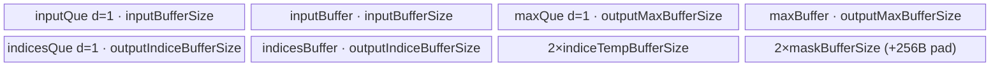
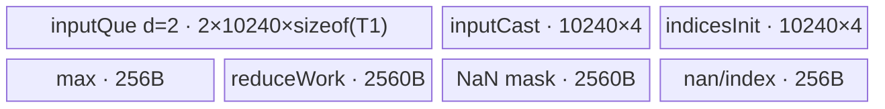

# MaxPool3dWithArgmax A2/A3 ACLNN 算子知识

## 算子速览

| 项目 | 内容 |
|---|---|
| 实际入口 | `aclnnMaxPool3dWithArgmaxGetWorkspaceSize` + `aclnnMaxPool3dWithArgmax`，公开 ACLNN 两段式接口；底层逻辑 Op 为 `MaxPool3DWithArgmaxV2`。 |
| 计算语义 | 对每个 N/C 与输出 `(od,oh,ow)`，在 dilation 后的 3D 窗口取最大值并返回该最大值在单个输入通道 `D×H×W` 平面中的线性索引。NaN 按 Device 分支规定参与选择。 |
| 输入输出 | `self/out`: FP16/BF16/FP32，4D CDHW 或 5D NCDHW；`indices`: INT32；A2/A3 不支持 NDHWC，且 `D*H*W <= INT_MAX`。 |
| 执行类型 | 单 Kernel、AIV_VECTOR；公开可达 R-001 与 R-002 均只启动 `max_pool3d_with_argmax_v2`，没有 AIC/Cube/MIX_CV 节点。 |
| Kernel 路线 | R-001 NoExpandIndices（key 300001/300002）；R-002 BigKernel（key 311110/311111/311112）。 |
| 核心资源 | GM 输入/双输出；R-001 使用 3 个 depth=1 Queue、7/8 个 TBuf；R-002 使用 depth=2 输入 Queue 与 6 个 TBuf；Tiling 固定声明 16 MiB system workspace，核心计算不消费 user slice。 |
| 来源闭包 | `source_closed`：公开 API 校验/归一化、L0 launcher、优先级 Tiling/POD、router、两条公开可达 body 与 binary/CMake 接线均闭合；框架 `Contiguous/ReFormat/ViewCopy` 为明确边界。 |
| 验证状态 | 已完成源码闭包检查；本次知识提取未执行编译、真机、数值或性能测试。 |

## 接口与语义

### 计算语义

令窗口起点为 `(od*sD-pD, oh*sH-pH, ow*sW-pW)`，有效采样坐标为起点加 `(kd*dD, kh*dH, kw*dW)` 且落在输入域内。`out[n,c,od,oh,ow]` 是这些值的最大值，`indices` 是获胜坐标的 `d*H*W+h*W+w`。输出轴为
`floor_div(input+2p-dilation*(kernel-1)-1+(ceilMode?stride-1:0), stride)+1`；`ceilMode` 下若最后窗口完全落在右 padding，L0 `PoolingOutShape` 再减 1。

### 输入、输出与属性

| 参数 | shape/layout | dtype | 约束、默认值与语义 |
|---|---|---|---|
| `self` | 4D CDHW 或 5D NCDHW；ACLNN 可接非连续视图 | FP16/BF16/FP32 | 非空计算；A2/A3 要求 `D*H*W <= INT_MAX`。 |
| `kernelSize` | 长度 1 或 3 | INT64 数组 | 每项 > 0；长度 1 广播至 D/H/W。 |
| `stride` | 长度 0、1 或 3 | INT64 数组 | 每项 > 0；空数组取 kernel，长度 1 广播。 |
| `padding` | 长度 1 或 3 | INT64 数组 | `0 <= p_i <= floor(k_i/2)`；padding 值语义为负无穷。 |
| `dilation` | 长度 1 或 3 | INT64 数组 | A2/A3 API 强制三项均为 1。 |
| `ceilMode` | 标量 | BOOL | 控制输出轴向上/向下取整并丢弃完全位于右 padding 的窗口。 |
| `out` | 与推导 shape 一致，layout 与 `self` 一致 | 与 `self` 相同 | 非连续输出由 `ViewCopy` 提交。 |
| `indices` | shape/layout 与 `out` 一致 | INT32 | A2/A3 不接受 INT64。 |

### 入口与版本

固定仓只有该公开符号族，没有更高版本的 `aclnnMaxPool3dWithArgmaxV*`。文档产品表明确支持 Atlas A2/A3；API `CheckPlatform` 接受 `DAV_2201`，OpDef/binary 同时接线 `ascend910b` 与 `ascend910_93`。A2/A3 使用同一非 RegBase body；2D、Backward、Grad 等符号不属于本卡。

## Host/Launcher 执行流程

### 参数校验与前处理

第一段依次创建 executor、校验平台、空指针、dtype/layout/rank、kernel/stride/padding/dilation。空 `self` 或 `out` 直接返回 workspace 0 且不追加计算。非空时执行 `Contiguous(self)`；4D 输入先 `UnsqueezeNd(dim=0)` 并 `ReFormat(NCDHW)`，5D 输入直接 `ReFormat(NCDHW)`。L0 将四个属性统一扩成 3 项，计算临时输出 shape，创建临时 `out/indices`，追加一个 `MaxPool3DWithArgmaxV2` AICore launcher。结果按原输出 format `Squeeze/ReFormat`，经 `CheckReduceOutShape` 后 `ViewCopy` 到用户输出。第二段 `CommonOpExecutorRun` 在调用方 stream 上按 executor 顺序运行全部框架节点和算子节点；任一前置返回空指针/错误会阻断后续追加或执行。

### 参数、Workspace 与生命周期

`kernelSize3/stride3/padding3/dilation3` 与临时 tensor 都由 executor 持有。Tiling 从平台取得 core 数和 UB；两条公开 Route 均在基类 `GetWorkspaceSize` 写入 16 MiB system workspace。R-002 entry 虽传入 `GetUserWorkspace(workspace)`，body 的 `Init` 未绑定或读写该指针；R-001 传 `nullptr`。ACLNN 返回的总 workspace 还包含框架 Contiguous/ReFormat/ViewCopy 所需空间，其精确聚合由 executor 框架完成。

### 启动图与失败传播

```text
aclnnMaxPool3dWithArgmaxGetWorkspaceSize
  -> Contiguous/ReFormat[/Unsqueeze] framework nodes
  -> MaxPool3DWithArgmaxV2NcdhwAiCore
     -> ADD_TO_LAUNCHER_LIST_AICORE(MaxPool3DWithArgmaxV2)
        -> TilingRegistry priority 10 then 11
        -> max_pool3d_with_argmax_v2(x,tmpY,tmpIndices,workspace,tiling)
  -> ReFormat[/Squeeze]/ViewCopy framework nodes
aclnnMaxPool3dWithArgmax(workspace, size, executor, stream)
  -> CommonOpExecutorRun (same stream, ordered)
```

算子核心节点为单 Kernel：输入是 executor 临时连续 NCDHW tensor，输出是临时连续 `y/indices`；没有核心 Kernel 间边。executor 拥有临时 GM/workspace，第二段结束后用户只观察 `ViewCopy` 的最终输出。Tiling、launcher 或核心节点失败均由 executor 状态返回并阻断其后同流节点。

## Route 与参数设计

### 分核与资源计算

Registry 的 `std::map<int32_t,...>` 按 priority 升序尝试；模板返回 `GRAPH_PARAM_INVALID` 才 fallthrough。R-001 先令 `ncFactor=min(N*C, blockDataNum*8)`，对 `(dyFactor,hyFactor,wyFactor)` 做 UB 约束搜索；`totalIdx=ncOuter*dyOuter*hyOuter*wyOuter`，`blockFactor=totalIdx/coreNum`、`blockTail=totalIdx%coreNum`、`coreNums=(blockFactor==0?totalIdx:coreNum)`。R-002 的 `totalIdx=N*C*Dout*Hout*Wout`，同样均分到 `coreNums`。

R-001 资源式（所有 pool 均 256 B 对齐）：

```text
inputPool = ncFactorAlign*dxFactor*hxFactor*align(wxFactor,32/inputBytes)*computeBytes
maxPool = ncFactorAlign*dyFactor*hyFactor*align(wyFactor,16)*computeBytes
indicesPool = ncMaxFactor*dyFactor*hyFactor*align(wyFactor,16)*4
tempIndices = ncMaxFactor*align(wyFactor,16)*4
maskPool = align(align(blockDataNum*8/16*2,32)*align(wyFactor,16),256)
UB_total = 2*(inputPool+maxPool+indicesPool+tempIndices+maskPool)
UB_total <= 192 KiB - 8 KiB - 256 B
```

### Route 选择

| 顺序 | Route | Key/模板 | 精确选择条件与优先级 | 不适用去向 |
|---:|---|---|---|---|
| 1 | R-001 NoExpandIndices | priority 10；300001 无 pad，300002 有 pad/ceil 补齐 | 非 RegBase；`dD=dH=dW=1`；最小 `(dy,hy,wy)=(1,1,1)` 的上述 `UB_total <= 192KiB-8KiB-256B`。key 由六侧有效 pad 是否非零决定。 | priority 11。 |
| 2 | R-002 BigKernel | priority 11；FP32/FP16/BF16 为 311110/311111/311112 | 非 RegBase 且 `dD=dH=dW=1`；公开 A2/A3 API 已保证该 dilation，因此是 R-001 失败后的闭合 fallback。 | 固定公开入口无下一 Route；其它 priority 12–16 对 ACLNN 因 dilation 校验不可达。 |

```text
if priority10.GetShapeAttrsInfo succeeds and NoExpandIndices::IsCapable:
    key = any_effective_pad ? 300002 : 300001
else if priority11.GetShapeAttrsInfo succeeds and dilation == (1,1,1):
    key = dtype == FP32 ? 311110 : dtype == FP16 ? 311111 : 311112
else:
    tiling failure
```

### 模板/实现执行矩阵

| Route | key/selector | dtype/shape/platform 完整命中条件 | 执行拓扑与 Kernel 节点 | 实际模板/body | 内存与同步特征 | tail/fallback |
|---|---|---|---|---|---|---|
| R-001 NoExpandIndices | 300001/300002 | A2/A3、NCDHW、INT32 indices、dilation=1、最小 tile 可装入固定 UB 预算 | 单 AIV Kernel | `MaxPool3DWithArgmaxV2NoExpandIndices<DTYPE_X, DTYPE_X-or-float, PAD_DISABLE/ENABLE>` | depth=1 Queue；同容量 TBuf 做 staging；BF16 以 FP32 计算；Queue 与 HardEvent | D/H/W/NC factor 均有 outer/tail；失败转 R-002。 |
| R-002 BigKernel | 311110/311111/311112 | A2/A3、NCDHW、dilation=1，且 R-001 不可用 | 单 AIV Kernel | `MaxPool3DWithArgmaxBigKernel<float,float,false,uint16_t>` / `<half,half,...>` / `<bfloat16_t,float,...>` | depth=2 输入 Queue；固定 `maxCount=10240` 分段归约；S/V/MTE3 event | 每核输出点 former/tail；窗口按 DHW/HW/W 连续性及 10240 上限切分。 |

### 隐藏性能 Guard

| Guard | Host/Tiling 条件 | Device/资源原因 | 影响 Route | 不满足时去向 | 源码符号 |
|---|---|---|---|---|---|
| API dilation | `DAV_2201 => dilationD/H/W == 1` | 非 RegBase 公开实现只发布 dilation=1 语义 | 全部 | ACLNN 参数错误 | `CheckParamsValid` |
| R-001 UB | `tmpTotalSize <= 192KiB-8KiB-256B` | Queue/TBuf 成对物理区与 pad OR mask 需同时容纳 | R-001 | R-002 | `NoExpandIndicesTiling::IsCapable/DoBufferCalculate` |
| NC vector factor | `ncFactor <= blockDataNum*8` 且 16 元素对齐 | Vector block/mask 批处理上限 | R-001 | 缩小 tile | `NoExpandIndicesTiling::IsCapable` |
| R-002 fixed chunk | `maxCount=10*1024` | 输入 Queue 每槽固定最大归约片段 | R-002 | Device 在 D/H/W 维分段合并 | `MaxPool3DWithArgmaxBigKernel::Init/*ContinueProcess` |
| DMA stride | `(inHW-blockLen)*sizeof(T1) <= UINT32_MAX` 或 `(w-blockLen)*sizeof(T1) <= UINT32_MAX` | `DataCopyExtParams.srcStride` 为 uint32 字节 | R-002 | Device 改逐行循环搬运 | `hwCopyInput/wCopyInput` |

### POD/ABI

`TILING_DATA_FIELD_DEF` 的序列化实现属于框架生成边界；固定仓可证明字段声明顺序、源码类型与读写双方一致，精确 `sizeof/alignof/offsetof` 未在固定仓展开。

| 结构 | 字段 | 类型/位宽 | ABI 布局 | 单位 | Host/launcher producer | Device consumer | 边界 |
|---|---|---|---|---|---|---|---|
| `NoExpand...TilingData` | `nc` | uint64/64 | 声明顺序；offset 未展开 | 元素 | N*C | `Init/CalNextIdxData` | 地址乘积需可表示 |
| 同上 | `dx` | uint64/64 | 同上 | 元素 | input D | `Init/CalNextIdxData` | >0 |
| 同上 | `hx` | uint64/64 | 同上 | 元素 | input H | `Init/CalNextIdxData` | >0 |
| 同上 | `wx` | uint64/64 | 同上 | 元素 | input W | `Init/CalNextIdxData` | >0 |
| 同上 | `kd` | uint64/64 | 同上 | 元素 | kernel D | `BaseCompute` | >0 |
| 同上 | `kh` | uint64/64 | 同上 | 元素 | kernel H | `BaseCompute` | >0 |
| 同上 | `kw` | uint64/64 | 同上 | 元素 | kernel W | `BaseCompute` | >0 |
| 同上 | `sd` | uint64/64 | 同上 | 元素 | stride D | tile 输入范围 | >0 |
| 同上 | `sh` | uint64/64 | 同上 | 元素 | stride H | tile 输入范围 | >0 |
| 同上 | `sw` | uint64/64 | 同上 | 元素 | stride W | 索引模板 | >0 |
| 同上 | `pf` | uint64/64 | 同上 | 元素 | 调整后 front pad | pad CopyIn/索引修正 | 决定 pad key |
| 同上 | `pb` | uint64/64 | 同上 | 元素 | 调整后 back pad | pad CopyIn/索引修正 | 决定 pad key |
| 同上 | `pl` | uint64/64 | 同上 | 元素 | 调整后 left pad | pad CopyIn/索引修正 | 决定 pad key |
| 同上 | `pr` | uint64/64 | 同上 | 元素 | 调整后 right pad | pad CopyIn/索引修正 | 决定 pad key |
| 同上 | `pt` | uint64/64 | 同上 | 元素 | 调整后 top pad | pad CopyIn/索引修正 | 决定 pad key |
| 同上 | `pd` | uint64/64 | 同上 | 元素 | 调整后 bottom pad | pad CopyIn/索引修正 | 决定 pad key |
| 同上 | `dy` | uint64/64 | 同上 | 元素 | output D | GM 输出地址 | >=1 |
| 同上 | `hy` | uint64/64 | 同上 | 元素 | output H | GM 输出地址 | >=1 |
| 同上 | `wy` | uint64/64 | 同上 | 元素 | output W | GM 输出地址 | >=1 |
| 同上 | `ncFactor` | uint64/64 | 同上 | 元素 | NC 切分 | `CalNextIdxData` | >=1 |
| 同上 | `ncTail` | uint64/64 | 同上 | 元素 | NC 切分 | tail tile | 整除时取 factor |
| 同上 | `ncOuter` | uint64/64 | 同上 | 次数 | NC 切分 | block decode | >=1 |
| 同上 | `dyFactor` | uint64/64 | 同上 | 元素 | UB 搜索 | D tile | >=1 |
| 同上 | `dyTail` | uint64/64 | 同上 | 元素 | UB 搜索 | D tail | 整除时取 factor |
| 同上 | `dyOuter` | uint64/64 | 同上 | 次数 | UB 搜索 | block decode | >=1 |
| 同上 | `hyFactor` | uint64/64 | 同上 | 元素 | UB 搜索 | H tile | >=1 |
| 同上 | `hyTail` | uint64/64 | 同上 | 元素 | UB 搜索 | H tail | 整除时取 factor |
| 同上 | `hyOuter` | uint64/64 | 同上 | 次数 | UB 搜索 | block decode | >=1 |
| 同上 | `wyFactor` | uint64/64 | 同上 | 元素 | UB 搜索 | W tile/Vector mask | >=1 |
| 同上 | `wyTail` | uint64/64 | 同上 | 元素 | UB 搜索 | W tail/mask | 整除时取 factor |
| 同上 | `wyOuter` | uint64/64 | 同上 | 次数 | UB 搜索 | block decode | >=1 |
| 同上 | `blockFactor` | uint64/64 | 同上 | tile/core | `DoBlockTiling` | `Process` core span | >=0 |
| 同上 | `blockTail` | uint64/64 | 同上 | tile | `DoBlockTiling` | former/tail core | `<coreNums` |
| 同上 | `totalIdx` | uint64/64 | 同上 | tile | outer 乘积 | `Process` 边界 | >=1 |
| 同上 | `coreNums` | uint64/64 | 同上 | core | `DoBlockTiling` | blockDim/边界 | <=platform coreNum |
| 同上 | `inputBufferSize` | uint64/64 | 同上 | 字节/槽 | `inputPoolSize` | input Queue/TBuf InitBuffer | 256 B 对齐 |
| 同上 | `outputMaxBufferSize` | uint64/64 | 同上 | 字节/槽 | `outputMaxPoolSize` | max Queue/TBuf | 256 B 对齐 |
| 同上 | `outputIndiceBufferSize` | uint64/64 | 同上 | 字节/槽 | `outputIndicePoolSize` | indices Queue/TBuf | INT32、256 B 对齐 |
| 同上 | `indiceTempBufferSize` | uint64/64 | 同上 | 字节/槽 | `indiceTempPoolSize` | update/template TBuf | 256 B 对齐 |
| 同上 | `maskBufferSize` | uint64/64 | 同上 | 字节/槽 | `maskPoolSize` | gt/ge TBuf | 256 B 对齐 |
| `BigKernelTilingData` | `inputShapes[3]` | uint32[3] | 声明顺序；offset 未展开 | 元素 | 输入 DHW 窄化 | `Init` | API 先限制单通道 DHW 乘积 <= INT_MAX |
| 同上 | `outShapes[3]` | uint32[3] | 同上 | 元素 | 输出 DHW 窄化 | `Init` | 各轴 >=1 |
| 同上 | `kD` | uint32/32 | 同上 | 元素 | kernel D 显式 cast | `Prepare/*CopyInput` | >0 |
| 同上 | `kW` | uint32/32 | 同上 | 元素 | kernel W 显式 cast | `Prepare/*CopyInput` | >0 |
| 同上 | `kH` | uint32/32 | 同上 | 元素 | kernel H 显式 cast | `Prepare/*CopyInput` | >0 |
| 同上 | `sD` | uint32/32 | 同上 | 元素 | stride D 显式 cast | `Prepare` | >0 |
| 同上 | `sW` | uint32/32 | 同上 | 元素 | stride W 显式 cast | `Prepare` | >0 |
| 同上 | `sH` | uint32/32 | 同上 | 元素 | stride H 显式 cast | `Prepare` | >0 |
| 同上 | `pD` | uint32/32 | 同上 | 元素 | pad D 显式 cast | `Prepare` | >=0 |
| 同上 | `pW` | uint32/32 | 同上 | 元素 | pad W 显式 cast | `Prepare` | >=0 |
| 同上 | `pH` | uint32/32 | 同上 | 元素 | pad H 显式 cast | `Prepare` | >=0 |
| 同上 | `dD` | uint32/32 | 同上 | 元素 | dilation D 显式 cast | `Prepare/*CopyInput` | 公开 Route=1 |
| 同上 | `dW` | uint32/32 | 同上 | 元素 | dilation W 显式 cast | `Prepare/*CopyInput` | 公开 Route=1 |
| 同上 | `dH` | uint32/32 | 同上 | 元素 | dilation H 显式 cast | `Prepare/*CopyInput` | 公开 Route=1 |
| 同上 | `blockFactor` | uint64/64 | 同上 | 输出点/core | `DoUBTiling` | `Process` | >=0 |
| 同上 | `blockTail` | uint64/64 | 同上 | core | `DoUBTiling` | former/tail core | 前若干核多1 |
| 同上 | `totalIdx` | uint64/64 | 同上 | 输出点 | `DoUBTiling` | `Process` | N*C*Dout*Hout*Wout |
| 同上 | `coreNums` | uint64/64 | 同上 | core | `DoUBTiling` | `Process`/blockDim | <=AIV core |

### Route 源码闭包

| Route | Key/selector | Host/Tiling producer | POD/参数 | Kernel entry/router 节点 | Kernel body/直接依赖 | 构建接线 |
|---|---|---|---|---|---|---|
| R-001 | 300001/300002，priority 10 | `max_pool3d_with_argmax_v2_no_expand_indices_tiling.cpp`: `IsCapable/GetTilingKey/SetTilingData` | `MaxPool3DWithArgmaxV2NoExpandIndicesTilingData` | `max_pool3d_with_argmax_v2.cpp`: key 300001/300002 | `max_pool3d_with_argmax_v2_no_expand_indices.h`: `Init/Process/BaseCompute` | `ascend910b/...binary.json` + module CMake |
| R-002 | 311110/311111/311112，priority 11 | `max_pool3d_with_argmax_v2_tiling_bigkernel.cpp`: `IsCapable/DoUBTiling` | `MaxPool3DWithArgmaxV2BigKernelTilingData` | `max_pool3d_with_argmax_v2.cpp`: key 31111x | `max_pool3d_with_argmax_big_kernel.h`: `Process/Prepare/*CopyInput/Compute` | 同上；ascend910_93 使用同 OpDef/config 族 |

## Kernel 实现

### 公共执行流程

两条 Route 都由同一 entry 按 key 构造唯一 AIV body，绑定 `x/y/indices` GM 后在每个 core 内处理独占输出域；没有 Atomic 或跨核归约。窗口外值用 dtype 对应 `-inf`，输出索引始终是单通道 DHW 线性坐标。Queue `EnQue/DeQue/FreeTensor` 与显式 `HardEvent` 保护 MTE/Vector/Scalar 阶段；未知 key 在 router 中不执行 body，正常 Host selector 不会产生未知 key。

### Route R-001：NoExpandIndices 分块 Vector

#### 适用条件

##### 选择证据

| 层级 | 文件 | 符号 | 源码谓词/参数 | 结果/下一跳 |
|---|---|---|---|---|
| API | `op_api/aclnn_max_pool3d_with_argmax.cpp` | `CheckParamsValid` | A2/A3 dilation 三项等于 1 | 进入 L0 |
| Host | `op_host/...no_expand_indices_tiling.cpp` | `IsCapable` | 非 RegBase、dilation=1、最小 tile `tmpTotalSize<=UB_SIZE` | 300001/300002；否则 priority 11 |
| Router | `op_kernel/max_pool3d_with_argmax_v2.cpp` | `max_pool3d_with_argmax_v2` | key 300001/300002 | PAD_DISABLE/PAD_ENABLE 模板 |

#### Device 数据流

##### 函数级调用链

```text
max_pool3d_with_argmax_v2
  -> NoExpandIndices::Init
  -> Process
     -> CalNextIdxData / CalCurrentIdxData
     -> BaseCompute
        -> CopyIn(D/H/W sliced DataCopyPad; BF16 Cast to FP32)
        -> window Compare/Select + index update
        -> CopyMaxOut / CopyIndicesOut
```

##### 源码等价伪码

```text
tileId range = block former/tail partition of totalIdx
for tileId:
  decode tileId -> nc/dy/hy/wy outer indices and real tail factors
  compute clipped six-side padding and GM input base
  DMA valid input rows; padded route fills invalid values with -inf
  if BF16: cast input tile to FP32
  initialize max and index template for each output W lane
  for kd,kh,kw:
    gt = sample > max; nan/tie masks follow source Compare/Select order
    max = select(gt,...); index = select(gt, real_dhw_index, old_index)
  cast FP32 result back to BF16 with CAST_ROUND when needed
  DMA only real nc*dy*hy*wy tail extent to GM y/indices
```

#### 内存与数据搬运

##### 资源与搬运表

| 层级/缓冲区 | offset/地址公式 | extent/容量公式 | dtype/layout | producer | consumer | owner/lifetime | 对齐/复用 |
|---|---|---|---|---|---|---|---|
| GM x | decoded NC/D/H/W tile base | clipped `nc*dx*hx*wx` | T1/NCDHW | executor | CopyIn | caller/executor | DataCopyPad 行搬运 |
| `inputQue` | UB allocator | `inputBufferSize` | T2 compute dtype | CopyIn | BaseCompute | depth=1，Free 后复用 | BF16 route T2=float |
| `inputBuffer` | 独立 TBuf | `inputBufferSize` | T2 | staging/cast | Compute | 单 tile | 不与 Queue alias |
| `maxQue/maxBuffer` | UB allocator | 各 `outputMaxBufferSize` | T2 | Compute | CopyOut | depth=1 + TBuf | 256 B 对齐 |
| `indicesQue/indicesBuffer` | UB allocator | 各 `outputIndiceBufferSize` | int32 | Compute | CopyOut | depth=1 + TBuf | 256 B 对齐 |
| update/template TBuf | UB allocator | 各 `indiceTempBufferSize` | int32 | Init/Compute | index select | Kernel lifetime | 模板跨 tile 只读 |
| gt/ge TBuf | UB allocator | 各 `maskBufferSize` | uint8/uint16 mask | Compare | Select | 每次窗口迭代覆盖 | 无跨迭代依赖 |
| OR mask TBuf | UB allocator | 256 B，仅 PAD_ENABLE | uint16 | Init Duplicate | padding mask merge | Kernel lifetime | Host 额外预留 256 B |

##### 分层内存布局



##### 字节账与复用顺序

```text
UB_total = 2*inputBufferSize + 2*outputMaxBufferSize + 2*outputIndiceBufferSize
         + 2*indiceTempBufferSize + 2*maskBufferSize + (PAD_ENABLE ? 256 : 0)
UB_total <= 192 KiB - 8 KiB  (Host 的 tmpTotalSize 已另扣 256 B)
dynamic_ub = N/A
workspace_total(core-owned) = 0；Tiling/API 仍保留 16 MiB system workspace
```

| 复用子区 | 写入者 | 读取者/消费点 | 下一次覆盖 | 同步或释放依据 | 安全条件 |
|---|---|---|---|---|---|
| Queue slot | CopyIn | BaseCompute | 下个 tile | EnQue→DeQue→FreeTensor | depth=1 串行 |
| gt/ge mask | Compare | Select | 下个窗口元素 | Vector 指令顺序/PipeBarrier | Select 完成后覆盖 |
| indices template | Init Duplicate | 每个 W tile | 不覆盖 | Kernel lifetime | stride/index pattern 不变 |

#### 同步、精度与尾块

##### 同步与数值边界表

| 阶段 | primitive/机制 | producer | consumer/等待点 | 保护对象 | 精度/尾块 |
|---|---|---|---|---|---|
| CopyIn→Vector | Queue + `MTE2_V` event（cast 路径） | DataCopyPad | Cast/Compare | input tile | BF16 升 FP32；FP16/FP32 原 dtype |
| Vector→CopyOut | `V_MTE3` event | BF16 downcast/Vector result | DataCopyPad | y/index UB | BF16 `CAST_ROUND` |
| tail | factor/tail 字段 + mask | Host/POD | CopyIn/Compute/CopyOut | D/H/W/NC 尾 tile | 只提交 real extent；padding 为 -inf |

#### 关键实现

##### 符号证据表

| 阶段 | 文件 | 符号/模板实例 | 实现事实 |
|---|---|---|---|
| Host/Tiling producer | `op_host/max_pool3d_with_argmax_v2_no_expand_indices_tiling.cpp` | `DoBufferCalculate/IsCapable/SetTilingData` | 生成 factor/tail、精确 UB pool 与 key |
| Kernel entry/router | `op_kernel/max_pool3d_with_argmax_v2.cpp` | key 300001/300002 | pad 模板与 BF16 compute dtype |
| Device body/helper | `op_kernel/max_pool3d_with_argmax_v2_no_expand_indices.h` | `Init/Process/BaseCompute/CastBF16ToF32/CastF32ToBF16` | 分块搬运、Compare/Select、精度与 tail |

### Route R-002：固定片段 BigKernel 归约

#### 适用条件

##### 选择证据

| 层级 | 文件 | 符号 | 源码谓词/参数 | 结果/下一跳 |
|---|---|---|---|---|
| API | `op_api/aclnn_max_pool3d_with_argmax.cpp` | `CheckParamsValid` | dilation=1，indices INT32 | 进入 L0 |
| Host | `op_host/...tiling_bigkernel.cpp` | `IsCapable` | 非 RegBase且 dilation=1；priority 11 | dtype key 31111x |
| Router | `op_kernel/max_pool3d_with_argmax_v2.cpp` | key 311110/1/2 | FP32/FP16/BF16 实例 | BigKernel body |

#### Device 数据流

##### 函数级调用链

```text
max_pool3d_with_argmax_v2
  -> MaxPool3DWithArgmaxBigKernel::Init
  -> Process -> Prepare(outputIndex) -> BaseCompute
     -> dhwContinueProcess / hwContinueProcess / wContinueProcess
        -> *CopyInput -> Compute(ReduceMax + NaN index) -> RestoreIndex
     -> CopyMaxOut -> CopyIndicesOut
```

##### 源码等价伪码

```text
partition total output points across cores (first blockTail cores get blockFactor+1)
for outputIndex in core range:
  clip window to input; compute curOriginIndex and cur kD/kH/kW
  choose contiguous copy family: DHW, HW rows, or W rows
  split copied values into <=10240-element chunks
  for each chunk:
    pad DMA tail with -inf; BF16 cast to FP32
    ReduceMax; if max is NaN, select NaN positions and ReduceMax index (last NaN)
    merge chunk max/index and restore index through original H/W strides
  scalar/event handoff; write one y and one int32 index
```

#### 内存与数据搬运

##### 资源与搬运表

| 层级/缓冲区 | offset/地址公式 | extent/容量公式 | dtype/layout | producer | consumer | owner/lifetime | 对齐/复用 |
|---|---|---|---|---|---|---|---|
| `inputQue` | UB allocator | `2*10240*sizeof(T1)` | T1 | *CopyInput | Compute | depth=2 | DMA tail pad -inf |
| `inputCastUB` | UB allocator | `10240*4` | float | BF16 cast/NaN Select | Reduce | Kernel lifetime | 多阶段复用 |
| `maxUB` | UB allocator | 256 B | T1/T2 | ReduceMax | CopyMaxOut | Kernel lifetime | BF16 原地 reinterpret/downcast |
| `indicesInitUB` | UB allocator | `10240*4` | float index template | NaNIndicesInit | Select | Kernel lifetime | 跨 chunk 复用 |
| `reduceWorkLocalUB` | UB allocator | `10240/16*4` | float | ReduceMax | ReduceMax | 每次归约 | 覆盖复用 |
| `maskNanUB` | UB allocator | `10240/4` | uint16 mask | Compare | Select | 每 chunk | 覆盖复用 |
| `nanMaxIndexUB` | UB allocator | 256 B | float/int32 | NaN reduce/scalar store | CopyIndicesOut | 每输出点 | offset 32 用作 GM staging |

##### 分层内存布局



##### 字节账与复用顺序

```text
UB_total = 2*10240*sizeof(T1) + 10240*4 + 256 + 10240*4 + 2560 + 2560 + 256
         = 169472 B (FP32) or 128512 B (FP16/BF16)
dynamic_ub = N/A
workspace_total(core-owned) = 0；16 MiB 为 framework system workspace
```

| 复用子区 | 写入者 | 读取者/消费点 | 下一次覆盖 | 同步或释放依据 | 安全条件 |
|---|---|---|---|---|---|
| inputCastUB | BF16 cast 或 NaN index Select | Reduce/NaN Reduce | 下个 chunk | PipeBarrier/V_S | 前一 Reduce 完成 |
| maxUB | ReduceMax | scalar read/CopyMaxOut | 下个 output | V_S、V_MTE3 | GM write 前不可覆盖 |
| nanMaxIndexUB | ReduceMax/scalar SetValue | CopyIndicesOut | 下个 output | MTE3_S、S_MTE3 | offset 32 staging 完成后覆盖 |

#### 同步、精度与尾块

##### 同步与数值边界表

| 阶段 | primitive/机制 | producer | consumer/等待点 | 保护对象 | 精度/尾块 |
|---|---|---|---|---|---|
| Vector→Scalar | `V_S` event | ReduceMax | GetValue/index restore | max/index | NaN 时选最后 NaN 索引 |
| Vector→MTE3 | `V_MTE3` | BF16 Cast | y DataCopyPad | maxUB | BF16 `CAST_RINT` |
| Scalar→MTE3 | `MTE3_S` + `S_MTE3` | scalar index staging | index DataCopyPad | nanMaxIndexUB | 输出 INT32 |
| DMA tail | DataCopyPad right padding | *CopyInput | Reduce | final chunk | 补 `-inf` 不改变有限最大值 |

#### 关键实现

##### 符号证据表

| 阶段 | 文件 | 符号/模板实例 | 实现事实 |
|---|---|---|---|
| Host/Tiling producer | `op_host/max_pool3d_with_argmax_v2_tiling_bigkernel.cpp` | `IsCapable/DoUBTiling/SetTilingData` | fallback 条件、key、输出点分核 |
| Kernel entry/router | `op_kernel/max_pool3d_with_argmax_v2.cpp` | key 311110/1/2 | 三 dtype 模板映射 |
| Device body/helper | `op_kernel/max_pool3d_with_argmax_big_kernel.h` | `Process/Prepare/*ContinueProcess/Compute/RestoreIndex` | 固定片段搬运、归约、NaN、真实索引 |

## 算子特定优化

### Trick T-001：UB 搜索优先保留无需展开 indices 的分块路线

#### 触发与源码依据

- 适用 Route：R-001。
- 触发条件：dilation=1，最小 tile 可放入固定 UB 预算。
- Golden 来源：[`max_pool3d_with_argmax_v2_no_expand_indices_tiling.cpp:203-215`](../../../../../../../cann-ops-raw/ascendc/ops-nn/955f8b33985b6d72989ebff341bb9c2c564a51bc/pooling/max_pool3d_with_argmax_v2/op_host/max_pool3d_with_argmax_v2_no_expand_indices_tiling.cpp#L203-L215)

**官方源码（固定 Commit 连续逐字摘录）**：

```cpp
    bufferData.inputPoolSize = bufferData.ncFactorAlign * bufferData.tmpDxFactor * bufferData.tmpHxFactor *
                               bufferData.tmpWxFactorAlign * bufferData.inputCastBytes;
    bufferData.inputPoolSize = CeilAlign(bufferData.inputPoolSize, CACHE_ALIGN_SIZE);
    bufferData.indiceTempPoolSize = bufferData.ncMaxFactor * bufferData.tmpWyFactorAlign * INT32_SIZE;
    bufferData.indiceTempPoolSize = CeilAlign(bufferData.indiceTempPoolSize, CACHE_ALIGN_SIZE);
    bufferData.maskPoolSize =
        CeilAlign(bufferData.blockDataNum * BLOCK_COUNT / MASK_DTYPE_BIT * MASK_DTYPE_SIZE, BLOCK_SIZE) *
        bufferData.tmpWyFactorAlign;
    bufferData.maskPoolSize = CeilAlign(bufferData.maskPoolSize, CACHE_ALIGN_SIZE);
    bufferData.tmpTotalSize =
        bufferData.inputPoolSize * NUM_OF_INPUT_PARTS + bufferData.outputMaxPoolSize * NUM_OF_OUTPUT_MAX_PARTS +
        bufferData.outputIndicePoolSize * NUM_OF_OUTPUT_INDICES_PARTS +
        bufferData.indiceTempPoolSize * NUM_OF_TEMP_INDICES_PARTS + bufferData.maskPoolSize * NUM_OF_MASK_PARTS;
```

#### 机制与设计原因

Host 按实际 Queue/TBuf 的双份物理区计字节，再搜索输出 D/H/W factor。Device 不为每个 kernel 采样点物化完整 indices tensor，而用 W 方向索引模板与 Compare mask 更新获胜索引，减少中间索引物化；一旦最小 tile 仍超预算，立即转固定片段归约。

#### 迁移边界

- 适用：池化/滑窗中可由规则地址生成候选索引的 Vector 实现。
- 前提：A2/A3、NCDHW、INT32 index、dilation=1、同等 Queue/TBuf 生命周期。
- 失效：最小 tile 超 UB 时必须使用 R-002。
- 未验证：本次知识提取未执行编译、真机、数值或性能测试。

#### 错误做法

只按逻辑有效元素计 UB 会漏掉 Queue/TBuf 成对容量、对齐和 mask；固定仓中的真实 fallback 是 R-002。

### Trick T-002：大窗口按连续性选择 DMA 网络并保留最后 NaN 索引

#### 触发与源码依据

- 适用 Route：R-002。
- 触发条件：R-001 UB gate 失败。
- Golden 来源：[`max_pool3d_with_argmax_big_kernel.h:381-395`](../../../../../../../cann-ops-raw/ascendc/ops-nn/955f8b33985b6d72989ebff341bb9c2c564a51bc/pooling/max_pool3d_with_argmax_v2/op_kernel/max_pool3d_with_argmax_big_kernel.h#L381-L395)

**官方源码（固定 Commit 连续逐字摘录）**：

```cpp
__aicore__ inline void MaxPool3DWithArgmaxBigKernel<T1, T2, IS_MASK, MaskType>::BaseCompute(int64_t curIdx)
{
    int64_t realIndex = 0;
    if (curkW == w && curkH == h) {
        realIndex = dhwContinueProcess();
    } else if (curkW == w && curkH != h) {
        realIndex = hwContinueProcess();
    } else if (curkW != w) {
        realIndex = wContinueProcess();
    }

    // 3、将max拷出到gm
    CopyMaxOut(curIdx);
    // 4、将indices拷出到gm
    CopyIndicesOut(realIndex, curIdx);
```

#### 机制与设计原因

整 HW 连续时合并为更长 DMA；仅 W 连续时以二维/三维行搬运，避免把跨 stride 的 GM 区误当连续。每段不超过 10240 元素，并通过真实输入 H/W 恢复索引；NaN 分支用 mask 选位置后 `ReduceMax` 索引，固定为最后一个 NaN。

#### 迁移边界

- 适用：窗口可能超过 UB、但可沿连续后缀维切分的归约。
- 前提：每段 padding 必须是 `-inf`，索引恢复使用原输入 stride。
- 失效：改变 layout 或索引语义时必须重写连续性与 RestoreIndex。
- 未验证：本次知识提取未执行编译、真机、数值或性能测试。

#### 错误做法

把跨行窗口作为一段连续 GM 搬运会读入无关元素；源码显式拆成 DHW/HW/W 三族。

## 模板与实现对比

| 对比维度 | R-001 NoExpandIndices | R-002 BigKernel | 设计选择依据 |
|---|---|---|---|
| 命中条件/优先级 | priority 10，精确 UB gate | priority 11，dilation=1 fallback | 先用规则索引分块；UB 不足转分段归约 |
| 模板与 dtype | pad × FP/BF16；BF16 compute=float | FP32/FP16/BF16 三实例 | dtype 决定 key/计算精度 |
| 循环与分核 | tileId→NC/D/H/W outer | output point→window chunks | 中小 tile vs 大窗口 |
| Queue/TBuf/寄存器/dynamic UB/通信 window | 3 Queue + 7/8 TBuf | depth2 Queue + 6 TBuf | 都无 dynamic UB/通信 |
| 内存总占用与复用 | Host 公式搜索，<=约 184 KiB | 固定 169472/128512 B | R-001 随 tile，R-002 固定 chunk |
| 搬运/Vector/SIMT/NDDMA/通信 API | DataCopyPad、Compare、Select、Cast | DataCopyPad、ReduceMax、Select、Cast | 均 AIV_VECTOR |
| 同步、精度与 tail | Queue/MTE event；BF16 FP32；四轴 tail | S/V/MTE event；BF16 FP32；chunk/core tail | 显式保护 UB 与尾块 |
| fallback/失败边界 | UB 失败→R-002 | 理论无公开下一路 | API dilation gate 保证闭合 |

## 平台差异

| 项目 | A2 | A3 | 950 |
|---|---|---|---|
| 支持状态 | 公开支持 | 公开支持 | 公开支持，但见独立 `_950` 卡 |
| Host/Launcher | `DAV_2201` ACLNN gate；ascend910b config | 同 gate/body；ascend910_93 config | RegBase priority 0–2 |
| Kernel/资源 | 非 RegBase AIV 两 Route | 非 RegBase AIV 两 Route | Gather/RegBase/SIMT，不与本卡混用 |

## 限制与失败边界

- A2/A3 ACLNN 不支持 NDHWC、INT64 indices 或 dilation 非 1；`D*H*W` 不得超过 `INT_MAX`。
- 空 tensor 返回成功、workspace 0且不执行核心 Kernel；输出 shape 任一轴小于 1 在参数/shape 检查失败。
- R-002 Tiling 将 DHW/属性窄化到 uint32；公开 `D*H*W<=INT_MAX` 是其上游边界。
- 公开链路不可达的 NoSplit/SplitD/SplitH/SplitW/HugeKernel priority 12–16 未纳入 Route 正文。
- 框架 Contiguous/ReFormat/ViewCopy 的内部 Kernel、workspace slice 与事件实现不在固定算子源码中展开；其顺序由 executor 保证。

## 源码索引

### 链路索引

| 链路阶段 | 文件 | 关键符号 | 支撑内容 |
|---|---|---|---|
| 入口声明/约束 | `pooling/max_pool3d_with_argmax_v2/docs/aclnnMaxPool3dWithArgmax.md` | 产品支持/参数表 | A2/A3 公开支持与接口限制 |
| 入口实现 | `pooling/max_pool3d_with_argmax_v2/op_api/aclnn_max_pool3d_with_argmax.cpp` | `aclnnMaxPool3dWithArgmax*` | 校验、前后处理、executor |
| 入口实现 | `pooling/max_pool3d_with_argmax_v2/op_api/max_pool3d_with_argmax_v2.cpp` | `MaxPool3DWithArgmaxV2NcdhwAiCore` | shape、launcher、DHW 上限 |
| Host/Tiling/Launcher | `common/inc/op_host/tiling_templates_registry.h` | `TilingRegistry::DoTilingImpl` | priority 升序与 fallthrough |
| Host/Tiling/Launcher | `pooling/max_pool3d_with_argmax_v2/op_host/max_pool3d_with_argmax_v2_tiling_base.h` | POD declarations | 两 Route POD ABI |
| Host/Tiling/Launcher | `pooling/max_pool3d_with_argmax_v2/op_host/max_pool3d_with_argmax_v2_no_expand_indices_tiling.cpp` | `IsCapable/DoBufferCalculate` | R-001 selector/UB/POD |
| Host/Tiling/Launcher | `pooling/max_pool3d_with_argmax_v2/op_host/max_pool3d_with_argmax_v2_tiling_bigkernel.cpp` | `IsCapable/DoUBTiling` | R-002 selector/key/core |
| Kernel entry/body | `pooling/max_pool3d_with_argmax_v2/op_kernel/max_pool3d_with_argmax_v2.cpp` | `max_pool3d_with_argmax_v2` | key router |
| Kernel entry/body | `pooling/max_pool3d_with_argmax_v2/op_kernel/max_pool3d_with_argmax_v2_no_expand_indices.h` | `NoExpandIndices` | R-001 body |
| Kernel entry/body | `pooling/max_pool3d_with_argmax_v2/op_kernel/max_pool3d_with_argmax_big_kernel.h` | `MaxPool3DWithArgmaxBigKernel` | R-002 body |
| 构建接线 | `pooling/max_pool3d_with_argmax_v2/op_host/config/ascend910b/max_pool3d_with_argmax_v2_binary.json` | `MaxPool3DWithArgmaxV2` | A2/A3 dtype/layout binary |
| 构建接线 | `pooling/max_pool3d_with_argmax_v2/op_host/config/ascend910_93/max_pool3d_with_argmax_v2_binary.json` | `MaxPool3DWithArgmaxV2` | A3 与 ascend910b 相同 binary 声明 |
| 构建接线 | `pooling/max_pool3d_with_argmax_v2/CMakeLists.txt` | `add_modules_sources` | Host/API 模块接线 |

### 实现复用检查

| 检查项 | 可复用事实 | 不得改变的约束 | 源码符号 |
|---|---|---|---|
| ABI/POD | factor/tail、buffer bytes、core partition 可直接复用 | 字段顺序/位宽、字节单位、BF16 compute dtype | 两个 TilingData + `SetTilingData` |
| 调用顺序 | API→framework preprocess→单核心 Kernel→framework copy | executor 同流顺序、失败阻断 | `GetWorkspaceSize/CommonOpExecutorRun` |
| workspace/内存 | R-001 精确 pool 式；R-002 固定 chunk | Queue depth、256 B 对齐、16 MiB system workspace | `DoBufferCalculate/InitBuffer` |
| 同步 | Queue 与 HardEvent 协议 | V/S/MTE producer-consumer 方向 | Device `SetFlag/WaitFlag` |
| 精度与尾块 | BF16 FP32 升降精度、`-inf` padding、former/tail | NaN/index选择顺序与只写 real extent | `Cast*/Compute/*Tail` |
| 失败边界 | R-001→R-002 fallback | dilation/format/index/DHW API gate | `CheckParamsValid/IsCapable` |