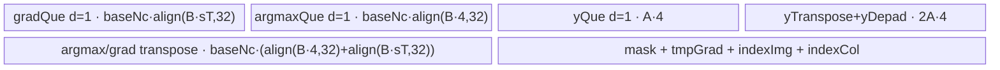
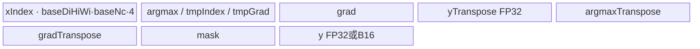
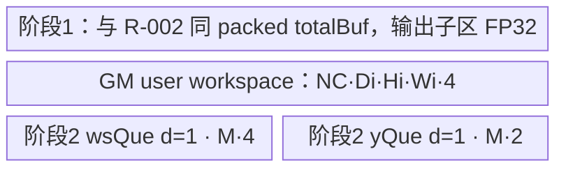
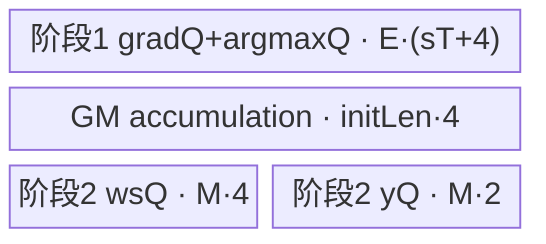

# MaxPool3dWithArgmaxBackward A2/A3 ACLNN 算子知识

## 算子速览

| 项目 | 内容 |
|---|---|
| 实际入口 | `aclnnMaxPool3dWithArgmaxBackwardGetWorkspaceSize` + `aclnnMaxPool3dWithArgmaxBackward`，公开 ACLNN 两段式接口，无更高版本后缀 |
| 计算语义 | 对每个 `gradOutput[n,c,od,oh,ow]`，按 `indices` 给出的展平 DHW 坐标回填到 `gradInput[n,c,:,:,:]`；同一坐标命中多次时求和，未命中位置为 0 |
| 输入输出 | ACLNN 接受 4D CDHW 或 5D NCDHW 视图；A2/A3 核心 Op 固化为 5D NCDHW；`self/gradOutput/gradInput` 为 FP16/BF16/FP32，`indices` 仅 INT32 |
| 执行类型 | 五条 Route 均为单 Kernel `AIV_VECTOR`；entry 在 `g_coreType == AIC` 时直接返回，不存在可达 Cube/AIC/MIX_CV 节点 |
| Kernel 路线 | R-001 CutK 白名单；R-002 Normal 非重叠；R-003 Normal 重叠；R-004 Scatter 非重叠 fallback；R-005 Scatter 重叠 fallback |
| 核心资源 | GM 输入/输出；AIV UB 的 `TBuf/TQue`；重叠 FP16/BF16 使用 FP32 user workspace；Vector transpose/compare/select/add/cast，Scatter fallback 使用标量 GM 读写 |
| 来源闭包 | `source_closed`：公开 ACLNN → level-0 launcher → OpDef/Tiling selector/POD → AIV entry/router → 五条 Host 可达 body/helper → A2/A3 binary config/CMake 均闭合 |
| 验证状态 | 已完成源码闭包检查；本次知识提取未执行编译、真机、数值或性能测试。 |

## 接口与语义

### 计算语义

令 `P = Di*Hi*Wi`，`q=(od,oh,ow)`，`p=indices[n,c,q]`。对合法的 INT32 `p`，核心语义为 `gradInput[n,c,p] += gradOutput[n,c,q]`；所有未写位置置零。`self` 仅提供目标 shape/dtype，Device body 不读取其数值。重叠池化窗口或重复索引会形成累加；公开文档说明默认非确定性，可通过运行时系统参数请求确定性。

4D CDHW 在 ACLNN 层以 view 增加批维成为 5D；5D 输入重格式化为 NCDHW。输出再 view/reformat 回调用者格式并 `ViewCopy` 到可能非连续的 `gradInput`。

### 输入、输出与属性

| 参数 | shape/layout | dtype | 约束、默认值与语义 |
|---|---|---|---|
| `gradOutput` | 4D/5D ND 视图；核心为 NCDHW `(N,C,Do,Ho,Wo)` | FP16/BF16/FP32 | shape 必须等于 `indices`；非空路径各维满足 Host 校验 |
| `self` | 4D/5D ND 视图；核心为 NCDHW `(N,C,Di,Hi,Wi)` | 同 `gradOutput` | shape 等于 `gradInput`；A2/A3 要求 `Di*Hi*Wi <= INT32_MAX` |
| `indices` | 与 `gradOutput` 同 shape；核心 NCDHW | INT32 | A2/A3 不支持 INT64；值是每个 NC 平面内展平 DHW 坐标 |
| `kernelSize` | 长度 1 或 3 | INT64 数组 | 正值；长度 1 广播到 D/H/W |
| `stride` | 长度 0、1 或 3 | INT64 数组 | 正值；空数组取 `kernelSize`，长度 1 广播 |
| `padding` | 长度 1 或 3 | INT64 数组 | 非负，且每轴 `pad <= kernel/2` |
| `dilation` | 长度 1 或 3 | INT64 数组 | 正值；Normal/CutK 只接受全 1，其他值进入 Scatter fallback |
| `ceilMode` | 标量 | BOOL | 控制正向输出 shape 校验中的向上/向下取整 |
| `gradInput` | 与 `self` 同 shape/format | 同 `self` | 未命中为 0；重叠命中累加 |

### 入口与版本

固定仓只公开无版本后缀的 `aclnnMaxPool3dWithArgmaxBackward`，故它是 A2/A3 实际支持的最新公开版本。第一段创建 executor、校验参数、插入 `Contiguous`、4D→5D view/reformat、核心 `MaxPool3DGradWithArgmax` 和最终 `ViewCopy`；第二段以用户 workspace 和 stream 执行 executor。A2/A3 公开支持同时由 ACLNN 文档产品表、OpDef 的 `ascend910b/ascend910_93` 配置及对应 binary config 支撑。

## Host/Launcher 执行流程

### 参数校验与前处理

调用顺序为：检查八个 tensor/数组指针 → 按 `DAV_2201` 选择 FP16/BF16/FP32 支持集并限制 INT32 indices → 检查非私有 format 与 4D/5D rank → 检查属性长度/正值/padding → 检查 A2/A3 `Di*Hi*Wi <= INT32_MAX` → 检查两组 shape 相等。任一失败返回 ACLNN 参数错误。任一核心输入为空时第一段返回 `workspaceSize=0` 且 executor 无核心计算。

非空时依次把 `indices/self/gradOutput` 连续化；4D 用 `ViewCDHWas5D`，5D 用 `ReFormat(...NCDHW)`；level-0 将四个属性展开为三元素 DHW 数组，分配 NCDHW `gradInputResult`，并通过 `ADD_TO_LAUNCHER_LIST_AICORE(MaxPool3DGradWithArgmax, ...)` 添加核心节点。最后恢复调用者 format、核对输出 shape 并 `ViewCopy`。

### 参数、Workspace 与生命周期

Tiling prepare 从平台取得 `AIV core num` 和 UB 字节数。核心 user workspace 仅在 `dtype != FP32 && isOverlap` 时为 `NC*Di*Hi*Wi*sizeof(float)`；Tiling 把 `user + GetLibApiWorkSpaceSize()` 写入单个 workspace size。ACLNN 返回的是 executor 中全部框架节点与核心节点的总 workspace；框架内部切片细节属于生成 executor 边界，固定仓未展开。

workspace 由调用者在第二段前分配，至少活到 stream 上 executor 完成。FP16/BF16 重叠 Route 先在 workspace 中 FP32 累加，所有 AIV 核 `SyncAll` 后按核切片降精度写回 y。FP32 或非重叠 Route 不使用 user slice。entry 要求 `workspace` 和 `GetUserWorkspace(workspace)` 非空，系统 workspace 因此始终由框架提供。

### 启动图与失败传播

核心 Op 的 launch graph 是单 Device 节点：

```text
ACLNN executor (Contiguous/View/ReFormat)
  -> launcher MaxPool3DGradWithArgmax(self, gradOutput, indices; attrs)
     -> TilingRegistry::DoTilingImpl
     -> max_pool3d_grad_with_argmax<<<blockDim, stream>>>
  -> ReFormat/View + ViewCopy(gradInput)
```

核心节点的 `blockDim=usedCoreNum`，POD 为 `MaxPool3DGradWithArgmaxTilingData`，输入顺序是 `x, grad, argmax`，输出 `y`，user workspace offset 由运行时 `GetUserWorkspace` 给出。单节点内部的初始化、计算、FP32 workspace 累加与 cast 仍在同一次 Kernel 启动中完成；`SyncAll` 提供跨核阶段边。Tiling/launcher 失败阻断核心启动，核心失败由 executor/stream 运行返回；框架前后处理与核心按同一 executor/stream 有序。

## Route 与参数设计

### 分核与资源计算

公共变量：`NC=N*C`，输入/输出空间分别 `Di*Hi*Wi` 与 `Do*Ho*Wo`；`isOverlap=(kd>sd)||(kh>sh)||(kw>sw)`。POD 的 `base*` 是 UB tile，`singleCore*` 是 Normal 的跨核分片；`cnt=ceil(dim/base)`，`tail=dim-(cnt-1)*base`。

Normal 首先选 `vl=64`，小 NC 可按 16 对齐降到 16/32/48/64，并以源码的 UB 公式测试完整 tile；随后按 NC→Do→Ho→Wo 顺序扩大并行度，UB 不足时对 Do→Ho→Wo 二分求最大 base。`usedCoreNum=min(totalCnt,totalAiv)`。CutK 固定 `baseNc=64`，只对白名单 shape 尝试，最终以 `ubCutAxis=30` 切 H。Scatter 按每核 NC 轮次分配，依次尝试不切、切 NC、Do、Ho、Wo；其有效 UB 是 `maxUbSize-32`。

### Route 选择

| 顺序 | Route | Key/模板 | 精确选择条件与优先级 | 不适用去向 |
|---:|---|---|---|---|
| 1 | R-001 CutK 白名单 | key `31`，priority 10 | dilation 全 1；`NC<=3072, Do=1,Ho=6,Wo=8,kd=5,kh=1,kw=6,sd=8,sh=13,sw=18`；最小 CutK UB 可容纳 | R-002/R-003 |
| 2 | R-002 Normal 非重叠 | key `0`，priority 12 | dilation 全 1，`isOverlap=false`，最小 Normal UB `<=maxUb` | R-004 |
| 3 | R-003 Normal 重叠 | key `100`，priority 12 | dilation 全 1，`isOverlap=true`，最小 overlap Normal UB `<=maxUb` | R-005 |
| 4 | R-004 Scatter 非重叠 | key `2`，priority 16 | 前述模板均不可用且 `isOverlap=false`；Scatter `IsCapable()` 恒 true，五级切分至少一项成功 | Tiling 失败 |
| 5 | R-005 Scatter 重叠 | key `102`，priority 16 | 前述模板均不可用且 `isOverlap=true`；Scatter 五级切分成功 | Tiling 失败 |

```text
priority 10 CutK.IsCapable() ? key 31
  : priority 12 Normal.IsCapable() ? (isOverlap ? key 100 : key 0)
  : priority 16 Scatter.IsCapable() ? (isOverlap ? key 102 : key 2)
  : GRAPH_FAILED
```

### 模板/实现执行矩阵

| Route | key/selector | dtype/shape/platform 完整命中条件 | 执行拓扑与 Kernel 节点 | 实际模板/body | 内存与同步特征 | tail/fallback |
|---|---|---|---|---|---|---|
| R-001 | 31 | A2/A3、INT32 index、CutK 白名单、UB guard | 单 AIV Kernel | `MaxPool3DGradWithArgmaxCutKD<T,T,int32,T,false>::Process` | 多 TQue/TBuf；Vector compare/select/col2img；非重叠直接写 y | NC/Do/Ho/Wo tail；不满足转 Normal |
| R-002 | 0 | dilation=1、非重叠、Normal 最小 UB 可容纳 | 单 AIV Kernel | `MaxPool3DGradWithArgmaxNormal<T,T,int32,T,false>` | 单 `totalBuf` 分区；FP32 局部累加，无 atomic | 四轴 tail；不满足转 Scatter |
| R-003 | 100 | dilation=1、重叠、Normal 最小 UB 可容纳 | 单 AIV Kernel | `MaxPool3DGradWithArgmaxNormal<T,T,int32,T,true>` | 输出先清零；FP32 atomic；B16 走 FP32 workspace+全核同步+cast | 四轴 tail；不满足转 Scatter |
| R-004 | 2 | 非重叠 Scatter fallback | 单 AIV Kernel | `MaxPoolGradWithArgScatter` → `MaxPool3DGradScatterUnified` | grad/argmax queues + 32B y queue；逐索引单元素写 | 每核 NC 轮次和四轴 tail；资源失败终止 |
| R-005 | 102 | 重叠 Scatter fallback | 单 AIV Kernel | `MaxPoolGradWithArgScatterOverlap` → `MaxPool3DGradScatterOverlapUnified` | GM read-modify-write；B16 在 FP32 workspace 累加并 cast | 每核 NC 轮次和四轴 tail；资源失败终止 |

### 隐藏性能 Guard

| Guard | Host/Tiling 条件 | Device/资源原因 | 影响 Route | 不满足时去向 | 源码符号 |
|---|---|---|---|---|---|
| A2/A3 index 范围 | `Di*Hi*Wi <= INT32_MAX` | indices 和生成的坐标均为 INT32 | 全部 | ACLNN/Tiling 参数错误 | `CheckSelfShapeSupport`, `CheckInputValid` |
| Normal dilation | 三轴 dilation 均为 1 | Normal body 的地址生成不乘 dilation | R-002/R-003 | Scatter | `MaxPool3DGradWithArgmaxNormalTiling::IsCapable` |
| Normal UB | `CalUBTotalSize(1,1,1,isOverlap)<=maxUb` | 至少容纳最小 index/transpose/mask/output tile 与 8192B reserve | R-002/R-003 | Scatter | `CalUBTotalSize`, `IsCapable` |
| repeat stride | `sw<32` 使用批量 `Adds/Add`；否则逐 Wo | repeat stride 是 uint8，`sw*8<=255` | R-002/R-003 | 同 Route 慢路径 | `Img2ColPart`, `Col2ImgPart` |
| Scatter UB | payload `<=maxUb-32`，按 no-cut→NC→Do→Ho→Wo 尝试 | 两个输入 queue 外，非重叠还需 32B y queue | R-004/R-005 | GRAPH_FAILED | `CalculateScatterTilingParams` |
| overlap B16 workspace | `dtype!=FP32 && isOverlap` | 避免 B16 冲突累加，先 FP32 | R-003/R-005 | N/A，必须申请 | `SetOtherTilingParams`, `CalculateRoundParams` |
| Kernel core type | `g_coreType != AIC` | 实现只在 AIV 运行 | 全部 | entry 返回、不写输出 | `max_pool3d_grad_with_argmax` |

### POD/ABI

`MaxPool3DGradWithArgmaxTilingData` 的 42 个字段均为 `uint64_t/64-bit`。仓内只提供 `BEGIN/TILING_DATA_FIELD_DEF` 宏调用，宏定义来自仓外构建头，因此精确 `sizeof/alignof/offsetof` 固定仓不可见；下表 ABI 布局写“源码顺序 #n”，迁移时不得据此臆造字节 offset。

| 结构 | 字段 | 类型/位宽 | ABI 布局 | 单位 | Host/launcher producer | Device consumer | 边界 |
|---|---|---|---|---|---|---|---|
| `MaxPool3DGradWithArgmaxTilingData` | `ncDim` | uint64/64 | #1 | element-plane count | `n*c` | 全部 body 的 NC 循环/offset | 乘法溢出未单独检查 |
| 同上 | `diDim` | uint64/64 | #2 | element | x D | 输出平面/地址 | 正数 |
| 同上 | `hiDim` | uint64/64 | #3 | element | x H | 输出平面/地址 | 正数 |
| 同上 | `wiDim` | uint64/64 | #4 | element | x W | 输出平面/地址 | 正数 |
| 同上 | `doDim` | uint64/64 | #5 | element | grad D | 输出 tile/shape 校验 | 正数 |
| 同上 | `hoDim` | uint64/64 | #6 | element | grad H | 输出 tile/shape 校验 | 正数 |
| 同上 | `woDim` | uint64/64 | #7 | element | grad W | 输出 tile/shape 校验 | 正数 |
| 同上 | `kd` | uint64/64 | #8 | element | 归一化 kernel D | Normal/CutK 循环 | 正数 |
| 同上 | `kh` | uint64/64 | #9 | element | 归一化 kernel H | Normal/CutK 循环 | 正数 |
| 同上 | `kw` | uint64/64 | #10 | element | 归一化 kernel W | Normal/CutK 循环 | 正数 |
| 同上 | `sd` | uint64/64 | #11 | element | 归一化 stride D | 地址步长 | 正数 |
| 同上 | `sh` | uint64/64 | #12 | element | 归一化 stride H | 地址步长 | 正数 |
| 同上 | `sw` | uint64/64 | #13 | element | 归一化 stride W | 地址/repeat stride | 正数 |
| 同上 | `padDTop` | uint64/64 | #14 | element | padding D | depad/offset | 非负 |
| 同上 | `padHTop` | uint64/64 | #15 | element | padding H | depad/offset | 非负 |
| 同上 | `padWTop` | uint64/64 | #16 | element | padding W | depad/offset | 非负 |
| 同上 | `padDBottom` | uint64/64 | #17 | element | `(Do-1)*sd+kd-(Di+padTop)` 截零 | init/depad | 派生值 |
| 同上 | `padHBottom` | uint64/64 | #18 | element | 同 H 公式 | init/depad | 派生值 |
| 同上 | `padWBottom` | uint64/64 | #19 | element | 同 W 公式 | init/depad | 派生值 |
| 同上 | `baseNc` | uint64/64 | #20 | element | Route tile 计算 | 所有 body UB/循环 | Normal 16 对齐，CutK 64 |
| 同上 | `baseDo` | uint64/64 | #21 | element | Route tile 计算 | tile D | >=1 |
| 同上 | `baseHo` | uint64/64 | #22 | element | Route tile 计算 | tile H | >=1 |
| 同上 | `baseWo` | uint64/64 | #23 | element | Route tile 计算 | tile W | >=1 |
| 同上 | `ncTail` | uint64/64 | #24 | element | `NC-(ncCnt-1)*baseNc` | 最后 NC tile | 1..baseNc |
| 同上 | `doTail` | uint64/64 | #25 | element | 同 D 公式 | 最后 D tile | 1..baseDo |
| 同上 | `hoTail` | uint64/64 | #26 | element | 同 H 公式 | 最后 H tile | 1..baseHo |
| 同上 | `woTail` | uint64/64 | #27 | element | 同 W 公式 | 最后 W tile | 1..baseWo |
| 同上 | `ncCnt` | uint64/64 | #28 | tile count | `ceil(NC/baseNc)` | 分核循环 | >=1 |
| 同上 | `doCnt` | uint64/64 | #29 | tile count | `ceil(Do/baseDo)` | 分核循环 | >=1 |
| 同上 | `hoCnt` | uint64/64 | #30 | tile count | `ceil(Ho/baseHo)` | 分核循环 | >=1 |
| 同上 | `woCnt` | uint64/64 | #31 | tile count | `ceil(Wo/baseWo)` | 分核循环 | >=1 |
| 同上 | `totalCnt` | uint64/64 | #32 | tile count | 四个 cnt 乘积 | Normal/CutK round-robin | 乘法溢出未单独检查 |
| 同上 | `usedCoreNum` | uint64/64 | #33 | AIV core | Route 分核结果 | `GetBlockNum`/cast 切片 | <=平台 AIV 数 |
| 同上 | `totalUBSize` | uint64/64 | #34 | byte | 平台 `maxUbSize` | totalBuf/queue 上界 | 不是有效元素数 |
| 同上 | `singleCoreNc` | uint64/64 | #35 | element | Normal 分核 | Normal core shape | Scatter/CutK 不读取 |
| 同上 | `singleCoreDo` | uint64/64 | #36 | element | Normal 分核 | Normal core shape | Scatter/CutK 不读取 |
| 同上 | `singleCoreHo` | uint64/64 | #37 | element | Normal 分核 | Normal core shape | Scatter/CutK 不读取 |
| 同上 | `singleCoreWo` | uint64/64 | #38 | element | Normal 分核 | Normal core shape | Scatter/CutK 不读取 |
| 同上 | `ncRound` | uint64/64 | #39 | round/core | `ceil(ncCnt/usedCoreNum)` | Scatter core ownership | 非 Scatter 不读取 |
| 同上 | `ncRoundTail` | uint64/64 | #40 | round/core | 余核为 `ncRound-1` | Scatter tail cores | 非 Scatter 不读取 |
| 同上 | `totalRound` | uint64/64 | #41 | tile round | `ncRound*doCnt*hoCnt*woCnt` | 仅日志；body 用 realRound | 非 Scatter 不读取 |
| 同上 | `preCoreNum` | uint64/64 | #42 | core | `ncCnt%usedCoreNum` | Scatter 前/后核分配 | 非 Scatter 不读取 |

### Route 源码闭包

| Route | Key/selector | Host/Tiling producer | POD/参数 | Kernel entry/router 节点 | Kernel body/直接依赖 | 构建接线 |
|---|---|---|---|---|---|---|
| R-001 | 31/CutK p10 | `max_pool3d_grad_with_argmax_cutk_tiling.cpp::IsCapable/DoOpTiling` | 公共 POD，`base*=64/1/baseHo/8` | entry key 31 | `CutKD::Process`, `CutKBase` helpers | 910B/910_93 binary + module CMake |
| R-002 | 0/Normal p12 | `normal_tiling.cpp::IsCapable/SetNormalTilingParams` | 公共 POD + `singleCore*` | entry key 0 | `Normal<...,false>::Process` | 同上 |
| R-003 | 100/Normal p12 | 同上，`isOverlap=true` | 同上 + FP32 workspace | entry key 100 | `Normal<...,true>::Process/ProcessCast` | 同上 |
| R-004 | 2/Scatter p16 | `scatter_tiling.cpp` + `CalculateScatterTilingParams` | 公共 POD + round 字段 | entry key 2 | `ScatterUnified` + base/common | 同上 |
| R-005 | 102/Scatter p16 | 同上，`isOverlap=true` | 同上 + FP32 workspace | entry key 102 | `ScatterOverlapUnified` + base/common | 同上 |

## Kernel 实现

### 公共执行流程

所有 Route 共用 entry 参数 `(x,grad,argmax,y,workspace,tiling)`；空 workspace/user workspace 或 AIC 核立即返回。A2/A3 router 读取公共 POD，根据 key 构造唯一模板实例并执行 `Init→Process`，未知 key 无 body、直接返回。`x` 只绑定或透传，不参与梯度值计算。每条 Route 都是一个 AIV Kernel 节点，不存在跨 Kernel workspace 边。

### Route R-001：CutK 白名单

#### 适用条件

##### 选择证据

| 层级 | 文件 | 符号 | 源码谓词/参数 | 结果/下一跳 |
|---|---|---|---|---|
| Host | `op_host/max_pool3d_grad_with_argmax_cutk_tiling.cpp` | `IsCapable` | 全 1 dilation、白名单十项 shape/attr、最小 UB guard | priority 10 命中 |
| Tiling | 同文件 | `SetCutKTilingParams` | `baseNc=64`，全量 UB 不可容纳后切 Ho | `ubCutAxis=30`, key 31 |
| Router | `op_kernel/max_pool3d_grad_with_argmax.cpp` | key 31 分支 | `TILING_KEY_IS(31)` | `CutKD<...,false>::Process` |

#### Device 数据流

##### 函数级调用链

```text
max_pool3d_grad_with_argmax
  -> MaxPool3DGradWithArgmaxCutKD::Init
     -> CutKBase::InitParams/InitInputsOutputs/InitUbBuffer
  -> CutKD::Process -> CalBlockParams -> CalcBlockKD
     -> CopyInData -> GenKernelIndicesWithTranspose
     -> Img2ColPartKD -> Compare/SelectGradOut -> Col2ImgPartKD
     -> DepadCopyKD -> TranBackAndMoveOut -> CopyOutKD
```

##### 源码等价伪码

```text
for tile index assigned by index % blockNum:
  derive NC/Do/Ho/Wo tile and GM offsets
  DMA argmax,grad; transpose NC-major to position-major
  for kd in [0,kd):
    generate absolute DHW indices by doubling Adds
    for kh,kw: gather strided index column
      mask = (generated_index == argmax)
      selected = mask ? cast_fp32(grad) : 0
      accumulate selected into FP32 image tile
    remove D/H/W padding, transpose back, DMA valid region to y
```

#### 内存与数据搬运

##### 资源与搬运表

| 层级/缓冲区 | offset/地址公式 | extent/容量公式 | dtype/layout | producer | consumer | owner/lifetime | 对齐/复用 |
|---|---|---|---|---|---|---|---|
| grad/argmax GM | `nc*DoHoWo + do*baseDo*HoWo + ho*baseHo*Wo + wo*baseWo` | `baseNc*baseDo*baseHo*baseWo` | T/int32 NCDHW | ACLNN | CopyInData | caller，Kernel 全程 | 每 NC blockLen，UB 32B 对齐 |
| input queues | UB allocator | `baseNc*align(singleBlock*sizeof(dtype),32)` 各一 | NC-major | DataCopyPad | transpose | depth 1，转置后释放 | 独立 queue |
| calc TBuf/queue | UB allocator | 见字节账 | FP32/int32/typed | index/compare/select | col2img/depad | tile 内 | 无跨 tile alias |
| y GM | depad 地址公式 | `diValid*hiValid*wiValid`/NC | output dtype | CopyOutKD | caller | output lifetime | 非重叠无需 atomic |

##### 分层内存布局



其中 `B=baseDo*baseHo*baseWo`，`A=baseNc*baseDp*baseHp*align(baseWp,8)`。

##### 字节账与复用顺序

```text
UB_total = baseNc*align(B*sT,32) + baseNc*align(B*4,32)
         + 3*A*4
         + baseNc*align(B*4,32) + baseNc*align(B*sT,32)
         + baseNc*B*4/32 + baseNc*B*4
         + baseNc*baseDp*baseHp*baseWp*4 + baseNc*B*4
UB_total + 8192-byte Host reserve <= maxUbSize
dynamic_ub = N/A
workspace_total = 0（该白名单非重叠）
```

| 复用子区 | 写入者 | 读取者/消费点 | 下一次覆盖 | 同步或释放依据 | 安全条件 |
|---|---|---|---|---|---|
| grad/argmax queue | CopyIn | transpose | 下一 tile | DeQue/FreeTensor + MTE2_V | 转置完成后才释放 |
| `tmpGradBuf` | Select | Col2Img | 下一 kh/kw | PIPE_V barrier | Add 完成前不覆盖 |
| `yTransposeBuf` | Duplicate/Add | depad | 下一 kd/tile | PIPE_V | CopyOut 前保持有效 |

#### 同步、精度与尾块

##### 同步与数值边界表

| 阶段 | primitive/机制 | producer | consumer/等待点 | 保护对象 | 精度/尾块 |
|---|---|---|---|---|---|
| DMA→Vector | `MTE2_V` | CopyIn | transpose | queues | tail 由 block shape |
| Vector chain | `PipeBarrier<PIPE_V>` | Adds/Compare/Select/Add | 下一 Vector op | calc buffers | B16 先转 FP32，FP32 累加 |
| Vector→DMA | `V_MTE3` | transpose/depad | CopyOut | y UB | BF16 RINT，FP16 CAST_NONE |
| tail | depad + DataCopyPad | tile loop | GM | 有效 D/H/W | padding lane 不写 GM |

#### 关键实现

##### 符号证据表

| 阶段 | 文件 | 符号/模板实例 | 实现事实 |
|---|---|---|---|
| Host/Tiling producer | `op_host/max_pool3d_grad_with_argmax_cutk_tiling.cpp` | `IsCapable`, `CalUBTotalSize`, `SetCutKTilingParams` | 白名单、UB 与 key |
| Kernel entry/router | `op_kernel/max_pool3d_grad_with_argmax.cpp` | key 31 | 映射到 CutKD false |
| Device body/helper | `op_kernel/max_pool3d_grad_with_argmax_cutk_d.h` + `cutk_base.h` | `Process`, `CalcGradKD`, `SelectGradOut` | 地址生成、筛选、FP32 累加、depad |

### Route R-002：Normal 非重叠

#### 适用条件

##### 选择证据

| 层级 | 文件 | 符号 | 源码谓词/参数 | 结果/下一跳 |
|---|---|---|---|---|
| Host | `op_host/max_pool3d_grad_with_argmax_normal_tiling.cpp` | `IsCapable` | dilation=1 且最小 UB 可容纳 | priority 12 |
| Tiling | 同文件 | `SetNormalTilingParams` | `isOverlap=false`，NC→D→H→W 切分 | key 0 |
| Router | `op_kernel/max_pool3d_grad_with_argmax.cpp` | key 0 | Normal false | body |

#### Device 数据流

##### 函数级调用链

```text
entry -> Normal<...,false>::Init -> InitUbBuffer(totalBuf)
      -> Process -> [optional ProcessInit0(y)] -> SubProcess -> CalcBlock
      -> CopyInArgmax/Grad -> transpose -> Gen/Img2Col/Compare/Select
      -> Col2Img -> DePad -> cast/transpose -> CopyOut(y)
```

##### 源码等价伪码

```text
optional zero y; SyncAll
generate one reusable baseDi*baseHi*baseWi*baseNc index lattice
for global tile where blockIdx == tile % blockNum:
  split again by baseDo/baseHo/baseWo and compute pad-valid extents
  DMA+transpose argmax and grad
  zero FP32 y tile
  for kd,kh,kw: compare generated index with argmax; select grad; FP32 col2img add
  depad; cast B16 if needed; transpose back; copy valid region without atomic
```

#### 内存与数据搬运

##### 资源与搬运表

| 层级/缓冲区 | offset/地址公式 | extent/容量公式 | dtype/layout | producer | consumer | owner/lifetime | 对齐/复用 |
|---|---|---|---|---|---|---|---|
| `totalBuf` | byte offsets in `InitUbBuffer` | exactly `totalUBSize=maxUbSize` | packed byte arena | InitBuffer | all stages | Kernel; reset only absent | argmax region aliases tmpIndex/tmpGrad at disjoint time |
| grad/argmax GM | core+block offset | `ncShape*dohowoShape` | NCDHW | caller | CopyIn | caller | blockCount=ncShape, GM stride skips rest plane |
| y GM | core/block/pad offset | valid `di*hi*wi` rows | NCDHW | CopyOut | caller | output | no atomic |

##### 分层内存布局



##### 字节账与复用顺序

```text
logical_used = xIndexSize + argmaxSize + gradSize + yTranSize
             + argmaxTranSize + gradTranSize + maskSize + ySize
UB allocation = totalUBSize = platform maxUbSize
logical_used + 8192 <= maxUbSize  （Host selector）
dynamic_ub = N/A
workspace_total = 0
```

| 复用子区 | 写入者 | 读取者/消费点 | 下一次覆盖 | 同步或释放依据 | 安全条件 |
|---|---|---|---|---|---|
| argmax region | CopyIn argmax | transpose | tmpIndex/tmpGrad | MTE2_V + PIPE_V | transpose 消费结束后复用 |
| yTranspose | Duplicate/Col2Img | depad/cast | 下一 tile | V_MTE3/MTE3_V | CopyOut 完成后覆盖 |

#### 同步、精度与尾块

##### 同步与数值边界表

| 阶段 | primitive/机制 | producer | consumer/等待点 | 保护对象 | 精度/尾块 |
|---|---|---|---|---|---|
| init | `SyncAll` | 分核清零 | tile 计算 | y | 仅 needInitOutput |
| copy/compute | MTE2_V + PIPE_V | DMA/vector | transpose/select/add | arena | mask 用 align 到 64 FP32 lanes |
| output | V_MTE3/MTE3_V | cast/transpose | DMA/arena reuse | y tile | FP16 CAST_NONE，BF16 RINT；depad 限定有效区 |

#### 关键实现

##### 符号证据表

| 阶段 | 文件 | 符号/模板实例 | 实现事实 |
|---|---|---|---|
| Host/Tiling producer | `op_host/max_pool3d_grad_with_argmax_normal_tiling.cpp` | `CalcBaseNc`, `SetNormalTilingParams` | VL、分核、UB |
| Kernel entry/router | `op_kernel/max_pool3d_grad_with_argmax.cpp` | key 0 | Normal false |
| Device body/helper | `op_kernel/max_pool3d_grad_with_argmax_normal.h` | `Process`, `CalcBlock`, `CopyOut` | packed UB、Vector pipeline、tail |

### Route R-003：Normal 重叠

#### 适用条件

##### 选择证据

| 层级 | 文件 | 符号 | 源码谓词/参数 | 结果/下一跳 |
|---|---|---|---|---|
| Host | `normal_tiling.cpp` | `IsCapable` | Normal guard 且 `isOverlap=true` | priority 12 |
| Tiling | 同文件 | `SetOtherTilingParams` | B16 workspace=`NC*Di*Hi*Wi*4` | key 100, schedule mode 1 |
| Router | `op_kernel/max_pool3d_grad_with_argmax.cpp` | key 100 | Normal true | body |

#### Device 数据流

##### 函数级调用链

```text
entry -> Normal<...,true>::Process
  -> ProcessInit0(y or FP32 workspace) -> SyncAll
  -> same compare/select/FP32 col2img pipeline as R-002
  -> SetAtomicAdd<float> CopyOut(y/workspace)
  -> SyncAll -> [B16] Reset pipe -> workspace DMA -> Cast -> y DMA
```

##### 源码等价伪码

```text
zero accumulation target; all-core barrier
for assigned tiles: compute FP32 partial tile and atomic-add valid region
if output is FP16/BF16:
  all-core barrier
  each core handles loops where loop % blockNum == blockIdx
  DMA FP32 workspace chunk -> cast -> DMA output chunk
```

#### 内存与数据搬运

##### 资源与搬运表

| 层级/缓冲区 | offset/地址公式 | extent/容量公式 | dtype/layout | producer | consumer | owner/lifetime | 对齐/复用 |
|---|---|---|---|---|---|---|---|
| calc arena | 同 R-002 | overlap y buffers固定 FP32 | packed UB | Vector | atomic DMA | tile | 不在 tile 间共享 |
| workspace | flat output offset | `NC*Di*Hi*Wi*4` | FP32 NCDHW | atomic CopyOut | ProcessCast | executor/caller | 全核 barrier 前不可读 |
| cast queues | Reset 后 UB | `M=floor(UB/(4+2))`：`M*4 + M*2` | FP32 + output B16 | DMA/Cast | y DMA | cast phase | depth 1 |

##### 分层内存布局



##### 字节账与复用顺序

```text
phase1 UB allocation = totalUBSize
phase2 UB_total = M*(4+2) <= totalUBSize
workspace_total = NC*Di*Hi*Wi*4 bytes for FP16/BF16; 0 for FP32
```

| 复用子区 | 写入者 | 读取者/消费点 | 下一次覆盖 | 同步或释放依据 | 安全条件 |
|---|---|---|---|---|---|
| whole UB | calc phase | atomic output | pipe Reset/cast queues | `SyncAll` then `Reset` | 所有 partial 已提交 |
| workspace chunk | atomic add | CopyInWorkspace | executor end | `SyncAll` | 所有核完成累加 |

#### 同步、精度与尾块

##### 同步与数值边界表

| 阶段 | primitive/机制 | producer | consumer/等待点 | 保护对象 | 精度/尾块 |
|---|---|---|---|---|---|
| init→compute | `SyncAll` | zero target | all tiles | GM target | 防止清零覆盖累加 |
| partial merge | `SetAtomicAdd<float>` | tile FP32 | GM | y/workspace | 累加次序默认非确定 |
| merge→cast | `SyncAll` | all atomics | ProcessCast | workspace | BF16 RINT，FP16 CAST_NONE；chunk tail=calcTail |

#### 关键实现

##### 符号证据表

| 阶段 | 文件 | 符号/模板实例 | 实现事实 |
|---|---|---|---|
| Host/Tiling producer | `normal_tiling.cpp` | `SetNormalTilingParams`, `SetOtherTilingParams` | overlap 分核与 workspace |
| Kernel entry/router | `op_kernel/max_pool3d_grad_with_argmax.cpp` | key 100 | Normal true |
| Device body/helper | `normal.h` | `CopyOut`, `ProcessCast` | FP32 atomic、barrier、降精度 |

### Route R-004：Scatter 非重叠 fallback

#### 适用条件

##### 选择证据

| 层级 | 文件 | 符号 | 源码谓词/参数 | 结果/下一跳 |
|---|---|---|---|---|
| Host | `scatter_tiling.cpp` | `IsCapable` | 恒 true；前两模板 fallthrough | priority 16 |
| Tiling | common tiling helper | `CalculateScatterTilingParams` | 五级 UB 切分，非重叠 | key 2 |
| Router | `op_kernel/max_pool3d_grad_with_argmax.cpp` | key 2 | `MaxPoolGradWithArgScatter` | unified body |

#### Device 数据流

##### 函数级调用链

```text
entry -> ScatterUnified::Init -> base::InitParams/InitInputsOutputs/InitUbBuffer
      -> InitGlobalMemory(y slice)
      -> ProcessCommon -> CopyInGrad/Argmax -> CalcOutOffset
      -> one-element DataCopyPad(y[argmax], grad)
```

##### 源码等价伪码

```text
assign contiguous NC-tile rounds to each core; zero that core's disjoint y slice
for local NC,Do,Ho,Wo tiles:
  DMA grad and argmax to depth-1 queues
  for each valid element:
    outOffset = ncPlaneBase + uint64(argmax)
    stage gradValue in 32-byte y queue; copy sizeof(T) bytes to y[outOffset]
```

#### 内存与数据搬运

##### 资源与搬运表

| 层级/缓冲区 | offset/地址公式 | extent/容量公式 | dtype/layout | producer | consumer | owner/lifetime | 对齐/复用 |
|---|---|---|---|---|---|---|---|
| gradQ | UB | `baseNc*baseDo*baseHo*baseWo*sT` | T | DMA | scalar GetValue | depth 1/tile | tail pad |
| argmaxQ | UB | `baseElems*4` | int32 | DMA | scalar GetValue | depth 1/tile | tail pad |
| yQ | UB | 32 bytes | T | scalar SetValue | one-element DMA | depth 1/element | repeatedly reused after MTE3_S |
| y GM slice | `ncIndex*baseNc*DiHiWi` | owned NC rounds | T NCDHW | zero + writes | caller | core-disjoint | no atomic |

##### 分层内存布局


##### 字节账与复用顺序

```text
E=baseNc*baseDo*baseHo*baseWo
UB_total=E*(sT+4)+32 <= maxUbSize
dynamic_ub=N/A
workspace_total=0
```

| 复用子区 | 写入者 | 读取者/消费点 | 下一次覆盖 | 同步或释放依据 | 安全条件 |
|---|---|---|---|---|---|
| yQ[0] | scalar SetValue | DataCopyPad | 下一 element | S_MTE3 then MTE3_S | 单元素 DMA 已完成 |

#### 同步、精度与尾块

##### 同步与数值边界表

| 阶段 | primitive/机制 | producer | consumer/等待点 | 保护对象 | 精度/尾块 |
|---|---|---|---|---|---|
| init | MTE3_S | InitGlobalMemory | scalar writes | y slice | 每核只清自己 NC slice |
| input | MTE2_S | DMA | scalar GetValue | queues | base/tail shapes |
| output | S_MTE3/MTE3_S | yQ | GM/reuse | single element | 不 cast，保持输入 dtype |

#### 关键实现

##### 符号证据表

| 阶段 | 文件 | 符号/模板实例 | 实现事实 |
|---|---|---|---|
| Host/Tiling producer | `scatter_tiling.cpp`, common tiling helper | `SetScatterTilingParams` | NC rounds/五级切分 |
| Kernel entry/router | `op_kernel/max_pool3d_grad_with_argmax.cpp` | key 2 | wrapper→unified |
| Device body/helper | `pool_3d_common/.../max_pool3d_grad_scatter_unified.h` | `CalcOutOffset`, `Process` | 逐索引 scatter 与同步 |

### Route R-005：Scatter 重叠 fallback

#### 适用条件

##### 选择证据

| 层级 | 文件 | 符号 | 源码谓词/参数 | 结果/下一跳 |
|---|---|---|---|---|
| Host | `scatter_tiling.cpp` | `IsCapable/DoOpTiling` | fallback 且 `isOverlap=true` | key 102 |
| Tiling | common tiling helper | `CalculateRoundParams` | B16 workspace=`NC*Di*Hi*Wi*4` | round POD |
| Router | `op_kernel/max_pool3d_grad_with_argmax.cpp` | key 102 | ScatterOverlap wrapper | unified overlap body |

#### Device 数据流

##### 函数级调用链

```text
entry -> ScatterOverlapUnified::Init -> zero y/workspace slice
      -> ProcessCommon -> CopyIn queues -> CalcOutOffset
      -> DataCacheCleanAndInvalid -> GM GetValue + grad -> GM SetValue
      -> [B16] Reset -> workspace CopyIn -> Cast -> y CopyOut
```

##### 源码等价伪码

```text
zero core-owned NC accumulation slice
for each tile element:
  p = argmaxUb[i]
  invalidate/clean cache
  accumulation[ncPlane+p] = accumulation[ncPlane+p] + float(gradUb[i])
  invalidate/clean cache
if B16: pipe barrier; reset UB; stream FP32 slice through cast queues to y
```

#### 内存与数据搬运

##### 资源与搬运表

| 层级/缓冲区 | offset/地址公式 | extent/容量公式 | dtype/layout | producer | consumer | owner/lifetime | 对齐/复用 |
|---|---|---|---|---|---|---|---|
| input queues | UB | `E*sT + E*4` | typed | DMA | scalar loop | tile | depth 1 |
| accumulation GM | `initOffset + ncPlane + argmax` | core-owned `initLen` | FP32 for B16, output FP32 otherwise | GM RMW | cast/caller | disjoint per core NC | cache clean/invalidate around each update |
| cast queues | Reset UB | `M*4 + M*2` | FP32→B16 | workspace DMA/Cast | y DMA | final phase | depth 1 |

##### 分层内存布局



##### 字节账与复用顺序

```text
phase1 UB_total=E*(sT+4) <= maxUbSize-32
phase2 UB_total=M*(4+2) <= maxUbSize
workspace_total=NC*Di*Hi*Wi*4 for B16; 0 for FP32
dynamic_ub=N/A
```

| 复用子区 | 写入者 | 读取者/消费点 | 下一次覆盖 | 同步或释放依据 | 安全条件 |
|---|---|---|---|---|---|
| whole UB | input queues | scalar RMW | cast queues | PIPE_ALL + Reset | 所有 tile 已处理 |
| FP32 accumulation | GM SetValue | cast | executor end | core NC ownership；cache clean/invalidate | 不跨核共享 NC slice |

#### 同步、精度与尾块

##### 同步与数值边界表

| 阶段 | primitive/机制 | producer | consumer/等待点 | 保护对象 | 精度/尾块 |
|---|---|---|---|---|---|
| DMA→scalar | MTE2_S + PIPE_ALL | queues | RMW | input tile | tail shapes |
| RMW | cache clean/invalidate | GM read/write | next update | accumulation | B16 converted to FP32 before add |
| cast | PIPE_ALL + queue protocol | all local RMW | output | core slice | BF16 RINT，FP16 CAST_NONE，chunk tail |

#### 关键实现

##### 符号证据表

| 阶段 | 文件 | 符号/模板实例 | 实现事实 |
|---|---|---|---|
| Host/Tiling producer | `scatter_tiling.cpp`, common helper | `CalculateRoundParams` | ownership/workspace |
| Kernel entry/router | `op_kernel/max_pool3d_grad_with_argmax.cpp` | key 102 | overlap wrapper |
| Device body/helper | `pool_3d_common/.../max_pool3d_grad_scatter_overlap_unified.h` | `CalcOutOffset`, `ProcessCast` | FP32 RMW、cache、cast |

## 算子特定优化

### Trick T-001：Normal 用索引格复用替代逐输出标量 scatter

#### 触发与源码依据

- 适用 Route：R-002、R-003
- 触发条件：dilation 全 1，最小 Normal UB 可容纳；Host priority 12 命中。
- Golden 来源：[`op_kernel/max_pool3d_grad_with_argmax_normal.h:402-427`](../../../../../../../cann-ops-raw/ascendc/ops-nn/955f8b33985b6d72989ebff341bb9c2c564a51bc/pooling/max_pool3d_grad_with_argmax/op_kernel/max_pool3d_grad_with_argmax_normal.h#L402-L427)

**官方源码（固定 Commit 连续逐字摘录）**：

```cpp
for (uint64_t kdId = 0; kdId < para_.kd; kdId++) {
    for (uint64_t khId = 0; khId < para_.kh; khId++) {
        for (uint64_t kwId = 0; kwId < para_.kw; kwId++) {
            uint64_t offsetIn = kdId * para_.baseHi * para_.baseWi * para_.baseNc +
                                khId * para_.baseWi * para_.baseNc + kwId * para_.baseNc;
            Img2ColPart(tmpIndexUb, xIndexUb[offsetIn]);
            PipeBarrier<PIPE_V>();
            Compare(maskUb, tmpIndexUb, argmaxTranUb, CMPMODE::EQ,
                    AlignUp(block_.dohowoShape * para_.baseNc, B32_VECTOR_MASK));
            PipeBarrier<PIPE_V>();
```

#### 机制与设计原因

`GenXInitIndex` 只为 base 输入 tile 生成一次连续 DHW 索引格；每个 kernel position 通过 `Img2ColPart` 的 strided `Adds` 形成候选索引列，再用 64-lane FP32 mask 的 `Compare`/`Select` 批量筛梯度并 `Col2Img` 累加。它把 Scatter fallback 的逐元素 GM 随机写改为 UB 内连续 transpose、Vector 比较与局部归并，只在 tile 完成后搬出有效区域。

#### 迁移边界

- 适用：索引可由规则窗口地址生成、且 tile 能容纳索引格与 transpose 缓冲的 gather/scatter backward。
- 前提：A2/A3 AIV；INT32 index；dilation=1；`baseNc` 满足 transpose 对齐；Host UB 公式通过。
- 失效：dilation 非 1 或最小 UB 不可容纳时必须使用 R-004/R-005 Scatter。
- 未验证：本次知识提取未执行编译、真机、数值或性能测试。

#### 错误做法

固定仓给出的真实 fallback 是忽略 Normal guard 仍强行执行其地址公式；dilation 非 1 时该公式没有 dilation 因子，会生成错误索引，因此必须 fallthrough 到 Scatter。

### Trick T-002：重叠 B16 先 FP32 聚合、全核同步后统一降精度

#### 触发与源码依据

- 适用 Route：R-003、R-005
- 触发条件：`isOverlap && dtype!=FP32`。
- Golden 来源：[`op_kernel/max_pool3d_grad_with_argmax_normal.h:264-267`](../../../../../../../cann-ops-raw/ascendc/ops-nn/955f8b33985b6d72989ebff341bb9c2c564a51bc/pooling/max_pool3d_grad_with_argmax/op_kernel/max_pool3d_grad_with_argmax_normal.h#L264-L267)

**官方源码（固定 Commit 连续逐字摘录）**：

```cpp
if constexpr (!is_same<TY, float>::value && IsOverlap) {
    SyncAll();
    InitCastUbBuffer();
    ProcessCast();
}
```

#### 机制与设计原因

Host 为完整输出平面分配 FP32 workspace；各 tile 先以 FP32 累加，`SyncAll` 保证全部 partial 可见后重置 pipe，并以 `M=floor(UB/(4+2))` 的 FP32/B16 双 queue 流式 cast。这样避免每次冲突更新都在 FP16/BF16 精度中反复舍入；BF16 用 `CAST_RINT`，FP16 用 `CAST_NONE`，最终只降精度一次。

#### 迁移边界

- 适用：存在重复目标地址且输出是 FP16/BF16 的反向散射累加。
- 前提：workspace 至少 `output_elements*4`，允许全核 barrier，cast 阶段与累加阶段在同一 Kernel 中有序。
- 失效：缺 workspace 或无法提供跨核同步时不得复用此结构；FP32 输出直接累加，不进入 cast phase。
- 未验证：本次知识提取未执行编译、真机、数值或性能测试。

#### 错误做法

若在 `SyncAll` 前读取并 cast workspace，晚到的 atomic/GM 更新会丢失；源码以全核同步作为明确反例边界。

## 模板与实现对比

| 对比维度 | R-001 CutK | R-002/003 Normal | R-004/005 Scatter | 设计选择依据 |
|---|---|---|---|---|
| 命中条件/优先级 | 极窄白名单，p10 | dilation=1且UB可容纳，p12 | 恒真 fallback，p16 | 数字小者先尝试 |
| 模板与 dtype | CutKD，INT32 index | Normal false/true | unified false/true | 三种 value dtype 共用模板 |
| 循环与分核 | tile round-robin，按 kd 切 | NC→D→H→W，tile 内 kd/kh/kw | 每核连续 NC rounds，逐元素 | UB/冲突特性不同 |
| Queue/TBuf/寄存器/dynamic UB/通信 window | 多 queue/TBuf | packed totalBuf | 两输入 queue；可选 cast queues | 均无 dynamic UB/通信 |
| 内存总占用与复用 | Host 显式逐 buffer 公式 | arena 分区与 argmax/tmp alias | payload+32B；phase reset | 均受 maxUb 限制 |
| 搬运/Vector/SIMT/NDDMA/通信 API | DMA+transpose+Vector | DMA+transpose+Compare/Select/Add | DMA+标量 GM RMW | 全为 AIV，无 SIMT/NDDMA |
| 同步、精度与 tail | PIPE barriers；FP32 累加 | overlap atomic/workspace；四轴 tail | cache protocol；NC/tile tail | B16 重叠最终 cast |
| fallback/失败边界 | →Normal | →Scatter | 资源仍失败则 Tiling 失败 | unknown key 无输出 |

## 平台差异

| 项目 | A2 | A3 | 950 |
|---|---|---|---|
| 支持状态 | 公开支持 | 公开支持 | 未发布：ACLNN 文档标支持，但同算子 README 明确标不支持，存在发布冲突 |
| Host/Launcher | `ascend910b` config，共用 arch32 Host | `ascend910_93` config，共用 arch32 Host | 发布冲突门禁下未纳入正式知识 |
| Kernel/资源 | 同一 AIV router/body，平台提供各自 AIV 数/UB | 同左 | 未纳入本卡 |

## 限制与失败边界

- A2/A3 `indices` 仅 INT32，且 `Di*Hi*Wi <= INT32_MAX`；ACLNN 文档的通用 INT64 行不适用于这两个平台。
- API 层把空输入视为成功空 executor，但文档写“不支持空进空出”；非空核心 Tiling 还要求 x 各维非零。此处只记录源码行为，不外推空输出内容。
- Host 多处使用 uint64 shape 乘法且未见独立溢出检查；POD 宏的精确 ABI offset/sizeof 在固定仓不可见。
- Scatter overlap 的 GM RMW 依赖每核连续 NC slice ownership与 cache clean/invalidate；不得改成跨核共享同一 NC plane。
- entry 对 unknown key、AIC core、空 workspace 直接返回而无 Device 错误码；调用侧必须保证 Tiling/launch 接线正确。
- 本次知识提取未执行编译、真机、数值或性能测试。

## 源码索引

### 链路索引

| 链路阶段 | 文件 | 关键符号 | 支撑内容 |
|---|---|---|---|
| 入口声明/约束 | `pooling/max_pool3d_grad_with_argmax/README.md` | 产品支持表 | A2/A3 支持与 950 冲突证据 |
| 入口声明/约束 | `pooling/max_pool3d_grad_with_argmax/docs/aclnnMaxPool3dWithArgmaxBackward.md` | 产品表/原型/约束 | A2/A3 支持、公开语义 |
| 入口声明/约束 | `pooling/max_pool3d_grad_with_argmax/op_api/aclnn_max_pool3d_with_argmax_backward.h` | 两段式声明 | 参数 ABI |
| 入口实现 | `pooling/max_pool3d_grad_with_argmax/op_api/aclnn_max_pool3d_with_argmax_backward.cpp` | `CheckParams`, GetWorkspaceSize/Run | 校验与 executor 流程 |
| 入口实现 | `pooling/max_pool3d_grad_with_argmax/op_api/max_pool3d_grad_with_argmax.cpp` | `MaxPool3DGradWithArgmax` | 属性归一化与 launcher |
| Host/Tiling/Launcher | `pooling/max_pool3d_grad_with_argmax/op_host/max_pool3d_grad_with_argmax_def.cpp` | `MaxPool3DGradWithArgmax` OpDef | dtype/layout/platform 注册 |
| Host/Tiling/Launcher | `pooling/max_pool3d_grad_with_argmax/op_host/max_pool3d_grad_with_argmax_tiling.cpp` | Tiling prepare/registry | AIV/UB 平台参数 |
| Host/Tiling/Launcher | `pooling/max_pool3d_grad_with_argmax/op_host/max_pool3d_grad_with_argmax_tiling.h` | POD/模板类 | ABI 字段和 selector 类 |
| Host/Tiling/Launcher | `pooling/max_pool3d_grad_with_argmax/op_host/max_pool3d_grad_with_argmax_tiling_base.cpp` | 校验、POD producer、key | 公共 Host 闭包 |
| Host/Tiling/Launcher | `pooling/max_pool3d_grad_with_argmax/op_host/max_pool3d_grad_with_argmax_cutk_tiling.cpp` | CutK template | R-001 |
| Host/Tiling/Launcher | `pooling/max_pool3d_grad_with_argmax/op_host/max_pool3d_grad_with_argmax_normal_tiling.cpp` | Normal template | R-002/003 |
| Host/Tiling/Launcher | `pooling/max_pool3d_grad_with_argmax/op_host/max_pool3d_grad_with_argmax_scatter_tiling.cpp` | Scatter template | R-004/005 |
| Host/Tiling/Launcher | `pooling/pool_3d_common/op_host/arch32/max_pool3d_grad_tiling_common.h` | scatter tiling helpers | 五级 UB 切分/round |
| Host/Tiling/Launcher | `pooling/pool_3d_common/op_host/arch32/max_pool3d_grad_tiling_constants.h` | key/UB constants | key 编码与 8192B reserve |
| Host/Tiling/Launcher | `common/inc/op_host/tiling_templates_registry.h` | `TilingRegistry::DoTilingImpl` | `std::map` 升序 priority 与首个非 PARAM_INVALID 终止 |
| Kernel entry/body | `pooling/max_pool3d_grad_with_argmax/op_kernel/max_pool3d_grad_with_argmax.cpp` | entry/router | key→body，AIV guard |
| Kernel entry/body | `pooling/max_pool3d_grad_with_argmax/op_kernel/max_pool3d_grad_with_argmax_normal.h` | Normal body | R-002/003 完整 pipeline |
| Kernel entry/body | `pooling/max_pool3d_grad_with_argmax/op_kernel/max_pool3d_grad_with_argmax_cutk_base.h` | CutK base | R-001 buffer/helper |
| Kernel entry/body | `pooling/max_pool3d_grad_with_argmax/op_kernel/max_pool3d_grad_with_argmax_cutk_d.h` | CutKD | R-001 body |
| Kernel entry/body | `pooling/pool_3d_common/op_kernel/arch32/max_pool3d_grad_scatter_base_template.h` | Scatter base | input queue/NC ownership |
| Kernel entry/body | `pooling/pool_3d_common/op_kernel/arch32/max_pool3d_grad_scatter_unified.h` | ScatterUnified | R-004 body |
| Kernel entry/body | `pooling/pool_3d_common/op_kernel/arch32/max_pool3d_grad_scatter_overlap_unified.h` | ScatterOverlapUnified | R-005 body |
| 构建接线 | `pooling/max_pool3d_grad_with_argmax/op_host/config/ascend910b/max_pool3d_grad_with_argmax_binary.json` | 三个 dtype binary | A2 接线 |
| 构建接线 | `pooling/max_pool3d_grad_with_argmax/op_host/config/ascend910_93/max_pool3d_grad_with_argmax_binary.json` | 三个 dtype binary | A3 接线 |
| 构建接线 | `pooling/max_pool3d_grad_with_argmax/CMakeLists.txt` | `add_modules_sources` | Host/API 模块纳入构建 |

### 实现复用检查

| 检查项 | 可复用事实 | 不得改变的约束 | 源码符号 |
|---|---|---|---|
| ABI/POD | 42 个 uint64 字段和同一 Host/Device 名称 | 字段顺序、单位、inactive Route；精确 offset 不可臆造 | `MaxPool3DGradWithArgmaxTilingData` |
| 调用顺序 | 校验→连续化/view→核心 launcher→ViewCopy | 输入顺序 `x,grad,argmax` 与 ACLNN 参数顺序不同 | ACLNN GetWorkspaceSize、level-0 launcher |
| workspace/内存 | B16 overlap 用完整 FP32 输出平面 | `NC*Di*Hi*Wi*4`、全核同步、owner lifetime | `SetOtherTilingParams`, `ProcessCast` |
| 同步 | MTE/Vector events、PIPE barriers、SyncAll | 清零、atomic/RMW、cast 的先后不可交换 | 各 Route `Process/CalcBlock` |
| 精度与尾块 | FP32 局部/全局累加；BF16 RINT | depad 后只写 valid D/H/W，B16 只最终 cast | Normal/CutK/Scatter overlap bodies |
| 失败边界 | selector 按 p10→p12→p16 fallback | AIC/unknown key/空 workspace 不产生输出 | registry + Kernel router |