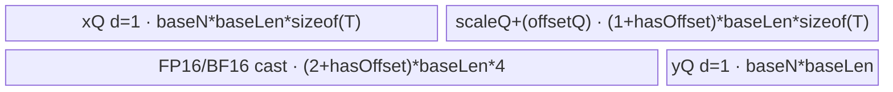
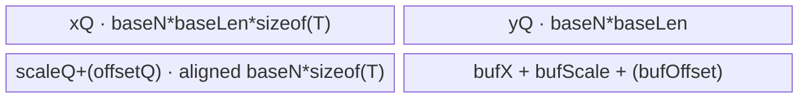

# AscendQuant A2/A3 ACLNN 算子知识

## 算子速览

| 项目 | 内容 |
|---|---|
| 实际入口 | `aclnnAscendQuantV3GetWorkspaceSize` / `aclnnAscendQuantV3`，`AscendQuant` 版本族在 A2/A3 的最新公开入口 |
| 计算语义 | `sqrtMode=false: y=round(x*scale+offset)`；`true: y=round(x*scale*scale+offset)`；`offset` 可省略；`axis` 决定参数广播轴 |
| 输入输出 | `x/scale/offset`: FP16/FP32/BF16，ND；A2/A3 还公开 FP32 NZ；`y`: INT8/INT4，INT32 是 8 个 INT4 的打包视图 |
| 执行类型 | 单 Kernel、`AIV_VECTOR`；ND 使用 Vector API，NZ 使用 AIV Vector + GM/UB 搬运，不含 Cube/AIC/MIX_CV |
| Kernel 路线 | R-001 per-channel，R-002 per-tensor，R-003 per-head（A2/A3），R-004 NZ FP32→packed INT4 |
| 核心资源 | GM、单深度 TQue/TBuf；NZ 使用固定 192 KiB TBuf；Tiling 声明 16 MiB user workspace，但 Kernel 只检查 `GetUserWorkspace` 非空，不读写该区 |
| 来源闭包 | `source_closed`：V3 ACLNN→`l0op::AscendQuantV2`→`Tiling4AscendQuantV2`→`AscendQuantV2TilingData`→`ascend_quant_v2`→具体 body/构建注册闭合 |
| 验证状态 | 已完成源码闭包检查；本次知识提取未执行编译、真机、数值或性能测试。 |

## 接口与语义

### 计算语义

对 `axis` 对应维度广播 `scale` 和可选 `offset`。无 `offset` 时加数为零；`sqrtMode` 决定 scale 使用一次还是两次。先按 FP32 计算路径或原 FP32 路径得到中间值，再按 `round/floor/ceil/trunc` 转为输出。INT4 每两个元素压入一字节；ACLNN 的 INT32 输出只是将 8 个相邻 INT4 解释为一个 INT32，计算仍是 INT4。

### 输入、输出与属性

| 参数 | shape/layout | dtype | 约束、默认值与语义 |
|---|---|---|---|
| `x` | ND，1–8 维；NZ 时 3 维 | FP16/FP32/BF16；NZ 仅 FP32 | 非标量；INT4 时尾轴为偶数；INT32 打包时尾轴可被 8 整除 |
| `scale` | 1 维或与 `x` 同阶；仅 `axis` 维可非 1 | 与 `x` 兼容 | 轴长等于 `x[axis]` 或 1；总元素数等于该轴长；1 元素选择 per-tensor |
| `offset` | 可选，shape 与 `scale` 相同 | 与 `scale` 相同 | 缺省即无加法；NZ 公开约束为空 |
| `sqrtMode` | 标量属性 | bool | `true` 时额外乘一次 scale |
| `roundMode` | 标量属性 | string | A2/A3 为 `round/floor/ceil/trunc`；NZ 仅 `round` |
| `dstType` | 标量属性 | int32 enum | `2/29/3` 对应 INT8/INT4/INT32；INT32 传入底层前改为 INT4 |
| `axis` | 标量属性 | int32 | A2/A3 仅最后两个维度（正负下标均可） |
| `y` | INT8/INT4 与 `x` 同 shape；INT32 尾轴为 `x` 的 1/8 | INT8/INT4/INT32 | 非连续输出由框架 `ViewCopy` 回写 |

### 入口与版本

公开文档 `docs/aclnnAscendQuantV3.md:5-14` 同时标记 A2、A3 支持；V3 比无版本入口新增 `axis`，因此本卡只取最新公开 V3。`aclnnAscendQuantV3GetWorkspaceSize` 构造 executor，`aclnnAscendQuantV3` 交给 `CommonOpExecutorRun`。核心算子名仍为 `AscendQuantV2`，不是另一个量化语义。

## Host/Launcher 执行流程

### 参数校验与前处理

`CheckParams` 依次执行非空、非标量、平台 dtype、`dstType==y.dtype`、axis、shape 和 roundMode 校验。空 `x` 在校验后直接返回 workspace 0。非空时依次把 `x/scale/(offset)` 连续化，将 scale/offset Cast 到 `x.dtype`，INT32 输出改用 INT4 临时输出，调用 `l0op::AscendQuantV2`，最后用 `CreateView` 把 INT4 内存视为 INT32 并 `ViewCopy` 到用户 `y`。`Contiguous/Cast/ViewCopy` 是可见的框架节点；本固定仓中其通用 Kernel 实现不属于算子自有闭包。

### 参数、Workspace 与生命周期

`l0op::AscendQuantV2` 按 `x` view shape 分配临时输出并通过 `ADD_TO_LAUNCHER_LIST_AICORE` 注册单个核心节点。Tiling 总是写 `workspace[0]=16*1024*1024`；entry 调 `GetUserWorkspace(workspace)` 并在空指针时返回，但后续 body 不消费 workspace。executor 拥有连续化临时量、临时输出和 ViewCopy 生命周期，第二段接口将 workspace、executor、stream 一起提交。

### 启动图与失败传播

```text
aclnnAscendQuantV3GetWorkspaceSize
  -> [framework] Contiguous/Cast
  -> l0op::AscendQuantV2 -> ADD_TO_LAUNCHER_LIST_AICORE(AscendQuantV2)
  -> Tiling4AscendQuantV2 -> 普通 ND/NZ tiling -> POD + blockDim=vectorCoreNum
  -> ascend_quant_v2(x, scale, offset, tmpY, workspace, tiling)  [单 AIV Kernel]
  -> [framework] INT4→INT32 view（条件式）+ ViewCopy(tmpY,y)
```

所有 executor 节点在同一 `stream` 按框架执行器顺序提交；任一前处理/launcher/ViewCopy 返回空立即返回错误，不会继续添加后续节点。核心节点无跨 Kernel workspace 边。

## Route 与参数设计

### 分核与资源计算

ND 将 shape 合成 `[dim0,dim1,dim2]`：per-tensor 为 `[1,prod(x),1]`，per-channel 为 `[prod(x[:-1]),x[-1],1]`，per-head 为 `[prod(x[:-2]),x[-2],x[-1]]`。A2/A3 cache line 为 512 B；候选核数分别来自行数和 `ceil(dim1/(512/sizeof(T)))`，不足满核且二维切分更优时 `blockAxis=11`。`availableUb=ubSize-2048`；`maxBase=floor_align(availableUb/每元素总字节, cacheLineElements)`，据此选择 `baseN/baseLen`。Host 启动 `blockDim=vectorCoreNum`，POD 的 `numCore=actCoreNum`，多余 block 在 Device 退出。

### Route 选择

| 顺序 | Route | Key/模板 | 精确选择条件与优先级 | 不适用去向 |
|---:|---|---|---|---|
| 1 | R-004 NZ | key 3 | storage format 为 29/NZ；V3 公开约束为 FP32、3 维、scale=1、offset 空、round | 不成立进入 ND |
| 2 | R-002 per-tensor | key 1 | ND 且 `scale.shape_size==1` | 否则继续 |
| 3 | R-003 per-head | key 2 | ND、非 per-tensor，axis 指向倒数第二维，A2/A3 架构标记为支持；若 `dim2==1` 降为 per-channel | 否则 R-001 |
| 4 | R-001 per-channel | key 0 | ND 且以上均不命中 | 无 Host fallback，校验/tiling 失败 |

```text
if format == NZ: key=3
else if scale_elements == 1: key=1
else if axis is penultimate and platform supports and merged dim2 != 1: key=2
else: key=0
```

### 模板/实现执行矩阵

| Route | key/selector | dtype/shape/platform 完整命中条件 | 执行拓扑与 Kernel 节点 | 实际模板/body | 内存与同步特征 | tail/fallback |
|---|---|---|---|---|---|---|
| R-001 | 0 | ND、per-channel；FP16/FP32/BF16 | 单 AIV | `PerChannelFP16/FP32/BF16::Process` | x/scale/(offset)/y queues；FP16/BF16 另有 FP32 cast TBuf | 列尾 `lenLoopTail`、行尾 `nLoopTail` |
| R-002 | 1 | ND、scale 单元素；FP16/FP32/BF16 | 单 AIV | `PerTensorFP16/FP32/BF16::Process` | scalar scale/offset 每列块复用；x/y queue | 同上 |
| R-003 | 2 | ND、倒数第二轴参数；FP16/FP32/BF16 | 单 AIV | `AscendQuantV2PerHead<T>::Process` | 参数按 `baseN` 搬入并标量化，x/y queue + FP32 TBuf | S/N/D 三轴尾块 |
| R-004 | 3 | NZ、FP32 | 单 AIV | `AscendQuantV2NZFP32<float>::Process` | 固定 192 KiB TBuf，MTE3→MTE2 循环握手 | `tail_core` 跳过无效末轮；无其它 fallback |

### 隐藏性能 Guard

| Guard | Host/Tiling 条件 | Device/资源原因 | 影响 Route | 不满足时去向 | 源码符号 |
|---|---|---|---|---|---|
| UB reserve | `availableUb=ubSize-2048` | 为运行时保留 2 KiB，tile 只用余量 | R-001..003 | 缩小 `baseLen/baseN` | `CalcUBFactor*` |
| cache 对齐 | A2/A3 `cacheLine=512 B` | 分核、DMA 和 UB tile 按 cache line 元素对齐 | R-001..003 | 改切轴或缩 tile | `GetCompileInfo/CalcTiling` |
| 输出尾轴 | INT4 偶数；INT32 为 1/8 view | 两个 INT4/byte、八个 INT4/INT32 | 全部 | ACLNN 参数错误 | `CheckInt4LastDim/CheckInt32OutputShape` |
| 空 block | `blockIdx>=numCore \|\| blockN==0` | `blockDim` 是物理 AIV 核数而非实际核数 | R-001..003 | Device 立即返回 | 各 `Process` |
| NZ 几何 | `needCoreNum=min(K/16,coreNum)`，`nloop=E*N/64` | body 固定 16×64 数据片 | R-004 | 公开 API shape 约束兜底；固定仓无额外 fallback | `CalcTilingNz/AscendQuantV2NZFP32::Process` |

### POD/ABI

`AscendQuantV2TilingData` 由 tiling-data 宏序列化；宏生成的整体 `sizeof/alignof/offsetof` 在固定仓不可见。字段顺序如下，Host 与 Device 使用同名结构。

| 结构 | 字段 | 类型/位宽 | ABI 布局 | 单位 | Host/launcher producer | Device consumer | 边界 |
|---|---|---|---|---|---|---|---|
| `AscendQuantV2TilingData` | `numCore` | uint32/32 | 宏生成，offset 不可见 | core | `actCoreNum_` | block 退出/尾核 | `<=vectorCoreNum` |
| 同上 | `blockAxis` | int32/32 | 同上 | axis enum | `CalcTiling*` | 地址与分核 | 0/1/2/11 |
| 同上 | `ubAxis` | int32/32 | 同上 | axis enum | `CalcUBFactor*` | tile 形态 | 0/1/2 |
| 同上 | `dim0` | int64/64 | 同上 | element dimension | 合并 shape | 地址/循环 | 非负 |
| 同上 | `dim1` | int64/64 | 同上 | element dimension | 合并 shape | 行 stride | 非负 |
| 同上 | `dim2` | int64/64 | 同上 | element dimension | 合并 shape | per-head/NZ | 非负 |
| 同上 | `blockUnion` | int64/64 | 同上 | cores/group | 双轴切分 | core 映射 | >=1 |
| 同上 | `blockFactor` | int64/64 | 同上 | elements/rows | `Calc*BlockFactor` | 普通核 extent | 对齐后值 |
| 同上 | `blockTailFactor` | int64/64 | 同上 | elements/rows | 同上 | 尾核 extent | 0 改为 factor |
| 同上 | `baseN` | int64/64 | 同上 | rows/tile | `CalcUBFactor*` | 内层行循环 | >=1 |
| 同上 | `baseLen` | int64/64 | 同上 | elements/row/tile | 同上 | Queue 容量/列循环 | UB 上界 |
| 同上 | `hasOffset` | int16/16 | 同上 | bool | optional input 存在性 | 条件分配/加法 | 0/1 |
| 同上 | `sqrtMode` | int16/16 | 同上 | bool | attr | 第二次乘法 | 0/1 |
| 同上 | `roundMode` | int16/16 | 同上 | enum | attr 映射 0..3 | `CastOut` | 其它值 Host 失败 |
| 同上 | `reserve1` | int16/16 | 同上 | N/A | 未赋值 | 未读取 | inactive |
| 同上 | `E` | int64/64 | 同上 | elements | NZ dim0 | NZ loop | 仅 key 3 |
| 同上 | `K` | int64/64 | 同上 | elements | NZ dim1 | NZ stride/core | 仅 key 3 |
| 同上 | `N` | int64/64 | 同上 | elements | NZ dim2 | NZ outer loop | 仅 key 3 |
| 同上 | `needCoreNum` | int64/64 | 同上 | cores | `min(K/16,coreNum)` | NZ block guard | 仅 key 3 |

### Route 源码闭包

| Route | Key/selector | Host/Tiling producer | POD/参数 | Kernel entry/router 节点 | Kernel body/直接依赖 | 构建接线 |
|---|---|---|---|---|---|---|
| R-001 | 0 | `ascend_quant_v2_tiling.cpp::CalcTiling/CalcTilingKey` | `AscendQuantV2TilingData` | `ascend_quant_v2.cpp::ascend_quant_v2` | `*_fp16.h/*_fp32.h/*_bf16.h` per-channel classes + `ascend_quant_v2.h` | `ascend_quant_v2_def.cpp::AscendQuantV2` A2/A3 configs |
| R-002 | 1 | 同上 | 同上 | 同上 | 同三文件 per-tensor classes + base | 同上 |
| R-003 | 2 | `CalcPerHeadTiling` | 同上 | 同上 | `ascend_quant_v2_fp32.h::AscendQuantV2PerHead`（模板接受三种 T） | 同上 |
| R-004 | 3 | `DoAscendQuantV2NZTiling` | E/K/N/needCoreNum | 同上 | `ascend_quant_v2_nz.h::AscendQuantV2NZFP32` | 同上 |

## Kernel 实现

### 公共执行流程

entry 先取得 user workspace 并解析 POD，再按编译期 `DTYPE_X` 与 runtime key 选择 body。所有 ND body 都是 `Init→Process→CopyIn→Compute→CopyOut`：`GetBlockIdx` 映射到合轴后的区间，列按 `baseLen`、行按 `baseN` 双层切块，`DataCopyPad` 处理未对齐尾块，Queue 的 EnQue/DeQue/FreeTensor 建立 MTE2→V→MTE3 生命周期。未知 key 或不匹配编译期 dtype 不写输出。

### Route R-001：ND per-channel

#### 适用条件

##### 选择证据

| 层级 | 文件 | 符号 | 源码谓词/参数 | 结果/下一跳 |
|---|---|---|---|---|
| Tiling | `op_host/ascend_quant_v2_tiling.cpp` | `GetOpParam/CalcTilingKey` | 非 NZ、scale 非标量、非有效 per-head | key 0 |
| Router | `op_kernel/ascend_quant_v2.cpp` | `ascend_quant_v2` | `DTYPE_X` 分 FP16/FP32/BF16 且 key 0 | 对应 per-channel 类 |

#### Device 数据流

##### 函数级调用链

```text
ascend_quant_v2 -> PerChannel{FP16,FP32,BF16}::Init/Process
  -> CopyInScaleAndOffset -> CopyXAndCompute
    -> CopyInX -> Compute(Mul,[Mul],[Add],CastOut) -> CopyOutY
```

##### 源码等价伪码

```text
if blockIdx>=numCore or blockN==0: return
gmX/gmS = address(blockAxis, blockUnion, blockFactor, blockIdx)
for col in full baseLen tiles + optional tail:
  copy scale[col] and optional offset[col]
  for rows in full baseN tiles + optional tail:
    copy x[row, col] with blockCount=rowCount, blockLen=colLen*sizeof(T)
    fp16/bf16: cast x/scale/offset to fp32; fp32: compute in x queue
    value=x*scale; if sqrtMode value*=scale; if offset value+=offset
    CastOut(roundMode, INT8/packed INT4); DataCopyPad to GM
  free parameter queues
```

#### 内存与数据搬运

##### 资源与搬运表

| 层级/缓冲区 | offset/地址公式 | extent/容量公式 | dtype/layout | producer | consumer | owner/lifetime | 对齐/复用 |
|---|---|---|---|---|---|---|---|
| GM x | `gmXOffset+n*dim1+col` | `rowCount*colLen` | T/ND | caller | CopyInX | caller | strided rows |
| inQueueX | row `i*baseLen` | `baseN*baseLen*sizeof(T)` | T | MTE2 | Compute | TPipe/tile | depth 1 |
| scale/offset queue | `gmSOffset+col` | each `baseLen*sizeof(T)` | T | MTE2 | Compute/cast | TPipe/column tile | offset conditional |
| FP32 cast TBuf | 0 | x `baseLen*4`; scale/offset each `baseLen*4` | FP32 | Cast | Mul/Add | TPipe/column tile | FP16/BF16 only |
| outQueueY | row `i*baseLen` | `baseN*baseLen` bytes | INT8/packed INT4 | CastOut | MTE3 | TPipe/tile | depth 1 |

##### 分层内存布局



##### 字节账与复用顺序

```text
FP32: UB_total = baseN*baseLen*4 + (1+hasOffset)*baseLen*4 + baseN*baseLen
FP16/BF16: UB_total = baseN*baseLen*2 + (1+hasOffset)*baseLen*2
             + (2+hasOffset)*baseLen*4 + baseN*baseLen
workspace_total = 16 MiB declared; body bytes touched = 0
```

| 复用子区 | 写入者 | 读取者/消费点 | 下一次覆盖 | 同步或释放依据 | 安全条件 |
|---|---|---|---|---|---|
| x queue | CopyInX | Compute | 下一 row tile | DeQue→FreeTensor | Compute 完成后复用 |
| castX | Cast | Mul/Add/CastOut | 下一行/列 | `PipeBarrier<PIPE_V>` | 同一 V 流水顺序 |
| scale/offset queue | CopyIn | Compute | 下一列 tile | EnQue/DeQue/FreeTensor | 当前所有 row tile 完成 |

#### 同步、精度与尾块

##### 同步与数值边界表

| 阶段 | primitive/机制 | producer | consumer/等待点 | 保护对象 | 精度/尾块 |
|---|---|---|---|---|---|
| GM→UB | TQue 或 MTE2_V event | DataCopyPad | Cast/Vector | 输入 tile | blockLen 字节、stride 按元素换算 |
| Compute | `PipeBarrier<PIPE_V>` | Cast/Mul/Add | 下一 Vector op | 原地 castX/xLocal | FP16/BF16 升 FP32；FP32 原地 |
| Quantize | `CastOut` | FP32 value | output queue | 输出 tile | 按 mode 先到 int32/half，再 INT8/INT4 |
| Tail | `lenLoopTail/nLoopTail` + mask length | Host POD | Copy/Vector | 有效元素 | 只提交 `dataCount` |

#### 关键实现

##### 符号证据表

| 阶段 | 文件 | 符号/模板实例 | 实现事实 |
|---|---|---|---|
| Host/Tiling producer | `op_host/ascend_quant_v2_tiling.cpp` | `CalcTiling/CalcUBFactor` | 选择切轴、baseN/baseLen |
| Kernel entry/router | `op_kernel/ascend_quant_v2.cpp` | `ascend_quant_v2` | dtype+key→三个 body |
| Device body/helper | `op_kernel/ascend_quant_v2_fp16.h` 等 | `PerChannel*::Process/Compute` | 搬运、升精度、计算、tail |

### Route R-002：ND per-tensor

#### 适用条件

##### 选择证据

| 层级 | 文件 | 符号 | 源码谓词/参数 | 结果/下一跳 |
|---|---|---|---|---|
| Tiling | `op_host/ascend_quant_v2_tiling.cpp` | `GetOpParam` | `scaleInputShape.GetShapeSize()==1` | key 1 |
| Router | `op_kernel/ascend_quant_v2.cpp` | `ascend_quant_v2` | key 1 + dtype | `PerTensor*` |

#### Device 数据流

##### 函数级调用链

```text
ascend_quant_v2 -> PerTensor{FP16,FP32,BF16}::Process
  -> load scalar scale/(offset) -> CopyXAndCompute
    -> CopyInX -> Muls,[Muls],[Adds],CastOut -> CopyOutY
```

##### 源码等价伪码

```text
merge all x elements into dim1; split aligned dim1 across cores
for each baseLen/tail: load scalar scale and optional offset
  for baseN/tail rows: copy x; apply scalar multiply once/twice and optional add; cast/pack; copy out
```

#### 内存与数据搬运

##### 资源与搬运表

| 层级/缓冲区 | offset/地址公式 | extent/容量公式 | dtype/layout | producer | consumer | owner/lifetime | 对齐/复用 |
|---|---|---|---|---|---|---|---|
| x/y queues | `blockIdx*blockFactor+tile` | x `baseN*baseLen*sizeof(T)`；y `baseN*baseLen` | flat | MTE2/Vector | Vector/MTE3 | tile | depth 1 |
| scalar queues | GM[0] | FP16/BF16 32 B block；FP32 body直接 `GetValue(0)` | T | GM | scalar Muls/Adds | tile/kernel | scalar reused across all lanes |
| castX | 0 | `baseLen*4` | FP32 | Cast | Muls/Adds/CastOut | tile | FP16/BF16 only |

##### 分层内存布局


##### 字节账与复用顺序

```text
FP32 UB_total = baseN*baseLen*4 + baseN*baseLen
FP16/BF16 UB_total = baseN*baseLen*2 + baseLen*4 + baseN*baseLen + (1+hasOffset)*32
workspace_total = 16 MiB declared; body bytes touched = 0
```

| 复用子区 | 写入者 | 读取者/消费点 | 下一次覆盖 | 同步或释放依据 | 安全条件 |
|---|---|---|---|---|---|
| x/castX/y | CopyIn/Cast/Compute | Compute/CopyOut | 下一 tile | Queue free + V barrier | 当前 tile 已输出 |

#### 同步、精度与尾块

##### 同步与数值边界表

| 阶段 | primitive/机制 | producer | consumer/等待点 | 保护对象 | 精度/尾块 |
|---|---|---|---|---|---|
| scalar load | MTE2_S flag（16-bit）或 GM scalar（FP32） | GM | scalar pipeline | scale/offset | 仅 element 0 |
| compute | V barriers | Muls/Adds | CastOut | in-place tile | FP16/BF16 转 FP32 |
| tail | `lenLoopTail/nLoopTail` | POD | Vector count | output | 有效长度提交 |

#### 关键实现

##### 符号证据表

| 阶段 | 文件 | 符号/模板实例 | 实现事实 |
|---|---|---|---|
| Host/Tiling producer | `op_host/ascend_quant_v2_tiling.cpp` | `GetOpParam/CalcTiling` | scalar route 与平铺分核 |
| Kernel entry/router | `op_kernel/ascend_quant_v2.cpp` | key 1 branches | dtype 路由 |
| Device body/helper | `op_kernel/ascend_quant_v2_fp16.h` 等 | `PerTensor*::Compute` | scalar 广播与原地计算 |

### Route R-003：ND per-head

#### 适用条件

##### 选择证据

| 层级 | 文件 | 符号 | 源码谓词/参数 | 结果/下一跳 |
|---|---|---|---|---|
| Host | `op_host/ascend_quant_v2_tiling.cpp` | `GetOpParam` | axis 为倒数第二维、scale 非标量、`isAscend910B_`，且 merged dim2 !=1 | key 2 |
| Router | `op_kernel/ascend_quant_v2.cpp` | arch guard + key 2 | A2/A3 支持宏 | `AscendQuantV2PerHead<DTYPE_X>` |

#### Device 数据流

##### 函数级调用链

```text
ascend_quant_v2 -> AscendQuantV2PerHead<T>::Process
  -> ParsePerHeadCoreBlocks/CalcOffset
  -> ProcessLoop -> ProcessParamLoop -> ProcessParamOneLoop
    -> CopyInParam/ProbeCast -> CopyInX -> Compute -> CopyOutY
```

##### 源码等价伪码

```text
map core onto S, N or D according to blockAxis
for each assigned S:
  for N in baseN/tail: copy scale/(offset), cast parameters to fp32
    for D in baseLen/tail: copy x rows; each row reads one scalar scale/offset
      cast x if needed; Muls twice iff sqrt; Adds iff offset; CastOut; copy rows to GM
```

#### 内存与数据搬运

##### 资源与搬运表

| 层级/缓冲区 | offset/地址公式 | extent/容量公式 | dtype/layout | producer | consumer | owner/lifetime | 对齐/复用 |
|---|---|---|---|---|---|---|---|
| xQ/yQ | core S/N/D base | `baseN*baseLen*sizeof(T)` / `baseN*baseLen` | ND | DMA/Vector | Vector/DMA | tile | depth 1 |
| param queues | `baseSOffset % dim1` | `ceil(baseN*sizeof(T),32)` each | T | DMA | ProbeCast | N tile | offset conditional |
| fp32 TBufs | 0 | x `baseLen*4`; param each `ceil(baseN*4,32)` | FP32 | Cast/scalar load | compute | N/D tile | conditional offset |

##### 分层内存布局



##### 字节账与复用顺序

```text
UB_total = baseN*baseLen*(sizeof(T)+1) + ceil(baseN*sizeof(T),32)*(1+hasOffset)
         + baseLen*4 + ceil(baseN*4,32)*(1+hasOffset)
workspace_total = 16 MiB declared; body bytes touched = 0
```

| 复用子区 | 写入者 | 读取者/消费点 | 下一次覆盖 | 同步或释放依据 | 安全条件 |
|---|---|---|---|---|---|
| parameter buffers | CopyInParam/ProbeCast | all D tiles for current N tile | next N tile | MTE2_S or V_S event + FreeTensor | all dependent D loops complete |

#### 同步、精度与尾块

##### 同步与数值边界表

| 阶段 | primitive/机制 | producer | consumer/等待点 | 保护对象 | 精度/尾块 |
|---|---|---|---|---|---|
| parameter→scalar | MTE2_S for FP32, V_S after cast otherwise | DMA/Cast | `GetValue` | scale/offset | one scalar per N row |
| scalar→vector | S_V event | scalar read | Muls/Adds | scalar value | exact row mask |
| S/N/D tails | blockTail/baseN/baseLen | Host/Device loops | copy/compute | assigned tensor slice | no padded lane committed |

#### 关键实现

##### 符号证据表

| 阶段 | 文件 | 符号/模板实例 | 实现事实 |
|---|---|---|---|
| Host/Tiling producer | `op_host/ascend_quant_v2_tiling.cpp` | `CalcPerHeadTiling/CalcPerHeadUBFactor` | S/N/D 候选与 tile |
| Kernel entry/router | `op_kernel/ascend_quant_v2.cpp` | key 2 arch guard | per-head 路由 |
| Device body/helper | `op_kernel/ascend_quant_v2_fp32.h` | `AscendQuantV2PerHead<T>` | 三轴地址、参数标量化、同步 |

### Route R-004：NZ FP32 固定分片

#### 适用条件

##### 选择证据

| 层级 | 文件 | 符号 | 源码谓词/参数 | 结果/下一跳 |
|---|---|---|---|---|
| Tiling | `op_host/ascend_quant_v2_tiling.cpp` | `Tiling4AscendQuantV2/CalcTilingNz` | format 29 | key 3，E/K/N/needCoreNum |
| Router | `op_kernel/ascend_quant_v2.cpp` | FP32 key 3 | `DTYPE_X=float` | NZ body |

#### Device 数据流

##### 函数级调用链

```text
ascend_quant_v2 -> AscendQuantV2NZFP32<float>::Init/Process
  -> 4*CopyIn(16 blocks × 16 FP32) -> Compute(1024 values) -> CopyOut(512 bytes)
```

##### 源码等价伪码

```text
if blockIdx>=needCoreNum: return
kloop=ceil(K/(16*needCoreNum)); nloop=E*N/64
for i in nloop, j in kloop:
  skip last j when blockIdx>=tail_core
  wait previous MTE3; copy four 16x16 FP32 pieces into UB
  cast FP32->INT32(round)->FP16->INT4; copy 64*16/2 bytes to GM; signal MTE3_MTE2
```

#### 内存与数据搬运

##### 资源与搬运表

| 层级/缓冲区 | offset/地址公式 | extent/容量公式 | dtype/layout | producer | consumer | owner/lifetime | 对齐/复用 |
|---|---|---|---|---|---|---|---|
| fixed TBuf | 0 | 192 KiB | bytes, reinterpreted FP32/INT32/FP16/INT4 | CopyIn/Compute | Compute/CopyOut | kernel lifetime | same physical region in-place |
| GM input | `offset_n+offset_k+K*16*k` | each copy 16×16 FP32 | NZ | caller | MTE2 | caller | dstStride=6 blocks |
| GM output | `(offset_k*4+offset_n)/2` | 512 B | packed INT4 | MTE3 | caller | caller | one contiguous block |

##### 分层内存布局


##### 字节账与复用顺序

```text
UB_total = 192*1024 bytes
workspace_total = 16 MiB declared; body bytes touched = 0
```

| 复用子区 | 写入者 | 读取者/消费点 | 下一次覆盖 | 同步或释放依据 | 安全条件 |
|---|---|---|---|---|---|
| whole ubTBuf | four CopyIn | three Cast stages / CopyOut | next (i,j) | MTE2_V, V_MTE3, MTE3_MTE2 flags | CopyOut completed before next CopyIn |

#### 同步、精度与尾块

##### 同步与数值边界表

| 阶段 | primitive/机制 | producer | consumer/等待点 | 保护对象 | 精度/尾块 |
|---|---|---|---|---|---|
| CopyIn→Vector | MTE2_V flag | 4 DMA copies | first Cast | TBuf | 1024 valid values |
| Vector→CopyOut | V_MTE3 flag | INT4 Cast | MTE3 | packed bytes | round only |
| CopyOut→next CopyIn | MTE3_MTE2 flag | MTE3 | next iteration | aliased TBuf | tail cores skip final group |

#### 关键实现

##### 符号证据表

| 阶段 | 文件 | 符号/模板实例 | 实现事实 |
|---|---|---|---|
| Host/Tiling producer | `op_host/ascend_quant_v2_tiling.cpp` | `CalcTilingNz/WriteTilingDataNz` | E/K/N/core 与 key 3 |
| Kernel entry/router | `op_kernel/ascend_quant_v2.cpp` | FP32 key 3 branch | body 路由 |
| Device body/helper | `op_kernel/ascend_quant_v2_nz.h` | `Process/CopyIn/Compute/CopyOut` | 固定分片、原地转换、事件链 |

## 算子特定优化

### Trick T-001：二维补切提高 AIV 利用率

#### 触发与源码依据

- 适用 Route：R-001。
- 触发条件：单轴实际核数小于物理核数、`shape0>1`、`shape1>32`，且二维切分核数更大。
- Golden 来源：[`ascend_quant_v2_tiling.cpp:507-527`](../../../../../../../cann-ops-raw/ascendc/ops-nn/955f8b33985b6d72989ebff341bb9c2c564a51bc/quant/ascend_quant_v2/op_host/ascend_quant_v2_tiling.cpp#L507-L527)

**官方源码（固定 Commit 连续逐字摘录）**：

```cpp
if (actCoreNum_ < coreNum_ && shape0 > 1 && shape1 > g_BlockSize) {
    uint32_t actCoreNum2 = GetCoreNumDoubleCut(shape0, cacheLineNum, static_cast<int64_t>(coreNum_));
    if (actCoreNum2 > actCoreNum_) {
        actCoreNum_ = actCoreNum2;
        useDoubleCut = true;
    }
}
```

#### 机制与设计原因

只沿行或列切分不足以占满 AIV 时，Host 计算二维分片并用 `blockUnion` 把同一行组映射到多个核；Device 的 `gmXOffset/gmSOffset` 公式与其匹配。它增加可并行 tile 数，不改变计算顺序或精度。

#### 迁移边界

- 适用：二维逻辑视图、行列均可独立切分的逐元素广播算子。
- 前提：每个分片有独占输出，尾列用 `blockTailFactor`，参数广播地址按 `blockUnion` 修正。
- 失效：候选核数不增加时保留单轴 Route；shape0≤1 或 shape1≤32 不尝试。
- 未验证：本次知识提取未执行编译、真机、数值或性能测试。

#### 错误做法

固定仓未提供可验证反例。

### Trick T-002：NZ 单 TBuf 原地多级窄化

#### 触发与源码依据

- 适用 Route：R-004。
- 触发条件：公开 NZ FP32→packed INT4 路线。
- Golden 来源：[`ascend_quant_v2_nz.h:118-140`](../../../../../../../cann-ops-raw/ascendc/ops-nn/955f8b33985b6d72989ebff341bb9c2c564a51bc/quant/ascend_quant_v2/op_kernel/ascend_quant_v2_nz.h#L118-L140)

**官方源码（固定 Commit 连续逐字摘录）**：

```cpp
Cast(x1Tmp.template ReinterpretCast<int32_t>(), x1Tmp, RoundMode::CAST_RINT, dataCount);
PipeBarrier<PIPE_V>();
Cast(x1Tmp.template ReinterpretCast<half>(), x1Tmp.template ReinterpretCast<int32_t>(), RoundMode::CAST_NONE, dataCount);
PipeBarrier<PIPE_V>();
Cast(x1Tmp.template ReinterpretCast<int4b_t>(), x1Tmp.template ReinterpretCast<half>(), RoundMode::CAST_RINT, dataCount);
```

#### 机制与设计原因

同一物理 TBuf 依次重解释为 FP32、INT32、FP16、INT4，省去三个中间 UB 分配；每次原地覆盖前用 Vector barrier 保证前级消费结束，最后以 512 B packed INT4 写回。

#### 迁移边界

- 适用：类型宽度单调缩小、原地 Cast 明确受支持的固定 tile。
- 前提：后级不再需要宽类型值，别名布局和同步顺序完全一致。
- 失效：需要保留宽类型中间值或 Cast 不支持原地时必须分配独立 buffer。
- 未验证：本次知识提取未执行编译、真机、数值或性能测试。

#### 错误做法

固定仓未提供可验证反例。

## 模板与实现对比

| 对比维度 | R-001 per-channel | R-002 per-tensor | R-003 per-head | R-004 NZ | 设计选择依据 |
|---|---|---|---|---|---|
| 命中条件/优先级 | 默认 ND | scale=1 元素 | 倒数第二轴 | format=NZ | 广播粒度/layout |
| 模板与 dtype | 三套 dtype body | 三套 dtype body | 单模板 T | FP32 专用 | 精度与广播方式 |
| 循环与分核 | 行/列/双切 | flat 列切 | S/N/D | 固定 16×64 | 可并行维 |
| Queue/TBuf/寄存器/dynamic UB/通信 window | queues+可选 cast | scalar+queues | 参数 TBuf | 192 KiB TBuf | 参数粒度 |
| 内存总占用与复用 | 由 baseN/baseLen 限制 | 参数开销最小 | 参数按 N tile | 全区原地 | UB 上界 |
| 搬运/Vector/SIMT/NDDMA/通信 API | DataCopyPad+Mul/Add/Cast | scalar Muls/Adds | scalar-vector 同步 | 4 次 DMA+Cast | 均为 AIV Vector |
| 同步、精度与 tail | queue/V barrier | 加 scalar event | MTE2_S/V_S/S_V | 三段 event 链 | 数据依赖 |
| fallback/失败边界 | 无 fallback | 无 fallback | dim2=1 降 channel | 固定几何 | Host 校验失败 |

## 平台差异

| 项目 | A2 | A3 | 950 |
|---|---|---|---|
| 支持状态 | V3 公开支持 | V3 公开支持 | V3 公开支持，见独立 `_950` 卡 |
| Host/Launcher | 普通 Tiling，AIV 核数/UB；本卡源码未再拆 A2 与 A3 Host 差异 | 同左 | RegBase Tiling |
| Kernel/资源 | 普通 AscendC body | 普通 AscendC body；BF16/per-head 有 arch guard | AIV MicroAPI、双缓冲 |

## 限制与失败边界

- ACLNN 公开层支持空 tensor，但非空核心路径要求 shape/dtype/axis/roundMode 全部通过；底层未知 key、workspace/user workspace 空或 dtype guard 不匹配时不写输出。
- Tiling 合并 shape 使用 int64 连乘，固定仓未见显式乘法溢出检查；`blockDim` 写物理核数而非实际核数，依赖 Device guard。
- NZ body 的固定 16×64 几何依赖公开 NZ 约束；固定仓没有通用 NZ tail fallback。
- 本次知识提取未执行编译、真机、数值或性能测试。

## 源码索引

### 链路索引

| 链路阶段 | 文件 | 关键符号 | 支撑内容 |
|---|---|---|---|
| 入口声明/约束 | `quant/ascend_quant_v2/docs/aclnnAscendQuantV3.md` | 产品表/参数表 | V3 公开平台与语义 |
| 入口实现 | `quant/ascend_quant_v2/op_host/op_api/aclnn_ascend_quant_v3.cpp` | `aclnnAscendQuantV3GetWorkspaceSize` | 校验、前后处理、executor |
| Host/Tiling/Launcher | `quant/ascend_quant_v2/op_host/ascend_quant_v2_tiling.cpp` | `Tiling4AscendQuantV2` | selector、tile、workspace |
| Host/Tiling/Launcher | `quant/ascend_quant_v2/op_host/ascend_quant_v2_tiling.h` | `AscendQuantV2TilingData` | POD 字段 |
| Kernel entry/body | `quant/ascend_quant_v2/op_kernel/ascend_quant_v2.cpp` | `ascend_quant_v2` | router |
| Kernel entry/body | `quant/ascend_quant_v2/op_kernel/ascend_quant_v2.h` | `AscendQuantV2Base` | DMA/Cast/tail helper |
| Kernel entry/body | `quant/ascend_quant_v2/op_kernel/ascend_quant_v2_fp16.h` | FP16 classes | FP16 routes |
| Kernel entry/body | `quant/ascend_quant_v2/op_kernel/ascend_quant_v2_fp32.h` | FP32/per-head classes | FP32/per-head routes |
| Kernel entry/body | `quant/ascend_quant_v2/op_kernel/ascend_quant_v2_bf16.h` | BF16 classes | BF16 routes |
| Kernel entry/body | `quant/ascend_quant_v2/op_kernel/ascend_quant_v2_nz.h` | NZ class | NZ route |
| 构建接线 | `quant/ascend_quant_v2/op_host/ascend_quant_v2_def.cpp` | `OP_ADD(AscendQuantV2)` | A2/A3/950 configs |

### 实现复用检查

| 检查项 | 可复用事实 | 不得改变的约束 | 源码符号 |
|---|---|---|---|
| ABI/POD | 合轴、分核与 tile 字段 | 字段顺序/位宽、inactive NZ/ND 字段 | `AscendQuantV2TilingData` |
| 调用顺序 | CopyIn→Compute→CopyOut | 参数 tile 必须覆盖全部 row tile 后才能释放 | 各 `Process` |
| workspace/内存 | 16 MiB 声明；无 body 读写 | entry 要求 user workspace 非空 | `WriteTilingData/ascend_quant_v2` |
| 同步 | Queue、V barrier、NZ event 链 | 原地 buffer 覆盖不得跨越等待点 | `CastOut/NZ::Process` |
| 精度与尾块 | FP16/BF16 升 FP32；INT4 pack | roundMode 与 dataCount/tail | `CastOut` |
| 失败边界 | Host 参数失败、Device guard | 不可把无输出分支视为 fallback | `CheckParams/ascend_quant_v2` |
