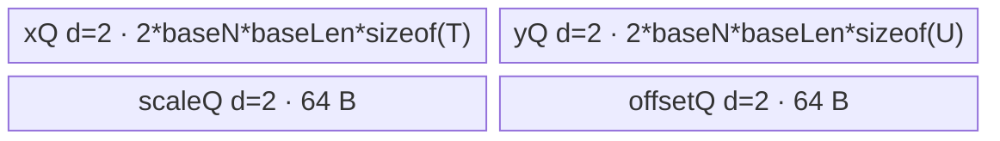
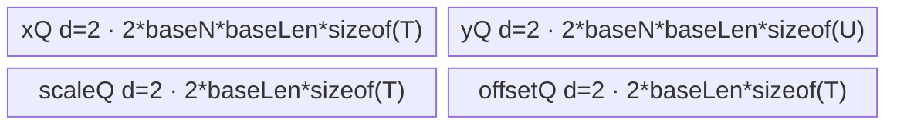
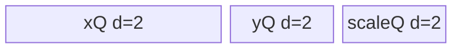
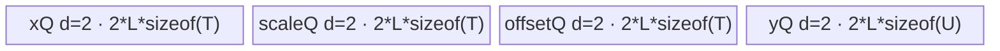
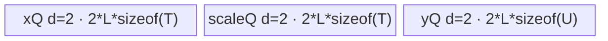

# AscendQuant 950 ACLNN 算子知识

## 算子速览

| 项目 | 内容 |
|---|---|
| 实际入口 | `aclnnAscendQuantV3GetWorkspaceSize` / `aclnnAscendQuantV3`，950 最新公开版本 |
| 计算语义 | `round(x*scale(+再乘scale)+offset)`，axis 广播；INT32 是 packed INT4 view |
| 输入输出 | FP16/FP32/BF16 ND 输入；INT8/INT4/HIFLOAT8/FLOAT8_E5M2/FLOAT8_E4M3FN 输出；950 不支持 NZ |
| 执行类型 | 单 Kernel `AIV_VECTOR`，entry 显式 `KERNEL_TYPE_AIV_ONLY`；Vector MicroAPI 寄存器流水，不含 Cube/AIC/MIX_CV |
| Kernel 路线 | R-001/R-002 per-tensor 有/无 offset；R-003/R-004 per-channel 有/无 offset；R-005/R-006 per-head 有/无 offset |
| 核心资源 | GM + depth=2 的 VECIN/VECOUT queues + Vector RegTensor；16 MiB workspace 仅由 Host 声明，950 body 不读写 |
| 来源闭包 | `source_closed`：V3 ACLNN→L0 Host→RegBase Tiling/template key→`QuantizeTilingData`→AIV-only entry→六个实际模板 body 闭合 |
| 验证状态 | 已完成源码闭包检查；本次知识提取未执行编译、真机、数值或性能测试。 |

## 接口与语义

### 计算语义

`sqrtMode=false` 时 `q=x*scale`，为 true 时 `q=x*scale*scale`；存在 offset 时再做 `q+=offset`。所有输入在寄存器中转换到 FP32 后计算。INT8/INT4 使用模板 round trait；HIFLOAT8 支持 round/hybrid 饱和转换，两个 FP8 只支持 round 饱和转换。INT4 两元素打包为一字节；ACLNN INT32 请求先按 INT4 计算，再把 8 个 INT4 视作一个 INT32。

### 输入、输出与属性

| 参数 | shape/layout | dtype | 约束、默认值与语义 |
|---|---|---|---|
| `x` | ND，1–8 维 | FP16/FP32/BF16 | 非标量；不支持 NZ；INT4 尾轴需偶数 |
| `scale` | 1 维或与 x 同阶；仅 axis 维可非 1 | 与 x 相同 | 轴长等于 x 轴长或 1；size=1 为 per-tensor |
| `offset` | 可选；shape 与 scale 相同 | 与 x 相同 | 是否存在进入 template key，消除无用 Queue/Add |
| `sqrtMode` | 属性 | bool | 编译期 `squareMode` specialization |
| `roundMode` | 属性 | string | INT: round/floor/ceil/trunc；HIFLOAT8: round/hybrid；FP8: round |
| `dstType` | 属性 | enum | INT8/INT4/HIFLOAT8/FP8E5M2/FP8E4M3FN；INT32 在 ACLNN 层转 INT4 |
| `axis` | 属性 | int32 | 最后两个维度；倒数第二维且 scale 非标量为 per-head |
| `y` | 与 x 同 shape，packed INT32 尾轴 1/8 | 上述输出类型或 INT32 view | 非连续输出经 ViewCopy |

### 入口与版本

公开 V3 产品表在 `docs/aclnnAscendQuantV3.md:5-14` 明确 950 支持，而旧 `aclnnAscendQuant` 明确 950 不支持，因此 950 只发布 V3。OpDef 的 `ascend950` config 把实现文件切到 `ascend_quant_v2_apt`；`Tiling4AscendQuantV2` 通过 `IsRegbaseSocVersion` 选 `AscendQuantV2Regbase`。

## Host/Launcher 执行流程

### 参数校验与前处理

V3 `CheckParams` 依次检查指针、非标量、平台 dtype、shape、axis、roundMode。空 x 在 ACLNN 层返回 workspace 0，不进入 RegBase Tiling（其 `GetOpParam` 自身拒绝空 tensor）。非空输入做 `Contiguous(x/scale/offset)`，scale/offset Cast 为 x dtype；INT32 输出改为 INT4 临时量；L0 添加 `AscendQuantV2` AICore launcher，随后框架 `CreateView/ViewCopy` 完成打包视图和非连续回写。

### 参数、Workspace 与生命周期

executor 拥有连续化输入、临时 y、可选 INT32 view 和 ViewCopy。RegBase `WriteTilingData` 直接写 15 个 int64 字段，`DoAscendQuantV2Tiling` 设置 `workspace[0]=16777216`；950 entry 的六个 wrapper 都不读取 `workspace`，不存在核心 Kernel 间 workspace edge。第二段 `CommonOpExecutorRun` 把所有节点提交到用户 stream。

### 启动图与失败传播

```text
V3 ACLNN
  -> [framework] Contiguous + Cast(scale/offset)
  -> l0op::AscendQuantV2 / ADD_TO_LAUNCHER_LIST_AICORE
  -> Tiling4AscendQuantV2 -> AscendQuantV2Regbase
  -> ascend_quant_v2<perMode,zeroPointsType,RoundMode,SqrtMode> [AIV-only]
  -> one of 6 Quantize*Regbase bodies
  -> [framework] optional INT4→INT32 view + ViewCopy
```

同一 executor/stream 保证前后处理与核心节点顺序；Host 任一检查、临时张量或 launcher 添加失败即终止。核心图只有一个 Device 节点。

## Route 与参数设计

### 分核与资源计算

RegBase 把 shape 合并为 per-tensor `[1,prod(x),1]`、per-channel `[prod(x[:-1]),x[-1],1]`、per-head `[prod(x[:-2]),x[-2],x[-1]]`。950 cache 单位固定 128 B。`blockAxis` 选择候选实际核数较大的轴：per-channel 比较 dim0 与尾轴 cache 数；per-head 比较 S、S×N、S×N×D-cache；per-tensor 固定切合轴 dim1。`availableUb=ubSize-2048`；所有队列双缓冲，因此 `CalcMaxBaseLen` 和 `CalcMaxN` 把 `BUFF_NUM=2` 计入。entry 的 `blockDim=coreNum_`，POD `numCore=actCoreNum_`，多余 block 退出。

### Route 选择

| 顺序 | Route | Key/模板 | 精确选择条件与优先级 | 不适用去向 |
|---:|---|---|---|---|
| 1 | R-001 per-tensor+offset | tuple `(TPL_PER_TENSOR,TPL_HAS_OFFSET,round+1,sqrt)` | `scale.size==1 && offset!=null` | 对应无 offset R-002 |
| 2 | R-002 per-tensor no-offset | `(PER_TENSOR,NO_OFFSET,round+1,sqrt)` | `scale.size==1 && offset==null` | 非 scalar 继续 |
| 3 | R-005 per-head+offset | `(PER_HEAD,HAS_OFFSET,round+1,sqrt)` | scale 非 scalar、axis 倒数第二、merged dim2!=1、offset 存在 | 无 offset R-006；dim2=1 降 channel |
| 4 | R-006 per-head no-offset | `(PER_HEAD,NO_OFFSET,round+1,sqrt)` | 同上且 offset 空 | 非 per-head 继续 |
| 5 | R-003 per-channel+offset | `(PER_CHANNEL,HAS_OFFSET,round+1,sqrt)` | 其余合法输入且 offset 存在 | R-004 |
| 6 | R-004 per-channel no-offset | `(PER_CHANNEL,NO_OFFSET,round+1,sqrt)` | 其余合法输入且 offset 空 | 失败 |

```text
mode = scale.size==1 ? PER_TENSOR : (axis==penultimate ? PER_HEAD : PER_CHANNEL)
if mode==PER_HEAD && merged dim2==1: mode=PER_CHANNEL
zeroPointType = offset ? HAS_OFFSET : NO_OFFSET
roundKey = enum(roundMode,dstType)+1
key = GET_TPL_TILING_KEY(mode, zeroPointType, roundKey, sqrtMode)
```

### 模板/实现执行矩阵

| Route | key/selector | dtype/shape/platform 完整命中条件 | 执行拓扑与 Kernel 节点 | 实际模板/body | 内存与同步特征 | tail/fallback |
|---|---|---|---|---|---|---|
| R-001 | PT,HAS | scalar scale，offset 有 | 单 AIV | `QuantizePerTensorRegbase<T,T,T,U,2,R,S>` | x/y d2，scale/offset 各 d2×32B | baseLen/baseN tail |
| R-002 | PT,NO | scalar scale，offset 无 | 单 AIV | `QuantizePerTensorNoOffsetRegbase<T,T,T,U,2,R,S>` | 删除 offset queue/Add | 同上 |
| R-003 | PC,HAS | per-channel，offset 有 | 单 AIV | `QuantizePerChannelRegbase<T,T,T,U,2,R,S>` | x/y/scale/offset 全双缓冲 | 行列 tail |
| R-004 | PC,NO | per-channel，offset 无 | 单 AIV | `QuantizePerChannelNoOffsetRegbase<T,T,T,U,2,R,S>` | 删除 offset queue/Add | 同上 |
| R-005 | PH,HAS | per-head，offset 有 | 单 AIV | `QuantizePerHeadRegbase<T,T,T,U,2,R,S>` | 四个 queue，容量都为 `baseN*baseLen` | S/N/D tail |
| R-006 | PH,NO | per-head，offset 无 | 单 AIV | `QuantizePerHeadNoOffsetRegbase<T,T,T,U,2,R,S>` | 删除 offset queue/Add | 同上 |

`T/T1/T2` 是同一输入 dtype；`U` 由输出编译实例决定。`R` 为 1..6（round/floor/ceil/trunc/rint/hybrid），`S` 为 0/1。entry 固定 `DivMode=2`，因此只走乘法而不走 quantize 共用模板中的除法编译分支。

### 隐藏性能 Guard

| Guard | Host/Tiling 条件 | Device/资源原因 | 影响 Route | 不满足时去向 | 源码符号 |
|---|---|---|---|---|---|
| 双缓冲 UB | `(input bytes+output bytes)*2 <= ubSize-2048` 的 tile 推导 | 所有活动 Queue depth=2 | 全部 | 缩 `baseLen/baseN` | `CalcMaxBaseLen/CalcMaxN` |
| 128 B cache | block factor 与 baseLen 按 `128/sizeof(T)` 对齐 | 950 DMA/cache 粒度 | 全部 | 改切轴/尾 tile | `GetCompileInfo/Calc*Tiling` |
| per-head D 切 | `actCoreNum2` 最大且 `dim2>32` | 避免极短尾轴拆分 | R-005/006 | 退到 N 或 S 切轴 | `CalcPerHeadTiling` |
| output round | FP8 仅 RINT；HIFLOAT8 仅 round/hybrid | cast trait 是编译期参数 | 全部 | Host tiling/ACLNN 失败 | `GetRoundMode` |
| INT4 pack | x 尾轴偶数 | 两个 INT4/byte，输出地址右移一位 | 全部 U=INT4 | ACLNN 参数错误 | `CheckAttrs/CopyOutY` |
| AIV-only | `KERNEL_TASK_TYPE_DEFAULT(KERNEL_TYPE_AIV_ONLY)` | 禁止调度为 Cube | 全部 | 无 fallback | `ascend_quant_v2_apt.cpp::ascend_quant_v2` |

### POD/ABI

`QuantizeTilingData` 是 15 个连续 `int64_t`：`sizeof=120`、`alignof=8`，字段 offset 依次为 0,8,...,112。Host 未写 `axis`，Device 的本算子实例也不消费它。

| 结构 | 字段 | 类型/位宽 | ABI 布局 | 单位 | Host/launcher producer | Device consumer | 边界 |
|---|---|---|---|---|---|---|---|
| `QuantizeTilingData` | `numCore` | int64/64 | off 0 | core | `actCoreNum_` | block guard/tail | `<=coreNum_` |
| 同上 | `blockAxis` | int64/64 | off 8 | axis enum | CalcTiling | core mapping | 0/1/2 |
| 同上 | `ubAxis` | int64/64 | off 16 | axis enum | UB factor | tile scheme | 0/1/2 |
| 同上 | `dim0` | int64/64 | off 24 | elements | merged shape | address/loop | nonnegative |
| 同上 | `dim1` | int64/64 | off 32 | elements | merged shape | row stride | nonnegative |
| 同上 | `dim2` | int64/64 | off 40 | elements | merged shape | per-head stride | nonnegative |
| 同上 | `blockUnion` | int64/64 | off 48 | cores/group | per-head split | core address | >=1 |
| 同上 | `blockFactor` | int64/64 | off 56 | rows/elements | block factor funcs | ordinary core extent | aligned |
| 同上 | `blockTailFactor` | int64/64 | off 64 | rows/elements | block factor funcs | tail core extent | zero normalized |
| 同上 | `baseN` | int64/64 | off 72 | rows | UB factor funcs | row loop/queue | >=1 |
| 同上 | `baseLen` | int64/64 | off 80 | elements | UB factor funcs | vector/DMA loop | UB bounded |
| 同上 | `hasZeroPoint` | int64/64 | off 88 | bool | `hasOffset_` | parsed；body由模板选择 | 0/1 |
| 同上 | `axis` | int64/64 | off 96 | axis | 未赋值 | 本算子 body 未读 | inactive/值不可依赖 |
| 同上 | `roundMode` | int64/64 | off 104 | enum | `roundMode_` | parsed；实际 cast 由模板参数 | 0..5 |
| 同上 | `sqrtMode` | int64/64 | off 112 | bool | `sqrtMode_` | parsed；实际乘法由模板参数 | 0/1 |

### Route 源码闭包

| Route | Key/selector | Host/Tiling producer | POD/参数 | Kernel entry/router 节点 | Kernel body/直接依赖 | 构建接线 |
|---|---|---|---|---|---|---|
| R-001 | PT,HAS,R,S | `AscendQuantV2Regbase::*` | `QuantizeTilingData` | `ascend_quant_v2_apt.cpp::ascend_quant_v2` | `quantize_per_tensor_regbase.h` + `quantize.h` | `ascend_quant_v2_def.cpp` 950 config→apt |
| R-002 | PT,NO,R,S | 同上 | 同上 | 同上 | `quantize_per_tensor_no_offset_regbase.h` + base | 同上 |
| R-003 | PC,HAS,R,S | 同上 | 同上 | 同上 | `quantize_per_channel_regbase.h` + base | 同上 |
| R-004 | PC,NO,R,S | 同上 | 同上 | 同上 | `quantize_per_channel_no_offset_regbase.h` + base | 同上 |
| R-005 | PH,HAS,R,S | 同上 | 同上 | 同上 | `quantize_per_head_regbase.h` + base | 同上 |
| R-006 | PH,NO,R,S | 同上 | 同上 | 同上 | `quantize_per_head_no_offset_regbase.h` + base | 同上 |

## Kernel 实现

### 公共执行流程

模板 entry 保存 3510 浮点溢出控制寄存器、声明 AIV-only，按 `perMode` 与 `zeroPointsType` 编译期分派六个 wrapper；wrapper 解析 POD，实例化 `Quantize*Regbase<DTYPE_X,DTYPE_SCALE,DTYPE_X,DTYPE_Y,2,RoundMode,SqrtMode>`。body 都执行 GM→depth-2 Queue→MicroAPI RegTensor→depth-2 output Queue→GM。寄存器循环以 `VL=VECTOR_REG_WIDTH/sizeof(float)` 分块，`UpdateMask(count)` 保护最后一个向量。输入 FP16/BF16 解包并转 FP32；scale/offset 同样转 FP32；编译期 `SqrtMode` 决定是否平方 scale，`DivMode=2` 固定乘法；输出按 U 走各自 Cast/pack trait。

### Route R-001：per-tensor，有 offset

#### 适用条件

##### 选择证据

| 层级 | 文件 | 符号 | 源码谓词/参数 | 结果/下一跳 |
|---|---|---|---|---|
| Tiling | `op_host/ascend_quant_v2_regbase_tiling.cpp` | `GetOpParam/CalcTilingKey` | scale size 1、offset 存在 | PT,HAS tuple |
| Router | `op_kernel/ascend_quant_v2_apt.cpp` | `ascend_quant_v2` | constexpr PT+HAS | `QuantizePerTensorRegbase` |

#### Device 数据流

##### 函数级调用链

```text
ascend_quant_v2<PT,HAS,R,S> -> AscendQuantV2PerTensor -> QuantizePerTensorRegbase::Init/Process
  -> CopyInScale + CopyInOffset -> CopyXAndCompute -> CopyInX -> Compute -> CopyOutY
```

##### 源码等价伪码

```text
if blockIdx>=numCore: return
load one scale and one offset into 32-byte queues once per core
for baseLen/tail, then baseN/tail:
  DMA x tile; for every row and VL-mask chunk:
    load/cast x, scale[0], offset[0] to fp32
    scale*=scale iff S; y=x*scale+offset
    cast/pack U and enqueue; DMA valid bytes to GM
```

#### 内存与数据搬运

##### 资源与搬运表

| 层级/缓冲区 | offset/地址公式 | extent/容量公式 | dtype/layout | producer | consumer | owner/lifetime | 对齐/复用 |
|---|---|---|---|---|---|---|---|
| xQ | core base + tile | `2*baseN*baseLen*sizeof(T)` | T/flat | DMA | RegTensor | pipe/core | depth 2 |
| scaleQ/offsetQ | GM[0] | each `2*32` bytes | T | DMA | all tiles | pipe/core | loaded once |
| yQ | same logical x offset | `2*baseN*baseLen*sizeof(U)` | U/packed if INT4 | RegTensor store | DMA | pipe/tile | depth 2 |

##### 分层内存布局



##### 字节账与复用顺序

```text
UB_total = 2*baseN*baseLen*(sizeof(T)+sizeof(U)) + 128 bytes
UB_total <= ubSize-2048 by Host tile calculation
dynamic_ub = N/A
workspace_total = 16 MiB declared; kernel bytes touched = 0
```

| 复用子区 | 写入者 | 读取者/消费点 | 下一次覆盖 | 同步或释放依据 | 安全条件 |
|---|---|---|---|---|---|
| each Queue slot | DMA/Compute | Compute/DMA | two tiles later | EnQue/DeQue/FreeTensor | depth=2 producer-consumer order |
| scalar queues | CopyInScale/Offset | all Compute loops | kernel end | FreeTensor after loops | scalars immutable |

#### 同步、精度与尾块

##### 同步与数值边界表

| 阶段 | primitive/机制 | producer | consumer/等待点 | 保护对象 | 精度/尾块 |
|---|---|---|---|---|---|
| DMA→Vector→DMA | TQue protocol | CopyIn/Compute | DeQue | tile slots | `UpdateMask(count)` |
| compute | compile-time MicroAPI | input regs | output store | RegTensor | FP32 math；U-specific saturated/rounded cast |
| INT4 | Pack + int4x2 Cast | FP32→int16→half | packed byte store | output | address/length divided by 2 |

#### 关键实现

##### 符号证据表

| 阶段 | 文件 | 符号/模板实例 | 实现事实 |
|---|---|---|---|
| Host/Tiling producer | `op_host/ascend_quant_v2_regbase_tiling.cpp` | `CalcPerTensor*` | aligned core/tile |
| Kernel entry/router | `op_kernel/ascend_quant_v2_apt.cpp` | `AscendQuantV2PerTensor` | template instantiation |
| Device body/helper | `quantize_per_tensor_regbase.h` | `Process/Compute` | scalar reuse、register pipeline |

### Route R-002：per-tensor，无 offset

#### 适用条件

##### 选择证据

| 层级 | 文件 | 符号 | 源码谓词/参数 | 结果/下一跳 |
|---|---|---|---|---|
| Tiling | `ascend_quant_v2_regbase_tiling.cpp` | `CalcTilingKey` | PT 且 `hasOffset_=false` | PT,NO |
| Router | `ascend_quant_v2_apt.cpp` | constexpr branch | PT+NO | no-offset body |

#### Device 数据流

##### 函数级调用链

```text
entry -> AscendQuantV2PerTensorNoOffset -> QuantizePerTensorNoOffsetRegbase::Process
  -> CopyInScale -> CopyInX -> Compute(Mul,[Mul],Cast/Pack) -> CopyOutY
```

##### 源码等价伪码

```text
与 R-001 相同，但不分配/搬运 offset，不执行 Add；scale[0] 在所有 tile 复用。
```

#### 内存与数据搬运

##### 资源与搬运表

| 层级/缓冲区 | offset/地址公式 | extent/容量公式 | dtype/layout | producer | consumer | owner/lifetime | 对齐/复用 |
|---|---|---|---|---|---|---|---|
| xQ/yQ | 同 R-001 | `2*baseN*baseLen*sizeof(T/U)` | flat | DMA/Vector | Vector/DMA | tile | depth 2 |
| scaleQ | GM[0] | 64 B | T | DMA | all tiles | core | no offset queue |

##### 分层内存布局


##### 字节账与复用顺序

```text
UB_total = 2*baseN*baseLen*(sizeof(T)+sizeof(U)) + 64
workspace_total = 16 MiB declared; kernel bytes touched = 0
```

| 复用子区 | 写入者 | 读取者/消费点 | 下一次覆盖 | 同步或释放依据 | 安全条件 |
|---|---|---|---|---|---|
| queues | 同 R-001 | 同 R-001 | 双缓冲轮转 | Queue protocol | 当前消费者完成 |

#### 同步、精度与尾块

##### 同步与数值边界表

| 阶段 | primitive/机制 | producer | consumer/等待点 | 保护对象 | 精度/尾块 |
|---|---|---|---|---|---|
| 全流程 | Queue + register mask | DMA/Vector | DeQue/store | tile | FP32 math，无 Add，mask tail |

#### 关键实现

##### 符号证据表

| 阶段 | 文件 | 符号/模板实例 | 实现事实 |
|---|---|---|---|
| Host/Tiling producer | `ascend_quant_v2_regbase_tiling.cpp` | `CalcTilingKey` | NO_OFFSET key |
| Kernel entry/router | `ascend_quant_v2_apt.cpp` | `AscendQuantV2PerTensorNoOffset` | body 选择 |
| Device body/helper | `quantize_per_tensor_no_offset_regbase.h` | `Init/Compute` | 条件分配消除 offset |

### Route R-003：per-channel，有 offset

#### 适用条件

##### 选择证据

| 层级 | 文件 | 符号 | 源码谓词/参数 | 结果/下一跳 |
|---|---|---|---|---|
| Tiling | `ascend_quant_v2_regbase_tiling.cpp` | `GetOpParam` | 默认非 scalar/非 head，offset 有 | PC,HAS |
| Router | `ascend_quant_v2_apt.cpp` | constexpr PC+HAS | tuple | channel body |

#### Device 数据流

##### 函数级调用链

```text
entry -> QuantizePerChannelRegbase::Process
  -> CopyInScale + CopyInOffset -> CopyXAndCompute
    -> CopyInX -> Compute(register x/scale/offset by lane) -> CopyOutY
```

##### 源码等价伪码

```text
map core to row or aligned tail-axis segment
for each baseLen/tail: DMA vector scale+offset once
  for baseN/tail rows: DMA x; for VL chunks load lane-wise parameters;
    fp32 y=x*(sqrt?scale*scale:scale)+offset; cast/pack; DMA rows out
```

#### 内存与数据搬运

##### 资源与搬运表

| 层级/缓冲区 | offset/地址公式 | extent/容量公式 | dtype/layout | producer | consumer | owner/lifetime | 对齐/复用 |
|---|---|---|---|---|---|---|---|
| xQ/yQ | `gmXOffset+n*dim1+col` | d2 `baseN*baseLen*sizeof(T/U)` | ND | DMA/regs | regs/DMA | tile | row strides |
| scaleQ/offsetQ | `gmSOffset+col` | each d2 `baseLen*sizeof(T)` | vector | DMA | all row tiles | col tile | loaded once per col tile |

##### 分层内存布局



##### 字节账与复用顺序

```text
UB_total = 2*baseN*baseLen*(sizeof(T)+sizeof(U)) + 4*baseLen*sizeof(T)
workspace_total = 16 MiB declared; kernel bytes touched = 0
```

| 复用子区 | 写入者 | 读取者/消费点 | 下一次覆盖 | 同步或释放依据 | 安全条件 |
|---|---|---|---|---|---|
| parameter queue slot | CopyInScale/Offset | all row tiles in CopyXAndCompute | next col tile | FreeTensor after inner loop | no premature overwrite |

#### 同步、精度与尾块

##### 同步与数值边界表

| 阶段 | primitive/机制 | producer | consumer/等待点 | 保护对象 | 精度/尾块 |
|---|---|---|---|---|---|
| Copy | `DataCopyPad`, queue | GM | reg load | strided rows/params | blockLen bytes + stride |
| Reg compute | `UpdateMask` + ZEROING | loads/casts | packed store | final VL | FP32 math；no invalid lane output |

#### 关键实现

##### 符号证据表

| 阶段 | 文件 | 符号/模板实例 | 实现事实 |
|---|---|---|---|
| Host/Tiling producer | `ascend_quant_v2_regbase_tiling.cpp` | `CalcPerChannel*` | row/tail-axis split |
| Kernel entry/router | `ascend_quant_v2_apt.cpp` | `AscendQuantV2PerChannel` | route wrapper |
| Device body/helper | `quantize_per_channel_regbase.h` | `Process/Compute` | lane-wise broadcast、cast/pack |

### Route R-004：per-channel，无 offset

#### 适用条件

##### 选择证据

| 层级 | 文件 | 符号 | 源码谓词/参数 | 结果/下一跳 |
|---|---|---|---|---|
| Tiling | `ascend_quant_v2_regbase_tiling.cpp` | selector/key | PC+offset null | PC,NO |
| Router | `ascend_quant_v2_apt.cpp` | constexpr PC+NO | tuple | no-offset channel body |

#### Device 数据流

##### 函数级调用链

```text
entry -> QuantizePerChannelNoOffsetRegbase::Process
  -> CopyInScale -> CopyInX -> Compute(Mul,[Mul],Cast/Pack) -> CopyOutY
```

##### 源码等价伪码

```text
同 R-003 的行/列循环和 lane scale；不搬 offset，不创建 offset RegTensor，不执行 Add。
```

#### 内存与数据搬运

##### 资源与搬运表

| 层级/缓冲区 | offset/地址公式 | extent/容量公式 | dtype/layout | producer | consumer | owner/lifetime | 对齐/复用 |
|---|---|---|---|---|---|---|---|
| xQ/yQ | 同 R-003 | 同 R-003 | ND | DMA/Vector | Vector/DMA | tile | depth 2 |
| scaleQ | channel col | `2*baseLen*sizeof(T)` | vector | DMA | inner rows | col tile | offset queue absent |

##### 分层内存布局



##### 字节账与复用顺序

```text
UB_total = 2*baseN*baseLen*(sizeof(T)+sizeof(U)) + 2*baseLen*sizeof(T)
workspace_total = 16 MiB declared; kernel bytes touched = 0
```

| 复用子区 | 写入者 | 读取者/消费点 | 下一次覆盖 | 同步或释放依据 | 安全条件 |
|---|---|---|---|---|---|
| scale slot | DMA | all row tiles | next col tile | FreeTensor | inner loop complete |

#### 同步、精度与尾块

##### 同步与数值边界表

| 阶段 | primitive/机制 | producer | consumer/等待点 | 保护对象 | 精度/尾块 |
|---|---|---|---|---|---|
| all | Queue + mask | DMA/register | DeQue/store | tile | FP32 multiply，masked tail |

#### 关键实现

##### 符号证据表

| 阶段 | 文件 | 符号/模板实例 | 实现事实 |
|---|---|---|---|
| Host/Tiling producer | `ascend_quant_v2_regbase_tiling.cpp` | `CalcTilingKey` | NO_OFFSET |
| Kernel entry/router | `ascend_quant_v2_apt.cpp` | `AscendQuantV2PerChannelNoOffset` | wrapper |
| Device body/helper | `quantize_per_channel_no_offset_regbase.h` | `Compute` | 无 offset specialization |

### Route R-005：per-head，有 offset

#### 适用条件

##### 选择证据

| 层级 | 文件 | 符号 | 源码谓词/参数 | 结果/下一跳 |
|---|---|---|---|---|
| Tiling | `ascend_quant_v2_regbase_tiling.cpp` | `GetOpParam/MergeInputShape` | penultimate axis、scale 非标量、dim2!=1、offset 有 | PH,HAS |
| Router | `ascend_quant_v2_apt.cpp` | constexpr PH+HAS | tuple | head body |

#### Device 数据流

##### 函数级调用链

```text
entry -> QuantizePerHeadRegbase::Init/Process
  -> ParsePerHeadCoreBlocks/CalcOffset -> ProcessLoop/ProcessParamLoop
    -> CopyIn scale+offset -> CopyInX -> Compute(register per-row scalar) -> CopyOutY
```

##### 源码等价伪码

```text
map block to S, N, or D; for assigned S and N baseN/tail:
  DMA scale+offset for N rows
  for D baseLen/tail: DMA x rectangle
    each row uses its own scale/offset across D; FP32 multiply once/twice + add; cast/pack and output
```

#### 内存与数据搬运

##### 资源与搬运表

| 层级/缓冲区 | offset/地址公式 | extent/容量公式 | dtype/layout | producer | consumer | owner/lifetime | 对齐/复用 |
|---|---|---|---|---|---|---|---|
| xQ/yQ | S/N/D core formula | each d2 `baseN*baseLen*sizeof(T/U)` | ND | DMA/regs | regs/DMA | tile | depth 2 |
| scaleQ/offsetQ | N parameter offset | each d2 `baseN*baseLen*sizeof(T)` | parameter vector | DMA | all D tiles | N tile | capacity intentionally uses dataLen |

##### 分层内存布局



`L=baseN*baseLen`。

##### 字节账与复用顺序

```text
UB_total = 2*baseN*baseLen*(3*sizeof(T)+sizeof(U))
workspace_total = 16 MiB declared; kernel bytes touched = 0
```

| 复用子区 | 写入者 | 读取者/消费点 | 下一次覆盖 | 同步或释放依据 | 安全条件 |
|---|---|---|---|---|---|
| scale/offset queues | parameter DMA | all D tiles in N group | next N group | DeQue/FreeTensor after ProcessInputLoop | D loop complete |

#### 同步、精度与尾块

##### 同步与数值边界表

| 阶段 | primitive/机制 | producer | consumer/等待点 | 保护对象 | 精度/尾块 |
|---|---|---|---|---|---|
| core tail | ParsePerHeadCoreBlocks | POD | loops | S/N/D extent | `blockTailFactor` |
| vector tail | `UpdateMask(count)` | dataCount | store | last VL | FP32 math, per-row parameters |

#### 关键实现

##### 符号证据表

| 阶段 | 文件 | 符号/模板实例 | 实现事实 |
|---|---|---|---|
| Host/Tiling producer | `ascend_quant_v2_regbase_tiling.cpp` | `CalcPerHeadTiling` | S/N/D split |
| Kernel entry/router | `ascend_quant_v2_apt.cpp` | `AscendQuantV2PerHead` | wrapper |
| Device body/helper | `quantize_per_head_regbase.h` | `ParsePerHeadCoreBlocks/Compute` | address, parameter broadcast |

### Route R-006：per-head，无 offset

#### 适用条件

##### 选择证据

| 层级 | 文件 | 符号 | 源码谓词/参数 | 结果/下一跳 |
|---|---|---|---|---|
| Tiling | `ascend_quant_v2_regbase_tiling.cpp` | selector/key | PH+offset null | PH,NO |
| Router | `ascend_quant_v2_apt.cpp` | constexpr PH+NO | tuple | no-offset head body |

#### Device 数据流

##### 函数级调用链

```text
entry -> QuantizePerHeadNoOffsetRegbase::Process
  -> Parse/CalcOffset -> parameter/D loops -> CopyInX -> Compute(Mul,[Mul],Cast) -> CopyOutY
```

##### 源码等价伪码

```text
与 R-005 相同的 S/N/D 映射；仅搬 scale，每行按自己的 scale 广播到 D，不执行 Add。
```

#### 内存与数据搬运

##### 资源与搬运表

| 层级/缓冲区 | offset/地址公式 | extent/容量公式 | dtype/layout | producer | consumer | owner/lifetime | 对齐/复用 |
|---|---|---|---|---|---|---|---|
| xQ/scaleQ/yQ | 同 R-005 | each d2×L×dtype bytes | ND | DMA/regs | regs/DMA | tile/N group | no offset queue |

##### 分层内存布局



##### 字节账与复用顺序

```text
UB_total = 2*baseN*baseLen*(2*sizeof(T)+sizeof(U))
workspace_total = 16 MiB declared; kernel bytes touched = 0
```

| 复用子区 | 写入者 | 读取者/消费点 | 下一次覆盖 | 同步或释放依据 | 安全条件 |
|---|---|---|---|---|---|
| Queue slots | DMA/compute | compute/DMA | depth-2 rotation | Queue protocol | consumer frees first |

#### 同步、精度与尾块

##### 同步与数值边界表

| 阶段 | primitive/机制 | producer | consumer/等待点 | 保护对象 | 精度/尾块 |
|---|---|---|---|---|---|
| all | Queue + mask | DMA/register | DeQue/store | S/N/D tile | FP32 math；masked VL tail |

#### 关键实现

##### 符号证据表

| 阶段 | 文件 | 符号/模板实例 | 实现事实 |
|---|---|---|---|
| Host/Tiling producer | `ascend_quant_v2_regbase_tiling.cpp` | `CalcPerHead*` | core/tile |
| Kernel entry/router | `ascend_quant_v2_apt.cpp` | `AscendQuantV2PerHeadNoOffset` | wrapper |
| Device body/helper | `quantize_per_head_no_offset_regbase.h` | `Init/Compute` | no-offset specialization |

## 算子特定优化

### Trick T-001：offset 作为模板轴消除整条数据路

#### 触发与源码依据

- 适用 Route：R-002、R-004、R-006。
- 触发条件：公开入口 `offset==nullptr`，Host 生成 `TPL_NO_OFFSET`。
- Golden 来源：[`ascend_quant_v2_apt.cpp:109-125`](../../../../../../../cann-ops-raw/ascendc/ops-nn/955f8b33985b6d72989ebff341bb9c2c564a51bc/quant/ascend_quant_v2/op_kernel/ascend_quant_v2_apt.cpp#L109-L125)

**官方源码（固定 Commit 连续逐字摘录）**：

```cpp
if constexpr (perMode == TPL_PER_TENSOR) {
    if constexpr (zeroPointsType == TPL_NO_OFFSET) {
        AscendQuantV2PerTensorNoOffset<RoundMode, SqrtMode>(x, scale, offset, y, workspace, tiling);
    } else {
        AscendQuantV2PerTensor<RoundMode, SqrtMode>(x, scale, offset, y, workspace, tiling);
    }
}
```

#### 机制与设计原因

可选 offset 不用 runtime 分支包围同一 body，而是直接选择 no-offset 类。对应类不绑定 offset GM、不初始化 offset Queue、不搬运 offset，也不创建 offset RegTensor/Add，实际降低 GM、UB 和寄存器计算。

#### 迁移边界

- 适用：可选输入在整个 Kernel 生命周期固定存在/缺失的逐元素算子。
- 前提：Host key 与 entry template 轴严格一致，POD 缺省字段不被 no-offset body 误读。
- 失效：offset 在 tile 内动态变化存在性时不能使用该 specialization。
- 未验证：本次知识提取未执行编译、真机、数值或性能测试。

#### 错误做法

固定仓未提供可验证反例。

### Trick T-002：双缓冲与寄存器 masked pipeline

#### 触发与源码依据

- 适用 Route：R-001..R-006。
- 触发条件：所有 RegBase body；Host UB 公式已将 `BUFF_NUM=2` 计入。
- Golden 来源：[`quantize_per_channel_regbase.h:75-80`](../../../../../../../cann-ops-raw/ascendc/ops-nn/955f8b33985b6d72989ebff341bb9c2c564a51bc/quant/quantize/op_kernel/arch35/quantize_per_channel_regbase.h#L75-L80)

**官方源码（固定 Commit 连续逐字摘录）**：

```cpp
pipe_.InitBuffer(inQueueX_, bufferNum_, tilingData_.baseN * tilingData_.baseLen * sizeof(T));
pipe_.InitBuffer(inQueueScale_, bufferNum_, tilingData_.baseLen * sizeof(T1));
pipe_.InitBuffer(inQueueOffset_, bufferNum_, tilingData_.baseLen * sizeof(T2));
pipe_.InitBuffer(outQueueY_, bufferNum_, tilingData_.baseN * tilingData_.baseLen * sizeof(U));
```

#### 机制与设计原因

`bufferNum_=2` 允许 Queue producer/consumer 轮换；Compute 不再物化 FP32 UB 中间量，而在 `RegTensor` 中完成解包、FP32 Mul/Add、目标 Cast 与 pack，尾部用 `UpdateMask(count)`。Host 资源公式乘以 2，保证调度与 UB 账一致。

#### 迁移边界

- 适用：DMA 与寄存器计算可流水、tile 间无跨迭代依赖的逐元素管线。
- 前提：UB 预算包含所有 Queue 的 depth，尾向量必须使用真实 count 更新 mask。
- 失效：UB 不足时必须减小 baseN/baseLen；不能忽略 depth 直接按逻辑 tile 容量估算。
- 未验证：本次知识提取未执行编译、真机、数值或性能测试。

#### 错误做法

固定仓未提供可验证反例。

## 模板与实现对比

| 对比维度 | R-001/002 per-tensor | R-003/004 per-channel | R-005/006 per-head | 设计选择依据 |
|---|---|---|---|---|
| 命中条件/优先级 | scale size 1 | 默认 axis | penultimate axis | 参数广播粒度 |
| 模板与 dtype | scalar parameter body | lane parameter body | row scalar body | T/U/round/sqrt 编译特化 |
| 循环与分核 | flat dim1 | rows×tail-axis | S×N×D | 最大可并行维 |
| Queue/TBuf/寄存器/dynamic UB/通信 window | x/y+32B params | x/y+baseLen params | all buffers use L | 全部 d2 + RegTensor |
| 内存总占用与复用 | offset 决定 64B | offset 决定 `2*baseLen*sizeof(T)` | offset 决定 `2*L*sizeof(T)` | no-offset 条件消除 |
| 搬运/Vector/SIMT/NDDMA/通信 API | DataCopyPad+MicroAPI | 同左 | 同左 | AIV-only，无 SIMT/NDDMA |
| 同步、精度与 tail | Queue+mask，FP32 | 同左 | S/N/D tail + mask | 编译期 cast trait |
| fallback/失败边界 | 无 fallback | 无 fallback | dim2=1 降 channel | 参数错误即失败 |

## 平台差异

| 项目 | A2 | A3 | 950 |
|---|---|---|---|
| 支持状态 | V3 支持，见无后缀卡 | V3 支持，见无后缀卡 | V3 明确支持；旧无版本 API 明确不支持 |
| Host/Launcher | 普通 Tiling | 普通 Tiling | `IsRegbaseSocVersion`→RegBase，128 B cache，tuple key |
| Kernel/资源 | 普通 Vector API、depth 1 | 同类普通 body | AIV-only MicroAPI、depth 2、FP8/HIFLOAT8 |

## 限制与失败边界

- 950 公开入口不支持 NZ；不能凭普通实现中的 NZ body 推导 950 支持。
- 950 RegBase Tiling 要求 x/scale/offset dtype 相同，拒绝空核心输入；ACLNN 在进入核心前处理合法空 tensor。
- Host 写物理 `coreNum_` 为 blockDim、写实际 `actCoreNum_` 到 POD；Device 依赖 `blockIdx>=numCore` 退出。
- `QuantizeTilingData::axis` 未由 Host 赋值，不能作为可复用 ABI 输入；当前 body 的 Route 已编译期确定。
- 本次知识提取未执行编译、真机、数值或性能测试。

## 源码索引

### 链路索引

| 链路阶段 | 文件 | 关键符号 | 支撑内容 |
|---|---|---|---|
| 入口声明/约束 | `quant/ascend_quant_v2/docs/aclnnAscendQuantV3.md` | 产品/参数表 | 950 V3 公开支持与约束 |
| 入口实现 | `quant/ascend_quant_v2/op_host/op_api/aclnn_ascend_quant_v3.cpp` | `aclnnAscendQuantV3GetWorkspaceSize` | ACLNN 校验/图 |
| Host/Tiling/Launcher | `quant/ascend_quant_v2/op_host/ascend_quant_v2_regbase_tiling.cpp` | `AscendQuantV2Regbase` | selector、tuple key、POD、workspace |
| Kernel entry/body | `quant/ascend_quant_v2/op_kernel/ascend_quant_v2_apt.cpp` | `ascend_quant_v2` | AIV-only router |
| Kernel entry/body | `quant/ascend_quant_v2/op_kernel/arch35/ascend_quant_v2_struct.h` | `ASCENDC_TPL_ARGS_DECL/SEL` | 四轴模板 key 域 |
| Kernel entry/body | `quant/quantize/op_kernel/arch35/quantize.h` | `QuantizeBase` | ABI parser、DMA 与 cast traits |
| Kernel entry/body | `quant/quantize/op_kernel/arch35/quantize_tilingdata.h` | `QuantizeTilingData` | 950 POD ABI |
| Kernel entry/body | `quant/quantize/op_kernel/arch35/quantize_per_channel_regbase.h` | `QuantizePerChannelRegbase` | PC 有 offset |
| Kernel entry/body | `quant/quantize/op_kernel/arch35/quantize_per_channel_no_offset_regbase.h` | `QuantizePerChannelNoOffsetRegbase` | PC 无 offset |
| Kernel entry/body | `quant/quantize/op_kernel/arch35/quantize_per_tensor_regbase.h` | `QuantizePerTensorRegbase` | PT 有 offset |
| Kernel entry/body | `quant/quantize/op_kernel/arch35/quantize_per_tensor_no_offset_regbase.h` | `QuantizePerTensorNoOffsetRegbase` | PT 无 offset |
| Kernel entry/body | `quant/quantize/op_kernel/arch35/quantize_per_head_regbase.h` | `QuantizePerHeadRegbase` | PH 有 offset |
| Kernel entry/body | `quant/quantize/op_kernel/arch35/quantize_per_head_no_offset_regbase.h` | `QuantizePerHeadNoOffsetRegbase` | PH 无 offset |
| 构建接线 | `quant/ascend_quant_v2/op_host/ascend_quant_v2_def.cpp` | `config_950/OP_ADD` | 950→apt 实现 |

### 实现复用检查

| 检查项 | 可复用事实 | 不得改变的约束 | 源码符号 |
|---|---|---|---|
| ABI/POD | 15×int64 POD | offset 顺序；axis inactive | `QuantizeTilingData` |
| 调用顺序 | parameter load→x tile→reg compute→output | parameter Queue 在所有依赖 tile 后释放 | 六个 `Process` |
| workspace/内存 | 16 MiB 声明、Kernel 无读写 | Queue depth=2 必须计入 UB | `DoAscendQuantV2Tiling/InitBuffer` |
| 同步 | TQue producer-consumer | slot FreeTensor 后才可覆盖 | Queue calls |
| 精度与尾块 | FP32 math + compile-time CastTrait + mask | output dtype/round 对应关系和 INT4 pack | `QuantizeBase/Compute` |
| 失败边界 | dtype/shape/round/axis 校验 | 无 device fallback；未知 tuple 无 body | `CheckAttrs/entry` |
