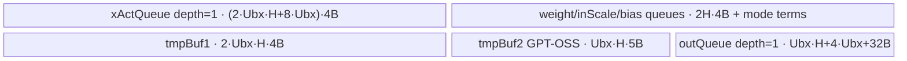

# DequantSwigluQuant A2/A3 ACLNN 算子知识

## 算子速览

| 项目 | 内容 |
|---|---|
| 实际入口 | `aclnnDequantSwigluQuantV2GetWorkspaceSize` / `aclnnDequantSwigluQuantV2`，公开 ACLNN V2 |
| 计算语义 | 对 `x` 反量化，在尾轴两半或奇偶通道上执行 SwiGLU/GPT-OSS SwiGLU，再做静态或动态量化 |
| 输入输出 | A2/A3 的 V2 公开域：二维 ND，`x` 为 INT32/BF16；`groupIndexOptional` 为一维 INT64 且非空；`y` 为 INT8，`scaleOut` 为 FLOAT |
| 执行类型 | 单节点 `AIV_VECTOR`；无 Cube/AIC、SIMT、NDDMA 或 MIX_CV |
| Kernel 路线 | R-001 标准按 token 分核；R-002 多 group 少 token 的按 group 分核 |
| 核心资源 | GM、AIV UB、`TQue<VECIN/VECOUT>`、`TBuf<VECCALC>`；R-001/R-002 均无跨 Kernel 边 |
| 来源闭包 | `source_closed`：公开 V2 文档 → versioned OpDef → `TilingForDequantSwigluQuant` → `DequantSwigluQuantBaseTilingData` → `dequant_swiglu_quant` → 两个实际 AIV body → binary config |
| 验证状态 | 已完成源码闭包检查；本次知识提取未执行编译、真机、数值或性能测试。 |

## 接口与语义

### 计算语义

令一行输入为 `x[r, 0:2H]`。INT32 路线先按通道应用 `weightScale`，可再按行应用 `activationScale`，并按 bias dtype 在缩放前（INT32 bias）或缩放后（浮点 bias）加偏置；BF16 直接升为 FP32。`swigluMode=0` 时，`A/B` 是由 `activateLeft` 决定的左右半轴，计算 `A/(1+exp(-A))*B`；`swigluMode=1` 时按偶/奇通道 gather，计算 `min(x_glu,L)/(1+exp(-alpha*min(x_glu,L))) * (clamp(x_linear,-L,L)+beta)`。静态量化使用给定 scale/offset；动态量化先逐行求绝对值最大值 `m`，写 `scaleOut=m/127`，再将结果除以该 scale 并转 INT8。

### 输入、输出与属性

| 参数 | shape/layout | dtype | 约束、默认值与语义 |
|---|---|---|---|
| `x` | `[M,2H]`, ND | INT32/BF16 | V2 在 A2/A3 只公开二维输入；`2H` 必须为偶数，Tiling 进一步要求可被 64 整除 |
| `weightScaleOptional` | `[G,2H]`, ND | FLOAT | INT32 必需；BF16 不参与反量化 scale 路径 |
| `activationScaleOptional` | `[M]`, ND | FLOAT | INT32 可选；每 token 一个标量 |
| `biasOptional` | `[G,2H]`, ND | INT32/FLOAT/FLOAT16/BF16 | 可选；二维特殊 groupIndex 与 bias 不同时允许 |
| `quantScaleOptional` | `[G]` 或 `[G,H]`, ND | FLOAT/FLOAT16（文档） | static/dynamic 均按 group；Host 还编码 BF16/FP16/FP32 specialization |
| `quantOffsetOptional` | 与静态 quant scale 配套 | FLOAT | dynamic 禁止；static 与 scale shape/dtype 一致 |
| `groupIndexOptional` | `[G]`, ND | INT64 | A2/A3 V2 必需；每项给出当前 group token 数 |
| `activateLeft` | 标量 | BOOL | 默认 false；Host 存 `actRight = !activateLeft` |
| `quantModeOptional` | 标量 | STRING | `dynamic` 或 `static` |
| `swigluMode` / `clampLimit` / `gluAlpha` / `gluBias` | 标量 | INT64/FLOAT | V2 新增；默认 `0/7.0/1.702/1.0` |
| `yOut` | `[M,H]`, ND | INT8 | 输出有效 token 由 groupIndex 累积决定 |
| `scaleOut` | `[M]`, ND | FLOAT | dynamic 写逐行 scale；static Kernel 不写动态 scale |

### 入口与版本

固定仓同时公开 V1 与 V2；V2 新增 GPT-OSS 四属性且公开支持 A2/A3，故本卡只提取该平台最新公开版本 `aclnnDequantSwigluQuantV2`。两段式 API 的生成 bridge/executor 属于框架边界；算子自身从 `DequantSwigluQuant` version-2 属性、`IMPL_OP_OPTILING` 注册、POD producer 到 Kernel body 均可在固定仓闭合。公开文档规定 A2/A3 的 `groupIndexOptional` 不得为空，因此 `DequantSwigluQuantTiling` 的无 group 旧模板不属于 V2 的公开可达 Route。

## Host/Launcher 执行流程

### 参数校验与前处理

ACLNN 第一段校验公开参数并建立 executor；非连续 Tensor 的 contiguous 化属于生成框架边界。OpDef 把 V2 属性放在 version 2，A2/A3 配置为 `ascend910b`/`ascend910_93`。Tiling 的真实顺序是：取得 AIV core/UB → 识别 group shape → 展平 `x` 为 `inDimx=M,inDimy=2H`，输出尾轴为 `outDimy=H` → 校验 INT32/BF16、group INT64、scale/bias/quant shape 与 dtype → 读取属性 → 计算 UB 行因子、key、blockDim/workspace → 序列化 POD。任一校验失败返回 `GRAPH_FAILED`，不启动 Kernel。

### 参数、Workspace 与生命周期

`DequantSwigluQuantDskTiling` 从平台产生 `coreNum_`、`ubSize_`。R-001 的 `ubFactorDimx` 由源码字节模型求得，`maxPreCore=min(ceil(M/ubFactorDimx),36,coreNum)`；R-002 命中后改为 `min(coreNum,M)`。用户 workspace 固定为 32 B，Kernel 并不把它作为中间张量；地址由 ACLNN executor 持有至同一 stream 上的单 Kernel 完成。POD 与输入/输出 GM 在 launch 期间只读/写，不存在跨节点 owner 转移。

### 启动图与失败传播

```text
aclnnDequantSwigluQuantV2GetWorkspaceSize
  -> generated ACLNN executor/framework boundary
  -> TilingForDequantSwigluQuant / DequantSwigluQuantDskTiling
  -> one stream launch: dequant_swiglu_quant(blockDim=maxPreCore, POD=DequantSwigluQuantBaseTilingData)
       -> R-001 DequantSwigluQuantBase::Process
       or R-002 DequantSwigluQuantGroup::Process
  -> yOut / scaleOut visible after stream ordering
```

只有一个 Device 节点，无 workspace/GM 节点间边。Host/Tiling 失败阻断 launch；entry 在 `workspace==nullptr` 或 `GetUserWorkspace(workspace)==nullptr` 时直接返回而不写输出；未知 key 没有匹配分支，也不写输出。

## Route 与参数设计

### 分核与资源计算

Host 先要求 `2H % 64 == 0`。字节模型预留 `UB_RESERVE=1024`，按双缓冲 x/activation-scale、FP32 反量化/临时区、INT8 y、逐行 scale、可选 bias、GPT-OSS gather/clamp 缓冲和静态 offset 计算 `ubFactorDimx`。一般路线按行块分核；每 group 在 Device 再以 `blockDimxFactor=ceil(realCount/maxCoreNum)` 均分，尾核取余数。特殊路线把 `blockIdx` 映射到 group，并以 `cuGroupIdx += maxCoreNum` 轮转 group。

### Route 选择

| 顺序 | Route | Key/模板 | 精确选择条件与优先级 | 不适用去向 |
|---:|---|---|---|---|
| 1 | R-002 按 group 分核 | 公开可达 key 为 `110000000` | `(speGroupType && G>=64 && M/G<=16) \|\| (!speGroupType && G>=32 && M/G<=16 && biasCode==0 && qsCode==0 && x==INT32)`；V2 A2/A3 公开的一维 group 只可命中第二项 | 条件假转 R-001 |
| 2 | R-001 标准按 token 分核 | `100000000 + biasCode*1000 + qsCode*100` | groupIndex 存在且未命中 R-002；`biasCode={BF16/none:0,FP16:1,FP32:2,INT32:3}`，`qsCode={FP32:0,FP16:1,BF16:2}` | 校验或 router 不支持则失败/无输出 |

```text
if non-regbase and groupIndex exists:
  validate V2 A2/A3 domain
  if special-small-token predicate: key += 10,000,000 -> R-002
  else: key = 100,000,000 + biasCode*1,000 + qsCode*100 -> R-001
else:
  this public V2 card has no reachable route
```

### 模板/实现执行矩阵

| Route | key/selector | dtype/shape/platform 完整命中条件 | 执行拓扑与 Kernel 节点 | 实际模板/body | 内存与同步特征 | tail/fallback |
|---|---|---|---|---|---|---|
| R-001 标准 | `100000000..100003200` | A2/A3 V2，group `[G]`；INT32 或 BF16；bias/quant-scale code 决定 key | 单 AIV Kernel | `DequantSwigluQuantBase<TBias,TQuantScale,int64_t,TXGm>` | 参数队列单缓冲，x 逻辑单缓冲，out 单缓冲；Queue/PIPE_V 同步 | 每 group 再分核，末核/末 UB loop 截短 |
| R-002 group-cut | `110000000` | 上述特殊小 token 谓词；公开一维 group 路线还要求 biasCode=0（无 bias 或 BF16 bias）、FP32/no quant scale code、INT32 | 单 AIV Kernel | `DequantSwigluQuantGroup<bfloat16_t,float,int64_t,int32_t>` | 复用 R-001 UB；只改变 group→core 调度 | 负/零 token 跳过；无其它 fallback |

### 隐藏性能 Guard

| Guard | Host/Tiling 条件 | Device/资源原因 | 影响 Route | 不满足时去向 | 源码符号 |
|---|---|---|---|---|---|
| 64 元素对齐 | `inDimy % 64 == 0` | body 的 half-axis vector copy/reduce stride 以整 block/repeat 表达 | 全部 | Tiling 失败 | `GetShapeAttrsInfoInner` |
| UB 上限 | `inDimy <= maxInDimy` 且 `ubFactorDimx>=1` | 全部输入、FP32 tmp、out、可选缓冲必须同驻 UB | 全部 | Tiling 失败 | `CountMaxDim` |
| 特殊分核 | `G>=32,M/G<=16,biasCode==0,qsCode==0,x==INT32`（公开 `[G]`） | 避免少 token 时按 token 分核留下空核，改为按 group 派发；code 0 分别覆盖无/BF16 bias 与无/FP32 quantScale | R-002 | R-001 | `CountTilingKey` |
| GPT-OSS 附加 UB | `swigluMode==1` | `tmpBuf2` 同时保存 `uint32` gather offset 与 `uint8` clamp 辅助区 | 全部 | Host 降低 `ubFactorDimx` | `CountMaxDim`, `CreateOffsetLocalTensor` |
| workspace 非空 | entry 两次空指针检查 | entry 总是调用 `GetUserWorkspace` | 全部 | 直接返回、输出未写 | `dequant_swiglu_quant` |

### POD/ABI

宏生成结构的字段按声明顺序连续序列化；固定仓未展开宏生成的 `sizeof/alignof/offsetof`，因此下表只给出源码类型/位宽并明确 ABI offset 不可见。

| 结构 | 字段 | 类型/位宽 | ABI 布局 | 单位 | Host/launcher producer | Device consumer | 边界 |
|---|---|---|---|---|---|---|---|
| `DequantSwigluQuantBaseTilingData` | `inDimx` | int64/64 | offset 不可见 | row/token | `set_inDimx(M)` | group/token 循环 | 正数 |
| 同上 | `inDimy` | int64/64 | offset 不可见 | element/row | `set_inDimy(2H)` | GM stride、scale/bias extent | `2H%64==0` |
| 同上 | `outDimy` | int64/64 | offset 不可见 | element/row | `set_outDimy(H)` | quant/reduce/output stride | `H=inDimy/2` |
| 同上 | `UbFactorDimx` | int64/64 | offset 不可见 | row/UB loop | `CountMaxDim` | per-core UB loop | `>=1` |
| 同上 | `UbFactorDimy` | int64/64 | offset 不可见 | element | `set_outDimy` | half-axis width | `H` |
| 同上 | `usedCoreNum` | int64/64 | offset 不可见 | AIV core | `maxPreCore_` | 调试/元数据 | `<=coreNum` |
| 同上 | `maxCoreNum` | int64/64 | offset 不可见 | AIV core | `maxPreCore_` | Device 二次分核 | `>=1` |
| 同上 | `inGroupNum` | int64/64 | offset 不可见 | group | group shape dim0 | group 循环 | `G>=1` |
| 同上 | `hasBias` | int64/64 | offset 不可见 | boolean | optional bias presence | 条件分配/计算 | 0/1 |
| 同上 | `quantMode` | int64/64 | offset 不可见 | enum | static=0,dynamic=1 | quant 分支 | 0/1 |
| 同上 | `actRight` | int64/64 | offset 不可见 | boolean | `!activateLeft` | act/gate offset | 0/1 |
| 同上 | `quantScaleDtype` | int64/64 | offset 不可见 | enum | FP32=0,FP16=1,BF16=2 | key specialization | 0..2 |
| 同上 | `groupIndexDtype` | int64/64 | offset 不可见 | enum | INT64=1 | router/body ABI | V2 A2/A3 为 1 |
| 同上 | `needSmoothScale` | int64/64 | offset 不可见 | boolean | quant scale presence | quant multiply | 0/1 |
| 同上 | `biasDtype` | int64/64 | offset 不可见 | enum | BF16/none=0,FP16=1,FP32=2,INT32=3 | key/bias path | 0..3 |
| 同上 | `speGroupType` | int64/64 | offset 不可见 | boolean | group rank==2 | group interpretation | 公开路线为 0 |
| 同上 | `activationScaleIsEmpty` | int64/64 | offset 不可见 | boolean | optional presence | dequant multiply | 0/1 |
| 同上 | `quantIsOne` | int64/64 | offset 不可见 | boolean | static shape | scalar/vector quant | 0/1 |
| 同上 | `swigluMode` | int64/64 | offset 不可见 | enum | V2 attr | normal/GPT-OSS | 0/1 |
| 同上 | `clampLimit` | float/32 | offset 不可见 | scalar | V2 attr | clamp | finite positive in public contract |
| 同上 | `gluAlpha` | float/32 | offset 不可见 | scalar | V2 attr | sigmoid exponent | scalar |
| 同上 | `gluBias` | float/32 | offset 不可见 | scalar | V2 attr | linear-side add | scalar |

### Route 源码闭包

| Route | Key/selector | Host/Tiling producer | POD/参数 | Kernel entry/router 节点 | Kernel body/直接依赖 | 构建接线 |
|---|---|---|---|---|---|---|
| R-001 | `100000000+...` | `dequant_swiglu_quant_tiling.cpp::CountTilingKey/DoOpTiling` | `DequantSwigluQuantBaseTilingData` | `dequant_swiglu_quant.cpp::dequant_swiglu_quant` | `dequant_swiglu_quant.h::DequantSwigluQuantBase` | `dequant_swiglu_quant_def.cpp`, `config/ascend910b\|ascend910_93/*.json` |
| R-002 | `110000000`（公开 V2 一维 group） | 同上特殊谓词 | 同上 | 同上 | `dequant_swiglu_quant_cut_group.h::DequantSwigluQuantGroup` + base | 同上 |

## Kernel 实现

### 公共执行流程

两条路线共享 entry、POD 与 `DequantSwigluQuantBase` 的 GM/UB/Vector 管线。entry 解析 key 后实例化 bias/quant-scale/group/x dtype 模板。每个 group 先将 weightScale、quantScale/offset、bias 搬入参数 Queue；随后每个 UB 行块执行 `CopyInXAct → ComputeDequant → ComputeSwiGLU → ComputeQuant → CopyOut`。Queue 的 `EnQue/DeQue/FreeTensor` 保证 DMA 与 Vector 阶段的生产消费；算术相关性由 `PipeBarrier<PIPE_V>` 保证。单 Kernel 没有跨节点 workspace 或 stream 同步边。

### Route R-001：标准按 token 分核

#### 适用条件

##### 选择证据

| 层级 | 文件 | 符号 | 源码谓词/参数 | 结果/下一跳 |
|---|---|---|---|---|
| API | `docs/aclnnDequantSwigluQuantV2.md` | 产品表/参数表 | A2/A3 支持且 groupIndex 非空 | 进入 V2 |
| Tiling | `op_host/dequant_swiglu_quant_tiling.cpp` | `IsCapable`, `CountTilingKey` | group 存在且特殊谓词为假 | `100000000+bias*1000+qs*100` |
| Router | `op_kernel/dequant_swiglu_quant.cpp` | `dequant_swiglu_quant` | `TILING_KEY_IS(100000000..100003200)` | base 模板 |

#### Device 数据流

##### 函数级调用链

```text
dequant_swiglu_quant
  -> DequantSwigluQuantBase::Init
  -> DequantSwigluQuantBase::Process
    -> ProcessSingleGroup
      -> ProcessSingleGroupPerCore
        -> CopyInWeightScale/CopyInQuantScale/CopyInBias/ParamDequeAndCast
        -> loop CopyInXAct -> ComputeDequant -> ComputeSwiGLU -> ComputeQuant -> CopyOut
        -> ParamFree
```

##### 源码等价伪码

```text
for group in [0,G):
  count = max(groupIndex[group], 0); offset = prefix_sum(previous counts)
  rowsPerCore = ceil(count/maxCoreNum); coreCount = ceil(count/rowsPerCore)
  if blockIdx < coreCount:
    load group parameters once
    for ubLoop over this core's rows:
      n = tail ? tailRows : UbFactorDimx
      DMA x[n,2H] and optional activationScale[n]
      fp32 = cast(x); if INT32: fp32 *= weightScale * optional activationScale; add bias
      swiglu = normal left/right or GPT-OSS even/odd formula
      if dynamic: scale=max(abs(swiglu))/127; y=rint/round/trunc cast(swiglu/scale)
      else: y=cast(swiglu/quantScale + quantOffset)
      DMA y[n,H] and dynamic scale[n] to GM
```

#### 内存与数据搬运

##### 资源与搬运表

| 层级/缓冲区 | offset/地址公式 | extent/容量公式 | dtype/layout | producer | consumer | owner/lifetime | 对齐/复用 |
|---|---|---|---|---|---|---|---|
| x GM | `(rowOffset+loop*Ubx)*2H` | `n*2H` | TX, row-major | caller | `CopyInXAct` | caller / launch | contiguous DMA |
| `xActQueue_` | UB 0 | `(2*Ubx*H + Ubx*8)*4` bytes | int32-backed | DMA | dequant | TPipe / one loop | depth=1；BF16 reinterpret/cast |
| `weightScaleQueue_` | UB | `2H*4` | FP32 | group DMA | dequant | one group | depth=1 |
| `inScaleQueue_` | UB | dynamic `H*4`; static `2H*4` | FP32 or packed 16-bit source | group DMA/cast | quant | one group | depth=1 |
| `biasQueue_` | UB | optional `2H*4` allocation | template dtype / FP32 view | group DMA | dequant | one group | depth=1 |
| `tmpBuf1_` | UB | `2*Ubx*H*4` | FP32 | dequant/SwiGLU | quant | one loop | 原地跨阶段复用 |
| `tmpBuf2_` | UB | GPT-OSS only `Ubx*H*(4+1)` | uint32+uint8 | offset/clamp | Gather/SwiGLU | launch | 条件分配 |
| `outQueue_` | UB | `Ubx*H + Ubx*4 + 32` bytes | INT8 y + FP32 scale | quant | CopyOut | one loop | depth=1 |
| workspace | user slice | 32 B | opaque | executor | entry user-space check | launch | 不存算子中间值 |

##### 分层内存布局



##### 字节账与复用顺序

```text
UB_total = xActQueue + weightScaleQueue + inScaleQueue + optional biasQueue
         + tmpBuf1 + optional tmpBuf2 + outQueue
UB_total <= ubSize - 1024B reserve（Host CountMaxDim 使用同类逐项模型）
dynamic_ub = N/A（非 SIMT）
workspace_total = 32B
=> UbFactorDimx >= 1，否则 Tiling 失败
```

| 复用子区 | 写入者 | 读取者/消费点 | 下一次覆盖 | 同步或释放依据 | 安全条件 |
|---|---|---|---|---|---|
| `tmpBuf1[0:2*n*H]` | dequant/SwiGLU | quant | 下一 UB loop | `PIPE_V` barrier + loop 顺序 | 当前 quant 完成后才覆盖 |
| `xActQueue` | CopyIn | dequant | 下一 loop DMA | EnQue/DeQue/FreeTensor | Free 后覆盖 |
| `outQueue` | quant | CopyOut | 下一 loop | EnQue/DeQue/FreeTensor | CopyOut Free 后覆盖 |

#### 同步、精度与尾块

##### 同步与数值边界表

| 阶段 | primitive/机制 | producer | consumer/等待点 | 保护对象 | 精度/尾块 |
|---|---|---|---|---|---|
| DMA→Vector | Queue | CopyIn | DeQue | x/param UB | `blockLen` 使用实际 n/2H |
| 反量化 | `Cast/Mul/Add + PIPE_V` | 前一 Vector | 后一 Vector | FP32 tmp | INT32/BF16 均在 FP32 做激活 |
| SwiGLU | `Exp/Div/Mul` 或 Gather+clamp | FP32 dequant | quant | FP32 tmp | 只处理 `n*H` 有效元素 |
| dynamic reduce | `Max/WholeReduceMax` | abs | scale/broadcast | 每行 H 元素 | 末行块 n 截短 |
| FP32→INT8 | `CAST_RINT→half ROUND→int8 TRUNC` | quant | CopyOut | y UB | 固定转换顺序 |

#### 关键实现

##### 符号证据表

| 阶段 | 文件 | 符号/模板实例 | 实现事实 |
|---|---|---|---|
| Host/Tiling producer | `op_host/dequant_swiglu_quant_tiling.cpp` | `CountMaxDim`, `DoOpTiling`, `PostTiling` | UB 行因子、key、blockDim、32B workspace |
| Kernel entry/router | `op_kernel/dequant_swiglu_quant.cpp` | `dequant_swiglu_quant` | key→bias/quant/group/x 模板 |
| Device body/helper | `op_kernel/dequant_swiglu_quant.h` | `DequantSwigluQuantBase::*` | group/prefix、DMA、FP32 SwiGLU、static/dynamic quant、tail |

### Route R-002：多 group 少 token 按 group 分核

#### 适用条件

##### 选择证据

| 层级 | 文件 | 符号 | 源码谓词/参数 | 结果/下一跳 |
|---|---|---|---|---|
| Tiling | `op_host/dequant_swiglu_quant_tiling.cpp` | `CountTilingKey` | 公开 `[G]`: `G>=32 && M/G<=16 && !biasDtype && !quantScaleDtype && x==INT32` | key 加 `10000000` |
| Router | `op_kernel/dequant_swiglu_quant.cpp` | `dequant_swiglu_quant` | 公开可达 key `110000000` | group subclass；`110000100/110000200` 属公开一维 group 不可达的已编译分支 |
| Body | `op_kernel/dequant_swiglu_quant_cut_group.h` | `DequantSwigluQuantGroup::Process` | `cuGroupIdx=blockIdx; cuGroupIdx+=maxCoreNum` | 调 base 单 group 实现 |

#### Device 数据流

##### 函数级调用链

```text
dequant_swiglu_quant
  -> DequantSwigluQuantGroup::Init (base Init)
  -> DequantSwigluQuantGroup::Process
    -> scan groupIndex, maintain groupOffset
    -> if groupIdx == cuGroupIdx: ProcessSingleGroupPerCore(group, count, offset)
      -> shared CopyIn/Dequant/SwiGLU/Quant/CopyOut
```

##### 源码等价伪码

```text
targetGroup = blockIdx; prefix = 0
for group in [0,G):
  count = groupIndex[group]
  if group == targetGroup and count > 0:
    process all rows of this group using shared base pipeline
    targetGroup += maxCoreNum
  prefix += count
```

#### 内存与数据搬运

##### 资源与搬运表

| 层级/缓冲区 | offset/地址公式 | extent/容量公式 | dtype/layout | producer | consumer | owner/lifetime | 对齐/复用 |
|---|---|---|---|---|---|---|---|
| groupIndex GM | `group` | `G` | INT64 | caller | group scheduler | launch | scalar loads |
| group token slice | `prefix*2H` | `count*2H` | INT32 | caller | shared base pipeline | group | 同 R-001 |
| UB queues/TBuf | 同 R-001 | 同 R-001 | 同 R-001 | shared body | shared body | group/loop | 同 R-001 |
| workspace | user slice | 32 B | opaque | executor | entry | launch | 无中间值 |

##### 分层内存布局


##### 字节账与复用顺序

```text
UB_total = R-001 相同公式
dynamic_ub = N/A
workspace_total = 32B
=> 本 Route 只改变调度，不增加 UB 子区
```

| 复用子区 | 写入者 | 读取者/消费点 | 下一次覆盖 | 同步或释放依据 | 安全条件 |
|---|---|---|---|---|---|
| group-local queues | 当前 group DMA | 当前 group compute | 同 core 下一 group | ParamFree/Queue Free | 当前 group CopyOut 已完成 |

#### 同步、精度与尾块

##### 同步与数值边界表

| 阶段 | primitive/机制 | producer | consumer/等待点 | 保护对象 | 精度/尾块 |
|---|---|---|---|---|---|
| group 调度 | 单 core 顺序循环 | group scalar load | base process | prefix/group slice | `count<=0` 跳过 |
| 节点内计算 | 与 R-001 相同 | 同上 | 同上 | 同上 | 同一 FP32/quant 顺序 |

#### 关键实现

##### 符号证据表

| 阶段 | 文件 | 符号/模板实例 | 实现事实 |
|---|---|---|---|
| Host/Tiling producer | `op_host/dequant_swiglu_quant_tiling.cpp` | `CountTilingKey` | 特殊 group 谓词与 blockDim |
| Kernel entry/router | `op_kernel/dequant_swiglu_quant.cpp` | `DEQUANT_SWIGLU_QUANT_*_GR` 分支 | key→group subclass |
| Device body/helper | `op_kernel/dequant_swiglu_quant_cut_group.h` | `DequantSwigluQuantGroup::Process` | core 按 group 轮转并复用 base pipeline |

## 算子特定优化

### Trick T-001：少 token 多 group 改为按 group 派核

#### 触发与源码依据

- 适用 Route：R-002
- 触发条件：公开一维 group 为 `G>=32 && M/G<=16 && biasCode==0 && quantScaleCode==0 && x==INT32`。
- Golden 来源：[`op_host/dequant_swiglu_quant_tiling.cpp:576-587`](../../../../../../../cann-ops-raw/ascendc/ops-nn/955f8b33985b6d72989ebff341bb9c2c564a51bc/quant/dequant_swiglu_quant/op_host/dequant_swiglu_quant_tiling.cpp#L576-L587)

**官方源码（固定 Commit 连续逐字摘录）**：

```cpp
bool cond2 = !speGroupType_ &&
             (groupNum_ >= CUT_GROUP_LARGE_THAN_32) &&
             (inDimx_ / groupNum_ <= EACH_GROUP_TOKEN_LESS_THAN) &&
             !tilingData_.get_biasDtype() && !tilingData_.get_quantScaleDtype() &&
             (xDtype == ge::DT_INT32);
if (cond1 || cond2) {
  tilingKey_ += TILING_KEY_CUT_GROUP;
  maxPreCore_ = std::min(static_cast<int64_t>(coreNum_), static_cast<int64_t>(inDimx_));
}
```

#### 机制与设计原因

普通路线每 group 再按 token 分核；当每 group token 很少时，调度粒度会产生大量不足一个大行块的工作。特殊 key 令 `DequantSwigluQuantGroup::Process` 直接以 `blockIdx` 选择 group，并按 `maxCoreNum` 步进复用 core。源码可证明它改变了调度映射且不增加 UB；未执行性能测试，不能给出收益百分比。

#### 迁移边界

- 适用：大量 group、每组少 token，且参数 specialization 与 group body 一致的融合逐行算子。
- 前提：A2/A3 V2、INT32、公开一维 INT64 group、biasCode=0（无 bias 或 BF16 bias）、FP32/no quant-scale code，group/prefix 可在单 Kernel 内顺序读取。
- 失效：谓词不成立必须回 R-001；不能仅凭 group 多就套用。
- 未验证：本次知识提取未执行编译、真机、数值或性能测试。

#### 错误做法

固定仓提供的真实失效路径是谓词为假时保留标准 key；强行使用 R-002 会改变 group→core 映射，并可能选到 router 不存在的模板组合。

### Trick T-002：GPT-OSS 奇偶布局用 gather offset 一次生成、跨循环复用

#### 触发与源码依据

- 适用 Route：R-001、R-002
- 触发条件：`swigluMode==1`。
- Golden 来源：[`op_kernel/dequant_swiglu_quant.h:594-615`](../../../../../../../cann-ops-raw/ascendc/ops-nn/955f8b33985b6d72989ebff341bb9c2c564a51bc/quant/dequant_swiglu_quant/op_kernel/dequant_swiglu_quant.h#L594-L615)

**官方源码（固定 Commit 连续逐字摘录）**：

```cpp
if (swigluMode == 1) {
    LocalTensor<int32_t> xOffsetLocalI32_ = tmpBuf2_.AllocTensor<int32_t>();
    ArithProgression(xOffsetLocalI32_, (int32_t)0, (int32_t)8, tensorLen);
    PipeBarrier<PIPE_V>();
    xOffsetLocalU32_ = xOffsetLocalI32_.template ReinterpretCast<uint32_t>();
}
```

#### 机制与设计原因

FP32 奇偶元素地址间隔为 8 B；`ArithProgression(0,8)` 在 group 处理前生成 offset，随后 `Gather(...,0)` 与 `Gather(...,4)` 分离偶/奇通道。offset 区跨 UB 行循环复用，避免每行重新物化索引；代价已由 Host 的 GPT-OSS UB 项计入。

#### 迁移边界

- 适用：固定宽度交错两路 FP32 数据的 Vector gather。
- 前提：offset 单位与 Gather API 一致，源元素为 4 B，两路地址差为 4 B，UB 容得下 `uint32` offset 与 clamp 辅助区。
- 失效：`swigluMode=0` 使用连续左右半轴路径，不分配 `tmpBuf2`。
- 未验证：本次知识提取未执行编译、真机、数值或性能测试。

#### 错误做法

固定仓未提供可验证反例。

## 模板与实现对比

| 对比维度 | R-001 标准 | R-002 group-cut | 设计选择依据 |
|---|---|---|---|
| 命中条件/优先级 | group 存在且特殊谓词假 | group 多、每组 token 少且 specialization 受限 | Host `CountTilingKey` |
| 模板与 dtype | base 的 bias/qs/x specialization | group subclass + base | 调度不同、数学 body 相同 |
| 循环与分核 | group→token→core→UB loop | core→group→共享 UB loop | 提高小 group 的 core 覆盖 |
| Queue/TBuf | 参数 Queue、x/out Queue、tmpBuf1/可选 tmpBuf2 | 相同 | 不为调度另分 UB |
| 内存总占用与复用 | Host UB 模型 | 同 R-001 | R-002 只改 Process |
| 搬运/Vector API | DataCopyPad、Cast/Mul/Exp/Div/reduce | 相同 | 共用 base body |
| 同步、精度与 tail | Queue + PIPE_V；FP32 激活 | 相同 | 数值等价 |
| fallback/失败边界 | unknown key 无输出 | 谓词假回 R-001 | 不存在 Device fallback |

## 平台差异

| 项目 | A2 | A3 | 950 |
|---|---|---|---|
| 支持状态 | V2 公开支持 | V2 公开支持 | 公开支持；见 `_950` 卡 |
| Host/Launcher | `ascend910b` config，非-regbase group 模板 | `ascend910_93` config，共用本卡 Host/Tiling | regbase 两模板、更多 dtype/axis/round route |
| Kernel/资源 | `dequant_swiglu_quant.cpp` AIV body | 同源 AIV body | `_apt` + arch35 MicroAPI，支持 FP4/FP8/HIFLOAT8 和非尾轴 |

## 限制与失败边界

- 本卡只覆盖公开 V2 A2/A3 域：二维 INT32/BF16、非空一维 INT64 group；源码中无 group、FP16 等实现信号没有被提升为公开 Route。
- `inDimy=2H` 的当前 group Tiling 要求可被 64 整除；公开文档另给出尾轴不超过 7232 及输入 UB 内存公式约束。
- dynamic 不允许 quantOffset；static 的 quantScale/quantOffset shape 与 dtype 必须匹配。
- entry 的 workspace/user-space 空指针会静默返回；unknown key 也没有输出写入分支。
- 宏生成 POD 的精确 `sizeof/alignof/offsetof` 在固定仓不可见；不得据字段类型推测填充。
- 本次知识提取未执行编译、真机、数值或性能测试。

## 源码索引

### 链路索引

| 链路阶段 | 文件 | 关键符号 | 支撑内容 |
|---|---|---|---|
| 入口声明/约束 | `docs/aclnnDequantSwigluQuantV2.md` | V2 prototypes / 产品与参数表 | 公开版本、A2/A3 支持、group 必需、语义 |
| 入口实现 | `op_host/dequant_swiglu_quant_def.cpp` | `ops::DequantSwigluQuant`, `OP_ADD` | version-2 属性与 A2/A3 config |
| Host/Tiling/Launcher | `op_host/dequant_swiglu_quant_tiling.cpp` | `DequantSwigluQuantDskTiling`, `TilingForDequantSwigluQuant` | 校验、selector、key、POD、workspace/blockDim |
| Host/Tiling/Launcher | `op_host/dequant_swiglu_quant_tiling.h` | `DequantSwigluQuantBaseTilingData` | POD 字段和 key 注册 |
| Kernel entry/body | `op_kernel/dequant_swiglu_quant.cpp` | `dequant_swiglu_quant` | entry/router/template mapping |
| Kernel entry/body | `op_kernel/dequant_swiglu_quant.h` | `DequantSwigluQuantBase` | 标准 body、UB、Vector、tail |
| Kernel entry/body | `op_kernel/dequant_swiglu_quant_cut_group.h` | `DequantSwigluQuantGroup` | 特殊 group 调度 body |
| 构建接线 | `op_host/config/ascend910b/dequant_swiglu_quant_binary.json` | `op_type=DequantSwigluQuant` | A2 binary 输入输出/属性实例 |
| 构建接线 | `op_host/config/ascend910_93/dequant_swiglu_quant_binary.json` | `op_type=DequantSwigluQuant` | A3 binary 输入输出/属性实例 |

### 实现复用检查

| 检查项 | 可复用事实 | 不得改变的约束 | 源码符号 |
|---|---|---|---|
| ABI/POD | Host/Device 共用 `DequantSwigluQuantBaseTilingData` | 字段顺序、int64/float 位宽、枚举编码 | `BEGIN_TILING_DATA_DEF` |
| 调用顺序 | group 参数一次加载，循环 x→compute→out | static/dynamic 与 GPT-OSS 分支顺序 | `ProcessSingleGroupPerCore` |
| workspace/内存 | 32 B user workspace；UB 按真实 Queue/TBuf 分配 | depth、可选 tmpBuf2、尾行有效 extent | `Init`, `GetWorkspaceSize` |
| 同步 | Queue 负责 DMA/Vector，PIPE_V 负责 Vector 依赖 | Free 前不得覆盖 | `CopyInXAct`, `Compute*`, `CopyOut` |
| 精度与尾块 | FP32 激活/量化中间，固定 INT8 cast 顺序 | dynamic reduce 逐行、末 UB loop n 截短 | `DynamicQuant`, `CastFloatToInt8` |
| 失败边界 | Host 校验失败阻断 launch | workspace null/unknown key 不写输出 | entry 与 Tiling checks |