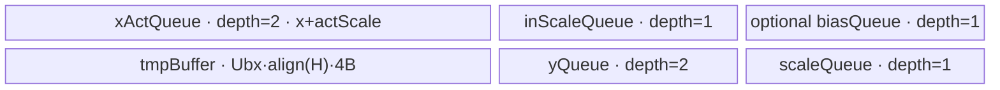
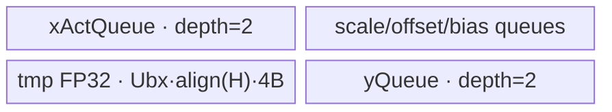
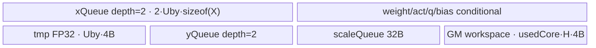
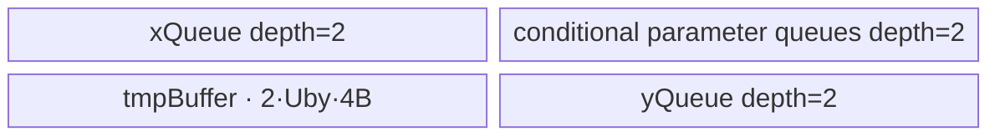
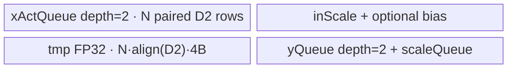

# DequantSwigluQuant 950 ACLNN 算子知识

## 算子速览

| 项目 | 内容 |
|---|---|
| 实际入口 | `aclnnDequantSwigluQuantV2GetWorkspaceSize` / `aclnnDequantSwigluQuantV2`，公开 ACLNN V2 |
| 计算语义 | INT32/FP16/BF16 反量化或升精度 → 普通 SwiGLU → static/dynamic quant；950 V2 的 GPT-OSS 四属性要求默认值 |
| 输入输出 | ND 2–8 维；切分轴长度为偶数；`y` 支持 INT8/HIFLOAT8/FP8/FP4，`scale` 为 FP32 |
| 执行类型 | 所有 Route 都是单节点 `AIV_VECTOR`（arch35 MicroAPI）；entry 用 `g_coreType!=AIV` 拒绝非 Vector core |
| Kernel 路线 | R-001 尾轴 dynamic full；R-002 尾轴 static full；R-003 尾轴 dynamic not-full；R-004 尾轴 static not-full；R-005 非尾轴 dynamic |
| 核心资源 | GM、AIV UB、TQue/TBuf/RegTensor；R-003 额外使用 user workspace 暂存整行 FP32 中间值 |
| 来源闭包 | `source_closed`：公开 V2 → ascend950 OpDef/config → regbase 两级 selector/POD → `_apt` router → 五个实际 AIV body/helper |
| 验证状态 | 已完成源码闭包检查；本次知识提取未执行编译、真机、数值或性能测试。 |

## 接口与语义

### 计算语义

若 `activateDim` 为尾轴，令每行长度为 `2H`；否则把 shape 融合为 `[D0,2D1,D2]`，沿中轴配对，保留尾轴 `D2`。INT32 执行 `x*weightScale*optional activationScale + optional bias`，FP16/BF16 直接升 FP32 且不允许 scale/bias 输入。950 V2 只使用普通 SwiGLU：`swish(A)*B=A/(1+exp(-A))*B`，`activateLeft` 决定 A/B。static quant 使用输入 scale/offset；dynamic quant 可先乘 smooth scale，再逐行/逻辑行求绝对值最大值，输出动态 scale，并依据 `dstType/roundMode` pack 到 INT8、HIFLOAT8、FP8 或 FP4。

### 输入、输出与属性

| 参数 | shape/layout | dtype | 约束、默认值与语义 |
|---|---|---|---|
| `x` | `[X...,2H]` 或 activateDim 对应轴为偶数，ND | INT32/FP16/BF16 | 2–8 维、非空；INT32 需要 weightScale；16-bit 输入禁止反量化 scale/bias |
| `weightScaleOptional` | `[2H]`/`[G,2H]` | FLOAT | INT32 必需；group 与首维匹配 |
| `activationScaleOptional` | x 去尾轴后的 shape | FLOAT | INT32 可选；16-bit 输入禁止 |
| `biasOptional` | `[2H]`/`[G,2H]` | INT32/FLOAT/FP16/BF16 | 仅 INT32 x 允许 |
| `quantScaleOptional` | `[H]`/`[G,H]` 或 static scalar-per-group | FLOAT | dynamic 可选 smooth scale；static 必需 |
| `quantOffsetOptional` | 与 static scale 可广播/同 shape | FLOAT | 只允许 static 且 activateDim 为尾轴 |
| `groupIndexOptional` | `[G]` 或 `[G,2]` | INT32/INT64 | 可空；activateDim 非尾轴时必须为空 |
| `activateLeft` | scalar | BOOL | false 表示右半激活 |
| `quantModeOptional` | scalar | STRING | `dynamic`/`static` |
| `dstType` | scalar | INT64 | `2/34/35/36/40/41`，对应 INT8/HIFLOAT8/FP8/FP4 |
| `roundModeOptional` | scalar | STRING | `rint/round/floor/ceil/trunc`；INT8/FP8 仅 rint，HIFLOAT8 仅 round，FP4 支持五种 |
| `activateDim` | scalar | INT64 | `[-rank,rank-1]`，负值归一化 |
| `swigluMode/clampLimit/gluAlpha/gluBias` | scalar | INT64/FLOAT | 950 V2 文档要求默认 `0/7/1.702/1`；Host仍校验并写 POD |
| `yOut` | x 在 activateDim 上减半 | INT8/HIFLOAT8/FP8/FP4 | FP4 最后一维必须为偶数 |
| `scaleOut` | y 去尾轴 | FLOAT | dynamic 有效；group 总 token 外区域未清理 |

### 入口与版本

950 上 V1/V2 都公开，但 V2 新增 `dstType/roundMode/activateDim`，是实际支持的最新版本。本卡不回退到 V1。生成 ACLNN bridge/executor 作为框架边界；算子拥有的 version-2 OpDef、`ExtendCfgInfo("opFile.value","dequant_swiglu_quant_apt")`、regbase Tiling templates、POD、router/body 和 ascend950 binary config 已闭合。

## Host/Launcher 执行流程

### 参数校验与前处理

第一段 ACLNN 完成公开空指针、dtype、rank、shape 与属性校验并建立 executor。Host Tiling 再依序读取平台 AIV core/UB、x、groupIndex、归一化 activateDim、属性、y、weight/activation scale、bias、quant scale/offset 与 scale output。核心失败边界包括：INT32 缺 weightScale；FP16/BF16 仍传 scale/bias；切分轴非偶数；static 缺 quantScale；dynamic 带 quantOffset；非尾轴带 group；dtype/roundMode 组合非法。失败返回 `GRAPH_FAILED`，不 launch。

### 参数、Workspace 与生命周期

尾轴 full/static/dynamic 和 static not-full 只需要系统 workspace `16 MiB`（非尾轴模板固定 32 B）；dynamic not-full 还需要 `usedCoreNum*H*4` user slice，位于系统 workspace 之后，由 `GetUserWorkspace` 交给 Kernel。该 slice 按 core 分区保存一整行反量化+SwiGLU FP32 结果，第一遍跨 tile 求全行 max，第二遍读回并量化；生命周期是单 Kernel launch，owner 为 executor。

### 启动图与失败传播

```text
V2 GetWorkspaceSize -> generated executor -> TilingForDequantSwigluQuant
  -> priority 1000: V35DskTiling (activateDim == last)
       -> full dynamic/static or not-full dynamic/static
  -> priority 2000: V35NlastTiling (activateDim != last)
  -> one stream launch dequant_swiglu_quant_apt::dequant_swiglu_quant
       -> exactly one AIV body selected at compile-time TILING_KEY_VAR
```

单 Kernel 无节点间边。entry 首先 `if (g_coreType != AIV) return`；unknown key 无匹配编译分支。R-003 的 workspace 交接发生在同一节点内部，不是跨 Kernel 边。

## Route 与参数设计

### 分核与资源计算

尾轴路线令 `M=prod(shape[:-1]),2H=x[-1],H=y[-1]`。`H<=5120` 使用 full-load 行块：Host 以 `UB-1024` 减去对齐后的 x/scale/bias/quant/tmp/y 项，求 `Ubx=floor(available/bytesPerRow)`；`blockDim=min(coreNum,ceil(M/Ubx))`，特殊多 group 少 token 可改为 `min(coreNum,M)`。`H>5120` 固定 `Ubx=1`，按 dtype/optional buffer 比例从 UB 推 `Uby`，`loops=ceil(H/Uby)` 和 tail。非尾轴融合 `[D0,2D1,D2]`，先在 D0/D1 上二维分核，再以 `ubFormer0/ubFormer1` 切 UB；`D2` 必须连同两路 x、scale、y、tmp 和 optional bias 装入 UB，否则失败。

### Route 选择

| 顺序 | Route | Key/模板 | 精确选择条件与优先级 | 不适用去向 |
|---:|---|---|---|---|
| 1 | R-001 尾轴 dynamic full | `bias*1000+act*100+q*10+group` | regbase，activateDim=last，`H<=5120`，quantMode=dynamic | static→R-002；H 大→R-003 |
| 2 | R-002 尾轴 static full | `10000+bias*1000+act*100+q*10+group` | 同上且 static、quantScale 存在 | H 大→R-004 |
| 3 | R-003 dynamic not-full | `1100000+biasCode*10000+act*1000+q*100+group` | activateDim=last，`H>5120`，dynamic，quantOffset=0 | 无 Device fallback |
| 4 | R-004 static not-full | `1000000+hasBias*10000+act*1000+q*100+offset*10+group` | activateDim=last，`H>5120`，static | 无 Device fallback |
| 5 | R-005 非尾轴 dynamic | `100000+bias*1000+act*100+q*10` | priority-1000 拒绝，priority-2000 接受；activateDim!=last、group=null、dynamic | UB 不足失败 |

```text
if !regbase: not an A5 route
if activateDim == last:
  if H > 5120: dynamic ? R-003 : R-004
  else: dynamic ? R-001 : R-002
else:
  require no group and dynamic -> R-005
```

### 模板/实现执行矩阵

| Route | key/selector | dtype/shape/platform 完整命中条件 | 执行拓扑与 Kernel 节点 | 实际模板/body | 内存与同步特征 | tail/fallback |
|---|---|---|---|---|---|---|
| R-001 | 0..4111 optional-bit keys | 950, tail axis, dynamic, H<=5120 | single AIV | `DequantSwigluQuantBase<TAct,TQ,TGroup,TBias,TX,TY>` | full row chunks；MicroAPI RegTensor | former/tail rows |
| R-002 | 10000..14111 | 950, tail axis, static, H<=5120 | single AIV | `DequantSwigluQuantBaseStatic` dtype/feature 特化 | full row chunks；qScale/qOffset in scale Queue | former/tail rows |
| R-003 | 1100000..1141101 | tail axis, dynamic, H>5120 | single AIV | `DequantSwigluQuantDynamicNotFull` dtype/feature 特化 | double-buffer tile + per-core FP32 workspace + events | `tailPerRow` |
| R-004 | 1000100..1011111 | tail axis, static, H>5120 | single AIV | `DequantSwigluQuantStaticNotFull` dtype/feature 特化 | double-buffer x/optional params/y；FP32 tmp | `tailPerRow` |
| R-005 | 100000..104110 | non-tail axis, dynamic, no group | single AIV | `DequantSwigluQuantNlast` dtype/feature 特化 | 2-D block/UB cut，LoopMode DMA | former/tail in both dimensions |

### 隐藏性能 Guard

| Guard | Host/Tiling 条件 | Device/资源原因 | 影响 Route | 不满足时去向 | 源码符号 |
|---|---|---|---|---|---|
| full-load threshold | `outDimy<=5120` | full body让整条 H 驻 UB | R-001/2 | R-003/4 | `Y_LAST_DIM_FULL_LOAD_MAX_VALUE`, `DoOpTiling` |
| FP4 alignment | `y[-1]%2==0` | 两个 4-bit 元素 pack 到 1 byte | 所有 FP4 route | Host 失败 | `CheckOutputY` |
| round guard | INT8/FP8→rint；HIFLOAT8→round | MicroAPI cast/pack mode固定 | 全部 | Host 失败 | `GetAttr` |
| non-tail no group | `activateDim!=last => !hasGroupIndex` | Nlast body没有 group prefix 调度 | R-005 | Host 失败 | `GetAttrActivateDim` |
| Nlast D2 residency | `ubFormer1>=1` | 连续尾轴 D2 的双路 x/scale/y/tmp 必须驻 UB | R-005 | Host 失败 | `DoUbSplit` |
| dynamic not-full workspace | `H>5120 && dynamic` | 全行 max 需要跨 tile 保存 FP32 SwiGLU | R-003 | 分配 `usedCore*H*4` | `GetWorkspaceSize`, `xTempGm_` |
| AIV-only | `g_coreType==AIV` | arch35 body是 Vector/MicroAPI | 全部 | entry return | `_apt.cpp::dequant_swiglu_quant` |

### POD/ABI

宏生成结构的精确 `sizeof/alignof/offsetof` 在固定仓不可见；字段顺序和源码位宽如下。

| 结构 | 字段 | 类型/位宽 | ABI 布局 | 单位 | Host/launcher producer | Device consumer | 边界 |
|---|---|---|---|---|---|---|---|
| `V35Base` | `inDimx` | int64/64 | offset 不可见 | row | `M` | core/group loop | >0 |
| `V35Base` | `inDimy` | int64/64 | offset 不可见 | element | `2H` | x/param stride | even |
| `V35Base` | `outDimy` | int64/64 | offset 不可见 | element | `H` | y/quant stride | >0 |
| `V35Base` | `UbFactorDimx` | int64/64 | offset 不可见 | row | full model或1 | row loop | >=1 |
| `V35Base` | `UbFactorDimy` | int64/64 | offset 不可见 | element/tile | H或Uby | tile body | 32B aligned capacity |
| `V35Base` | `usedCoreNum` | int64/64 | offset 不可见 | core | selector | block guard | <=coreNum |
| `V35Base` | `maxCoreNum` | int64/64 | offset 不可见 | core | platform/special cut | per-group stride | >0 |
| `V35Base` | `inGroupNum` | int64/64 | offset 不可见 | group | group shape | group loop | >=0 |
| `V35Base` | `quantMode` | int64/64 | offset 不可见 | enum | attr | static/dynamic body | 0/1 |
| `V35Base` | `actRight` | int64/64 | offset 不可见 | boolean | `!activateLeft` | act/gate offset | 0/1 |
| `V35Base` | `dstType` | int64/64 | offset 不可见 | enum | attr | output pack | 2/34/35/36/40/41 |
| `V35Base` | `roundMode` | int64/64 | offset 不可见 | enum | string map | cast helper | 0..4 |
| `V35Base` | `activateDim` | int64/64 | offset 不可见 | axis | normalized attr | selector/body metadata | [0,rank) |
| `V35Base` | `loopTimesPerRow` | int64/64 | offset 不可见 | loop | `ceil(H/Uby)` | not-full loop | inactive full |
| `V35Base` | `tailPerRow` | int64/64 | offset 不可见 | element | `H-(loops-1)Uby` | final tile | inactive full |
| `V35Base` | `swiGluMode` | int64/64 | offset 不可见 | enum | attr | V1/V2 layout helper | 950公开为0 |
| `V35Base` | `biasMode` | int64/64 | offset 不可见 | enum | none=0,int32=1,bf16=2,fp16=3,fp32=4 | template/diagnostic | 0..4 |
| `V35Base` | `groupIndexMode` | int64/64 | offset 不可见 | enum | none=0,int32=1,int64=2 | group scalar load | 0..2 |
| `V35Base` | `quantIsOne` | int64/64 | offset 不可见 | boolean | qScale shape | scalar/vector quant | 0/1 |
| `V35Base` | `speGroupType` | int64/64 | offset 不可见 | boolean | group rank==2 | group interpretation | 0/1 |
| `V35Base` | `isSpecialCoreCut` | int64/64 | offset 不可见 | boolean | small-token predicate | core mapping | 0/1 |
| `V35Base` | `clampLimit` | float/32 | offset 不可见 | scalar | attr | GPT-OSS helper | 950默认7 |
| `V35Base` | `gluAlpha` | float/32 | offset 不可见 | scalar | attr | GPT-OSS helper | 950默认1.702 |
| `V35Base` | `gluBias` | float/32 | offset 不可见 | scalar | attr | GPT-OSS helper | 950默认1 |
| `V35Nlast` | `inDim0` | int64/64 | offset 不可见 | element-product | fused prefix | 2-D address | >0 |
| `V35Nlast` | `inDim1` | int64/64 | offset 不可见 | element-product | fused activate axis | 2-D address | even |
| `V35Nlast` | `inDim2` | int64/64 | offset 不可见 | contiguous element | fused suffix | DMA last dimension | >0 |
| `V35Nlast` | `outDim1` | int64/64 | offset 不可见 | element | `inDim1/2` | output address | >0 |
| `V35Nlast` | `blockNum0/1` | int64/64 each | offset 不可见 | block | `DoBlockSplit` | blockIdx 2-D decode | product=blockDim |
| `V35Nlast` | `blockFormer0/1` | int64/64 each | offset 不可见 | element | ceil split | block extent | >0 |
| `V35Nlast` | `ubFormer0/1` | int64/64 each | offset 不可见 | element | `DoUbSplit` | nested UB loops | >=1 |
| `V35Nlast` | `ubLoopOfFormerBlock0/1` | int64/64 each | offset 不可见 | loop | ceil division | former loops | >=1 |
| `V35Nlast` | `ubLoopOfTailBlock0/1` | int64/64 each | offset 不可见 | loop | ceil division | tail-block loops | >=1 |
| `V35Nlast` | `ubTailOfFormerBlock0/1` | int64/64 each | offset 不可见 | element | residual | final former tile | >0 |
| `V35Nlast` | `ubTailOfTailBlock0/1` | int64/64 each | offset 不可见 | element | residual | final tail tile | >0 |
| `V35Nlast` | `actRight` | int64/64 | offset 不可见 | boolean | attr | middle-axis offset | 0/1 |
| `V35Nlast` | `roundMode` | int64/64 | offset 不可见 | enum | attr | output cast | 0..4 |

### Route 源码闭包

| Route | Key/selector | Host/Tiling producer | POD/参数 | Kernel entry/router 节点 | Kernel body/直接依赖 | 构建接线 |
|---|---|---|---|---|---|---|
| R-001 | base optional-bit keys | `V35DskTiling::DoOpTiling` | `V35Base` | `_apt.cpp::dequant_swiglu_quant` | `arch35/dequant_swiglu_quant.h` + common | ascend950 config / `dequant_swiglu_quant_apt` |
| R-002 | base keys +10000 | 同上 | `V35Base` | 同上 | `arch35/dequant_swiglu_quant_static.h` + common | 同上 |
| R-003 | 11xxxxx | `DoOpTilingNotFull`, `GetWorkspaceSize` | `V35Base` | 同上 | `dynamic_not_full.h` + common | 同上 |
| R-004 | 10xxxxx | 同上 | `V35Base` | 同上 | `static_not_full.h` + common | 同上 |
| R-005 | 10xxxx | `V35NlastTiling::*` | `V35Nlast` | 同上 | `dequant_swiglu_quant_nlast.h` + common | 同上 |

## Kernel 实现

### 公共执行流程

所有 Route 共享 `_apt` entry、AIV guard 和 `TPipe`。router 用编译期 `TILING_KEY_VAR` 选择完整 optional/dtype 模板；不存在运行时多 Kernel。body 都把两路 x 搬到 UB，INT32 乘 weight/activation scale 并加 bias，MicroAPI 在 FP32 RegTensor 上执行 `Exp/Div/Mul`，再做 static/dynamic quant 与 pack。Queue/硬事件承担 MTE↔Vector 可见性，RegTensor 只活到当前 repeat/tile。

### Route R-001：尾轴 dynamic full

#### 适用条件

##### 选择证据

| 层级 | 文件 | 符号 | 源码谓词/参数 | 结果/下一跳 |
|---|---|---|---|---|
| Tiling | `tiling_arch35.cpp` | `IsCapable`, `DoOpTiling` | regbase, activateDim=last, H<=5120, dynamic | base key无10000前缀 |
| Router | `_apt.cpp` | 0..4111 branches | optional bits/bias dtype | `DequantSwigluQuantBase` |
| Body | `arch35/dequant_swiglu_quant.h` | `ProcessSingleGroupPerCore` | row full-load | MicroAPI dynamic pipeline |

#### Device 数据流

##### 函数级调用链

```text
entry -> DequantSwigluQuantBase::Init -> Process -> ProcessSingleGroup(PerCore)
  -> group parameter DMA -> row-chunk x/actScale DMA
  -> MicroAPI DequantSwigluV1/V2 -> abs/reduce max -> scale -> output cast/pack -> GM
```

##### 源码等价伪码

```text
for group/core/rowChunk n:
  load x[n,2H], optional scales/bias
  fp32 swiglu[n,H] = dequant_and_swiglu(...)
  if smoothScale: swiglu *= quantScale
  scale[row] = max(abs(swiglu[row,:])) / maxRepresentable(dstType)
  y = cast_pack(swiglu / scale, dstType, roundMode)
  DMA y and scale
```

#### 内存与数据搬运

##### 资源与搬运表

| 层级/缓冲区 | offset/地址公式 | extent/容量公式 | dtype/layout | producer | consumer | owner/lifetime | 对齐/复用 |
|---|---|---|---|---|---|---|---|
| `xActQueue` | UB | depth2 `Ubx*(2*xAlign*sizeof(TX)+aScaleArea)` | TX/FP32 | DMA | dequant | tile | 32B align |
| `inScaleQueue` | UB | `(2*xAlign32 + optional tail)*4` | FP32 | DMA | dequant/quant | group | depth1 |
| `biasQueue` | UB | optional `2*biasAlign*sizeof(TBias)+tail` | TBias | DMA | dequant | group | depth1 |
| `tmpBuffer` | UB | `Ubx*xAlign32*4` | FP32 | swiglu | reduce/quant | tile | 原地复用 |
| `yQueue` | UB | depth2 `Ubx*yAlign*sizeof(TY)` | packed output | cast | DMA | tile | FP4按byte pack |
| `scaleQueue` | UB | `Ubx*align8*4` | FP32 | reduce | DMA | tile | depth1 |

##### 分层内存布局



##### 字节账与复用顺序

```text
UB_total = 2*xActCapacity + inScaleCapacity + optional biasCapacity
         + tmpCapacity + 2*yCapacity + scaleCapacity
UB_total <= ubSize - 1024B
dynamic_ub = N/A
workspace_total = 16MiB system workspace；user slice=0
```

| 复用子区 | 写入者 | 读取者/消费点 | 下一次覆盖 | 同步或释放依据 | 安全条件 |
|---|---|---|---|---|---|
| tmp FP32 | dequant/SwiGLU | reduce/quant | next tile | Vector call order/event | pack完成后覆盖 |
| double queues | MTE | Vector/MTE3 | ping-pong | Queue/event | 对侧消费完毕 |

#### 同步、精度与尾块

##### 同步与数值边界表

| 阶段 | primitive/机制 | producer | consumer/等待点 | 保护对象 | 精度/尾块 |
|---|---|---|---|---|---|
| MTE2→V | Queue/event | DMA | MicroAPI | x/params | tail mask保护最后 repeat |
| activation | RegTensor FP32 | cast/dequant | exp/div/mul | logical H | FP16/BF16 unpack→FP32 |
| dynamic quant | reduce + broadcast | swiglu | pack | per-row scale | dstType max和roundMode |
| V→MTE3 | Queue/event | pack | DataCopyPad | y/scale | only valid n*H |

#### 关键实现

##### 符号证据表

| 阶段 | 文件 | 符号/模板实例 | 实现事实 |
|---|---|---|---|
| Host/Tiling producer | `op_host/dequant_swiglu_quant_tiling_arch35.cpp` | `DoOpTiling`, `PostTiling` | full key/Ubx/blockDim |
| Kernel entry/router | `op_kernel/dequant_swiglu_quant_apt.cpp` | base dynamic branches | key→template |
| Device body/helper | `op_kernel/arch35/dequant_swiglu_quant.h` | `DequantSwigluQuantBase` | full dynamic body/UB/tail |

### Route R-002：尾轴 static full

#### 适用条件

##### 选择证据

| 层级 | 文件 | 符号 | 源码谓词/参数 | 结果/下一跳 |
|---|---|---|---|---|
| Tiling | `tiling_arch35.cpp` | `DoOpTiling` | H<=5120, quantMode=0 | key万位加1 |
| Router | `_apt.cpp` | `*_STATIC` branches | 10000..14111 | static body |

#### Device 数据流

##### 函数级调用链

```text
entry -> DequantSwigluQuantBaseStatic::Init -> Process
  -> parameter/x DMA -> DequantSwigluV1/V2
  -> StaticQuant{WithOne,WithQuantOffset,WithQuantOffsetOne} -> pack -> y GM
```

##### 源码等价伪码

```text
swiglu = fp32_dequant_swiglu(x)
if quantIsOne: q = swiglu * reciprocal(scaleScalar) + offsetScalar
else: q = swiglu / scaleVector + optional offsetVector
y = cast_pack(q, dstType, roundMode)
```

#### 内存与数据搬运

##### 资源与搬运表

| 层级/缓冲区 | offset/地址公式 | extent/容量公式 | dtype/layout | producer | consumer | owner/lifetime | 对齐/复用 |
|---|---|---|---|---|---|---|---|
| x/bias queues | 同 R-001 | 同 R-001 | 同上 | DMA | dequant | tile/group | aligned |
| inScaleQueue | qScale at `2*xAlign32`，offset next region | 3或4个 aligned H FP32 region | FP32 | DMA | static quant | group | scalar route broadcasts |
| tmp/yQueue | 同 R-001但无 scaleQueue | `Ubx*H*4`, depth2 y | FP32/output | swiglu/cast | quant/MTE3 | tile | 原地 quant |

##### 分层内存布局



##### 字节账与复用顺序

```text
UB_total = 2*xAct + inScale(qScale+optional offset) + optional bias + tmp + 2*y
workspace_total = 16MiB system；user=0
dynamic_ub = N/A
```

| 复用子区 | 写入者 | 读取者/消费点 | 下一次覆盖 | 同步或释放依据 | 安全条件 |
|---|---|---|---|---|---|
| tmp FP32 | SwiGLU | StaticQuant in-place | next tile | VF call order | pack完成 |

#### 同步、精度与尾块

##### 同步与数值边界表

| 阶段 | primitive/机制 | producer | consumer/等待点 | 保护对象 | 精度/尾块 |
|---|---|---|---|---|---|
| static scale | MicroAPI load/broadcast | qScale/offset | arithmetic | FP32 q | scalar/vector specialization |
| pack | dtype-specific Cast/DataCopy | FP32 q | MTE3 | y | tail mask，FP4 pair pack |

#### 关键实现

##### 符号证据表

| 阶段 | 文件 | 符号/模板实例 | 实现事实 |
|---|---|---|---|
| Host/Tiling producer | `tiling_arch35.cpp` | `CheckForStaticQuant`, `DoOpTiling` | static guards/key |
| Kernel entry/router | `_apt.cpp` | static full branches | key→static body |
| Device body/helper | `arch35/dequant_swiglu_quant_static.h` | `DequantSwigluQuantBaseStatic` | qScale/offset specialization与pack |

### Route R-003：尾轴 dynamic not-full

#### 适用条件

##### 选择证据

| 层级 | 文件 | 符号 | 源码谓词/参数 | 结果/下一跳 |
|---|---|---|---|---|
| Tiling | `tiling_arch35.cpp` | `DoOpTilingNotFull`, `GetWorkspaceSize` | H>5120 && dynamic | 11xxxxx + user workspace |
| Router | `_apt.cpp` | dynamic not-full branches | bias/act/q/group bits | `DynamicNotFull` |

#### Device 数据流

##### 函数级调用链

```text
entry -> DynamicNotFull::Init -> Process -> ProcessSingleRow
  pass1 each H tile: CopyIn -> PreProcess/DequantSwiGLU -> CopyOutForXTemp(workspace), update max
  write scale
  pass2 each H tile: CopyInForXTemp -> quant/cast -> CopyOutY
```

##### 源码等价伪码

```text
for row assigned to core:
  maxAbs=0
  for tile in H: workspace[core,Htile]=swigluTile; maxAbs=max(maxAbs,max(abs(tile)))
  scale=maxAbs/maxRepresentable
  for tile in H: yTile=pack(workspace[core,Htile]/scale)
```

#### 内存与数据搬运

##### 资源与搬运表

| 层级/缓冲区 | offset/地址公式 | extent/容量公式 | dtype/layout | producer | consumer | owner/lifetime | 对齐/复用 |
|---|---|---|---|---|---|---|---|
| user workspace | `blockIdx*H + tileOffset` | `usedCoreNum*H` elements | FP32 | pass1 | pass2 | executor/launch | core-private |
| xQueue | UB | depth2 `2*Uby*sizeof(X)` | X | DMA | preprocess | tile | aligned |
| param queues | UB | weight `2Uby*4`, act 32B, q `Uby*4`, optional bias `2Uby*sizeof` | typed | DMA | preprocess/quant | tile | conditional |
| tmpBuffer | UB | `Uby*4` | FP32 | SwiGLU | reduce/workspace | tile | reused pass2 |
| yQueue/scaleQueue | UB | depth2 `Uby*sizeof(Y)` + 32B | output/FP32 | quant/reduce | MTE3 | tile/row | pack aligned |

##### 分层内存布局



##### 字节账与复用顺序

```text
UB_total = 2*x + weight + 2*act + q + optional bias + tmp + 2*y + scale
workspace_total = 16MiB + usedCoreNum*H*4B
dynamic_ub = N/A
```

| 复用子区 | 写入者 | 读取者/消费点 | 下一次覆盖 | 同步或释放依据 | 安全条件 |
|---|---|---|---|---|---|
| core-private workspace row | pass1 MTE3 | pass2 MTE2 | next logical row on same core | explicit pass1 loop completes before pass2 | 不跨 core alias |
| tmpBuffer | dequant/SwiGLU | reduce/MTE3 | next tile/pass2 | MTE/V events | WaitFlag 后覆盖 |

#### 同步、精度与尾块

##### 同步与数值边界表

| 阶段 | primitive/机制 | producer | consumer/等待点 | 保护对象 | 精度/尾块 |
|---|---|---|---|---|---|
| pass1 | `SetFlag/WaitFlag MTE2_V` 等 | DMA | VF | tile UB | `tailPerRow` controls tileData |
| workspace edge | same-core program order/events | pass1 MTE3 | pass2 MTE2 | FP32 row slice | extent H exactly |
| reduce/pack | FP32 max + dtype cast | all tiles | y copy | scale/y | full-row scale consistent |

#### 关键实现

##### 符号证据表

| 阶段 | 文件 | 符号/模板实例 | 实现事实 |
|---|---|---|---|
| Host/Tiling producer | `tiling_arch35.cpp` | `DoOpTilingNotFull`, `GetWorkspaceSize` | Uby/loops/tail/workspace |
| Kernel entry/router | `_apt.cpp` | 1100000..1141101 | optional template mapping |
| Device body/helper | `dynamic_not_full.h` | `ProcessSingleRow`, `xTempGm_` | two-pass full-row dynamic quant |

### Route R-004：尾轴 static not-full

#### 适用条件

##### 选择证据

| 层级 | 文件 | 符号 | 源码谓词/参数 | 结果/下一跳 |
|---|---|---|---|---|
| Tiling | `tiling_arch35.cpp` | `CalcTilingKeyForNotFull` | H>5120 && static | 10xxxxx |
| Router | `_apt.cpp` | static not-full branches | presence bits | `StaticNotFull` |

#### Device 数据流

##### 函数级调用链

```text
entry -> StaticNotFull::Init -> Process -> ProcessSingleRow
  -> per tile CopyIn2H(V1/V2), optional group params
  -> DequantSwiglu -> StaticQuantSingleY -> pack -> CopyOut y
```

##### 源码等价伪码

```text
for row and tile(H):
  load paired x halves/interleaved values and matching scale/bias/qScale/qOffset slice
  fp32 tile = dequant_swiglu(...)
  q = tile / qScale + optional qOffset  # scalar group value is broadcast
  pack only processNum tail-valid values
```

#### 内存与数据搬运

##### 资源与搬运表

| 层级/缓冲区 | offset/地址公式 | extent/容量公式 | dtype/layout | producer | consumer | owner/lifetime | 对齐/复用 |
|---|---|---|---|---|---|---|---|
| xQueue | tile offsets from row*2H | depth2 `2Uby*sizeof(X)` | X | DMA | compute | tile | V1 halves/V2 interleaved |
| optional queues | group/row/tile offsets | each depth2；weight/bias `2Uby`, q/offset `Uby`, act 32B | typed | DMA | compute | tile | compile-time removed if absent |
| tmpBuffer | UB | `2Uby*4` | FP32 | dequant/SwiGLU | static quant | tile | in-place |
| yQueue | output tile offset | depth2 `Uby*sizeof(Y)` | packed Y | cast | DMA | tile | tail extent processNum |

##### 分层内存布局



##### 字节账与复用顺序

```text
UB_total = 2*x + conditional(2*weight + 2*act + 2*bias + 2*q + 2*offset) + 2Uby*4 + 2*y
workspace_total = 16MiB system；user=0
dynamic_ub = N/A
```

| 复用子区 | 写入者 | 读取者/消费点 | 下一次覆盖 | 同步或释放依据 | 安全条件 |
|---|---|---|---|---|---|
| tmpBuffer | dequant/SwiGLU | StaticQuantSingleY | next tile | VF order/Queue | current y pack finished |

#### 同步、精度与尾块

##### 同步与数值边界表

| 阶段 | primitive/机制 | producer | consumer/等待点 | 保护对象 | 精度/尾块 |
|---|---|---|---|---|---|
| DMA | Queue/events | per-tile MTE2 | VF | x/params | processNum for last tile |
| static quant | FP32 MicroAPI | SwiGLU | pack | tmp | scalar/vector qScale specialization |
| copyout | MTE3 | pack | GM | y | FP4 bytes use half element count |

#### 关键实现

##### 符号证据表

| 阶段 | 文件 | 符号/模板实例 | 实现事实 |
|---|---|---|---|
| Host/Tiling producer | `tiling_arch35.cpp` | `DoOpTilingNotFull` | Uby/loops/key |
| Kernel entry/router | `_apt.cpp` | 1000100..1011111 | presence→template |
| Device body/helper | `static_not_full.h` | `ProcessSingleRow`, CopyIn helpers | tile-address/static quant/tail |

### Route R-005：非尾轴 dynamic

#### 适用条件

##### 选择证据

| 层级 | 文件 | 符号 | 源码谓词/参数 | 结果/下一跳 |
|---|---|---|---|---|
| Selector | `tiling_arch35.cpp` | `V35DskTiling::IsCapable` | activateDim!=last → false | priority 2000 |
| Selector | 同上 | `V35NlastTiling::IsCapable` | regbase && activateDim!=last | Nlast route |
| Router | `_apt.cpp` | 100000..104110 | bias/act/q bits, group=false | `DequantSwigluQuantNlast` |

#### Device 数据流

##### 函数级调用链

```text
entry -> Nlast::Init -> Process
  -> decode blockIdx=(block0,block1)
  -> nested ubIdx0/ubIdx1 -> ProcessPerLoop
    -> LoopMode DataCopy x two middle-axis halves + optional scales/bias
    -> FP32 dequant/SwiGLU -> reduce/scale -> pack
    -> LoopMode CopyOut y/scale
```

##### 源码等价伪码

```text
fuse x as [D0,2D1,D2]
for block/UB tile over D0,D1:
  copy cur0*cur1 rows of contiguous D2 from activation and gate middle-axis slices
  compute FP32 swiglu for each logical [d0,d1,:]
  dynamic-quant each logical row over D2
  write y[D0,D1,D2] and scale[D0,D1]
```

#### 内存与数据搬运

##### 资源与搬运表

| 层级/缓冲区 | offset/地址公式 | extent/容量公式 | dtype/layout | producer | consumer | owner/lifetime | 对齐/复用 |
|---|---|---|---|---|---|---|---|
| xActQueue | `((d0*2D1+d1)*D2)` 两 slice | depth2 `N*(2*xAlign*sizeof(X)+2*8*4)` | fused rows | LoopMode MTE2 | VF | tile | N=ubFormer0*ubFormer1 |
| inScaleQueue | weight/q over D2 | `2*align(D2,8)*4` | FP32 | DMA | dequant/quant | launch | depth1 |
| optional bias | D2 | `align(D2)*sizeof(TBias)` | typed | DMA | dequant | launch | depth1 |
| tmpBuffer | tile logical rows | `N*align(D2,8)*4` | FP32 | swiglu | reduce/quant | tile | in-place |
| y/scale queues | fused output | depth2 `N*alignY*sizeof(Y)` + `N*8*4` | Y/FP32 | quant | LoopMode MTE3 | tile | FP4 separate align |

##### 分层内存布局



##### 字节账与复用顺序

```text
N = ubFormer0*ubFormer1
UB_total = 2*N*(2*xAlign*sizeof(X)+2*8*4) + 2*alignD2*4
         + optional bias + N*alignD2*4 + 2*N*yAlign*sizeof(Y) + N*8*4
UB_total <= ubSize-1024；否则 ubFormer1<1 并失败
workspace_total = 32B
dynamic_ub = N/A
```

| 复用子区 | 写入者 | 读取者/消费点 | 下一次覆盖 | 同步或释放依据 | 安全条件 |
|---|---|---|---|---|---|
| tile queues/tmp | current `(ubIdx0,ubIdx1)` | VF/MTE3 | next nested iteration | Queue/LoopMode reset | current CopyOut complete |

#### 同步、精度与尾块

##### 同步与数值边界表

| 阶段 | primitive/机制 | producer | consumer/等待点 | 保护对象 | 精度/尾块 |
|---|---|---|---|---|---|
| strided DMA | `SetLoopModePara` | GM | UB | D2 rows across D1 | blockCount/stride由 curNlastSize/D2 产生 |
| compute | FP32 RegTensor | UB | quant | D2 logical row | masks D2 tail |
| 2-D tail | four former/tail POD sets | Host | nested loops | D0/D1 | final block与final UB各自 residual |

#### 关键实现

##### 符号证据表

| 阶段 | 文件 | 符号/模板实例 | 实现事实 |
|---|---|---|---|
| Host/Tiling producer | `tiling_arch35.cpp` | `FusedShape`, `DoBlockSplit`, `DoUbSplit`, `DoOpTiling` | 3-D融合、二维 block/UB、tail POD |
| Kernel entry/router | `_apt.cpp` | Nlast key branches | key→Nlast template |
| Device body/helper | `dequant_swiglu_quant_nlast.h` | `Init`, `Process`, `ProcessPerLoop` | LoopMode DMA、FP32计算、2-D tail |

## 算子特定优化

### Trick T-001：超长尾轴动态量化采用两遍流式 tile 与 core-private workspace

#### 触发与源码依据

- 适用 Route：R-003
- 触发条件：`activateDim` 为尾轴、`outDimy>5120`、`quantMode=dynamic`。
- Golden 来源：[`op_host/dequant_swiglu_quant_tiling_arch35.cpp:1079-1087`](../../../../../../../cann-ops-raw/ascendc/ops-nn/955f8b33985b6d72989ebff341bb9c2c564a51bc/quant/dequant_swiglu_quant/op_host/dequant_swiglu_quant_tiling_arch35.cpp#L1079-L1087)

**官方源码（固定 Commit 连续逐字摘录）**：

```cpp
size_t usrSize = 0;
if (outDimy_ > Y_LAST_DIM_FULL_LOAD_MAX_VALUE && quantMode_ == 1) {
  usrSize = maxPreCore_ * outDimy_ * sizeof(float);
}
workspaceSize_ = SYS_WORK_SPACE_SIZE + usrSize;
```

#### 机制与设计原因

动态 scale 依赖整行最大绝对值，单个 UB tile 无法立刻确定最终 scale。R-003 第一遍将每 tile FP32 SwiGLU 写入按 core 隔离的 GM workspace，同时累计 max；得到 scale 后第二遍读回并量化。它把 UB 上界从整行 H 降为 Uby tile，代价是可证明的两次 workspace 搬运。

#### 迁移边界

- 适用：输出需全行统计量但整行不能驻 UB 的逐行融合算子。
- 前提：workspace 可按 core 隔离、两遍处于同一 Kernel 程序顺序、第一遍保存未降精度中间值。
- 失效：H<=5120 应使用 R-001；static quant 不需要全行 reduce，使用 R-004。
- 未验证：本次知识提取未执行编译、真机、数值或性能测试。

#### 错误做法

固定仓的真实反例是用单 tile 局部 max 直接量化：这会让一行不同 tile 使用不同 scale；官方实现明确保存整行并进行第二遍。

### Trick T-002：非尾轴用二维 block/UB 切分保持 D2 连续 DMA

#### 触发与源码依据

- 适用 Route：R-005
- 触发条件：`activateDim != rank-1`。
- Golden 来源：[`op_host/dequant_swiglu_quant_tiling_arch35.cpp:1123-1136`](../../../../../../../cann-ops-raw/ascendc/ops-nn/955f8b33985b6d72989ebff341bb9c2c564a51bc/quant/dequant_swiglu_quant/op_host/dequant_swiglu_quant_tiling_arch35.cpp#L1123-L1136)

**官方源码（固定 Commit 连续逐字摘录）**：

```cpp
for (size_t i = 0; i < xShape_.GetDimNum(); i++) {
  if (i < static_cast<size_t>(actDimIndex_)) {
    inDim0_ *= xShape_.GetDim(i);
  } else if (i == xShape_.GetDimNum() - 1) {
    inDim2_ *= xShape_.GetDim(i);
  } else {
    inDim1_ *= xShape_.GetDim(i);
  }
}
```

#### 机制与设计原因

Host 将任意 rank 规约成 `[D0,2D1,D2]`，Device 在 D0/D1 上二维切分，而每次搬运保留连续 D2。这样避免先做独立 transpose/layout kernel；单 Kernel 的 LoopMode DMA 直接跨中轴取 activation/gate 两片并写回原逻辑布局。

#### 迁移边界

- 适用：任意中轴成对融合、尾部子空间连续的逐元素算子。
- 前提：group 为空、D2 整片能进入 UB、地址折叠无溢出、输出在同一中轴减半。
- 失效：`ubFormer1<1` 时 Host 明确失败；尾轴情况走 R-001~R-004。
- 未验证：本次知识提取未执行编译、真机、数值或性能测试。

#### 错误做法

固定仓未提供可验证反例。

## 模板与实现对比

| 对比维度 | R-001 dynamic full | R-002 static full | R-003 dynamic not-full | R-004 static not-full | R-005 non-last | 设计选择依据 |
|---|---|---|---|---|---|---|
| 命中条件/优先级 | tail,H<=5120,dynamic | tail,H<=5120,static | tail,H>5120,dynamic | tail,H>5120,static | non-tail,dynamic | axis/mode/H |
| 模板与 dtype | Base optional template | BaseStatic | DynamicNotFull | StaticNotFull | Nlast | key digits encode optional types |
| 循环与分核 | row chunks | row chunks | row→H tiles，两遍 | row→H tiles，一遍 | D0/D1 nested | UB residency/statistic scope |
| Queue/TBuf | full x/tmp/y/scale | full x/tmp/y | tile queues + workspace | tile queues | 2-D LoopMode queues | resource shape |
| 内存总占用与复用 | no user WS | no user WS | `core*H*4` user WS | no user WS | 32B WS | dynamic full-row max |
| 搬运/Vector API | DataCopyPad+MicroAPI | same+StaticQuant | MTE events+two-pass | per-tile parameter DMA | LoopMode strided DMA | layout/tile |
| 同步、精度与 tail | FP32, row tail | FP32, row tail | tile tail + workspace order | tile tail | 2-D four-way tail | exact valid extent |
| fallback/失败边界 | H大转R3 | H大转R4 | no fallback | no fallback | UB不足失败 | Host decides only |

## 平台差异

| 项目 | A2 | A3 | 950 |
|---|---|---|---|
| 支持状态 | V2 支持，见无后缀卡 | V2 支持，见无后缀卡 | V2 公开支持 |
| Host/Launcher | non-regbase group template | 同 A2 | regbase tail/non-tail templates；dstType/roundMode/activateDim 生效 |
| Kernel/资源 | INT8 AIV，公开 group 必需 | 同 A2 | arch35 MicroAPI，FP8/FP4/HIFLOAT8、长轴 workspace、LoopMode DMA |

## 限制与失败边界

- 950 V2 使用 GPT-OSS 四属性时必须保留文档默认值；本卡不把 A2/A3 的 `swigluMode=1` 公开域扩展到 950。
- FP4 输出尾轴必须为偶数；INT8/FP8 只接受 rint，HIFLOAT8 只接受 round。
- 非尾轴路线不支持 groupIndex，且固定源码的 Nlast body是 dynamic quant 路径；不得推测 static 非尾轴支持。
- dynamic not-full workspace 的 user slice是 `usedCoreNum*H*4`，不能与系统 16 MiB 混淆，也不能跨 core 复用。
- groupIndex 所描述 token 总数之外的 y/scale 区域不清理，公开文档称其为垃圾数据。
- POD 宏的精确 ABI offset/总大小固定仓不可见；运行时生成 bridge、executor 内部 workspace header 属框架边界。
- 本次知识提取未执行编译、真机、数值或性能测试。

## 源码索引

### 链路索引

| 链路阶段 | 文件 | 关键符号 | 支撑内容 |
|---|---|---|---|
| 入口声明/约束 | `docs/aclnnDequantSwigluQuantV2.md` | V2 prototypes/产品表 | 950公开版本、参数与失败语义 |
| 入口实现 | `op_host/dequant_swiglu_quant_def.cpp` | `config_950`, `ExtendCfgInfo` | ascend950 dtype组合与 `_apt` 接线 |
| Host/Tiling/Launcher | `op_host/dequant_swiglu_quant_tiling_arch35.cpp` | `V35DskTiling`, `V35NlastTiling` | selector、key、资源、POD、workspace |
| Host/Tiling/Launcher | `op_host/dequant_swiglu_quant_tiling.h` | `V35BaseTilingData`, `V35NlastTilingData` | POD/registered keys |
| Kernel entry/body | `op_kernel/dequant_swiglu_quant_apt.cpp` | `dequant_swiglu_quant` | AIV guard与所有 key→body |
| Kernel entry/body | `op_kernel/arch35/dequant_swiglu_quant.h` | `DequantSwigluQuantBase` | dynamic full |
| Kernel entry/body | `op_kernel/arch35/dequant_swiglu_quant_static.h` | `DequantSwigluQuantBaseStatic` | static full |
| Kernel entry/body | `op_kernel/arch35/dequant_swiglu_quant_dynamic_not_full.h` | `DynamicNotFull` | long-axis two-pass/workspace |
| Kernel entry/body | `op_kernel/arch35/dequant_swiglu_quant_static_not_full.h` | `StaticNotFull` | long-axis static tile |
| Kernel entry/body | `op_kernel/arch35/dequant_swiglu_quant_nlast.h` | `Nlast` | non-tail 2-D/LoopMode |
| Kernel helper | `op_kernel/arch35/dequant_swiglu_quant_common.h` | `DequantSwigluV2`, `StaticQuant*`, `CastY` | 公共反量化、SwiGLU、量化、cast 与尾块 mask |
| Kernel helper | `op_kernel/arch35/dequant_swiglu_quant_dynamic_not_full_vf.h` | `DequantAndSwiGlu*`, `CalculateReduceMax`, `QuantAndCast` | dynamic not-full 的 VF 两遍计算 |
| 构建接线 | `op_host/config/ascend950/dequant_swiglu_quant_binary.json` | `op_type=DequantSwigluQuant` | dtype/output/group binary instances |

### 实现复用检查

| 检查项 | 可复用事实 | 不得改变的约束 | 源码符号 |
|---|---|---|---|
| ABI/POD | Base/Nlast 两套 Host/Device POD | 字段顺序、int64/float 位宽、key编码 | `BEGIN_TILING_DATA_DEF` |
| 调用顺序 | 单 entry→单 body | R-003 两遍、R-005 nested order | 各 `Process*` |
| workspace/内存 | full/static无user中间；R-003 core-private FP32 row | 16MiB system base、slice extent/depth/alignment | `GetWorkspaceSize`, `InitBuffer` |
| 同步 | Queue、MTE/V events、LoopMode reset | workspace pass1完成后才能pass2 | `SetFlag/WaitFlag`, `ResetLoopModePara` |
| 精度与尾块 | FP32 SwiGLU；dtype-specific max/round/pack | FP4 pair、full-row dynamic scale、2-D tail POD | common helpers / body masks |
| 失败边界 | Host selector无 Device fallback | non-AIV/unknown key不写；Nlast UB不足失败 | entry/`IsCapable`/`DoUbSplit` |