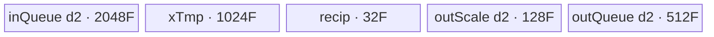
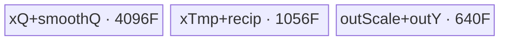
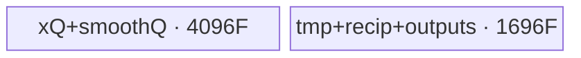
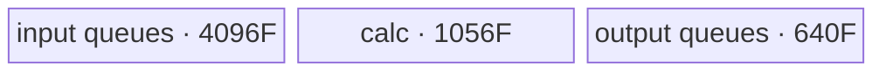

# DynamicDualLevelMxQuant 950 ACLNN 算子知识

## 算子速览

| 项目 | 内容 |
|---|---|
| 实际入口 | 公开两段式 API `aclnnDynamicDualLevelMxQuantGetWorkspaceSize` + `aclnnDynamicDualLevelMxQuant`；固定仓只有无版本后缀的公开版本。 |
| 计算语义 | 尾轴先按 512 元素做 level-0 动态块量化，再按 32 元素做 E2M1 MX level-1 量化；可先融合 `x *= smoothScale`。 |
| 输入输出 | `x/smoothScaleOptional` 为 FP16 或 BF16；`yOut` 为 FLOAT4_E2M1；`level0ScaleOut` 为 FP32；`level1ScaleOut` 为 FLOAT8_E8M0；均为 ND。 |
| 执行类型 | 单节点 `AIV_VECTOR`。entry 的 `KERNEL_TYPE_MIX_AIV_1_0` 明确是 AIV:AIC=`1:0`，body 只使用 Vector/MicroAPI，不含 Cube/AIC/MIX_CV。 |
| Kernel 路线 | 24 个精确 Route：`2 dtype × 3 roundMode × 2 smoothScale × 2 copyMethod`；正文按 8 个结构族列出，每族保留 3 个不同 rounding Route。 |
| 核心资源 | GM；双缓冲 `inQueue/outQueue/outScaleQueue`，smooth 路线另有双缓冲 `smoothScaleQueue`；单缓冲 `xTmpBuf/level1ScaleReciprocalBuf`；MicroAPI 寄存器；无算法 workspace slice。 |
| 来源闭包 | `source_closed`：公开 ACLNN 文档、ACLNN 构建类型、OpDef/InferShape、950 Tiling/POD、模板 key、单 Kernel entry/body/helper、binary config 与构建接线闭合；自动生成的 ACLNN bridge/executor 是框架边界。 |
| 验证状态 | 已完成源码闭包检查；本次知识提取未执行编译、真机、数值或性能测试。 |

## 接口与语义

### 计算语义

把 `x` 的前 `rank-1` 轴合为 `C=product(x.shape[:-1])`，尾轴长度记为 `R=x.shape[-1]`。若提供 `smoothScaleOptional`，先在每个合并后的行上广播执行 `x'[c,r]=x[c,r]*smoothScaleOptional[r]`；否则 `x'=x`。

对每个连续 512 元素 level-0 块 `B0`：

```text
amax0 = max(abs(finite(x'[B0])))                 # Inf/NaN 在求 max 时置 0
level0Scale = amax0 / 6
tmp = cast_to_x_dtype(x' / level0Scale)          # 0 输入专门保持为 0
```

随后对 `tmp` 每 32 元素 level-1 块 `B1` 提取最大指数，`emax(FLOAT4_E2M1)=2`：

```text
sharedExp = floor(log2(max(abs(tmp[B1])))) - 2
level1Scale = 2^sharedExp                         # 以 FLOAT8_E8M0 指数编码输出
y = cast_FLOAT4_E2M1(tmp / level1Scale, roundMode)
```

`y` 两个 FP4 元素打包为一个字节。`level1ScaleOut` 的末轴固定为 2；倒数第二轴为 `ceil(R/64)`，等价于把 32 元素 scale 数补成偶数后按 `(…,2)` 排列。Device 对尾部不足 512 的输入先补零，只搬回有效的 `R`、`ceil(R/512)` 和 `2*ceil(R/64)` 个对应结果。

### 输入、输出与属性

| 参数 | shape/layout | dtype | 约束、默认值与语义 |
|---|---|---|---|
| `x` | ND，rank 1–7；尾轴为偶数；不支持空 Tensor | FLOAT16、BFLOAT16 | 必填；允许非连续，OpDef 对 `x` 声明 `AutoContiguous()`。 |
| `smoothScaleOptional` | 可空；非空时是一维、长度等于 `x.shape[-1]` | 与 `x` 相同 | 每个合并行复用同一尾轴 scale；公开 API 允许非连续，生成 bridge 的具体连续化任务固定仓不可见。 |
| `roundModeOptional` | Host 字符串 | N/A | `"rint"`、`"round"`、`"floor"`；默认 `"rint"`。分别映射 `CAST_RINT/CAST_ROUND/CAST_FLOOR`。 |
| `level0BlockSize` | Host 标量 | INT64 | 只允许 512；默认 512。 |
| `level1BlockSize` | Host 标量 | INT64 | 只允许 32；默认 32。 |
| `yOut` | 与 `x` 同 shape，ND | FLOAT4_E2M1 | 两个元素占一个字节；不支持空 Tensor。 |
| `level0ScaleOut` | 与 `x` 同 rank，末轴 `ceil(R/512)` | FLOAT32 | 其余维与 `x` 相同；不支持空 Tensor。 |
| `level1ScaleOut` | rank=`rank(x)+1`，末两轴 `(ceil(R/64),2)` | FLOAT8_E8M0 | 其余维与 `x` 相同；偶数 pad 位为 0。 |
| `workspaceSize/executor` | Host 输出 | `uint64_t` / `aclOpExecutor**` | 第一段返回 executor 汇总 workspace 与任务图。 |
| `workspace/stream` | Device 地址 / runtime stream | N/A | 第二段必须使用第一段给出的容量和 executor；同一 stream 执行任务。 |

### 入口与版本

固定 Commit 只公开 `aclnnDynamicDualLevelMxQuantGetWorkspaceSize/aclnnDynamicDualLevelMxQuant`，没有同语义的 V2/V3 公开入口。API 实现文件由 `ACLNNTYPE aclnn` 的构建流程自动生成，固定仓没有手写 `op_api/aclnn_*.cpp`；该 bridge 的 executor 内部、非连续 Tensor 临时区和 launch 封装属于允许保留的框架边界。算子拥有的 OpDef、校验、shape 推导、Tiling、POD、key 和 Kernel 全部在固定仓内闭合。

公开 README 与 ACLNN 文档都明确：Ascend 950PR/950DT 支持，A2/A3 及更早产品不支持。950 还由根 CMake 的 `SUPPORT_COMPUTE_UNIT="ascend950"`、OpDef 的 `.AddConfig("ascend950",…)`、ascend950 binary config 以及全局 kernel config 的 `compute_units:["ascend950"]` 交叉确认。

## Host/Launcher 执行流程

### 参数校验与前处理

公开第一段接口先在自动生成 bridge 内检查必填指针、dtype/format/shape/属性与平台；源码可见的 `DynamicDualLevelMxQuantTiling::DoTiling` 再按以下顺序失败即停：

1. `GetPlatformInfo` 取得 AIV 核数、UB 字节数和 `GetLibApiWorkSpaceSize()`；核数或 UB 非正即失败。
2. `CheckRequiredDtype` 要求 `x∈{FP16,BF16}`、`y=FP4_E2M1`、level-0 scale=FP32、level-1 scale=FP8_E8M0。
3. `GetAttr` 把 `rint/round/floor` 映射为 `4/0/1`，并强制 block size 分别为 512/32。
4. `CheckRequiredShape` 要求尾轴为偶数、`y.shape==x.shape`、scale shapes 精确匹配。
5. `CheckSmoothScaleDtypeShape`：可选输入非空时必须与 `x` 同 dtype，且为非标量的一维 `[R]`。
6. `SetTilingParams` 合轴、二维分核、计算 UB factor、正常/尾核循环及 `copyMethod`。
7. `SetTilingKey/SetTilingData` 写 key 与 224 B POD，设置 `blockDim=usedCoreNum` 和唯一 workspace 大小。

InferShape 独立要求已知 rank 位于 `[1,7]`；未知 rank 时三个输出都设未知 rank。已知 shape 时 `y=x`，level-0 末轴为 `ceil(R/level0BlockSize)`，level-1 末轴先变为 `ceil(ceil(R/level1BlockSize)/2)`、再追加 2。

### 参数、Workspace 与生命周期

令平台返回的库 workspace 为 `Wlib=PlatformAscendC::GetLibApiWorkSpaceSize()`。Tiling 唯一写入：

```text
workspaces[0] = Wlib
blockDim = usedCoreNum
```

Kernel ABI 带 `workspace`，但 entry/body 从不读取它；没有本算子拥有的跨 Kernel 中间 slice。`Wlib` 是 AscendC 库/运行时预留，不应误写成算法临时结果。ACLNN executor 可能还持有非连续 Tensor 的框架临时区，其 offset、extent 和总量由自动生成 bridge/executor 决定，固定算子源码不可见。调用者必须让输入、输出、workspace、executor 和 stream 在第二段完成前保持有效。

### 启动图与失败传播

```text
aclnnDynamicDualLevelMxQuantGetWorkspaceSize(...)
  -> generated ACLNN bridge / executor boundary
  -> DynamicDualLevelMxQuant OpDef + InferShape
  -> TilingForDynamicDualLevelMxQuant
       -> DynamicDualLevelMxQuantTiling::DoTiling
  -> one AIV launch: dynamic_dual_level_mx_quant<roundMode>(x,smooth,y,l0,l1,workspace,tiling)

aclnnDynamicDualLevelMxQuant(workspace,workspaceSize,executor,stream)
  -> generated executor runs the single operator node on stream
```

| 节点/边 | entry/POD/blockDim | 输入输出与交接介质 | ordering、owner/lifetime | 失败传播 |
|---|---|---|---|---|
| ACLNN bridge | 自动生成；公开两段式原型可见 | 用户 Tensor -> OpDef Tensor；非连续临时区固定仓不可见 | executor 持有任务与框架临时对象；第二段按指定 stream 执行 | 第一段校验失败不产生可执行 executor |
| 单 AIV Kernel | `dynamic_dual_level_mx_quant<roundMode>`；POD=`DynamicDualLevelMxQuantTilingData`；`blockDim=usedCoreNum` | 五路 GM 输入/输出；`workspace` 仅保留 ABI、不读 | 单 Kernel，无节点间 edge；Queue/event 保证核内阶段顺序 | Tiling 失败阻断 launch；launch/runtime 错误由 executor 返回 |
| 输出完成 | 同一 Kernel 的 `CopyOut` | UB -> 用户输出 GM 或框架输出临时 Tensor | stream 完成前输出不可消费；owner 由 ACLNN/executor 管理 | Kernel 失败时无有效完整输出 |

## Route 与参数设计

### 分核与资源计算

Host 把尾轴称为 `rowSize=R`，把前轴乘积称为 `colSize=C`；基本块为 `(blockSizeCol,blockSizeRow)=(1,512)`：

```text
rowBlockNum = ceil(R/512)
colBlockNum = C
used0 = max(1, min(AIVCoreNum, rowBlockNum*colBlockNum))
```

`FindShapeCut(used0)` 枚举 `m<ceil(sqrt(used0)+1)` 及 `floor(used0/m)`。每个候选以 `m<=colBlockNum`、`n=max(1,floor(used0/m))<=rowBlockNum` 过滤；计算 `colNormalBlock=ceil(colBlockNum/m)`、`rowNormalBlock=ceil(rowBlockNum/n)` 和源码中的尾部 `delta`，按 `(delta,n)` 升序选择最小候选。选中后重新收缩空核：

```text
normalRowBlocks = ceil(rowBlockNum/rowTileNum)
normalColBlocks = ceil(colBlockNum/colTileNum)
rowTileNum = ceil(rowBlockNum/normalRowBlocks)
colTileNum = ceil(colBlockNum/normalColBlocks)
tailRowBlocks = rowBlockNum-(rowTileNum-1)*normalRowBlocks
tailColBlocks = colBlockNum-(colTileNum-1)*normalColBlocks
usedCoreNum = rowTileNum*colTileNum
normalRowSize = normalRowBlocks*512
tailRowSize = R-(rowTileNum-1)*normalRowSize
```

令 `F=ubFactor`。Host 与 Device 完全一致的每 factor UB 字节为：

```text
noSmoothBytesPerF = 2*(512*2) + 2*(512/2) + 512*2 + 2*32 + 2*32 + 32 = 3744 B
smoothBytesPerF   = noSmoothBytesPerF + 2*(512*2) = 5792 B
F = floor((UBSize-1024) / (3744 or 5792))
```

`UBSize<=1024` 或 `F<=0` 直接失败。若 `normalRowBlocks<F`，选择 `copyMethod=0`，一次搬多行，`normalRowLoops=1`、`normalColLoops=ceil(normalColBlocks/(F/normalRowBlocks))`；否则 `copyMethod=1`，一行切多段，`normalRowLoops=ceil(normalRowBlocks/F)`、`normalColLoops=normalColBlocks`。尾核若 `tailRowBlocks<F`，源码写 `tailRowLoops=1`、`tailColLoops=ceil(tailColBlocks/(F/normalRowBlocks))`，注意分母仍使用正常核的 `normalRowBlocks`；否则为 `ceil(tailRowBlocks/F)` 与 `tailColBlocks`。`tailAlignNum=ceil((tailRowSize mod 512)/128)` 写 POD，但 Device body 不读取。

### Route 选择

下表中的 `M/S` 分别表示 `copyMethod=0/1`；`NS/SS` 表示 `needSmoothScale=0/1`。每个 roundMode 都是独立模板 key 和数值 Route，不能互换。

| 顺序 | Route | Key/模板 | 精确选择条件与优先级 | 不适用去向 |
|---:|---|---|---|---|
| 1 | R-001 FP16/RINT/NS/M | selector `GET_TPL_TILING_KEY(TPL_RINT)`；模板值 4；`Base<half,CAST_RINT,false>` | 950，FP16，`rint`，smooth=null，`normalRowBlocks<F` | 对应属性/shape 的下一行 |
| 2 | R-002 FP16/ROUND/NS/M | selector `GET_TPL_TILING_KEY(TPL_ROUND)`；模板值 0；`Base<half,CAST_ROUND,false>` | 同上但 `round` | 下一 Route/失败 |
| 3 | R-003 FP16/FLOOR/NS/M | selector `GET_TPL_TILING_KEY(TPL_FLOOR)`；模板值 1；`Base<half,CAST_FLOOR,false>` | 同上但 `floor` | 下一 Route/失败 |
| 4 | R-004 FP16/RINT/NS/S | 同 R-001 selector；`Base<half,CAST_RINT,false>` | FP16，`rint`，smooth=null，`normalRowBlocks>=F` | 下一 Route/失败 |
| 5 | R-005 FP16/ROUND/NS/S | 同 R-002 selector；`Base<half,CAST_ROUND,false>` | 同上但 `round` | 下一 Route/失败 |
| 6 | R-006 FP16/FLOOR/NS/S | 同 R-003 selector；`Base<half,CAST_FLOOR,false>` | 同上但 `floor` | 下一 Route/失败 |
| 7 | R-007 FP16/RINT/SS/M | 同 R-001 selector；`Base<half,CAST_RINT,true>` | FP16，`rint`，smooth非空，`normalRowBlocks<F` | 下一 Route/失败 |
| 8 | R-008 FP16/ROUND/SS/M | 同 R-002 selector；`Base<half,CAST_ROUND,true>` | 同上但 `round` | 下一 Route/失败 |
| 9 | R-009 FP16/FLOOR/SS/M | 同 R-003 selector；`Base<half,CAST_FLOOR,true>` | 同上但 `floor` | 下一 Route/失败 |
| 10 | R-010 FP16/RINT/SS/S | 同 R-001 selector；`Base<half,CAST_RINT,true>` | FP16，`rint`，smooth非空，`normalRowBlocks>=F` | 下一 Route/失败 |
| 11 | R-011 FP16/ROUND/SS/S | 同 R-002 selector；`Base<half,CAST_ROUND,true>` | 同上但 `round` | 下一 Route/失败 |
| 12 | R-012 FP16/FLOOR/SS/S | 同 R-003 selector；`Base<half,CAST_FLOOR,true>` | 同上但 `floor` | 下一 Route/失败 |
| 13 | R-013 BF16/RINT/NS/M | 同 R-001 selector；`Base<bfloat16_t,CAST_RINT,false>` | BF16，`rint`，smooth=null，`normalRowBlocks<F` | 下一 Route/失败 |
| 14 | R-014 BF16/ROUND/NS/M | 同 R-002 selector；`Base<bfloat16_t,CAST_ROUND,false>` | 同上但 `round` | 下一 Route/失败 |
| 15 | R-015 BF16/FLOOR/NS/M | 同 R-003 selector；`Base<bfloat16_t,CAST_FLOOR,false>` | 同上但 `floor` | 下一 Route/失败 |
| 16 | R-016 BF16/RINT/NS/S | 同 R-001 selector；`Base<bfloat16_t,CAST_RINT,false>` | BF16，`rint`，smooth=null，`normalRowBlocks>=F` | 下一 Route/失败 |
| 17 | R-017 BF16/ROUND/NS/S | 同 R-002 selector；`Base<bfloat16_t,CAST_ROUND,false>` | 同上但 `round` | 下一 Route/失败 |
| 18 | R-018 BF16/FLOOR/NS/S | 同 R-003 selector；`Base<bfloat16_t,CAST_FLOOR,false>` | 同上但 `floor` | 下一 Route/失败 |
| 19 | R-019 BF16/RINT/SS/M | 同 R-001 selector；`Base<bfloat16_t,CAST_RINT,true>` | BF16，`rint`，smooth非空，`normalRowBlocks<F` | 下一 Route/失败 |
| 20 | R-020 BF16/ROUND/SS/M | 同 R-002 selector；`Base<bfloat16_t,CAST_ROUND,true>` | 同上但 `round` | 下一 Route/失败 |
| 21 | R-021 BF16/FLOOR/SS/M | 同 R-003 selector；`Base<bfloat16_t,CAST_FLOOR,true>` | 同上但 `floor` | 下一 Route/失败 |
| 22 | R-022 BF16/RINT/SS/S | 同 R-001 selector；`Base<bfloat16_t,CAST_RINT,true>` | BF16，`rint`，smooth非空，`normalRowBlocks>=F` | 下一 Route/失败 |
| 23 | R-023 BF16/ROUND/SS/S | 同 R-002 selector；`Base<bfloat16_t,CAST_ROUND,true>` | 同上但 `round` | 下一 Route/失败 |
| 24 | R-024 BF16/FLOOR/SS/S | 同 R-003 selector；`Base<bfloat16_t,CAST_FLOOR,true>` | 同上但 `floor` | 无 fallback；任一校验/资源条件失败即终止 |

```text
if platform != ascend950 or API/Tiling validation fails: error
dtype specialization = FP16 or BF16 binary
round specialization = rint:TPL_RINT(4) | round:TPL_ROUND(0) | floor:TPL_FLOOR(1)
smooth specialization = tilingData.needSmoothScale ? true : false
copy path = (normalTileRowBlockNum < ubFactor) ? multi-row(0) : single-row(1)
=> 2*3*2*2 exact Routes; no Device fallback
```

### 模板/实现执行矩阵

| Route | key/selector | dtype/shape/platform 完整命中条件 | 执行拓扑与 Kernel 节点 | 实际模板/body | 内存与同步特征 | tail/fallback |
|---|---|---|---|---|---|---|
| R-001–R-003 | selectors `GET_TPL_TILING_KEY(4/0/1)` | 950；FP16；无 smooth；multi-row | 单 AIV Kernel | `Base<half,CAST_RINT/ROUND/FLOOR,false>` | 3744F B UB；多 burst DMA；Queue + tail V→MTE2 event | 尾行补零；失败无 fallback |
| R-004–R-006 | 同三 selectors | 950；FP16；无 smooth；single-row | 单 AIV Kernel | 同上 | 3744F B；每 burst=1，长尾轴切段 | 同上 |
| R-007–R-009 | 同三 selectors | 950；FP16；有 smooth；multi-row | 单 AIV Kernel | `Base<half,...,true>` | 5792F B；smooth 只搬一行并跨 burst 复用 | 同上 |
| R-010–R-012 | 同三 selectors | 950；FP16；有 smooth；single-row | 单 AIV Kernel | 同上 | 5792F B；x 与 smooth 同段搬入 | 同上 |
| R-013–R-015 | 同三 selectors | 950；BF16；无 smooth；multi-row | 单 AIV Kernel | `Base<bfloat16_t,...,false>` | 3744F B；BF16 直接指数/scale 路径 | 同上 |
| R-016–R-018 | 同三 selectors | 950；BF16；无 smooth；single-row | 单 AIV Kernel | 同上 | 3744F B；single-row | 同上 |
| R-019–R-021 | 同三 selectors | 950；BF16；有 smooth；multi-row | 单 AIV Kernel | `Base<bfloat16_t,...,true>` | 5792F B；广播复用 smooth | 同上 |
| R-022–R-024 | 同三 selectors | 950；BF16；有 smooth；single-row | 单 AIV Kernel | 同上 | 5792F B；single-row | 同上 |

### 隐藏性能 Guard

| Guard | Host/Tiling 条件 | Device/资源原因 | 影响 Route | 不满足时去向 | 源码符号 |
|---|---|---|---|---|---|
| 950 公开/构建门禁 | public table=950 only；`SUPPORT_COMPUTE_UNIT=ascend950` | FP4、MicroAPI 和 arch35 body 只接线 950 | 全部 | 其它平台 ACLNN runtime error；不发布卡 | `README.md::产品支持情况`; root `CMakeLists.txt` |
| UB factor | `UBSize>1024 && floor((UBSize-1024)/(3744或5792))>0` | 全部 Queue/TBuf 必须同时容纳，smooth 路线多 2048F B | 全部 | Tiling `GRAPH_FAILED` | `SplitCore` |
| copy 路线 | `normalTileRowBlockNum<F` | 短尾轴可在 UB 同时容纳多行；否则只能沿尾轴切段 | M/S Route | 进入另一 copy Route | `SetTilingParams` |
| tail loop 除数 | 当 `tailRowBlocks<F` 时实际除数为 `F/normalRowBlocks`，必须非 0 | Host 用正常核块数决定尾核一次可合并的行数 | 尾 core | 固定源码无 guard/fallback；`normalRowBlocks>F` 且小尾核时存在零除风险 | `SetTilingParams` lines 426–432 |
| dtype | `x∈{FP16,BF16}` 且 smooth 同 dtype | FP16 level-1/Y 路线多一次 BF16/FP32 变换；BF16 可直接处理 | 全部 | 参数错误 | `CheckRequiredDtype`; `CheckSmoothScaleDtypeShape`; `ComputeLevel1Scale/ComputeY` |
| round key | 字符串严格为 `rint/round/floor` | key 选择编译期 `RoundModeMapper`，决定最终 Truncate/Cast | 每组三条 Route | 参数错误，无默认 Device fallback | `GetRoundMode`; `SetTilingKey`; `RoundModeMapper` |
| 尾轴偶数 | `R%2==0` | FP4 两元素打包一个 `uint8_t`，CopyOut 使用 `dataLen/2` | 全部 | shape 失败 | `CheckRequiredShape`; `CopyOut` |
| 尾块补零 | `isRowTail && dataLen%512!=0` | MicroAPI 固定按 512/256 规模计算，必须让无效 lane 不污染 reduce | 全部 | `Duplicate -> V_MTE2 event -> DataCopyPad` | `CopyIn`; `CopySmoothScale` |
| 计数窄化 | `inBurst:uint16_t`、`dataLen:uint32_t`、SIMD loop 转 `uint16_t` | DMA 与 MicroAPI 参数位宽固定 | 全部 | 固定仓无显式越界 fallback；上界由 Tiling/平台资源隐式限制 | `CopyIn`; `ComputeSmoothScaleLevel0Quant`; `ComputeLevel1Scale`; `ComputeY` |
| 空域/rank | API 不支持空 Tensor；InferShape rank 1–7 | Tiling 在读取末轴前假定至少一维，AutoTiling 假定候选非空 | 全部 | ACLNN 第一段报参数错误 | public docs; `InferShapeForDynamicDualLevelMxQuant`; `CheckRequiredShape` |

### POD/ABI

`DynamicDualLevelMxQuantTilingData` 由 28 个连续 `int64_t` 组成，因此固定声明可得 `sizeof=224 B`、`alignof=8 B`，字段 offset 每次增加 8 B。Host 和 Device include 同一头文件。

| 结构 | 字段 | 类型/位宽 | ABI 布局 | 单位 | Host/launcher producer | Device consumer | 边界 |
|---|---|---|---|---|---|---|---|
| `DynamicDualLevelMxQuantTilingData` | `tilingKey` | int64/64 | off 0 | key | `SetTilingData:=tilingParams.tilingKey` | 不读取 | `tilingParams.tilingKey` 从未赋新值，POD 固定为 0；真实 key 由 `context.SetTilingKey` 旁路传递 |
| 同上 | `totalCoreNum` | int64/64 | off 8 | AIV core | `GetCoreNumAiv()` | 不读取 | 仅诊断字段 |
| 同上 | `usedCoreNum` | int64/64 | off 16 | core | `rowTileNum*colTileNum` | `Process` 越界保护 | 与 `SetBlockDim` 同值 |
| 同上 | `roundMode` | int64/64 | off 24 | enum | `GetRoundMode` 的 4/0/1 | 不读取 | 真实 mode 已编码进模板 key |
| 同上 | `level0BlockSize` | int64/64 | off 32 | 元素 | 强制 512 | `level1ScaleGmAddr` 间接不读；量化 body 使用常量 512 | 只允许 512 |
| 同上 | `level1BlockSize` | int64/64 | off 40 | 元素 | 强制 32 | level1 offset/循环 | 只允许 32 |
| 同上 | `rowSize` | int64/64 | off 48 | 元素/行 | `lastDim` | GM stride、level1 行宽 | 正偶数 |
| 同上 | `colSize` | int64/64 | off 56 | 行 | 前轴乘积 | 不直接读取 | 乘法溢出显式检查不可见 |
| 同上 | `blockSizeRow` | int64/64 | off 64 | 元素 | 512 | `InitParams`、buffer/loop/copy | 固定 512 |
| 同上 | `blockSizeCol` | int64/64 | off 72 | 行 | 1 | buffer size | 固定 1 |
| 同上 | `rowBlockNum` | int64/64 | off 80 | 512 元素块 | `ceil(R/512)` | level0 GM row stride | 正数 |
| 同上 | `colBlockNum` | int64/64 | off 88 | 行块 | `C` | `InitParams` 保存但 body 后续不读 | 正数 |
| 同上 | `rowTileNum` | int64/64 | off 96 | 尾轴 tile | 分核选择/收缩 | blockIdx 二维映射 | 正数 |
| 同上 | `colTileNum` | int64/64 | off 104 | 行 tile | 分核选择/收缩 | tail-col 判断 | 正数 |
| 同上 | `normalTileRowBlockNum` | int64/64 | off 112 | 512 元素块/core | `ceil(rowBlockNum/rowTileNum)` | core base、正常核参数 | 正数 |
| 同上 | `normalTileColBlockNum` | int64/64 | off 120 | 行/core | `ceil(colBlockNum/colTileNum)` | core base、正常核参数 | 正数 |
| 同上 | `tailTileRowBlockNum` | int64/64 | off 128 | 块 | 余数公式 | 尾 row core 参数 | 正数 |
| 同上 | `tailTileColBlockNum` | int64/64 | off 136 | 行 | 余数公式 | 尾 col core 参数 | 正数 |
| 同上 | `normalTileRowSize` | int64/64 | off 144 | 元素 | `normalRowBlocks*512` | 正常 core 数据长、level1 offset | 512 倍数 |
| 同上 | `tailTileRowSize` | int64/64 | off 152 | 元素 | `R-(rowTiles-1)*normalRowSize` | 尾 core 数据长 | `1..normalRowSize`，且全局 R 偶数 |
| 同上 | `normalTileRowLoopNum` | int64/64 | off 160 | loop | copy 分支公式 | 正常 core row loop | 正数 |
| 同上 | `normalTileColLoopNum` | int64/64 | off 168 | loop | copy 分支公式 | 正常 core col loop | 正数 |
| 同上 | `tailTileRowLoopNum` | int64/64 | off 176 | loop | tail 公式 | 尾 core row loop | 正数 |
| 同上 | `tailTileColLoopNum` | int64/64 | off 184 | loop | tail 公式 | 尾 core col loop | 正数 |
| 同上 | `ubFactor` | int64/64 | off 192 | 512 元素基本块 | `floor((UB-1024)/denom)` | 全部 buffer capacity | 必须 >0 |
| 同上 | `tailAlignNum` | int64/64 | off 200 | 128 元素档 | `ceil((tailRowSize%512)/128)` | 不读取 | inactive 字段，0–4 |
| 同上 | `copyMethod` | int64/64 | off 208 | enum | multi=0/single=1 | `Process/CopyIn/CopyOut` | 仅 0/1 |
| 同上 | `needSmoothScale` | int64/64 | off 216 | bool | optional input 是否非空 | entry 选择 `Base<...,false/true>` | 仅 0/1；false body 不读取 smooth 指针 |

### Route 源码闭包

| Route | Key/selector | Host/Tiling producer | POD/参数 | Kernel entry/router 节点 | Kernel body/直接依赖 | 构建接线 |
|---|---|---|---|---|---|---|
| R-001–R-024 | `GET_TPL_TILING_KEY(TPL_RINT/TPL_ROUND/TPL_FLOOR)`；dtype binary；runtime smooth/copy predicates | `TilingForDynamicDualLevelMxQuant` -> `DoTiling/SetTilingParams/SetTilingKey` | `DynamicDualLevelMxQuantTilingData` 全 28 字段 | `dynamic_dual_level_mx_quant<roundMode>`；`needSmoothScale` 选择 bool 模板 | `DynamicDualLevelMxQuantBase::{Init,Process,CopyIn,CopySmoothScale,ComputeAll,ComputeSmoothScaleLevel0Quant,CalcXTmp,ComputeLevel1Scale,ComputeY,ComputeFP4FromHalf,CopyOut}`；公共 `platform/kernel_utils` | root `CMakeLists.txt`; OpDef；ascend950 binary JSON；全局 `ascendc_config.json` |

## Kernel 实现

### 公共执行流程

单 Kernel entry 设置 `KERNEL_TYPE_MIX_AIV_1_0`，在 arch3510 保存并清零浮点 overflow control，解析 POD，构造 `TPipe`。`needSmoothScale==0/1` 分别实例化 `Base<DTYPE_X,RoundMode,false/true>`；执行结束恢复 control。没有 SIMT、NDDMA、AICPU、通信或第二个 Kernel。

每核 `blockIdx` 映射为 `colIndex=blockIdx/rowTileNum` 与 `rowIndex=blockIdx%rowTileNum`。每次 `ProcessOneLoop` 严格执行 `CopyIn -> 可选 CopySmoothScale -> ComputeAll -> CopyOut`。`ComputeAll` 对每个 burst/行执行 level-0、level-1 scale、FP4 y 三阶段；Queue 的 EnQue/DeQue/FreeTensor 形成 MTE/Vector 生命周期，尾块预清零另用 `V_MTE2` hard event 防止 DMA 覆盖尚未完成的 Duplicate。

### Route R-001–R-003：FP16、无 smooth、多行搬运

#### 适用条件

##### 选择证据

| 层级 | 文件 | 符号 | 源码谓词/参数 | 结果/下一跳 |
|---|---|---|---|---|
| Host | `op_host/dynamic_dual_level_mx_quant_tiling.cpp` | `GetAttr/SetTilingKey` | round=`rint/round/floor` -> template value 4/0/1 -> `GET_TPL_TILING_KEY` | R-001/R-002/R-003 |
| Tiling | 同上 | `SetTilingParams` | `normalTileRowBlockNum<ubFactor`; smooth input null | `copyMethod=0`,`needSmoothScale=0` |
| Binary | `op_host/config/ascend950/dynamic_dual_level_mx_quant_binary.json` | `DynamicDualLevelMxQuant_fp16toe2m1` | `x.dtype=float16` | `DTYPE_X=half` |
| Router | `op_kernel/dynamic_dual_level_mx_quant.cpp` | entry + `RoundModeMapper` | key模板 mode + POD smooth=0 | `Base<half,mode,false>` |

#### Device 数据流

##### 函数级调用链

```text
DoTiling -> launch dynamic_dual_level_mx_quant<4|0|1>
  -> Base<half,CAST_RINT|CAST_ROUND|CAST_FLOOR,false>::Init
  -> Process [copyMethod=0]
    -> ProcessOneLoop
      -> CopyIn(x multi-burst)
      -> ComputeAll
        -> ComputeSmoothScaleLevel0Quant<false> -> CalcXTmp
        -> ComputeLevel1Scale<half>
        -> ComputeY<half> -> ComputeFP4FromHalf
      -> CopyOut(y,l0,l1 multi-burst)
```

##### 源码等价伪码

```text
# 源码等价伪码
for colLoop:
  burst = ceil(curColBlocks/curColLoops) or burst-1
  dataLen = curRowTileSize
  xUB = DataCopyPad(burst, dataLen*2, srcStride=(R-dataLen)*2)
  for b in burst:
    for each 512-block: level0 scale + tmp
    for each 256 elements: eight level1 scales/reciprocals, then 128 packed y bytes
  copy valid y/l0/l1 bursts back with GM row strides
```

#### 内存与数据搬运

##### 资源与搬运表

| 层级/缓冲区 | offset/地址公式 | extent/容量公式 | dtype/layout | producer | consumer | owner/lifetime | 对齐/复用 |
|---|---|---|---|---|---|---|---|
| x GM | `colIndex*normalColBlocks*R + rowIndex*normalRowBlocks*512 + loopOffset` | `burst*dataLen` valid | FP16, merged 2D | caller | `CopyIn` | caller through stream | source stride skips `R-dataLen` elements |
| `inQueue` | Queue slots | depth2 × `1024F` B | FP16 | `CopyIn` | `ComputeAll` | Alloc→EnQue→DeQue→Free | 32 B DMA; tail zero-fill |
| `xTmpBuf` | per burst `b*align(dataLen,512)` | `1024F` B | FP16 | level-0 stage | level-1/Y | whole Kernel, overwritten next loop | single buffer |
| `outScaleQueue` | l0 `[0,32F)`; l1 `[32F,64F)` per slot | depth2 × `64F` B | FP32 + uint8 | compute | CopyOut | Queue lifecycle | explicit subregion split |
| reciprocal TBuf | `b*rowLoopNum*32/2*2` uint16 | `32F` B | BF16-bit reciprocal | level-1 stage | Y stage | whole Kernel | each 32 B block reused after Y |
| `outQueue` | y offset=`xUbOffset/2` | depth2 × `256F` B | packed FP4 | Y stage | CopyOut | Queue lifecycle | two FP4/byte |

##### 分层内存布局


##### 字节账与复用顺序

```text
UB_total = 2048F + 1024F + 32F + 128F + 512F = 3744F B <= UBSize-1024
dynamic_ub = N/A
workspace_total = Wlib；算法私有 workspace = 0 B
```

| 复用子区 | 写入者 | 读取者/消费点 | 下一次覆盖 | 同步或释放依据 | 安全条件 |
|---|---|---|---|---|---|
| `xTmpBuf` | level-0 `CalcXTmp` | level-1 与 Y | 下一 `ProcessOneLoop` | 同一 Vector 调用顺序；Y 完成后返回 | 不得在 `ComputeY` 前覆盖 |
| outScale slot | level-0/level-1 | CopyOut | Queue 下一次 Alloc | EnQue→DeQue→Free | l0/l1 offset 必须保持 32F 边界 |
| reciprocal | `ComputeLevel1Scale` | `ComputeY` | 下一行/loop | 同函数顺序 | 每个 burst offset 不重叠 |

#### 同步、精度与尾块

##### 同步与数值边界表

| 阶段 | primitive/机制 | producer | consumer/等待点 | 保护对象 | 精度/尾块 |
|---|---|---|---|---|---|
| 尾部清零 | `Duplicate + SetFlag/WaitFlag<V_MTE2>` | Vector | MTE2 DataCopyPad | inQueue slot | 无效 lane=0，避免 ReduceMax 污染 |
| x Queue | EnQue/DeQue/Free | MTE2 | Vector | x slot | FP16；Inf/NaN 不参与 level0 max |
| 量化 | MicroAPI register order | level0 | level1→Y | xTmp/reciprocal | FP16 路线升 FP32，RINT 降回 x dtype；最终按 Route mode 舍入 |
| 输出 Queue | EnQue/DeQue/Free | Vector | MTE3 | y/scales | 只搬有效 y、ceil scale 长度 |

#### 关键实现

##### 符号证据表

| 阶段 | 文件 | 符号/模板实例 | 实现事实 |
|---|---|---|---|
| Host/Tiling producer | `op_host/dynamic_dual_level_mx_quant_tiling.cpp` | `SetTilingParams/SetTilingKey` | multi-row、F、三 round keys |
| Kernel entry/router | `op_kernel/dynamic_dual_level_mx_quant.cpp` | `dynamic_dual_level_mx_quant<roundMode>` | mode 映射和 smooth=false 实例 |
| Device body/helper | `op_kernel/arch35/dynamic_dual_level_mx_quant_base.h` | `Process/ComputeAll/ComputeY<half>` | 多 burst、FP16 精度管线、tail |

### Route R-004–R-006：FP16、无 smooth、单行搬运

#### 适用条件

##### 选择证据

| 层级 | 文件 | 符号 | 源码谓词/参数 | 结果/下一跳 |
|---|---|---|---|---|
| Tiling | `op_host/dynamic_dual_level_mx_quant_tiling.cpp` | `SetTilingParams` | FP16、smooth=null、`normalTileRowBlockNum>=F` | `copyMethod=1`；三 key 得 R-004/5/6 |
| Router | `op_kernel/dynamic_dual_level_mx_quant.cpp` | entry | `needSmoothScale=0` | `Base<half,mode,false>` |

#### Device 数据流

##### 函数级调用链

```text
entry -> Base<half,mode,false>::Process [copyMethod=1]
  -> per leading row, split curRowBlocks across curRowLoops
  -> ProcessOneLoop(inBurst=1)
  -> CopyIn -> level0 -> level1 -> Y -> CopyOut
```

##### 源码等价伪码

```text
for each assigned leading row:
  balance rowBlocks into head chunks of ceil(blocks/loops)*512,
  smaller aligned chunks, and one final possibly unaligned chunk
  ProcessOneLoop(xBase+chunkOffset, dataLen=chunkLen, burst=1)
```

#### 内存与数据搬运

##### 资源与搬运表

| 层级/缓冲区 | offset/地址公式 | extent/容量公式 | dtype/layout | producer | consumer | owner/lifetime | 对齐/复用 |
|---|---|---|---|---|---|---|---|
| GM chunk | `row*R + chunkOffset` | `dataLen` | FP16 | caller | CopyIn | stream | srcStride=0，burst=1 |
| UB allocations | 同 R-001–3 | 3744F B | 同上 | 同上 | 同上 | 同上 | 容量不随实际短 chunk 缩小 |
| GM outputs | y=`xAddr/2`; l0/l1 按 chunk block offset | 有效长度 | packed/scale | CopyOut | caller | stream | dst stride=0 |

##### 分层内存布局



##### 字节账与复用顺序

```text
UB_total=3744F B <= UBSize-1024；dynamic_ub=N/A；workspace_total=Wlib
```

| 复用子区 | 写入者 | 读取者/消费点 | 下一次覆盖 | 同步或释放依据 | 安全条件 |
|---|---|---|---|---|---|
| 全部 UB 子区 | 同 R-001–3 | 同 R-001–3 | 下一 chunk | Queue/顺序 | burst 固定 1，尾 chunk 完成后才覆盖 |

#### 同步、精度与尾块

##### 同步与数值边界表

| 阶段 | primitive/机制 | producer | consumer/等待点 | 保护对象 | 精度/尾块 |
|---|---|---|---|---|---|
| chunk | 顺序调用 | 前 chunk CopyOut | 下一 chunk CopyIn | 同一 UB | 不跨 chunk reduce |
| tail | V_MTE2 event | Duplicate | DMA | 尾 slot | final `dataLen%512` 补零 |
| 量化 | 同 R-001–3 | Vector | CopyOut | xTmp/y | mode 分别 RINT/ROUND/FLOOR |

#### 关键实现

##### 符号证据表

| 阶段 | 文件 | 符号/模板实例 | 实现事实 |
|---|---|---|---|
| Host/Tiling producer | `op_host/dynamic_dual_level_mx_quant_tiling.cpp` | `SetTilingParams` | long-row single copy 公式 |
| Kernel entry/router | `op_kernel/dynamic_dual_level_mx_quant.cpp` | FP16,false 实例 | 三 round specialization |
| Device body/helper | `op_kernel/arch35/dynamic_dual_level_mx_quant_base.h` | `Process(copyMethod=1)` | head/tail chunk 地址与有效输出 |

### Route R-007–R-009：FP16、有 smooth、多行搬运

#### 适用条件

##### 选择证据

| 层级 | 文件 | 符号 | 源码谓词/参数 | 结果/下一跳 |
|---|---|---|---|---|
| Tiling | `op_host/dynamic_dual_level_mx_quant_tiling.cpp` | `CheckSmoothScaleDtypeShape/SetTilingParams` | smooth 非空、FP16 `[R]`、`normalRowBlocks<F` | smooth=true,multi-row；R-007/8/9 |
| Router | entry | `needSmoothScale!=0` | bool specialization | `Base<half,mode,true>` |

#### Device 数据流

##### 函数级调用链

```text
entry -> Base<half,mode,true>::Process(copyMethod=0)
  -> CopyIn(x, burst>1)
  -> CopySmoothScale(same tail-axis slice, burst=1)
  -> ComputeAll: for every x burst reuse same smoothScale UB
  -> level0 -> level1 -> Y -> CopyOut
```

##### 源码等价伪码

```text
xUB = DMA(burst rows)
sUB = DMA(one smooth vector slice)
for b in burst:
  xReg = xUB[b]
  smoothReg = sUB[0]                 # broadcast across leading rows
  xReg *= smoothReg in FP16
  quantize and emit row b
```

#### 内存与数据搬运

##### 资源与搬运表

| 层级/缓冲区 | offset/地址公式 | extent/容量公式 | dtype/layout | producer | consumer | owner/lifetime | 对齐/复用 |
|---|---|---|---|---|---|---|---|
| smooth GM | row-axis slice only | `dataLen` | FP16 [R] | caller | CopySmoothScale | caller | burst=1，不随 x burst 重复搬 |
| smooth Queue | slots | depth2 × `1024F` B | FP16 | DMA | level0 stage | Queue | 2048F B additional UB |
| other UB | 同 R-001–3 | 3744F B | mixed | 同上 | 同上 | 同上 | 总计 5792F B |

##### 分层内存布局


##### 字节账与复用顺序

```text
UB_total=5792F B <= UBSize-1024；dynamic_ub=N/A；workspace_total=Wlib
```

| 复用子区 | 写入者 | 读取者/消费点 | 下一次覆盖 | 同步或释放依据 | 安全条件 |
|---|---|---|---|---|---|
| smooth slot | CopySmoothScale | burst 内每次 `ComputeSmoothScaleLevel0Quant` | 整个 `ComputeAll` 后 | DeQue 后仅在全部 burst 完成才 Free | 相同尾轴 slice 才可跨行复用 |
| 其它 | 同 R-001–3 | 同上 | 同上 | 同上 | 同上 |

#### 同步、精度与尾块

##### 同步与数值边界表

| 阶段 | primitive/机制 | producer | consumer/等待点 | 保护对象 | 精度/尾块 |
|---|---|---|---|---|---|
| smooth Queue | EnQue/DeQue/Free | MTE2 | Vector | smooth slot | FP16 乘法；tail 同样先清零 |
| broadcast | same pointer per burst | smooth DMA | each row compute | smooth UB | 不做重复 GM load |
| quant | 同 R-001–3 | Vector | MTE3 | outputs | 三 mode 独立 |

#### 关键实现

##### 符号证据表

| 阶段 | 文件 | 符号/模板实例 | 实现事实 |
|---|---|---|---|
| Host/Tiling producer | Tiling cpp | `CheckSmoothScaleDtypeShape/SplitCore` | smooth guard 和 5792 denominator |
| Kernel entry/router | Kernel cpp | `Base<half,mode,true>` | bool template 条件分配 |
| Device body/helper | base.h | `CopySmoothScale/ComputeAll/ComputeSmoothScaleLevel0Quant` | 单次搬 smooth、多行复用、FP16 Mul |

### Route R-010–R-012：FP16、有 smooth、单行搬运

#### 适用条件

##### 选择证据

| 层级 | 文件 | 符号 | 源码谓词/参数 | 结果/下一跳 |
|---|---|---|---|---|
| Tiling | Tiling cpp | `SetTilingParams` | FP16、smooth非空、`normalRowBlocks>=F` | `copyMethod=1`; R-010/11/12 |
| Router | Kernel cpp | entry | smooth=1 | `Base<half,mode,true>` |

#### Device 数据流

##### 函数级调用链

```text
entry -> Base<half,mode,true>::Process(single-row)
  -> for each row/chunk: CopyIn + CopySmoothScale(same chunk) + ComputeAll + CopyOut
```

##### 源码等价伪码

```text
for row, for balanced tail-axis chunk:
  DMA x[chunk], DMA smooth[chunk]
  FP16 multiply -> level0 FP32 divide/cast -> level1 exponent -> FP4(mode)
  copy valid packed y/scales
```

#### 内存与数据搬运

##### 资源与搬运表

| 层级/缓冲区 | offset/地址公式 | extent/容量公式 | dtype/layout | producer | consumer | owner/lifetime | 对齐/复用 |
|---|---|---|---|---|---|---|---|
| x/smooth GM | 同一 chunk offset | each `dataLen` | FP16 | caller | DMA | caller | 两路 burst=1 |
| all UB | 同 R-007–9 | 5792F B | mixed | DMA/Vector | Vector/MTE3 | Queue/TBuf | final chunk zero padded |

##### 分层内存布局



##### 字节账与复用顺序

```text
UB_total=5792F B <= UBSize-1024；workspace_total=Wlib
```

| 复用子区 | 写入者 | 读取者/消费点 | 下一次覆盖 | 同步或释放依据 | 安全条件 |
|---|---|---|---|---|---|
| all slots | current chunk | current compute/copy | next chunk | Queue Free / function order | x 与 smooth chunk offset 必须一致 |

#### 同步、精度与尾块

##### 同步与数值边界表

| 阶段 | primitive/机制 | producer | consumer/等待点 | 保护对象 | 精度/尾块 |
|---|---|---|---|---|---|
| x/smooth | two Queue protocols | MTE2 | Vector | both inputs | both tail-filled before use |
| compute | MicroAPI | inputs | output Queue | tmp/scale | FP16 path and chosen mode |

#### 关键实现

##### 符号证据表

| 阶段 | 文件 | 符号/模板实例 | 实现事实 |
|---|---|---|---|
| Host/Tiling producer | Tiling cpp | `SetTilingParams` | smooth/single guards |
| Kernel entry/router | Kernel cpp | FP16,true | mode map |
| Device body/helper | base.h | `Process/CopySmoothScale` | per chunk dual input DMA |

### Route R-013–R-015：BF16、无 smooth、多行搬运

#### 适用条件

##### 选择证据

| 层级 | 文件 | 符号 | 源码谓词/参数 | 结果/下一跳 |
|---|---|---|---|---|
| Binary | binary JSON | BF16 entry | `x.dtype=bfloat16` | `DTYPE_X=bfloat16_t` |
| Tiling | Tiling cpp | `SetTilingParams` | smooth=null, multi | R-013/14/15 |
| Router | Kernel cpp | entry | template mode 4/0/1 | `Base<bfloat16_t,mode,false>` |

#### Device 数据流

##### 函数级调用链

```text
entry -> Base<bfloat16_t,mode,false>::Process(multi-row)
  -> CopyIn -> level0/CalcXTmp -> ComputeLevel1Scale<BF16 direct>
  -> ComputeY<BF16 direct multiply/cast> -> CopyOut
```

##### 源码等价伪码

```text
same multi-row DMA as R-001–3
level1: mask BF16 exponent directly; reduce each 32; emit E8M0+reciprocal
y: BF16 tmp *= BF16 reciprocal; interleave; cast packed FP4 with mode
```

#### 内存与数据搬运

##### 资源与搬运表

| 层级/缓冲区 | offset/地址公式 | extent/容量公式 | dtype/layout | producer | consumer | owner/lifetime | 对齐/复用 |
|---|---|---|---|---|---|---|---|
| x/inQueue | multi-row formulas | depth2 ×1024F | BF16 | DMA | compute | Queue | 32 B aligned |
| calc/output | same physical formulas as FP16 | remaining 1696F | BF16/FP32/FP8/FP4 | Vector | MTE3 | Queue/TBuf | total 3744F |

##### 分层内存布局


##### 字节账与复用顺序

```text
UB_total=3744F B <= UBSize-1024；workspace_total=Wlib
```

| 复用子区 | 写入者 | 读取者/消费点 | 下一次覆盖 | 同步或释放依据 | 安全条件 |
|---|---|---|---|---|---|
| xTmp/reciprocal/output slots | 同 FP16 routes | 同上 | next loop | same Queue/order | BF16 path 不需要额外 UB |

#### 同步、精度与尾块

##### 同步与数值边界表

| 阶段 | primitive/机制 | producer | consumer/等待点 | 保护对象 | 精度/尾块 |
|---|---|---|---|---|---|
| level0 | FP32 scale + BF16 RINT tmp | x | level1 | xTmp | zero/Inf/NaN special handling |
| level1/Y | BF16 exponent/direct Mul | tmp/reciprocal | FP4 cast | outputs | Route mode only at FP4 cast；tail padded |

#### 关键实现

##### 符号证据表

| 阶段 | 文件 | 符号/模板实例 | 实现事实 |
|---|---|---|---|
| Host/Tiling producer | Tiling cpp | dtype checks/SetTilingParams | BF16 legal, multi |
| Kernel entry/router | Kernel cpp | `DTYPE_X=bfloat16_t` | three mode templates |
| Device body/helper | base.h | `ComputeLevel1Scale/ComputeY` else branches | BF16 direct exponent and cast |

### Route R-016–R-018：BF16、无 smooth、单行搬运

#### 适用条件

##### 选择证据

| 层级 | 文件 | 符号 | 源码谓词/参数 | 结果/下一跳 |
|---|---|---|---|---|
| Tiling | Tiling cpp | `SetTilingParams` | BF16, null smooth, `normalRowBlocks>=F` | R-016/17/18 |
| Router | Kernel cpp | entry | smooth=0 | BF16,false |

#### Device 数据流

##### 函数级调用链

```text
entry -> Base<bfloat16_t,mode,false>::Process(single-row)
  -> balanced row chunks -> CopyIn -> BF16 quant pipeline -> CopyOut
```

##### 源码等价伪码

```text
same single-row address/chunk algorithm as R-004–6
same BF16 compute algorithm as R-013–15
```

#### 内存与数据搬运

##### 资源与搬运表

| 层级/缓冲区 | offset/地址公式 | extent/容量公式 | dtype/layout | producer | consumer | owner/lifetime | 对齐/复用 |
|---|---|---|---|---|---|---|---|
| GM | row/chunk base | dataLen | BF16/packed outputs | caller/Kernel | Kernel/caller | stream | burst=1 |
| UB | same no-smooth layout | 3744F B | mixed | DMA/Vector | Vector/DMA | Queue/TBuf | tail filled |

##### 分层内存布局


##### 字节账与复用顺序

```text
UB_total=3744F B <= UBSize-1024；workspace_total=Wlib
```

| 复用子区 | 写入者 | 读取者/消费点 | 下一次覆盖 | 同步或释放依据 | 安全条件 |
|---|---|---|---|---|---|
| all | current chunk | current pipeline | next chunk | Queue/order | no cross-chunk reduce |

#### 同步、精度与尾块

##### 同步与数值边界表

| 阶段 | primitive/机制 | producer | consumer/等待点 | 保护对象 | 精度/尾块 |
|---|---|---|---|---|---|
| DMA/compute | Queue | CopyIn | Vector | chunk | BF16 direct; final tail zero |
| output | Queue | Vector | MTE3 | valid ranges | three round modes |

#### 关键实现

##### 符号证据表

| 阶段 | 文件 | 符号/模板实例 | 实现事实 |
|---|---|---|---|
| Host/Tiling producer | Tiling cpp | single-row branch | chunk loops |
| Kernel entry/router | Kernel cpp | BF16,false | key map |
| Device body/helper | base.h | Process + BF16 branches | addresses/precision/tail |

### Route R-019–R-021：BF16、有 smooth、多行搬运

#### 适用条件

##### 选择证据

| 层级 | 文件 | 符号 | 源码谓词/参数 | 结果/下一跳 |
|---|---|---|---|---|
| Tiling | Tiling cpp | smooth check + copy branch | BF16 smooth `[R]`, multi | R-019/20/21 |
| Router | Kernel cpp | entry | smooth=1 | `Base<bfloat16_t,mode,true>` |

#### Device 数据流

##### 函数级调用链

```text
entry -> BF16,true,multi Process
  -> x multi-burst DMA + smooth one-row DMA
  -> per-burst BF16 Mul and shared quant pipeline -> outputs
```

##### 源码等价伪码

```text
load smooth once; for each leading-row burst reuse it
BF16 x *= BF16 smooth
level0 FP32 scale -> BF16 tmp -> level1 BF16 exponent -> FP4(mode)
```

#### 内存与数据搬运

##### 资源与搬运表

| 层级/缓冲区 | offset/地址公式 | extent/容量公式 | dtype/layout | producer | consumer | owner/lifetime | 对齐/复用 |
|---|---|---|---|---|---|---|---|
| x/smooth queues | x burst / smooth single | 2048F +2048F | BF16 | MTE2 | Vector | Queue | smooth broadcast |
| remaining buffers | common | 1696F | mixed | Vector | MTE3 | TBuf/Queue | total5792F |

##### 分层内存布局



##### 字节账与复用顺序

```text
UB_total=5792F B <= UBSize-1024；workspace_total=Wlib
```

| 复用子区 | 写入者 | 读取者/消费点 | 下一次覆盖 | 同步或释放依据 | 安全条件 |
|---|---|---|---|---|---|
| smooth slot | one DMA | all x bursts | after ComputeAll | Free after loop | identical tail-axis slice |

#### 同步、精度与尾块

##### 同步与数值边界表

| 阶段 | primitive/机制 | producer | consumer/等待点 | 保护对象 | 精度/尾块 |
|---|---|---|---|---|---|
| inputs | dual Queue | MTE2 | Vector | x/smooth | BF16 Mul, tail zero |
| quant/output | common order | Vector | MTE3 | scales/y | selected mode |

#### 关键实现

##### 符号证据表

| 阶段 | 文件 | 符号/模板实例 | 实现事实 |
|---|---|---|---|
| Host/Tiling producer | Tiling cpp | smooth + multi predicates | F denominator/route |
| Kernel entry/router | Kernel cpp | BF16,true | bool/mode template |
| Device body/helper | base.h | CopySmoothScale + BF16 Compute | broadcast reuse |

### Route R-022–R-024：BF16、有 smooth、单行搬运

#### 适用条件

##### 选择证据

| 层级 | 文件 | 符号 | 源码谓词/参数 | 结果/下一跳 |
|---|---|---|---|---|
| Tiling | Tiling cpp | `SetTilingParams` | BF16 smooth 非空，`normalRowBlocks>=F` | R-022/23/24 |
| Router | Kernel cpp | entry | template mode 4/0/1, smooth=1 | BF16,true,single |

#### Device 数据流

##### 函数级调用链

```text
entry -> Base<bfloat16_t,mode,true>::Process(single-row)
  -> row/chunk CopyIn + CopySmoothScale -> BF16 quant -> CopyOut
```

##### 源码等价伪码

```text
for each row and tail-axis chunk:
  load aligned x and matching smooth segment
  multiply BF16; compute l0/l1/y; commit valid bytes/scales
```

#### 内存与数据搬运

##### 资源与搬运表

| 层级/缓冲区 | offset/地址公式 | extent/容量公式 | dtype/layout | producer | consumer | owner/lifetime | 对齐/复用 |
|---|---|---|---|---|---|---|---|
| GM x/smooth | matching chunk offsets | dataLen each | BF16 | caller | Kernel | stream | burst=1 |
| UB | full smooth layout | 5792F B | mixed | DMA/Vector | Vector/DMA | Queue/TBuf | double buffers included |

##### 分层内存布局



##### 字节账与复用顺序

```text
UB_total=5792F B <= UBSize-1024；dynamic_ub=N/A；workspace_total=Wlib
```

| 复用子区 | 写入者 | 读取者/消费点 | 下一次覆盖 | 同步或释放依据 | 安全条件 |
|---|---|---|---|---|---|
| all | one row/chunk | same pipeline | next chunk | Queue/order | both input chunks consumed before Free |

#### 同步、精度与尾块

##### 同步与数值边界表

| 阶段 | primitive/机制 | producer | consumer/等待点 | 保护对象 | 精度/尾块 |
|---|---|---|---|---|---|
| tail | Duplicate + hard event | Vector | MTE2 | x/smooth slots | zeros in invalid lanes |
| BF16 quant | MicroAPI order | x*smooth | y/scales | tmp/reciprocal | RINT/ROUND/FLOOR specialization |

#### 关键实现

##### 符号证据表

| 阶段 | 文件 | 符号/模板实例 | 实现事实 |
|---|---|---|---|
| Host/Tiling producer | Tiling cpp | smooth/single predicate | final route family |
| Kernel entry/router | Kernel cpp | BF16,true,mode | template identity |
| Device body/helper | base.h | full method chain | single-row BF16 smooth dataflow |

## 算子特定优化

### Trick T-001：多行路线只搬一次 smoothScale 并在行 burst 间广播复用

#### 触发与源码依据

- 适用 Route：R-007–R-009、R-019–R-021。
- 触发条件：smooth input 非空，且 `normalTileRowBlockNum < ubFactor` 选择 `copyMethod=0`。
- Golden 来源：[`dynamic_dual_level_mx_quant_base.h:439-455`](../../../../../../../cann-ops-raw/ascendc/ops-nn/955f8b33985b6d72989ebff341bb9c2c564a51bc/quant/dynamic_dual_level_mx_quant/op_kernel/arch35/dynamic_dual_level_mx_quant_base.h#L439-L455)

**官方源码（固定 Commit 连续逐字摘录）**：

```cpp
for (int64_t i = 0; i < inBurst; i++) {
    // 以行为单位计算
    xUbOffset = i * ops::CeilAlign(dataLen, blockSizeRow_);
    yUbOffset = xUbOffset / DIGIT_TWO;
    level0ScaleUbOffset = i * ops::CeilAlign(rowLoopNum, DIGIT_EIGHT);
    level1ScaleUbOffset = i * ops::CeilAlign(ops::CeilDiv(dataLen, DIGIT_32), DIGIT_32);
    level1ScaleReciprocalUbOffset = i * rowLoopNum * UBBlockSize_ / sizeof(bfloat16_t) * DIGIT_TWO;
    xTmpUbOffset = xUbOffset;
    ComputeSmoothScaleLevel0Quant(
        rowLoopNum, xUbAddr + xUbOffset, smoothScaleUbAddr,
        xTmpUbAddr + xTmpUbOffset, level0ScaleUbAddr + level0ScaleUbOffset);
    ComputeLevel1Scale(
        rowLoopNum * DIGIT_TWO, xTmpUbAddr + xTmpUbOffset, level1ScaleUbAddr + level1ScaleUbOffset,
        level1ScaleReciprocalUbAddr + level1ScaleReciprocalUbOffset); // 256
    ComputeY(
        rowLoopNum * DIGIT_TWO, xTmpUbAddr + xTmpUbOffset, yUbAddr + yUbOffset,
        level1ScaleReciprocalUbAddr + level1ScaleReciprocalUbOffset); // 256
}
```

#### 机制与设计原因

`CopyIn` 用 `inBurst>1` 搬多行 x，但 `CopySmoothScale` 的 `blockCount` 固定为 1；`ComputeAll` 每次移动 x offset，却保持 `smoothScaleUbAddr` 不变。因为 smooth scale 只依赖尾轴而不依赖合并后的 leading row，这把每组 burst 的 smooth GM 流量从 `inBurst*dataLen` 降到 `dataLen`，代价是条件分配一个双缓冲 smooth Queue。

#### 迁移边界

- 适用：同一尾轴 scale 广播到多行，且 UB 能同时容纳多个 x 行的块量化。
- 前提：950、公开 ACLNN、smooth dtype 与 x 一致、shape `[R]`、multi-row Route。
- 失效：长尾轴令 `normalRowBlocks>=F` 时进入 R-010–12/R-022–24，每个 row chunk 分别搬匹配的 smooth segment。
- 未验证：本次知识提取未执行编译、真机、数值或性能测试。

#### 错误做法

固定仓未提供可验证反例；若把 smooth 指针也按 burst 行推进，会越过唯一 `[R]` 向量并破坏广播语义。

### Trick T-002：一个 outScale Queue slot 物理拼接两级 scale

#### 触发与源码依据

- 适用 Route：R-001–R-024。
- 触发条件：任一合法输入。
- Golden 来源：[`dynamic_dual_level_mx_quant_base.h:412-417`](../../../../../../../cann-ops-raw/ascendc/ops-nn/955f8b33985b6d72989ebff341bb9c2c564a51bc/quant/dynamic_dual_level_mx_quant/op_kernel/arch35/dynamic_dual_level_mx_quant_base.h#L412-L417)

**官方源码（固定 Commit 连续逐字摘录）**：

```cpp
LocalTensor<uint8_t> outScale = outScaleQueue.AllocTensor<uint8_t>();
LocalTensor<float> level0Scale = outScale.ReinterpretCast<float>();
LocalTensor<uint8_t> level1Scale = outScale[level0ScaleBufferSize_];
```

#### 机制与设计原因

每个 Queue slot 只分配一次 `level0ScaleBufferSize_+level1ScaleBufferSize_`，前 `32F` B reinterpret 为 FP32 level-0，后 `32F` B 作为 uint8 level-1。两种输出共享一次 Queue 生命周期和一次 EnQue/DeQue/Free，避免两个独立输出 Queue 的额外控制对象；物理容量仍严格计入两段并乘 depth=2。

#### 迁移边界

- 适用：两个输出同阶段产生、同阶段搬出，且可给出固定不重叠 offset。
- 前提：保持 `level1Scale = outScale[level0ScaleBufferSize_]` 与 CopyOut 相同切分。
- 失效：两输出生命周期分离或消费者并行时必须拆分 Queue/同步。
- 未验证：本次知识提取未执行编译、真机、数值或性能测试。

#### 错误做法

固定仓未提供可验证反例；不能因共用 Queue 而在 UB 账中把两段当 alias 扣除，它们同时存活且不重叠。

### Trick T-003：尾 512 块先整槽清零再 DMA 覆盖有效区

#### 触发与源码依据

- 适用 Route：R-001–R-024。
- 触发条件：`isRowTail_ && dataLen % 512 != 0`。
- Golden 来源：[`dynamic_dual_level_mx_quant_base.h:366-375`](../../../../../../../cann-ops-raw/ascendc/ops-nn/955f8b33985b6d72989ebff341bb9c2c564a51bc/quant/dynamic_dual_level_mx_quant/op_kernel/arch35/dynamic_dual_level_mx_quant_base.h#L366-L375)

**官方源码（固定 Commit 连续逐字摘录）**：

```cpp
if (isRowTail_ && dataLen % blockSizeRow_ != 0) {
    Duplicate<xDtype>(xLocal, static_cast<xDtype>(0), xBufferSize_ / sizeof(xDtype));
    event_t eventIDVToMTE2 = static_cast<event_t>(GetTPipePtr()->FetchEventID(HardEvent::V_MTE2));
    SetFlag<HardEvent::V_MTE2>(eventIDVToMTE2);
    WaitFlag<HardEvent::V_MTE2>(eventIDVToMTE2);
}
DataCopyPad(xLocal, xGm_[xGmAddr], copyInParams, padParams);
```

#### 机制与设计原因

MicroAPI 固定按 512/256 粒度做 reduce 和 pack。先把完整 Queue slot 置零，再以 `V_MTE2` event 确保清零对随后 DMA 可见，最后 DMA 仅覆盖有效输入，使无效 lane 对 max、指数和 FP4 结果保持中性；CopyOut 又只提交有效字节和 scale 长度。

#### 迁移边界

- 适用：固定向量粒度计算、reduce 的尾块可用 0 作为中性填充值。
- 前提：必须保留 V→MTE2 event；smooth 路线对 smooth Queue 做同样处理。
- 失效：0 不是归约中性值或输出需要保留 padding 时必须换 tail mask/填充值。
- 未验证：本次知识提取未执行编译、真机、数值或性能测试。

#### 错误做法

若删除 event，MTE2 可能与 Vector Duplicate 并发写同一 slot；固定源码明确用 hard event 避免该覆盖竞争。

## 模板与实现对比

| 对比维度 | FP16 Route R-001–R-012 | BF16 Route R-013–R-024 | 设计选择依据 |
|---|---|---|---|
| 命中条件/优先级 | dtype FP16；再按 smooth/copy/mode | dtype BF16；再按 smooth/copy/mode | binary dtype + POD/Host branch |
| 模板与 dtype | `Base<half,mode,bool>` | `Base<bfloat16_t,mode,bool>` | entry 的 `DTYPE_X` |
| 循环与分核 | 相同二维 block 与 M/S 循环 | 相同 | dtype 均 2 B，UB factor 同 smooth 状态一致 |
| Queue/TBuf/寄存器/dynamic UB/通信 window | no-smooth 3744F；smooth 5792F；FP16 Y 使用更多 FP32/BF16 RegTensor | 相同 UB；BF16 直接指数与 Mul | 寄存器生命周期可见，固定仓未提供字节占用 |
| 内存总占用与复用 | smooth/multi 广播；scale Queue 拼接 | 相同 | 编译期 bool 条件分配 |
| 搬运/Vector/SIMT/NDDMA/通信 API | DMA + MicroAPI；FP16 转 FP32/BF16 后 FP4 | DMA + MicroAPI；BF16 直接转 FP4 | 无 SIMT/NDDMA/通信 |
| 同步、精度与 tail | Queue；tail hard event；三 mode；FP16 自定义 `ComputeFP4FromHalf` | Queue；tail hard event；三 mode；BF16 direct | round key 决定最终模式 |
| fallback/失败边界 | 无 Device fallback | 无 Device fallback | 校验/Tiling/launch 失败直接返回 |

| 对比维度 | multi-row Route | single-row Route | 设计选择依据 |
|---|---|---|---|
| 命中条件/优先级 | `normalRowBlocks<F` | `normalRowBlocks>=F` | 每 UB 可容纳的 512 基本块数 |
| 循环与分核 | rowLoop=1；col loop 搬多个 leading rows | 每 leading row 沿尾轴多 chunk | 利用 UB 容量或处理长尾轴 |
| 搬运 | `blockCount=inBurst>1`、GM stride；smooth 只搬一次 | `blockCount=1`、stride 0 | 广播复用 vs 长行切分 |
| tail | 每 burst 相同 `dataLen`，末尾行块补零 | 最后 chunk 可能非 512 对齐 | CopyOut 只写有效区 |

## 平台差异

| 项目 | A2 | A3 | 950 |
|---|---|---|---|
| 支持状态 | 公开 README/API 明确不支持 | 公开 README/API 明确不支持 | Ascend 950PR/950DT 支持 |
| Host/Launcher | 无公开支持链路 | 无公开支持链路 | `ascend950` OpDef、Tiling、三 round key、单 AIV launch |
| Kernel/资源 | 无活动实现 | 无活动实现 | arch35 MicroAPI；AIV:AIC=1:0；3744F/5792F B UB |

## 限制与失败边界

- 只支持 950/Ascend 950；A2/A3 明确不支持，不能因存在通用文件名而外推。
- `x` 必须 rank 1–7、非空、尾轴为正偶数；输出 shape/dtype 必须精确匹配；smooth 非空时必须同 dtype 且一维 `[R]`。
- block size 实际只支持 512/32；其它值在 Tiling 失败。
- `UBSize<=1024` 或 `F<=0` 无 fallback；`FindShapeCut` 后直接读取 `allTiling[0]`，其安全性依赖公开 API 非空/合法 shape 前提。
- 尾核 `tailRowBlocks<F` 分支用 `F/normalRowBlocks` 作 `CeilDiv` 除数；当 `normalRowBlocks>F` 时该整数商为 0，固定源码没有显式 guard 或 fallback。不能把这类 shape 记录为已验证支持。
- `colSize` 前轴乘积、DMA 的 `uint16_t/uint32_t` 窄化和 SIMD loop 的 `uint16_t` 转换没有独立显式溢出检查；不得把固定仓不可见的范围保证补写为已验证事实。
- POD 的 `tilingKey` 与 `tailAlignNum` 是 Device inactive 字段；真实 key 来自 `context.SetTilingKey`。复用实现时不能错误地从 POD `tilingKey=0` 选择 mode。
- 固定仓可见模板参数值 `TPL_RINT/TPL_ROUND/TPL_FLOOR=4/0/1`，但 `GET_TPL_TILING_KEY` 宏定义来自外部 AscendC SDK，最终序列化 key 的十进制整数在固定仓不可见；本卡只记录可追溯的 selector 表达式，不把模板值冒充最终 key。
- ascend950 binary JSON 的 FP16 条目属性名写为 `round_mode/dst_type/scale_alg`，与 OpDef 的 `round_mode/level0_block_size/level1_block_size` 不一致；固定仓没有解释该生成元数据差异。本卡的运行时属性链以公开 API、OpDef 和 Tiling 实际读取为准，不推测 JSON 中后两项的用途。
- ACLNN bridge/executor、非连续 smooth/output 的具体临时区及 `Wlib` 数值属于框架/平台边界；算法 Kernel 不读 workspace。
- 本次知识提取未执行编译、真机、数值或性能测试。

## 源码索引

### 链路索引

| 链路阶段 | 文件 | 关键符号 | 支撑内容 |
|---|---|---|---|
| 入口声明/约束 | `quant/dynamic_dual_level_mx_quant/docs/aclnnDynamicDualLevelMxQuant.md` | 两段式原型、产品表 | 公开 ACLNN、参数、错误与 950-only |
| 入口声明/约束 | `quant/dynamic_dual_level_mx_quant/README.md` | 产品支持/公式/参数 | 语义与平台交叉证据 |
| 构建接线 | `quant/dynamic_dual_level_mx_quant/CMakeLists.txt` | `SUPPORT_COMPUTE_UNIT`; `add_modules_sources` | ascend950 + ACLNNTYPE aclnn |
| Host 定义 | `quant/dynamic_dual_level_mx_quant/op_host/dynamic_dual_level_mx_quant_def.cpp` | `DynamicDualLevelMxQuant`; `OP_ADD` | OpDef dtype/format/attr/950 配置 |
| InferShape | `quant/dynamic_dual_level_mx_quant/op_host/dynamic_dual_level_mx_quant_infershape.cpp` | `InferShapeForDynamicDualLevelMxQuant` | rank/output shapes/dtypes |
| Host/Tiling | `quant/dynamic_dual_level_mx_quant/op_host/dynamic_dual_level_mx_quant_tiling.h` | compile info/params/class | Host 状态与 producer 声明 |
| Host/Tiling | `quant/dynamic_dual_level_mx_quant/op_host/dynamic_dual_level_mx_quant_tiling.cpp` | `DoTiling` 及全部 helper | 校验、分核、F、key、POD、workspace |
| POD/key | `quant/dynamic_dual_level_mx_quant/op_kernel/arch35/dynamic_dual_level_mx_quant_struct.h` | `ASCENDC_TPL_ARGS_DECL/SEL` | 三 round 模板集合 |
| POD/key | `quant/dynamic_dual_level_mx_quant/op_kernel/arch35/dynamic_dual_level_mx_quant_tiling_data.h` | `DynamicDualLevelMxQuantTilingData` | 224 B ABI |
| Kernel entry | `quant/dynamic_dual_level_mx_quant/op_kernel/dynamic_dual_level_mx_quant.cpp` | `RoundModeMapper`; entry | router、AIV 1:0、bool 模板 |
| Kernel body | `quant/dynamic_dual_level_mx_quant/op_kernel/arch35/dynamic_dual_level_mx_quant_base.h` | `DynamicDualLevelMxQuantBase` 全方法 | UB、循环、DMA、MicroAPI、同步、tail |
| 公共依赖 | `common/inc/op_kernel/platform.h` | `GetUbBlockSize/GetVRegSize` | UB block=32 B，vector width producer |
| 公共依赖 | `common/inc/op_kernel/kernel_utils.h` | `CeilAlign/CeilDiv` | Device 对齐/上取整公式 |
| 构建接线 | `quant/dynamic_dual_level_mx_quant/op_host/config/ascend950/dynamic_dual_level_mx_quant_binary.json` | FP16/BF16 bins | dtype binary 枚举 |
| 构建接线 | `scripts/kernel/binary_config/ascendc_config.json` | `DynamicDualLevelMxQuant` | kernel 限定 ascend950、auto_sync=false |

### 实现复用检查

| 检查项 | 可复用事实 | 不得改变的约束 | 源码符号 |
|---|---|---|---|
| ABI/POD | 28×int64、224 B、8 B 对齐 | 字段顺序/offset；真实 key 不从 POD inactive 字段读取 | `DynamicDualLevelMxQuantTilingData`; `SetTilingData` |
| 调用顺序 | `CopyIn -> optional smooth -> l0 -> l1 -> y -> CopyOut` | level1 reciprocal 必须在 Y 前产生；scale/y 全完成后才能 Free | `ProcessOneLoop/ComputeAll` |
| workspace/内存 | no-smooth 3744F、smooth 5792F，额外保留 1024 B | depth=2 必须乘入；outScale 两子区同时存活；Kernel 不读 workspace | `SplitCore`; `Init` |
| 同步 | Queue 协议 + tail `V_MTE2` event | 清零完成前不得启动覆盖同槽的 DMA | `CopyIn/CopySmoothScale` |
| 精度与尾块 | finite max、subnormal scale 清零、FP32 level0 divide、E8M0 exponent、三 mode FP4 | FP16/BF16 分支、mode、padding 和有效 CopyOut 长度不能互换 | `ComputeSmoothScaleLevel0Quant` 至 `CopyOut` |
| 失败边界 | 950-only、dtype/shape/attr/UB 失败即停 | 不得添加 A2/A3、空 Tensor、其它 block size 或 Device fallback | public docs; `DoTiling`; CMake/config |
