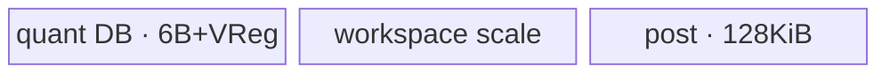

# DynamicMxQuant 950 ACLNN 算子知识

## 算子速览

| 项目 | 内容 |
|---|---|
| 实际入口 | `aclnnDynamicMxQuantV2GetWorkspaceSize` / `aclnnDynamicMxQuantV2`，公开 ACLNN 两段式接口；V2 是本版本族在 950 上的最新公开版本。 |
| 计算语义 | 沿 `axis` 每 `blocksize` 个元素求共享的 E8M0 scale，再以该 scale 将 `x` 量化到 FP4/FP8；`scaleAlg=0/1/2` 分别选择 OCP、cuBLAS 风格和动态目标范围算法。 |
| 输入输出 | `x`: FP16/BF16/FP32、ND、rank 1–7；`y`: FP4_E2M1/FP4_E1M2/FP8_E4M3FN/FP8_E5M2；`mxscale`: FP8_E8M0，量化块数补偶并追加末维 2。 |
| 执行类型 | 所有可达节点均为 `AIV_VECTOR`；单个 `dynamic_mx_quant` Kernel，奇数 scale 路线在同一 Kernel 内追加 `DynamicMxQuantPost` 阶段。没有可达 Cube/AIC 或 `MIX_CV` 节点。 |
| Kernel 路线 | R-001 尾轴 block32；R-002/R-003 尾轴普通直写/后处理；R-004/R-005 非尾轴小尾/大尾高性能；R-006/R-007 非尾轴旧小尾/普通 fallback。 |
| 核心资源 | GM `x/y/mxScale`，可选 workspace scale 暂存区；AIV `TQue` 双缓冲、`TBuf`、寄存器；`SyncAll` 保护 workspace→最终 scale 的跨核交接。 |
| 来源闭包 | `source_closed`：公开 V2 文档→版本化 OpDef 属性→InferShape/Host Tiling→POD→31 个可达 key→单 Kernel router→各 Vector body/post helper→ascend950 binary/CMake 接线闭合；ACLNN inner bridge 属框架生成边界。 |
| 验证状态 | 已完成源码闭包检查；本次知识提取未执行编译、真机、数值或性能测试。 |

## 接口与语义

### 计算语义

令规范化轴为 `a = axis >= 0 ? axis : axis + rank(x)`，块长 `k=blocksize`。每个块先取 `amax=max(abs(x_i))`。`scaleAlg=0` 取 `shared_exp=floor(log2(amax))-emax`，`scale=2^shared_exp`；`scaleAlg=1` 先取 `amax/Amax(dst)`，再向上舍入到可表示 E8M0 幂；`scaleAlg=2` 仅用于 FP4_E2M1/blocksize 32，`dstTypeMax` 为 0/6/7 时走位级特殊算法，否则以 `amax/dstTypeMax` 求 E8M0 scale。最后按 `roundMode` 计算 `y_i=cast_dst(x_i/scale)`。不足 `blocksize` 的尾块补零参与归约但只回写有效 `y`；scale 块数补偶，非尾轴按相邻两个量化块交织。

### 输入、输出与属性

| 参数 | shape/layout | dtype | 约束、默认值与语义 |
|---|---|---|---|
| `x` | ND，rank 1–7 | FP16/BF16/FP32 | FP4 输出要求 `x` 最后一维为偶数；FP32 仅支持 `blocksize=32` 且量化轴长不小于 32；ACLNN 接受非连续 Tensor，由自动连续化边界处理。 |
| `axis` | 标量 | int64 | `[-rank, rank-1]`，默认 -1。 |
| `roundModeOptional` | 字符串 | char* | 默认 `rint`；FP4 支持 `rint/round/floor`，FP8 只支持 `rint`。 |
| `dstType` | 标量 | int64 | 35/36/40/41，对应 FP8_E5M2/FP8_E4M3FN/FP4_E2M1/FP4_E1M2，必须与 `yOut` dtype 一致。 |
| `blocksize` | 标量 | int64 | `(0,1024]` 且为 32 的倍数；若轴长更小，Host 内部有效块长收缩为轴长。 |
| `scaleAlg` | 标量 | int64 | 0/1/2；E1M2 仅 0，E2M1 仅 0/2，FP8 仅 0/1。 |
| `dstTypeMax` | 标量 | double→OpDef float | V2 新增；0 或 `[6,12]`，仅 FP4_E2M1、`blocksize=32` 的 `scaleAlg=2` 语义使用。 |
| `yOut` | 与 `x` 同 shape，ND | FP4/FP8 | FP4 在 GM 中以两个值/字节打包。 |
| `mxscaleOut` | rank=`rank(x)+1`，axis 维=`ceil(ceil(x[a]/blocksize)/2)`，末维=2 | FP8_E8M0 | 等价于块数补偶；新增位置补 0；非尾轴两块交织。 |

### 入口与版本

V2 文档公开 `dstTypeMax`，而 `dynamic_mx_quant_def.cpp` 用 `.Version(2).Float(0.0)` 将它标成第二版属性；旧 `aclnnDynamicMxQuant` 不含该参数并等价使用默认 0。本卡只覆盖最新公开 V2。两段式 ACLNN 生成桥的 C++ body 不在固定仓中；其可见边界是第一段校验、创建 executor/workspace，第二段在给定 stream 上执行 `DynamicMxQuant`。算子拥有的 OpDef、InferShape、Tiling、POD、Kernel 与构建均在固定仓闭合。

## Host/Launcher 执行流程

### 参数校验与前处理

公开 API 第一段检查空指针、dtype/format/shape/属性和平台。OpDef 对 `x` 启用 `AutoContiguous`。`InferShapeForDynamicMxQuant` 令 `y=x.shape`，scale 在量化轴先 `ceil(dim/blocksize)`、再除 2 向上取整，最后追加维 2；未知 rank 传播未知 rank。Tiling 顺序为 `CheckDtype → GetAttr → CheckShape → 平台 AIV/UB/VReg/workspace 查询 → BaseCalc`。`BaseCalc` 规范化负 axis、合并前后轴、计算块数/尾块并把小于属性 blocksize 的轴长收缩为有效 blocksize。

### 参数、Workspace 与生命周期

Host 从平台得到 `totalCoreNum=GetCoreNumAiv()`、`ubSize=GetCoreMemSize(UB)`、`vfLen=GetVRegSize()` 和库 API workspace。R-001/R-004/R-005 以及 R-002 的 workspace 仅为库 API workspace；需要 scale post 的 R-003/R-006/R-007 为 `libApiWorkspace + align512(mxScaleSize)`。额外 slice 起点就是传入 Kernel 的 `workspace`，extent 为补齐前 scale 元素数的 512 字节对齐值，主量化阶段写，`DynamicMxQuantPost` 在 `SyncAll()` 后读；executor/用户拥有整块 workspace，第二段调用结束前有效。

### 启动图与失败传播

```text
aclnnDynamicMxQuantV2GetWorkspaceSize
  -> generated ACLNN executor boundary
  -> DynamicMxQuant / Tiling4DynamicMxQuant
  -> one dynamic_mx_quant<<<usedCoreNum, stream>>>(x, y, mxScale, workspace, tiling)
       -> route quant body (all active AIV blocks)
       -> [odd-scale routes only] SyncAll
       -> DynamicMxQuantPost (block 0 only): workspace scale -> padded/interleaved mxScale
```

这是单 Kernel launch graph；post 是同一 entry 内第二阶段，不是第二次 Host launch。Tiling、raw POD copy 或 workspace 指针取得失败均返回 `GRAPH_FAILED`，不会启动 Kernel；ACLNN 第二段沿 stream 返回运行错误。奇数 scale 路线 Host 设 `ScheduleMode(1)`，Kernel 的 `SyncAll()` 形成主阶段所有 AIV block→block0 post 的全核可见性；随后 `InitOutput` 与 `PipeBarrier<PIPE_ALL>` 保证清零完成后才覆盖有效 scale。

## Route 与参数设计

### 分核与资源计算

公共量为 `pre=∏shape[0:a]`、`quant=shape[a]`、`post=∏shape[a+1:]`、`blocks=ceil(quant/blockSize)`、`tail=quant%blockSize`（0 时改为 blockSize）、`nAlign=vfLen/sizeof(x)`。普通路线以 `(ubSize-2048)/2/bytesPerElem/3/blockSize` 求 UB 可容纳因子；FP32 的 `bytesPerElem=4+2`，其余为 2。随后按 post 或 pre 切 `ubFactor/uo`，以 `ceil(splitCoreData/totalCoreNum)` 反推 `usedCoreNum/blockFactor/tailBlockFactor`。

非尾轴高性能路线要求 `groupPerUb>0`；每 group 是两个量化 block。小尾轴按 group/task 分核；大尾轴以 `ubRowLen=vfLen/(FP32?4:2)`、`ubRowCount=2*groupPerUb*blockSize` 建二维 task。尾轴 block32 路线按 1×256 slice 选 256/512 列粒度，再枚举行/列核切分，以空洞 `delta` 最小、其次优先列切分较小的组合决定 `rowTileNum/colTileNum`。

### Route 选择

| 顺序 | Route | Key/模板 | 精确选择条件与优先级 | 不适用去向 |
|---:|---|---|---|---|
| 1 | R-001 尾轴 block32 | 33/65/97 | `isTailAxis && (attr blocksize==32 \|\| quantAxisSize==32)`；key 随 `scaleAlg=0/1/2` | R-004 检查 |
| 2 | R-004 非尾轴小尾高性能 | 292/324/356/388，548/580/612/644，804/836/868/900 | 非尾轴，`post<=nAlign`，`blockSize==32`，`groupPerUb>0`；三组分别 rint/round/floor，组内 calcMode 0/1/2/3 | R-006/R-007 |
| 3 | R-005 非尾轴大尾高性能 | 293/325/357/389，549/581/613/645，805/837/869/901 | 非尾轴，`post>nAlign`，`groupPerUb>0`；round/calcMode 编码同上 | R-006/R-007 |
| 4 | R-002 尾轴普通直写 | 8192 | 尾轴、有效 blockSize!=32、`blocks` 为偶数 | 失败 |
| 5 | R-003 尾轴普通+post | 4096 | 尾轴、有效 blockSize!=32、`blocks` 为奇数 | 失败 |
| 6 | R-006 非尾轴旧小尾+post | 4099 | 高性能 gate 失败后，`post<=vRegSize/((FP16或FP32)?4:2)/2 && blockSize<=320` | R-007 |
| 7 | R-007 非尾轴普通+post | 4098 | 高性能 gate 失败后的其余非尾轴 | 失败 |

```text
if tail_axis && effective_block_size == 32: R-001
else if !tail_axis && groupPerUb > 0 && (post > nAlign || blockSize == 32):
  if post <= nAlign: R-004
  else: R-005
else:
  CalcTilingKey
  if tail_axis: blocks even ? R-002 : R-003
  else if post <= vReg/(estimated_dtype_bytes*2) && blockSize <= 320: R-006
  else: R-007
```

### 模板/实现执行矩阵

| Route | key/selector | dtype/shape/platform 完整命中条件 | 执行拓扑与 Kernel 节点 | 实际模板/body | 内存与同步特征 | tail/fallback |
|---|---|---|---|---|---|---|
| R-001 | 33/65/97 | 950；尾轴；block32；合法 alg/dtype | 单 AIV Kernel | FP4 `DynamicMxQuantTailAxis<T,U,alg>`；FP8 `DynamicMxQuantTailAxisFP8<T,U,alg>` | 2D 分核、DB queues、max/reciprocal TBuf；直写 scale | 行/列尾 tile 用 `rowTailLen/colTailLen` |
| R-002 | 8192 | 尾轴、非32、scale block 偶数 | 单 AIV Kernel | FP4 `DynamicMxQuantNotTailAxis<T,U,true>`；FP8 对应 FP8 类 | scale 直写；无 post | `ubFactor/tailUbFactor` |
| R-003 | 4096 | 尾轴、非32、scale block 奇数 | 单 AIV Kernel内 quant→post | 同 R-002 + `DynamicMxQuantPost` | workspace 暂存；`SyncAll`；block0 pad | 尾 scale 补 0 |
| R-004 | 12 个 small key | 非尾轴、小尾、block32、UB gate | 单 AIV Kernel | `DynamicMxQuantNotTailAxisOptimizeSmallTail<x,y,round,calcMode>` | 直接成对处理/交织 scale，无 workspace slice | 模板化 pad-axis/pad-block/post-axis |
| R-005 | 12 个 large key | 非尾轴、大尾、UB gate | 单 AIV Kernel | `DynamicMxQuantNotTailAxisOptimizeLargeTail<x,y,round,calcMode>` | 二维 task；tmp scale 后寄存器 Interleave；直写 | 行/列 tail 与 odd block scale pad |
| R-006 | 4099 | 非尾轴，高性能 gate 失败，小 post 与 block<=320 | 单 AIV Kernel内 quant→post | FP4/FP8 `NotTailAxisOptimize*<...,useInterleavedScalePath>` + post | 三 DB queue，VReg TBuf；workspace→post | 最后 block/UB loop |
| R-007 | 4098 | 非尾轴剩余 fallback | 单 AIV Kernel内 quant→post | FP4/FP8 `NotTailAxis*<...,false>` + post | 普通 post/pre 轴切分；workspace→post | `ubDim` 决定尾循环 |

### 隐藏性能 Guard

| Guard | Host/Tiling 条件 | Device/资源原因 | 影响 Route | 不满足时去向 | 源码符号 |
|---|---|---|---|---|---|
| 950 平台 | README 仅 950 为 √；CMake `SUPPORT_COMPUTE_UNIT=ascend950` | 只有 arch35 binary/body | 全部 | 平台错误 | `README.md` 产品表；`CMakeLists.txt` |
| 高性能 UB | `groupPerUb=(ub-2048)/2/(x+y+scale+[tmp]) > 0` | 两 block/group 的 DB queue 必须同时落 UB | R-004/R-005 | R-006/R-007 | `GetNotAxisGroupPerUb` |
| 小尾 block32 | `post<=nAlign => blockSize==32` | 小尾模板固定成对 block 的寄存器布局 | R-004 | R-006/R-007 | `IsOptForNotLastQuantAxis` |
| legacy 小尾 | `post<=vRegSize/dtypeEstimate/2 && blockSize<=320` | 单次寄存器处理范围与模板上限 | R-006 | R-007 | `CalcTilingKey` |
| odd scale | `!(tailAxis && blocks%2==0)` | 输出布局要求块数补偶/非尾轴交织 | R-003/R-006/R-007 | workspace post | `CalcTilingKey`；`DynamicMxQuantPost::Init` |
| FP32 UB | 普通路线按 6 B/元素；高性能按 FP32 4 B 输入并保留相应临时量 | FP32 不可按 FP16 的 2 B 预算 | 全部 FP32 | 缩小 tile/fallback | `DoTiling`；`GetNotAxisGroupPerUb` |
| 空域/除数 | `spliteCoreData!=0`、coreNum/ubSize>0 | 防止分核除零和空启动 | 普通路线 | `GRAPH_FAILED` | `DoTiling` |

### POD/ABI

三种 POD 都是标准顺序布局；固定源码没有 `packed`。以下偏移按可见字段类型与自然对齐闭合：主结构 `sizeof=184, alignof=8`，优化结构 `sizeof=224, alignof=8`，尾轴结构 `sizeof=128, alignof=8`。

| 结构 | 字段 | 类型/位宽 | ABI 布局 | 单位 | Host/launcher producer | Device consumer | 边界 |
|---|---|---|---|---|---|---|---|
| `DynamicMxQuantTilingData` | `totalCoreNum` | int64/64 | off 0 | core | platform AIV count | base parse | >0 |
| 同上 | `usedCoreNum` | int64/64 | off 8 | core | `DoTiling` | active block guard | `<=totalCoreNum` |
| 同上 | `blockFactor` | int64/64 | off 16 | loop/core | `DoTiling` | `Process` | head core |
| 同上 | `tailBlockFactor` | int64/64 | off 24 | loop | `DoTiling` | tail core | last core |
| 同上 | `ubDim` | int64/64 | off 32 | merged-axis id | `SpliteUB` | address branch | 0 or 2 |
| 同上 | `uo` | int64/64 | off 40 | loop | `SpliteUB` | core mapping | >=1 |
| 同上 | `ubFactor` | int64/64 | off 48 | element/group | `SpliteUB` | buffer/address | UB bound |
| 同上 | `tailUbFactor` | int64/64 | off 56 | element/group | `DoTiling` | last loop | nonzero normalized |
| 同上 | `roundMode` | int64/64 | off 64 | enum | `GetAttr` | quant cast | 0/1/4 |
| 同上 | `dstType` | int64/64 | off 72 | GE dtype | `GetAttr` | output path | 35/36/40/41 |
| 同上 | `blockSize` | int64/64 | off 80 | element | `BaseCalc` | reduction loop | effective size |
| 同上 | `scaleAlg` | int64/64 | off 88 | enum | `GetAttr` | compute selector | 0..2 |
| 同上 | `blockSizeNumInAxis` | int64/64 | off 96 | block | `BaseCalc` | scale layout/post | ceil division |
| 同上 | `tailBlockSize` | int64/64 | off 104 | element | `BaseCalc` | pad/tail | 1..blockSize |
| 同上 | `isPad` | int64/64 | off 112 | bool | `BaseCalc` | tail mask | 0/1 |
| 同上 | `isTailAxis` | int64/64 | off 120 | bool | `BaseCalc` | post selector | 0/1 |
| 同上 | `preAxisSize` | int64/64 | off 128 | element-product | `SetTilingData` | post layout | before axis |
| 同上 | `postAxisSize` | int64/64 | off 136 | element-product | `BaseCalc` | address/stride | after axis |
| 同上 | `mxScaleSize` | int64/64 | off 144 | byte/FP8 element | `CalScaleSize` | post clear | logical output count |
| 同上 | `tilingKey` | int64/64 | off 152 | key | `CalcTilingKey` | diagnostic | 4096/4098/4099/8192 |
| 同上 | `calcMode` | int64/64 | off 160 | enum | `SetCalcMode` | scale algorithm | 0..3 |
| 同上 | `subNumForScale` | uint32/32 | off 168 | bit constant | `SetCalcMode` | scale exponent helper | mode2 only |
| 同上 | `subNumForFP16Scale` | uint32/32 | off 172 | bit constant | `SetCalcMode` | FP32/FP16 helper | mode2 only |
| 同上 | `dstTypeMax` | float/32 | off 176 | value | `GetAttr` | tail alg2 | V2 |
| 同上 | `invDstTypeMax` | float/32 | off 180 | reciprocal | `GetAttr` | scale compute | 1/6 if input 0 |
| `DynamicMxQuant4OptimizeTilingData` | `totalCoreNum` | int64/64 | off 0 | core | platform | large split | >0 |
| 同上 | `usedCoreNum` | int64/64 | off 8 | core | `SplitCore` | active guard | <=total |
| 同上 | `blockSize` | int64/64 | off 16 | element | `BaseCalc` | block loops | high-perf gate |
| 同上 | `isPad` | int64/64 | off 24 | bool | `BaseCalc` | template pad | 0/1 |
| 同上 | `tailBlockSize` | int64/64 | off 32 | element | `BaseCalc` | tail block | valid only if pad |
| 同上 | `tilingKey` | int64/64 | off 40 | key | `SetTilingKey` | diagnostic | 24-key family |
| 同上 | `quantAxisSize` | int64/64 | off 48 | element | `BaseCalc` | mapping | axis extent |
| 同上 | `postAxisSize` | int64/64 | off 56 | element | `BaseCalc` | DMA stride | >0 |
| 同上 | `nAlignSize` | int64/64 | off 64 | element | `SplitCore` | small-tail buffer | ceil align |
| 同上 | `mAlignBlockCount` | int64/64 | off 72 | block | `SplitCore` | mapping | ceil quant/block |
| 同上 | `nAlignBlockCount` | int64/64 | off 80 | block | `SplitCore` | large-tail mapping | ceil post/row |
| 同上 | `mAlignGroupCount` | int64/64 | off 88 | group | `SplitCore` | small mapping | ceil blocks/2 |
| 同上 | `quantAxisIsOdd` | int64/64 | off 96 | bool | `SplitCore` | dummy scale | 0/1 |
| 同上 | `totalGroupNum` | int64/64 | off 104 | group | `SplitCore` | small tasks | small route |
| 同上 | `groupPerUb` | int64/64 | off 112 | group | UB formula | tile size | >0 |
| 同上 | `totalBlockNum` | int64/64 | off 120 | block | `SplitCore` | small tasks | padded count |
| 同上 | `blockNumPerTask` | int64/64 | off 128 | block/task | `SplitCore` | small queues | even |
| 同上 | `totalTaskNum` | int64/64 | off 136 | task | `SplitCore` | both routes | >0 |
| 同上 | `loopNumPerHeadCore` | int64/64 | off 144 | loop | large split | large process | head |
| 同上 | `loopNumPerTailCore` | int64/64 | off 152 | loop | large split | large process | tail |
| 同上 | `needPadPostAxis` | int64/64 | off 160 | bool | `SplitCore` | small copy | 0/1 |
| 同上 | `ubRowLen` | int64/64 | off 168 | element | large split | row tile | large only |
| 同上 | `ubRowLenTail` | int64/64 | off 176 | element | large split | col tail | large only |
| 同上 | `ubRowCount` | int64/64 | off 184 | row | large split | tile | large only |
| 同上 | `ubRowCountTail` | int64/64 | off 192 | row | large split | row tail | large only |
| 同上 | `blockCountPerBatch` | int64/64 | off 200 | task/batch | large split | mapping | large only |
| 同上 | `scaleRowCountPerBatch` | int64/64 | off 208 | row | large split | scale offset | large only |
| 同上 | `subNumForScale` | uint32/32 | off 216 | bit constant | `SetCalcMode` | calcMode2 | otherwise inactive |
| 同上 | `invDstTypeMax` | float/32 | off 220 | reciprocal | `GetAttr` | calcMode3 | otherwise default usable |
| `DynamicMxQuantTailAxisTilingData` | `tilingKey` | int64/64 | off 0 | key | `CalcTilingKeyForTail` | diagnostic | 33/65/97 |
| 同上 | `ubSize` | int64/64 | off 8 | byte | platform | capacity context | >0 |
| 同上 | `roundMode` | int64/64 | off 16 | enum | `GetAttr` | cast | legal by dtype |
| 同上 | `blockSize` | int64/64 | off 24 | element | forced 32 | loops | 32 |
| 同上 | `totalCoreNum` | int64/64 | off 32 | core | platform | tiling | >0 |
| 同上 | `usedCoreNum` | int64/64 | off 40 | core | `AutoTiling` | active guard | rowTile*colTile |
| 同上 | `rowTileNum` | int64/64 | off 48 | tile | `AutoTiling` | block mapping | >0 |
| 同上 | `colTileNum` | int64/64 | off 56 | tile | `AutoTiling` | block mapping | >0 |
| 同上 | `rowNum` | int64/64 | off 64 | row | `CalcAxisSize` | GM mapping | merged pre |
| 同上 | `colNum` | int64/64 | off 72 | element | `CalcAxisSize` | GM mapping | tail axis |
| 同上 | `colNormalBlockNum` | int64/64 | off 80 | 1x256 block | `DoTiling` | per-core columns | head |
| 同上 | `colTailLen` | int64/64 | off 88 | element | `DoTiling` | final col | tail |
| 同上 | `rowNormalBlockNum` | int64/64 | off 96 | row | `DoTiling` | per-core rows | head |
| 同上 | `rowTailLen` | int64/64 | off 104 | row | `DoTiling` | final row | tail |
| 同上 | `maxUbBlockNum` | int64/64 | off 112 | 1x32 block | UB byte formula | all queues/TBuf | multiple of 8 |
| 同上 | `dstTypeMax` | float/32 | off 120 | value | `GetAttr` | alg2 | V2 |
| 同上 | `invDstTypeMax` | float/32 | off 124 | reciprocal | `GetAttr` | alg1/2 | finite valid input |

### Route 源码闭包

| Route | Key/selector | Host/Tiling producer | POD/参数 | Kernel entry/router 节点 | Kernel body/直接依赖 | 构建接线 |
|---|---|---|---|---|---|---|
| R-001 | 33/65/97 | `TailAxisTiling::DoTiling/CalcTilingKeyForTail` | TailAxis POD | `RunTailAxisBlock32Path` | `dynamic_mx_quant_tail_axis{,_fp8}.h` | ascend950 binary + CMake |
| R-002/R-003 | 8192/4096 | `DoTiling/CalcTilingKey` | Main POD | `RunMainQuantPath<...,true,...>` | main FP4/FP8 body；R-003 加 post | 同上 |
| R-004 | 12 small keys | `OptimzieTiling::*` | Optimize POD | `RunNotTailAxisSmallTailOptiPath` | high-perf small-tail body | 同上 |
| R-005 | 12 large keys | `OptimzieTiling::*` | Optimize POD | `RunNotTailAxisLargeTailOptiPath` | high-perf large-tail body | 同上 |
| R-006 | 4099 | main Tiling fallback | Main POD | `RunSmallTailQuantPath` | legacy optimize FP4/FP8 + post | 同上 |
| R-007 | 4098 | main Tiling fallback | Main POD | `RunMainQuantPath<...,false,...>` | normal FP4/FP8 + post | 同上 |

## Kernel 实现

### 公共执行流程

`dynamic_mx_quant` 固定参数顺序为 `(x,y,mxScale,workspace,tiling)`，声明 `KERNEL_TYPE_MIX_AIV_1_0`；这里的 MIX 是 AIV task 配置，不含 AIC/Cube。编译期 `optiMode` 路由到五个 runner，dtype 已由 binary 的 `DTYPE_X/DTYPE_Y` 固化。公共数值管线是 `GM x → DataCopyPad → UB → Reg abs/max/reduce → E8M0 scale/倒数 → Reg mul/cast(round,sat) → packed y + uint8 scale → GM`。FP16 在需要的路径升到 FP32，BF16/FP32 保留各自专门位级路径；FP8 cast 固定 RINT，FP4 使用模板 round mode。

### Route R-001：尾轴 block32 专用二维模板

#### 适用条件

##### 选择证据

| 层级 | 文件 | 符号 | 源码谓词/参数 | 结果/下一跳 |
|---|---|---|---|---|
| Host | `op_host/arch35/dynamic_mx_quant_tiling_arch35.cpp` | `IsTailAxisAndBlockSize32` | `isTailAxis && isBlockSize32` | TailAxis tiling |
| Tiling | `...tail_axis_tiling_arch35.cpp` | `CalcTilingKeyForTail` | alg 0/1/2 | 33/65/97 |
| Router | `op_kernel/dynamic_mx_quant.cpp` | `RunTailAxisBlock32Path` | FP8 type trait | FP4/FP8 body |

#### Device 数据流

##### 函数级调用链

```text
dynamic_mx_quant -> RunTailAxisBlock32Path
  -> DynamicMxQuantTailAxis{FP8}::Init/ParseTilingData
  -> Process -> CopyIn -> Compute -> CopyOut
```

##### 源码等价伪码

```text
map blockIdx to rowTile/colTile; choose normal/tail row and col lengths
for each UB-sized group of 1x32 blocks:
  DataCopyPad strided rows of x, zero right tail
  reduce abs/max; alg0/alg1/alg2 derives E8M0 and reciprocal
  multiply x by reciprocal; cast and pack FP4/FP8
  copy valid y and one scale byte per block to GM
```

#### 内存与数据搬运

##### 资源与搬运表

| 层级/缓冲区 | offset/地址公式 | extent/容量公式 | dtype/layout | producer | consumer | owner/lifetime | 对齐/复用 |
|---|---|---|---|---|---|---|---|
| `inQueue` | tile GM offset | `2*maxUbBlockNum*32*sizeof(T)` | T | CopyIn | Compute | per core/iteration | depth2 |
| `outQueue` | packed tile | FP4 `2*maxBlocks*32/2`; FP8 `2*maxBlocks*32` | uint8 | Compute | CopyOut | per iteration | depth2 |
| `mxScaleQueue` | block id | `2*align(maxBlocks,VF_LEN16)` | uint8 | ComputeScale | CopyOut | per iteration | depth2 |
| `maxExpBuffer` | 0 | `2*maxBlocks*sizeof(T)` | T/bit view | max reduction | scale | TBuf | reused |
| `recipScaleBuffer` | 0 | `2*maxBlocks*sizeof(uint16)` | bf16 bits | scale | y quant | TBuf | reused |

##### 分层内存布局


##### 字节账与复用顺序

```text
UB_total_FP4 = 2*M*32*sizeof(T) + M*32 + 2*align(M,VF16) + 2*M*sizeof(T) + 4*M
UB_total_FP8 = 2*M*32*sizeof(T) + 2*M*32 + 2*align(M,VF16) + 2*M*sizeof(T) + 4*M
UB_total <= ubSize - 2048 (Host maxUbBlockNum formula)
dynamic_ub = N/A
workspace_total = libApiWorkspace
```

| 复用子区 | 写入者 | 读取者/消费点 | 下一次覆盖 | 同步或释放依据 | 安全条件 |
|---|---|---|---|---|---|
| queues | CopyIn/Compute | Compute/CopyOut | 下一 tile | EnQue/DeQue/FreeTensor | depth2 |
| max/recip TBuf | max/scale | scale/quant | 下一 group | V→MTE2 flag when reused before DMA | WaitFlag |

#### 同步、精度与尾块

##### 同步与数值边界表

| 阶段 | primitive/机制 | producer | consumer/等待点 | 保护对象 | 精度/尾块 |
|---|---|---|---|---|---|
| UB reuse | queue + `SetFlag/WaitFlag<V_MTE2>` | Vector | next DMA | TBuf/input | 右补零不写 GM |
| cast | Reg Cast/Mul | scale reciprocal | packed output | y register | FP8 RINT；FP4 template round + SAT |

#### 关键实现

##### 符号证据表

| 阶段 | 文件 | 符号/模板实例 | 实现事实 |
|---|---|---|---|
| Host/Tiling producer | `...tail_axis_tiling_arch35.cpp` | `DoTiling/AutoTiling` | 256/512 slice、二维切核、UB 公式 |
| Kernel entry/router | `op_kernel/dynamic_mx_quant.cpp` | `RunTailAxisBlock32Path` | alg/dtype specialization |
| Device body/helper | `...dynamic_mx_quant_tail_axis.h` / `_fp8.h` | `Process/CopyIn/Compute/CopyOut` | DB、归约、scale、cast、tail |

### Route R-002：尾轴普通偶数 scale 直写

#### 适用条件

##### 选择证据

| 层级 | 文件 | 符号 | 源码谓词/参数 | 结果/下一跳 |
|---|---|---|---|---|
| Host | `...tiling_arch35.cpp` | `CalcTilingKey` | tail、blocks 偶数 | key 8192 |
| Router | `dynamic_mx_quant.cpp` | `RunMainQuantPath<...,true,EVEN>` | `scaleOut=mxScale` | 普通 body |

#### Device 数据流

##### 函数级调用链

```text
dynamic_mx_quant -> RunMainQuantPath<tail=true,even>
 -> NotTailAxis{FP8}::Init -> Process -> CopyIn -> ComputeOcp/ComputeCuBLAS -> CopyOut(mxScale)
```

##### 源码等价伪码

```text
for core loop and UB tile: copy x; reduce each block; emit packed y and scale directly; valid tail only
```

#### 内存与数据搬运

##### 资源与搬运表

| 层级/缓冲区 | offset/地址公式 | extent/容量公式 | dtype/layout | producer | consumer | owner/lifetime | 对齐/复用 |
|---|---|---|---|---|---|---|---|
| three queues | core/tile offset | each `2*B`, `B=align(ubFactor*blockSize*post*sizeof(T),UBblock)` | input/uint8 | DMA/compute | compute/DMA | per core | depth2 |
| `maxExpBuf` | 0 | VReg bytes，FP4 body | calc type | reduce | scale | route lifetime | FP8 normal无该 TBuf |

##### 分层内存布局


##### 字节账与复用顺序

```text
UB_total = 6*B + (FP4 ? VRegBytes : 0)
workspace_total = libApiWorkspace
```

| 复用子区 | 写入者 | 读取者/消费点 | 下一次覆盖 | 同步或释放依据 | 安全条件 |
|---|---|---|---|---|---|
| queue slots | stage producer | next stage | next loop | EnQue/DeQue/FreeTensor | depth2 |

#### 同步、精度与尾块

##### 同步与数值边界表

| 阶段 | primitive/机制 | producer | consumer/等待点 | 保护对象 | 精度/尾块 |
|---|---|---|---|---|---|
| tile pipeline | TQue | CopyIn/Compute | DeQue | UB slots | tail `dataLen` controls copy |

#### 关键实现

##### 符号证据表

| 阶段 | 文件 | 符号/模板实例 | 实现事实 |
|---|---|---|---|
| Host/Tiling producer | `...tiling_arch35.cpp` | `DoTiling/CalcTilingKey` | even direct key |
| Kernel entry/router | `dynamic_mx_quant.cpp` | `RunMainQuantPath` | direct scale address |
| Device body/helper | `...not_tail_axis.h` / `_fp8.h` | `Init/Process/Compute*` | generic UB loops |

### Route R-003：尾轴普通奇数 scale 后处理

#### 适用条件

##### 选择证据

| 层级 | 文件 | 符号 | 源码谓词/参数 | 结果/下一跳 |
|---|---|---|---|---|
| Host | `...tiling_arch35.cpp` | `CalcTilingKey/Tiling4DynamicMxQuant` | tail、blocks 奇数 | key4096、schedule mode1、额外 workspace |
| Router | `dynamic_mx_quant.cpp` | `RunMainQuantPath<...,ODD>` | `scaleOut=userWS` | quant→post |

#### Device 数据流

##### 函数级调用链

```text
quant body writes workspace scale -> DynamicMxQuantPost::Init(SyncAll) -> block0 TailAxis*Compute -> mxScale
```

##### 源码等价伪码

```text
all cores quantize and write dense scale to WS; SyncAll; block0 clears mxScale, pads odd scale row to even, copies valid bytes
```

#### 内存与数据搬运

##### 资源与搬运表

| 层级/缓冲区 | offset/地址公式 | extent/容量公式 | dtype/layout | producer | consumer | owner/lifetime | 对齐/复用 |
|---|---|---|---|---|---|---|---|
| workspace scale slice | 0 | `align512(mxScaleSize)` | uint8 dense | quant cores | post block0 | executor | SyncAll edge |
| post buffers | 0 | lastSize<16: `12*16KiB`; else `2*16KiB` | uint8/int32 | post | post | block0 only | conditional allocation |

##### 分层内存布局


##### 字节账与复用顺序

```text
workspace_total = libApiWorkspace + align512(mxScaleSize)
post_UB = (lastSize<16 ? 12*SCALE_BUFFER_SIZE : 2*SCALE_BUFFER_SIZE), SCALE_BUFFER_SIZE=16384
```

| 复用子区 | 写入者 | 读取者/消费点 | 下一次覆盖 | 同步或释放依据 | 安全条件 |
|---|---|---|---|---|---|
| workspace | all quant blocks | post block0 | API completion | `SyncAll` | schedule mode1 |

#### 同步、精度与尾块

##### 同步与数值边界表

| 阶段 | primitive/机制 | producer | consumer/等待点 | 保护对象 | 精度/尾块 |
|---|---|---|---|---|---|
| phase edge | `SyncAll` | all blocks | post Init | workspace | odd scale pad |
| clear→copy | `PipeBarrier<PIPE_ALL>` | `InitOutput(0)` | post DMA | mxScale | dummy scale remains 0 |

#### 关键实现

##### 符号证据表

| 阶段 | 文件 | 符号/模板实例 | 实现事实 |
|---|---|---|---|
| Host/Tiling producer | `...tiling_arch35.cpp` | `Tiling4DynamicMxQuant` | workspace/schedule |
| Kernel entry/router | `dynamic_mx_quant.cpp` | `RunMainQuantPath` | WS + post |
| Device body/helper | `dynamic_mx_quant_post.h` | `Init/TailAxisCompute/TailAxisOptCompute` | global sync, zero pad |

### Route R-004：非尾轴小尾高性能模板

#### 适用条件

##### 选择证据

| 层级 | 文件 | 符号 | 源码谓词/参数 | 结果/下一跳 |
|---|---|---|---|---|
| Host | `...tiling_arch35.cpp` | `IsOptForNotLastQuantAxis` | non-tail、post<=nAlign、block32、groupPerUb>0 | optimize |
| Tiling | `...optimize_tiling_arch35.cpp` | `SetTilingKey` | small + round + calcMode | 12 keys |

#### Device 数据流

##### 函数级调用链

```text
dynamic_mx_quant -> RunNotTailAxisSmallTailOptiPath
 -> SmallTail::Init/Process -> ProcessWithPad -> CopyIn -> SplitPreAxisCompute -> Compute -> CopyOut
```

##### 源码等价伪码

```text
assign contiguous pairs of quant blocks as tasks; prefetch next task before current compute/copyout
load two block rows; specialize needPadBlock/needPadAxis/canInterleave at compile time
compute two scales and y; directly emit interleaved scale, zero dummy RHS when blocks odd
```

#### 内存与数据搬运

##### 资源与搬运表

| 层级/缓冲区 | offset/地址公式 | extent/容量公式 | dtype/layout | producer | consumer | owner/lifetime | 对齐/复用 |
|---|---|---|---|---|---|---|---|
| inQ | task row offset | `2*blockNumPerTask*nAlign*blockSize*sizeof(x)` | strided ND | CopyIn | Compute | task | depth2 |
| outQ | same | `2*blockNumPerTask*alignedOutputPost*blockSize` | packed | Compute | CopyOut | task | depth2 |
| scaleQ | scale task | `2*blockNumPerTask*nAlign` | already interleaved | Compute | CopyOut | task | depth2 |

##### 分层内存布局


##### 字节账与复用顺序

```text
UB_total = 2*Bt*nAlign*32*sizeof(X) + 2*Bt*outAlign*32 + 2*Bt*nAlign
workspace_total = libApiWorkspace
```

| 复用子区 | 写入者 | 读取者/消费点 | 下一次覆盖 | 同步或释放依据 | 安全条件 |
|---|---|---|---|---|---|
| queue slot | prefetched CopyIn | current Compute | two tasks later | depth2 queue | next copy precedes current compute safely |

#### 同步、精度与尾块

##### 同步与数值边界表

| 阶段 | primitive/机制 | producer | consumer/等待点 | 保护对象 | 精度/尾块 |
|---|---|---|---|---|---|
| specialization | compile-time bool | POD pad facts | `ProcessWithPad` | lanes/layout | dummy RHS zero; valid GM only |
| cast | round template | reciprocal multiply | y pack | registers | FP4 user round; FP8 RINT constraint |

#### 关键实现

##### 符号证据表

| 阶段 | 文件 | 符号/模板实例 | 实现事实 |
|---|---|---|---|
| Host/Tiling producer | `...optimize_tiling_arch35.cpp` | `SplitCore/SetTilingKey` | group task and 12 keys |
| Kernel entry/router | `dynamic_mx_quant.cpp` | `RunNotTailAxisSmallTailOptiPath` | round/calc specialization |
| Device body/helper | `...high_perf_small_tail.h` | `ProcessWithPad/Compute/QuantizeValues` | pair fusion/direct interleave |

### Route R-005：非尾轴大尾高性能模板

#### 适用条件

##### 选择证据

| 层级 | 文件 | 符号 | 源码谓词/参数 | 结果/下一跳 |
|---|---|---|---|---|
| Host | `...tiling_arch35.cpp` | `IsOptForNotLastQuantAxis` | non-tail、post>nAlign、groupPerUb>0 | optimize |
| Tiling | `...optimize_tiling_arch35.cpp` | `SplitCore/SetTilingKey` | large | 12 large keys |

#### Device 数据流

##### 函数级调用链

```text
LargeTail::InitParams -> for loopPerCore: InitCalcParams -> CopyIn -> ComputeAll -> CopyOut
```

##### 源码等价伪码

```text
map task to batch,row-quant-tile,col-post-tile; pad DMA row tail
for each quant block: compute scale into tmpScale and reciprocal into tmp
quantize y; zero odd dummy scale; Interleave each scale pair; copy strided y and scale to GM
```

#### 内存与数据搬运

##### 资源与搬运表

| 层级/缓冲区 | offset/地址公式 | extent/容量公式 | dtype/layout | producer | consumer | owner/lifetime | 对齐/复用 |
|---|---|---|---|---|---|---|---|
| inQ | batch/row/col formula | `2*align(ubRowLen*ubRowCount*sizeof(X),UBblk)` | X rows | DMA | compute | loop | depth2 |
| outQ | y offset | `2*align(ubRowLen*ubRowCount,UBblk)` | packed uint8 | compute | DMA | loop | depth2 |
| scaleQ | scale offset | `2*align(ubRowLen*scaleRows,UBblk)` | interleaved uint8 | Interleave | DMA | loop | depth2 |
| tmpBuf/tmpScale | 0 | `align(ubRowLen*scaleRows*sizeof(X)) + align(ubRowLen*scaleRows)` | reciprocal/raw scale | scale | quant/interleave | persistent TBuf | overwrite per loop |

##### 分层内存布局


##### 字节账与复用顺序

```text
UB_total = 2*inBuffer + 2*outBuffer + 2*scaleBuffer + tmpBuffer + tmpScaleBuffer
workspace_total = libApiWorkspace
```

| 复用子区 | 写入者 | 读取者/消费点 | 下一次覆盖 | 同步或释放依据 | 安全条件 |
|---|---|---|---|---|---|
| tmpScale | ComputeScale* | Interleave | next loop | same ComputeAll program order | all scale pairs consumed |
| tmpBuf | ComputeScale* | ComputeYVf | next block/loop | same loop order | reciprocal consumed first |

#### 同步、精度与尾块

##### 同步与数值边界表

| 阶段 | primitive/机制 | producer | consumer/等待点 | 保护对象 | 精度/尾块 |
|---|---|---|---|---|---|
| row DMA | DataCopyPad | GM | compute | row tail | rightPadding zero |
| scale pair | Reg/Vector Interleave | tmpScale | scaleQ | pair order | odd final block Duplicate(0) |

#### 关键实现

##### 符号证据表

| 阶段 | 文件 | 符号/模板实例 | 实现事实 |
|---|---|---|---|
| Host/Tiling producer | `...optimize_tiling_arch35.cpp` | `SplitCore` | 2D task formulas |
| Kernel entry/router | `dynamic_mx_quant.cpp` | `RunNotTailAxisLargeTailOptiPath` | full specialization |
| Device body/helper | `...high_perf_large_tail.h` | `InitCalcParams/ComputeAll/CopyOut` | padded rows/direct interleave |

### Route R-006：非尾轴旧小尾 fallback 与 post

#### 适用条件

##### 选择证据

| 层级 | 文件 | 符号 | 源码谓词/参数 | 结果/下一跳 |
|---|---|---|---|---|
| Host | `...tiling_arch35.cpp` | `CalcTilingKey` | non-tail、post<=vRegEstimate、block<=320 | key4099 |
| Router | `dynamic_mx_quant.cpp` | `RunSmallTailQuantPath` | FP4/FP8 type | legacy optimize + post |

#### Device 数据流

##### 函数级调用链

```text
SmallTail legacy quant -> workspace scale -> SyncAll -> block0 NonTailAxisCompute -> mxScale
```

##### 源码等价伪码

```text
each core processes several axis blocks across complete small post; compute y and dense scale; post interleaves two scale rows and zero-fills odd partner
```

#### 内存与数据搬运

##### 资源与搬运表

| 层级/缓冲区 | offset/地址公式 | extent/容量公式 | dtype/layout | producer | consumer | owner/lifetime | 对齐/复用 |
|---|---|---|---|---|---|---|---|
| quant UB | per-core block offset | `6B+VRegBytes` | X/uint8 | quant | copyout | core | DB queues |
| post UB | scale rows | `8*16384` bytes | uint8 | workspace DMA | Interleave/DMA | block0 | 2 input + 1 double-sized output queues |
| workspace | scaleBlockOffset | align512(scale size) | dense uint8 | quant | post | executor | SyncAll |

##### 分层内存布局



##### 字节账与复用顺序

```text
quant_UB = 6B + VRegBytes
post_UB = 8*16384
workspace_total = libApiWorkspace + align512(mxScaleSize)
```

| 复用子区 | 写入者 | 读取者/消费点 | 下一次覆盖 | 同步或释放依据 | 安全条件 |
|---|---|---|---|---|---|
| workspace | quant cores | post block0 | completion | SyncAll | all cores active in batch mode |

#### 同步、精度与尾块

##### 同步与数值边界表

| 阶段 | primitive/机制 | producer | consumer/等待点 | 保护对象 | 精度/尾块 |
|---|---|---|---|---|---|
| post | MultiCopy + Reg Interleave | two dense rows | output | scale layout | missing second row Duplicate(0) |

#### 关键实现

##### 符号证据表

| 阶段 | 文件 | 符号/模板实例 | 实现事实 |
|---|---|---|---|
| Host/Tiling producer | `...tiling_arch35.cpp` | `CalcTilingKey/DoTiling` | 4099 + workspace |
| Kernel entry/router | `dynamic_mx_quant.cpp` | `RunSmallTailQuantPath` | type-special body |
| Device body/helper | `...not_tail_axis_optimize*.h`; `dynamic_mx_quant_post.h` | `Process/Compute*/NonTailAxisCompute` | dense→interleaved scale |

### Route R-007：非尾轴普通 fallback 与 post

#### 适用条件

##### 选择证据

| 层级 | 文件 | 符号 | 源码谓词/参数 | 结果/下一跳 |
|---|---|---|---|---|
| Host | `...tiling_arch35.cpp` | `CalcTilingKey` | non-tail 且 legacy small guard false | key4098 |
| Router | `dynamic_mx_quant.cpp` | fallback `RunMainQuantPath<...,false,ODD>` | non-tail | normal + post |

#### Device 数据流

##### 函数级调用链

```text
normal body::Process -> (ubDim==2 ? SplitPostAxisCompute : SplitPreAxisCompute)
 -> workspace scale -> SyncAll -> post non-tail subtemplate -> mxScale
```

##### 源码等价伪码

```text
tile either post axis or merged pre/block axis; DataCopyPad; per-block scale and y; write dense scale WS
post selects even, odd-large, odd-medium, odd-small layout routine and interleaves/pads to final mxScale
```

#### 内存与数据搬运

##### 资源与搬运表

| 层级/缓冲区 | offset/地址公式 | extent/容量公式 | dtype/layout | producer | consumer | owner/lifetime | 对齐/复用 |
|---|---|---|---|---|---|---|---|
| normal UB | `ubDim` address formula | FP4 `6B+VReg`; FP8 `6B` | tiled X/y/scale | quant | DMA | per core | depth2 |
| workspace/post | as R-006 | align512(scale); post 128KiB | dense→interleaved | quant/post | output | executor/block0 | SyncAll |

##### 分层内存布局


##### 字节账与复用顺序

```text
UB_total = 6B + optional VRegBytes
workspace_total = libApiWorkspace + align512(mxScaleSize)
```

| 复用子区 | 写入者 | 读取者/消费点 | 下一次覆盖 | 同步或释放依据 | 安全条件 |
|---|---|---|---|---|---|
| normal queues | copy/compute | compute/copy | next tile | queue lifecycle | valid tail length |
| workspace | all blocks | post block0 | API end | SyncAll | schedule mode1 |

#### 同步、精度与尾块

##### 同步与数值边界表

| 阶段 | primitive/机制 | producer | consumer/等待点 | 保护对象 | 精度/尾块 |
|---|---|---|---|---|---|
| generic tail | pad + masks | CopyIn | vector compute | invalid lanes | only valid data copied out |
| phase | SyncAll/PipeBarrier | quant/clear | post/copy | workspace/mxScale | dummy scale zero |

#### 关键实现

##### 符号证据表

| 阶段 | 文件 | 符号/模板实例 | 实现事实 |
|---|---|---|---|
| Host/Tiling producer | `...tiling_arch35.cpp` | `SpliteUB/DoTiling` | core/tile/tail formulas |
| Kernel entry/router | `dynamic_mx_quant.cpp` | final else | key4098 body |
| Device body/helper | `...not_tail_axis*.h`; `dynamic_mx_quant_post.h` | `Process/Split*Compute/NonTailAxis*Compute` | all fallback sublayouts |

## 算子特定优化

### Trick T-001：非尾轴高性能路径直接生成交织 scale

#### 触发与源码依据

- 适用 Route：R-004、R-005
- 触发条件：非尾轴、`groupPerUb>0`，且小尾时 `blockSize==32`。
- Golden 来源：[`dynamic_mx_quant_not_tail_axis_optimize_high_perf_large_tail.h:289-302`](../../../../../../../cann-ops-raw/ascendc/ops-nn/955f8b33985b6d72989ebff341bb9c2c564a51bc/quant/dynamic_mx_quant/op_kernel/arch35/dynamic_mx_quant_not_tail_axis_optimize_high_perf_large_tail.h#L289-L302)

**官方源码（固定 Commit 连续逐字摘录）**：

```cpp
if (scaleNeedsPad_) {
    int64_t padScaleOffset = (calcBlockLoop + 1) * dataLen32Align_;
    Duplicate<uint8_t>(tmpScaleLocal[padScaleOffset], (uint8_t)0, dataLen32Align_);
}

for (int64_t i = 1; i < blockNum; i += 2) {
    Interleave(
        mxScale[(i - 1) * dataLen32Align_], mxScale[i * dataLen32Align_],
        tmpScaleLocal[(i - 1) * dataLen32Align_], tmpScaleLocal[i * dataLen32Align_], dataLen32Align_);
}
```

#### 机制与设计原因

量化块天然成对，raw scale 先落 `tmpScaleLocal`；奇数块在同一 UB 中补零，再用 `Interleave` 直接构造最终 layout。因而省去普通路线的 GM workspace 落盘、全核同步和 block0 二次搬运；收益只表述为源码可证明的少一次 scale 中间物化。

#### 迁移边界

- 适用：输出要求相邻两组交织、可在 UB 中同时容纳一对 scale 的 Vector 算子。
- 前提：950 AIV、UB gate 成立、pair 的地址和 dummy 语义一致。
- 失效：`groupPerUb==0` 或小尾 blocksize 非32时回 R-006/R-007。
- 未验证：本次知识提取未执行编译、真机、数值或性能测试。

#### 错误做法

不能在奇数块时读取不存在的第二个 raw scale；源码明确先 `Duplicate(0)`。固定仓未提供其它可验证反例。

### Trick T-002：奇数 scale 的同 Kernel 全核后处理

#### 触发与源码依据

- 适用 Route：R-003、R-006、R-007
- 触发条件：`isOddScale==TPL_ODD_SCALE`。
- Golden 来源：[`dynamic_mx_quant.cpp:47-62`](../../../../../../../cann-ops-raw/ascendc/ops-nn/955f8b33985b6d72989ebff341bb9c2c564a51bc/quant/dynamic_mx_quant/op_kernel/dynamic_mx_quant.cpp#L47-L62)

**官方源码（固定 Commit 连续逐字摘录）**：

```cpp
GM_ADDR scaleOut = (isOddScale == TPL_ODD_SCALE) ? userWS : mxScale;
if constexpr (IsFp8Type<TY>()) {
    DynamicMxQuant::DynamicMxQuantNotTailAxisFP8<TX, TY, isTailAxis> op;
    op.Init(x, y, mxScale, scaleOut, &tilingData);
    op.Process();
} else {
    DynamicMxQuant::DynamicMxQuantNotTailAxis<TX, TY, isTailAxis> op;
    op.Init(x, y, mxScale, scaleOut, &tilingData);
    op.Process();
}
if constexpr (isOddScale == TPL_ODD_SCALE) {
    DynamicMxQuantPost postOp;
    postOp.Init(mxScale, userWS, &tilingData);
    postOp.Process();
}
```

#### 机制与设计原因

同一 entry 内将算法阶段固定为 quant→post，避免额外 Host Kernel launch。`DynamicMxQuantPost::Init` 首句 `SyncAll()` 使所有核的 workspace 写入对 block0 可见，随后仅 block0 执行 padding/interleave；Host 只在该类 key 分配 scale slice 并设 batch schedule。

#### 迁移边界

- 适用：一个主阶段多核产出、一个核可完成轻量 layout post 的 AIV 算子。
- 前提：全核都到达 `SyncAll`，workspace 足够且 Host schedule 与 blockDim 一致。
- 失效：直接交织的 R-004/R-005 或尾轴偶数 R-002 不应付出 post 成本。
- 未验证：本次知识提取未执行编译、真机、数值或性能测试。

#### 错误做法

删除 `SyncAll` 会让 block0 可能读取未完成的 workspace；删除 `PipeBarrier` 会破坏 mxScale 清零与有效写回顺序。

### Trick T-003：尾轴 block32 的二维负载均衡切分

#### 触发与源码依据

- 适用 Route：R-001
- 触发条件：尾轴且有效 blocksize=32。
- Golden 来源：[`dynamic_mx_quant_tail_axis_tiling_arch35.cpp:184-200`](../../../../../../../cann-ops-raw/ascendc/ops-nn/955f8b33985b6d72989ebff341bb9c2c564a51bc/quant/dynamic_mx_quant/op_host/arch35/dynamic_mx_quant_tail_axis_tiling_arch35.cpp#L184-L200)

**官方源码（固定 Commit 连续逐字摘录）**：

```cpp
int64_t sliceSize = SLICE_SIZE_512;
if (tilingParam_.rowNum * Ops::Base::CeilDiv(tilingParam_.colNum, sliceSize) <=
    tilingParam_.totalCoreNum * LOAD_BALANCE_THRESHOLD) {
    sliceSize = SLICE_SIZE_256;
}
tilingParam_.rowBlockLoopNum = Ops::Base::CeilDiv(tilingParam_.rowNum, DIGIT_ONE);
tilingParam_.colBlockLoopNum = Ops::Base::CeilDiv(tilingParam_.colNum, sliceSize);
```

#### 机制与设计原因

先根据 512 列 slice 的任务数是否低于核心数 75% 决定是否降为 256，再在行列两个维度枚举核分解并最小化尾部空洞。这改变了并行域与每核 GM 连续段，不改变数值算法。

#### 迁移边界

- 适用：二维行×连续列、列可按固定 DMA slice 切分的尾轴 Vector 算子。
- 前提：尾轴 block32 专用 body 与 1×256 block 地址定义保持一致。
- 失效：非尾轴或非32由其它 Route 处理。
- 未验证：本次知识提取未执行编译、真机、数值或性能测试。

#### 错误做法

固定仓未提供可验证反例；不可只改 Host slice 而不保持 Device 的 256 元素 block 解释。

## 模板与实现对比

| 对比维度 | R-001 | R-002/R-003 | R-004 | R-005 | R-006/R-007 | 设计选择依据 |
|---|---|---|---|---|---|---|
| 命中条件/优先级 | tail+32，最高 | tail+非32 | non-tail small+UB | non-tail large+UB | gate fallback | 轴位置、block、post 与 UB |
| 模板与 dtype | FP4/FP8 专用尾轴类 | FP4/FP8 generic | 单高性能模板特化 | 单高性能模板特化 | FP4/FP8 legacy | dtype binary 固化 |
| 循环与分核 | 2D row/col | ubDim core loops | paired group tasks | batch/row/col task | pre/post split | 连续 DMA 与并行度 |
| Queue/TBuf | 3 DB+2 TBuf | 3 DB+可选 VReg TBuf | 3 DB | 3 DB+2 TBuf | 3 DB+post UB | route-specific capacity |
| 内存总占用与复用 | Host 精确 M 上界 | 6B(+VReg) | pair task formula | 2in+2out+2scale+tmp | quant+workspace+post | UB gate |
| 搬运/Vector API | strided DataCopyPad | generic pad/Reg | pair fusion/direct output | row DMA/direct Interleave | workspace MultiCopy post | layout locality |
| 同步、精度与 tail | flags、row/col tail | queue；R-003 SyncAll | compile-time pads | odd dummy+row tail | SyncAll+PipeBarrier | 保证 dummy=0 |
| fallback/失败边界 | AutoTiling fail | resource/shape fail | →legacy | →legacy | 最终 fail | 无未知 key runtime branch |

## 平台差异

| 项目 | A2 | A3 | 950 |
|---|---|---|---|
| 支持状态 | 公开 README/V2 文档明确不支持 | 公开 README/V2 文档明确不支持 | Ascend 950PR/950DT 支持 |
| Host/Launcher | 无发布链路 | 无发布链路 | arch35 Tiling；`SUPPORT_COMPUTE_UNIT=ascend950` |
| Kernel/资源 | 无活动 binary | 无活动 binary | AIV Vector、arch35 VReg/UB、12 dtype binaries |

## 限制与失败边界

- 只覆盖 `DynamicMxQuant`，不覆盖 dual-axis、grouped、Grad、原地或其它量化逻辑算子。
- V2 文档将 `dstTypeMax` 暴露为 double，而 OpDef/Tiling 存为 float；精度在生成桥到属性时窄化，固定仓未提供桥 body 的逐语句实现。
- `dstTypeMax` 的 Host 范围校验是 0 或 `[6,12]`；其有效语义受公开 API 的 FP4_E2M1/block32/scaleAlg2 约束，Kernel 其它路线虽携带字段也不得据此扩大接口。
- 普通路线的 `mxScaleSize` 是 FP8 元素数，因每元素 1 byte 可直接作为 workspace 字节数；512 对齐和 lib API workspace 必须保留。
- 31 个 key 是模板注册可达集合；具体 binary 的 dtype/算法约束仍由公开校验限制，不能跨 dtype 强行调用注册实例。
- 本次知识提取未执行编译、真机、数值或性能测试。

## 源码索引

### 链路索引

| 链路阶段 | 文件 | 关键符号 | 支撑内容 |
|---|---|---|---|
| 入口声明/约束 | `quant/dynamic_mx_quant/docs/aclnnDynamicMxQuantV2.md` | 两段式原型/产品表 | V2、参数、950 支持 |
| 公开平台 | `quant/dynamic_mx_quant/README.md` | 产品支持情况 | A2/A3 不支持、950 支持 |
| OpDef | `quant/dynamic_mx_quant/op_host/dynamic_mx_quant_def.cpp` | `DynamicMxQuant` | dtype、AutoContiguous、V2 attr、ascend950 |
| Infer | `quant/dynamic_mx_quant/op_host/dynamic_mx_quant_infershape.cpp` | `InferShapeForDynamicMxQuant` | y/scale shape、dtype |
| Host/Tiling | `quant/dynamic_mx_quant/op_host/arch35/dynamic_mx_quant_tiling_arch35.cpp` | `Tiling4DynamicMxQuant` | 校验、总路由、普通 tiling/workspace |
| Host/Tiling | `quant/dynamic_mx_quant/op_host/arch35/dynamic_mx_quant_optimize_tiling_arch35.cpp` | `DynamicMxQuantOptimzieTiling` | small/large high-perf tiling |
| Host/Tiling | `quant/dynamic_mx_quant/op_host/arch35/dynamic_mx_quant_tail_axis_tiling_arch35.cpp` | `DynamicMxQuantTailAxisTiling` | tail32 tiling |
| POD | `quant/dynamic_mx_quant/op_kernel/arch35/dynamic_mx_quant_tilingdata.h` | 三个 POD | ABI 字段 |
| Router | `quant/dynamic_mx_quant/op_kernel/arch35/dynamic_mx_quant_struct.h` | `ASCENDC_TPL_SEL` | 31 keys/结构映射 |
| Kernel entry | `quant/dynamic_mx_quant/op_kernel/dynamic_mx_quant.cpp` | `dynamic_mx_quant` | runner 分发 |
| Kernel body | `quant/dynamic_mx_quant/op_kernel/arch35/dynamic_mx_quant_tail_axis.h` | `DynamicMxQuantTailAxis` | FP4 tail32 |
| Kernel body | `quant/dynamic_mx_quant/op_kernel/arch35/dynamic_mx_quant_tail_axis_fp8.h` | `DynamicMxQuantTailAxisFP8` | FP8 tail32 |
| Kernel body | `quant/dynamic_mx_quant/op_kernel/arch35/dynamic_mx_quant_not_tail_axis.h` | `DynamicMxQuantNotTailAxis` | FP4 generic |
| Kernel body | `quant/dynamic_mx_quant/op_kernel/arch35/dynamic_mx_quant_not_tail_axis_fp8.h` | `DynamicMxQuantNotTailAxisFP8` | FP8 generic |
| Kernel body | `quant/dynamic_mx_quant/op_kernel/arch35/dynamic_mx_quant_not_tail_axis_optimize_high_perf_small_tail.h` | `...SmallTail` | direct small-tail |
| Kernel body | `quant/dynamic_mx_quant/op_kernel/arch35/dynamic_mx_quant_not_tail_axis_optimize_high_perf_large_tail.h` | `...LargeTail` | direct large-tail |
| Kernel helper | `quant/dynamic_mx_quant/op_kernel/arch35/dynamic_mx_quant_post.h` | `DynamicMxQuantPost` | workspace post/sync |
| Binary config | `quant/dynamic_mx_quant/op_host/config/ascend950/dynamic_mx_quant_binary.json` | `op_list` | 12 x/y dtype binaries |
| 构建接线 | `quant/dynamic_mx_quant/CMakeLists.txt` | `SUPPORT_COMPUTE_UNIT` | ascend950/arch35/ACLNN |

### 实现复用检查

| 检查项 | 可复用事实 | 不得改变的约束 | 源码符号 |
|---|---|---|---|
| ABI/POD | 三个 POD 的字段生产/消费映射 | 字段顺序、64/32 位宽、inactive 字段 | `dynamic_mx_quant_tilingdata.h` |
| 调用顺序 | 单 launch；可选 quant→SyncAll→post | post 不可提前，block0-only | `RunMainQuantPath/RunSmallTailQuantPath` |
| workspace/内存 | odd scale 的 aligned slice | 512 对齐、lib workspace 前提、owner 生命周期 | `Tiling4DynamicMxQuant` |
| 同步 | queue；V_MTE2 flags；SyncAll/PipeBarrier | 全核必须到达 SyncAll | `DynamicMxQuantPost::Init` |
| 精度与尾块 | alg/round 编译特化、FP4 pack、FP8 RINT、dummy scale zero | dtype/alg 组合与有效长度 | `Compute*`/`QuantizeValues*` |
| 失败边界 | 校验→Route gate→fallback/GRAPH_FAILED | 不得把 A2/A3 或注册但接口不可达组合视为支持 | `GetAttr/CheckShape/IsOptForNotLastQuantAxis` |
