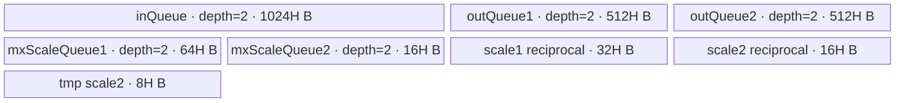
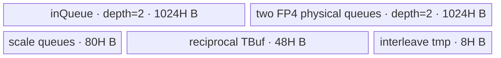
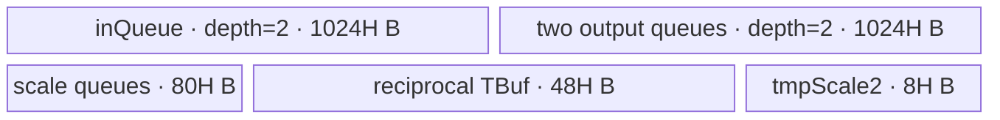

# DynamicMxQuantWithDualAxis 950 ACLNN 算子知识

## 算子速览

| 项目 | 内容 |
|---|---|
| 实际入口 | `aclnnDynamicMxQuantWithDualAxisV2GetWorkspaceSize` + `aclnnDynamicMxQuantWithDualAxisV2`，公开两段式 ACLNN；950 选版本族中新增 `scaleAlg=2`、`dstTypeMax` 的 V2。 |
| 计算语义 | 同一输入同时沿末轴和倒数第二轴按 32 元素分组计算 E8M0 scale，并分别量化为 FP4/FP8，形成 `y1/mxscale1` 与 `y2/mxscale2`。 |
| 输入输出 | `x` 为 2～7 维 ND FLOAT16/BFLOAT16；`y1/y2` 与 `x` 同 shape，目标为 FLOAT4_E2M1/FLOAT4_E1M2/FLOAT8_E4M3FN/FLOAT8_E5M2；两个 scale 为 FLOAT8_E8M0 且增加末维 2。 |
| 执行类型 | 单 Kernel `AIV_VECTOR`：entry 声明 `KERNEL_TYPE_MIX_AIV_1_0`，可达 body 只有 MicroAPI Vector、DMA、Queue/Event，无 AIC/Cube 或 MIX_CV 节点。 |
| Kernel 路线 | R-001 OCP；R-002 CuBALS FP8；R-003 DynamicDtypeRange 默认/6/7；R-004 DynamicDtypeRange 自定义范围。 |
| 核心资源 | GM 五路张量；5 个 depth=2 `TQue`、3 个 `TBuf`、MicroAPI RegTensor；单 Kernel 不使用算子自有 workspace，仍申请平台 `GetLibApiWorkSpaceSize()`。 |
| 来源闭包 | `source_closed`：公开 V2 契约、生成式 ACLNN/OpDef 接线、InferShape、950 Tiling/POD、模板 tuple、entry/body、公共平台常量与 ascend950 binary/CMake 接线闭合；生成的 ACLNN inner bridge 作为框架边界。 |
| 验证状态 | 已完成源码闭包检查；本次知识提取未执行编译、真机、数值或性能测试。 |

## 接口与语义

### 计算语义

把输入前 `rank-2` 个维度合为 `B`，记末两维为 `M,N`，逻辑视图为 `[B,M,N]`。对末轴每个 32 元素组 `G1` 与倒数第二轴每个 32 元素组 `G2` 分别求 scale，再用对应倒数缩放并 cast：

```text
OCP:       shared_exp = floor(log2(max(abs(G)))) - emax
           scale = 2^shared_exp
CuBALS:    s = max(abs(G)) / Amax(dst); scale = 2^rounded_exponent(s)
Dynamic:   s = max(abs(G)) / dstTypeMax; scale = 2^rounded_exponent(s)
quantized: y[k] = cast_dst(x[k] / scale, roundMode)
```

`y1/mxscale1` 属于末轴分组，`y2/mxscale2` 属于倒数第二轴分组。scale 组数向偶数 pad：`mxscale1` 等价 `[... , M, ceil(ceil(N/32)/2), 2]`，`mxscale2` 等价 `[... , ceil(ceil(M/32)/2), N, 2]`；`mxscale2` 还按相邻两组交织写出。

### 输入、输出与属性

| 参数 | shape/layout | dtype | 约束、默认值与语义 |
|---|---|---|---|
| `x` | ND，rank 2～7；公开接口允许非连续 | FLOAT16、BFLOAT16 | 必填；FP4 输出时末维必须为偶数。 |
| `roundModeOptional` | Host 字符串；空指针取 `rint` | `char*` | FP4 支持 `rint/floor/round`；FP8 只支持 `rint`。 |
| `dstType` | Host 标量 | `int64_t` | 35=FLOAT8_E5M2，36=FLOAT8_E4M3FN，40=FLOAT4_E2M1，41=FLOAT4_E1M2；必须与 `y1/y2` dtype 一致。 |
| `scaleAlg` | Host 标量 | `int64_t` | 0=OCP；1=CuBALS，仅 FP8；2=DynamicDtypeRange，仅 FP4_E2M1。 |
| `dstTypeMax` | Host 标量 | API 为 `double`，OpDef/POD 为 `float` | V2 新增；公开值为 0 或 `[6,12]`，仅 `scaleAlg=2`/FP4_E2M1 有效；Host 预计算 `float` 倒数。 |
| `y1Out`、`y2Out` | 与 `x` 相同；公开接口允许非连续 | `dstType` 指定的 FP4/FP8 | 分别为 -1/-2 轴量化结果；FP4 在物理 GM 中两个 4-bit 元素打包为 1 字节。 |
| `mxscale1Out` | rank=`rank(x)+1` | FLOAT8_E8M0 | 原末轴替换为 `ceil(N/64)`，追加末维 2。 |
| `mxscale2Out` | rank=`rank(x)+1` | FLOAT8_E8M0 | 原 -2 轴替换为 `ceil(M/64)`，追加末维 2；相邻 scale 行交织。 |
| `workspaceSize`、`executor` | Host 输出 | `uint64_t*`、`aclOpExecutor**` | 第一段返回 executor 图及其 Device workspace。 |
| `workspace`、`stream` | Device 地址、ACL stream | `void*`、`aclrtStream` | 第二段在指定 stream 运行同一次第一段产生的 executor。 |

### 入口与版本

V1 与 V2 都是公开入口，但 950 的最新公开版本是 V2：V2 在 V1 的 `scaleAlg=0/1` 上增加 `scaleAlg=2` 和 `dstTypeMax`。`DynamicMxQuantWithDualAxis` OpDef 用 `.Version(2)` 注册 `dst_type_max`，同一 Host/Tiling/Kernel body 同时承载这些算法。固定仓通过 `add_modules_sources(... ACLNNTYPE aclnn)` 生成 ACLNN bridge，未提交 bridge 展开体；该自动生成层只作为入口到 `DynamicMxQuantWithDualAxis` OpDef 的框架边界，不据此推测其内部 Contiguous/ViewCopy 节点。

公开 V2 文档、README、OpDef、binary config 与 CMake 均只支持 Ascend 950。文档明确 A2/A3 为不支持，因此不能以 `arch35` 文件存在替代公开支持证据。

## Host/Launcher 执行流程

### 参数校验与前处理

1. ACLNN 第一段按公开契约检查 `x`、输出、属性、shape、dtype、format 和平台；具体自动生成 bridge 不在固定仓，属于框架边界。
2. `InferShapeForDynamicMxQuantWithDualAxis` 拒绝已知 rank 不在 `[2,7]` 的输入；`y1/y2=x.shape`，两个 scale 把量化轴先变为 `ceil(dim/32)`、再两两折叠并追加维度 2；未知 rank 传播为 unknown rank。
3. `InferDataTypeForDynamicMxQuantWithDualAxis` 把 `dstType` 映射到两路 y，并固定两路 scale 为 FLOAT8_E8M0。
4. Tiling 的 `DoTiling` 顺序为 `GetPlatformInfo -> CheckDtype -> GetAttr -> CheckShape -> SetTilingParams -> SetTilingKey -> SetTilingData`；任一步失败即返回 `GRAPH_FAILED`。
5. `CheckDtype` 检查输入和 `y1/mxscale1` dtype；`GetAttr` 检查 round/dst/algorithm 组合并把 API `dstTypeMax` 窄化为 float 属性；`CheckShape` 检查两路 y 与 x 相同、scale shape 和 FP4 末维偶数约束。

### 参数、Workspace 与生命周期

`GetPlatformInfo` 读取 `GetCoreNumAiv()`、UB 字节数和 `GetLibApiWorkSpaceSize()`。此算子 Kernel 的 `workspace` 参数没有被 body 读取，所以 workspace 是运行库保留区而非算子自有跨 Kernel 中间量；executor/调用方拥有该区，第二段运行期间有效。

令 `U` 为平台 UB 字节数、`g=groupPerUb`。Host 固定 `blockSize=32`、`blockW=256`，并计算：

```text
per_group_host = 32768(x) + 16384(y1) + 16384(y2)
               + 1024(scale2 reciprocal) + 8192(scale1 reciprocal)
               + 512(scale2) + 4096(scale1) + 1024(tmp scale2)
               = 80384 bytes
g = floor((U - 1024) / 2 / 80384)
splitBlockH = 2 * 32 * g = 64g rows
workspaceSize = GetLibApiWorkSpaceSize()
```

该 Host 预算统一乘 2，覆盖 depth=2 Queue，并对单缓冲 TBuf 保守计入；真实 `InitBuffer` 字节账见后文。

### 启动图与失败传播

```text
aclnnDynamicMxQuantWithDualAxisV2GetWorkspaceSize
  -> [generated ACLNN bridge / executor boundary]
  -> DynamicMxQuantWithDualAxis OpDef + InferShape/InferDataType
  -> TilingForDynamicMxQuantWithDualAxis::DoTiling
  -> single AIV launch: dynamic_mx_quant_with_dual_axis<<<usedCoreNum, stream>>>
       inputs: x
       outputs: y1, mxScale1, y2, mxScale2
       POD: DynamicMxQuantWithDualAxisTilingData
       workspace: library workspace, body unused
```

只有一个 Device 节点，没有跨 Kernel workspace 边。Tiling 失败不产生有效 launch；第二段由 executor 在调用者 stream 上发射 Kernel，框架错误直接作为 ACLNN 状态返回。Kernel 内每核负责不重叠的二维 tile，四个输出直接落 GM，生命周期到 stream 完成。

## Route 与参数设计

### 分核与资源计算

合轴得到 `B=product(d[0:rank-2])`、`M=d[-2]`、`N=d[-1]`。令 `H=64g`、`W=256`：

```text
tilesM = ceil(M/H)
tilesN = ceil(N/W)
tasks = B * tilesM * tilesN
usedCoreNum = min(totalAivCoreNum, tasks)
headTask = ceil(tasks/totalAivCoreNum)
tailTask = floor(tasks/totalAivCoreNum)
headCoreNum = tasks % totalAivCoreNum
```

core `< headCoreNum` 处理 `headTask`，其余活动核处理 `tailTask`。每 task 的行/列尾块分别为 `M % H`（整除取 H）和 `N % 256`（整除取 256）。scale 逻辑步长为 `scale1Cols=ceil(N/64)*2`、`scale2Rows=ceil(M/64)*2`。

### Route 选择

| 顺序 | Route | Key/模板 | 精确选择条件与优先级 | 不适用去向 |
|---:|---|---|---|---|
| 1 | R-001 OCP | tuple `(mode=0, roundMode={4,0,1}, scaleAlg=0)` | `scaleAlg==0`；FP8 已先限制 `roundMode==rint`，FP4 可三种 round；所有合法目标 dtype。 | `scaleAlg==1` 去 R-002；`scaleAlg==2` 去 R-003/R-004；非法失败。 |
| 2 | R-002 CuBALS FP8 | tuple `(0,4,1)` | `scaleAlg==1 && dstType in {35,36} && roundMode==rint`。 | 组合不合法在 `GetAttr` 失败。 |
| 3 | R-003 Dynamic 默认范围 | tuple `(0,{4,0,1},2)` + body runtime branch | `scaleAlg==2 && dstType==40 && dstTypeMax in {0,6,7}`。 | 同 key 但其它 `[6,12]` 值去 R-004。 |
| 4 | R-004 Dynamic 自定义范围 | 同 R-003 tuple | `scaleAlg==2 && dstType==40 && dstTypeMax in [6,12] \ {6,7}`。 | 范围外或 dtype/algorithm 不匹配时 Host 失败。 |

```text
validate dtype/round/algorithm/range
if scaleAlg == 0: R-001
else if scaleAlg == 1: R-002
else if dstTypeMax == 0 || 6 || 7: R-003
else: R-004
```

### 模板/实现执行矩阵

| Route | key/selector | dtype/shape/platform 完整命中条件 | 执行拓扑与 Kernel 节点 | 实际模板/body | 内存与同步特征 | tail/fallback |
|---|---|---|---|---|---|---|
| R-001 OCP | `(0, round, 0)` | 950；合法 FP4/FP8 与 round；rank/shape 合法 | 单 AIV Kernel | `DynamicMxQuantWithDualAxisBase<DTYPE_X,DTYPE_Y1,DTYPE_Y2,RoundModeMapper,0>`；`ComputeScaleOcp` | 公共 5 Queue+3 TBuf；指数域 scale；Queue 和 `V_MTE2` event | 行/列 tile、32 组和 FP4 pack tail；非法组合失败。 |
| R-002 CuBALS | `(0,4,1)` | 950；FP8 E4M3/E5M2；rint | 单 AIV Kernel | 同模板 `scaleAlg=1`；`ComputeScaleCublas` | 公共 UB；FP32 amax×目标倒数；寄存器链内复用 | 同公共 tail；无其它 fallback。 |
| R-003 Dynamic default | `(0,round,2)` | 950；FP4_E2M1；`dstTypeMax=0/6/7` | 单 AIV Kernel | `scaleAlg=2`；`ComputeScaleDynamicDefault` | 公共 UB；BF16 add/sub 指数进位；FP16 先 RINT→BF16 | 同公共 tail；运行时不命中转 R-004。 |
| R-004 Dynamic custom | `(0,round,2)` | 950；FP4_E2M1；`dstTypeMax in [6,12]\{6,7}` | 单 AIV Kernel | `scaleAlg=2`；`ComputeScaleDynamicCustom` | 公共 UB；FP32 amax×Host 预计算倒数；寄存器复用 | 同公共 tail；范围外失败。 |

### 隐藏性能 Guard

| Guard | Host/Tiling 条件 | Device/资源原因 | 影响 Route | 不满足时去向 | 源码符号 |
|---|---|---|---|---|---|
| UB 分组 | `g=floor((U-1024)/2/80384)` | `H=64g` 决定全部 Queue/TBuf 容量；源码未显式检查 `g>0` | 全部 | 固定仓没有安全 fallback；UB 过小时后续 `ceil(M/H)` 存在除零风险。 | `dynamic_mx_quant_with_dual_axis_tiling.cpp::SplitCore` |
| FP4 pack | `N % 2 == 0` | 两个 FP4 物理打包为一个 uint8，CopyOut 用 `dataLen/2` | R-001/R-003/R-004 的 FP4 | Host `CheckShape` 失败。 | `CheckShape`、`CopyOut` |
| 末轴 pad | 全局 `dimNeg1Tail<256` 时 `dimNeg1IsOdd=true` | 当前实现把该全局 flag 传给每个 task：先把整块 input Queue 清零，再 `DataCopyPad`，避免尾列无效 lane 读入旧 UB 数据 | 全部 | 无替代 Route；存在末轴 tail 时所有 task 都走带 event 的清零路径。 | `Process`、`CopyIn` |
| scale 偶数化 | `ceil(axis/32)%2` 可能为奇 | scale 输出按相邻两个组储存，缺组为 0 | 全部 | 无 fallback；Tiling 扩展 shape/stride。 | `SetTilingParams`、`CopyOut` |
| FP8 round | `roundMode==rint` | FP8 entry mapper和公开精度约束只允许 RINT | R-001/R-002 FP8 | `GetAttr` 失败。 | `GetAttr`、`RoundModeMapper` |
| Dynamic branch | `dstTypeMax==0 \|\| 6 \|\| 7` | 这些值有专门的 BF16 指数 add/sub 常量；其余值要 FP32 乘倒数 | R-003/R-004 | 同 key 内转另一 body helper。 | `InitParams`、`ComputeAll` |
| 950 overflow mode | `__NPU_ARCH__==3510` | entry 保存 SPR 60，`Init` 清零，结束后恢复 | 全部 | 其它编译架构不执行该段；但本卡只发布 950。 | `dynamic_mx_quant_with_dual_axis`、`Init` |

### POD/ABI

`DynamicMxQuantWithDualAxisTilingData` 是标准顺序字段：25 个 `int64_t` 后接 2 个 `float`；由字段类型和顺序可得 `sizeof=208`、`alignof=8`。Host 直接 `memcpy_s` 整体写入，Device 用同一头文件解析。

| 结构 | 字段 | 类型/位宽 | ABI 布局 | 单位 | Host/launcher producer | Device consumer | 边界 |
|---|---|---|---|---|---|---|---|
| `DynamicMxQuantWithDualAxisTilingData` | `totalCoreNum` | int64/64 | offset 0 | core | `GetCoreNumAiv` | 固定 body 不读 | 仅审计/日志字段。 |
| 同上 | `usedCoreNum` | int64/64 | offset 8 | core | `min(totalCoreNum,totalTaskNum)` | `Process` 活动核 guard | 也写 `blockDim`。 |
| 同上 | `roundMode` | int64/64 | offset 16 | enum | `GetRoundMode` | body 不读；编译 tuple 已承载 | 4/0/1。 |
| 同上 | `dstType` | int64/64 | offset 24 | GE dtype code | `GetAttr` | body 不读；`DTYPE_Y1` 承载 | 35/36/40/41。 |
| 同上 | `scaleAlg` | int64/64 | offset 32 | enum | ACLNN attr | body不读；模板参数承载 | 0/1/2。 |
| 同上 | `blockSize` | int64/64 | offset 40 | element | 常量 32 | scale 循环、offset、CopyOut | 必须为 32。 |
| 同上 | `dim0` | int64/64 | offset 48 | batch product | `MergeAxis` | body 不直接读 | 已用于 Host tasks。 |
| 同上 | `dimNeg2` | int64/64 | offset 56 | element | `x.shape[-2]` | GM task offset | M。 |
| 同上 | `dimNeg1` | int64/64 | offset 64 | element | `x.shape[-1]` | DMA stride、GM offset | N。 |
| 同上 | `blockW` | int64/64 | offset 72 | element/row | 常量 256 | `ubRowLen_` | Vector 横向 tile。 |
| 同上 | `splitBlockH` | int64/64 | offset 80 | row | `64*groupPerUb` | `ubRowCount_`、task offset | 依赖 `g>0`。 |
| 同上 | `tilingKey` | int64/64 | offset 88 | opaque key | `tilingParams.tilingKey` 默认 0 | body 不读 | 真正 dispatch key 由 `context->SetTilingKey` 单独写。 |
| 同上 | `dimNeg2Tail` | int64/64 | offset 96 | row | `M%H`，整除取 H | 尾行 task | 非零。 |
| 同上 | `dimNeg1Tail` | int64/64 | offset 104 | element | `N%256`，整除取 256 | 尾列 task | FP4 时为偶数。 |
| 同上 | `dimNeg2SplitBlockNum` | int64/64 | offset 112 | task block | `ceil(M/H)` | task→M tile 映射 | `H` 不得 0。 |
| 同上 | `dimNeg1BlockNum` | int64/64 | offset 120 | task block | `ceil(N/256)` | task→N tile 映射 | N 空域未见专门 guard。 |
| 同上 | `blockPerHeadCore` | int64/64 | offset 128 | task/core | `ceil(tasks/totalCoreNum)` | `InitParams` | former core。 |
| 同上 | `blockPerTailCore` | int64/64 | offset 136 | task/core | `floor(tasks/totalCoreNum)` | `InitParams` | tail core。 |
| 同上 | `headCoreNum` | int64/64 | offset 144 | core | `tasks%totalCoreNum` | `InitParams` | 分界。 |
| 同上 | `dimNeg2IsOdd` | int64/64 | offset 152 | bool | `ceil(M/32)%2` | 固定 body 不读 | shape/pad审计字段。 |
| 同上 | `dimNeg1IsOdd` | int64/64 | offset 160 | bool | `ceil(N/32)%2` | 固定 body 不读 | task runtime另算 tail bool。 |
| 同上 | `dimNeg1IsPad` | int64/64 | offset 168 | bool | `N%32!=0` | 固定 body 不读 | 审计字段。 |
| 同上 | `blockCountPerBatch` | int64/64 | offset 176 | task/batch | `tilesM*tilesN` | task→batch offset | 大 shape 乘法无显式溢出检查。 |
| 同上 | `scale1ColCountPerBatch` | int64/64 | offset 184 | uint8 scale columns | `ceil(N/64)*2` | `scale1Offset` | 偶数。 |
| 同上 | `scale2RowCountPerBatch` | int64/64 | offset 192 | uint8 scale rows | `ceil(M/64)*2` | `scale2Offset` | 偶数。 |
| 同上 | `dstTypeMax` | float/32 | offset 200 | value | V2 double attr 窄化为 float | `InitParams` 与 R-003/R-004 branch | 精确比较 0/6/7，这三值可由 float 精确表示。 |
| 同上 | `invDstTypeMax` | float/32 | offset 204 | reciprocal | `1/dstTypeMax`；0 时 `1/6` | R-004 `Duplicate` | 预计算避免 Device 除法。 |

### Route 源码闭包

| Route | Key/selector | Host/Tiling producer | POD/参数 | Kernel entry/router 节点 | Kernel body/直接依赖 | 构建接线 |
|---|---|---|---|---|---|---|
| R-001 | `(0,round,0)` | `GetAttr/SetTilingKey/SetTilingParams` | 公共 POD | `dynamic_mx_quant_with_dual_axis<0,round,0>` | `ComputeScaleOcp` + dtype-specific ComputeY | ascend950 CMake/binary JSON |
| R-002 | `(0,4,1)` | 同上 | 公共 POD、`invDtypeMax_` 常量 | `<0,4,1>` | `ComputeScaleCublas` + FP8 ComputeY | 同上 |
| R-003 | `(0,round,2)` + runtime | `dstTypeMax`/倒数 producer | POD 两个 float | `<0,round,2>` | `ComputeScaleDynamicDefault` + FP4 ComputeY | 同上 |
| R-004 | 同 R-003 | 同上 | POD `invDstTypeMax` | 同 R-003 entry | `ComputeScaleDynamicCustom` + FP4 ComputeY | 同上 |

## Kernel 实现

### 公共执行流程

entry 解析 POD、创建 `TPipe`，把 ACLNN 的 logical FP4 输出指针统一绑定为 `uint8_t` GM，然后构造模板类并依次 `Init/Process`。`InitParams` 将 block 映射为连续 task 区间；每个 task 计算 `[calcRow,calcCol]` tile 的五个 GM offset。`CopyIn` 用二维 `DataCopyPad` 搬入并补齐到 256 列；`ComputeAll` 每 32 行为一个 scale block，先同时算两轴 scale/reciprocal，再量化两路 y，最后交织 scale2；`CopyOut` 直接提交四路 GM。

### Route R-001：OCP 指数域双轴量化

#### 适用条件

##### 选择证据

| 层级 | 文件 | 符号 | 源码谓词/参数 | 结果/下一跳 |
|---|---|---|---|---|
| ACLNN | `docs/aclnnDynamicMxQuantWithDualAxisV2.md` | V2 参数约束 | `scaleAlg=0`，合法目标 dtype/round | OCP。 |
| Host | `op_host/dynamic_mx_quant_with_dual_axis_tiling.cpp` | `GetAttr/SetTilingKey` | 合法性后 `scaleAlg_=0`，`mode_=0` | tuple `(0,round,0)`。 |
| Router | `op_kernel/dynamic_mx_quant_with_dual_axis.cpp` | entry template | `scaleAlg` 编译参数为 0 | 实例化 base。 |
| Body | `op_kernel/arch35/dynamic_mx_quant_with_dual_axis_base.h` | `ComputeAll` | `if constexpr(scaleAlg==0)` | `ComputeScaleOcp`。 |

#### Device 数据流

##### 函数级调用链

```text
dynamic_mx_quant_with_dual_axis<0,round,0>
  -> Base::Init -> InitParams + InitBuffer
  -> Base::Process -> ProcessOneLoop
    -> CopyIn -> ComputeAll
      -> ComputeScaleOcp
      -> ComputeYVf -> FP4 helper or FP8 helpers
      -> Interleave(scale2)
    -> CopyOut
```

##### 源码等价伪码

```text
for task in this_core_tasks:
  map task -> batch, m_tile, n_tile; derive calcRow/calcCol and four output offsets
  if the global N tile has a tail, zero input UB for every task; DMA-pad calcRow rows x calcCol elements
  for each full 32-row group and final row tail:
    for row in group:
      deinterleave 256 B16 values to even/odd regs
      use exponent bits; reduce each consecutive 32 values for scale1
      accumulate even/odd column maxima for scale2
      scale = clamp/special(floor exponent - dtype emax); reciprocal = BF16 exponent inverse
    quantize x by scale1 and scale2 reciprocal; FP4 pack or FP8 layout-store
  interleave adjacent scale2 groups
  DMA-pad y1, y2, scale1, scale2 to GM
```

#### 内存与数据搬运

##### 资源与搬运表

| 层级/缓冲区 | offset/地址公式 | extent/容量公式 | dtype/layout | producer | consumer | owner/lifetime | 对齐/复用 |
|---|---|---|---|---|---|---|---|
| GM x | `batch*M*N + mTile*H*N + nTile*256` | `calcRow*calcCol` | xDtype ND | caller | `CopyIn` | caller/stream | 2-D DMA src stride `(N-calcCol)*2` bytes。 |
| `inQueue` | local 0 | `H*256*2` bytes/buffer | xDtype padded rows | `CopyIn` | `ComputeAll` | pipe/dequeue-free | depth 2；全局存在 N-tail 时每个 task 先清零。 |
| `mxScale1ReciprocalBuf` | per 32-row block | `H*32` bytes | uint16 BF16 exponent | scale helper | ComputeY | pipe/all tasks | 单 TBuf，当前 task覆盖。 |
| `mxScale2ReciprocalBuf` | per M group/column | `256*(ceil(H/64)*2)*2=16H` bytes | uint16 interleaved | scale helper | ComputeY | pipe/all tasks | 单 TBuf。 |
| `tmpScale2Buf` | per M group/column | `256*(ceil(H/64)*2)=8H` bytes | uint8 pre-interleave | scale helper | `Interleave` | pipe/all tasks | 之后可覆盖。 |
| 四个 output Queue | local | y1/y2 各 `256H`；scale1 `32H`；scale2 `8H` bytes/buffer | uint8 physical | ComputeAll | CopyOut | pipe/enqueue-dequeue | 各 depth 2。 |
| GM outputs | 公共 offset 公式 | 有效 tile，FP4 y 除 2 字节 | packed FP4/FP8/E8M0 | CopyOut | caller | caller/stream | scale1/2 以偶数组布局。 |

##### 分层内存布局



##### 字节账与复用顺序

```text
H = splitBlockH = 64g
UB_total = 1024H + 512H + 512H + 64H + 16H + 32H + 16H + 8H
         = 2184H = 139776g bytes
Host conservative selector requires 1024 + 160768g <= U
therefore actual UB_total <= Host-selected budget < U
dynamic_ub = N/A（AIV TPipe 静态 InitBuffer）
workspace_total = GetLibApiWorkSpaceSize()（Kernel body不使用）
```

| 复用子区 | 写入者 | 读取者/消费点 | 下一次覆盖 | 同步或释放依据 | 安全条件 |
|---|---|---|---|---|---|
| input Queue slot | `CopyIn` | `ComputeAll` | depth=2 后续 task | EnQue→DeQue→FreeTensor | FreeTensor 后才复用。 |
| reciprocal TBuf | 当前 scale helper | 当前 ComputeY | 下一 task | 同一 AIV 顺序执行 | ComputeY 完成前不可覆盖。 |
| tmpScale2 | scale helper | `Interleave` | 下一 task | 函数顺序 | 交织完成后才覆盖。 |
| output Queue slot | ComputeAll | CopyOut | 后续 task | EnQue→DeQue→FreeTensor | CopyOut 后释放。 |

#### 同步、精度与尾块

##### 同步与数值边界表

| 阶段 | primitive/机制 | producer | consumer/等待点 | 保护对象 | 精度/尾块 |
|---|---|---|---|---|---|
| tail 清零→DMA | `V_MTE2 SetFlag/WaitFlag` | `Duplicate` | `DataCopyPad` | input UB | 防止 DMA 与 Vector 清零冲突。 |
| CopyIn→Compute | `TQue EnQue/DeQue` | MTE2 | Vector | input Queue slot | 右 padding 为 0。 |
| Compute→CopyOut | 四组 `EnQue/DeQue` | Vector | MTE3 | output slots | 只搬 `calcRow/calcCol` 有效域。 |
| OCP scale | exponent mask/reduce/select | input regs | reciprocal/scale | scale regs/TBuf | FP16先 CAST_TRUNC→BF16取指数；INF/NAN→E8M0 `0xff`，0→0。 |
| FP4/FP8 cast | compile-time `roundMode` + SAT | reciprocal multiply | packed output | RegTensor | FP8强制 RINT；FP4支持三种 round。 |

#### 关键实现

##### 符号证据表

| 阶段 | 文件 | 符号/模板实例 | 实现事实 |
|---|---|---|---|
| Host/Tiling producer | `op_host/dynamic_mx_quant_with_dual_axis_tiling.cpp` | `SetTilingParams/SetTilingKey` | 固定 32×256 基块、UB 分组、tuple。 |
| Kernel entry/router | `op_kernel/dynamic_mx_quant_with_dual_axis.cpp` | `dynamic_mx_quant_with_dual_axis<0,round,0>` | AIV entry、round mapper、POD解析。 |
| Device body/helper | `op_kernel/arch35/dynamic_mx_quant_with_dual_axis_base.h` | `ComputeScaleOcp/ComputeYVf/CopyIn/CopyOut` | 双轴指数归约、量化、pad与搬出。 |

### Route R-002：CuBALS FP8

#### 适用条件

##### 选择证据

| 层级 | 文件 | 符号 | 源码谓词/参数 | 结果/下一跳 |
|---|---|---|---|---|
| ACLNN/Host | V2 doc + tiling cpp | `GetAttr` | `scaleAlg==1` 仅 FP8，FP8 round 仅 rint | tuple `(0,4,1)`。 |
| Router | kernel cpp | entry template | `scaleAlg=1` | base specialization。 |
| Body | base.h | `ComputeAll` | `if constexpr(scaleAlg==1)` | `ComputeScaleCublas`。 |

#### Device 数据流

##### 函数级调用链

```text
entry<0,4,1> -> Init -> Process -> CopyIn -> ComputeAll
  -> ComputeScaleCublas -> ComputeY1ToFP8 -> ComputeY2ToFP8(even/odd half) -> CopyOut
```

##### 源码等价伪码

```text
for each 32-row group:
  deinterleave each 256-element row; abs; reduce 32-wide scale1 maxima
  accumulate even/odd scale2 maxima
  fp32_s = amax * invAmax(dst)
  exp,man = bit_extract(fp32_s)
  round exp upward for normal fractional s; also subnormal man>0.5
  emit E8M0 scale and BF16 reciprocal exponent
  multiply x by reciprocal in FP32 (FP16 input) or BF16 then FP32 (BF16 input)
  cast four RegLayout lanes to FP8, Add bytes, single aligned store
```

#### 内存与数据搬运

##### 资源与搬运表

| 层级/缓冲区 | offset/地址公式 | extent/容量公式 | dtype/layout | producer | consumer | owner/lifetime | 对齐/复用 |
|---|---|---|---|---|---|---|---|
| GM/Queue/TBuf | 与 R-001 完全相同 | `UB_total=2184H` | xDtype/uint8/uint16 | 公共 CopyIn/scale | FP8 helpers/CopyOut | pipe/task | Route 合并边界中内存相同。 |
| RegTensor | 每 256 元素 row | 固定仓未暴露字节分配 | uint16/uint32/float/FP8 layout | `ComputeScaleCublas`、FP8 helpers | 同函数 store | VEC scope | 死值寄存器复用。 |

##### 分层内存布局


##### 字节账与复用顺序

```text
UB_total = 2184H; dynamic_ub = N/A; workspace_total = GetLibApiWorkSpaceSize()
```

| 复用子区 | 写入者 | 读取者/消费点 | 下一次覆盖 | 同步或释放依据 | 安全条件 |
|---|---|---|---|---|---|
| UB slots | 与 R-001 相同 | 与 R-001 相同 | 后续 task | Queue/函数顺序 | 同 R-001。 |
| `maxFP32/manFP32/scale1*` regs | scale1链 | scale1 output/reciprocal | 循环后作为 scale2链 | VEC程序顺序及注释标出的 death point | 旧值最后消费后才改变含义。 |

#### 同步、精度与尾块

##### 同步与数值边界表

| 阶段 | primitive/机制 | producer | consumer/等待点 | 保护对象 | 精度/尾块 |
|---|---|---|---|---|---|
| Queue/event | 同 R-001 | 同 R-001 | 同 R-001 | UB slots | 同一 tail 网络。 |
| scale | FP32 Mul + 指数/尾数比较 | amax | E8M0/reciprocal | RegTensor | normal 与 subnormal 分别条件进位；目标倒数为 E4M3/E5M2 常量。 |
| quant | 4路/2路 RegLayout cast | FP32 scaled x | y1/y2 stores | RegTensor | SAT+RINT，padding lane 不写 GM 有效域。 |

#### 关键实现

##### 符号证据表

| 阶段 | 文件 | 符号/模板实例 | 实现事实 |
|---|---|---|---|
| Host/Tiling producer | tiling cpp | `GetAttr/SetTilingKey` | FP8/算法/round guard。 |
| Kernel entry/router | kernel cpp | `<0,4,1>` | 编译期 route。 |
| Device body/helper | base.h | `ComputeScaleCublas/ComputeY1ToFP8/ComputeY2ToFP8` | FP32 scale与RegLayout FP8输出。 |

### Route R-003：DynamicDtypeRange 默认/6/7

#### 适用条件

##### 选择证据

| 层级 | 文件 | 符号 | 源码谓词/参数 | 结果/下一跳 |
|---|---|---|---|---|
| Host | tiling cpp | `GetAttr` | `scaleAlg=2`、FP4_E2M1、范围合法 | tuple `(0,round,2)`。 |
| Body init | base.h | `InitParams` | `dstTypeMax==0/6` 或 `==7` | 装载两套 add/sub 常量。 |
| Body dispatch | base.h | `ComputeAll` | `dstTypeMax==0 \|\| 6 \|\| 7` | `ComputeScaleDynamicDefault`。 |

#### Device 数据流

##### 函数级调用链

```text
entry<0,round,2> -> InitParams(addValueBit/subNum) -> Process -> CopyIn -> ComputeAll
  -> ComputeScaleDynamicDefault -> ComputeYFP16ToFP4 or ComputeYBF16ToFP4 -> CopyOut
```

##### 源码等价伪码

```text
amax = reduce(abs(BF16(x)))  # FP16先RINT转BF16，并把INF/NAN替换为BF16 INF
scale1_exp = exponent((amax + addValueBit) & expMask) - FP4_E2M1_emax
scale2_exp = exponent(amax - subNumForScale)
select zero/subnormal/inf-nan special cases
emit E8M0 scale and BF16 reciprocal
multiply x by reciprocal; apply FP4-specific round/truncate correction; SAT cast and pack
```

#### 内存与数据搬运

##### 资源与搬运表

| 层级/缓冲区 | offset/地址公式 | extent/容量公式 | dtype/layout | producer | consumer | owner/lifetime | 对齐/复用 |
|---|---|---|---|---|---|---|---|
| GM/UB | 同 R-001 | `UB_total=2184H` | packed FP4 outputs | 公共路径 | CopyOut | pipe/task | FP4有效 y 字节为逻辑元素一半，但 Queue 按 1 byte/element 保守分配。 |
| RegTensor | 32元素归约和256元素行 | 固定仓不可见 | BF16 bits/FP32/FP4 | default scale + FP4 helper | stores | VEC scope | `expOnly/addedVal/sharedExp/scaleValue` 在 scale1 后复用为 scale2。 |

##### 分层内存布局



##### 字节账与复用顺序

```text
UB_total = 2184H; dynamic_ub = N/A; workspace_total = GetLibApiWorkSpaceSize()
```

| 复用子区 | 写入者 | 读取者/消费点 | 下一次覆盖 | 同步或释放依据 | 安全条件 |
|---|---|---|---|---|---|
| 公共 UB | 同 R-001 | 同 R-001 | 后续 task | Queue/函数顺序 | 同 R-001。 |
| scale registers | scale1 loop | scale1 store/reciprocal | scale2 even/odd | 源码函数顺序 | 最终 store 需要并存的两路用独立 regs。 |

#### 同步、精度与尾块

##### 同步与数值边界表

| 阶段 | primitive/机制 | producer | consumer/等待点 | 保护对象 | 精度/尾块 |
|---|---|---|---|---|---|
| Queue/event | 同 R-001 | 同 R-001 | 同 R-001 | UB | 公共 tail。 |
| FP16 amax | `CAST_RINT` 到 BF16 | FP16 x | BF16 abs/max | RegTensor | 与 OCP 的 TRUNC 明确不同。 |
| scale rounding | BF16 add/sub bit trick | amax | scale/reciprocal | RegTensor | 0/6 用 `0x3f/0xc1`，7 用 `0x1f/0xe1`。 |
| FP4 quant | FP32/BF16 multiply + `ComputeFP4FromHalf` | reciprocal | packed GM | RegTensor | 保留负零并使用编译 round mode。 |

#### 关键实现

##### 符号证据表

| 阶段 | 文件 | 符号/模板实例 | 实现事实 |
|---|---|---|---|
| Host/Tiling producer | tiling cpp | `GetAttr/SetTilingData` | 产生 float max/倒数与 scaleAlg=2 tuple。 |
| Kernel entry/router | kernel cpp | `<0,round,2>` | 单 entry。 |
| Device body/helper | base.h | `InitParams/ComputeScaleDynamicDefault/ComputeY*FP4` | runtime default branch、bit scale和FP4 pack。 |

### Route R-004：DynamicDtypeRange 自定义范围

#### 适用条件

##### 选择证据

| 层级 | 文件 | 符号 | 源码谓词/参数 | 结果/下一跳 |
|---|---|---|---|---|
| ACLNN/Host | V2 doc + tiling cpp | `GetAttr` | `scaleAlg=2`、FP4_E2M1、`dstTypeMax in [6,12]` | 产生 float倒数。 |
| Body | base.h | `ComputeAll` | 不等于0/6/7 | `ComputeScaleDynamicCustom`。 |

#### Device 数据流

##### 函数级调用链

```text
entry<0,round,2> -> InitParams(dstTypeMax, invDstTypeMax) -> Process -> CopyIn -> ComputeAll
  -> ComputeScaleDynamicCustom -> FP4 ComputeY helper -> CopyOut
```

##### 源码等价伪码

```text
amax = reduce(abs(x)) for axis -1; accumulate even/odd column maxima for axis -2
s = fp32(amax) * invDstTypeMax
exp = bits(s)>>23; man = bits(s)&0x7fffff
if exp>0 && exp<254 && man>0: exp++
emit low8(exp) as E8M0; derive BF16 reciprocal exponent
quantize both axes through common FP4 path
```

#### 内存与数据搬运

##### 资源与搬运表

| 层级/缓冲区 | offset/地址公式 | extent/容量公式 | dtype/layout | producer | consumer | owner/lifetime | 对齐/复用 |
|---|---|---|---|---|---|---|---|
| GM/UB | 同 R-003 | `UB_total=2184H` | xDtype/packed FP4/E8M0 | 公共路径 | CopyOut | pipe/task | 与 R-003 仅 scale计算不同。 |
| RegTensor | group amax | 固定仓不可见 | uint16→FP32→E8M0 | custom scale | reciprocal/FP4 | VEC scope | FP32链内复用。 |

##### 分层内存布局



##### 字节账与复用顺序

```text
UB_total = 2184H; dynamic_ub = N/A; workspace_total = GetLibApiWorkSpaceSize()
```

| 复用子区 | 写入者 | 读取者/消费点 | 下一次覆盖 | 同步或释放依据 | 安全条件 |
|---|---|---|---|---|---|
| 公共 UB | 同 R-001 | 同 R-001 | 后续 task | Queue/函数顺序 | 同 R-001。 |
| FP32 scale regs | amax×倒数链 | exponent/scale store | axis -2 链 | 程序顺序 | 需要同时存活的 odd 链保留独立 regs。 |

#### 同步、精度与尾块

##### 同步与数值边界表

| 阶段 | primitive/机制 | producer | consumer/等待点 | 保护对象 | 精度/尾块 |
|---|---|---|---|---|---|
| Queue/event/tail | 同 R-001 | 同 R-001 | 同 R-001 | UB/GM | 同公共路径。 |
| Host精度 | API double→OpDef/POD float，再 float reciprocal | ACLNN attr | Device `Duplicate` | scale factor | 自定义值按 float 精度执行。 |
| Device scale | FP32 Mul、normal-only exponent进位 | amax | reciprocal | regs | 不含 R-002 的 subnormal `man>0.5` 分支。 |
| FP4量化 | 公共 helper | x×reciprocal | packed output | regs | round由 tuple编译。 |

#### 关键实现

##### 符号证据表

| 阶段 | 文件 | 符号/模板实例 | 实现事实 |
|---|---|---|---|
| Host/Tiling producer | tiling cpp | `GetAttr` | 预计算 `invDstTypeMax` 并检查范围。 |
| Kernel entry/router | kernel cpp | `<0,round,2>` | 与 R-003 共 entry/key。 |
| Device body/helper | base.h | `ComputeScaleDynamicCustom` | runtime custom branch、FP32乘法、normal-only进位。 |

## 算子特定优化

### Trick T-001：Host 预计算自定义量化范围倒数

#### 触发与源码依据

- 适用 Route：R-004（字段也为 R-003 产生，但 R-003 不消费倒数）。
- 触发条件：V2 `scaleAlg=2` 且 `dstTypeMax` 为自定义 `[6,12] \ {6,7}`。
- Golden 来源：[`dynamic_mx_quant_with_dual_axis_tiling.cpp:146-156`](../../../../../../../cann-ops-raw/ascendc/ops-nn/955f8b33985b6d72989ebff341bb9c2c564a51bc/quant/dynamic_mx_quant_with_dual_axis/op_host/dynamic_mx_quant_with_dual_axis_tiling.cpp#L146-L156)

**官方源码（固定 Commit 连续逐字摘录）**：

```cpp
// 解析 dstTypeMax 属性 (V2接口新增，仅在 scaleAlg=2 时生效)
auto* attrDstTypeMax = attrs->GetAttrPointer<float>(INDEX_ATTR_DST_DTYPE_MAX);
OP_CHECK_NULL_WITH_CONTEXT(context_, attrDstTypeMax);
tilingParams.dstTypeMax = static_cast<float>(*attrDstTypeMax);

if (tilingParams.dstTypeMax != 0.0) {
    tilingParams.invDstTypeMax = 1.0 / tilingParams.dstTypeMax;
} else {
    // 当dstTypeMax=0时，默认使用目标数据类型最大值，当前为FP4E2M1最大值6
    tilingParams.invDstTypeMax = 1.0 / FP4E2M1_MAX;
}
```

#### 机制与设计原因

Host 把 API 值窄化为 float 后一次求倒数，通过 POD 传入；R-004 在 VEC scope 只 `Duplicate(invDstTypeMax_)` 并用 `Mul(amax, inv)`，省去每个 32 元素组的 Device 浮点除法。关键乘法因子直接来自 POD，不是目标 dtype 的固定倒数。

#### 迁移边界

- 适用：同一标量除数被大量量化组重复使用的 Vector Kernel。
- 前提：允许 Host float 精度、除数范围已校验且 POD ABI 固定。
- 失效：0/6/7 走 R-003 bit trick；CuBALS 走目标 dtype 固定倒数。
- 未验证：本次知识提取未执行编译、真机、数值或性能测试。

#### 错误做法

固定仓未提供可验证反例；迁移时不能保留 API double 精度承诺却只传 float 倒数。

### Trick T-002：四路 RegLayout cast 合并为单次 FP8 store

#### 触发与源码依据

- 适用 Route：R-001/R-002 的 FP8 分支。
- 触发条件：目标为 E4M3FN/E5M2，`ComputeY1ToFP8` 处理每个 256 元素 row。
- Golden 来源：[`dynamic_mx_quant_with_dual_axis_base.h:1684-1703`](../../../../../../../cann-ops-raw/ascendc/ops-nn/955f8b33985b6d72989ebff341bb9c2c564a51bc/quant/dynamic_mx_quant_with_dual_axis/op_kernel/arch35/dynamic_mx_quant_with_dual_axis_base.h#L1684-L1703)

**官方源码（固定 Commit 连续逐字摘录）**：

```cpp
MicroAPI::Cast<y1Dtype, float, castTraitFp32toFP8Layout0>(fp8Layout0, x0ZeroFP32, maskAll);
MicroAPI::Cast<y1Dtype, float, castTraitFp32toFP8Layout2>(fp8Layout2, x0OneFP32, maskAll);
MicroAPI::Cast<y1Dtype, float, castTraitFp32toFP8Layout1>(fp8Layout1, x1ZeroFP32, maskAll);
MicroAPI::Cast<y1Dtype, float, castTraitFp32toFP8Layout3>(fp8Layout3, x1OneFP32, maskAll);
// Add合并: 4个字节位置的FP8值合并到一个寄存器
MicroAPI::Add(
    (MicroAPI::RegTensor<uint8_t>&)fp8Layout0,
    (MicroAPI::RegTensor<uint8_t>&)fp8Layout0,
    (MicroAPI::RegTensor<uint8_t>&)fp8Layout2, maskFP8);
MicroAPI::Add(
    (MicroAPI::RegTensor<uint8_t>&)fp8Layout1,
    (MicroAPI::RegTensor<uint8_t>&)fp8Layout1,
    (MicroAPI::RegTensor<uint8_t>&)fp8Layout3, maskFP8);
MicroAPI::Add(
    (MicroAPI::RegTensor<uint8_t>&)fp8Layout0,
    (MicroAPI::RegTensor<uint8_t>&)fp8Layout0,
    (MicroAPI::RegTensor<uint8_t>&)fp8Layout1, maskFP8);
// 一次性输出256个FP8值
MicroAPI::DataCopy<uint8_t, MicroAPI::StoreDist::DIST_NORM_B8>(
    y1Addr + i * vlForHalfNumber_ * DIGIT_TWO, (MicroAPI::RegTensor<uint8_t>&)fp8Layout0, maskFP8);
```

#### 机制与设计原因

ZERO/ONE/TWO/THREE 四种 Cast trait 把四组 FP32 结果直接放入 uint32 的四个字节位置；字节位置互斥，因此三次 Add 可合并成紧凑 FP8 寄存器并一次 store 256 个值。它减少显式 Interleave/Pack 与多次 UB store，同时 round 和 SAT 仍由同一 compile-time CastTrait 保证。

#### 迁移边界

- 适用：输出为 8-bit、四组 lane 能映射到互斥 byte layout 的 950 MicroAPI 路线。
- 前提：输入拆分顺序与 layout0/2/1/3 映射完全一致，mask覆盖 256 个有效位置。
- 失效：FP4 需要 4-bit pack，改用专用 FP4 helper；-2轴只用两路 layout+Pack。
- 未验证：本次知识提取未执行编译、真机、数值或性能测试。

#### 错误做法

固定仓未提供可验证反例；若四路落在重叠字节位置，Add 将改变数值而不是纯拼接。

### Trick T-003：同一遍行扫描同时生成两轴 amax

#### 触发与源码依据

- 适用 Route：全部 Route。
- 触发条件：每个 tile 的每个 32-row group。
- Golden 来源：[`dynamic_mx_quant_with_dual_axis_base.h:507-513`](../../../../../../../cann-ops-raw/ascendc/ops-nn/955f8b33985b6d72989ebff341bb9c2c564a51bc/quant/dynamic_mx_quant_with_dual_axis/op_kernel/arch35/dynamic_mx_quant_with_dual_axis_base.h#L507-L513)

**官方源码（固定 Commit 连续逐字摘录）**：

```cpp
// 计算x0和x1的最大值，相当于计算原始相邻两个数据的最大值
MicroAPI::Max(expMaxDim1, x0ExpBF16, x1ExpBF16, maskAll);
// ReduceMax一个block，即16个数，配合上一步，可以计算出每32个数的最大值，一共256/32个
MicroAPI::ReduceMaxWithDataBlock(expMaxDim1, expMaxDim1, maskAll);
// 二分性能更高，待定
MicroAPI::Max(expMax1Dim2, expMax1Dim2, x0ExpBF16, maskAll);
MicroAPI::Max(expMax2Dim2, expMax2Dim2, x1ExpBF16, maskAll);
```

#### 机制与设计原因

一次 DINTLV_B16 load 后，横向 `ReduceMaxWithDataBlock` 产生末轴 32 元素组的最大值，同时两组累积寄存器跨行收集倒数第二轴最大值。两轴 scale 不需要分别从 UB 再读 x，直接减少重复 Vector load 和中间 amax 物化；CuBALS/Dynamic 两条 helper 沿用相同双轴框架，只改变 amax后的 scale算法。

#### 迁移边界

- 适用：两个量化轴正交、tile覆盖 256 列和最多若干个 32-row group的双轴归约。
- 前提：DINTLV lane映射与 scale2 偶/奇列交织协议一致。
- 失效：轴不相邻、group size不为32或输出布局不同，需要重建归约与交织。
- 未验证：本次知识提取未执行编译、真机、数值或性能测试。

#### 错误做法

固定仓未提供可验证反例；不能把 `expMax1Dim2/expMax2Dim2` 在行循环内清零，否则 -2 轴只保留单行结果。

## 模板与实现对比

| 对比维度 | R-001 OCP | R-002 CuBALS | R-003 Dynamic default | R-004 Dynamic custom | 设计选择依据 |
|---|---|---|---|---|---|
| 命中条件/优先级 | alg0 | alg1+FP8+rint | alg2+FP4+max 0/6/7 | alg2+FP4+其它[6,12] | Host先按alg，alg2 body再按max。 |
| 模板与 dtype | scaleAlg=0；FP4/FP8 | scaleAlg=1；FP8 | scaleAlg=2；FP4 | 同R-003 | dtype binary由JSON，round/alg由tuple。 |
| 循环与分核 | 公共 B×ceil(M/H)×ceil(N/256) | 同 | 同 | 同 | 算法不改变tile。 |
| Queue/TBuf/寄存器/dynamic UB/通信 window | 公共5 Queue+3 TBuf；指数regs | 公共UB；更多FP32 regs | 公共UB；BF16 bit regs | 公共UB；FP32 regs | 无dynamic UB/通信。 |
| 内存总占用与复用 | 2184H | 2184H | 2184H | 2184H | compile/runtime分支不改变 InitBuffer。 |
| 搬运/Vector/SIMT/NDDMA/通信 API | exponent reduce | abs+FP32 mul+conditional round | BF16 add/sub bit trick | FP32 mul+normal round | 全为 AIV MicroAPI。 |
| 同步、精度与 tail | Queue/event；FP16→BF16 TRUNC for scale | Queue/event；FP32 scale | Queue/event；FP16→BF16 RINT | Queue/event；Host float reciprocal+FP32 | tail网络相同。 |
| fallback/失败边界 | 非alg0转其它路线 | 非FP8失败 | max不匹配转R-004 | 范围外失败 | 无SIMT/NDDMA fallback。 |

## 平台差异

| 项目 | A2 | A3 | 950 |
|---|---|---|---|
| 支持状态 | 官方 README/V2 文档明确不支持 | 官方 README/V2 文档明确不支持 | Ascend 950PR/950DT 支持。 |
| Host/Launcher | 不发布 | 不发布 | CMake、OpDef与binary config仅注册 `ascend950`。 |
| Kernel/资源 | 不发布 | 不发布 | arch35 单 AIV Kernel，32B UB block，Vector reg width由950 `VECTOR_REG_WIDTH` 给出。 |

## 限制与失败边界

- V2 只公开支持 950；A2/A3 明确不支持，不能从目录名外推。
- `GetAttr` 对 `dstTypeMax` 只检查数值范围，固定源码没有在该函数中显式拒绝“非 scaleAlg=2 时传非零值”；公开契约更严格，调用者应遵守仅 FP4_E2M1/scaleAlg=2 生效的限制。
- `CheckDtype` 只直接读取 `y1` 与 `mxscale1` desc；`y2/mxscale2` 一致性依赖 OpDef dtype组合、InferDataType和公开 ACLNN 校验，固定 Tiling 函数未再次独立检查它们。
- `g=groupPerUb` 没有显式 `>0` guard；若平台 UB 小于预算，`splitBlockH=0` 会使后续 CeilDiv 路径失去安全前提。950 实际 UB 值由运行平台提供，本次未真机核验。
- `dim0`、task/offset乘法均为 int64，但固定源码未见显式溢出检查；shape空维也未见 Tiling 专门 early return。
- POD 内 `tilingKey`、三个 pad/odd字段及若干审计字段不被当前 Device body读取；不得误当成 Device branch。
- API double `dstTypeMax` 在 OpDef/Tiling/POD 中按 float 使用，自定义范围量化精度以固定源码的 float 路径为准。
- 本次知识提取未执行编译、真机、数值或性能测试。

## 源码索引

### 链路索引

| 链路阶段 | 文件 | 关键符号 | 支撑内容 |
|---|---|---|---|
| 入口声明/约束 | `quant/dynamic_mx_quant_with_dual_axis/docs/aclnnDynamicMxQuantWithDualAxisV2.md` | 两段式 V2 原型/产品表 | 最新公开 API、参数、错误与950支持。 |
| 入口声明/约束 | `quant/dynamic_mx_quant_with_dual_axis/README.md` | 产品表/算法说明 | 逻辑语义、V1/V2版本关系。 |
| 入口实现 | `quant/dynamic_mx_quant_with_dual_axis/op_host/dynamic_mx_quant_with_dual_axis_def.cpp` | `DynamicMxQuantWithDualAxis` | OpDef、V2属性、950注册。 |
| shape/dtype | `quant/dynamic_mx_quant_with_dual_axis/op_host/dynamic_mx_quant_with_dual_axis_infershape.cpp` | `InferShapeFor.../InferDataTypeFor...` | 四输出 shape/dtype。 |
| Host/Tiling | `quant/dynamic_mx_quant_with_dual_axis/op_host/dynamic_mx_quant_with_dual_axis_tiling.cpp` | `DoTiling/GetAttr/SplitCore/SetTilingKey` | 校验、资源、分核、POD producer。 |
| POD | `quant/dynamic_mx_quant_with_dual_axis/op_kernel/arch35/dynamic_mx_quant_with_dual_axis_tilingdata.h` | `DynamicMxQuantWithDualAxisTilingData` | ABI字段。 |
| template selector | `quant/dynamic_mx_quant_with_dual_axis/op_kernel/arch35/dynamic_mx_quant_with_dual_axis_struct.h` | `ASCENDC_TPL_ARGS_DECL` | mode/round/alg tuple。 |
| Kernel entry | `quant/dynamic_mx_quant_with_dual_axis/op_kernel/dynamic_mx_quant_with_dual_axis.cpp` | `dynamic_mx_quant_with_dual_axis` | AIV entry、round mapper、SPR。 |
| Kernel body | `quant/dynamic_mx_quant_with_dual_axis/op_kernel/arch35/dynamic_mx_quant_with_dual_axis_base.h` | `DynamicMxQuantWithDualAxisBase` 全部方法 | tile、UB、四Route、搬运/同步/tail。 |
| binary接线 | `quant/dynamic_mx_quant_with_dual_axis/op_host/config/ascend950/dynamic_mx_quant_with_dual_axis_binary.json` | 8个 dtype binary项 | FP16/BF16×四目标dtype。 |
| 构建接线 | `quant/dynamic_mx_quant_with_dual_axis/CMakeLists.txt` | `SUPPORT_COMPUTE_UNIT/add_modules_sources` | ascend950与生成式ACLNN。 |
| 公共平台 | `common/inc/op_kernel/platform.h` | `GetUbBlockSize/GetVRegSize` | 32B block与950 vector width。 |

### 实现复用检查

| 检查项 | 可复用事实 | 不得改变的约束 | 源码符号 |
|---|---|---|---|
| ABI/POD | 208B顺序POD可直接复刻 | 25×int64后2×float、Host/Device同头文件；key字段不是context key | `DynamicMxQuantWithDualAxisTilingData` |
| 调用顺序 | 单 Kernel `CopyIn→Scale→ComputeY→Interleave→CopyOut` | scale reciprocal必须先于两路y；scale2交织必须在写GM前 | `ProcessOneLoop/ComputeAll` |
| workspace/内存 | 5个depth2 Queue+3个TBuf布局 | depth、H/W、FP4物理字节与Host保守UB条件 | `Init/SplitCore` |
| 同步 | Queue协议和tail清零的V_MTE2 event | 清零完成前不能DMA，FreeTensor前不能复用Queue slot | `CopyIn/ComputeAll/CopyOut` |
| 精度与尾块 | 四套scale算法、dtype专用ComputeY、pad与SAT/round | OCP TRUNC、Dynamic default RINT、custom normal-only round、FP8 rint | `ComputeScale*/ComputeY*` |
| 失败边界 | Host顺序校验与无fallback终点 | 不支持组合不能落到任意模板；`g>0`是未显式保护的资源前提 | `DoTiling/GetAttr/CheckShape/SplitCore` |
