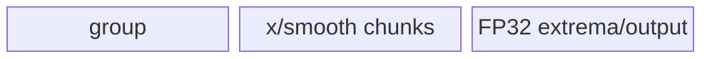

# DynamicQuant A2/A3 ACLNN 算子知识

## 算子速览

| 项目 | 内容 |
|---|---|
| 实际入口 | `aclnnDynamicQuantV2GetWorkspaceSize` / `aclnnDynamicQuantV2`，公开 ACLNN 两段式接口；A2/A3 上该版本族的最新公开版本为 V2。 |
| 计算语义 | 仅 per-token；对称：`s=max(abs(v))/Qmax, y=round(v/s)`；非对称：`s=max((max(v)-min(v))/(Qmax-Qmin), eps), offset=Qmax-max(v)/s, y=round(v/s+offset)`；`v=x*smooth`（有 smooth 时），MOE 用 `groupIndex` 选专家 smooth 行。 |
| 输入输出 | `x/smooth`: FP16/BF16 ND；`groupIndex`: INT32；`y`: INT8/INT4（ACLNN 也接受 INT32 视图封装的 INT4）；`scale/offset`: FP32。 |
| 执行类型 | 所有可达 Device 节点均为单 Kernel `AIV_VECTOR`；无 Cube/AIC、MIX_CV、SIMT、NDDMA 或 AICPU。 |
| Kernel 路线 | R-001 full-load 单缓冲，R-002 full-load 双缓冲，R-003 large-shape，R-004 MOE full-load，R-005 MOE large-shape，R-006 特殊尾轴，R-007 multi-row。 |
| 核心资源 | GM + AIV UB；`TQue/TBuf`、Vector/MicroAPI、pipe/event；算子 workspace 固定申报 16 MiB 系统区，Device 只校验 `GetUserWorkspace`。 |
| 来源闭包 | `source_closed`：V2 API 校验/连续化→`DynamicQuant` 或 `DynamicQuantV2` L0 launcher→共同 Tiling/POD→`dynamic_quant`/`dynamic_quant_v2` router→全部可达 body→binary config。 |
| 验证状态 | 已完成源码闭包检查；本次知识提取未执行编译、真机、数值或性能测试。 |

## 接口与语义

### 计算语义

令一行 token 为 `x_r`，可选平滑后 `v_r=x_r*smooth[group(r),:]`，无 smooth 时 `v_r=x_r`。对称量化输出 `scale_r=max(abs(v_r))/Qmax` 与 `round(v_r/scale_r)`；非对称量化输出 `scale_r=max((max(v_r)-min(v_r))/(Qmax-Qmin),1e-12)`、`offset_r=Qmax-max(v_r)/scale_r` 与 `round(v_r/scale_r+offset_r)`。V2 固定 per-token；`offsetOut==nullptr` 表示对称，否则非对称。

### 输入、输出与属性

| 参数 | shape/layout | dtype | 约束、默认值与语义 |
|---|---|---|---|
| `x` | ND，2–8 维 | FP16/BF16 | 必需；可非连续，API 先 `Contiguous`；最后一维为 `rowLen`。 |
| `smoothScalesOptional` | `[rowLen]` 或 MOE `[E,rowLen]` | 同 `x` | 可空；MOE 时与 `groupIndex` 同时使用。 |
| `groupIndexOptional` | `[E]` | API 接受 INT32/INT64，但 Tiling/OpDef 仅闭合 INT32 | `E<=1024`；固定仓中 INT64 会通过 API 校验却在 Tiling 失败，是明确边界。 |
| `dstType` | Host 标量 | INT64 枚举 | A2/A3 公开为 INT8/INT4/INT32；INT32 是 8 个 INT4 打包视图。 |
| `yOut` | 通常同 `x`；INT32 时末维为 `rowLen/8` | INT8/INT4/INT32 | INT4 要求 `rowLen%2==0`；INT32 要求 `rowLen%8==0`。 |
| `scaleOut` | `x.shape[:-1]` | FP32 | 每 token 一个 scale。 |
| `offsetOut` | 同 `scaleOut` | FP32 | 可空；空=对称，非空=非对称。 |

### 入口与版本

公开文档明确 A2/A3 支持 `aclnnDynamicQuantV2`，而 V3/V4 产品表明确 A2/A3 不支持，因此 V2 是该平台实际最新公开入口。第一段建立 executor，第二段用 `CommonOpExecutorRun` 在传入 stream 上执行。对称 V2 复用两输出 L0 `DynamicQuant`；非对称 V2 走三输出 L0 `DynamicQuantV2`，两者共享 `TilingForDynamicQuant`，但分别进入 `dynamic_quant` 与 `dynamic_quant_v2` entry。

## Host/Launcher 执行流程

### 参数校验与前处理

`CheckParams` 依次执行非空、属性、dtype、shape 校验。空 `x/y/scale` 直接返回 `workspaceSize=0`，不加入 Device 节点。非空输入经 `InputsContiguous`；INT32 输出被改为内部 INT4，再由 `Int42Int32PackedTensor` 建立末维 `/8` 的 INT32 view。`offsetOut==nullptr` 时调用 `l0op::DynamicQuant`，否则调用 `l0op::DynamicQuantV2(..., false,"pertoken",0.0)`；最终 `ViewCopy` 到用户的 y/scale/offset，任何空返回或 ViewCopy 失败都阻断 executor 构造。

### 参数、Workspace 与生命周期

L0 用 executor 分配连续 y、scale（以及 V2 offset），`ADD_TO_LAUNCHER_LIST_AICORE` 将一个 AIV Kernel 加入同一 executor。Tiling 对非空计算统一写 `workSpaces[0]=16777216`；这部分是框架系统 workspace，entry 仅以 `GetUserWorkspace(workSpace)!=nullptr` 作 guard，传统 A2/A3 body 不建立算子私有跨 Kernel slice。用户 workspace 与 executor 从第一段产生，活到第二段同 stream 执行完成。

### 启动图与失败传播

```text
aclnnDynamicQuantV2GetWorkspaceSize
  -> Contiguous(x/smooth/group)
  -> offsetOut == nullptr ? l0op::DynamicQuant : l0op::DynamicQuantV2
  -> TilingForDynamicQuant -> DynamicQuantTiling::RunFusionKernelTiling
  -> one AIV node:
       symmetric:   dynamic_quant(x,smooth,group,y,scale,workspace,tiling)
       asymmetric:  dynamic_quant_v2(x,smooth,group,y,scale,offset,workspace,tiling)
  -> ViewCopy(y,scale[,offset])
```

单 Kernel 无跨节点数据边。launch、ViewCopy 和最终 `CommonOpExecutorRun` 任一失败均返回 ACLNN 错误；entry 遇空必需指针、空 user workspace、`blockIdx>=coreNum` 或未知 key 时无写出返回。

## Route 与参数设计

### 分核与资源计算

`rowLen=x[-1]`，`rowNum=product(x[:-1])`，`coreNum=max(min(vectorCoreNum,rowNum),1)`；`headCoreNum=rowNum%coreNum`，大核/小核行数分别 `ceil(rowNum/coreNum)` 与 `floor(rowNum/coreNum)`。普通路线先把 `rowLen` 对齐 16；每行 UB 系数按 dtype/smooth/DB 为 11、13、17、19 B/element，扣除 1024 B 后计算可容纳行数，最多 255 行。若一行仍装不下，`innerLoopEle=floor((ubSize-1024)/19/128)*128`，按尾轴切块。

### Route 选择

| 顺序 | Route | Key/模板 | 精确选择条件与优先级 | 不适用去向 |
|---:|---|---|---|---|
| 1 | R-006 特殊尾轴 | 100 | 对称 L0；无 group；y=INT8；`rowLen∈{4096,5120,10240}`；`4<=rowNum<=384` | R-007 |
| 2 | R-007 multi-row | 10 | 对称 L0；无 group；`128<=rowLen<=maxUbLen`；`rowLen%8==0` | 普通树 |
| 3 | R-005 MOE large | 8 | `groupNum>0 && innerLoopTimes>0` | 无 fallback |
| 4 | R-004 MOE full | 7 | `groupNum>0 && innerLoopTimes==0` | 无 fallback |
| 5 | R-003 large | 6 | `groupNum==0 && innerLoopTimes>0` | 无 fallback |
| 6 | R-002 DB full | 2/3 | `groupNum==0 && innerLoopTimes==0 && useDb`；BF16=2，FP16=3 | R-001 |
| 7 | R-001 single-buffer full | 0/1 | 同上且 `!useDb`；BF16=0，FP16=1 | 未知 key 无输出 |

```text
special-symmetric? key100
else multi-row-symmetric? key10
else if groupNum>0: innerLoopTimes>0 ? key8 : key7
else if innerLoopTimes>0: key6
else if useDb: BF16 ? key2 : key3
else: BF16 ? key0 : key1
```

### 模板/实现执行矩阵

| Route | key/selector | dtype/shape/platform 完整命中条件 | 执行拓扑与 Kernel 节点 | 实际模板/body | 内存与同步特征 | tail/fallback |
|---|---|---|---|---|---|---|
| R-001 | 0/1 | 普通、非 MOE、一行可载但 DB 不可载 | 单 AIV | `DynamicQuant<xDtype,yDtype>` | depth=1 queues；FP32 reduce/cast buffers | 行尾 pad；former/tail core |
| R-002 | 2/3 | 普通、非 MOE、DB 可载 | 单 AIV | `DynamicQuantDbOpt<xDtype,yDtype>` | input depth=2，输出/scale TBuf；DMA/Vector 交叠 | 行尾 pad |
| R-003 | 6 | 单行超 UB | 单 AIV | `DynamicQuantLargeShapeOpt` | 尾轴分片两遍：先全局 min/max，再量化 | `innerLoopTail` |
| R-004 | 7 | group present、整行可载 | 单 AIV | `DynamicQuantMoe` | group queue + 专家 smooth | group/row tail |
| R-005 | 8 | group present、单行超 UB | 单 AIV | `DynamicQuantMoeLargeShape` | group 驱动的尾轴分片两遍 | `innerLoopTail` |
| R-006 | 100 | 上述固定尾轴/rowNum | 单 AIV | `DynamicQuantSingleRow` | 单块 TQue/TBuf，专用多行归约 | 固定 shape guard |
| R-007 | 10 | 通用对称多行 guard | 单 AIV | `DynamicQuantMultiRow` | 一个大 TBuf 手工切片；2D broadcast/reduce | 每核末循环行数 |

### 隐藏性能 Guard

| Guard | Host/Tiling 条件 | Device/资源原因 | 影响 Route | 不满足时去向 | 源码符号 |
|---|---|---|---|---|---|
| UB reserve | `maxUseUbSize=ubSize-1024` | 留出框架/常量空间 | 全部 | Tiling 失败或 large | `DynamicQuantTiling::SetTilingData` |
| repeat 上限 | multi-row 单次行数/列长被 255 repeat 限制 | Vector repeat 字段上限 | R-007/普通 | 普通路线 | `CheckMultiRowPreconditions` |
| MOE 限制 | `groupNum<=1024` 且 smooth 第一维=groupNum | group UB 与索引合法性 | R-004/005 | Tiling 失败 | `CheckSmoothShape` |
| INT4 | `rowLen%2==0` | 两个 INT4 打包成 1 byte | 全部 INT4 | API/Tiling 失败 | `CheckShape` / `CheckOpInputShape` |
| user workspace | `GetUserWorkspace(workSpace)!=nullptr` | entry 的框架 workspace guard | 全部 | 无写出返回 | `dynamic_quant[_v2]` |

### POD/ABI

`DynamicQuantTilingData` 由仓外注册宏序列化；固定仓可见字段顺序与类型，但没有 `static_assert(sizeof/alignof/offsetof)`，因此 ABI 数值布局标为固定仓不可见。A2/A3 实际 consumer 只读取前 15 个公共字段；后续字段属于同结构中的其他平台路线，当前路线 inactive。

| 结构 | 字段 | 类型/位宽 | ABI 布局 | 单位 | Host/launcher producer | Device consumer | 边界 |
|---|---|---|---|---|---|---|---|
| DynamicQuantTilingData | `coreNum` | uint32/32 | 宏序列第1项 | core | `SetTilingData` | entry/core guard | >=1 |
| 同上 | `rowLen` | uint32/32 | 第2项 | element | `RunFusionKernelTiling` | 全部 body | >0 |
| 同上 | `headCoreNum` | uint32/32 | 第3项 | core | 分核公式 | base offset | `< =coreNum` |
| 同上 | `rowPerHeadCore` | uint32/32 | 第4项 | row | ceil 分核 | head core loop | active |
| 同上 | `rowPerTailCore` | uint32/32 | 第5项 | row | floor 分核 | tail core loop | active |
| 同上 | `multiRowNumHeadCore` | uint32/32 | 第6项 | row/tile | UB 可容纳行 | tile loop | <=255 |
| 同上 | `multiRowNumTailCore` | uint32/32 | 第7项 | row/tile | UB 可容纳行 | tail tile loop | <=255 |
| 同上 | `innerLoopEle` | uint32/32 | 第8项 | element | large formula | large CopyIn | large only |
| 同上 | `innerLoopTimes` | uint32/32 | 第9项 | loop | `rowLen/innerLoopEle` | large Process | large only |
| 同上 | `innerLoopTail` | uint32/32 | 第10项 | element | modulo | large tail | may be 0 |
| 同上 | `groupNum` | uint32/32 | 第11项 | expert | group shape | MOE body | 0..1024 |
| 同上 | `alignGroupNum` | uint32/32 | 第12项 | element | align8(groupNum) | MOE group queue | MOE only |
| 同上 | `hasSmooth` | uint32/32 | 第13项 | bool | optional input | template/runtime branch | 0/1 |
| 同上 | `unused` | uint32/32 | 第14项 | N/A | 未赋值 | 未读取 | inactive |
| 同上 | `ubSize` | uint32/32 | 第15项 | byte | compile info | multi-row buffer | R-007 |
| 同上 | `sizeH` | uint32/32 | 第16项 | element | A2/A3 未赋值 | A2/A3 未读取 | inactive |
| 同上 | `sizeX` | uint32/32 | 第17项 | element | 未赋值 | 未读取 | inactive |
| 同上 | `sizeZOut` | uint32/32 | 第18项 | element | 未赋值 | 未读取 | inactive |
| 同上 | `sizeCopyRow` | uint32/32 | 第19项 | element | 未赋值 | 未读取 | inactive |
| 同上 | `numCopyRow` | uint32/32 | 第20项 | row | 未赋值 | 未读取 | inactive |
| 同上 | `numHeadCore` | uint32/32 | 第21项 | core | 未赋值 | 未读取 | inactive |
| 同上 | `numTailCore` | uint32/32 | 第22项 | core | 未赋值 | 未读取 | inactive |
| 同上 | `numHeadTimes` | uint32/32 | 第23项 | loop | 未赋值 | 未读取 | inactive |
| 同上 | `numTailTimes` | uint32/32 | 第24项 | loop | 未赋值 | 未读取 | inactive |
| 同上 | `numLastTailRow` | uint32/32 | 第25项 | row | 未赋值 | 未读取 | inactive |
| 同上 | `alignType` | uint32/32 | 第26项 | enum | 未赋值 | 未读取 | inactive |
| 同上 | `totalBatchLen` | int64/64 | 第27项 | batch | 未赋值 | 未读取 | 950 perchannel only |
| 同上 | `mLen` | int64/64 | 第28项 | element | 未赋值 | 未读取 | inactive |
| 同上 | `mBlockSize` | int64/64 | 第29项 | element | 未赋值 | 未读取 | inactive |
| 同上 | `mTailBlockSize` | int64/64 | 第30项 | element | 未赋值 | 未读取 | inactive |
| 同上 | `mBlockNum` | int64/64 | 第31项 | block | 未赋值 | 未读取 | inactive |
| 同上 | `nLen` | int64/64 | 第32项 | element | 未赋值 | 未读取 | inactive |
| 同上 | `nBlockSize` | int64/64 | 第33项 | element | 未赋值 | 未读取 | inactive |
| 同上 | `nTailBlockSize` | int64/64 | 第34项 | element | 未赋值 | 未读取 | inactive |
| 同上 | `nBlockNum` | int64/64 | 第35项 | block | 未赋值 | 未读取 | inactive |
| 同上 | `nBaseSize` | int64/64 | 第36项 | element | 未赋值 | 未读取 | inactive |
| 同上 | `nBaseLoopNum` | int64/64 | 第37项 | loop | 未赋值 | 未读取 | inactive |
| 同上 | `blockPerHead` | int64/64 | 第38项 | block | 未赋值 | 未读取 | inactive |
| 同上 | `blockPerTail` | int64/64 | 第39项 | block | 未赋值 | 未读取 | inactive |
| 同上 | `totalBlockNum` | int64/64 | 第40项 | block | 未赋值 | 未读取 | inactive |
| 同上 | `batchBlockSize` | int64/64 | 第41项 | batch | 未赋值 | 未读取 | inactive |
| 同上 | `batchTailBlockSize` | int64/64 | 第42项 | batch | 未赋值 | 未读取 | inactive |
| 同上 | `batchBlockNum` | int64/64 | 第43项 | block | 未赋值 | 未读取 | inactive |

### Route 源码闭包

| Route | Key/selector | Host/Tiling producer | POD/参数 | Kernel entry/router 节点 | Kernel body/直接依赖 | 构建接线 |
|---|---|---|---|---|---|---|
| R-001/002/003 | 0/1/2/3/6 | `dynamic_quant_tiling.cpp::SetTilingData` | `DynamicQuantTilingData` | `dynamic_quant.cpp` / `dynamic_quant_v2.cpp` | `dynamic_quant.h`, `dynamic_quant_db.h`, `dynamic_quant_large_shape_opt.h`, `dynamic_quant_base.h` | A2/A3 binary JSON + OpDef |
| R-004/005 | 7/8 | 同上，group 分支 | 同上 | 同上 | `dynamic_quant_moe.h`, `dynamic_quant_moe_large_shape.h` | 同上 |
| R-006/007 | 100/10 | `SetSpecialTilingForDs` / `CalcTilingForMultiRow` | 同上 | 仅对称 `dynamic_quant.cpp` | `dynamic_quant_single_row.h`, `dynamic_quant_multi_row.h` | `DynamicQuant` binary JSON |

## Kernel 实现

### 公共执行流程

两个 entry 均检查必需 GM、user workspace、POD 与 block 范围，再以 key 实例化一个 AIV 类。公共量化顺序是 GM→TQue/TBuf→FP32（或 VF 寄存器 FP32）smooth/abs 或 min/max→FP32 scale/offset→RINT→中间 half→TRUNC 到 INT8/INT4→GM；每行只由一个 core 写 y/scale/offset，不使用跨核 atomic。Queue 的 EnQue/DeQue/FreeTensor、`PipeBarrier` 和 `SetFlag/WaitFlag` 建立 MTE/Vector/Scalar 顺序。

### Route R-001：full-load 单缓冲

#### 适用条件

##### 选择证据

| 层级 | 文件 | 符号 | 源码谓词/参数 | 结果/下一跳 |
|---|---|---|---|---|
| Tiling | `dynamic_quant_tiling.cpp` | `SetTilingData/SetTilingKey` | 整行可载、`!useDb`、无 group | key 0/1 |
| Router | `dynamic_quant[_v2].cpp` | entry | `TILING_KEY_IS(0)\|\|...1` | `DynamicQuant<DTYPE_X,DTYPE_Y>` |

#### Device 数据流

##### 函数级调用链

```text
entry -> DynamicQuant::Init -> InitAndSetBuffer -> Process
      -> SmoothCopyIn(optional) -> LoopProcess -> CopyIn -> Compute/ComputAsymmetric -> CopyOut
```

##### 源码等价伪码

```text
for each core-owned row tile:
  DMA x rows; cast x to FP32; optionally multiply cached FP32 smooth
  symmetric: abs -> ReduceMax -> scale=max/Qmax
  asymmetric: ReduceMax + ReduceMin -> scale/offset
  x = x/scale [+offset]; RINT -> half -> output dtype; DMA y/scale[/offset]
```

#### 内存与数据搬运

##### 资源与搬运表

| 层级/缓冲区 | offset/地址公式 | extent/容量公式 | dtype/layout | producer | consumer | owner/lifetime | 对齐/复用 |
|---|---|---|---|---|---|---|---|
| GM x/y | `coreBase + loop*multiRow*rowLen` | `multiRow*rowLen` | ND | API | CopyIn/CopyOut | caller | INT4 y offset `/2` |
| in/out queues | 0 | `multiRow*align16(rowLen)*sizeof(dtype)` | UB | DMA/Compute | Compute/DMA | TPipe, one loop | depth 1 |
| tempCast/fp32 | 0 | `align64(align16(rowLen))*4` each | FP32 | Cast/reduce | quant | TPipe | sequential reuse |
| scale/offset queues | 0 | `align rows *4` | FP32 | Compute | CopyOut | TPipe | offset conditional |

##### 分层内存布局


##### 字节账与复用顺序

```text
Host conservative full-load coefficient = A16(rowLen) * {11 or 17} bytes/row
UB_total = queues + tempCastUb + fp32_buf_ + quantTemp + optional smooth/offset
workspace_total = 16 MiB framework system workspace; private cross-kernel slice = 0
```

| 复用子区 | 写入者 | 读取者/消费点 | 下一次覆盖 | 同步或释放依据 | 安全条件 |
|---|---|---|---|---|---|
| `fp32_buf_` | abs/minmax | reduce/cast scratch | next row | `PipeBarrier<PIPE_V>` | row serial |

#### 同步、精度与尾块

##### 同步与数值边界表

| 阶段 | primitive/机制 | producer | consumer/等待点 | 保护对象 | 精度/尾块 |
|---|---|---|---|---|---|
| DMA→V | queue + barrier | CopyIn | Compute DeQue | x/smooth | DataCopyPad zeros alignment tail |
| V→S | `V_S` event | reduce | scalar scale read | reduce scalar | FP32 reduce |
| quant | PipeBarrier | FP32 arithmetic | casts | temp | RINT→ROUND→TRUNC |

#### 关键实现

##### 符号证据表

| 阶段 | 文件 | 符号/模板实例 | 实现事实 |
|---|---|---|---|
| Host/Tiling producer | `dynamic_quant_tiling.cpp` | `SetTilingData` | UB 决定单缓冲 |
| Kernel entry/router | `dynamic_quant_v2.cpp` | `dynamic_quant_v2` | key 0/1 映射 |
| Device body/helper | `dynamic_quant.h` | `DynamicQuant::Compute/ComputAsymmetric` | FP32 min/max 与 cast 顺序 |

### Route R-002：full-load 双缓冲

#### 适用条件

##### 选择证据

| 层级 | 文件 | 符号 | 源码谓词/参数 | 结果/下一跳 |
|---|---|---|---|---|
| Tiling | `dynamic_quant_tiling.cpp` | `SetTilingData` | `ubPerRow < ubSize-1024` 且无 large/group | key 2/3 |

#### Device 数据流

##### 函数级调用链

```text
entry -> DynamicQuantDbOpt::Init -> Process -> pipelined CopyIn -> ProcessSymmetric/ProcessAsymmetric -> CopyOutData
```

##### 源码等价伪码

```text
prefetch tile0; for tile: prefetch tile(i+1); DeQue tile(i); reduce/quantize; DMA out
```

#### 内存与数据搬运

##### 资源与搬运表

| 层级/缓冲区 | offset/地址公式 | extent/容量公式 | dtype/layout | producer | consumer | owner/lifetime | 对齐/复用 |
|---|---|---|---|---|---|---|---|
| `inQueue` | ping/pong | `2*MR*A16(N)*sizeof(x)` | UB | MTE2 | V | TPipe | depth 2 |
| out/scale/offset TBuf | 0 | one tile | UB | V | MTE3 | TPipe | event protected |

##### 分层内存布局


##### 字节账与复用顺序

```text
Host conservative DB coefficient = A16(rowLen) * {13 or 19} bytes/row
workspace_total = 16 MiB system workspace
```

| 复用子区 | 写入者 | 读取者/消费点 | 下一次覆盖 | 同步或释放依据 | 安全条件 |
|---|---|---|---|---|---|
| ping/pong input | CopyIn | Compute | two iterations later | queue depth=2 | DeQue/FreeTensor |

#### 同步、精度与尾块

##### 同步与数值边界表

| 阶段 | primitive/机制 | producer | consumer/等待点 | 保护对象 | 精度/尾块 |
|---|---|---|---|---|---|
| output reuse | `MTE3_V`, `V_MTE3` | CopyOut/Compute | reciprocal stage | out TBuf | last tile uses remainRow |

#### 关键实现

##### 符号证据表

| 阶段 | 文件 | 符号/模板实例 | 实现事实 |
|---|---|---|---|
| Host/Tiling producer | `dynamic_quant_tiling.cpp` | `CalculateMaxUbSizePerRow` | DB coefficient |
| Kernel entry/router | `dynamic_quant.cpp` / `_v2.cpp` | key 2/3 | DB class |
| Device body/helper | `dynamic_quant_db.h` | `DynamicQuantDbOpt::Process*` | prefetch 与事件 |

### Route R-003：large-shape 尾轴分片

#### 适用条件

##### 选择证据

| 层级 | 文件 | 符号 | 源码谓词/参数 | 结果/下一跳 |
|---|---|---|---|---|
| Tiling | `SetTilingData` | `ubAvail==0` | `innerLoopTimes>0` | key 6 |

#### Device 数据流

##### 函数级调用链

```text
entry -> DynamicQuantLargeShapeOpt::Init -> Process
      -> chunks: CopyInByEle -> ComputeMax[Min]Value
      -> chunks: CopyInByEle -> Compute(scale,offset) -> CopyOut
```

##### 源码等价伪码

```text
for row: pass1 reduce every N-chunk into row max[/min]; derive scale[/offset]; pass2 reload chunks, quantize and write; mask/pad tail
```

#### 内存与数据搬运

##### 资源与搬运表

| 层级/缓冲区 | offset/地址公式 | extent/容量公式 | dtype/layout | producer | consumer | owner/lifetime | 对齐/复用 |
|---|---|---|---|---|---|---|---|
| chunk queues | `rowBase+k*innerLoopEle` | `2*innerLoopEle*sizeof(dtype)` per depth-2 queue | UB | DMA | VF | TPipe | tail padded |
| scale/offset | row index | 1 FP32 | GM | pass1 | pass2/output | caller | scalar event |

##### 分层内存布局


##### 字节账与复用顺序

```text
C=innerLoopEle=floor((ubSize-1024)/19/128)*128
UB_total bounded by Host 19*C coefficient + reserved bytes
```

| 复用子区 | 写入者 | 读取者/消费点 | 下一次覆盖 | 同步或释放依据 | 安全条件 |
|---|---|---|---|---|---|
| chunk queues | pass1/pass2 CopyIn | VF | next chunk | queue lifecycle | scale finalized before pass2 |

#### 同步、精度与尾块

##### 同步与数值边界表

| 阶段 | primitive/机制 | producer | consumer/等待点 | 保护对象 | 精度/尾块 |
|---|---|---|---|---|---|
| pass boundary | scalar/queue events | reduce | quant pass | scale/offset | `innerLoopTail` masked |

#### 关键实现

##### 符号证据表

| 阶段 | 文件 | 符号/模板实例 | 实现事实 |
|---|---|---|---|
| Host/Tiling producer | `dynamic_quant_tiling.cpp` | `SetTilingData` | chunk formula |
| Kernel entry/router | `dynamic_quant_v2.cpp` | key 6 | large class |
| Device body/helper | `dynamic_quant_large_shape_opt.h` | `Process/Compute*` | two-pass chunking |

### Route R-004：MOE full-load

#### 适用条件

##### 选择证据

| 层级 | 文件 | 符号 | 源码谓词/参数 | 结果/下一跳 |
|---|---|---|---|---|
| Tiling | | `SetTilingKey` | `groupNum>0 && innerLoopTimes==0` | key 7 |

#### Device 数据流

##### 函数级调用链

```text
entry -> DynamicQuantMoe::Init -> copy groupIndex -> map token range to expert -> CopyIn x/smooth -> Compute -> CopyOut
```

##### 源码等价伪码

```text
load cumulative group ends; for each token choose expert; load smooth[expert,:]; v=x*smooth; reduce and quantize per token
```

#### 内存与数据搬运

##### 资源与搬运表

| 层级/缓冲区 | offset/地址公式 | extent/容量公式 | dtype/layout | producer | consumer | owner/lifetime | 对齐/复用 |
|---|---|---|---|---|---|---|---|
| group queue | 0 | `align8(E)*4` | INT32 | GM | expert lookup | TPipe | loaded once/core |
| smooth | `expert*rowLen` | rowLen | x dtype | GM | quant | queue | per token/expert |

##### 分层内存布局


##### 字节账与复用顺序

```text
UB per row = A8(E)*4 + 17*A16(rowLen); DB disabled by Host for MOE
```

| 复用子区 | 写入者 | 读取者/消费点 | 下一次覆盖 | 同步或释放依据 | 安全条件 |
|---|---|---|---|---|---|
| smooth queue | selected expert DMA | current token compute | next token | queue lifecycle | group boundary lookup complete |

#### 同步、精度与尾块

##### 同步与数值边界表

| 阶段 | primitive/机制 | producer | consumer/等待点 | 保护对象 | 精度/尾块 |
|---|---|---|---|---|---|
| group→smooth | queue order | group read | expert DMA | expert id | E<=1024 |

#### 关键实现

##### 符号证据表

| 阶段 | 文件 | 符号/模板实例 | 实现事实 |
|---|---|---|---|
| Host/Tiling producer | `dynamic_quant_tiling.cpp` | `CheckSmoothShape/SetTilingKey` | MOE guard |
| Kernel entry/router | `dynamic_quant_v2.cpp` | key 7 | MOE class |
| Device body/helper | `dynamic_quant_moe.h` | `DynamicQuantMoe::Process` | expert mapping |

### Route R-005：MOE large-shape

#### 适用条件

##### 选择证据

| 层级 | 文件 | 符号 | 源码谓词/参数 | 结果/下一跳 |
|---|---|---|---|---|
| Tiling | | `SetTilingKey` | `groupNum>0 && innerLoopTimes>0` | key 8 |

#### Device 数据流

##### 函数级调用链

```text
entry -> DynamicQuantMoeLargeShape::Init -> group lookup -> chunked min/max pass -> chunked quant pass
```

##### 源码等价伪码

```text
for token: expert=group_lookup(token); for chunks load x and smooth[expert,chunk], accumulate extrema; reload and quantize
```

#### 内存与数据搬运

##### 资源与搬运表

| 层级/缓冲区 | offset/地址公式 | extent/容量公式 | dtype/layout | producer | consumer | owner/lifetime | 对齐/复用 |
|---|---|---|---|---|---|---|---|
| group + chunk queues | expert/chunk offsets | `A8(E)*4 + O(C)` | mixed | GM | VF | TPipe | depth/queue protected |

##### 分层内存布局



##### 字节账与复用顺序

```text
C uses large-shape Host bound; workspace=16 MiB system only
```

| 复用子区 | 写入者 | 读取者/消费点 | 下一次覆盖 | 同步或释放依据 | 安全条件 |
|---|---|---|---|---|---|
| chunk UB | pass1/pass2 | current chunk VF | next chunk | queue events | expert id stable per row |

#### 同步、精度与尾块

##### 同步与数值边界表

| 阶段 | primitive/机制 | producer | consumer/等待点 | 保护对象 | 精度/尾块 |
|---|---|---|---|---|---|
| chunk tail | mask/DataCopyPad | MTE2 | VF | invalid lanes | `innerLoopTail` |

#### 关键实现

##### 符号证据表

| 阶段 | 文件 | 符号/模板实例 | 实现事实 |
|---|---|---|---|
| Host/Tiling producer | `dynamic_quant_tiling.cpp` | `SetTilingData` | MOE large selector |
| Kernel entry/router | `dynamic_quant_v2.cpp` | key 8 | class mapping |
| Device body/helper | `dynamic_quant_moe_large_shape.h` | `Process/Compute*` | expert-aware two pass |

### Route R-006：固定尾轴专用实现

#### 适用条件

##### 选择证据

| 层级 | 文件 | 符号 | 源码谓词/参数 | 结果/下一跳 |
|---|---|---|---|---|
| Tiling | | `SetSpecialTilingForDs` | 对称、INT8、无 group、固定 N 与 row 范围 | key 100 |

#### Device 数据流

##### 函数级调用链

```text
dynamic_quant -> DynamicQuantSingleRow::Process -> ProcessFp16/ProcessBf16 -> per-row ReduceMax -> quantize -> DMA
```

##### 源码等价伪码

```text
load multiple complete rows; reduce each row then reduce row maxima; broadcast reciprocal scale; quantize and write
```

#### 内存与数据搬运

##### 资源与搬运表

| 层级/缓冲区 | offset/地址公式 | extent/容量公式 | dtype/layout | producer | consumer | owner/lifetime | 对齐/复用 |
|---|---|---|---|---|---|---|---|
| in/out queues | per core row group | `maxHandleNum` | ND | DMA/V | V/DMA | TPipe | depth1 |
| `tmpBufNew_` | hand offsets | input FP32 + row scalars | mixed | V | V | TPipe | alias by phase |

##### 分层内存布局


##### 字节账与复用顺序

```text
maxHandleRowsPerUb=16384/rowLen; rowLoops=ceil(rowNum/maxHandleRowsPerUb)
```

| 复用子区 | 写入者 | 读取者/消费点 | 下一次覆盖 | 同步或释放依据 | 安全条件 |
|---|---|---|---|---|---|
| `tmpBufNew_` | cast/reduce | scale broadcast/quant | next tile | PIPE_V barriers | phase order |

#### 同步、精度与尾块

##### 同步与数值边界表

| 阶段 | primitive/机制 | producer | consumer/等待点 | 保护对象 | 精度/尾块 |
|---|---|---|---|---|---|
| reduce→quant | PIPE_V | WholeReduceMax | reciprocal/broadcast | row scales | last core uses explicit row count |

#### 关键实现

##### 符号证据表

| 阶段 | 文件 | 符号/模板实例 | 实现事实 |
|---|---|---|---|
| Host/Tiling producer | `dynamic_quant_tiling.cpp` | `SetSpecialTilingForDs` | exact guard/distribution |
| Kernel entry/router | `dynamic_quant.cpp` | key 100 | special class |
| Device body/helper | `dynamic_quant_single_row.h` | `ProcessFp16/ProcessBf16` | specialized reduce |

### Route R-007：multi-row 通用对称实现

#### 适用条件

##### 选择证据

| 层级 | 文件 | 符号 | 源码谓词/参数 | 结果/下一跳 |
|---|---|---|---|---|
| Tiling | | `CheckMultiRowPreconditions` | 对称、无 group、N>=128、N%8=0、N<=maxUbLen | key 10 |

#### Device 数据流

##### 函数级调用链

```text
dynamic_quant -> DynamicQuantMultiRow::AllocateLocalBuffers -> ProcessQuant
              -> CopyInAndApplySmooth -> ComputeQuantization -> QuantizeAndWriteOut
```

##### 源码等价伪码

```text
TBuf hand-partitions x/smooth/cast/abs/out/scale; copy a 2D row tile; broadcast smooth; row ReduceMax; broadcast reciprocal scale; quantize; DMA
```

#### 内存与数据搬运

##### 资源与搬运表

| 层级/缓冲区 | offset/地址公式 | extent/容量公式 | dtype/layout | producer | consumer | owner/lifetime | 对齐/复用 |
|---|---|---|---|---|---|---|---|
| `bufQueue` TBuf | monotonically computed `offsetBytes` | `ubSize-1024` | hand-partitioned | all stages | all stages | TPipe/kernel | no queue allocation |
| GM | `idx*singleLoopEle` | `ubRows*rowLen` | ND | caller | DMA | caller | last loop short |

##### 分层内存布局


##### 字节账与复用顺序

```text
bufQueue = ubSize-1024
maxUbLen=floor((ubSize-1024-overhead)/{15 smooth|11 no-smooth}/128)*128
```

| 复用子区 | 写入者 | 读取者/消费点 | 下一次覆盖 | 同步或释放依据 | 安全条件 |
|---|---|---|---|---|---|
| `absTmp` | abs/reduce | scale broadcast | quant product | PIPE_V | reduce complete |

#### 同步、精度与尾块

##### 同步与数值边界表

| 阶段 | primitive/机制 | producer | consumer/等待点 | 保护对象 | 精度/尾块 |
|---|---|---|---|---|---|
| DMA/V | hard events | DataCopyPad | Cast/Mul | hand aliases | final `ubRows/ubNums` exact |

#### 关键实现

##### 符号证据表

| 阶段 | 文件 | 符号/模板实例 | 实现事实 |
|---|---|---|---|
| Host/Tiling producer | `dynamic_quant_tiling.cpp` | `CalcTilingForMultiRow` | exact guard/row split |
| Kernel entry/router | `dynamic_quant.cpp` | key 10 | multi-row class |
| Device body/helper | `dynamic_quant_multi_row.h` | `AllocateLocalBuffers/ComputeQuantization` | hand UB layout + 2D reduce |

## 算子特定优化

### Trick T-001：对称多行专用 Route 把完整 UB 手工切片

#### 触发与源码依据

- 适用 Route：R-007。
- 触发条件：对称两输出、无 group、`128<=rowLen<=maxUbLen` 且 `rowLen%8==0`。
- Golden 来源：[`dynamic_quant_tiling.cpp:632-641`](../../../../../../../cann-ops-raw/ascendc/ops-nn/955f8b33985b6d72989ebff341bb9c2c564a51bc/quant/dynamic_quant/op_host/dynamic_quant_tiling.cpp#L632-L641)

**官方源码（固定 Commit 连续逐字摘录）**：

```cpp
uint32_t maxUbLen;
if (!CheckMultiRowPreconditions(context, maxUbLen)) {
    return false;
}
context->SetTilingKey(TILING_KEY_MULTI_ROW);
```

#### 机制与设计原因

Host 在普通每行模板之前选择 multi-row，Device 用单个 `TBuf(ubSize-1024)` 顺序切出 input、smooth、FP32 cast/abs、output 和 scale 子区，并用 2D broadcast 与行归约一次处理多行，减少逐行 queue 管理与重复 smooth 装载。最大列长同时受 UB 系数和 255 repeat 约束。

#### 迁移边界

- 适用：对称 per-token、连续 ND、无 MOE 的中等尾轴。
- 前提：A2/A3、尾轴 8 对齐、Vector repeat 与 UB guard 均满足。
- 失效：回落普通 full-load/large-shape；非对称与 MOE 不得套用。
- 未验证：本次知识提取未执行编译、真机、数值或性能测试。

#### 错误做法

固定仓给出的真实反例是把三输出 V2 或 group 场景送入该模板：`CheckMultiRowPreconditions` 明确返回 false，因为 body 不产生 offset、也不做专家 smooth 选择。

### Trick T-002：large-shape 两遍扫描替代整行常驻 UB

#### 触发与源码依据

- 适用 Route：R-003/R-005。
- 触发条件：`ubAvail==0`，一整行按保守 UB 系数无法装入。
- Golden 来源：[`dynamic_quant_tiling.cpp:435-444`](../../../../../../../cann-ops-raw/ascendc/ops-nn/955f8b33985b6d72989ebff341bb9c2c564a51bc/quant/dynamic_quant/op_host/dynamic_quant_tiling.cpp#L435-L444)

**官方源码（固定 Commit 连续逐字摘录）**：

```cpp
if (ubAvail == 0U) {
    innerLoopEle = static_cast<uint32_t>(maxUseUbSize / BF16_DB_SMOOTH_UB_SIZE /
        FLOAT_NUM_ONE_RPT * FLOAT_NUM_ONE_RPT);
    innerLoopTimes = rowLen / innerLoopEle;
    innerLoopTail = rowLen % innerLoopEle;
}
```

#### 机制与设计原因

把尾轴切成 128-element 对齐 chunk，第一遍只保留行级 extrema，第二遍重新搬入并量化；因此 UB 上界从整行变为 chunk，代价是 x/smooth 的第二次 GM 读取。该机制改变的是可支持 shape 范围，不宣称固定性能收益。

#### 迁移边界

- 适用：归约参数必须由完整行 extrema 决定、但输入可重读的量化。
- 前提：chunk 对齐、尾块 mask/pad、两遍之间 scale/offset 生命周期闭合。
- 失效：不能重读输入或需要跨 chunk 额外状态时必须重设计。
- 未验证：本次知识提取未执行编译、真机、数值或性能测试。

#### 错误做法

固定仓未提供可验证反例。

## 模板与实现对比

| 对比维度 | R-001/002 full-load | R-003/005 large | R-006/007 specialized | 设计选择依据 |
|---|---|---|---|---|
| 命中条件/优先级 | 整行可载 | 整行不可载 | 对称特定 shape/通用 multi-row 优先 | Tiling 决策顺序 |
| 模板与 dtype | FP16/BF16×INT8/INT4 | 同左 | 对称 INT8 为主 | binary + guard |
| 循环与分核 | core→row tile→row | core→row→chunk 两遍 | core→multi-row tile | UB/repeat |
| Queue/TBuf/寄存器 | d1/d2 queues | chunk d2 queues | 手工 TBuf/专用 queue | 交叠与容量 |
| 内存总占用与复用 | 11/13/17/19 B 系数 | 19*C 上界 | 整块 UB 手分区 | Host guard |
| 搬运/Vector API | DataCopyPad + FP32 Vector | chunk reload + VF | 2D broadcast/reduce | shape |
| 同步、精度与 tail | queue/event；FP32 | 两遍边界；masked chunk | hard event；exact row tail | body |
| fallback/失败边界 | large 或未知 key | Tiling 失败 | 普通树 | guard |

## 平台差异

| 项目 | A2 | A3 | 950 |
|---|---|---|---|
| 支持状态 | V2 公开支持 | V2 公开支持 | 本卡不覆盖；最新为 V4 |
| Host/Launcher | DAV_2201 进入共同 `DynamicQuantTiling` | DAV_3003/DAV_3113 进入同一 tiler | RegBase tiler |
| Kernel/资源 | `dynamic_quant[_v2].cpp` AIV | 同一 entry/body 与平台 binary | arch35 MicroAPI 专用 body |

## 限制与失败边界

- V2 只支持 per-token；V3/V4 在 A2/A3 公开文档为不支持，不能用实现文件存在推导支持。
- API 对 groupIndex 接受 INT64，但 OpDef/Tiling/Kernel 只闭合 INT32；INT64 是发布接口与实现约束不一致的失败边界。
- 空 Tensor 在 ACLNN 层以零 workspace/no Device node 成功返回；entry 的 unknown key、空 workspace 和越界 block 无输出。
- 16 MiB 是框架系统 workspace 申报，不应误当作 body 使用的算法临时数组。
- 固定仓未显式给出 Tiling 宏展开后的 `sizeof/alignof/offsetof`；迁移 ABI 时必须以 CANN 注册宏生成结果为准。
- 本次知识提取未执行编译、真机、数值或性能测试。

## 源码索引

### 链路索引

| 链路阶段 | 文件 | 关键符号 | 支撑内容 |
|---|---|---|---|
| 入口声明/约束 | `quant/dynamic_quant_v2/docs/aclnnDynamicQuantV2.md` | `aclnnDynamicQuantV2*` | 公开平台、语义、参数 |
| 入口实现 | `quant/dynamic_quant/op_host/op_api/aclnn_dynamic_quant.cpp` | `GetDynamicQuantResultByL0Api` | 校验、连续化、L0 分支、executor |
| Host/Tiling/Launcher | `quant/dynamic_quant/op_host/dynamic_quant_tiling.cpp` | `TilingForDynamicQuant` | selector、资源、POD producer |
| Host/Tiling/Launcher | `quant/dynamic_quant/op_host/dynamic_quant_tiling.h` | `DynamicQuantTilingData` | POD 字段 |
| Kernel entry/body | `quant/dynamic_quant/op_kernel/dynamic_quant.cpp` | `dynamic_quant` | 对称 router |
| Kernel entry/body | `quant/dynamic_quant_v2/op_kernel/dynamic_quant_v2.cpp` | `dynamic_quant_v2` | 非对称 router/全部 key |
| Kernel entry/body | `quant/dynamic_quant/op_kernel/dynamic_quant_base.h` | `DynamicQuantBase` | 公共分核、FP32 buffer、归约与 scale 公式 |
| Kernel entry/body | `quant/dynamic_quant/op_kernel/dynamic_quant.h` | `DynamicQuant` | 单缓冲 full-load |
| Kernel entry/body | `quant/dynamic_quant/op_kernel/dynamic_quant_db.h` | `DynamicQuantDbOpt` | 双缓冲 full-load |
| Kernel entry/body | `quant/dynamic_quant/op_kernel/dynamic_quant_large_shape_opt.h` | `DynamicQuantLargeShapeOpt` | 非 MOE large-shape |
| Kernel entry/body | `quant/dynamic_quant/op_kernel/dynamic_quant_moe.h` | `DynamicQuantMoe` | MOE full-load |
| Kernel entry/body | `quant/dynamic_quant/op_kernel/dynamic_quant_moe_large_shape.h` | `DynamicQuantMoeLargeShape` | MOE large-shape |
| Kernel entry/body | `quant/dynamic_quant/op_kernel/dynamic_quant_single_row.h` | `DynamicQuantSingleRow` | key100 专用实现 |
| Kernel entry/body | `quant/dynamic_quant/op_kernel/dynamic_quant_multi_row.h` | `DynamicQuantMultiRow` | key10 multi-row 实现 |
| 构建接线 | `quant/dynamic_quant_v2/op_host/config/ascend910b/dynamic_quant_v2_binary.json` | `DynamicQuantV2` op_list | A2 dtype binary 实例；A3 对应 `ascend910_93` 同结构 |
| 构建接线 | `quant/dynamic_quant_v2/op_host/config/ascend910_93/dynamic_quant_v2_binary.json` | `DynamicQuantV2` op_list | A3 dtype binary 实例 |

### 实现复用检查

| 检查项 | 可复用事实 | 不得改变的约束 | 源码符号 |
|---|---|---|---|
| ABI/POD | 公共前 15 字段可复用 | 字段顺序、uint32 位宽、inactive 字段 | `DynamicQuantTilingData` |
| 调用顺序 | API→Contiguous→L0→single kernel→ViewCopy | 对称/非对称 L0 分支 | `GetDynamicQuantResultByL0Api` |
| workspace/内存 | 16 MiB 系统区 + UB route | 不得把 system workspace 当私有 slice | `RunFusionKernelTiling` |
| 同步 | queue/pipe/event 模式 | DB ping-pong 与 pass boundary | 各 `Process` |
| 精度与尾块 | FP32 extrema/scale，RINT→ROUND→TRUNC | INT4 packing、tail mask/pad | `Compute*` |
| 失败边界 | 校验失败阻断 launch | INT64 group、unknown key、空 user workspace | `Check*`/entry |