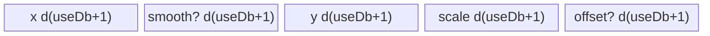
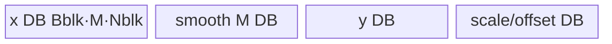

# DynamicQuant 950 ACLNN 算子知识

## 算子速览

| 项目 | 内容 |
|---|---|
| 实际入口 | `aclnnDynamicQuantV4GetWorkspaceSize` / `aclnnDynamicQuantV4`；950 上版本族最新公开入口 V4，新增 `dstTypeMax`。 |
| 计算语义 | 对称/非对称；`pertoken`、`pertensor`、`perchannel`；可选 smooth，per-token MOE 可用 groupIndex；HiFloat8 可用 `dstTypeMax` 自定义量化范围。 |
| 输入输出 | `x/smooth`: FP16/BF16；`groupIndex`: INT32；`y`: INT8/INT4/FP8E4M3FN/FP8E5M2/HiFloat8（INT32 是 INT4 view）；`scale/offset`: FP32。 |
| 执行类型 | 单 Kernel `AIV_VECTOR`，entry 标记 `KERNEL_TYPE_MIX_AIV_1_0`，所有模板均为 AIV/MicroAPI；无 AIC/Cube 或 MIX_CV。 |
| Kernel 路线 | R-001/002 per-token full/large，R-003/004 MOE per-token full/large，R-005/006 per-tensor full/large，R-007/008/009 per-channel full/recompute/split-M；R-010/011 是 Host 实现可达但超出公开参数域的 MOE-per-tensor full/large 审计 Route。 |
| 核心资源 | GM、AIV UB、TQue、RegTensor；per-tensor 用 `coreNum` 个 FP32 workspace 槽并 `SyncAll`；split-M 用 `batch*N` FP32 extrema workspace、AtomicMax/Min、两阶段 `SyncAll`。 |
| 来源闭包 | `source_closed`：V4 API→RegBase L0 `DynamicQuantV2`→arch35 Tiling/template key/POD→APT entry→九条公开有效 Route及两条实现可达审计 Route body→ascend950 binary config。 |
| 验证状态 | 已完成源码闭包检查；本次知识提取未执行编译、真机、数值或性能测试。 |

## 接口与语义

### 计算语义

先得到 `v=x` 或 `v=x*smooth`。对称量化在域 `t` 上计算 `scale=max_t(abs(v))/Qmax`、`y=round(v/scale)`；非对称量化计算 `scale=max((max_t(v)-min_t(v))/(Qmax-Qmin),eps)`、`offset=Qmax-max_t(v)/scale`、`y=round(v/scale+offset)`。`t` 在 per-token 为一行、per-tensor 为整个 tensor、per-channel 为倒数第二维 M。V4 的 `dstTypeMax∈[0,32768]` 只对 HiFloat8 有公开语义；Tiling 把接近 0 的值归一化为 32768。

### 输入、输出与属性

| 参数 | shape/layout | dtype | 约束、默认值与语义 |
|---|---|---|---|
| `x` | ND，2–8 维 | FP16/BF16 | 可非连续，先 `Contiguous`；INT4 要求 N 偶数。 |
| `smoothScalesOptional` | per-token/tensor `[N]`；MOE `[E,N]`；per-channel `[M]` | 同 x | 可空；per-channel 沿 M 广播。 |
| `groupIndexOptional` | `[E]` | INT32 | 公开 V4 仅 per-token 可用；1<=E<=1024，值应非负非递减且末值等于 token 数。 |
| `dstType` | Host INT64 enum | 2/3/29/34/35/36 | 分别 INT8/INT32-view/INT4/HiFloat8/FP8E5M2/FP8E4M3FN。 |
| `isSymmetrical` | Host bool | bool | true 要求用户 `offsetOut=nullptr`；内部 L0 仍分配三输出，模板以 attr 控制。 |
| `quantMode` | Host string | `pertoken/pertensor/perchannel` | pertensor/perchannel 公开约束 group=null。 |
| `dstTypeMax` | Host float | FP32 | `[0,32768]`；约 0 归一化为 32768。 |
| `yOut` | 同 x；INT32 view 末维 N/8 | 目标 dtype | INT4/INT32 packing 约束。 |
| `scaleOut/offsetOut` | token: `x[:-1]`；tensor:`[1]`；channel:`x[:-2]+[N]` | FP32 | offset 仅非对称用户可见。 |

### 入口与版本

V3/V4 公开产品表只支持 Ascend 950，V4 比 V3 多 `dstTypeMax`，故 950 选择 V4。`aclnnDynamicQuantV4GetWorkspaceSize` 先强制 `IsRegbase()`，再走公共 `GetDynamicQuantResultByL0Api`。RegBase 分支总是调用 `l0op::DynamicQuantV2(...,isSymmetrical,quantMode,dstTypeMax)`；即便对称，L0 也建立 y/scale/offset 三输出，只有用户 offset 为空时省略最终 ViewCopy。

## Host/Launcher 执行流程

### 参数校验与前处理

顺序为 `IsRegbase`→创建 executor→`CheckNotNull/CheckAttr/CheckDtype/CheckShape`→空 Tensor 快返→x/smooth/group `Contiguous`→INT32 输出转内部 INT4→L0 `DynamicQuantV2`→可选 offset ViewCopy→INT4/INT32 view→y/scale ViewCopy。`CheckAttr` 校验 mode 与 offset 对称关系；API 源码只显式禁止 perchannel+group，公开 V4 文档还禁止 pertensor+group，因此 MOE-per-tensor 模板虽在内部表中存在，不作为本卡公开有效 Route。

### 参数、Workspace 与生命周期

Tiling 先写 16 MiB 系统 workspace，再加算法区：普通/per-token/per-tensor/per-channel full/recompute 为 `coreNum*4`（对称）或 `coreNum*8`（非对称）；split-M 为 `totalBatchLen*nLen*4` 或其两倍。APT entry 以 `usrWorkspace=GetUserWorkspace(workSpace)` 传给 per-tensor/per-channel body。per-tensor 第一区每 core 一个 max/scale，非对称第二区每 core 一个 min；所有 core 写入后 `SyncAll`，归并并广播标量。split-M 第一区/第二区分别存每 batch/channel 的 max/min，phase-1 atomic 后全核同步，`ReInit` UB，再 phase-2读取并量化。

### 启动图与失败传播

```text
aclnnDynamicQuantV4GetWorkspaceSize
  -> contiguous/view handling
  -> l0op::DynamicQuantV2
  -> DynamicQuantRegbaseTiling::RunFusionKernelTiling
  -> one AIV node dynamic_quant_v2<useDb,quantMode,hasSmooth,isSymmetrical>
       -> exactly one arch35 body
  -> ViewCopy y/scale[/offset]
```

单 Kernel 内部可有多阶段全核同步，但没有第二个 Kernel 节点。API/L0/Tiling/runner 失败阻断后续；空 Tensor 在 ACLNN 层直接零 workspace 成功返回，APT 的 `TPL_EMPTY_TENSOR` 对公开 ACLNN 非空路径不可达。

## Route 与参数设计

### 分核与资源计算

非 per-channel：`rowLen=N`、`rowNum=product(x[:-1])`、`coreNum=max(min(AIV,rowNum),1)`，former/tail 行数按 ceil/floor。`A=align16(N)`，`maxUseUb=ubSize-1024`；单缓冲 `calcSize=A*(7+2*hasSmooth+4)`，双缓冲 `calcDbSize=A*(14+4*hasSmooth+8)`。`calcSize>maxUseUb` 选 large；否则 `calcDbSize>maxUseUb` 关 DB；否则开 DB；每 tile 行数不超过 255。

per-channel 将 shape 折为 `[B,M,N]`，`nBaseSize=64`。先尝试整 M full-load，再在 `nBlockNum*B>=AIV` 时尝试 recompute 并优化 N 尾块填充率，否则 split-M；UB 公式均扣 `8*1024`。`headCoreNum/blocksPerCore` 由总 block 数分配，per-channel 固定 `useDb=true`。

### Route 选择

| 顺序 | Route | Key/模板 | 精确选择条件与优先级 | 不适用去向 |
|---:|---|---|---|---|
| 1 | R-009 per-channel split-M | `quantMode=9` | perchannel；full-load 不可，且 recompute 条件不足 | 资源公式无正 mBlock 时失败 |
| 2 | R-008 per-channel recompute | `quantMode=8` | full-load 不可且 `nBlockNum*B>=AIV` | R-009 |
| 3 | R-007 per-channel full | `quantMode=7` | 枚举 `nBlock=64*i` 时可容纳完整 M（并尽量多 batch） | R-008 |
| 4 | R-011 MOE per-tensor large（审计） | `quantMode=11` | pertensor、group、`calcSize>maxUseUb`；API源码可达但公开文档禁止 | 不应由合规调用触发 |
| 5 | R-010 MOE per-tensor full（审计） | `quantMode=10` | pertensor、group、整行可载；API源码可达但公开文档禁止 | large/DB choice |
| 6 | R-004 MOE per-token large | `quantMode=3` | pertoken、group、`calcSize>maxUseUb` | 无 |
| 7 | R-003 MOE per-token full | `quantMode=2` | pertoken、group、整行可载 | large/单或双缓冲由 key |
| 8 | R-006 per-tensor large | `quantMode=5` | pertensor、无 group、`calcSize>maxUseUb` | 无 |
| 9 | R-005 per-tensor full | `quantMode=4` | pertensor、无 group、整行可载 | large/DB choice |
| 10 | R-002 per-token large | `quantMode=1` | pertoken、无 group、`calcSize>maxUseUb` | 无 |
| 11 | R-001 per-token full | `quantMode=0` | pertoken、无 group、整行可载 | DB bit from capacity |

```text
quantMode attr perchannel -> FullLoad ? R-007 : (enough N-block parallelism ? R-008 : R-009)
else compute row capacity -> large/full
  pertoken + group -> R-004/R-003
  pertoken no group -> R-002/R-001
  pertensor no group -> R-006/R-005
  pertensor + group (outside public contract but Host code permits) -> R-011/R-010
template key = (useDb, quantMode, hasSmooth, isSymmetrical)
```

### 模板/实现执行矩阵

| Route | key/selector | dtype/shape/platform 完整命中条件 | 执行拓扑与 Kernel 节点 | 实际模板/body | 内存与同步特征 | tail/fallback |
|---|---|---|---|---|---|---|
| R-001 | q0 | pertoken/no group/full | 单 AIV | `DynamicQuantRegbaseFullLoad` | d1/d2 queues，MicroAPI row reduce | multiRow/tail mask |
| R-002 | q1 | pertoken/no group/large | 单 AIV | `DynamicQuantLargeShapeDb` | chunk 双缓冲，两遍 | innerLoopTail |
| R-003 | q2 | pertoken/group/full | 单 AIV | `DynamicQuantRegbaseFullLoadMOE` | group+expert smooth | group boundary |
| R-004 | q3 | pertoken/group/large | 单 AIV | `DynamicQuantLargeShapeMOE` | expert chunk 两遍 | chunk/group tail |
| R-005 | q4 | pertensor/no group/full | 单 AIV，多阶段 | `DynamicQuantRegbaseFullLoadPertensor` | per-core workspace + `SyncAll` | former/tail core |
| R-006 | q5 | pertensor/no group/large | 单 AIV，多阶段 | `DynamicQuantLargeShapeDbPertensor` | chunk + cross-core reduce | innerLoopTail |
| R-007 | q7 | perchannel full-capable | 单 AIV | `DynamicQuantRegbasePerChannnelFullLoad` | `[batchBlock,M,nBlock]` DB | M/N/batch tails |
| R-008 | q8 | perchannel recompute | 单 AIV | `DynamicQuantRegbasePerChannnelRecompute` | extrema pass then reload x | M/N tails |
| R-009 | q9 | perchannel split-M | 单 AIV，两阶段 | `DynamicQuantRegbasePerChannnelSplitM` | GM extrema + Atomic + SyncAll | split M/N tails |
| R-010 | q10 | pertensor+group；超出公开参数域但实现可达 | 单 AIV，多阶段 | `DynamicQuantRegbaseMoeFullLoadPertensor` | group smooth + per-core workspace + SyncAll | group/former-tail |
| R-011 | q11 | pertensor+group+large；超出公开参数域但实现可达 | 单 AIV，多阶段 | `DynamicQuantMoeLargeShapePertensor` | group chunks + cross-core reduce | group/chunk tail |

### 隐藏性能 Guard

| Guard | Host/Tiling 条件 | Device/资源原因 | 影响 Route | 不满足时去向 | 源码符号 |
|---|---|---|---|---|---|
| full/DB | `calcSize`/`calcDbSize` 对 `ubSize-1024` | queues 是否容纳整行及 ping-pong | R-001..006 | large 或单缓冲 | `CalculateTilingData` |
| perchannel reserve | `maxUseUb=ubSize-8192` | 多个 DB queue/RegBase 临时量 | R-007..009 | 下一级模板/失败 | `IsCapableFor*` |
| N 基块 | `nBlockSize=64*i` | 一个寄存器基本列块 | R-007..009 | 调整 i/template | `PER_CHANNEL_N_BASE_SIZE` |
| group contract | pertoken only，E<=1024，smooth `[E,N]` | expert选择与 UB | R-003/004 | API/Tiling 失败 | docs + `CheckOpInputShape` |
| dstTypeMax | `0<=v<=32768`，近0→32768 | HiFloat8 scale range | 全部 HiFloat8 | Tiling 失败 | `CheckAttrs` |
| split-M ordering | scheduleMode=1 + `SyncAll<true>` | atomic extrema必须全局可见后重用 workspace | R-009 | N/A | `IsCapableForSplitM`, body `Process` |

### POD/ABI

`DynamicQuantTilingDataArch35` 是普通 C++ 类，按声明顺序传递。固定仓没有 `static_assert(sizeof/alignof/offsetof)`，所以以下保留字段顺序、类型与 producer/consumer，不把推导的 ABI 偏移冒充已固定事实。

| 结构 | 字段 | 类型/位宽 | ABI 布局 | 单位 | Host/launcher producer | Device consumer | 边界 |
|---|---|---|---|---|---|---|---|
| DynamicQuantTilingDataArch35 | `coreNum` | uint32/32 | 第1项，offset未显式断言 | core | `CalculateCoreNum/perchannel` | entry/body core guard | >=1 |
| 同上 | `rowLen` | uint32/32 | 第2项 | element | `CalculateCoreNum` | row templates | non-channel |
| 同上 | `headCoreNum` | uint32/32 | 第3项 | core | core/block distribution | all bodies | former count |
| 同上 | `rowPerHeadCore` | uint32/32 | 第4项 | row | ceil | row body | active non-channel |
| 同上 | `rowPerTailCore` | uint32/32 | 第5项 | row | floor | row body | active non-channel |
| 同上 | `multiRowNumHeadCore` | uint32/32 | 第6项 | row/tile | UB capacity | full-load | <=255 |
| 同上 | `multiRowNumTailCore` | uint32/32 | 第7项 | row/tile | UB capacity | full-load | <=255 |
| 同上 | `innerLoopEle` | uint32/32 | 第8项 | element | large formula | large body | multiple 128 |
| 同上 | `innerLoopTimes` | uint32/32 | 第9项 | loop | N/chunk | large body | large only |
| 同上 | `innerLoopTail` | uint32/32 | 第10项 | element | N%chunk | large body | may 0 |
| 同上 | `groupNum` | uint32/32 | 第11项 | expert | group shape | MOE | 0..1024 |
| 同上 | `alignGroupNum` | uint32/32 | 第12项 | element | arch35 producer未赋值 | arch35 body未依赖 | inactive |
| 同上 | `hasSmooth` | uint32/32 | 第13项 | bool | optional input | template/body | 0/1 |
| 同上 | `unused` | uint32/32 | 第14项 | N/A | 未赋值 | 未读取 | inactive |
| 同上 | `ubSize` | uint32/32 | 第15项 | byte | arch35 producer未赋值到 POD | body不以此分配 | inactive |
| 同上 | `sizeH` | uint32/32 | 第16项 | N/A | 未赋值 | 未读取 | inactive |
| 同上 | `sizeX` | uint32/32 | 第17项 | N/A | 未赋值 | 未读取 | inactive |
| 同上 | `sizeZOut` | uint32/32 | 第18项 | N/A | 未赋值 | 未读取 | inactive |
| 同上 | `sizeCopyRow` | uint32/32 | 第19项 | N/A | 未赋值 | 未读取 | inactive |
| 同上 | `numCopyRow` | uint32/32 | 第20项 | N/A | 未赋值 | 未读取 | inactive |
| 同上 | `numHeadCore` | uint32/32 | 第21项 | N/A | 未赋值 | 未读取 | inactive |
| 同上 | `numTailCore` | uint32/32 | 第22项 | N/A | 未赋值 | 未读取 | inactive |
| 同上 | `numHeadTimes` | uint32/32 | 第23项 | N/A | 未赋值 | 未读取 | inactive |
| 同上 | `numTailTimes` | uint32/32 | 第24项 | N/A | 未赋值 | 未读取 | inactive |
| 同上 | `numLastTailRow` | uint32/32 | 第25项 | N/A | 未赋值 | 未读取 | inactive |
| 同上 | `alignType` | uint32/32 | 第26项 | N/A | 未赋值 | 未读取 | inactive |
| 同上 | `totalBatchLen` | int64/64 | 第27项 | batch | `CalculateTilingDataForPerChannel` | channel body/workspace | channel only |
| 同上 | `mLen` | int64/64 | 第28项 | element | x[-2] | channel loops | >0 |
| 同上 | `mBlockSize` | int64/64 | 第29项 | element | capability formula | channel CopyIn | >0 |
| 同上 | `mTailBlockSize` | int64/64 | 第30项 | element | M modulo | tail | >0 |
| 同上 | `mBlockNum` | int64/64 | 第31项 | block | ceil(M/mBlock) | loops | >=1 |
| 同上 | `nLen` | int64/64 | 第32项 | element | x[-1] | address/workspace | >0 |
| 同上 | `nBlockSize` | int64/64 | 第33项 | element | `64*nBaseLoopNum` | channel CopyIn/VF | 64 multiple |
| 同上 | `nTailBlockSize` | int64/64 | 第34项 | element | N modulo | tail mask | >0 |
| 同上 | `nBlockNum` | int64/64 | 第35项 | block | ceil(N/nBlock) | scheduling | >=1 |
| 同上 | `nBaseSize` | int64/64 | 第36项 | element | constant 64 | VF | 64 |
| 同上 | `nBaseLoopNum` | int64/64 | 第37项 | loop | capability search | VF loops | >=1 |
| 同上 | `blockPerHead` | int64/64 | 第38项 | block/core | ceil(total/AIV) | core work | >=1 active |
| 同上 | `blockPerTail` | int64/64 | 第39项 | block/core | head-1 | core work | may 0 |
| 同上 | `totalBlockNum` | int64/64 | 第40项 | block | template topology | core guard | channel |
| 同上 | `batchBlockSize` | int64/64 | 第41项 | batch | full/split selection | full-load | >=1 |
| 同上 | `batchTailBlockSize` | int64/64 | 第42项 | batch | batch modulo | tail | >=1 |
| 同上 | `batchBlockNum` | int64/64 | 第43项 | block | ceil(B/batchBlock) | scheduling | >=1 |
| 同上 | `dstTypeMax` | float/32 | 第44项 | quant range | normalized attr | MicroAPI scale constant | [0,32768], 0→32768 |

### Route 源码闭包

| Route | Key/selector | Host/Tiling producer | POD/参数 | Kernel entry/router 节点 | Kernel body/直接依赖 | 构建接线 |
|---|---|---|---|---|---|---|
| R-001/002 | q0/q1 tuple | `CalculateTilingData` | Arch35 POD | `dynamic_quant_v2_apt.cpp` | `dynamic_quant_regbase_full_load.h`, `dynamic_quant_regbase_large_shape_db.h`, base | ascend950 V2 binary JSON |
| R-003/004 | q2/q3 tuple | 同上+group | 同上 | 同上 | `*_moe_full_load.h`, `*_moe_large_shape.h` | 同上 |
| R-005/006 | q4/q5 tuple | 同上+pertensor attr | 同上 | 同上 | `*_full_load_pertensor.h`, `*_large_shape_db_pertensor.h` | 同上 |
| R-007/008/009 | q7/q8/q9 tuple | `CalculateTilingDataForPerChannel` | 同上 channel fields | 同上 | `*_perchannel_full_load/recompute/split_m.h` | 同上 |
| R-010/011（审计） | q10/q11 tuple | `CheckAttrs/CalculateTilingData` 的 pertensor+group 组合 | 同上 | 同上 | `dynamic_quant_regbase_moe_full_load_pertensor.h`, `dynamic_quant_regbase_moe_large_shape_pertensor.h` | 同上 |

## Kernel 实现

### 公共执行流程

APT entry 从 tuple key 编译期确定 `useDb/quantMode/hasSmooth/isSymmetrical`，设置 `KERNEL_TYPE_MIX_AIV_1_0`，解析 POD 后只实例化一个 body。所有 body 以 AIV GM↔UB 搬运、MicroAPI RegTensor FP32 extrema/scale、predicate tail、目标 dtype pack store 为主。INT4 使用 `DIST_PACK4_B32` 并调整 GM offset；对称只生成 scale，非对称生成 scale+offset。`__NPU_ARCH__==3510` 时 entry 保存并恢复 float overflow control SPR，作用域覆盖整个 body。

### Route R-001：per-token full-load

#### 适用条件

##### 选择证据

| 层级 | 文件 | 符号 | 源码谓词/参数 | 结果/下一跳 |
|---|---|---|---|---|
| Tiling | `dynamic_quant_tiling_arch35.cpp` | `CalculateTilingData` | q=pertoken、group=0、`calcSize<=maxUseUb` | q0，DB bit按 `calcDbSize` |
| Router | `dynamic_quant_v2_apt.cpp` | tuple q0 | compile-time flags | `DynamicQuantRegbaseFullLoad` |

#### Device 数据流

##### 函数级调用链

```text
entry -> FullLoad::Init -> Process -> LoopProcess -> CopyIn -> ComputeVF(ComputeScaleVF,ComputeYVF) -> CopyOut
```

##### 源码等价伪码

```text
for owned row tiles: DMA x[/smooth]; VF unpack B16 to FP32; per-row abs-max or min/max; derive scale/offset; divide/add; cast/pack y; DMA y/scale[/offset]
```

#### 内存与数据搬运

##### 资源与搬运表

| 层级/缓冲区 | offset/地址公式 | extent/容量公式 | dtype/layout | producer | consumer | owner/lifetime | 对齐/复用 |
|---|---|---|---|---|---|---|---|
| in/out/smooth queues | core row base + tile | `useBufferNum*MR*A16(N)*dtypeB` | UB/ND | MTE2/V | V/MTE3 | TPipe | d1 or d2 |
| scale/offset queues | tile row index | `useBufferNum*MR*4` | FP32 | VF | MTE3 | TPipe | offset conditional |
| RegTensor | VF loop `j*VL` | register lifetime | FP32 | unpack/mul | reduce/cast | VF | predicate tail |

##### 分层内存布局



##### 字节账与复用顺序

```text
Host calcSize=A16(N)*(7+2*hasSmooth+4) ; DB=A16(N)*(14+4*hasSmooth+8)
UB_total = exact InitBuffer queues + 32-byte tempScale + FP32 scratch from base
workspace_private = coreNum*4 or *8 is allocated but this per-token body does not consume it
```

| 复用子区 | 写入者 | 读取者/消费点 | 下一次覆盖 | 同步或释放依据 | 安全条件 |
|---|---|---|---|---|---|
| queue slot | CopyIn/Compute | VF/CopyOut | after depth cycles | queue lifecycle | `useBufferNum=useDb+1` |

#### 同步、精度与尾块

##### 同步与数值边界表

| 阶段 | primitive/机制 | producer | consumer/等待点 | 保护对象 | 精度/尾块 |
|---|---|---|---|---|---|
| VF | predicates + Zeroing | load | reduce/store | invalid lanes | FP32 reduce; RINT/ROUND/TRUNC or FP8 cast |

#### 关键实现

##### 符号证据表

| 阶段 | 文件 | 符号/模板实例 | 实现事实 |
|---|---|---|---|
| Host/Tiling producer | `dynamic_quant_tiling_arch35.cpp` | `CalculateTilingData` | DB/full guard |
| Kernel entry/router | `dynamic_quant_v2_apt.cpp` | q0 branch | tuple→body |
| Device body/helper | `dynamic_quant_regbase_full_load.h` | `ComputeScaleVF/ComputeYVF` | row VF pipeline |

### Route R-002：per-token large-shape

#### 适用条件

##### 选择证据

| 层级 | 文件 | 符号 | 源码谓词/参数 | 结果/下一跳 |
|---|---|---|---|---|
| Tiling | | `CalculateTilingData` | `calcSize>maxUseUb`、no group、pertoken | q1 |

#### Device 数据流

##### 函数级调用链

```text
entry -> DynamicQuantLargeShapeDb::Process -> chunk pass ComputeMaxScaleVF -> chunk pass ComputeYVF -> CopyOut
```

##### 源码等价伪码

```text
for row: first pass over 128-aligned chunks accumulates FP32 extrema; finalize scale/offset; second pass reloads chunks and writes packed y
```

#### 内存与数据搬运

##### 资源与搬运表

| 层级/缓冲区 | offset/地址公式 | extent/容量公式 | dtype/layout | producer | consumer | owner/lifetime | 对齐/复用 |
|---|---|---|---|---|---|---|---|
| chunk queues | `rowBase+k*C` | depth2×C | UB | DMA | VF | TPipe | `C=innerLoopEle` |
| scale/offset tiny queues | row | 256 B each depth2 | FP32 | reduce | GM/quant | TPipe | phase reused |

##### 分层内存布局


##### 字节账与复用顺序

```text
C=floor((maxUseUb-1024)/(2*(2*hasSmooth+4))/128)*128
workspace has no cross-core consumer in q1
```

| 复用子区 | 写入者 | 读取者/消费点 | 下一次覆盖 | 同步或释放依据 | 安全条件 |
|---|---|---|---|---|---|
| extrema queue | chunk pass1 | finalize | next row | queue barriers | all chunks reduced |

#### 同步、精度与尾块

##### 同步与数值边界表

| 阶段 | primitive/机制 | producer | consumer/等待点 | 保护对象 | 精度/尾块 |
|---|---|---|---|---|---|
| last chunk | predicate mask | DMA | VF | padded lanes | `innerLoopTail` exact |

#### 关键实现

##### 符号证据表

| 阶段 | 文件 | 符号/模板实例 | 实现事实 |
|---|---|---|---|
| Host/Tiling producer | `dynamic_quant_tiling_arch35.cpp` | `CalculateTilingData` | q1/chunk |
| Kernel entry/router | `dynamic_quant_v2_apt.cpp` | q1 branch | class mapping |
| Device body/helper | `dynamic_quant_regbase_large_shape_db.h` | `ComputeMaxScaleVF/ComputeYVF` | two-pass |

### Route R-003：MOE per-token full-load

#### 适用条件

##### 选择证据

| 层级 | 文件 | 符号 | 源码谓词/参数 | 结果/下一跳 |
|---|---|---|---|---|
| Tiling | | `CalculateTilingData` | q=pertoken、group>0、整行可载 | q2 |

#### Device 数据流

##### 函数级调用链

```text
entry -> DynamicQuantRegbaseFullLoadMOE::Init -> group lookup -> CopyIn x/expert smooth -> VF scale/y -> CopyOut
```

##### 源码等价伪码

```text
load cumulative group boundaries; map token to expert; use smooth[expert,:]; then same per-row VF quantization
```

#### 内存与数据搬运

##### 资源与搬运表

| 层级/缓冲区 | offset/地址公式 | extent/容量公式 | dtype/layout | producer | consumer | owner/lifetime | 对齐/复用 |
|---|---|---|---|---|---|---|---|
| group queue | 0 | aligned E*4 | INT32 | GM | expert lookup | TPipe | once/core |
| x/smooth/y queues | expert/row offsets | full row d1/d2 | ND | DMA/V | V/DMA | TPipe | tuple controls depth |

##### 分层内存布局


##### 字节账与复用顺序

```text
same full-load row formula + aligned group queue; group must be <=1024
```

| 复用子区 | 写入者 | 读取者/消费点 | 下一次覆盖 | 同步或释放依据 | 安全条件 |
|---|---|---|---|---|---|
| smooth slot | expert DMA | token VF | next token/tile | queue | group lookup done |

#### 同步、精度与尾块

##### 同步与数值边界表

| 阶段 | primitive/机制 | producer | consumer/等待点 | 保护对象 | 精度/尾块 |
|---|---|---|---|---|---|
| expert selection | queue/VF order | group | smooth address | expert id | documented group monotonicity |

#### 关键实现

##### 符号证据表

| 阶段 | 文件 | 符号/模板实例 | 实现事实 |
|---|---|---|---|
| Host/Tiling producer | `dynamic_quant_tiling_arch35.cpp` | `CheckOpInputShape/CalculateTilingData` | group guard/q2 |
| Kernel entry/router | `dynamic_quant_v2_apt.cpp` | q2 | MOE body |
| Device body/helper | `dynamic_quant_regbase_moe_full_load.h` | `Process/ComputeVF` | expert smooth |

### Route R-004：MOE per-token large-shape

#### 适用条件

##### 选择证据

| 层级 | 文件 | 符号 | 源码谓词/参数 | 结果/下一跳 |
|---|---|---|---|---|
| Tiling | | `CalculateTilingData` | group>0、pertoken、`calcSize>maxUseUb` | q3 |

#### Device 数据流

##### 函数级调用链

```text
entry -> DynamicQuantLargeShapeMOE::Process -> expert-aware chunk extrema pass -> chunk quant pass
```

##### 源码等价伪码

```text
for token resolve expert once; for each chunk load x and matching expert smooth; reduce; reload chunks to quantize
```

#### 内存与数据搬运

##### 资源与搬运表

| 层级/缓冲区 | offset/地址公式 | extent/容量公式 | dtype/layout | producer | consumer | owner/lifetime | 对齐/复用 |
|---|---|---|---|---|---|---|---|
| group + chunk queues | expert*N+k*C | aligned group + depth2 chunks | mixed | GM | VF | TPipe | masked tail |

##### 分层内存布局


##### 字节账与复用顺序

```text
chunk bound from q3 `innerLoopEle`; workspace private unused
```

| 复用子区 | 写入者 | 读取者/消费点 | 下一次覆盖 | 同步或释放依据 | 安全条件 |
|---|---|---|---|---|---|
| chunk slot | DMA | reduce/quant | ping-pong | queue depth2 | expert stable |

#### 同步、精度与尾块

##### 同步与数值边界表

| 阶段 | primitive/机制 | producer | consumer/等待点 | 保护对象 | 精度/尾块 |
|---|---|---|---|---|---|
| two pass | queue/pipe | extrema | quant | row scale | FP32, predicate tail |

#### 关键实现

##### 符号证据表

| 阶段 | 文件 | 符号/模板实例 | 实现事实 |
|---|---|---|---|
| Host/Tiling producer | `dynamic_quant_tiling_arch35.cpp` | `CalculateTilingData` | q3 |
| Kernel entry/router | `dynamic_quant_v2_apt.cpp` | q3 | body mapping |
| Device body/helper | `dynamic_quant_regbase_moe_large_shape.h` | `Process` | expert two-pass |

### Route R-005：per-tensor full-load

#### 适用条件

##### 选择证据

| 层级 | 文件 | 符号 | 源码谓词/参数 | 结果/下一跳 |
|---|---|---|---|---|
| Tiling | | `CheckAttrs/CalculateTilingData` | pertensor、group=null、整行可载 | q4 + scheduleMode1 |

#### Device 数据流

##### 函数级调用链

```text
entry -> FullLoadPertensor::Init -> local row extrema -> CopyUB2Workspace -> SyncAll
      -> cross-core extrema reduce -> scale/offset -> quantize owned rows -> CopyOut
```

##### 源码等价伪码

```text
each core reduces its rows; writes one max[/min] to workspace[blockIdx]; all cores sync; reduce workspace to global scalar; all cores quantize with same scalar
```

#### 内存与数据搬运

##### 资源与搬运表

| 层级/缓冲区 | offset/地址公式 | extent/容量公式 | dtype/layout | producer | consumer | owner/lifetime | 对齐/复用 |
|---|---|---|---|---|---|---|---|
| workspace max | `0` | `coreNum*4` | FP32 | each core | global reduce | executor | through kernel |
| workspace min | `coreNum*4` | `coreNum*4` | FP32 | each core | asymmetric reduce | executor | non-sym only |
| queues | core rows | full row d1/d2 + scalar queues | UB | DMA/V | V/DMA | TPipe | phase reuse |

##### 分层内存布局


##### 字节账与复用顺序

```text
workspace_private = coreNum*4*(isSymmetrical?1:2)
UB_total = full-load queues + multiple 256B extrema/workspace transfer queues
```

| 复用子区 | 写入者 | 读取者/消费点 | 下一次覆盖 | 同步或释放依据 | 安全条件 |
|---|---|---|---|---|---|
| workspace max/min | all cores | cross-core reduction | scale may overwrite max region | `SyncAll` | all extrema visible first |

#### 同步、精度与尾块

##### 同步与数值边界表

| 阶段 | primitive/机制 | producer | consumer/等待点 | 保护对象 | 精度/尾块 |
|---|---|---|---|---|---|
| cross-core | `SyncAll` | `CopyUB2Workspace` | workspace reduction | extrema | FP32 global scalar |

#### 关键实现

##### 符号证据表

| 阶段 | 文件 | 符号/模板实例 | 实现事实 |
|---|---|---|---|
| Host/Tiling producer | `dynamic_quant_tiling_arch35.cpp` | q4 + workspace formula | schedule/workspace |
| Kernel entry/router | `dynamic_quant_v2_apt.cpp` | q4 | pertensor body |
| Device body/helper | `dynamic_quant_regbase_full_load_pertensor.h` | `CopyUB2Workspace/Process` | cross-core reduce |

### Route R-006：per-tensor large-shape

#### 适用条件

##### 选择证据

| 层级 | 文件 | 符号 | 源码谓词/参数 | 结果/下一跳 |
|---|---|---|---|---|
| Tiling | | `CalculateTilingData` | pertensor、group=null、row too large | q5 + scheduleMode1 |

#### Device 数据流

##### 函数级调用链

```text
entry -> LargeShapeDbPertensor::Process -> chunk local extrema -> workspace -> SyncAll -> global scalar -> chunk quant pass
```

##### 源码等价伪码

```text
combine row-chunk two-pass with per-core workspace reduction; only after global scalar is known reload chunks for y
```

#### 内存与数据搬运

##### 资源与搬运表

| 层级/缓冲区 | offset/地址公式 | extent/容量公式 | dtype/layout | producer | consumer | owner/lifetime | 对齐/复用 |
|---|---|---|---|---|---|---|---|
| chunk queues | row+k*C | depth2*C | UB | DMA | VF | TPipe | tail predicate |
| workspace | as R-005 | Ccore FP32 ×1/2 | GM | core reduce | all cores | executor | SyncAll |

##### 分层内存布局


##### 字节账与复用顺序

```text
workspace_private=coreNum*4*(sym?1:2); UB chunk bound from `innerLoopEle`
```

| 复用子区 | 写入者 | 读取者/消费点 | 下一次覆盖 | 同步或释放依据 | 安全条件 |
|---|---|---|---|---|---|
| workspace | per-core extrema | global reduce | scale scratch | SyncAll | all active cores participate |

#### 同步、精度与尾块

##### 同步与数值边界表

| 阶段 | primitive/机制 | producer | consumer/等待点 | 保护对象 | 精度/尾块 |
|---|---|---|---|---|---|
| global + chunk | SyncAll + predicate | pass1 | pass2 | scalar/tail | FP32 extrema |

#### 关键实现

##### 符号证据表

| 阶段 | 文件 | 符号/模板实例 | 实现事实 |
|---|---|---|---|
| Host/Tiling producer | `dynamic_quant_tiling_arch35.cpp` | q5 | large/workspace |
| Kernel entry/router | `dynamic_quant_v2_apt.cpp` | q5 | class mapping |
| Device body/helper | `dynamic_quant_regbase_large_shape_db_pertensor.h` | `Process/CopyUB2Workspace` | chunk+cross-core |

### Route R-007：per-channel full-load

#### 适用条件

##### 选择证据

| 层级 | 文件 | 符号 | 源码谓词/参数 | 结果/下一跳 |
|---|---|---|---|---|
| Tiling | | `IsCapableForFullLoad` | 存在 `i` 使整 M 及 N块/可选多 batch 入 UB | q7 |

#### Device 数据流

##### 函数级调用链

```text
entry -> PerChannnelFullLoad::Init -> Process -> CopyIn [batchBlock,M,nBlock] -> VF column extrema/scale/y -> CopyOut
```

##### 源码等价伪码

```text
for assigned batch/N block: load complete M columns; reduce each channel along M; derive scale[/offset]; reuse loaded x to write y
```

#### 内存与数据搬运

##### 资源与搬运表

| 层级/缓冲区 | offset/地址公式 | extent/容量公式 | dtype/layout | producer | consumer | owner/lifetime | 对齐/复用 |
|---|---|---|---|---|---|---|---|
| input queue | `(b*M*N+nBlock)` | `2*batchBlock*M*nBlock*sizeof(x)` | 3D tile | DMA | VF | TPipe | DB |
| smooth queue | M | `2*M*sizeof(x)` | 1D | DMA | broadcast | TPipe | optional |
| y/scale/offset | corresponding tile | DB capacities | target/FP32 | VF | DMA | TPipe | N tail |

##### 分层内存布局



##### 字节账与复用顺序

```text
Host full-load inequality is exactly `IsCapableForFullLoad` lines 593-605; workspace normal coreNum*4/8, body does not use cross-core extrema
```

| 复用子区 | 写入者 | 读取者/消费点 | 下一次覆盖 | 同步或释放依据 | 安全条件 |
|---|---|---|---|---|---|
| x tile | CopyIn | extrema then y compute | next tile | same queue slot after both | full M resident |

#### 同步、精度与尾块

##### 同步与数值边界表

| 阶段 | primitive/机制 | producer | consumer/等待点 | 保护对象 | 精度/尾块 |
|---|---|---|---|---|---|
| column reduce | MicroAPI mask | x load | scale/y | N tail lanes | FP32 per-channel |

#### 关键实现

##### 符号证据表

| 阶段 | 文件 | 符号/模板实例 | 实现事实 |
|---|---|---|---|
| Host/Tiling producer | `dynamic_quant_tiling_arch35.cpp` | `IsCapableForFullLoad` | capability search |
| Kernel entry/router | `dynamic_quant_v2_apt.cpp` | q7 | full channel body |
| Device body/helper | `dynamic_quant_regbase_perchannel_full_load.h` | `Process/ComputeVF` | full-M reuse |

### Route R-008：per-channel recompute

#### 适用条件

##### 选择证据

| 层级 | 文件 | 符号 | 源码谓词/参数 | 结果/下一跳 |
|---|---|---|---|---|
| Tiling | | `IsCapableForRecompute` | q7 不可且 `nBlockNum*B>=vectorCoreNum` | q8；调整 N 尾块填充率 |

#### Device 数据流

##### 函数级调用链

```text
entry -> PerChannnelRecompute::LoopProcess
      -> M-block CopyIn/ComputeInner extrema
      -> repeat M-block CopyIn/ComputeOut y
      -> CopyOutScaleAndOffset
```

##### 源码等价伪码

```text
for batch/N block: pass1 stream M blocks to accumulate column extrema; pass2 reload the same x blocks and quantize using finalized per-channel scale
```

#### 内存与数据搬运

##### 资源与搬运表

| 层级/缓冲区 | offset/地址公式 | extent/容量公式 | dtype/layout | producer | consumer | owner/lifetime | 对齐/复用 |
|---|---|---|---|---|---|---|---|
| x queue | Mblock×Nblock | `2*mBlock*nBlock*2B` | tile | DMA twice | extrema/y | TPipe | DB |
| colMax/min queues | Nblock | `2*nBlock*4B` each | FP32 | pass1 | pass2 | TPipe | min conditional |
| scale/y queues | Nblock/MblockNblock | formula | mixed | VF | DMA | TPipe | N/M tails |

##### 分层内存布局


##### 字节账与复用顺序

```text
mBlockSize=(maxUseUb-8*4*nBlock)/(2*nBlock*(2+1)+2*2); exact integer formula in Host
```

| 复用子区 | 写入者 | 读取者/消费点 | 下一次覆盖 | 同步或释放依据 | 安全条件 |
|---|---|---|---|---|---|
| x queue | pass1 DMA | extrema | pass2 DMA overwrites | pass1 DeQue/Free | extrema retained separately |

#### 同步、精度与尾块

##### 同步与数值边界表

| 阶段 | primitive/机制 | producer | consumer/等待点 | 保护对象 | 精度/尾块 |
|---|---|---|---|---|---|
| pass boundary | queue lifecycle | final extrema | reload/quant | col extrema | M/N exact tail |

#### 关键实现

##### 符号证据表

| 阶段 | 文件 | 符号/模板实例 | 实现事实 |
|---|---|---|---|
| Host/Tiling producer | `dynamic_quant_tiling_arch35.cpp` | `IsCapableForRecompute` | parallelism/tail ratio |
| Kernel entry/router | `dynamic_quant_v2_apt.cpp` | q8 | recompute body |
| Device body/helper | `dynamic_quant_regbase_perchannel_recompute.h` | `ComputeInner/ComputeOut` | two-pass reload |

### Route R-009：per-channel split-M

#### 适用条件

##### 选择证据

| 层级 | 文件 | 符号 | 源码谓词/参数 | 结果/下一跳 |
|---|---|---|---|---|
| Tiling | | `IsCapableForSplitM` | q7/q8 均不可，保留默认 q9 | scheduleMode=1；workspace B*N*4/8 |

#### Device 数据流

##### 函数级调用链

```text
entry -> SplitM::Init (workspace extrema initialize) -> phase1 CopyIn/ComputeMinMax/Atomic CopyOut
      -> SyncAll -> ReInit -> phase2 CopyIn extrema+x -> Compute y/scale/offset -> CopyOut
```

##### 源码等价伪码

```text
initialize max=-inf[/min=+inf]; each M block computes partial column extrema and AtomicMax/Min to GM workspace; all cores sync; reload global extrema and x blocks; quantize and write
```

#### 内存与数据搬运

##### 资源与搬运表

| 层级/缓冲区 | offset/地址公式 | extent/容量公式 | dtype/layout | producer | consumer | owner/lifetime | 对齐/复用 |
|---|---|---|---|---|---|---|---|
| max workspace | `b*N+n` | `B*N*4` | FP32 | AtomicMax | phase2 | executor | whole kernel |
| min workspace | `B*N*4+b*N+n` | `B*N*4` | FP32 | AtomicMin | phase2 | executor | asymmetric only |
| phase1 UB | x/smooth + col max/min | DB formulas | mixed | DMA/V | atomic DMA | TPipe | destroyed before ReInit |
| phase2 UB | x/smooth + extrema + y/scale/offset | DB formulas | mixed | DMA/V | MTE3 | TPipe | after SyncAll |

##### 分层内存布局


##### 字节账与复用顺序

```text
workspace_private=B*N*4*(sym?1:2)
UB phase1 and phase2 are not simultaneous: `PipeBarrier<PIPE_ALL>; SyncAll; ReInit()`
```

| 复用子区 | 写入者 | 读取者/消费点 | 下一次覆盖 | 同步或释放依据 | 安全条件 |
|---|---|---|---|---|---|
| GM extrema | all phase1 cores | all phase2 cores | executor release | AtomicNone + SyncAll | workspace initialized and all atomics complete |
| UB allocator | phase1 InitBuffer | phase1 | `ReInit` for phase2 | PIPE_ALL + SyncAll | no phase1 local live value needed |

#### 同步、精度与尾块

##### 同步与数值边界表

| 阶段 | primitive/机制 | producer | consumer/等待点 | 保护对象 | 精度/尾块 |
|---|---|---|---|---|---|
| partial extrema | `SetAtomicMax/Min<float>` | M-block cores | GM workspace | FP32 extrema | conflicts on same b,n |
| phase boundary | `SyncAll<true>` | all atomics | ReInit/phase2 | GM visibility/UB reuse | all cores scheduleMode1 |
| output | predicates | global extrema+x | y/scale/offset | N/M tails | FP32 scale then target cast |

#### 关键实现

##### 符号证据表

| 阶段 | 文件 | 符号/模板实例 | 实现事实 |
|---|---|---|---|
| Host/Tiling producer | `dynamic_quant_tiling_arch35.cpp` | `IsCapableForSplitM/RunFusionKernelTiling` | q9/schedule/workspace |
| Kernel entry/router | `dynamic_quant_v2_apt.cpp` | q9 | split body |
| Device body/helper | `dynamic_quant_regbase_perchannel_split_m.h` | `Process/CopyOutMinMax/ReInit` | atomic two-stage |

### Route R-010：MOE per-tensor full-load（实现可达审计）

#### 适用条件

##### 选择证据

| 层级 | 文件 | 符号 | 源码谓词/参数 | 结果/下一跳 |
|---|---|---|---|---|
| API | `aclnn_dynamic_quant.cpp` | `CheckAttr` | 只拒绝 `perchannel && group!=nullptr`，没有拒绝 pertensor+group | L0 可达；但 V4 文档禁止该组合 |
| Tiling | `dynamic_quant_tiling_arch35.cpp` | `CalculateTilingData` | 初始 q4、`groupNum>0`、整行可载 | q10 |
| Router | `dynamic_quant_v2_apt.cpp` | q10 branch | tuple compile-time flags | `DynamicQuantRegbaseMoeFullLoadPertensor` |

#### Device 数据流

##### 函数级调用链

```text
entry -> MoeFullLoadPertensor::Init -> group/expert smooth + local extrema
      -> CopyUB2Workspace -> SyncAll -> global tensor scale/offset -> quantize owned rows
```

##### 源码等价伪码

```text
resolve each token's expert smooth while reducing local extrema; each core writes max[/min] scalar; SyncAll; reduce to one tensor scalar; quantize all owned rows with expert smooth
```

#### 内存与数据搬运

##### 资源与搬运表

| 层级/缓冲区 | offset/地址公式 | extent/容量公式 | dtype/layout | producer | consumer | owner/lifetime | 对齐/复用 |
|---|---|---|---|---|---|---|---|
| group/smooth queues | E / expert*N | aligned E and full row | INT32/x dtype | GM | expert lookup/VF | TPipe | full-load |
| workspace max/min | `0` / `coreNum*4` | `coreNum*4` each | FP32 | all cores | global reduce | executor | SyncAll |
| x/y/scalar queues | core rows | d1/d2 full-row + 256B queues | mixed | DMA/V | V/DMA | TPipe | tuple depth |

##### 分层内存布局


##### 字节账与复用顺序

```text
workspace_private=coreNum*4*(sym?1:2)
UB_total=full-load MOE queues + per-tensor extrema/workspace transfer queues
```

| 复用子区 | 写入者 | 读取者/消费点 | 下一次覆盖 | 同步或释放依据 | 安全条件 |
|---|---|---|---|---|---|
| workspace extrema | all cores | global scalar reduction | scale scratch | SyncAll | all active cores write unique slot |

#### 同步、精度与尾块

##### 同步与数值边界表

| 阶段 | primitive/机制 | producer | consumer/等待点 | 保护对象 | 精度/尾块 |
|---|---|---|---|---|---|
| cross-core | `SyncAll` | local extrema | global scalar | max/min slots | FP32；group boundaries control smooth |

#### 关键实现

##### 符号证据表

| 阶段 | 文件 | 符号/模板实例 | 实现事实 |
|---|---|---|---|
| Host/Tiling producer | `dynamic_quant_tiling_arch35.cpp` | `CheckAttrs/CalculateTilingData` | q10 is code-reachable |
| Kernel entry/router | `dynamic_quant_v2_apt.cpp` | q10 | audit route mapping |
| Device body/helper | `dynamic_quant_regbase_moe_full_load_pertensor.h` | `Process/CopyUB2Workspace` | expert + cross-core reduce |

### Route R-011：MOE per-tensor large-shape（实现可达审计）

#### 适用条件

##### 选择证据

| 层级 | 文件 | 符号 | 源码谓词/参数 | 结果/下一跳 |
|---|---|---|---|---|
| API | `aclnn_dynamic_quant.cpp` | `CheckAttr` | pertensor+group 未被源码校验阻断 | L0 可达；公开文档禁止 |
| Tiling | `dynamic_quant_tiling_arch35.cpp` | `CalculateTilingData` | q4、group>0、`calcSize>maxUseUb` | q11 |
| Router | `dynamic_quant_v2_apt.cpp` | q11 branch | tuple | `DynamicQuantMoeLargeShapePertensor` |

#### Device 数据流

##### 函数级调用链

```text
entry -> MoeLargeShapePertensor::Process -> expert-aware chunk extrema
      -> workspace + SyncAll -> global scalar -> expert-aware chunk quant pass
```

##### 源码等价伪码

```text
for token chunks apply its expert smooth and reduce; combine all cores through workspace; after global scalar is visible, reload expert chunks and write y
```

#### 内存与数据搬运

##### 资源与搬运表

| 层级/缓冲区 | offset/地址公式 | extent/容量公式 | dtype/layout | producer | consumer | owner/lifetime | 对齐/复用 |
|---|---|---|---|---|---|---|---|
| chunk/group queues | expert*N+k*C | group + depth2 chunks | mixed | GM | VF | TPipe | predicate tail |
| workspace max/min | same as R-010 | Ccore FP32 ×1/2 | FP32 | local reduce | global reduce | executor | SyncAll |

##### 分层内存布局


##### 字节账与复用顺序

```text
workspace_private=coreNum*4*(sym?1:2); UB chunk capacity from `innerLoopEle`
```

| 复用子区 | 写入者 | 读取者/消费点 | 下一次覆盖 | 同步或释放依据 | 安全条件 |
|---|---|---|---|---|---|
| chunk queues | extrema pass | VF | quant pass reload | queue + SyncAll at global boundary | expert mapping stable |

#### 同步、精度与尾块

##### 同步与数值边界表

| 阶段 | primitive/机制 | producer | consumer/等待点 | 保护对象 | 精度/尾块 |
|---|---|---|---|---|---|
| global/chunk | SyncAll + predicates | local chunk extrema | quant pass | FP32 scalar/tail | `innerLoopTail` masked |

#### 关键实现

##### 符号证据表

| 阶段 | 文件 | 符号/模板实例 | 实现事实 |
|---|---|---|---|
| Host/Tiling producer | `dynamic_quant_tiling_arch35.cpp` | `CalculateTilingData` | q11 selector |
| Kernel entry/router | `dynamic_quant_v2_apt.cpp` | q11 | audit body mapping |
| Device body/helper | `dynamic_quant_regbase_moe_large_shape_pertensor.h` | `Process/CopyUB2Workspace` | expert chunks + cross-core reduce |

## 算子特定优化

### Trick T-001：Host 用整行单缓冲/双缓冲/large 三段资源门控

#### 触发与源码依据

- 适用 Route：R-001–R-006。
- 触发条件：非 per-channel；由 `calcSize`、`calcDbSize` 与 `ubSize-1024` 比较决定。
- Golden 来源：[`dynamic_quant_tiling_arch35.cpp:541-562`](../../../../../../../cann-ops-raw/ascendc/ops-nn/955f8b33985b6d72989ebff341bb9c2c564a51bc/quant/dynamic_quant/op_host/dynamic_quant_tiling_arch35.cpp#L541-L562)

**官方源码（固定 Commit 连续逐字摘录）**：

```cpp
if (calcSize > maxUseUbSize) {
    useDb = true;
    innerLoopEle = static_cast<uint32_t>(maxUseUbSize) /
                   static_cast<uint32_t>(calcLargeBuf) / FLOAT_NUM_ONE_RPT * FLOAT_NUM_ONE_RPT;
} else if (calcDbSize > maxUseUbSize) {
    useDb = false;
} else {
    useDb = true;
}
```

#### 机制与设计原因

Host 在编译期 tuple key 中固化 DB 与执行族：能双缓冲则给 queue depth 2，整行只够单份则避免 UB 溢出，连单份都放不下则改为 128-element chunk 的两遍 large body。Device 因此不需运行时尝试分配或分支回退。

#### 迁移边界

- 适用：整行归约后逐元素量化的 AIV 算子。
- 前提：每项 queue/TBuf 字节系数、smooth/offset 条件分配与 body 一致。
- 失效：新增 buffer 或 dtype 后必须同步更新 `calcSize/calcDbSize/calcLargeBuf`。
- 未验证：本次知识提取未执行编译、真机、数值或性能测试。

#### 错误做法

源码的真实错误边界是只按输入 x 大小估 UB；Host 明确把 y、scale、可选 smooth/offset 与 DB 倍数都计入，漏项会选择无法安全初始化的模板。

### Trick T-002：per-channel 按“驻留、重算、Atomic split-M”逐级降级

#### 触发与源码依据

- 适用 Route：R-007/R-008/R-009。
- 触发条件：`quantMode=perchannel`；依次调用三个 capability 函数。
- Golden 来源：[`dynamic_quant_tiling_arch35.cpp:704-713`](../../../../../../../cann-ops-raw/ascendc/ops-nn/955f8b33985b6d72989ebff341bb9c2c564a51bc/quant/dynamic_quant/op_host/dynamic_quant_tiling_arch35.cpp#L704-L713)

**官方源码（固定 Commit 连续逐字摘录）**：

```cpp
quantMode_ = TPL_PER_CHANNEL_SPLIT_M;
IsCapableForFullLoad(context);
IsCapableForRecompute(context);
IsCapableForSplitM(context);
```

#### 机制与设计原因

full-load 保留 x 避免重读；装不下完整 M 但 N-block 足以占满 AIV 时，recompute 用第二次 GM 读取换 UB 容量；并行度仍不足时 split-M 让多个 core 处理 M 分片，以 FP32 atomic 合并列 extrema，再同步进入量化阶段。这是明确的内存/搬运/并行度三方取舍。

#### 迁移边界

- 适用：按列归约、结果依赖所有 M 元素的算子。
- 前提：AtomicMax/Min 支持 FP32、全核同步可用、GM workspace 初始化与生命周期闭合。
- 失效：无法全核同步或 workspace 不可扩展时不能用 split-M。
- 未验证：本次知识提取未执行编译、真机、数值或性能测试。

#### 错误做法

不经 `SyncAll<true>` 就在 phase2 读取 extrema 是源码可验证的错误做法：部分 Atomic 写可能尚不可见，且 UB `ReInit` 也可能提前覆盖 phase1 状态。

### Trick T-003：per-tensor 用每核标量槽完成单 Kernel 跨核归约

#### 触发与源码依据

- 适用 Route：R-005/R-006。
- 触发条件：`quantMode=pertensor`，Host 设置 schedule mode 1，并分配 `coreNum`（或两倍）FP32 槽。
- Golden 来源：[`dynamic_quant_tiling_arch35.cpp:818-822`](../../../../../../../cann-ops-raw/ascendc/ops-nn/955f8b33985b6d72989ebff341bb9c2c564a51bc/quant/dynamic_quant/op_host/dynamic_quant_tiling_arch35.cpp#L818-L822)

**官方源码（固定 Commit 连续逐字摘录）**：

```cpp
if (quantMode_ == TPL_PER_TENSOR_FULL_LOAD || quantMode_ == TPL_PER_TENSOR_LARGE_SHAPE ||
    quantMode_ == TPL_MOE_PER_TENSOR_FULL_LOAD || quantMode_ == TPL_MOE_PER_TENSOR_LARGE_SHAPE){
    context->SetScheduleMode(1);
}
```

#### 机制与设计原因

每核先把局部 extrema 写到唯一 FP32 槽，`SyncAll` 后由 Device 汇总为全 tensor scale/offset，再由所有 core 继续量化，避免增加第二个 Kernel 和跨 Kernel中间张量。非对称用两个并列 slice 保存 max/min。

#### 迁移边界

- 适用：全 tensor 只需少量标量统计量的单 Kernel 全核归约。
- 前提：所有参与 core 同批调度，workspace 至少 `coreNum*4*(1或2)`，每 core 唯一槽。
- 失效：core 不能同时驻留/参与同步时需多 Kernel 归约。
- 未验证：本次知识提取未执行编译、真机、数值或性能测试。

#### 错误做法

固定仓未提供可验证反例。

## 模板与实现对比

| 对比维度 | row full/large | per-tensor full/large | per-channel full/recompute/split | 设计选择依据 |
|---|---|---|---|---|
| 命中条件/优先级 | row UB 三段门控 | 同左+pertensor | full→recompute→split | quant domain/UB/parallelism |
| 模板与 dtype | tuple flags×FP16/BF16×5 y dtype | 同左 | 同左 | APT template table/binary |
| 循环与分核 | core→row→tile/chunk | 加跨 core scalar reduce | batch/N/M block | reduction domain |
| Queue/TBuf/寄存器 | d1/d2 queues, RegTensor | 加 workspace transfer queues | 多 DB queues；split 两套阶段 | topology |
| 内存总占用与复用 | formula-controlled UB | +Ccore*4/8 GM | +B*N*4/8 for split | Host formulas |
| 搬运/Vector API | unpack/reduce/pack | chunk/full + SyncAll | broadcast/column reduce/Atomic | body |
| 同步、精度与 tail | queue/predicate FP32 | SyncAll FP32 scalar | queue；split Atomic+SyncAll | correctness |
| fallback/失败边界 | large/tiling fail | resource fail | next capability/fail | selector order |

## 平台差异

| 项目 | A2 | A3 | 950 |
|---|---|---|---|
| 支持状态 | V4 公开不支持 | V4 公开不支持 | V4 公开支持 |
| Host/Launcher | 本卡不覆盖 | 本卡不覆盖 | `IsRegbase`→`DynamicQuantV2` L0→arch35 tiler |
| Kernel/资源 | 旧 Vector body | 旧 Vector body | RegBase MicroAPI、tuple key、跨核 workspace/Atomic |

## 限制与失败边界

- 公开 V4 文档禁止 pertensor/perchannel 搭配 group；API 源码只显式禁止 perchannel，内部 tuple 也含 MOE-per-tensor body。正式卡按公开有效域排除 MOE-per-tensor Route，并记录该实现/文档差异，不建议依赖未公开组合。
- 文档要求 groupIndex 值非负、非递减且最后一项等于 token 数；固定 Host/Tiling 只校验 shape/dtype/E 范围，Device 直接消费其值，违规时文档明确结果无实际意义。
- `dstTypeMax` 在 Host Tiling 对所有 dtype 接收并写 POD，但公开语义仅 HiFloat8 生效；不要据此扩展其它 dtype 的自定义范围。
- split-M 的 workspace 是真实算法中间区，不能与 16 MiB 系统区混淆；per-token 路线虽获得 normal workspace 增量，body未消费该私有 slice。
- Tiling plain struct 无仓内 ABI static_assert；跨编译单元复用必须保持字段声明顺序和平台 ABI。
- 本次知识提取未执行编译、真机、数值或性能测试。

## 源码索引

### 链路索引

| 链路阶段 | 文件 | 关键符号 | 支撑内容 |
|---|---|---|---|
| 入口声明/约束 | `quant/dynamic_quant/docs/aclnnDynamicQuantV4.md` | `aclnnDynamicQuantV4*` | 950 公开性、语义、约束 |
| 入口实现 | `quant/dynamic_quant/op_host/op_api/aclnn_dynamic_quant.cpp` | `aclnnDynamicQuantV4GetWorkspaceSize`, `GetDynamicQuantResultByL0Api` | RegBase gate、校验、L0/executor |
| Host/Tiling/Launcher | `quant/dynamic_quant/op_host/dynamic_quant_tiling_arch35.cpp` | `DynamicQuantRegbaseTiling` | selector、POD、workspace、schedule |
| Host/Tiling/Launcher | `quant/dynamic_quant/op_kernel/arch35/dynamic_quant_arch35_tilingdata.h` | `DynamicQuantTilingDataArch35` | POD 声明 |
| Kernel entry/body | `quant/dynamic_quant_v2/op_kernel/dynamic_quant_v2_apt.cpp` | `dynamic_quant_v2<...>` | tuple router、AIV task type |
| Kernel entry/body | `quant/dynamic_quant/op_kernel/arch35/dynamic_quant_struct.h` | `ASCENDC_TPL_SEL` | 可编译 tuple 集合 |
| Kernel entry/body | `quant/dynamic_quant/op_kernel/arch35/dynamic_quant_regbase_base.h` | `DynamicQuantBase` | 公共分核、buffer 与 reduce helper |
| Kernel entry/body | `quant/dynamic_quant/op_kernel/arch35/dynamic_quant_regbase_full_load.h` | `DynamicQuantRegbaseFullLoad` | per-token full-load |
| Kernel entry/body | `quant/dynamic_quant/op_kernel/arch35/dynamic_quant_regbase_large_shape_db.h` | `DynamicQuantLargeShapeDb` | per-token large-shape |
| Kernel entry/body | `quant/dynamic_quant/op_kernel/arch35/dynamic_quant_regbase_moe_full_load.h` | `DynamicQuantRegbaseFullLoadMOE` | MOE per-token full-load |
| Kernel entry/body | `quant/dynamic_quant/op_kernel/arch35/dynamic_quant_regbase_moe_large_shape.h` | `DynamicQuantLargeShapeMOE` | MOE per-token large-shape |
| Kernel entry/body | `quant/dynamic_quant/op_kernel/arch35/dynamic_quant_regbase_full_load_pertensor.h` | `DynamicQuantRegbaseFullLoadPertensor` | per-tensor full-load |
| Kernel entry/body | `quant/dynamic_quant/op_kernel/arch35/dynamic_quant_regbase_large_shape_db_pertensor.h` | `DynamicQuantLargeShapeDbPertensor` | per-tensor large-shape |
| Kernel entry/body | `quant/dynamic_quant/op_kernel/arch35/dynamic_quant_regbase_moe_full_load_pertensor.h` | `DynamicQuantRegbaseMoeFullLoadPertensor` | 审计 q10 |
| Kernel entry/body | `quant/dynamic_quant/op_kernel/arch35/dynamic_quant_regbase_moe_large_shape_pertensor.h` | `DynamicQuantMoeLargeShapePertensor` | 审计 q11 |
| Kernel entry/body | `quant/dynamic_quant/op_kernel/arch35/dynamic_quant_regbase_perchannel_full_load.h` | `DynamicQuantRegbasePerChannnelFullLoad` | per-channel full-load |
| Kernel entry/body | `quant/dynamic_quant/op_kernel/arch35/dynamic_quant_regbase_perchannel_base.h` | `DynamicQuantPerChannel::SetMaxValue/CastToDstType` | per-channel 公共量化常量与 cast helper |
| Kernel entry/body | `quant/dynamic_quant/op_kernel/arch35/dynamic_quant_regbase_perchannel_recompute.h` | `DynamicQuantRegbasePerChannnelRecompute` | per-channel recompute |
| Kernel entry/body | `quant/dynamic_quant/op_kernel/arch35/dynamic_quant_regbase_perchannel_split_m.h` | `DynamicQuantRegbasePerChannnelSplitM` | per-channel split-M |
| 构建接线 | `quant/dynamic_quant_v2/op_host/config/ascend950/dynamic_quant_v2_binary.json` | `DynamicQuantV2` op_list | 950 dtype实例与 attrs |

### 实现复用检查

| 检查项 | 可复用事实 | 不得改变的约束 | 源码符号 |
|---|---|---|---|
| ABI/POD | 44字段 POD 与 tuple flags | 顺序/位宽/inactive 字段；无显式 offset assert | `DynamicQuantTilingDataArch35` |
| 调用顺序 | V4→L0 V2→single AIV | RegBase gate、ViewCopy、empty fast return | `GetDynamicQuantResultByL0Api` |
| workspace/内存 | per-tensor Ccore slots；split B*N extrema | 系统区偏移、对称1 slice/非对称2 slices | `RunFusionKernelTiling`/bodies |
| 同步 | per-tensor/split scheduleMode1 + SyncAll | 所有 core 必须参与，split atomic先结束 | pertensor/split `Process` |
| 精度与尾块 | FP32 extrema/scale、predicate、pack store | dstTypeMax/INT4 packing/M/N tail | MicroAPI helpers |
| 失败边界 | capability fallthrough与参数失败 | 文档 group 域、UB正值、unknown tuple | `Check*`/`IsCapableFor*` |

- [SetAtomicMax](../../../../apis/simd_api/basic_api/atomic_operations/set_atomic_max_isasi.md)
