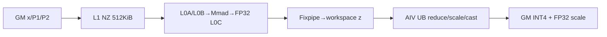
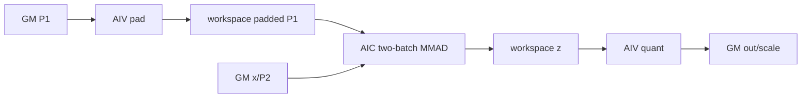

# FlatQuant A2/A3 ACLNN 算子知识

## 算子速览

| 项目 | 内容 |
|---|---|
| 实际入口 | V1 `aclnnFlatQuantGetWorkspaceSize` / `aclnnFlatQuant`，公开 ACLNN 两段式入口 |
| 计算语义 | 对每个 batch `k` 计算 `z_k = P1 @ (x_k @ P2)`，再按该 `M×N` token 的绝对值最大值做 INT4 per-token 量化 |
| 输入输出 | `x:[K,M,N]`、`P1:[M,M]`、`P2:[N,N]` 为 FP16/BF16 ND；物理 `out` 为 INT4，ACLNN 还允许以 INT32 视图承载每 8 个 INT4；`quantScale:[K]` 为 FP32 |
| 执行类型 | R-001/R-002/R-003/R-005 为单 Kernel `MIX_CV`（AIC MMAD + AIV Vector）；R-004 为 Matmul API 驱动的 Cube/Vector 混合路线 |
| Kernel 路线 | R-001 Base；R-002 Double；R-003 Split；R-004 High；R-005 M=1 reshape |
| 核心资源 | GM 输入/输出；用户 workspace 中间张量；L1/L0A/L0B/L0C；AIV 192/148/128 KiB UB；寄存器/标量 reduce |
| 来源闭包 | `source_closed`：公开 ACLNN → 连续化/内部 `FlatQuant` launcher → Tiling key/POD → `flat_quant` router → Cube/Vector body、同步和构建接线均可追溯 |
| 验证状态 | 已完成源码闭包检查；本次知识提取未执行编译、真机、数值或性能测试。 |

## 接口与语义

### 计算语义

对 `k∈[0,K)`：`u_k=x_k@P2`，`z_k=P1@u_k`。令 `amax_k=max(abs(z_k))`，`quantScale_k=amax_k*clipRatio/7`；非零时量化乘子为 `(7/clipRatio)/amax_k`，经 FP32 乘法、`CAST_RINT` 和 INT4 cast 得 `out_k`。`amax_k=0` 时源码令乘子为 7，零输入仍输出零。V1 在 A2/A3 只接受 INT4/INT32 输出；文档中的 FLOAT4_E2M1 语义不由该平台 API dtype 表放行。

### 输入、输出与属性

| 参数 | shape/layout | dtype | 约束、默认值与语义 |
|---|---|---|---|
| `x` | `[K,M,N]` / ND | FP16、BF16 | 非空；`0<K<=262144`，`0<M,N<=256`；非连续输入先 `Contiguous` |
| `kroneckerP1` | `[M,M]` / ND | 同 `x` | 左乘矩阵；非连续输入先连续化 |
| `kroneckerP2` | `[N,N]` / ND | 同 `x` | 右乘矩阵；V1 API 不接受空 P2 |
| `clipRatio` | 标量 | Host `double`→attr FP32 | `(0,1]`；公开默认语义为 1 |
| `out` | INT4 时 `[K,M,N]`；INT32 时 `[K,M,N/8]` / ND | INT4、INT32 | `N` 分别须偶数或 8 的倍数；内部总以 INT4 tensor 计算，INT32 仅重解释打包 |
| `quantScale` | `[K]` / ND | FP32 | 每个 `k` 一个 scale |

### 入口与版本

固定提交的公开文档明确 V1 支持 A2/A3，而 V2 明确不支持 A2/A3；因此本卡只取 `aclnnFlatQuant`。V1 与 V2 共用 `aclnn_flat_quant.cpp` 和内部 `l0op::FlatQuant`，但 V1 固定传 `dstTypeMax=0.0f`，不能把 V2 属性补入本入口。

## Host/Launcher 执行流程

### 参数校验与前处理

`CheckParams` 依次检查非空、按 `NpuArch::DAV_2201` 的 dtype 表、shape、ND 格式；再检查 `clipRatio`。三个输入分别进入 `l0op::Contiguous`。若用户请求 INT32，`l0op::FlatQuant` 仍分配 `[K,M,N]` INT4 临时输出，计算后 `Int42Int32PackedTensor` 将末维除 8 并把 view dtype 设为 INT32；最终 `ViewCopy` 提交 out 与 scale。任一步返回空或 launcher 添加失败都立即返回，不添加后继核心节点。

### 参数、Workspace 与生命周期

`CREATE_EXECUTOR` 持有连续化、FlatQuant 和 ViewCopy 节点；第一段以 `GetWorkspaceSize()` 返回所有节点合计 workspace 并转移 executor，第二段 `CommonOpExecutorRun` 在调用者 stream 上执行。核心 Tiling workspace 公式见 Route：每条均含固定 `16 MiB` system/workspace 余量；用户 workspace 从 FlatQuant launch 到其 AIV 完成量化前有效，executor/输出临时 tensor 则由框架管理到 stream 完成。

### 启动图与失败传播

```text
aclnnFlatQuantGetWorkspaceSize
  -> CheckParams/CheckRatioValid
  -> Contiguous(x,P1,P2)
  -> l0op::FlatQuant -> ADD_TO_LAUNCHER_LIST_AICORE(FlatQuant)
  -> [可选] INT4 tensor 的 INT32 view
  -> ViewCopy(out) -> ViewCopy(scale)
aclnnFlatQuant(workspace,executor,stream)
  -> CommonOpExecutorRun
    -> 单个 flat_quant MIX_CV kernel（blockDim=aicNum，AIV:AIC=2:1）
```

Tiling/launcher 失败阻止该核心节点；第一段任一后处理构造失败不返回 executor。核心 kernel 内没有运行时错误返回通道，unknown key 直接无输出。

## Route 与参数设计

### 分核与资源计算

令 `mA=ceil(M/16)*16`、`nA=ceil(N/16)*16`，`aicNum=GetCoreNumAic()`、`aivNum=GetCoreNumAiv()`。通用 MIX 路线设备侧令 `perK=align_up(ceil(K/(16*aicNum)),4)`，每个 AIC 处理连续 `[K1,K2)`；两个 AIV sub-block 通过 `GetBlockIdx()>>1` 映射到同一 AIC 的 K 段，并分担偶/奇 `k`。Tiling 还计算 `iterBatch=min` 的 L1/L0/L0C/K 上界，但 A2/A3 key 1/2/3/5 body 不读取该字段；key 4 的 Matmul API Tiling 读取两个 `TCubeTiling`。

### Route 选择

| 顺序 | Route | Key/模板 | 精确选择条件与优先级 | 不适用去向 |
|---:|---|---|---|---|
| 1 | R-005 M=1 reshape | key 5 | `M==1 && N%8==0` | R-002 |
| 2 | R-002 Double | key 2 | `mA<=64 && nA<=128 && K>1` | R-004 |
| 3 | R-004 High | key 4 | `mA*mA+nA*nA+4*mA*nA > 512KiB/2` | R-003 |
| 4 | R-003 Split | key 3 | `mA>128 \|\| nA>128` | R-001 |
| 5 | R-001 Base | key 1 | 上述均不成立 | 无 fallback；key 1 |

```text
if M==1 && N%8==0 -> 5
else if mA<=64 && nA<=128 && K>1 -> 2
else if mA²+nA²+4*mA*nA > 262144 elements -> 4
else if mA>128 || nA>128 -> 3
else -> 1
```

### 模板/实现执行矩阵

| Route | key/selector | dtype/shape/platform 完整命中条件 | 执行族与 kernel 节点 | 实际模板/body | 内存与同步特征 | tail/fallback |
|---|---|---|---|---|---|---|
| R-001 Base | 1 | DAV_2201，FP16/BF16→INT4，末级默认 | 单 `flat_quant`：AIC + 两个 AIV | `FlatQuantCube<T,1>` + `FlatQuantVec<T,1>` | L1 全载 P1/P2；workspace `z`; flag 4/0 交接 | M/N 16 对齐填零；AIV 只写真实 M*N |
| R-002 Double | 2 | 第二优先谓词 | 同上 | `FlatQuantCube<T,2>` + `FlatQuantVec<T,2>` | 一次处理 2 个 k；AIV 先生成 padded P1 到 workspace | 奇 K 用 `K+(K%2)` 容量 |
| R-003 Split | 3 | 第四优先谓词 | 同上 | `FlatQuantCube<T,3>` + `FlatQuantVec<T,3>` | 128×128 分块 MMAD；workspace `z` | M/N tile tail 用 `realM/realN/realK` |
| R-004 High | 4 | 第三优先谓词 | 单 Matmul API Cube/Vector 混合 entry | `FlatQuantHigh<T>`；两个 GM/ND/`MDL_CFG` `matmul::Matmul`（右乘 T→T，左乘 T→FP32） | workspace `x2(FP32)` + `x1(T)`；`PipeBarrier<PIPE_ALL>` 后量化 | K 每 4；AIV UB 按行切分 |
| R-005 M=1 reshape | 5 | 第一优先谓词 | 单 MIX_CV | `FlatQuantCubeOne<T,3>` + `FlatQuantVecOne<T,3>` | 把原 K 合并成伪 M；P1 退化为标量乘 | 末组 `tailK`、N padding |

### 隐藏性能 Guard

| Guard | Host/Tiling 条件 | Device/资源原因 | 影响 Route | 不满足时去向 | 源码符号 |
|---|---|---|---|---|---|
| 单行专用 | `M==1 && N%8==0` | P1 是 1×1，设备将 K reshape 后只做 `x@P2` + 标量乘 | R-005 | R-002 | `DetermineMmMode` |
| 双 batch 容量 | `mA<=64,nA<=128,K>1` | L1/L0 双份 tile 可容纳 | R-002 | R-004 | `DetermineMmMode`、`FlatQuantCube::tiling` |
| 全载 L1 上界 | `mA²+nA²+4mA nA<=262144` | L1 固定 512 KiB，元素 2 B | R-001/2/3 | R-004 | `DetermineMmMode` |
| 128 tile | `mA<=128 && nA<=128` | 非 split body 的 DATA_COUNT/L0 tile 上界 | R-001 | R-003 | `DetermineMmMode` |
| 同步轮数 | `perK=align_up(ceil(K/(16*aicNum)),4)` | 每核最多约 16 轮，匹配重复使用 flag | R-001/2/3/5 | 无其它设备 fallback | 各 `tiling()` |

### POD/ABI

`BEGIN_TILING_DATA_DEF` 和 `TCubeTiling` 的宏/完整定义不在固定仓可见范围，故 `sizeof/alignof/offsetof` 不能从本仓可靠给出；下表保留声明顺序、位宽和 producer/consumer。

| 结构 | 字段 | 类型/位宽 | ABI 布局 | 单位 | Host/launcher producer | Device consumer | 边界 |
|---|---|---|---|---|---|---|---|
| `FlatQuantTilingData` | `dataType` | `uint8_t`/8 | offset/总大小固定仓不可见 | enum | 固定 Tiling 未赋值 | 当前 body 不读取 | 不得依赖其值 |
| 同上 | `hasP2` | `uint8_t`/8 | 同上 | bool | `SetBasicTilingData` | A2/A3 body 不读取 | V1 总为 1 |
| 同上 | `K` | `int64_t`/64 | 同上 | element/batch | `x.shape[0]` | 全部 route | `1..262144` |
| 同上 | `M` | `int64_t`/64 | 同上 | element | `x.shape[1]` | 全部 route | `1..256` |
| 同上 | `N` | `int64_t`/64 | 同上 | element | `x.shape[2]` | 全部 route | `1..256`、偶数 |
| 同上 | `iterBatch` | `int64_t`/64 | 同上 | batch/core tile | `CalculateIterBatch` | A2/A3 当前 body 不读取 | 至少 1 |
| 同上 | `clipRatio` | `float`/32 | 同上 | scalar | `SetBasicTilingData` | `FlatQuantVec*`/`FlatQuantHigh` | `(0,1]` |
| 同上 | `dstTypeMax` | `float`/32 | 同上 | scalar | V1 写 0 | A2/A3 不用于 FP4 | 0 |
| 同上 | `invDstTypeMax` | `float`/32 | 同上 | scalar | V1 写 0 | A2/A3 不读取 | 0 |
| 同上 | `matmulTilingR` | `TCubeTiling` | 类型布局固定仓不可见 | Matmul POD | key 4 `GetTCubeTiling` | `REGIST_MATMUL_OBJ`/`matmulR` | 非 key 4 inactive |
| 同上 | `matmulTilingL` | `TCubeTiling` | 类型布局固定仓不可见 | Matmul POD | key 4 `GetTCubeTiling` | `matmulL` | 非 key 4 inactive |

### Route 源码闭包

| Route | Key/selector | Host/Tiling producer | POD/参数 | Kernel entry/router | Kernel body/直接依赖 | 构建接线 |
|---|---|---|---|---|---|---|
| R-001 | 1 | `flat_quant_tiling.cpp::DetermineMmMode` | `FlatQuantTilingData` | `flat_quant.cpp::flat_quant` | `flat_quant_cube.h`、`flat_quant_vec.h`、`tensor_utils.h` | `flat_quant_def.cpp` + `ascendc_config.json` |
| R-002 | 2 | 同上 | 同上 | 同上 | 同上 | 同上 |
| R-003 | 3 | 同上 | 同上 | 同上 | 同上 | 同上 |
| R-004 | 4 | `DetermineMmMode/GetTCubeTiling` | POD + 两个 `TCubeTiling` | 同上 | `flat_quant_high.h` | 同上 |
| R-005 | 5 | `DetermineMmMode` | POD | 同上 | `flat_quant_cube_one.h`、`flat_quant_vec_one.h`、`tensor_utils.h` | 同上 |

## Kernel 实现

### 公共执行流程

key 1/2/3/5 在同一 launch 内按 `ASCEND_IS_AIC/AIV` 分支。AIV 先清 scale 并用 flag 5 做 Vector 核集合 barrier，再以 flag 4 通知 AIC 可开始；AIC 产生 workspace 中的 FP16/BF16 `z`，每个 `perK` 轮以 flag 0 通知两个 AIV；AIV 偶/奇分工读取、reduce/量化并写正式输出。key 4 由 Matmul API 先写 workspace 的 `x1/x2`，同一 body 紧接 Vector 量化。

### Route R-001：Base 全载

#### 适用条件

##### 选择证据

| 层级 | 文件 | 符号 | 源码谓词/参数 | 结果/下一跳 |
|---|---|---|---|---|
| Tiling | `op_host/flat_quant_tiling.cpp` | `DetermineMmMode` | 前四谓词均 false | key 1 |
| Router | `op_kernel/flat_quant.cpp` | `TILING_KEY_IS(1)` | `DTYPE_X` | `FlatQuantVec<T,1>` / `FlatQuantCube<T,1>` |

#### Device 数据流

##### 函数级调用链

```text
flat_quant -> AIV FlatQuantVec::Process / AIC FlatQuantCube::Process
AIC: CopyXToL1 -> ProcessXP2(Mmad) -> ProcessP1X(Mmad) -> Fixpipe(workspace)
AIV: Quant -> Abs/CalReduceMax -> FP32 Muls -> CAST_RINT -> INT4 GM
```

##### 源码等价伪码

```text
AIV barrier; signal flag4
AIC preload P1/P2 to L1
for each owned k: x GM->L1(ND2NZ); x@P2 -> L0C -> L1; P1@u -> L0C -> workspace z; each perK set flag0
AIV subBlock parity reads z; scale=max(abs(z))*clip/7; out=rint(z*(7/clip)/max)->INT4
```

#### 内存与数据搬运

##### 资源与搬运表

| 层级/缓冲区 | offset/地址公式 | extent/容量公式 | dtype/layout | producer | consumer | owner/lifetime | 对齐/复用 |
|---|---|---|---|---|---|---|---|
| workspace `z` | `k*mA*N` | `K*mA*N*2 B` | half ND | AIC Fixpipe | AIV | user workspace/本 kernel | M pad；只写真实 N |
| L1 | 固定 buffer | 512 KiB | T/NZ | GM MTE2 | L0A/B | AIC | x/y 双缓冲 + P1/P2 |
| L0A/L0B | ping/pong | 各 `2*16384*2=64 KiB` | T cube | LoadData | Mmad | AIC | DEvent 4/5 |
| L0C | ping/pong | `2*16384*4=128 KiB` | FP32 | Mmad | Fixpipe | AIC | DEvent 4/5 |
| UB | 单 `TBuf` | 192 KiB | T/FP32/half/INT4 | workspace | Vector/GM | AIV | 多类型静态切片 |

##### 分层内存布局



##### 字节账、交接边与复用顺序

```text
workspace_total = K*mA*N*2 + 16MiB
L1=512KiB; L0A=64KiB; L0B=64KiB; L0C=128KiB; UB=192KiB
```

| 边/复用子区 | producer | offset/extent | dtype/layout | consumer | ordering/sync | owner/lifetime | 安全条件 |
|---|---|---|---|---|---|---|---|
| AIC→AIV `z` | `ProcessP1X` | `k*mA*N`, `mA*N*2 B` | half ND | `Quant` | flag 0，每 `perK` 一轮 | workspace | AIV 等待对应轮后才读 |

#### 同步、精度与尾块

##### 同步与数值边界表

| 阶段 | primitive/机制 | producer | consumer/等待点 | 保护对象 | 精度/尾块 |
|---|---|---|---|---|---|
| 启动 | flags 5/4 | 两 AIV | AIC `CrossCoreWaitFlag(4)` | scale 清零/P1P2 开始 | N/A |
| 交接 | flag 0 mode2 PIPE_FIX | AIC | AIV `Quant` | workspace perK 段 | FP32 MMAD→T Fixpipe |
| 量化 | AtomicAdd FP32 scale | 两 AIV | GM scale | 同一 scale 区 | 偶/奇 k 无冲突；写前清零 |
| tail | ND2NZ + mask/真实计数 | AIC/AIV | 输出 | M/N padding | 只提交 M*N |

#### 关键实现

##### 符号证据表

| 阶段 | 文件 | 符号/模板实例 | 实现事实 |
|---|---|---|---|
| Host/Tiling producer | `op_host/flat_quant_tiling.cpp` | `DetermineMmMode/CalculateWorkspace` | key 1 与 workspace |
| Kernel entry/router | `op_kernel/flat_quant.cpp` | `TILING_KEY_IS(1)` | AIC/AIV 实例 |
| Device body/helper | `op_kernel/flat_quant_cube.h`、`flat_quant_vec.h` | `ProcessXP2/ProcessP1X/Quant` | 两次 MMAD、交接与量化 |

### Route R-002：Double 双 batch

#### 适用条件

##### 选择证据

| 层级 | 文件 | 符号 | 源码谓词/参数 | 结果/下一跳 |
|---|---|---|---|---|
| Tiling | `flat_quant_tiling.cpp` | `DetermineMmMode` | 非 M=1 route 且 `mA<=64,nA<=128,K>1` | key 2 |
| Router | `flat_quant.cpp` | key 2 | `MM_DOUBLE_MODE` | `FlatQuantCube/Vec<T,2>` |

#### Device 数据流

##### 函数级调用链

```text
AIV ProcessP1 -> padded P1 workspace
AIC ProcessDoubleK -> ProcessXP2(two k merged) -> ProcessP1X -> workspace z
AIV Quant -> GM out/scale
```

##### 源码等价伪码

```text
AIV writes P1 padded to mA*mA; barrier/flag4
AIC loads two x batches into one L1 tile, performs batched right/left MMAD, writes two z
AIV consumes z exactly as Base
```

#### 内存与数据搬运

##### 资源与搬运表

| 层级/缓冲区 | offset/地址公式 | extent/容量公式 | dtype/layout | producer | consumer | owner/lifetime | 对齐/复用 |
|---|---|---|---|---|---|---|---|
| workspace `z` | 0 | `(K+K%2)*mA*N*2 B` | half | AIC | AIV | kernel | even-K padded |
| workspace P1 | preceding extent | `mA*mA*2 B` | T padded ND | AIV `ProcessP1` | AIC preload | kernel | flag 4 before read |
| L1/L0/UB | 同 R-001 | L1 512KiB；L0 64/64/128KiB；UB192KiB | mixed | 同上 | 同上 | core | two-batch slices |

##### 分层内存布局



##### 字节账、交接边与复用顺序

```text
workspace_total=((K+K%2)*mA*N + mA*mA)*2 + 16MiB
```

| 边/复用子区 | producer | offset/extent | dtype/layout | consumer | ordering/sync | owner/lifetime | 安全条件 |
|---|---|---|---|---|---|---|---|
| padded P1 | AIV | after z / `mA²*2` | T ND padded | AIC | flags 5 then 4 | workspace | all AIV finish pad |
| z | AIC | same as R-001 | half ND | AIV | flag 0 | workspace | even allocation covers pair tail |

#### 同步、精度与尾块

##### 同步与数值边界表

| 阶段 | primitive/机制 | producer | consumer/等待点 | 保护对象 | 精度/尾块 |
|---|---|---|---|---|---|
| P1 pad | MTE2/MTE3 events + cross flags | AIV | AIC | padded P1 | zero padding |
| pair loop | DEvent ping/pong | AIC | AIC | L1/L0 | odd K guarded |
| quant | 同 R-001 | AIC/AIV | GM | z | same cast order |

#### 关键实现

##### 符号证据表

| 阶段 | 文件 | 符号/模板实例 | 实现事实 |
|---|---|---|---|
| Host/Tiling producer | `flat_quant_tiling.cpp` | key 2 workspace branch | even K + padded P1 |
| Kernel entry/router | `flat_quant.cpp` | key 2 | double templates |
| Device body/helper | `flat_quant_cube.h`、`flat_quant_vec.h` | `ProcessDoubleK/ProcessP1` | two-k merge and P1 pad |

### Route R-003：Split 128 tile

#### 适用条件

##### 选择证据

| 层级 | 文件 | 符号 | 源码谓词/参数 | 结果/下一跳 |
|---|---|---|---|---|
| Tiling | `flat_quant_tiling.cpp` | `DetermineMmMode` | prior false，`mA>128 \|\| nA>128` | key 3 |
| Router | `flat_quant.cpp` | key 3 | `MM_SPLIT_MODE` | split body |

#### Device 数据流

##### 函数级调用链

```text
ProcessSplitK -> ProcessSplitXP2(tile M,N,K) -> ProcessSplitP1X(tile M,N,K) -> z
FlatQuantVec::SplitQuant/ComputeMaxValue -> out
```

##### 源码等价伪码

```text
for m,n,k tiles of at most 128: LoadData L1->L0; MMAD with cmatrixInitVal=(first k); Fixpipe tile
AIV scans row chunks twice: first global amax, then scale/cast/store
```

#### 内存与数据搬运

##### 资源与搬运表

| 层级/缓冲区 | offset/地址公式 | extent/容量公式 | dtype/layout | producer | consumer | owner/lifetime | 对齐/复用 |
|---|---|---|---|---|---|---|---|
| workspace/L1/L0/UB | 同 R-001 | `K*mA*N*2+16MiB`; fixed local capacities | T/FP32/INT4 | AIC/AIV | AIV/GM | kernel | 128 tile ping/pong |

##### 分层内存布局


##### 字节账、交接边与复用顺序

```text
workspace_total=K*mA*N*2+16MiB; local fixed sizes同R-001
```

| 边/复用子区 | producer | offset/extent | dtype/layout | consumer | ordering/sync | owner/lifetime | 安全条件 |
|---|---|---|---|---|---|---|---|
| z | split Fixpipe | `k*mA*N + tile offset` | half ND | AIV split reduce | flag 0 | workspace | realM/N/K guards |

#### 同步、精度与尾块

##### 同步与数值边界表

| 阶段 | primitive/机制 | producer | consumer/等待点 | 保护对象 | 精度/尾块 |
|---|---|---|---|---|---|
| K tile accumulate | `UFMode2/UFMode3` + `cmatrixInitVal` | Mmad iterations | Fixpipe | L0C | real K on final tile |
| row split reduce | V/MTE events | workspace | AIV | UB chunks | max across chunks, NaN propagated by comparison |

#### 关键实现

##### 符号证据表

| 阶段 | 文件 | 符号/模板实例 | 实现事实 |
|---|---|---|---|
| Host/Tiling producer | `flat_quant_tiling.cpp` | key 3 condition | >128 split |
| Kernel entry/router | `flat_quant.cpp` | key 3 | split templates |
| Device body/helper | `flat_quant_cube.h`、`flat_quant_vec.h` | `ProcessSplitXP2/ProcessSplitP1X/SplitQuant` | tile loops and two-pass reduce |

### Route R-004：High Matmul API

#### 适用条件

##### 选择证据

| 层级 | 文件 | 符号 | 源码谓词/参数 | 结果/下一跳 |
|---|---|---|---|---|
| Tiling | `flat_quant_tiling.cpp` | capacity predicate | L1 full-load expression exceeds 512KiB | key 4 + two `TCubeTiling` |
| Router | `flat_quant.cpp` | key 4 | `REGIST_MATMUL_OBJ` | `FlatQuantHigh<T>` |

#### Device 数据流

##### 函数级调用链

```text
FlatQuantHigh::Process -> ProcessHighK
 -> matmulR(x,P2)->workspace x1(T)
 -> matmulL(P1,x1)->workspace x2(FP32)
 -> ComputeMaxValue/SplitQuant -> GM
```

##### 源码等价伪码

```text
for K chunks of 4: MatmulApi right GEMM; barrier; per batch MatmulApi left GEMM to FP32
for each batch: row-chunk FP32->half for amax; FP32 scale; half CAST_RINT; INT4 store
```

#### 内存与数据搬运

##### 资源与搬运表

| 层级/缓冲区 | offset/地址公式 | extent/容量公式 | dtype/layout | producer | consumer | owner/lifetime | 对齐/复用 |
|---|---|---|---|---|---|---|---|
| workspace x2 | 0；每 AIV `8*mA*N` elems | `useAiv*8*mA*N*4 B` | FP32 ND | matmulL | Vector | kernel | ring by `k%8` |
| workspace x1 | after x2 | `useAiv*4*M*N*2 B` | T ND | matmulR | matmulL | kernel | ring by `k%4` |
| UB | fixed | 148 KiB | FP32/half/INT4 | x2 | quant/store | AIV | `splitRow=floor(16384/nA)*16` |
| L1/L0 | Matmul API internal | 当前 `TCubeTiling` | ND→Cube | library | library | Matmul object | 固定仓不展开公共库内部 |

##### 分层内存布局


##### 字节账、交接边与复用顺序

```text
useAiv=min(ceil(K/4),aivNum)
workspace_total=useAiv*(4*M*N*2 + 8*mA*N*4)+16MiB
UB=148KiB; L1/L0 exact bytes由当前 TCubeTiling 决定，固定仓宏展开不可见
```

| 边/复用子区 | producer | offset/extent | dtype/layout | consumer | ordering/sync | owner/lifetime | 安全条件 |
|---|---|---|---|---|---|---|---|
| x1 | `matmulR.IterateAll` | per core ring / `batch*M*N*2` | T ND | matmulL | `PipeBarrier<PIPE_ALL>` | workspace | batch<=4 |
| x2 | `matmulL.IterateAll` | per core ring / `mA*N*4` each | FP32 ND | Vector | call order + events | workspace | quant before ring reuse |

#### 同步、精度与尾块

##### 同步与数值边界表

| 阶段 | primitive/机制 | producer | consumer/等待点 | 保护对象 | 精度/尾块 |
|---|---|---|---|---|---|
| right→left | `PipeBarrier<PIPE_ALL>` | matmulR | matmulL | x1 | T output |
| left→quant | program order + MTE2/V events | matmulL | `ComputeMaxValue` | x2 | FP32→half max path |
| quant | `CAST_RINT` | FP32 scaled | half/INT4 | UB | real M*N only |

#### 关键实现

##### 符号证据表

| 阶段 | 文件 | 符号/模板实例 | 实现事实 |
|---|---|---|---|
| Host/Tiling producer | `flat_quant_tiling.cpp` | `GetTCubeTiling` | right `[4M,N,N]` 与 left `[M,N,M]` ND Matmul POD |
| Kernel entry/router | `flat_quant.cpp` | key 4 + `REGIST_MATMUL_OBJ` | two Matmul objects |
| Device body/helper | `flat_quant_high.h` | `ProcessHighK/SplitQuant` | workspace rings and quant |

### Route R-005：M=1 reshape

#### 适用条件

##### 选择证据

| 层级 | 文件 | 符号 | 源码谓词/参数 | 结果/下一跳 |
|---|---|---|---|---|
| Tiling | `flat_quant_tiling.cpp` | first predicate | `M==1 && N%8==0` | key 5 |
| Router | `flat_quant.cpp` | macro `INVOKE_FLAT_QUANT_IMPL` | key 5 | One templates with mode 3 |

#### Device 数据流

##### 函数级调用链

```text
AIC FlatQuantCubeOne::ProcessSplitXP2(x@P2)->workspace
AIV FlatQuantVecOne::Process -> scalar P1 load -> MultiQuant -> row-wise scale/INT4
```

##### 源码等价伪码

```text
reshape original K into groups of M'=min(align16(ceil(K/aicNum)),128)
AIC computes grouped x@P2; final group uses tailK
AIV multiplies every result by scalar P1[0], converts FP32->half->FP32, per original row reduce/quantizes
```

#### 内存与数据搬运

##### 资源与搬运表

| 层级/缓冲区 | offset/地址公式 | extent/容量公式 | dtype/layout | producer | consumer | owner/lifetime | 对齐/复用 |
|---|---|---|---|---|---|---|---|
| workspace | 0 | `K*16*nA*2 B` (Host) | T | AIC | AIV | kernel | covers grouped/padded rows |
| L1/L0 | fixed | 512KiB / 64+64+128KiB | T/FP32 | AIC | Fixpipe | AIC | split N by128 |
| UB | fixed | 128KiB | FP32/T/INT4 | workspace | AIV | AIV | `perKM<=240`, align16 |

##### 分层内存布局


##### 字节账、交接边与复用顺序

```text
workspace_total=K*16*nA*2+16MiB; L1/L0同通用Cube；UB=128KiB
```

| 边/复用子区 | producer | offset/extent | dtype/layout | consumer | ordering/sync | owner/lifetime | 安全条件 |
|---|---|---|---|---|---|---|---|
| grouped result | AIC | grouped k*M'*N | T ND | AIV | flag 0 per group | workspace | tailK controls final group |

#### 同步、精度与尾块

##### 同步与数值边界表

| 阶段 | primitive/机制 | producer | consumer/等待点 | 保护对象 | 精度/尾块 |
|---|---|---|---|---|---|
| P1 scalar | MTE2_S/V events | GM | AIV scalar | `P1[0]` | T→FP32 |
| handoff | flags 4/0 | AIV/AIC | opposite side | workspace | final `tailK` |
| quant | FP32 multiply→half→FP32→divide→half→INT4 | AIV | GM | row | source preserves reference rounding sequence |

#### 关键实现

##### 符号证据表

| 阶段 | 文件 | 符号/模板实例 | 实现事实 |
|---|---|---|---|
| Host/Tiling producer | `flat_quant_tiling.cpp` | key 5 branch | M=1 priority |
| Kernel entry/router | `flat_quant.cpp` | `INVOKE_FLAT_QUANT_IMPL` | one templates |
| Device body/helper | `flat_quant_cube_one.h`、`flat_quant_vec_one.h` | `tiling/ProcessSplitXP2/MultiQuant` | K reshape, scalar P1, tail |

## 算子特定优化

### Trick T-001：容量与形状联合 selector

#### 触发与源码依据

- 适用 Route：R-001～R-005
- 触发条件：按 M=1、双 batch、L1 容量、128 tile 的固定优先级
- Golden 来源：[`op_host/flat_quant_tiling.cpp:248-260`](../../../../../../../cann-ops-raw/ascendc/ops-nn/955f8b33985b6d72989ebff341bb9c2c564a51bc/quant/flat_quant/op_host/flat_quant_tiling.cpp#L248-L260)

**官方源码（固定 Commit 连续逐字摘录）**：

```cpp
if (M == 1 && N % NUM_EIGHT == 0) {
    return MM_ONE_MODE;
}
if (mAlign_ <= BASE_SIZE / FACTOR_TWO && nAlign_ <= BASE_SIZE && K > 1) {
    return MM_DOUBLE_MODE;
}
if (mAlign_ * mAlign_ + nAlign_ * nAlign_ + FACTOR_TWO * FACTOR_TWO * mAlign_ * nAlign_ > L1_SIZE / BYTE_LEN_2) {
    return MM_HIGH_MODE;
}
if (mAlign_ > BASE_SIZE || nAlign_ > BASE_SIZE) {
    return MM_SPLIT_MODE;
}
return MM_BASE_MODE;
```

#### 机制与设计原因

selector 先利用 M=1 的数学退化，再在小 shape 上合并两个 batch；全载集合超过 512 KiB 时切到 GM Matmul API，中间情况用 128 tile。谓词顺序本身是实例语义，不可交换。

#### 迁移边界

- 适用：同样的两次小矩阵乘 + per-token 量化。
- 前提：2-byte 输入、512 KiB L1、相同本地 buffer 与 route body。
- 失效：dtype 字节数、L1 或 tile 改变时必须重推公式。
- 未验证：本次知识提取未执行编译、真机、数值或性能测试。

#### 错误做法

把 split 判断提前会夺走 High 路线；固定源码提供了上述反例顺序。

### Trick T-002：AIC/AIV workspace 流水与轮次 flag

#### 触发与源码依据

- 适用 Route：R-001、R-002、R-003、R-005
- 触发条件：key 1/2/3/5 的显式 AIC/AIV 双分支
- Golden 来源：[`op_kernel/flat_quant_vec.h:73-96`](../../../../../../../cann-ops-raw/ascendc/ops-nn/955f8b33985b6d72989ebff341bb9c2c564a51bc/quant/flat_quant/op_kernel/flat_quant_vec.h#L73-L96)

**官方源码（固定 Commit 连续逐字摘录）**：

```cpp
PipeBarrier<PIPE_ALL>();
CrossCoreSetFlag<SYNC_MODE0, PIPE_MTE3>(VEC_SYNC_ID);
CrossCoreWaitFlag(VEC_SYNC_ID);
CrossCoreSetFlag<SYNC_MODE2, PIPE_MTE3>(VEC_CUBE_SYNC_ID);
ClearQuant();
CrossCoreSetFlag<SYNC_MODE1, PIPE_MTE3>(TWO_VEC_SYNC_ID);
CrossCoreWaitFlag(TWO_VEC_SYNC_ID);

in_empty.setall();
out_empty.setall();
int64_t scaleK = shape.K1;
for (int64_t startK = shape.K1; startK < shape.K2; startK += shape.perK) {
    int64_t endK = startK + shape.perK > shape.K2 ? shape.K2 : startK + shape.perK;
    for (int64_t k = startK + subBlockIdx; k < endK; k += DOUBLE) {
        // 量化分给两个vec核，0核做偶数，1核做奇数
        Quant(k, scaleK);
    }
    if (endK == shape.K2 || endK + shape.perK > scaleK + SCALE_COUNT) {
        CopyOutQuant(scaleK, endK - scaleK);
        scaleK = endK;
    }
}
in_empty.release();
out_empty.release();
```

#### 机制与设计原因

同一 launch 的一个 AIC 对应两个 AIV。AIV 先完成共享前置状态，再允许 AIC 写 workspace；AIC 按 `perK` 发布，两个 AIV按奇偶消费，避免每个 k 都做跨核同步。

#### 迁移边界

- 适用：AIV:AIC=2:1 且相同 flag ID 4/0/5/6 的 softsync 环境。
- 前提：`perK` 轮数约束、workspace 不在 flag 前复用、构建 `auto_sync:false`。
- 失效：核比例、flag namespace、消费者划分改变时必须重建协议。
- 未验证：本次知识提取未执行编译、真机、数值或性能测试。

#### 错误做法

只依赖 Host launch 顺序无法保护同一 MIX kernel 内的 workspace；固定实现显式等待 flag。

## 模板与实现对比

| 对比维度 | R-001 Base | R-002 Double | R-003 Split | R-004 High | R-005 M=1 | 设计选择依据 |
|---|---|---|---|---|---|---|
| 命中条件/优先级 | 默认 | 小 shape,K>1 | >128 且可全载 | L1 表达式超限 | M=1 首选 | `DetermineMmMode` |
| 执行族/节点图 | MIX | MIX | MIX | Matmul+Vector | MIX | 都是单 kernel |
| M/N/K、tile 与 scheduler | 全载单 k | 全载双 k | 128 tiles | 每 AIV 4 k | K reshape | 容量/退化 |
| workspace/L1/L0/UB | z/512K/192K | z+paddedP1/192K | z/192K | x1+x2/148K | grouped/128K | Tiling 公式 |
| AIC/AIV 或 kernel 交接 | flag0 workspace | 同上+flag4 P1 | flag0 tile结果 | Matmul API/program order | flag0 grouped | 防覆盖 |
| 同步、精度与 tail | FP32→T→FP32量化 | 同 | tile real dims | FP32 x2 | 额外 T↔FP32 序列 | body |
| fallback/失败边界 | unknown key无输出 | 依次回落 | 回落 Base | Tiling失败 | 不满足回落 | 无设备动态 fallback |

## 平台差异

| 项目 | A2 | A3 | 950 |
|---|---|---|---|
| 支持状态 | V1 公开支持 | V1 公开支持 | V2 为最新；见 `_950` 卡 |
| Host/Launcher | `ascend910b`，DAV_2201，共用五 key | `ascend910_93`，DAV_2201，共用五 key | DAV_3510 强制 key4/6 |
| Kernel/资源 | `flat_quant.cpp`，AIV:AIC softsync | 同左 | `flat_quant_apt.cpp` + SSBUF/CMCT |

## 限制与失败边界

- 仅 ND、FP16/BF16 输入；A2/A3 V1 API dtype 表不放行 FLOAT4_E2M1。
- 核心 kernel unknown key 无显式错误输出；正确性依赖 Host selector 与二进制实例一致。
- `FlatQuantTilingData` 的 ABI offset/总大小及 Matmul API 内部 L1/L0 参数展开在固定仓不可见，不得自行补数值。
- 本卡不把框架 `Contiguous/ViewCopy/CommonOpExecutorRun` 的通用内部实现复制为算子源码；它们是允许的生成 bridge/框架边界。

## 源码索引

### 链路索引

| 链路阶段 | 文件 | 关键符号 | 支撑内容 |
|---|---|---|---|
| 入口声明/约束 | `quant/flat_quant/docs/aclnnFlatQuant.md` | `aclnnFlatQuant*` | V1 平台、语义与 API |
| 入口实现 | `quant/flat_quant/op_host/op_api/aclnn_flat_quant.cpp` | `aclnnFlatQuantGetWorkspaceSize` | 校验、连续化、executor、ViewCopy |
| 入口实现 | `quant/flat_quant/op_host/op_api/flat_quant.cpp` | `l0op::FlatQuant` | 临时 INT4 与 AICore launcher |
| Host/Tiling/Launcher | `quant/flat_quant/op_host/flat_quant_tiling.h` | `FlatQuantTilingData` | POD 声明 |
| Host/Tiling/Launcher | `quant/flat_quant/op_host/flat_quant_tiling.cpp` | `FlatQuantTiling` | selector、workspace、blockDim |
| Kernel entry/body | `quant/flat_quant/op_kernel/flat_quant.cpp` | `flat_quant` | key router |
| Kernel entry/body | `quant/flat_quant/op_kernel/flat_quant_cube.h` | `FlatQuantCube` | Base/Double/Split AIC |
| Kernel entry/body | `quant/flat_quant/op_kernel/flat_quant_vec.h` | `FlatQuantVec` | AIV per-token quant |
| Kernel entry/body | `quant/flat_quant/op_kernel/flat_quant_cube_one.h` | `FlatQuantCubeOne` | M=1 AIC |
| Kernel entry/body | `quant/flat_quant/op_kernel/flat_quant_vec_one.h` | `FlatQuantVecOne` | M=1 AIV |
| Kernel entry/body | `quant/flat_quant/op_kernel/flat_quant_high.h` | `FlatQuantHigh` | High Matmul API route |
| Kernel entry/body | `quant/flat_quant/op_kernel/tensor_utils.h` | `CalMatrix/DEvent` | MMAD、搬运、事件常量 |
| 构建接线 | `quant/flat_quant/op_host/flat_quant_def.cpp` | `FlatQuant::AICore` | ascend910b/910_93 注册 |
| 构建接线 | `scripts/kernel/binary_config/ascendc_config.json` | `FlatQuant` | compute units、`auto_sync:false` |

### 实现复用检查

| 检查项 | 可复用事实 | 不得改变的约束 | 源码符号 |
|---|---|---|---|
| ABI/POD | 字段 producer/consumer | 声明顺序、位宽；未知 offset 不补造 | `FlatQuantTilingData` |
| 调用顺序 | 连续化→FlatQuant→pack view→ViewCopy | 失败即止 | `aclnnFlatQuantGetWorkspaceSize` |
| workspace/内存 | 五 key 公式与切片 | offset、dtype、+16MiB | `CalculateWorkspace`、各 `Init` |
| 同步 | flags 4/0/5/6 + DEvent ping/pong | AIV:AIC=2:1、轮次 | `Process`、`DEvent` |
| 精度与尾块 | FP32 MMAD/scale、T handoff、RINT | cast 次序、real M/N/K | `Quant`、`ProcessSplit*` |
| 失败边界 | Host 校验/selector；unknown key无输出 | 不补设备 fallback | `CheckParams`、`flat_quant` |