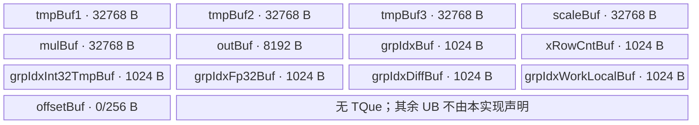

# GroupQuant A2/A3 ACLNN 算子知识

## 算子速览

| 项目 | 内容 |
|---|---|
| 实际入口 | `aclnnGroupQuantGetWorkspaceSize` / `aclnnGroupQuant`，公开两段式 ACLNN；固定仓没有同语义带版本后缀入口 |
| 计算语义 | 对 `x[S,H]` 的每一行按 `groupIndex[E]` 指定的专家分段，应用对应 `scale[e,H]`：`y=round(x*scale+offsetOptional)` |
| 输入输出 | `x/scale/offset`: FP16/FP32/BF16，`groupIndex`: INT32/INT64，ND；`y`: INT8/INT4，ACLNN 的 INT32 是 8 个 INT4 的打包视图 |
| 执行类型 | 单 Kernel、`AIV_VECTOR`；Host 用 `GetCoreNumAiv()` 分核，Device 仅含 Vector/Scalar 与 GM↔UB 搬运，不含 Cube/AIC/MIX_CV、SIMT、NDDMA 或 AICPU 可达节点 |
| Kernel 路线 | R-001 Key 0 通用分组量化；36 个 `x × scale × groupIndex × y` 编译 dtype 组合进入同一 POD、单节点图和模板体，模板内保留 dtype 编译期分支 |
| 核心资源 | GM；13 个 `TBuf<VECCALC>`，其中 5×32 KiB、1×8 KiB、6×1 KiB，offset 存在时再分配 256 B；固定 32 B 算子 workspace 仅用于保证 user workspace 非空 |
| 来源闭包 | `source_closed`：公开 ACLNN→连续化/INT32 打包视图→`l0op::GroupQuant`→`Tiling4GroupQuant`/`GroupQuantTilingData`→`group_quant`→`GroupQuantBase`→A2/A3 binary/CMake 接线闭合 |
| 验证状态 | 已完成源码闭包检查；本次知识提取未执行编译、真机、数值或性能测试。 |

## 接口与语义

### 计算语义

令 `groupIndex` 为非递减累计行末端，约定 `groupIndex[-1]=0`；第 `e` 组覆盖 `s∈[groupIndex[e-1], groupIndex[e])`。对有效元素：

```text
v = fp32(x[s,h]) * fp32(scale[e,h])
v = v + fp32(offset[0])                    # offset 存在时
q = rint(v) -> int32 -> fp16 -> rint(y_dtype)
y[s,h] = q                                 # INT4 时两个元素打包为一字节
```

Device 会在每个活动 AIV core 上检查 `groupIndex` 的值域、非递减性和末值等于 `S`；INT32 用 Vector cast/reduce，INT64 用 Scalar 循环。INT32 形式的 ACLNN 输出不是另一种计算语义：Host 仍以 INT4 计算，再把每 8 个 INT4 的 32 bit 存储创建成 INT32 view。

### 输入、输出与属性

| 参数 | shape/layout | dtype | 约束、默认值与语义 |
|---|---|---|---|
| `x` | `[S,H]`, ND | FP16/FP32/BF16 | 可为空；非连续时先 `Contiguous`；INT4 输出要求 `H%2==0`，INT32 打包要求用户 `y` 尾轴为 `H/8` |
| `scale` | `[E,H]`, ND | FP16/FP32/BF16 | `E>=1`，第二维等于 `H`；dtype 可与 `x` 不同 |
| `groupIndex` | `[E]`, ND | INT32/INT64 | 非递减、值域 `[0,S]`、末值为 `S`；这些值约束由 Device `Trap` 防御，不由 ACLNN Host 逐值检查 |
| `offsetOptional` | `[]` 或 `[1]`, ND | 与 `scale` 相同 | 可省略；所有元素共享一个 offset |
| `dstType` | 标量属性 | int32 enum | `2/29/3` 分别为 INT8/INT4/INT32；底层 Tiling 只接收 INT8/INT4，3 在 ACLNN 层转换成 INT4 |
| `y` | INT8/INT4 时 `[S,H]`；INT32 时 `[S,H/8]` | INT8/INT4/INT32 | dtype 必须与 `dstType` 数值一致；非连续输出由 `ViewCopy` 回写 |

### 入口与版本

固定 Commit 只公开无后缀版本 `aclnnGroupQuantGetWorkspaceSize`/`aclnnGroupQuant`，因此它是 A2/A3 实际支持的最新公开版本。`docs/aclnnGroupQuant.md:5-14` 明确支持 Atlas A2、A3；API 实现在 DAV_2201 上允许三种浮点输入、两种 groupIndex 与 INT8/INT4/INT32 输出。第一段创建 executor 并返回动态 workspace 大小，第二段通过 `CommonOpExecutorRun` 在用户 stream 上执行。

## Host/Launcher 执行流程

### 参数校验与前处理

`CheckParams` 顺序为：`x/scale/groupIndex/y` 非空 → 当前架构 dtype 表检查 → 可选 offset dtype 及其与 scale 一致性 → `y.dtype==dstType` → shape 检查。shape 要求 `x/scale` 为二维、`groupIndex` 一维、`scale[1]=x[1]`、`groupIndex[0]=scale[0]`；INT4/INT32 另走打包 shape 检查。若 `x->IsEmpty()`，第一段直接返回 `workspaceSize=0`，executor 不含核心 Kernel。

非空时依次将 `x`、`scale`、`groupIndex`、可选 offset 连续化。若用户 `y` 为 INT32，则把核心输出 dtype 改为 INT4；`l0op::GroupQuant` 分配 `[S,H]` 临时输出并用 `ADD_TO_LAUNCHER_LIST_AICORE(GroupQuant, ...)` 加入核心节点。随后 `Int42Int32PackedTensor` 仅创建尾轴除以 8 且 dtype 为 INT32 的 view，最终 `ViewCopy` 写用户 `y`。`Contiguous/CreateView/ViewCopy` 是本固定仓允许的框架边界。

### 参数、Workspace 与生命周期

核心 Tiling 从平台读取 AIV core 数；虽然 `TilingPrepare4GroupQuant` 也读取 UB 大小到 `GroupQuantCompileInfo::ubSizePlatForm`，当前 selector 不消费该字段。`GetWorkspaceSize` 固定写 32 B，`PostTiling` 写入 workspace slice 0；entry 只用 `GetUserWorkspace(workspace)` 检查非空，不读写其中内容。ACLNN 返回的总 workspace 由 executor 汇总，可能还含 `Contiguous/ViewCopy` 框架任务，因此只能由 `uniqueExecutor->GetWorkspaceSize()` 在第一段得到，固定仓没有一个可替代的静态总公式。workspace、临时连续 Tensor 和 INT4 临时输出由 executor 持有到同一 stream 上任务完成。

### 启动图与失败传播

```text
aclnnGroupQuantGetWorkspaceSize
  -> CheckParams
  -> Contiguous(x, scale, groupIndex, offset?)                 # 框架节点，按需
  -> l0op::GroupQuant -> ADD_TO_LAUNCHER_LIST_AICORE(GroupQuant)
       -> Tiling4GroupQuant -> GroupQuantTiling::DoTiling
       -> group_quant<<<blockDim=needCoreNum, key=0>>>
  -> CreateView(INT4 as packed INT32)?                         # dstType==3
  -> ViewCopy(core result/view, user y)                        # 框架节点
aclnnGroupQuant(workspace, size, executor, stream)
  -> CommonOpExecutorRun                                      # 同一 stream 顺序提交
```

核心语义只有一个 Device 节点。其输入为连续 GM `x/scale/groupIndex/offset?`，输出为 executor 分配的连续 `out`，POD 为 `GroupQuantTilingData`，blockDim 为 `needCoreNum`，workspace slice 为 32 B。前处理失败即不加入后续节点；launcher 添加失败返回空；核心 Kernel 的空 workspace 直接 return、非法 groupIndex 或 `E<=0` 触发 `Trap`，后续 `ViewCopy` 的执行结果由 executor/stream 的错误传播决定。固定源码只展示同一 executor/stream 的顺序关系，没有独立 event 或跨 Kernel 中间 workspace 边。

## Route 与参数设计

### 分核与资源计算

设平台 AIV 核数为 `C`。Tiling 取 `needCoreNum = 1 (S=0), S (0<S<C), C (S>=C)`；若 `S%needCoreNum==0`，`preCoreNum=needCoreNum`，否则为余数。前 `preCoreNum` 核各处理 `ceil(S/needCoreNum)` 行，其余核各处理 `floor(S/needCoreNum)` 行；Device 的行起点为 `b*preRows` 或 `preCoreNum*preRows+(b-preCoreNum)*postRows`。

每核再按 `H` 每次最多 8192 元素切片：`loopH=ceil(H/8192)`，`calH=min(8192, H-hIdx*8192)`，`calHBlock=ceil(calH/64)*64`。一批同专家行数上限为 `maxSSize=floor(32768/(4*calHBlock))`，从而 `dataCount=perSSize*calHBlock<=8192`；这同时约束 FP32 中间区和 8 KiB INT8 输出区。groupIndex 每批最多 `1024/sizeof(T3)` 个元素。

### Route 选择

| 顺序 | Route | Key/模板 | 精确选择条件与优先级 | 不适用去向 |
|---:|---|---|---|---|
| 1 | R-001 通用累计分组 | Key `0`；`GroupQuantBase<DTYPE_X,DTYPE_SCALE,DTYPE_GROUP_INDEX,DTYPE_SCALE,DTYPE_Y>` | A2/A3 公开参数通过 ACLNN 与 Tiling 校验；`IsCapable()` 恒 true；binary config 覆盖 `3×3×2×2=36` 个 dtype 组合 | 校验失败返回错误；未知 key/空 workspace 在 entry 不执行 body |

```text
公开 A2/A3 + 非空 x
  -> GroupQuantTiling::GetShapeAttrsInfo 成功
  -> IsCapable() == true
  -> GetTilingKey() == 0
  -> R-001
     -> T3==INT32: Vector groupIndex 检查/差分
        T3==INT64: Scalar groupIndex 检查/差分
     -> T1/T2/T5 constexpr dtype 子路径
```

### 模板/实现执行矩阵

| Route | key/selector | dtype/shape/platform 完整命中条件 | 执行拓扑与 Kernel 节点 | 实际模板/body | 内存与同步特征 | tail/fallback |
|---|---|---|---|---|---|---|
| R-001 通用累计分组 | 0 | A2/A3；`x,scale∈{FP16,FP32,BF16}` 可独立组合；`groupIndex∈{INT32,INT64}`；核心 `y∈{INT8,INT4}`；shape 约束见上 | 单 `group_quant` AIV 节点 | `GroupQuantBase<T1,T2,T3,T2,T5>::Process`；INT32/INT64、FP32/非 FP32、INT8/INT4 走编译期分支 | 固定 TBuf 布局；MTE2↔V/S、V↔MTE3 事件；无跨节点 workspace 数据 | S/H 空域 return；H 按 8192 与 64 对齐；S 按 UB 上限与专家边界切尾；非法 groupIndex Trap |

### 隐藏性能 Guard

| Guard | Host/Tiling 条件 | Device/资源原因 | 影响 Route | 不满足时去向 | 源码符号 |
|---|---|---|---|---|---|
| AIV 核数 | `needCoreNum>=1` | blockDim 与每核 S 分片必须有效 | R-001 | `GRAPH_FAILED` | `GroupQuantTiling::DoOpTiling` |
| scale 非空首维 | `E>=1` | Device 会读取 `groupIndex[E-1]` 与 `scale[e,*]` | R-001 | Tiling `GRAPH_FAILED`；Device 另有 `Trap` 防御 | `GetShapeAttrsInfo`、`Process` |
| INT4 偶数 H | `y==INT4 => H%2==0` | 两个 INT4 打包为一个字节，CopyOut 使用 `calH/2` | R-001 | 参数/Tiling 失败 | `CheckSpecialIOShape`、`GetShapeAttrsInfo` |
| H 片与 FP32 工作区 | `calH<=8192`、`calHBlock=align64(calH)`、`maxSSize=floor(32768/(4*calHBlock))` | `tmpBuf2/tmpBuf3/mulBuf` 各只有 32 KiB，`outBuf` 只有 8 KiB | R-001 | Device 继续切 H/S；固定实现无另一 Route | `Compute`、`PerLoopCompute` |
| DMA blockCount 窄化 | `perSSize<=128`，再转 `uint16_t` | `CopyInX/CopyOutY.blockCount` 为 uint16 | R-001 | 由上述 maxSSize 自然满足 | `CopyInX`、`CopyOutY` |
| groupIndex 批宽 | `loadElems<=1024/sizeof(T3)` | 6 个检查/差分 TBuf 各 1024 B | R-001 | 多批循环与 tail 批 | `CheckGrpIdxAllValue`、`WalkGrpIdx` |
| workspace 非空 | Tiling 固定 32 B | entry 对 `workspace` 与 `GetUserWorkspace` 均判空 | R-001 | 直接 return，不写输出 | `group_quant` |

### POD/ABI

`GroupQuantTilingData` 由同一组 tiling 宏生成并由 Host `SaveToBuffer`、Device `GET_TILING_DATA` 解析。固定仓未包含 `register/tilingdata_base.h`/生成后的 Device struct，故只能证明字段声明顺序与每字段 `int64_t` 位宽，不能从固定仓证明 `sizeof/alignof/offsetof` 数值。

| 结构 | 字段 | 类型/位宽 | ABI 布局 | 单位 | Host/launcher producer | Device consumer | 边界 |
|---|---|---|---|---|---|---|---|
| `GroupQuantTilingData` | `dimS` | int64/64 | 第1字段；精确 offset 固定仓不可见 | 元素行 | `set_dimS(dimS)` | `ParseTilingData -> dimS_` | `S>=0`，0 为核心空域 |
| 同上 | `dimE` | int64/64 | 第2字段；精确 offset 固定仓不可见 | 专家数 | `set_dimE(dimE)` | `dimE_`，groupIndex/scale 遍历 | Tiling 要求 `>=1` |
| 同上 | `dimH` | int64/64 | 第3字段；精确 offset 固定仓不可见 | 每行元素 | `set_dimH(dimH)` | `dimH_`，H 切片与地址 | 0 为核心空域 |
| 同上 | `hasOffset` | int64/64 | 第4字段；精确 offset 固定仓不可见 | bool(0/1) | offset shape 指针是否为空 | 条件分配/CopyIn/Adds | 0 时 offset 指针不读取 |
| 同上 | `needCoreNum` | int64/64 | 第5字段；精确 offset 固定仓不可见 | AIV core | `min` 分核公式 | `blockIdx` guard | 必须 `>=1` |
| 同上 | `preCoreNum` | int64/64 | 第6字段；精确 offset 固定仓不可见 | AIV core | 整除时为 `needCoreNum`，否则 `S%needCoreNum` | former/tail core 分支 | `0..needCoreNum` |
| 同上 | `xRowNumPreCore` | int64/64 | 第7字段；精确 offset 固定仓不可见 | 行/core | `ceil(S/needCoreNum)` | former core 行数与起点 | S=0 时 0 |
| 同上 | `xRowNumPostCore` | int64/64 | 第8字段；精确 offset 固定仓不可见 | 行/core | `S/needCoreNum` | tail core 行数与起点 | 整除时虽被写入但无 tail core 消费 |

### Route 源码闭包

| Route | Key/selector | Host/Tiling producer | POD/参数 | Kernel entry/router 节点 | Kernel body/直接依赖 | 构建接线 |
|---|---|---|---|---|---|---|
| R-001 通用累计分组 | 0；`IsCapable=true` | `op_host/group_quant_tiling.cpp::Tiling4GroupQuant/GroupQuantTiling::*` | `op_host/group_quant_tiling.h::GroupQuantTilingData` | `op_kernel/group_quant.cpp::group_quant` | `op_kernel/group_quant_base.h::GroupQuantBase::*` | `op_host/group_quant_def.cpp::GroupQuant`、A2/A3 binary JSON、`scripts/kernel/binary_config/ascendc_config.json`、`op_host/CMakeLists.txt` |

## Kernel 实现

### 公共执行流程

Key 0 entry 先要求 user workspace 非空，解析 POD，实例化 `GroupQuantBase<DTYPE_X,DTYPE_SCALE,DTYPE_GROUP_INDEX,DTYPE_SCALE,DTYPE_Y>`，然后 `Init→Process`。`Init` 绑定五路 GM 并分配全部 TBuf。`Process` 先在每核完整检查 groupIndex，再按 former/tail core 确定当前 S 行域。`Compute` 先一次搬入可选 offset，按 H 片进入 `PerLoopCompute`；后者以有状态游标把本核行域与专家累计区间相交，按 UB 容量切 S 批，逐批执行 `CopyInScale→CopyInX→VecCompute→CopyOutY`。

### Route R-001：通用累计分组

#### 适用条件

##### 选择证据

| 层级 | 文件 | 符号 | 源码谓词/参数 | 结果/下一跳 |
|---|---|---|---|---|
| ACLNN | `quant/group_quant/op_host/op_api/aclnn_group_quant.cpp` | `CheckParams`、`aclnnGroupQuantGetWorkspaceSize` | 非空/dtype/shape 成功；`x` 非空 | 连续化并调用 L0；空 x 直接成功 |
| L0 | `quant/group_quant/op_host/op_api/group_quant.cpp` | `l0op::GroupQuant` | DAV_2201 dtype 支持；分配 `[S,H]`、`dstType` 输出 | `ADD_TO_LAUNCHER_LIST_AICORE(GroupQuant)` |
| Tiling | `quant/group_quant/op_host/group_quant_tiling.cpp` | `GroupQuantTiling::IsCapable/GetTilingKey` | `true`；返回 `0%10^12` | Key 0 |
| Router | `quant/group_quant/op_kernel/group_quant.cpp` | `group_quant` | workspace/userWS 非空且 `TILING_KEY_IS(0)` | 实例化 `GroupQuantBase`；否则无 body |

#### Device 数据流

##### 函数级调用链

```text
ADD_TO_LAUNCHER_LIST_AICORE(GroupQuant)
  -> group_quant(x, scale, groupIndex, offset, y, workspace, tiling)
    -> GET_TILING_DATA
    -> GroupQuantBase<T1,T2,T3,T2,T5>::Init
    -> GroupQuantBase::Process
      -> CheckGrpIdxAllValue
        -> LoadGrpIdxFirstBatch / CheckGrpIdxAll
        -> CheckGrpIdxOneBatch / CheckGrpIdxLastValue
      -> Compute
        -> CopyInOffset
        -> PerLoopCompute(H slice)
          -> LookupExpertStateful -> WalkGrpIdx -> CalcGrpCnt
          -> CopyInScale
          -> CopyInX -> VecCompute -> CopyOutY
```

##### 源码等价伪码

```text
# 伪码；b=GetBlockIdx()
if b >= needCoreNum or S==0 or H==0: return
if E <= 0: Trap
for every groupIndex batch on every core:
    load cumulative indices and one-position-shifted values
    if T3==int32: Vector cast/reduce check [0,S] and non-decreasing
    else: Scalar loop check the same conditions
load groupIndex[E-1]; if != S: Trap
barrier_all

rows = (b < preCoreNum ? preRows : postRows)
row0 = (b < preCoreNum ? b*preRows
                        : preCoreNum*preRows+(b-preCoreNum)*postRows)
if hasOffset: load offset[0] and convert to fp32

for h0 in range(0,H,8192):
    calH = min(8192,H-h0); H64=align_up(calH,64)
    maxRows = floor(32768/(4*H64))
    reset expert cursor
    while current-core rows remain:
        find next expert interval intersecting [row0,row0+rows)
        expertRows = intersection length
        load scale[expert,h0:h0+calH]
        for sBatch in split(expertRows,maxRows):
            load x[(row0+done):, h0:h0+calH] to rows padded to H64
            cast x/scale to fp32 when needed
            broadcast scale row across sBatch by UB copy
            v = x_fp32 * scale_fp32
            if hasOffset: v += offset_fp32
            v = rint_to_int32(v); v = int32_to_fp16(v)
            q = rint_to_int8_or_int4(v)
            copy only calH valid columns to GM (INT4 uses calH/2 bytes)
```

#### 内存与数据搬运

##### 资源与搬运表

| 层级/缓冲区 | offset/地址公式 | extent/容量公式 | dtype/layout | producer | consumer | owner/lifetime | 对齐/复用 |
|---|---|---|---|---|---|---|---|
| GM `x` | `(row0+done)*H+h0` | `perSSize × calH` 有效元素 | T1/ND | 用户/Contiguous | `CopyInX` | executor 到 stream 完成 | 每行 UB stride 为 `H64`；GM src stride 跳过 `H-calH` |
| GM `scale` | `expert*H+h0` | `calH` 元素 | T2/ND | 用户/Contiguous | `CopyInScale` | 同上 | 搬入一行，UB 内广播至 `perSSize` 行 |
| GM `groupIndex` | 批 offset 或 `E-1` | 每批至多 `1024/sizeof(T3)` | T3/ND | 用户/Contiguous | 检查与专家游标 | 同上 | 首批构造 0 前驱；后批从 offset-1 搬前驱 |
| GM `offset` | 0 | 1 元素 | T2 | 用户/Contiguous | `CopyInOffset` | hasOffset 时有效 | UB 固定预留 256 B |
| GM `y` | INT8: `xAddr`；INT4: `xAddr/2` | 每行 `calH` 或 `calH/2` 字节 | packed INT8/INT4 | `CopyOutY` | View/ViewCopy/用户 | executor 到 stream 完成 | 跳过 H tail；INT4 要求偶数 H |
| `tmpBuf1_` | UB 子区 | 32768 B | T1；H64-padded rows | `CopyInX` | x cast/alias | Kernel/core 全生命周期 | T1=FP32 时直接别名 `xLocal` |
| `tmpBuf2_` | UB 子区 | 32768 B | FP32 | x Cast | Mul | 全生命周期、逐批覆盖 | T1非 FP32 才承载 x_fp32 |
| `tmpBuf3_` | UB 子区 | 32768 B | FP32 | scale Cast/broadcast | Mul | 全生命周期、逐专家/批覆盖 | T2非 FP32 时使用 |
| `scaleBuf_` | UB 子区 | 32768 B | T2 | `CopyInScale`/FP32 broadcast | scale Cast/Mul | 全生命周期 | T2=FP32 时直接作 FP32 broadcast 区 |
| `mulBuf_` | UB 子区 | 32768 B | FP32→原地 INT32→原地 FP16 | Mul/Adds/Cast | final Cast | 全生命周期、逐批覆盖 | 同一物理区原地 reinterpret，事件/PIPE_V barrier 保护 |
| `outBuf_` | UB 子区 | 8192 B | INT8 或 packed INT4 | final Cast | `CopyOutY` | 全生命周期、逐批覆盖 | INT4 最多用 4096 B 有效区 |
| 6×group buffers | 六个独立 UB 子区 | 各 1024 B | T3/FP32 临时 | DMA/Vector | 检查、差分、游标 | 全生命周期、逐批覆盖 | INT64 路线部分 FP32 临时未被计算使用但仍分配 |
| `offsetBuf_` | UB 子区 | hasOffset ? 256 B : 0 | T2 | MTE2 | Scalar `offset_` | 条件分配；读取后仍保留 | 无 offset 时消除分配 |
| user workspace | `GetUserWorkspace(workspace)` | 32 B | 未解释字节 | Host/Tiling | entry 仅判空 | executor/用户持有 | Kernel 不读写 |

##### 分层内存布局



##### 字节账与复用顺序

```text
UB_total(no offset) = 5*32768 + 8192 + 6*1024 = 178176 B
UB_total(has offset)= 178176 + 256 = 178432 B
UB_total <= 平台实际可用 UB 是启动的必要条件；Host 虽读取 ubSizePlatForm，但固定实现未做比较
dynamic_ub = N/A（AIV TBuf 静态分配）
workspace_total(core node) = 32 B；ACLNN executor 总 workspace 另含按需框架节点
```

| 复用子区 | 写入者 | 读取者/消费点 | 下一次覆盖 | 同步或释放依据 | 安全条件 |
|---|---|---|---|---|---|
| `mulBuf_` 同一物理区 | `Mul/Adds` 写 FP32 | FP32→INT32 Cast | 原地 INT32→FP16 Cast，再被下一 S 批 Mul 覆盖 | 每步 `PipeBarrier<PIPE_V>`；批末 `V_MTE3/MTE3_V` | CopyOut 完成后才能开始下一批覆盖 |
| `tmpBuf3_` 或 FP32 `scaleBuf_` | scale Cast 与逐行 `Muls` broadcast | `Mul` | 下一专家/下一 H 片的 scale load/cast | `PIPE_V` barrier，末尾 `V_MTE2` 后才允许 MTE2 覆盖 | `dataCount*4<=32768` |
| `outBuf_` | final Cast | MTE3 `CopyOutY` | 下一 S 批 final Cast | `V_MTE3` 前置、`MTE3_V` 后置事件 | 当前批 GM 写出完成 |
| groupIndex 六缓冲 | DMA/Vector/Scalar 检查 | reduce/Scalar/专家 lookup | 下一 1024 B 批 | MTE2↔V/S 与 V→MTE2 事件 | 当前批检查或差分消费完毕 |
| `offsetBuf_` | `CopyInOffset` | Scalar 读取到寄存标量 `offset_` | 无后续覆盖 | `MTE2_S` | 仅 hasOffset 分配和访问 |

#### 同步、精度与尾块

##### 同步与数值边界表

| 阶段 | primitive/机制 | producer | consumer/等待点 | 保护对象 | 精度/尾块 |
|---|---|---|---|---|---|
| groupIndex 搬入→检查 | `MTE2_V` 或 `MTE2_S` event | `DataCopyPad` | Vector reduce 或 Scalar loop | group buffers | INT32 cast FP32 后 reduce；INT64 保持 int64 Scalar 比较；最后一批按 `tailE` |
| groupIndex 检查→重载 | `V_MTE2`/`S_MTE2` event | 检查/差分 | 下一 `LoadGrpIdxMoreBatch` | 同一 group buffers | 每批含前一累计值，保证跨批非递减检查 |
| 全检查→计算 | `PipeBarrier<PIPE_ALL>` | `CheckGrpIdxAllValue` | 分核行处理 | 全部检查缓冲 | 每核都完整校验；错误 `Trap` |
| x/scale→Vector | `MTE2_V`，另有 `S_V` | CopyIn 与 offset Scalar | `VecCompute` | x/scale/offset | T1/T2 非 FP32 时 `CAST_NONE` 升 FP32 |
| scale broadcast/Mul/Add | `PIPE_V` barrier | Cast/Muls/Mul/Adds | 下一 Vector primitive | FP32 工作区 | `scaleExpandLoop=perSSize`；H tail padded 到 64，CopyOut 仅写 calH |
| 量化 | 连续 `PIPE_V` barrier | FP32 Mul/Add | 三次 Cast | `mulBuf/outBuf` | FP32 `CAST_RINT`→INT32，INT32→FP16，FP16 `CAST_RINT`→INT8/INT4；该两段降精度顺序不可省略 |
| Vector→GM | `V_MTE3` / `MTE3_V` | final Cast | `CopyOutY` / 下一批 | outBuf 与 GM y | INT8 每行 calH B；INT4 每行 calH/2 B；src/dst stride 跳过对齐/全 H 余量 |

#### 关键实现

##### 符号证据表

| 阶段 | 文件 | 符号/模板实例 | 实现事实 |
|---|---|---|---|
| Host/Tiling producer | `quant/group_quant/op_host/group_quant_tiling.cpp` | `GetShapeAttrsInfo/DoOpTiling/GetTilingKey/GetWorkspaceSize/PostTiling` | shape/dtype、分核、Key 0、32 B workspace、POD 保存 |
| Kernel entry/router | `quant/group_quant/op_kernel/group_quant.cpp` | `group_quant` | user workspace 判空；Key 0 到完整模板实例 |
| Device body/helper | `quant/group_quant/op_kernel/group_quant_base.h` | `GroupQuantBase::Init/Process/CheckGrpIdxAllValue/Compute/PerLoopCompute/VecCompute/CopyOutY` | 固定 TBuf、groupIndex 双族校验、H/S 切分、FP32 计算、打包与同步 |

## 算子特定优化

### Trick T-001：一行 scale 在 UB 内扩展给同专家多行

#### 触发与源码依据

- 适用 Route：R-001。
- 触发条件：当前专家与本核相交的一个 S 批 `perSSize>1`；`scaleExpandLoop` 就是该批行数。
- Golden 来源：[`quant/group_quant/op_kernel/group_quant_base.h:589-600`](../../../../../../../cann-ops-raw/ascendc/ops-nn/955f8b33985b6d72989ebff341bb9c2c564a51bc/quant/group_quant/op_kernel/group_quant_base.h#L589-L600)

**官方源码（固定 Commit 连续逐字摘录）**：

```cpp
    // 将scale进行broadcast
    if (scaleExpandLoop > 1) {
        for (int64_t eIdx = 0; eIdx < scaleExpandLoop; eIdx++) {
            int64_t scaleAddr = eIdx * calHBlock;
            PipeBarrier<PIPE_V>();
            Muls(scaleLocal[scaleAddr], scaleLocal, 1.0f, calHBlock);
        }
    }

    // scale乘x
    PipeBarrier<PIPE_V>();
    Mul(mulLocal, xLocal, scaleLocal, dataCount);
```

#### 机制与设计原因

`CopyInScale` 对一个专家、一个 H 片只从 GM 搬一行 `calH`；随后以 `Muls(...,1.0f,calHBlock)` 在 UB 中复制到每个行片，再用一次长度为 `dataCount=perSSize*calHBlock` 的 `Mul` 与多行 x 相乘。这样 GM scale 流量不随同一专家的行数增长；`maxSSize` 的 FP32 字节公式保证广播后的全部行仍在 32 KiB 区内。T2=FP32 时 `scaleLocal` 别名 `scaleBuf_`，非 FP32 时先 Cast 到 `tmpBuf3_`，机制相同。

#### 迁移边界

- 适用：分组/专家内多行共享同一向量参数的逐元素计算。
- 前提：同一批所有行属于同一专家；参数片长度按 64 对齐；`perSSize*calHBlock*4<=32768`。
- 失效：跨专家行不能共享 scale，必须先结束当前交集并载入下一专家 scale；超过 UB 时继续切 S 批。
- 未验证：本次知识提取未执行编译、真机、数值或性能测试。

#### 错误做法

固定仓未提供可验证反例；从源码约束可确定不能把不同专家的行合入同一次 broadcast/Mul。

### Trick T-002：按 groupIndex dtype 选择 Vector 或 Scalar 完整校验

#### 触发与源码依据

- 适用 Route：R-001。
- 触发条件：`T3==int32_t` 使用 Vector cast/reduce；否则公开可达的 INT64 使用 Scalar 循环。
- Golden 来源：[`quant/group_quant/op_kernel/group_quant_base.h:239-253`](../../../../../../../cann-ops-raw/ascendc/ops-nn/955f8b33985b6d72989ebff341bb9c2c564a51bc/quant/group_quant/op_kernel/group_quant_base.h#L239-L253)

**官方源码（固定 Commit 连续逐字摘录）**：

```cpp
    // group_index values are in the range [0, S], and the sequence is non-decreasing
    if constexpr (IsSameType<T3, int32_t>::value) {  // group_index data type is int32_t
        event_t eventIdMte2ToV = static_cast<event_t>(GetTPipePtr()->FetchEventID(HardEvent::MTE2_V));
        SetFlag<HardEvent::MTE2_V>(eventIdMte2ToV);
        WaitFlag<HardEvent::MTE2_V>(eventIdMte2ToV);

        // compare with 0
        PipeBarrier<PIPE_V>();
        Cast(grpIdxFp32Ub, grpIdxUb, RoundMode::CAST_NONE, loadElems);
        PipeBarrier<PIPE_V>();
        ReduceMin(grpIdxDiffUb, grpIdxFp32Ub, grpIdxWorkLocalUb, loadElems, false);
```

#### 机制与设计原因

INT32 批通过 `Cast/ReduceMin/ReduceMax` 一次检查多个元素，并以错位累计值相减检查非递减；INT64 不强行窄化，而用 `GetValue` 保留 64 位比较。每批至多占 1024 B，跨批时 `LoadGrpIdxMoreBatch` 额外从 `offset-1` 搬前一累计值，维持边界检查。该编译期分流改变检查计算方式但复用同一个 Key、POD 和主量化管线。

#### 迁移边界

- 适用：索引 dtype 同时支持 32/64 位且需要 Device 防御性全量检查的算子。
- 前提：INT32→FP32 的 reduce 仅用于符号/相对界检查，原 INT32 数据仍用于专家游标；INT64 必须保持 Scalar 64 位比较。
- 失效：其它 dtype 没有固定 binary config；不能未经证据套用 INT32 Vector 路径。
- 未验证：本次知识提取未执行编译、真机、数值或性能测试。

#### 错误做法

固定仓未提供可验证反例；源码明确没有把 INT64 索引 Cast 到 FP32 后做同一套 Vector reduce。

## 模板与实现对比

| 对比维度 | R-001 通用累计分组 | 设计选择依据 |
|---|---|---|
| 命中条件/优先级 | 唯一模板、`IsCapable=true`、Key 0 | Host 只有一个 selector，无 fallback 模板 |
| 模板与 dtype | 36 个 binary 组合；`T4=T2`；T1/T2/T3/T5 决定 constexpr 子路径 | offset 必须与 scale 同 dtype；x 与 scale 可不同 dtype |
| 循环与分核 | 先 S 分核，再 H≤8192，再专家交集，再 S≤maxSSize | 保持 GM 行布局、专家共享 scale 与 32 KiB FP32 上界 |
| TBuf/寄存器 | 13 个 TBuf，offset 条件分配；无 TQue/显式 RegTensor | 手工 event/barrier 管理静态 UB 子区 |
| 内存总占用与复用 | 178176/178432 B；mul 区 FP32→INT32→FP16 原地 reinterpret | 固定布局避免额外中间物化 |
| 搬运/Vector API | DataCopyPad、Cast、ReduceMin/Max、Muls、Mul、Adds | groupIndex INT32 向量化，INT64 Scalar；scale UB broadcast |
| 同步、精度与 tail | MTE2/V/S/MTE3 events；FP32 计算后两段降精度；H/S/E 多级 tail | 保证静态 TBuf 重用和 packed INT4 有效写出 |
| fallback/失败边界 | 无另一 Route；Host 失败、entry return 或 Device Trap | 固定实现不提供通用降级 body |

## 平台差异

| 项目 | A2 | A3 | 950 |
|---|---|---|---|
| 支持状态 | 公开支持 | 公开支持 | 公开 README/API 明确不支持；虽有 `ascend950` OpDef/binary 接线，构成发布冲突，未生成 950 正式卡 |
| Host/Launcher | `ascend910b` config，DAV_2201 ACLNN dtype 表 | `ascend910_93` config，DAV_2201 ACLNN dtype 表 | 实现信号存在但不能覆盖公开不支持结论 |
| Kernel/资源 | 共用 Key 0 `GroupQuantBase`，32 KiB 主 TBuf 配置 | 与 A2 共用源体及 36 个 dtype binary 组合 | 不作为公开可达链路发布 |

## 限制与失败边界

- ACLNN Host 不读取 groupIndex 内容；非法值在每个活动 core 的 `CheckGrpIdxAllValue` 中 `Trap`。公开文档也明确这类内容约束不由参数校验保证。
- `TilingPrepare4GroupQuant` 读取平台 UB 大小却不用于 selector；固定实现自身静态分配为 178176/178432 B，固定仓没有 Host 侧资源不足 fallback。
- POD 宏实现与生成后的 Device ABI 不在固定仓，精确 `sizeof/alignof/offsetof` 不可见；迁移时必须继续使用相同生成宏，不能手抄猜测布局。
- `CopyInX/CopyOutY.blockCount` 窄化到 uint16，但源码的 `maxSSize<=128` 将公开路径约束在安全范围；shape 乘法和地址计算主要为 int64，`dataCount` 窄化到 uint32 前由 8192 元素上界约束。
- 核心 32 B workspace 不承载数据；传入空 workspace 会静默 return。ACLNN 空 x 则在 Host 提前成功返回 workspace 0，不启动 Kernel。
- 950 的公开产品表与实现接线冲突，故 `group_quant_950.md` 不生成；不得仅据 `ascend950` 文件存在推断公开支持。
- 本次知识提取未执行编译、真机、数值或性能测试。

## 源码索引

### 链路索引

| 链路阶段 | 文件 | 关键符号 | 支撑内容 |
|---|---|---|---|
| 入口声明/约束 | `quant/group_quant/docs/aclnnGroupQuant.md` | `aclnnGroupQuant*`、产品支持表 | A2/A3 公开性、950 不支持、接口语义与限制 |
| 入口实现 | `quant/group_quant/op_host/op_api/aclnn_group_quant.cpp` | `CheckParams`、`Int42Int32PackedTensor`、`aclnnGroupQuant*` | 校验、Contiguous、INT32 view、executor/stream |
| L0 launcher | `quant/group_quant/op_host/op_api/group_quant.cpp` | `l0op::GroupQuant/GroupQuantAiCore` | 临时输出与 AICore launcher 添加 |
| Host/Tiling/POD | `quant/group_quant/op_host/group_quant_tiling.h` | `GroupQuantCompileInfo/GroupQuantTilingData/GroupQuantTiling` | POD 字段、类状态与接口 |
| Host/Tiling/Launcher | `quant/group_quant/op_host/group_quant_tiling.cpp` | `GroupQuantTiling::*`、`Tiling4GroupQuant` | 校验、分核、Key、workspace、注册 |
| Kernel entry | `quant/group_quant/op_kernel/group_quant.cpp` | `group_quant` | workspace guard、Key 0 router、模板实例 |
| Kernel body | `quant/group_quant/op_kernel/group_quant_base.h` | `GroupQuantBase::*` | 完整 AIV 数据流、内存、同步、精度和 tail |
| 平台注册 | `quant/group_quant/op_host/group_quant_def.cpp` | `ops::GroupQuant` | dtype/layout 与 A2/A3/950 实现配置信号 |
| A2 binary | `quant/group_quant/op_host/config/ascend910b/group_quant_binary.json` | `GroupQuant_*` 36 entries | A2 dtype 实例闭包 |
| A3 binary | `quant/group_quant/op_host/config/ascend910_93/group_quant_binary.json` | `GroupQuant_*` 36 entries | A3 dtype 实例闭包 |
| Kernel 全局接线 | `scripts/kernel/binary_config/ascendc_config.json` | `GroupQuant` | compute unit 与 `auto_sync:false` |
| Host 构建 | `quant/group_quant/op_host/CMakeLists.txt` | `add_modules_sources(... group_quant ACLNNTYPE aclnn_exclude)` | 手写 ACLNN/Host 源码进入构建 |

### 实现复用检查

| 检查项 | 可复用事实 | 不得改变的约束 | 源码符号 |
|---|---|---|---|
| ABI/POD | 8 个 int64 字段及声明/写入/读取顺序 | 必须用同一 tiling 宏；`hasOffset`、former/tail 字段即使部分 inactive 仍保持位置 | `GroupQuantTilingData`、`ParseTilingData` |
| 调用顺序 | 检查 groupIndex 后再确定行域并计算；每专家先 scale 后逐 S 批 x | `CheckGrpIdxAllValue→PIPE_ALL→Compute` 与 `CopyInScale→CopyInX→VecCompute→CopyOutY` | `Process`、`PerLoopCompute` |
| workspace/内存 | 固定 32 B user workspace；静态 TBuf 字节账；scale 广播和 mul 原地复用 | entry 非空 guard、32 KiB/8 KiB/1 KiB/256 B 容量及覆盖顺序 | `GetWorkspaceSize`、`Init`、`VecCompute` |
| 同步 | 显式 HardEvent 与 PIPE barrier 图 | `auto_sync:false`，不得删除 MTE2/V/S/MTE3 交接 | `CheckGrpIdxOneBatch`、`VecCompute`、`CopyOutY` |
| 精度与尾块 | FP32 Mul/Add→RINT INT32→FP16→RINT INT8/INT4；H64 pad、仅 calH 写出 | INT4 地址/字节减半；scale broadcast 必须覆盖 `perSSize` 行 | `VecCompute`、`CopyOutY`、`Compute` |
| 失败边界 | Host 校验失败、空域成功、workspace return、非法索引 Trap | 不得把 Device 内容检查误写成 Host 检查或静默 fallback | `CheckParams`、`group_quant`、`CheckGrpIdxAllValue` |
