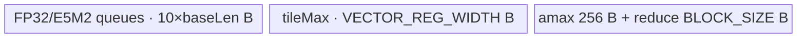
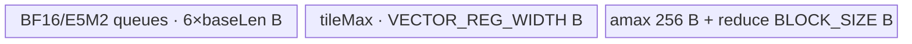
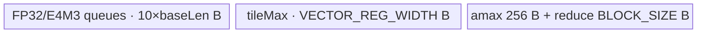

# QuantMax 950 ACLNN 算子知识

## 算子速览

| 项目 | 内容 |
|---|---|
| 实际入口 | `aclnnQuantMaxGetWorkspaceSize` + `aclnnQuantMax`，公开两段式 ACLNN；固定仓没有其它同语义版本 |
| 计算语义 | 同一次遍历计算 `y=Cast(x*scale,dst_type,round_mode)` 与 `amax=max(abs(x))` |
| 输入输出 | `x`: 1–8D ND FP32/FP16/BF16；`scale`: `[1]` FP32；`y`: 同 shape 的 HiFloat8/E5M2/E4M3FN；`amax`: `[1]` 且与 `x` 同 dtype |
| 执行类型 | 单 Kernel `AIV_VECTOR`；entry 声明 `KERNEL_TYPE_MIX_AIV_1_0`，但可达 body 仅含 AIV/Vector/MicroAPI，无 Cube/AIC/MIX_CV |
| Kernel 路线 | R-001～R-012：`x dtype × y dtype/round mode` 的 12 个实际模板实例 |
| 核心资源 | GM 输入输出、depth=2 的 `VECIN/VECOUT` 队列、3 个 `VECCALC` TBuf、寄存器计算、2 MiB user workspace 中 `+1 MiB` 的跨核 FP32 partial-max 区 |
| 来源闭包 | `source_closed`：公开 ACLNN→手写校验/连续化→`l0op::QuantMax` launcher→950 Tiling/POD→单 AIV entry→完整 RegBase body/helper→Ascend 950 构建接线闭合 |
| 验证状态 | 已完成源码闭包检查；本次知识提取未执行编译、真机、数值或性能测试。 |

## 接口与语义

### 计算语义

把 `x` 的 1–8 维 ND shape 展平为 `N=product(x.shape)`。对每个元素，Kernel 先将 FP16/BF16 输入升为 FP32（FP32 输入直接装载），再同时执行：

```text
q[i] = fp32(x[i]) * fp32(scale[0])
y[i] = saturating_cast_dst(q[i], round_mode)
amax_fp32 = max_i(abs(fp32(x[i])))
amax[0] = cast_x_dtype(amax_fp32, CAST_RINT)  # x 为 FP32 时直接写
```

HiFloat8 支持 `round` 与 `hybrid`，E5M2/E4M3FN 只支持 `rint`。绝对值最大值始终在 FP32 寄存器及 FP32 workspace 中归约，最后才转回 `x.dtype`。

### 输入、输出与属性

| 参数 | shape/layout | dtype | 约束、默认值与语义 |
|---|---|---|---|
| `x` | 1–8D / ND | FP32、FP16、BF16 | ACLNN 允许空 Tensor 和非连续 Tensor；空 Tensor 在第一段接口直接成功返回且不加入 QuantMax launch |
| `scale` | `[1]` / ND | FP32 | 非空；每个 AIV core 从 GM 直接读取 `scale[0]` |
| `roundMode` | 标量字符串 | `char*` | HiFloat8 必须为 `round/hybrid`；E5M2/E4M3FN 必须为 `rint`；空指针和空字符串失败 |
| `dstType` | 标量 | `int64_t` | `34/35/36` 分别为 HiFloat8/E5M2/E4M3FN，必须与 `y.dtype` 一致 |
| `y` | 与 `x` 完全同 shape / ND | HiFloat8、E5M2、E4M3FN | 每元素 1 byte；非连续输出通过末尾 `ViewCopy` 回写 |
| `amax` | `[1]` / ND | 与 `x` 相同 | 文档未声明非连续支持；算子只对传入 launcher 的连续对象写一次，不安排 `amax` 的 `ViewCopy` |

### 入口与版本

公开版本只有 `aclnnQuantMaxGetWorkspaceSize`/`aclnnQuantMax`。第一段创建 executor、完成参数校验与 launch 列表构造并返回 workspace；第二段把 workspace/executor/stream 交给 `CommonOpExecutorRun`。公开 README 与 ACLNN 文档只将 Ascend 950PR/950DT 标为支持，并明确 A2、A3 不支持；`OpAICoreConfig("ascend950")`、`SUPPORT_COMPUTE_UNIT="ascend950"` 和全局 binary config 的 `QuantMax/ascend950` 条目一致，所以本卡只覆盖 950。

## Host/Launcher 执行流程

### 参数校验与前处理

`CheckParams` 按 `CheckNullParams → CheckInputParams → CheckDstType → CheckRoundMode → CheckOutputParams` 顺序短路：检查四个 Tensor 指针，`x` dtype/rank，`scale` dtype、非空及 `[1]` shape，`dstType/roundMode` 组合，`y` dtype/shape，以及 `amax` dtype/`[1]` shape。`x->IsEmpty()` 在这些校验之后返回 workspace 0 和空计算 executor，不进入 Tiling；因此 Tiling 内部拒绝 `N==0` 不与公开空 Tensor 语义冲突。

非空时依次对 `x/scale/y/amax` 调用框架 `Contiguous`，再通过 `l0op::QuantMax` 把 `QuantMax` AICore 节点加入 executor。`l0op::QuantMax` 返回 `y`，随后 `ViewCopy(opResult,y)` 处理用户 `y` 的非连续视图。通用 `Contiguous/ViewCopy` 的实现是允许的框架边界；算子自有 selector、POD、entry 和 body 均已继续闭合。

### 参数、Workspace 与生命周期

`QuantMaxRegbase::GetPlatform` 读取 AIV core 数和 UB 字节数，失败或为零即返回 `GRAPH_FAILED`。它令 user workspace 为 `2,097,152` B，再加 `GetLibApiWorkSpaceSize()` 的 system workspace。Kernel 通过 `GetUserWorkspace(workspace)` 得到 user 区，`QuantMaxPerTensorRegbase::Init` 只显式绑定 `user+1,048,576` 的 64 个 FP32 槽；每个有效 core 写 `slot[blockIdx]`，`SyncAll` 后 core 0 读前 `numCore` 个槽并归约。前 1 MiB 与剩余 user 区未被该类显式索引；不得把它们解释为额外算子张量。

executor 拥有连续化临时张量、launcher 和 workspace 需求，生命周期持续到第二段接口在给定 stream 上执行结束。单 Kernel 内部 workspace partial-max 从各 core 写入，经全核同步后由 core 0 消费；没有跨 Kernel workspace 边。

### 启动图与失败传播

```text
aclnnQuantMaxGetWorkspaceSize
  -> Contiguous(x, scale, y, amax)                    # 框架边界
  -> l0op::QuantMax / QuantMaxAiCore
       -> ADD_TO_LAUNCHER_LIST_AICORE(QuantMax, ...)
          -> TilingForQuantMax -> QuantMaxRegbase::DoQuantMaxTiling
          -> quant_max<RoundMode><<<blockDim=physical AIV coreNum>>>
               -> Init -> Process -> MergeAmax
  -> ViewCopy(yContiguous, y)                         # 框架边界
aclnnQuantMax(workspace, size, executor, stream)
  -> CommonOpExecutorRun
```

唯一 Device 节点的 entry 为 `quant_max<RoundMode>(x,scale,y,amax,workspace,tiling)`，POD 为 `QuantMaxTilingData`。Host 发射 `blockDim=coreNum_`，Device 仅让 `blockIdx<numCore` 的 active core 参与；不过所有 block 都会走 `MergeAmax` 的 `SyncAll`，随后仅 block 0 输出。Tiling 任何平台、dtype、属性、shape、UB 失败均阻止 launch；launcher 加入失败返回空结果并沿 ACLNN 第一段返回错误，第二段由 `CommonOpExecutorRun` 传播运行错误。

## Route 与参数设计

### 分核与资源计算

令 `sx=sizeof(x.dtype)`，`sy=1`，`E=128/sx`（每 128 B cache line 的元素数），`L=ceil(N/E)`，平台 AIV 数为 `Cmax`：

```text
perCoreLines = ceil(L / Cmax)
C = activeCoreNum = ceil(L / perCoreLines)
blockFactor = ceil(L / C) * E
blockTailFactor = N - blockFactor * (C - 1)  # 为 0 时替换成 blockFactor

availableUb = UB - 2048
maxBase = floor(availableUb / (2 * (sx + sy)))
maxBase = floor_align(maxBase, E)
baseLen = min(ceil_align(blockFactor, E), maxBase)
```

`blockFactor/baseLen` 单位均为元素，128 和 UB 均为字节。Host 用 2048 B reserve 覆盖 3 个固定 TBuf 等非队列开销；实际分配账见 Route。`MergeInputShape` 用 `int64_t` 连乘原 shape，源码没有额外乘法溢出检查。

### Route 选择

下表以 `RINT/ROUND/HYBRID` 分别简写源码常量 `TPL_ROUND_MODE_RINT/TPL_ROUND_MODE_ROUND/TPL_ROUND_MODE_HYBRID`；实际 entry 模板参数是对应的 `uint64_t` 常量，不是运行时字符串。

| 顺序 | Route | Key/模板 | 精确选择条件与优先级 | 不适用去向 |
|---:|---|---|---|---|
| 1 | R-001 FP32→HiFloat8 round | `MODE_ROUND` / `<float,hifloat8_t,ROUND>` | `x=FP32 && y=HiFloat8 && dstType=34 && roundMode=="round"` | 下一行或 ACLNN 校验失败 |
| 2 | R-002 FP16→HiFloat8 round | 同上 / `<half,hifloat8_t,ROUND>` | `x=FP16`，其余同 R-001 | 下一行或失败 |
| 3 | R-003 BF16→HiFloat8 round | 同上 / `<bfloat16_t,hifloat8_t,ROUND>` | `x=BF16`，其余同 R-001 | 下一行或失败 |
| 4 | R-004 FP32→HiFloat8 hybrid | `MODE_HYBRID` / `<float,hifloat8_t,HYBRID>` | `x=FP32 && y=HiFloat8 && dstType=34 && roundMode=="hybrid"` | 下一行或失败 |
| 5 | R-005 FP16→HiFloat8 hybrid | 同上 / `<half,hifloat8_t,HYBRID>` | `x=FP16`，其余同 R-004 | 下一行或失败 |
| 6 | R-006 BF16→HiFloat8 hybrid | 同上 / `<bfloat16_t,hifloat8_t,HYBRID>` | `x=BF16`，其余同 R-004 | 下一行或失败 |
| 7 | R-007 FP32→E5M2 rint | `MODE_RINT` / `<float,fp8_e5m2_t,RINT>` | `x=FP32 && y=E5M2 && dstType=35 && roundMode=="rint"` | 下一行或失败 |
| 8 | R-008 FP16→E5M2 rint | 同上 / `<half,fp8_e5m2_t,RINT>` | `x=FP16`，其余同 R-007 | 下一行或失败 |
| 9 | R-009 BF16→E5M2 rint | 同上 / `<bfloat16_t,fp8_e5m2_t,RINT>` | `x=BF16`，其余同 R-007 | 下一行或失败 |
| 10 | R-010 FP32→E4M3FN rint | `MODE_RINT` / `<float,fp8_e4m3fn_t,RINT>` | `x=FP32 && y=E4M3FN && dstType=36 && roundMode=="rint"` | 下一行或失败 |
| 11 | R-011 FP16→E4M3FN rint | 同上 / `<half,fp8_e4m3fn_t,RINT>` | `x=FP16`，其余同 R-010 | 下一行或失败 |
| 12 | R-012 BF16→E4M3FN rint | 同上 / `<bfloat16_t,fp8_e4m3fn_t,RINT>` | `x=BF16`，其余同 R-010 | ACLNN 校验失败 |

```text
if dstType==34 && y==HiFloat8:
    if roundMode=="round":  key=GET_TPL_TILING_KEY(MODE_ROUND)  -> R-001/R-002/R-003 by x dtype
    if roundMode=="hybrid": key=GET_TPL_TILING_KEY(MODE_HYBRID) -> R-004/R-005/R-006 by x dtype
elif dstType==35 && y==E5M2 && roundMode=="rint":
    key=GET_TPL_TILING_KEY(MODE_RINT) -> R-007/R-008/R-009 by x dtype
elif dstType==36 && y==E4M3FN && roundMode=="rint":
    key=GET_TPL_TILING_KEY(MODE_RINT) -> R-010/R-011/R-012 by x dtype
else: ACLNN/Host validation failure
```

### 模板/实现执行矩阵

| Route | key/selector | dtype/shape/platform 完整命中条件 | 执行拓扑与 Kernel 节点 | 实际模板/body | 内存与同步特征 | tail/fallback |
|---|---|---|---|---|---|---|
| R-001/R-002/R-003 | `MODE_ROUND` | 950；FP32/FP16/BF16→HiFloat8；合法非空 shape | 单 `quant_max` | `QuantMaxPerTensorRegbase<T,hifloat8_t,ROUND>` | x queue 随 T 为 4/2/2 B；HiFloat8 `SAT+CAST_ROUND` | mask + tail tile；非法即失败 |
| R-004/R-005/R-006 | `MODE_HYBRID` | 950；FP32/FP16/BF16→HiFloat8；合法非空 shape | 单 `quant_max` | `QuantMaxPerTensorRegbase<T,hifloat8_t,HYBRID>` | 同上，降精度改 `CAST_HYBRID` | 同上 |
| R-007/R-008/R-009 | `MODE_RINT` | 950；FP32/FP16/BF16→E5M2；合法非空 shape | 单 `quant_max` | `QuantMaxPerTensorRegbase<T,fp8_e5m2_t,RINT>` | E5M2 `SAT+CAST_RINT` | 同上 |
| R-010/R-011/R-012 | `MODE_RINT` | 950；FP32/FP16/BF16→E4M3FN；合法非空 shape | 单 `quant_max` | `QuantMaxPerTensorRegbase<T,fp8_e4m3fn_t,RINT>` | E4M3FN `SAT+CAST_RINT` | 同上 |

### 隐藏性能 Guard

| Guard | Host/Tiling 条件 | Device/资源原因 | 影响 Route | 不满足时去向 | 源码符号 |
|---|---|---|---|---|---|
| 平台资源 | `AIV coreNum>0 && UB>0` | 分核和 `baseLen` 依赖资源查询 | 全部 | `GRAPH_FAILED` | `QuantMaxRegbase::GetPlatform` |
| 非空执行域 | ACLNN 空 `x` 提前成功；Tiling 要求 `N>0` | 防止零循环、零分核 | 全部 | ACLNN no-op 或 Tiling 失败 | `aclnnQuantMaxGetWorkspaceSize` / `GetOpParam` |
| 128 B 分核 | `E=128/sx`，block/base 按 `E` 对齐 | core 起点和主体 tile 对齐 cache line；尾核保留真实长度 | 全部 | 无替代 Route | `CalcTiling` / `CalcPerTensorBlockFactor` |
| UB 上界 | `baseLen<=floor_align((UB-2048)/(2*(sx+1)),E)` | 两个 depth=2 队列随 tile 线性增长 | 全部 | Tiling 计算更小 tile；若结果无有效容量，源码无显式二次 guard | `CalcMaxBaseLen` / `CalcPerTensorUBFactor` |
| 有效 block | entry 发射 `coreNum_`，`Process` 仅接受 `blockIdx<numCore` | 尾部物理 block 不读写 x/y/partial | 全部 | `Process` 立即返回，仍参加后续 `SyncAll` | `WriteTilingData` / `Process` |
| workspace 槽数 | `gmWorkspaceFp32_` 显式 extent 为 64，索引 `[0,numCore)` | 每 active core 一个 FP32 partial max | 全部 | 源码未提供 `numCore<=64` guard/fallback | `Init` / `Process` / `MergeAmax` |
| Vector tail | `vfLoopNum=ceil(dataCount/VL)`，每轮 `UpdateMask(count)` | 保护不足一寄存器的有效 lane | 全部 | 无 scalar fallback | `QuantMaxPerTensorRegbase::Compute` |

### POD/ABI

`QuantMaxTilingData` 是 6 个连续 `int64_t` 的标准布局类；固定声明可确定 `sizeof=48`、`alignof=8`，字段 offset 依次为 0/8/16/24/32/40。

| 结构 | 字段 | 类型/位宽 | ABI 布局 | 单位 | Host/launcher producer | Device consumer | 边界 |
|---|---|---|---|---|---|---|---|
| `QuantMaxTilingData` | `numCore` | `int64_t`/64 | sizeof 48, align 8, offset 0 | core | `actCoreNum_` | `Init/Process/MergeAmax` 的尾核、active guard、归约长度 | `1..coreNum_` |
| `QuantMaxTilingData` | `dim0` | `int64_t`/64 | offset 8 | element | 展平 `N` | Device 未读取 | 仅保留 ABI |
| `QuantMaxTilingData` | `blockFactor` | `int64_t`/64 | offset 16 | element/core | `CalcPerTensorBlockFactor` | `Init`、`Process` core offset | 非尾 active core |
| `QuantMaxTilingData` | `blockTailFactor` | `int64_t`/64 | offset 24 | element | `N-blockFactor*(C-1)` | `Init` 最后 active core | 正数 |
| `QuantMaxTilingData` | `baseLen` | `int64_t`/64 | offset 32 | element/tile | `CalcPerTensorUBFactor` | `InitBuffer`、`Process` loop/tail | 受 UB 和 cache 对齐约束 |
| `QuantMaxTilingData` | `roundMode` | `int64_t`/64 | offset 40 | enum | `static_cast<int64_t>(roundMode_)` | Device body 未读取；编译期 `RoundMode` 来自 tiling key | inactive runtime 字段 |

### Route 源码闭包

| Route | Key/selector | Host/Tiling producer | POD/参数 | Kernel entry/router 节点 | Kernel body/直接依赖 | 构建接线 |
|---|---|---|---|---|---|---|
| R-001～R-003 | `MODE_ROUND` + x/y dtype dispatch | `quant_max_tiling.cpp::GetRoundMode/CalcTilingKey` | `QuantMaxTilingData` | `quant_max<ROUND>` | `QuantMaxPerTensorRegbase<T,hifloat8_t,ROUND>` + `QuantMaxBase` | `quant_max/CMakeLists.txt`; `ascendc_config.json::QuantMax` |
| R-004～R-006 | `MODE_HYBRID` + x/y dtype dispatch | 同上 | 同上 | `quant_max<HYBRID>` | `QuantMaxPerTensorRegbase<T,hifloat8_t,HYBRID>` + `QuantMaxBase` | 同上 |
| R-007～R-009 | `MODE_RINT` + FP8 E5M2 dtype dispatch | 同上 | 同上 | `quant_max<RINT>` | `QuantMaxPerTensorRegbase<T,fp8_e5m2_t,RINT>` + `QuantMaxBase` | 同上 |
| R-010～R-012 | `MODE_RINT` + FP8 E4M3FN dtype dispatch | 同上 | 同上 | `quant_max<RINT>` | `QuantMaxPerTensorRegbase<T,fp8_e4m3fn_t,RINT>` + `QuantMaxBase` | 同上 |

## Kernel 实现

### 公共执行流程

所有 Route 都是一个 `quant_max<RoundMode>` Device 节点。entry 保存 overflow-control SPR，解析 POD，声明 `KERNEL_TYPE_MIX_AIV_1_0`，实例化 `QuantMaxPerTensorRegbase<DTYPE_X,DTYPE_Y,RoundMode>`，取得 user workspace 后依次执行 `Init→Process`；随后恢复 SPR，再执行 `MergeAmax`。

`Init` 绑定 GM，直接读取一次 `scale[0]`，按 active core 是否最后一核选择 `blockFactor/blockTailFactor`，建立双缓冲输入输出队列和三个 TBuf。`Process` 按 `baseLen` 遍历本核片段；每 tile 执行 GM→UB、寄存器内升精度/绝对值/逐 lane 最大/乘 scale/饱和降精度、UB→GM。每核把一个 FP32 partial max 写到 workspace。`MergeAmax` 以 `SyncAll` 等待所有 block，core 0 把 `numCore` 个 FP32 值搬入 UB，`ReduceMax` 后按 `x.dtype` 输出。

`tileMaxBuf_` 分配 `VECTOR_REG_WIDTH` B 并用 FP32 `-1.0` 初始化，跨本核全部 tile 保留归约状态。`amaxBuf_` 分配 256 B：core 0 先把 workspace partial 当 FP32 搬入该区；FP16/BF16 Route 在 `ReduceMax` 已把结果写入独立 `reduceDstBuf_` 后，再把同一 `amaxBuf_` 物理区解释成 `T` 作为最终 cast 目的，因此覆盖发生在 FP32 partial 已消费之后。`reduceDstBuf_` 容量为库常量 `BLOCK_SIZE`，只承载最终 core-merge 结果。

以下 12 条 Route 的函数级 pipeline 相同，差异全部落在实际 `T/U/RoundMode` 实参、输入升精度分支、输出 CastTrait、x queue 字节数和 `amax` 最终 cast。为避免把“公共模板”当闭包终点，逐 Route 表均列出实际实例和执行分支；完整循环、地址、搬运、同步与资源公式在每条表之后的公共实体现实化段给出，并适用于表中明确列出的实例。

### Route R-001：FP32→HiFloat8 round

#### 适用条件

##### 选择证据

| 层级 | 文件 | 符号 | 源码谓词/参数 | 结果/下一跳 |
|---|---|---|---|---|
| ACLNN | `op_api/aclnn_quant_max.cpp` | `CheckInputParams/CheckRoundMode/CheckOutputParams` | `x=FP32,dstType=34,y=HiFloat8,roundMode="round"` | launcher；否则错误 |
| Tiling | `op_host/arch35/quant_max_tiling.cpp` | `GetRoundMode/CalcTilingKey` | HiFloat8 + `round` | `MODE_ROUND` key |
| Router | `op_kernel/quant_max_apt.cpp` | `quant_max<ROUND>` | `DTYPE_X=float, DTYPE_Y=hifloat8_t` | `QuantMaxPerTensorRegbase<float,hifloat8_t,ROUND>` |

#### Device 数据流

##### 函数级调用链

```text
quant_max<ROUND> -> Init -> Process -> CopyXAndCompute -> CopyInX -> Compute[FP32 load; HiFloat8 CAST_ROUND] -> CopyOutY -> MergeAmax[FP32 direct]
```

##### 源码等价伪码

```text
for tile in core_slice: load float x; fp32_absmax; fp32_mul_scale; sat_cast_round HiFloat8; store y
write fp32 partial; SyncAll; core0 ReduceMax; write float amax
```

#### 内存与数据搬运

##### 资源与搬运表

| 层级/缓冲区 | offset/地址公式 | extent/容量公式 | dtype/layout | producer | consumer | owner/lifetime | 对齐/复用 |
|---|---|---|---|---|---|---|---|
| GM x/y | `core*blockFactor+tile*baseLen` | `dataCount` | FP32/HiFloat8 ND | caller/Compute | Compute/caller | launch | tail 按字节 CopyPad |
| queues | UB allocator | `2*baseLen*4 + 2*baseLen` B | FP32/HiFloat8 | CopyIn/Compute | Compute/CopyOut | `TPipe` | depth=2 |
| partial | `userWS+1MiB+core*4` | `numCore*4` B | FP32 vector | Process | MergeAmax | single launch | `SyncAll` |

##### 分层内存布局


##### 字节账与复用顺序

```text
UB_total = 8*baseLen + 2*baseLen + VECTOR_REG_WIDTH + 256 + BLOCK_SIZE
dynamic_ub = N/A；AIV 使用静态 TPipe UB
workspace_total = 2 MiB user + system library workspace；partial slice = [1 MiB, 1 MiB+4*numCore)
```

| 复用子区 | 写入者 | 读取者/消费点 | 下一次覆盖 | 同步或释放依据 | 安全条件 |
|---|---|---|---|---|---|
| queue slots | `CopyInX/Compute` | `Compute/CopyOutY` | 下一 tile | `EnQue/DeQue/FreeTensor` | depth=2 协议完整 |
| `tileMaxBuf` | `Duplicate/Compute` | 下一 tile/Process | 同核后续 Vector 更新 | 同一 `Process` 顺序，写 GM 前 V→MTE3 event | active core |

#### 同步、精度与尾块

##### 同步与数值边界表

| 阶段 | primitive/机制 | producer | consumer/等待点 | 保护对象 | 精度/尾块 |
|---|---|---|---|---|---|
| tile | Queue + mask | CopyIn/Vector | Vector/CopyOut | x/y UB | FP32 全程；最后 tile 与寄存器用有效长度/mask |
| partial | `V_MTE3` flag | Vector max | workspace copy | one FP32/core | 无降精度 |
| merge | `SyncAll`, `MTE2_V`, `V_MTE3` | all cores / DMA / reduce | core0 merge / Vector / DMA | workspace→amax | FP32 direct output |

#### 关键实现

##### 符号证据表

| 阶段 | 文件 | 符号/模板实例 | 实现事实 |
|---|---|---|---|
| Host/Tiling producer | `op_host/arch35/quant_max_tiling.cpp` | `CalcTiling/WriteTilingData` | 产生 core/tile/key/POD |
| Kernel entry/router | `op_kernel/quant_max_apt.cpp` | `quant_max<ROUND>` | 实例化 FP32→HiFloat8 |
| Device body/helper | `op_kernel/arch35/quant_max_per_tensor_regbase.h` | `Compute/MergeAmax` | FP32 load、CAST_ROUND、FP32 amax |

### Route R-002：FP16→HiFloat8 round

#### 适用条件

##### 选择证据

| 层级 | 文件 | 符号 | 源码谓词/参数 | 结果/下一跳 |
|---|---|---|---|---|
| API/Host/Tiling/Router | `op_api/aclnn_quant_max.cpp`; `op_host/arch35/quant_max_tiling.cpp`; `op_kernel/quant_max_apt.cpp` | `CheckParams`; `GetRoundMode`; `quant_max<ROUND>` | `x=FP16,y=HiFloat8,dstType=34,round` | `<half,hifloat8_t,ROUND>`；否则失败 |

#### Device 数据流

##### 函数级调用链

```text
quant_max<ROUND> -> Init -> Process -> CopyInX -> Compute[DIST_UNPACK_B16; half→FP32; CAST_ROUND] -> CopyOutY -> MergeAmax[FP32→half RINT]
```

##### 源码等价伪码

```text
load half tile; unpack/cast FP32; absmax + mul scale; sat_cast_round HiFloat8; store; cross-core FP32 max; cast_rint half amax
```

#### 内存与数据搬运

##### 资源与搬运表

| 层级/缓冲区 | offset/地址公式 | extent/容量公式 | dtype/layout | producer | consumer | owner/lifetime | 对齐/复用 |
|---|---|---|---|---|---|---|---|
| GM/queues/workspace | 同 R-001 地址 | queues=`4*baseLen+2*baseLen` B；partial=`4*numCore` B | FP16/HiFloat8/FP32 | CopyIn/Compute/Process | Compute/CopyOut/Merge | launch | depth=2；128 B core factor |

##### 分层内存布局


##### 字节账与复用顺序

```text
UB_total=6*baseLen+VECTOR_REG_WIDTH+256+BLOCK_SIZE；workspace 同 R-001
```

| 复用子区 | 写入者 | 读取者/消费点 | 下一次覆盖 | 同步或释放依据 | 安全条件 |
|---|---|---|---|---|---|
| queues/tileMaxBuf | `CopyInX/Compute` | `Compute/CopyOut/Merge` | 下一 tile | Queue 协议 + events | 有效 mask |

#### 同步、精度与尾块

##### 同步与数值边界表

| 阶段 | primitive/机制 | producer | consumer/等待点 | 保护对象 | 精度/尾块 |
|---|---|---|---|---|---|
| 全流程 | Queue/events/`SyncAll` | DMA/Vector/all cores | Vector/DMA/core0 | tile/partial/amax | half 升 FP32，amax 最后 RINT 回 half；mask tail |

#### 关键实现

##### 符号证据表

| 阶段 | 文件 | 符号/模板实例 | 实现事实 |
|---|---|---|---|
| Host/Tiling producer | `op_host/arch35/quant_max_tiling.cpp` | `GetRoundMode/CalcTiling` | round key 和 `sx=2` 资源公式 |
| Kernel entry/router | `op_kernel/quant_max_apt.cpp` | `quant_max<ROUND>` | half/HiFloat8 specialization |
| Device body/helper | `op_kernel/arch35/quant_max_per_tensor_regbase.h` | `Compute/MergeAmax` | unpack B16、升 FP32、回 half |

### Route R-003：BF16→HiFloat8 round

#### 适用条件

##### 选择证据

| 层级 | 文件 | 符号 | 源码谓词/参数 | 结果/下一跳 |
|---|---|---|---|---|
| API/Host/Tiling/Router | 同 R-002 | `CheckParams`; `GetRoundMode`; `quant_max<ROUND>` | `x=BF16,y=HiFloat8,dstType=34,round` | `<bfloat16_t,hifloat8_t,ROUND>` |

#### Device 数据流

##### 函数级调用链

```text
quant_max<ROUND> -> Init -> Process -> CopyInX -> Compute[DIST_UNPACK_B16; BF16→FP32; CAST_ROUND] -> CopyOutY -> MergeAmax[FP32→BF16 RINT]
```

##### 源码等价伪码

```text
load BF16; unpack/cast FP32; fused traversal for absmax and quant; store HiFloat8; merge FP32 partials; cast_rint BF16 amax
```

#### 内存与数据搬运

##### 资源与搬运表

| 层级/缓冲区 | offset/地址公式 | extent/容量公式 | dtype/layout | producer | consumer | owner/lifetime | 对齐/复用 |
|---|---|---|---|---|---|---|---|
| GM/UB/workspace | 同 R-002 | `6*baseLen` queue B + fixed TBuf；`4*numCore` partial B | BF16/HiFloat8/FP32 | pipeline | pipeline | launch | depth=2 |

##### 分层内存布局


##### 字节账与复用顺序

```text
UB_total=6*baseLen+VECTOR_REG_WIDTH+256+BLOCK_SIZE；workspace 同 R-001
```

| 复用子区 | 写入者 | 读取者/消费点 | 下一次覆盖 | 同步或释放依据 | 安全条件 |
|---|---|---|---|---|---|
| queue slots/tile max | Copy/Vector | Vector/Copy/merge | 下一 tile | Queue + events | active lane |

#### 同步、精度与尾块

##### 同步与数值边界表

| 阶段 | primitive/机制 | producer | consumer/等待点 | 保护对象 | 精度/尾块 |
|---|---|---|---|---|---|
| 全流程 | Queue/events/`SyncAll` | DMA/Vector/all cores | Vector/DMA/core0 | tile/partial/amax | BF16 升 FP32，最后 RINT 回 BF16；mask tail |

#### 关键实现

##### 符号证据表

| 阶段 | 文件 | 符号/模板实例 | 实现事实 |
|---|---|---|---|
| Host/Tiling producer | `op_host/arch35/quant_max_tiling.cpp` | `CheckDtype/CalcTiling` | BF16 可达和 2 B 资源 |
| Kernel entry/router | `op_kernel/quant_max_apt.cpp` | `quant_max<ROUND>` | BF16 specialization |
| Device body/helper | `op_kernel/arch35/quant_max_per_tensor_regbase.h` | `Compute/MergeAmax` | BF16 CastTrait 与输出 |

### Route R-004：FP32→HiFloat8 hybrid

#### 适用条件

##### 选择证据

| 层级 | 文件 | 符号 | 源码谓词/参数 | 结果/下一跳 |
|---|---|---|---|---|
| API/Host/Tiling/Router | 三层同上 | `CheckRoundMode/GetRoundMode/quant_max<HYBRID>` | `x=FP32,y=HiFloat8,dstType=34,hybrid` | `<float,hifloat8_t,HYBRID>` |

#### Device 数据流

##### 函数级调用链

```text
quant_max<HYBRID> -> Init -> Process -> CopyInX -> Compute[FP32; HiFloat8 CAST_HYBRID] -> CopyOutY -> MergeAmax[FP32]
```

##### 源码等价伪码

```text
同 R-001，但 HiFloat8 的饱和降精度选择 CAST_HYBRID
```

#### 内存与数据搬运

##### 资源与搬运表

| 层级/缓冲区 | offset/地址公式 | extent/容量公式 | dtype/layout | producer | consumer | owner/lifetime | 对齐/复用 |
|---|---|---|---|---|---|---|---|
| GM/UB/workspace | 同 R-001 | queues=`10*baseLen` B + fixed TBuf | FP32/HiFloat8/FP32 | pipeline | pipeline | launch | depth=2 |

##### 分层内存布局


##### 字节账与复用顺序

```text
UB_total=10*baseLen+VECTOR_REG_WIDTH+256+BLOCK_SIZE；workspace 同 R-001
```

| 复用子区 | 写入者 | 读取者/消费点 | 下一次覆盖 | 同步或释放依据 | 安全条件 |
|---|---|---|---|---|---|
| queues/tile max | Copy/Vector | Vector/Copy/merge | 下一 tile | Queue + events | active mask |

#### 同步、精度与尾块

##### 同步与数值边界表

| 阶段 | primitive/机制 | producer | consumer/等待点 | 保护对象 | 精度/尾块 |
|---|---|---|---|---|---|
| 全流程 | 同 R-001 | 同 R-001 | 同 R-001 | tile/partial/amax | FP32；HiFloat8 `SAT+CAST_HYBRID`; mask tail |

#### 关键实现

##### 符号证据表

| 阶段 | 文件 | 符号/模板实例 | 实现事实 |
|---|---|---|---|
| Host/Tiling producer | `op_host/arch35/quant_max_tiling.cpp` | `GetRoundMode` | hybrid→MODE_HYBRID |
| Kernel entry/router | `op_kernel/quant_max_apt.cpp` | `quant_max<HYBRID>` | FP32/HiFloat8 instance |
| Device body/helper | `op_kernel/arch35/quant_max_common.h` | `CAST_TRAIT_FP32_TO_HIFP8` | 选择 `CAST_HYBRID` |

### Route R-005：FP16→HiFloat8 hybrid

#### 适用条件

##### 选择证据

| 层级 | 文件 | 符号 | 源码谓词/参数 | 结果/下一跳 |
|---|---|---|---|---|
| API/Host/Tiling/Router | 三层同上 | `CheckRoundMode/GetRoundMode/quant_max<HYBRID>` | `x=FP16,y=HiFloat8,dstType=34,hybrid` | `<half,hifloat8_t,HYBRID>` |

#### Device 数据流

##### 函数级调用链

```text
quant_max<HYBRID> -> Init -> Process -> CopyInX -> Compute[half→FP32; CAST_HYBRID] -> CopyOutY -> MergeAmax[FP32→half]
```

##### 源码等价伪码

```text
load/unpack half; FP32 absmax and scaled value; sat_cast_hybrid HiFloat8; merge; cast_rint half amax
```

#### 内存与数据搬运

##### 资源与搬运表

| 层级/缓冲区 | offset/地址公式 | extent/容量公式 | dtype/layout | producer | consumer | owner/lifetime | 对齐/复用 |
|---|---|---|---|---|---|---|---|
| GM/UB/workspace | 同 R-002 | queues=`6*baseLen` B + fixed TBuf | FP16/HiFloat8/FP32 | pipeline | pipeline | launch | depth=2 |

##### 分层内存布局


##### 字节账与复用顺序

```text
UB_total=6*baseLen+VECTOR_REG_WIDTH+256+BLOCK_SIZE；workspace 同 R-001
```

| 复用子区 | 写入者 | 读取者/消费点 | 下一次覆盖 | 同步或释放依据 | 安全条件 |
|---|---|---|---|---|---|
| queues/tile max | Copy/Vector | Vector/Copy/merge | next tile | Queue + events | valid mask |

#### 同步、精度与尾块

##### 同步与数值边界表

| 阶段 | primitive/机制 | producer | consumer/等待点 | 保护对象 | 精度/尾块 |
|---|---|---|---|---|---|
| 全流程 | Queue/events/`SyncAll` | pipeline | pipeline/core0 | all buffers | FP16→FP32；hybrid 输出；amax RINT FP16；mask |

#### 关键实现

##### 符号证据表

| 阶段 | 文件 | 符号/模板实例 | 实现事实 |
|---|---|---|---|
| Host/Tiling producer | `op_host/arch35/quant_max_tiling.cpp` | `CalcTiling/GetRoundMode` | 2 B x + hybrid key |
| Kernel entry/router | `op_kernel/quant_max_apt.cpp` | `quant_max<HYBRID>` | half/HiFloat8 instance |
| Device body/helper | `op_kernel/arch35/quant_max_per_tensor_regbase.h`; `quant_max_common.h` | `Compute`; HiFloat8 CastTrait | half 升精度与 hybrid cast |

### Route R-006：BF16→HiFloat8 hybrid

#### 适用条件

##### 选择证据

| 层级 | 文件 | 符号 | 源码谓词/参数 | 结果/下一跳 |
|---|---|---|---|---|
| API/Host/Tiling/Router | 三层同上 | 对应检查/selector/entry | `x=BF16,y=HiFloat8,dstType=34,hybrid` | `<bfloat16_t,hifloat8_t,HYBRID>` |

#### Device 数据流

##### 函数级调用链

```text
quant_max<HYBRID> -> Init -> Process -> CopyInX -> Compute[BF16→FP32; CAST_HYBRID] -> CopyOutY -> MergeAmax[FP32→BF16]
```

##### 源码等价伪码

```text
load/unpack BF16; FP32 absmax and quant multiply; hybrid HiFloat8 output; RINT BF16 amax
```

#### 内存与数据搬运

##### 资源与搬运表

| 层级/缓冲区 | offset/地址公式 | extent/容量公式 | dtype/layout | producer | consumer | owner/lifetime | 对齐/复用 |
|---|---|---|---|---|---|---|---|
| GM/UB/workspace | 同 R-003 | queues=`6*baseLen` B + fixed TBuf | BF16/HiFloat8/FP32 | pipeline | pipeline | launch | depth=2 |

##### 分层内存布局


##### 字节账与复用顺序

```text
UB_total=6*baseLen+VECTOR_REG_WIDTH+256+BLOCK_SIZE；workspace 同 R-001
```

| 复用子区 | 写入者 | 读取者/消费点 | 下一次覆盖 | 同步或释放依据 | 安全条件 |
|---|---|---|---|---|---|
| queues/tile max | Copy/Vector | Vector/Copy/merge | next tile | Queue + events | valid mask |

#### 同步、精度与尾块

##### 同步与数值边界表

| 阶段 | primitive/机制 | producer | consumer/等待点 | 保护对象 | 精度/尾块 |
|---|---|---|---|---|---|
| 全流程 | Queue/events/`SyncAll` | pipeline | pipeline/core0 | all buffers | BF16→FP32；hybrid output；amax RINT BF16 |

#### 关键实现

##### 符号证据表

| 阶段 | 文件 | 符号/模板实例 | 实现事实 |
|---|---|---|---|
| Host/Tiling producer | `op_host/arch35/quant_max_tiling.cpp` | `CheckDtype/GetRoundMode` | BF16 hybrid reachable |
| Kernel entry/router | `op_kernel/quant_max_apt.cpp` | `quant_max<HYBRID>` | BF16/HiFloat8 instance |
| Device body/helper | `op_kernel/arch35/quant_max_per_tensor_regbase.h`; `quant_max_common.h` | `Compute`; CastTraits | BF16 cast and hybrid output |

### Route R-007：FP32→E5M2 rint

#### 适用条件

##### 选择证据

| 层级 | 文件 | 符号 | 源码谓词/参数 | 结果/下一跳 |
|---|---|---|---|---|
| API/Host/Tiling/Router | 三层同上 | `CheckRoundMode/GetRoundMode/quant_max<RINT>` | `x=FP32,y=E5M2,dstType=35,rint` | `<float,fp8_e5m2_t,RINT>` |

#### Device 数据流

##### 函数级调用链

```text
quant_max<RINT> -> Init -> Process -> CopyInX -> Compute[FP32; E5M2 CAST_RINT] -> CopyOutY -> MergeAmax[FP32]
```

##### 源码等价伪码

```text
load FP32; same-pass absmax and multiply; saturating RINT cast E5M2; partial merge; FP32 amax
```

#### 内存与数据搬运

##### 资源与搬运表

| 层级/缓冲区 | offset/地址公式 | extent/容量公式 | dtype/layout | producer | consumer | owner/lifetime | 对齐/复用 |
|---|---|---|---|---|---|---|---|
| GM/UB/workspace | 同 R-001 | queues=`10*baseLen` B + fixed TBuf | FP32/E5M2/FP32 | pipeline | pipeline | launch | depth=2 |

##### 分层内存布局



##### 字节账与复用顺序

```text
UB_total=10*baseLen+VECTOR_REG_WIDTH+256+BLOCK_SIZE；workspace 同 R-001
```

| 复用子区 | 写入者 | 读取者/消费点 | 下一次覆盖 | 同步或释放依据 | 安全条件 |
|---|---|---|---|---|---|
| queues/tile max | Copy/Vector | Vector/Copy/merge | next tile | Queue + events | mask tail |

#### 同步、精度与尾块

##### 同步与数值边界表

| 阶段 | primitive/机制 | producer | consumer/等待点 | 保护对象 | 精度/尾块 |
|---|---|---|---|---|---|
| 全流程 | Queue/events/`SyncAll` | pipeline | pipeline/core0 | buffers/workspace | FP32，E5M2 `SAT+RINT`，mask tail |

#### 关键实现

##### 符号证据表

| 阶段 | 文件 | 符号/模板实例 | 实现事实 |
|---|---|---|---|
| Host/Tiling producer | `op_host/arch35/quant_max_tiling.cpp` | `GetRoundMode` | E5M2+rint→MODE_RINT |
| Kernel entry/router | `op_kernel/quant_max_apt.cpp` | `quant_max<RINT>` | FP32/E5M2 instance |
| Device body/helper | `op_kernel/arch35/quant_max_common.h` | `CAST_TRAIT_FP32_TO_FP8E5M2` | `SAT+CAST_RINT` |

### Route R-008：FP16→E5M2 rint

#### 适用条件

##### 选择证据

| 层级 | 文件 | 符号 | 源码谓词/参数 | 结果/下一跳 |
|---|---|---|---|---|
| API/Host/Tiling/Router | 三层同上 | 对应检查/selector/entry | `x=FP16,y=E5M2,dstType=35,rint` | `<half,fp8_e5m2_t,RINT>` |

#### Device 数据流

##### 函数级调用链

```text
quant_max<RINT> -> Init -> Process -> CopyInX -> Compute[half→FP32; E5M2 RINT] -> CopyOutY -> MergeAmax[FP32→half]
```

##### 源码等价伪码

```text
unpack half; FP32 absmax/multiply; sat_rint E5M2; merge FP32; rint half amax
```

#### 内存与数据搬运

##### 资源与搬运表

| 层级/缓冲区 | offset/地址公式 | extent/容量公式 | dtype/layout | producer | consumer | owner/lifetime | 对齐/复用 |
|---|---|---|---|---|---|---|---|
| GM/UB/workspace | 同 R-002 | queues=`6*baseLen` B + fixed TBuf | FP16/E5M2/FP32 | pipeline | pipeline | launch | depth=2 |

##### 分层内存布局


##### 字节账与复用顺序

```text
UB_total=6*baseLen+VECTOR_REG_WIDTH+256+BLOCK_SIZE；workspace 同 R-001
```

| 复用子区 | 写入者 | 读取者/消费点 | 下一次覆盖 | 同步或释放依据 | 安全条件 |
|---|---|---|---|---|---|
| queues/tile max | Copy/Vector | Vector/Copy/merge | next tile | Queue + events | mask tail |

#### 同步、精度与尾块

##### 同步与数值边界表

| 阶段 | primitive/机制 | producer | consumer/等待点 | 保护对象 | 精度/尾块 |
|---|---|---|---|---|---|
| 全流程 | Queue/events/`SyncAll` | pipeline | pipeline/core0 | buffers/workspace | half→FP32；E5M2 RINT；amax half RINT |

#### 关键实现

##### 符号证据表

| 阶段 | 文件 | 符号/模板实例 | 实现事实 |
|---|---|---|---|
| Host/Tiling producer | `op_host/arch35/quant_max_tiling.cpp` | `CalcTiling/GetRoundMode` | half resource and rint key |
| Kernel entry/router | `op_kernel/quant_max_apt.cpp` | `quant_max<RINT>` | half/E5M2 instance |
| Device body/helper | `op_kernel/arch35/quant_max_per_tensor_regbase.h` | `Compute/MergeAmax` | half cast pipeline |

### Route R-009：BF16→E5M2 rint

#### 适用条件

##### 选择证据

| 层级 | 文件 | 符号 | 源码谓词/参数 | 结果/下一跳 |
|---|---|---|---|---|
| API/Host/Tiling/Router | 三层同上 | 对应检查/selector/entry | `x=BF16,y=E5M2,dstType=35,rint` | `<bfloat16_t,fp8_e5m2_t,RINT>` |

#### Device 数据流

##### 函数级调用链

```text
quant_max<RINT> -> Init -> Process -> CopyInX -> Compute[BF16→FP32; E5M2 RINT] -> CopyOutY -> MergeAmax[FP32→BF16]
```

##### 源码等价伪码

```text
unpack BF16; FP32 absmax/multiply; sat_rint E5M2; merge partials; rint BF16 amax
```

#### 内存与数据搬运

##### 资源与搬运表

| 层级/缓冲区 | offset/地址公式 | extent/容量公式 | dtype/layout | producer | consumer | owner/lifetime | 对齐/复用 |
|---|---|---|---|---|---|---|---|
| GM/UB/workspace | 同 R-003 | queues=`6*baseLen` B + fixed TBuf | BF16/E5M2/FP32 | pipeline | pipeline | launch | depth=2 |

##### 分层内存布局



##### 字节账与复用顺序

```text
UB_total=6*baseLen+VECTOR_REG_WIDTH+256+BLOCK_SIZE；workspace 同 R-001
```

| 复用子区 | 写入者 | 读取者/消费点 | 下一次覆盖 | 同步或释放依据 | 安全条件 |
|---|---|---|---|---|---|
| queues/tile max | Copy/Vector | Vector/Copy/merge | next tile | Queue + events | mask tail |

#### 同步、精度与尾块

##### 同步与数值边界表

| 阶段 | primitive/机制 | producer | consumer/等待点 | 保护对象 | 精度/尾块 |
|---|---|---|---|---|---|
| 全流程 | Queue/events/`SyncAll` | pipeline | pipeline/core0 | buffers/workspace | BF16→FP32；E5M2 RINT；amax BF16 RINT |

#### 关键实现

##### 符号证据表

| 阶段 | 文件 | 符号/模板实例 | 实现事实 |
|---|---|---|---|
| Host/Tiling producer | `op_host/arch35/quant_max_tiling.cpp` | `CheckDtype/GetRoundMode` | BF16 E5M2 route |
| Kernel entry/router | `op_kernel/quant_max_apt.cpp` | `quant_max<RINT>` | BF16/E5M2 instance |
| Device body/helper | `op_kernel/arch35/quant_max_per_tensor_regbase.h`; `quant_max_common.h` | `Compute`; E5M2 trait | BF16 conversion and E5M2 cast |

### Route R-010：FP32→E4M3FN rint

#### 适用条件

##### 选择证据

| 层级 | 文件 | 符号 | 源码谓词/参数 | 结果/下一跳 |
|---|---|---|---|---|
| API/Host/Tiling/Router | 三层同上 | 对应检查/selector/entry | `x=FP32,y=E4M3FN,dstType=36,rint` | `<float,fp8_e4m3fn_t,RINT>` |

#### Device 数据流

##### 函数级调用链

```text
quant_max<RINT> -> Init -> Process -> CopyInX -> Compute[FP32; E4M3FN RINT] -> CopyOutY -> MergeAmax[FP32]
```

##### 源码等价伪码

```text
load FP32; same-pass absmax/multiply; sat_rint E4M3FN; merge; direct FP32 amax
```

#### 内存与数据搬运

##### 资源与搬运表

| 层级/缓冲区 | offset/地址公式 | extent/容量公式 | dtype/layout | producer | consumer | owner/lifetime | 对齐/复用 |
|---|---|---|---|---|---|---|---|
| GM/UB/workspace | 同 R-001 | queues=`10*baseLen` B + fixed TBuf | FP32/E4M3FN/FP32 | pipeline | pipeline | launch | depth=2 |

##### 分层内存布局



##### 字节账与复用顺序

```text
UB_total=10*baseLen+VECTOR_REG_WIDTH+256+BLOCK_SIZE；workspace 同 R-001
```

| 复用子区 | 写入者 | 读取者/消费点 | 下一次覆盖 | 同步或释放依据 | 安全条件 |
|---|---|---|---|---|---|
| queues/tile max | Copy/Vector | Vector/Copy/merge | next tile | Queue + events | mask tail |

#### 同步、精度与尾块

##### 同步与数值边界表

| 阶段 | primitive/机制 | producer | consumer/等待点 | 保护对象 | 精度/尾块 |
|---|---|---|---|---|---|
| 全流程 | Queue/events/`SyncAll` | pipeline | pipeline/core0 | buffers/workspace | FP32；E4M3FN `SAT+RINT`; mask |

#### 关键实现

##### 符号证据表

| 阶段 | 文件 | 符号/模板实例 | 实现事实 |
|---|---|---|---|
| Host/Tiling producer | `op_host/arch35/quant_max_tiling.cpp` | `GetRoundMode` | E4M3FN+rint route |
| Kernel entry/router | `op_kernel/quant_max_apt.cpp` | `quant_max<RINT>` | FP32/E4M3FN instance |
| Device body/helper | `op_kernel/arch35/quant_max_common.h` | `CAST_TRAIT_FP32_TO_FP8E4M3` | `SAT+CAST_RINT` |

### Route R-011：FP16→E4M3FN rint

#### 适用条件

##### 选择证据

| 层级 | 文件 | 符号 | 源码谓词/参数 | 结果/下一跳 |
|---|---|---|---|---|
| API/Host/Tiling/Router | 三层同上 | 对应检查/selector/entry | `x=FP16,y=E4M3FN,dstType=36,rint` | `<half,fp8_e4m3fn_t,RINT>` |

#### Device 数据流

##### 函数级调用链

```text
quant_max<RINT> -> Init -> Process -> CopyInX -> Compute[half→FP32; E4M3FN RINT] -> CopyOutY -> MergeAmax[FP32→half]
```

##### 源码等价伪码

```text
unpack half; FP32 absmax/multiply; sat_rint E4M3FN; cross-core merge; rint half amax
```

#### 内存与数据搬运

##### 资源与搬运表

| 层级/缓冲区 | offset/地址公式 | extent/容量公式 | dtype/layout | producer | consumer | owner/lifetime | 对齐/复用 |
|---|---|---|---|---|---|---|---|
| GM/UB/workspace | 同 R-002 | queues=`6*baseLen` B + fixed TBuf | FP16/E4M3FN/FP32 | pipeline | pipeline | launch | depth=2 |

##### 分层内存布局


##### 字节账与复用顺序

```text
UB_total=6*baseLen+VECTOR_REG_WIDTH+256+BLOCK_SIZE；workspace 同 R-001
```

| 复用子区 | 写入者 | 读取者/消费点 | 下一次覆盖 | 同步或释放依据 | 安全条件 |
|---|---|---|---|---|---|
| queues/tile max | Copy/Vector | Vector/Copy/merge | next tile | Queue + events | mask tail |

#### 同步、精度与尾块

##### 同步与数值边界表

| 阶段 | primitive/机制 | producer | consumer/等待点 | 保护对象 | 精度/尾块 |
|---|---|---|---|---|---|
| 全流程 | Queue/events/`SyncAll` | pipeline | pipeline/core0 | buffers/workspace | half→FP32；E4M3 RINT；amax half RINT |

#### 关键实现

##### 符号证据表

| 阶段 | 文件 | 符号/模板实例 | 实现事实 |
|---|---|---|---|
| Host/Tiling producer | `op_host/arch35/quant_max_tiling.cpp` | `CalcTiling/GetRoundMode` | FP16 E4M3 route |
| Kernel entry/router | `op_kernel/quant_max_apt.cpp` | `quant_max<RINT>` | half/E4M3FN instance |
| Device body/helper | `op_kernel/arch35/quant_max_per_tensor_regbase.h`; `quant_max_common.h` | `Compute`; E4M3 trait | half conversion and E4M3 cast |

### Route R-012：BF16→E4M3FN rint

#### 适用条件

##### 选择证据

| 层级 | 文件 | 符号 | 源码谓词/参数 | 结果/下一跳 |
|---|---|---|---|---|
| API/Host/Tiling/Router | 三层同上 | 对应检查/selector/entry | `x=BF16,y=E4M3FN,dstType=36,rint` | `<bfloat16_t,fp8_e4m3fn_t,RINT>`；否则失败 |

#### Device 数据流

##### 函数级调用链

```text
quant_max<RINT> -> Init -> Process -> CopyInX -> Compute[BF16→FP32; E4M3FN RINT] -> CopyOutY -> MergeAmax[FP32→BF16]
```

##### 源码等价伪码

```text
unpack BF16; FP32 absmax/multiply; sat_rint E4M3FN; cross-core merge; rint BF16 amax
```

#### 内存与数据搬运

##### 资源与搬运表

| 层级/缓冲区 | offset/地址公式 | extent/容量公式 | dtype/layout | producer | consumer | owner/lifetime | 对齐/复用 |
|---|---|---|---|---|---|---|---|
| GM/UB/workspace | 同 R-003 | queues=`6*baseLen` B + fixed TBuf | BF16/E4M3FN/FP32 | pipeline | pipeline | launch | depth=2 |

##### 分层内存布局


##### 字节账与复用顺序

```text
UB_total=6*baseLen+VECTOR_REG_WIDTH+256+BLOCK_SIZE；workspace 同 R-001
```

| 复用子区 | 写入者 | 读取者/消费点 | 下一次覆盖 | 同步或释放依据 | 安全条件 |
|---|---|---|---|---|---|
| queues/tile max | Copy/Vector | Vector/Copy/merge | next tile | Queue + events | mask tail |

#### 同步、精度与尾块

##### 同步与数值边界表

| 阶段 | primitive/机制 | producer | consumer/等待点 | 保护对象 | 精度/尾块 |
|---|---|---|---|---|---|
| 全流程 | Queue/events/`SyncAll` | pipeline | pipeline/core0 | buffers/workspace | BF16→FP32；E4M3 RINT；amax BF16 RINT |

#### 关键实现

##### 符号证据表

| 阶段 | 文件 | 符号/模板实例 | 实现事实 |
|---|---|---|---|
| Host/Tiling producer | `op_host/arch35/quant_max_tiling.cpp` | `CheckDtype/GetRoundMode` | BF16 E4M3 route |
| Kernel entry/router | `op_kernel/quant_max_apt.cpp` | `quant_max<RINT>` | BF16/E4M3FN instance |
| Device body/helper | `op_kernel/arch35/quant_max_per_tensor_regbase.h`; `quant_max_common.h` | `Compute/MergeAmax`; E4M3 trait | BF16 conversion, E4M3 output and BF16 amax |

## 算子特定优化

### Trick T-001：一次 GM 装载同时完成量化与绝对值最大值更新

#### 触发与源码依据

- 适用 Route：R-001～R-012。
- 触发条件：任意非空合法输入；每个寄存器 tile 的 `mask` 由剩余 `count` 更新。
- Golden 来源：[`quant_max_per_tensor_regbase.h:176-199`](../../../../../../../cann-ops-raw/ascendc/ops-nn/955f8b33985b6d72989ebff341bb9c2c564a51bc/quant/quant_max/op_kernel/arch35/quant_max_per_tensor_regbase.h#L176-L199)

**官方源码（固定 Commit 连续逐字摘录）**：

```cpp
AscendC::Reg::Abs<float>(vregFloatAbsT, vregFloatX, mask);
AscendC::Reg::Max<float>(vregTileMaxFp32, vregTileMaxFp32, vregFloatAbsT, mask);
AscendC::Reg::Mul(vregFloatY, vregFloatX, vregS, mask);

if constexpr (IsSameType<U, hifloat8_t>::value) {
    AscendC::Reg::Cast<U, float, QuantMaxBase<T, U, RoundMode>::CAST_TRAIT_FP32_TO_HIFP8>(
        vregY, vregFloatY, mask);
```

#### 机制与设计原因

`vregFloatX` 是当前 tile 的唯一 FP32 数据副本；同一份寄存器数据先更新持续跨 tile 存活的 `vregTileMaxFp32`，再乘一次由 `scale[0]` 广播得到的 `vregS`。这把量化和 amax 的第一层归约放进同一 GM→UB→寄存器遍历，源码上避免了为 amax 再读取一次完整 `x`。`UpdateMask(count)` 同时约束 Abs/Max/Mul/Cast/Store 的尾寄存器有效 lane。

#### 迁移边界

- 适用：同一输入需要逐元素变换和全局归约，且两条计算支路能共享升精度后的寄存器值。
- 前提：归约中间 dtype、mask 语义和输出 cast 顺序与本实现一致；跨核仍需独立 partial workspace。
- 失效：scale 变成无法在寄存器广播复用的逐元素张量，或归约要求不同的 NaN/精度顺序时，需要重新设计 load 和 reduction。
- 未验证：本次知识提取未执行编译、真机、数值或性能测试。

#### 错误做法

固定仓未提供可验证反例。

### Trick T-002：core-local FP32 partial 加一次全核合并

#### 触发与源码依据

- 适用 Route：R-001～R-012。
- 触发条件：`numCore>=1`；每个 active core 已把局部最大值写入 `workspace+1MiB`。
- Golden 来源：[`quant_max_per_tensor_regbase.h:229-245`](../../../../../../../cann-ops-raw/ascendc/ops-nn/955f8b33985b6d72989ebff341bb9c2c564a51bc/quant/quant_max/op_kernel/arch35/quant_max_per_tensor_regbase.h#L229-L245)

**官方源码（固定 Commit 连续逐字摘录）**：

```cpp
SyncAll();
if (blockIdx_ != 0)
    return;

LocalTensor<float> amaxFp32Local = amaxBuf_.Get<float>();
DataCopyExtParams copyParams{1, static_cast<uint32_t>(tilingData_->numCore * sizeof(float)), 0, 0, 0};
DataCopyPad(amaxFp32Local, gmWorkspaceFp32_[0], copyParams, {false, 0, 0, 0});

int32_t eventIDMTE2ToV = GetTPipePtr()->FetchEventID(AscendC::HardEvent::MTE2_V);
SetFlag<AscendC::HardEvent::MTE2_V>(eventIDMTE2ToV);
WaitFlag<AscendC::HardEvent::MTE2_V>(eventIDMTE2ToV);

LocalTensor<float> dstLocal = reduceDstBuf_.Get<float>();
ReduceMax<float>(dstLocal, amaxFp32Local, amaxFp32Local,
                 static_cast<int32_t>(tilingData_->numCore), false);
```

#### 机制与设计原因

每核只向 GM workspace 提交一个 FP32 标量，`SyncAll` 建立所有 partial 对 core 0 的可见性；随后只有 core 0 搬运 `4*numCore` B 并执行一次 `ReduceMax`。这把跨核通信量限制为每核一个标量，而不是写出各 tile 或整个中间张量。amax 的 FP16/BF16 降精度发生在跨核 FP32 reduction 之后。

#### 迁移边界

- 适用：AIV 多核全局标量归约，平台支持相同 `SyncAll` 协议，且 workspace 可提供至少 `4*numCore` B 的结果区。
- 前提：全部发射 block 都到达 `SyncAll`；本实现让非 active block 只跳过 `Process`，不会跳过 barrier。
- 失效：异步多 Kernel、无法全核 barrier 或 core 数超过显式 64-slot extent 时，必须换用有明确 ordering/容量的归约图。
- 未验证：本次知识提取未执行编译、真机、数值或性能测试。

#### 错误做法

把 `if (blockIdx_>=numCore) return` 放到整个 entry、从而使部分发射 block 不进入 `SyncAll`，会破坏本源码的全核同步协议；固定仓通过只从 `Process` 返回而保留后续 `MergeAmax` 避免该结构。

## 模板与实现对比

| 对比维度 | FP32 输入 Routes | FP16 输入 Routes | BF16 输入 Routes | 设计选择依据 |
|---|---|---|---|---|
| 命中条件/优先级 | R-001/R-004/R-007/R-010 | R-002/R-005/R-008/R-011 | R-003/R-006/R-009/R-012 | ACLNN/OpDef dtype 组合；round key 再分输出模式 |
| 模板与 dtype | `T=float` | `T=half` | `T=bfloat16_t` | `U` 为三种 1-byte dtype；HiFloat8 再分 round/hybrid |
| 循环与分核 | `E=32` element/128 B | `E=64` | `E=64` | 分核按输入字节对齐 |
| Queue/TBuf/寄存器/dynamic UB/通信 window | queue `10*baseLen` B | queue `6*baseLen` B | queue `6*baseLen` B | fixed TBuf 与 RegTensor 集合相同；dynamic UB/通信 N/A |
| 内存总占用与复用 | queue + fixed TBuf | 同公式但较小 x queue | 同 FP16 | Host 用 `sx` 计算 baseLen；queue depth=2 |
| 搬运/Vector API | FP32 normal load | B16 unpack + cast | B16 unpack + cast | 都用 CopyPad、Abs/Max/Mul、packed 1-byte store |
| 同步、精度与 tail | FP32 amax 直接写 | amax RINT 回 FP16 | amax RINT 回 BF16 | partial 始终 FP32；相同 mask/SyncAll |
| fallback/失败边界 | 无 Device fallback | 无 Device fallback | 无 Device fallback | 非法组合在 ACLNN/Tiling 失败 |

输出侧的正交差异为：HiFloat8 round=`SAT+CAST_ROUND`，HiFloat8 hybrid=`SAT+CAST_HYBRID`，E5M2/E4M3FN 都是各自类型的 `SAT+CAST_RINT`。不存在 SIMT、NDDMA、AICPU 或多 Kernel fallback。

## 平台差异

| 项目 | A2 | A3 | 950 |
|---|---|---|---|
| 支持状态 | 公开 README/API 明确不支持 | 公开 README/API 明确不支持 | Ascend 950PR/950DT 公开支持 |
| Host/Launcher | 无发布路线 | 无发布路线 | `arch35/QuantMaxRegbase`，单 AIV launcher |
| Kernel/资源 | 无公开可达实现 | 无公开可达实现 | RegBase MicroAPI、2 MiB user workspace、AIV UB 双队列 |

## 限制与失败边界

- ACLNN 文档允许空 `x`，实现会直接返回 workspace 0，不写 `y/amax`；非空才进入 Tiling，Tiling 自身拒绝 `N==0`。
- `scale` 必须是非空 `[1]` FP32；`amax` 必须是 `[1]` 且与 `x` 同 dtype；`y` 的 shape 必须逐维等于 `x`，dtype 必须等于 `dstType` 映射。
- `CheckShape` 的 Tiling 层只检查 `scale/amax` rank 为 1，没有复查维长；ACLNN 路线已在更外层检查 `[1]`，不得把内部 Host 单独视为同等约束的公开入口。
- `MergeInputShape` 以 `int64_t` 连乘维度，`DataCopyExtParams.blockLen` 再窄化为 `uint32_t` 字节数；固定源码没有额外溢出 guard。合法公开 shape 仍须满足这些可表示范围。
- workspace partial tensor 显式 extent 为 64 FP32，固定源码未出现 `numCore<=64` 的 guard；本卡不推测平台实际 core 上限。
- `roundMode` 同时写入 POD 和 tiling key，但 Device 只消费编译期模板参数，不读取 POD 的 `roundMode`；`dim0` 同样未被 Device 消费。
- `REDUCE_TMP_SIZE` 与 `gmCounter_` 在类中声明但未用于实际分配或执行，不能计入有效资源路径。
- `KERNEL_TYPE_MIX_AIV_1_0` 并不带来 AIC 节点；固定可达 body 只有 AIV Vector/MicroAPI，因此仍按 VV 分类。
- 固定仓没有给出 Vector primitive 对 NaN 的更深语义；amax 的 NaN 行为不得由本卡推测。未执行编译、真机、数值或性能测试。

## 源码索引

### 链路索引

| 链路阶段 | 文件 | 关键符号 | 支撑内容 |
|---|---|---|---|
| 产品支持 | `quant/quant_max/README.md` | 产品支持表、调用说明 | 950 支持、A2/A3 不支持、公开 ACLNN 路线 |
| 入口声明/约束 | `quant/quant_max/docs/aclnnQuantMax.md` | `aclnnQuantMaxGetWorkspaceSize/aclnnQuantMax` | 公开接口、产品、dtype/shape/round 约束 |
| 入口实现 | `quant/quant_max/op_api/aclnn_quant_max.cpp` | `CheckParams/aclnnQuantMaxGetWorkspaceSize/aclnnQuantMax` | 校验、空域、连续化、executor |
| L0 launcher | `quant/quant_max/op_api/quant_max.cpp` | `QuantMaxAiCore/l0op::QuantMax` | AICore launch 节点 |
| OpDef/平台 | `quant/quant_max/op_host/quant_max_def.cpp` | `ops::QuantMax` | dtype 组合、AutoContiguous、ascend950 config |
| Host/Tiling | `quant/quant_max/op_host/arch35/quant_max_tiling.cpp` | `QuantMaxRegbase` 全方法 | 平台、校验、分核、UB、key、workspace、POD |
| Host/Tiling 声明 | `quant/quant_max/op_host/arch35/quant_max_tiling.h` | `QuantMaxCompileInfo/QuantMaxRegbase/RoundMode` | 成员类型、2048 B reserve、枚举和值域 |
| POD | `quant/quant_max/op_kernel/arch35/quant_max_tiling_data.h` | `QuantMaxTilingData` | Host/Device ABI |
| 模板 selector | `quant/quant_max/op_kernel/arch35/quant_max_struct.h` | `ASCENDC_TPL_ARGS_DECL/SEL(QuantMax)` | round mode 模板值集合与 key specialization |
| Kernel entry | `quant/quant_max/op_kernel/quant_max_apt.cpp` | `quant_max<RoundMode>` | entry、任务类型、模板实例、调用顺序 |
| Kernel body | `quant/quant_max/op_kernel/arch35/quant_max_per_tensor_regbase.h` | `QuantMaxPerTensorRegbase` | GM/UB/Reg pipeline、partial 和 merge |
| Cast helper | `quant/quant_max/op_kernel/arch35/quant_max_common.h` | `QuantMaxBase` CastTraits | 输入升精度与输出 round/saturation |
| 构建接线 | `quant/quant_max/CMakeLists.txt` | `SUPPORT_COMPUTE_UNIT/add_modules_sources` | ascend950 + arch35 + ACLNN 手写排除配置 |
| Kernel binary config | `scripts/kernel/binary_config/ascendc_config.json` | `QuantMax` 条目 | ascend950 Kernel 编译接线、`auto_sync=false` |

### 实现复用检查

| 检查项 | 可复用事实 | 不得改变的约束 | 源码符号 |
|---|---|---|---|
| ABI/POD | 6×int64 的 48 B POD | 字段顺序、offset、单位；`dim0/roundMode` 虽未消费也不能删除 | `QuantMaxTilingData` |
| 调用顺序 | `Init→Process→restore SPR→MergeAmax` | inactive block 也必须抵达 `SyncAll` | `quant_max`; `Process`; `MergeAmax` |
| workspace/内存 | 每核一个 FP32 partial，起点 user+1 MiB | 2 MiB user workspace、offset、64-slot extent、queue depth=2 | `GetPlatform`; `InitBuffer`; `gmWorkspaceFp32_` |
| 同步 | Queue、V↔MTE events、`SyncAll` | partial 写后全核 barrier，core0 才归约 | `Process`; `MergeAmax` |
| 精度与尾块 | FP16/BF16→FP32；FP32 absmax；饱和目标 cast；mask tail | HiFloat8 round/hybrid 与 FP8 rint 不得互换；amax 最后才回输入 dtype | `Compute`; `QuantMaxBase` |
| 失败边界 | API 参数失败、平台/UB/shape 失败均禁止 launch | 空 `x` 是 ACLNN no-op，不得送入拒绝零元素的 Tiling | `CheckParams`; `GetOpParam`; `DoQuantMaxTiling` |
