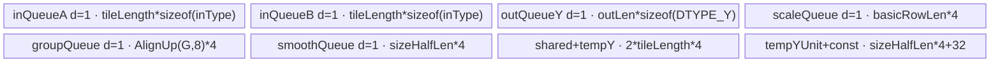
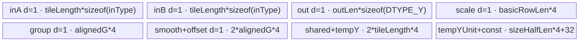
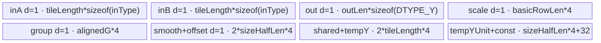

# SwiGluQuant A2/A3 ACLNN 算子知识

## 算子速览

| 项目 | 内容 |
|---|---|
| 实际入口 | `aclnnSwiGluQuantV2GetWorkspaceSize` / `aclnnSwiGluQuantV2`，公开 ACLNN 两段式接口；A2/A3 实际支持的最新公开版本为 V2。 |
| 计算语义 | 将 `x[...,2N]` 切成两半，以 `activateLeft` 选择激活半，计算 `Act=Swish(A)*B`；随后按专家或非 MoE 的 smooth/offset 做动态、静态 per-tensor 或静态 per-channel 量化。 |
| 输入输出 | `x`: FP16/BF16/FP32 ND；`smooth_scales/offsets`: FP32；`group_index`: INT32；`y`: INT8/INT4；`scale`: FP32。 |
| 执行类型 | 单 Kernel `swi_glu_quant`，全部 Host 可达 body 均为 `AIV_VECTOR`；无 Cube/AIC、MIX_CV、SIMT、NDDMA 或 AICPU。 |
| Kernel 路线 | R-001 动态量化；R-002 静态 per-tensor；R-003 静态 per-channel。每条路线各有 FP16/BF16/FP32 key。 |
| 核心资源 | GM + AIV UB；depth=1 的 `TQue`、`TBuf`、Vector API、pipe barrier；workspace 为系统区加每核 32 B，但 body 不读写算子私有 workspace。 |
| 来源闭包 | `source_closed`：公开 V2 文档→框架生成 ACLNN bridge 边界→V2 属性 OpDef/shape inference→Tiling/POD→A2/A3 entry/router→三条完整 AIV body→binary config。 |
| 验证状态 | 已完成源码闭包检查；本次知识提取未执行编译、真机、数值或性能测试。 |

## 接口与语义

### 计算语义

令输入最后一维为 `2N`。`activateLeft=true` 时 `A=x[...,0:N]`、`B=x[...,N:2N]`；否则交换二者。共同激活为 `Act=A/(1+exp(-A))*B`。有 `group_index` 时，第 `g` 个累计边界或 count 转累计边界决定每行所用专家参数；无分组时统一使用第 0 组。

- 动态：`tmp=Act*smooth[g,:]`，`qmax=127`（INT8）或 `7`（INT4），Device 计算 `scale=qmax/max(abs(tmp))`，`y=cast_rint(tmp*scale)`，并输出这个乘法 scale。
- 静态 per-tensor：每专家一个标量 `s,o`，`y=cast_rint(Act*s+o)`；`scaleOut` 写 0。
- 静态 per-channel：每专家一行 `[N]` 参数，`y=cast_rint(Act*s[g,:]+o[g,:])`；`scaleOut` 写 0。

### 输入、输出与属性

| 参数 | shape/layout | dtype | 约束、默认值与语义 |
|---|---|---|---|
| `x` | ND，至少 2 维，末维 `2N<=8192` | FP16/BF16/FP32 | 必需且公开接口不接受非连续 Tensor；末维为偶数，INT4 时须被 4 整除。 |
| `smoothScalesOptional` | per-tensor `[G]`；per-channel `[G,N]`；非 MoE 时 `G=1` | FP32 | V2 文档要求非空；动态与静态都由 Kernel 读取。 |
| `offsetsOptional` | 与 static smooth 对应 | FP32 | 动态时不生效；静态时必需语义参数。 |
| `groupIndexOptional` | `[G]` | INT32 | 可空；非空表示 MoE，`1<=G<=1024`，公开约束要求非递减且末值不超过行数；`groupListType=0` 为累计值、`1` 为 count。 |
| `activateLeft` | Host bool | BOOL | `true` 激活左半，`false` 激活右半。 |
| `quantModeOptional` | Host string | STRING | 最新公开有效值为 `dynamic` 或 `static`；`dynamic_msd` 虽被 Host Tiling 接受但被映射到 static，属于失败边界。 |
| `groupListType` | Host scalar | INT64 | V2 新增；仅 0/1。 |
| `dstType` | Host scalar | INT64 enum | V2 新增；2=INT8，29=INT4，默认 2。 |
| `yOut` | `x.shape[:-1]+[N]` | INT8/INT4 | 量化输出；INT4 以每字节两个元素写出。 |
| `scaleOut` | `x.shape[:-1]` | FP32 | 动态路线输出每行乘法 scale；静态路线写 0。 |

### 入口与版本

`aclnnSwiGluQuantV2` 相比旧 `aclnnSwiGluQuant` 增加 `groupListType`、`dstType`，允许 count group list、无 group 的非 MoE 和 INT4，因此是 A2/A3 最新公开版本。公开文档明确列出 Atlas A2 与 A3 支持；`SwiGluQuant` OpDef 注册 `ascend910b`、`ascend910_93`，两份 binary config 完全一致并覆盖三种输入 dtype × 两种输出 dtype。固定仓没有生成后的 ACLNN C++ bridge，executor 构造与两段式运行记为框架边界；算子拥有的 OpDef、Tiling、POD、entry 和 body 均已闭合。

## Host/Launcher 执行流程

### 参数校验与前处理

公开 API 要求连续 ND Tensor。框架 bridge 将 V2 参数落到 `SwiGluQuant` 的 4 输入、2 输出和 4 属性。`InferShapeForSwiGluQuant` 把 `y` 末维除 2、把 `scale` 设为去掉末维的 shape；`InferDataTypeForSwiGluQuant` 以 `dst_type` 设置 `y`、固定 `scale=FP32`。Tiling 依次检查输入/输出 dtype、属性、输入与输出 shape；INT4 额外检查 `x_last%4==0`，MoE 检查 `G∈[1,1024]` 且 smooth/offset 第一维等于 G。任一正常检查失败应返回 `GRAPH_FAILED`；但 `Tiling4SwiGluQuant` 未检查 `GetTillingData` 返回值，这是固定源码中的失败传播缺口，调用侧不可依赖无效参数安全终止。

### 参数、Workspace 与生命周期

`GetCompileInfo` 从平台取 AIV 核数和 UB 字节数。`SetTotalShape` 折叠 `x.shape[:-1]` 为 `rowLen`，令 `colLen=x_last/2`。Tiling 写 POD 后设置 `blockDim=realCoreNum`、`tilingKey`，并申报 `workspace=sysWorkspaceSize+realCoreNum*32`。runtime 拥有 workspace/executor，生命周期覆盖第二段接口在用户 stream 上的单 Kernel 执行。entry 要求 `workspace` 与 `GetUserWorkspace(workspace)` 均非空，但 body 不访问 `userWS` 或任何 workspace slice。

### 启动图与失败传播

```text
aclnnSwiGluQuantV2GetWorkspaceSize
  -> generated ACLNN executor bridge（固定仓边界）
  -> SwiGluQuant OpDef / InferShape / Tiling4SwiGluQuant
  -> executor: one AICore launch
aclnnSwiGluQuantV2(workspace, workspaceSize, executor, stream)
  -> swi_glu_quant<<<realCoreNum, stream>>>(x,smooth,offset,group,y,scale,workspace,tiling)
     -> key 104/204/304: static per-tensor body
     -> key 105/205/305: static per-channel body
     -> key 106/206/306: dynamic body
```

启动图只有一个 Device 节点，故无跨 Kernel 数据边。GM 输入、输出和 workspace 由 executor/runtime 持有至 stream 完成。entry 的 null workspace、null user workspace 或 `blockIdx>=realCoreNum` 直接无输出返回；未知 key 也无 fallback。Host Tiling 检查失败未被顶层传播的源码缺口可能使未初始化 POD 继续保存和 launch，属于明确限制。

## Route 与参数设计

### 分核与资源计算

`coreNumUsed=max(min(AIVCoreNum,rowLen),1)`；`headCoreNum=rowLen%coreNumUsed`。头核各处理 `ceil(rowLen/coreNumUsed)` 行，尾核各处理 `floor(rowLen/coreNumUsed)` 行。`inputDataByte∈{2,4}`，`block_num=32/inputDataByte`，`dataNumSingleUb=ubSize/25`。令 `alignedCol=AlignUp(colLen,block_num)`、`ubAvail=floor(dataNumSingleUb/alignedCol)`：公开 `colLen<=4096` 通常走 `basicColLen=colLen`；若 `ubAvail=0`，Host 预留按 32 B、至多再按 512 B cache line 下对齐的列切分，但 Device 没有列循环，因此该预留路线不构成公开可用 fallback。`basicRowLen=min(ubAvail,rowLenPerCore,255)`；每核 `rowLoop=ceil(rowLenPerCore/basicRowLen)`，末循环单独计算有效行数。

### Route 选择

| 顺序 | Route | Key/模板 | 精确选择条件与优先级 | 不适用去向 |
|---:|---|---|---|---|
| 1 | R-001 动态 | FP16 `106`；BF16 `206`；FP32 `306`；`SwiGluQuant<inType,DTYPE_Y>` | dtype 基值 100/200/300；`quant_mode=="dynamic"` 加 6。 | 非 dynamic 进入 static 分类。 |
| 2 | R-002 静态 per-tensor | `104/204/304`；`SwiGluQuantStatic<inType, DTYPE_Y, QuantType::STATIC_PER_TENSOR>` | `quant_mode!="dynamic" && smooth.rank==1`，公开有效域为 `quant_mode=="static"`。 | smooth rank 非 1 进入 R-003。 |
| 3 | R-003 静态 per-channel | `105/205/305`；`SwiGluQuantStatic<inType, DTYPE_Y, QuantType::STATIC_PER_CHANNEL>` | `quant_mode!="dynamic" && smooth.rank!=1`，公开有效域为 static `[G,N]`。 | 无 fallback；未知 key 无输出。 |

```text
validate dtype/attrs/shapes
  -> dtype base = FP16:100, BF16:200, FP32:300
  -> quant_mode == dynamic ? key=base+6
     : smooth.rank == 1 ? key=base+4
     : key=base+5
```

### 模板/实现执行矩阵

| Route | key/selector | dtype/shape/platform 完整命中条件 | 执行拓扑与 Kernel 节点 | 实际模板/body | 内存与同步特征 | tail/fallback |
|---|---|---|---|---|---|---|
| R-001 动态 | 106/206/306 | A2/A3；FP16/BF16/FP32；dynamic；INT8/INT4 | 单 `swi_glu_quant` AIV | `SwiGluQuant::Process/Compute` | A/B、smooth、group queues；FP32 临时；逐行 abs-reduce 与 scale | 行尾由 `basicRowLenCal`；列 padding；无 key fallback。 |
| R-002 静态 per-tensor | 104/204/304 | A2/A3；static；smooth `[G]` | 单 AIV | `SwiGluQuantStatic<inType, DTYPE_Y, QuantType::STATIC_PER_TENSOR>` | 整个 G 个 smooth/offset 标量每 tile 搬入；无动态归约 | 行尾同上；static scale 输出 0。 |
| R-003 静态 per-channel | 105/205/305 | A2/A3；static；smooth/offset `[G,N]` | 单 AIV | `SwiGluQuantStatic<inType, DTYPE_Y, QuantType::STATIC_PER_CHANNEL>` | 当前专家 N 个 smooth/offset 向量搬入，跨行复用 | 专家边界切换参数；无 fallback。 |

### 隐藏性能 Guard

| Guard | Host/Tiling 条件 | Device/资源原因 | 影响 Route | 不满足时去向 | 源码符号 |
|---|---|---|---|---|---|
| AIV/UB 可用 | `totalCoreNum>0 && ubSize>0` | 分核和 `ub/25` tile 上界需要有效资源 | 全部 | `GRAPH_FAILED` | `swi_glu_quant_tiling.cpp::GetCompileInfo` |
| 完整列可驻留 | `floor((ubSize/25)/AlignUp(colLen,32/sizeof(x)))>=1` | body 仅循环 row tile，不循环 col tile | 全部 | Host 虽生成 `basicColLen<colLen`，但公开路线不得依赖该未闭合预留分支 | `CalculateMaxUbSizePerRow`、`ProcessCoreMultiUbMulti` |
| DMA 对齐 | `sizeHalfLen=AlignUp(basicColLen,32/sizeof(x))` | 非对齐列用 `DataCopyPad`，对齐列用 `DataCopy` | 全部 | 自动走 padding | `SwiGluQuantBase::InitParams` |
| 行 tile 窄化 | `basicRowLen<=255` | `basicRowLenCal` 为 `uint16_t`，并限制一次 UB 行数 | 全部 | 增加 `rowLoop` | `CalculateMaxUbSizePerRow` |
| group 上界 | `1<=G<=1024` | group queue 按 `AlignUp(G,8)` 分配，标量扫描使用 G | 全部 MoE | `GRAPH_FAILED` | `CheckOpInputShape` |
| INT4 shape | `x_last%4==0` | 两个 INT4 共用一个字节且输出 N 需成对 | 全部 INT4 | `GRAPH_FAILED` | `CheckOpInputShape` |
| entry guard | workspace/userWS 非空且 `blockIdx<realCoreNum` | Kernel 依赖 runtime workspace 约定和有效核域 | 全部 | 当前核无输出返回 | `swi_glu_quant.cpp::swi_glu_quant` |

### POD/ABI

`BEGIN_TILING_DATA_DEF` 的宏展开不在固定仓内，故精确 `sizeof/alignof/offsetof` 不可见；下表保持声明顺序，Host 与 Device 使用同名结构，不能据常规 C++ padding 推测 ABI。

| 结构 | 字段 | 类型/位宽 | ABI 布局 | 单位 | Host/launcher producer | Device consumer | 边界 |
|---|---|---|---|---|---|---|---|
| `SwiGluQuantTilingData` | `groupLen` | uint32/32 | 声明序号 1；数值 offset 不可见 | expert | `set_groupLen(groupLength)` | group GM/queue 与专家扫描 | 无 group 时 1。 |
| 同上 | `rowLen` | uint32/32 | 序号 2 | row | `SetTotalShape` | GM extent、scale extent | shape 积先存 int32。 |
| 同上 | `colLen` | uint32/32 | 序号 3 | element | `x_last/2` | 半轴、GM stride | 公开上限 4096。 |
| 同上 | `rowLenPerHeadCore` | uint32/32 | 序号 4 | row/core | `CalTilingData` | `InitParams` | head 核。 |
| 同上 | `rowLenPerTailCore` | uint32/32 | 序号 5 | row/core | `CalTilingData` | `InitParams` | tail 核。 |
| 同上 | `basicRowLenHeadCore` | uint32/32 | 序号 6 | row/tile | UB 公式 | `InitParams` | 最大 255。 |
| 同上 | `basicRowLenTailCore` | uint32/32 | 序号 7 | row/tile | UB 公式 | `InitParams` | 最大 255。 |
| 同上 | `basicColLen` | uint32/32 | 序号 8 | element/tile | `CalculateMaxUbSizePerRow` | DMA/Vector 长度 | Device 无列循环。 |
| 同上 | `headCoreNum` | uint32/32 | 序号 9 | core | `rowLen%coreNumUsed` | core 地址映射 | 可为 0。 |
| 同上 | `realCoreNum` | uint32/32 | 序号 10 | core | `coreNumUsed` | entry guard | 同时作为 blockDim。 |
| 同上 | `activateLeft` | uint32/32 | 序号 11 | bool flag | attr bool→0/1 | A/B GM offset 选择 | 仅 0/1。 |
| 同上 | `groupListType` | int64/64 | 序号 12 | enum | V2 attr | count→cumsum 转换 | 0/1。 |
| 同上 | `dstType` | int64/64 | 序号 13 | dtype enum | V2 attr | qmax、INT4 packing | 2/29。 |
| 同上 | `hasGroup` | int64/64 | 序号 14 | flag | optional group shape 是否存在 | group copy/专家选择 | 0/1。 |
| 同上 | `tilingKey` | uint32/32 | 序号 15 | key | `CalculateTilingKey` | entry 的 `TILING_KEY_IS`/context key | body 不另读。 |

### Route 源码闭包

| Route | Key/selector | Host/Tiling producer | POD/参数 | Kernel entry/router 节点 | Kernel body/直接依赖 | 构建接线 |
|---|---|---|---|---|---|---|
| R-001 动态 | 106/206/306 | `swi_glu_quant_tiling_utils.h::CalculateTilingKey` | `SwiGluQuantTilingData` | `swi_glu_quant.cpp::swi_glu_quant` | `swi_glu_quant.h::SwiGluQuant` + base | `ascend910b/ascend910_93` binary config、`ascendc_config.json` |
| R-002 per-tensor | 104/204/304 | 同上，rank=1 | 同上 | 同 entry | `swi_glu_quant_static.h::SwiGluQuantStatic<inType, DTYPE_Y, QuantType::STATIC_PER_TENSOR>` + base | 同上 |
| R-003 per-channel | 105/205/305 | 同上，rank!=1 | 同上 | 同 entry | `SwiGluQuantStatic<inType, DTYPE_Y, QuantType::STATIC_PER_CHANNEL>` + base | 同上 |

## Kernel 实现

### 公共执行流程

entry 解析 POD、检查核号并按 dtype 编译分支和 key 实例化模板。三个 body 都先复制 group list；count 模式以标量前缀和原地转累计边界。每核按 head/tail 公式定位连续行，对每个 row tile 将 x 的两半分别搬入 UB；FP16/BF16 先升到 FP32，按 `-A→exp→+1→A/divisor→×B` 计算 Swish-Gated 结果。之后 Route 专属量化写入同一个输出 queue，再把 y 与每行 scale 搬回 GM。所有 Vector 依赖以 `PipeBarrier<PIPE_V>` 串联；Queue 的 `EnQue/DeQue/FreeTensor` 管理 MTE2/VEC/MTE3 生命周期。

### Route R-001：动态量化

#### 适用条件

##### 选择证据

| 层级 | 文件 | 符号 | 源码谓词/参数 | 结果/下一跳 |
|---|---|---|---|---|
| API | `docs/aclnnSwiGluQuantV2.md` | `aclnnSwiGluQuantV2GetWorkspaceSize` | `quantModeOptional="dynamic"`，dstType 2/29 | 动态语义。 |
| Tiling | `op_host/swi_glu_quant_tiling_utils.h` | `GetQuantMode/CalculateTilingKey` | dynamic→6，dtype→100/200/300 | key 106/206/306。 |
| Router | `op_kernel/swi_glu_quant.cpp` | `swi_glu_quant` | `TILING_KEY_IS(106/206/306)` | `SwiGluQuant<inType,DTYPE_Y>`。 |

#### Device 数据流

##### 函数级调用链

```text
swi_glu_quant
  -> SwiGluQuant::Init -> ParseTilingData -> InitParams -> InitAndSetBuffer
  -> Process -> GroupCopyIn -> SyncAll -> DuplicateConst
  -> ProcessCoreMultiUbMulti
     -> CopyIn(A,B,smooth)
     -> Compute(Swish*B -> smooth -> Abs/ReduceMax -> scale -> CastQuantOut)
     -> SwiGluQuantBase::CopyOut(y,scale)
```

##### 源码等价伪码

```text
for ridx in [0,rowLoop):
  validRows = last ? rowLenPerCore-(rowLoop-1)*basicRowLen : basicRowLen
  base = (baseRow+ridx*basicRowLen)*2*colLen
  A,B = activateLeft ? x[base:base+N],x[base+N:base+2N] : swapped
  tmp = fp32(A)/(1+exp(-fp32(A))) * fp32(B)
  for i in [0,validRows):
    expert = first cumulative group boundary >= baseRow+ridx*basicRowLen+i+1
    v = tmp[i,:N] * smooth[expert,:N]
    m = reduce_max(abs(v))
    scale[i] = qmax/m
    y[i,:N] = staged_cast_rint(v*scale[i])
  copy valid y bytes and validRows FP32 scales to GM
```

#### 内存与数据搬运

##### 资源与搬运表

| 层级/缓冲区 | offset/地址公式 | extent/容量公式 | dtype/layout | producer | consumer | owner/lifetime | 对齐/复用 |
|---|---|---|---|---|---|---|---|
| GM x A/B | `(baseRow+ridx*basicRowLen)*2N + {0,N}`，由 activateLeft 交换 | `validRows*N` 各 | inType/ND | caller | CopyIn | caller，launch 全程 | 行 DMA；尾列 pad 到 `sizeHalfLen`。 |
| `inQueueA/B` | UB queue | 各 `tileLength*sizeof(inType)` | inType | CopyIn | Compute | depth=1，消费即 Free | 两路独立。 |
| `sharedTempBuf` | 0 与 `sizeHalfLen` alias view | `tileLength*4` | FP32/int32 views | cast/B/归约 | Vector/cast | 全 Kernel，阶段覆盖 | A 转换后被 B 覆盖；行 scratch 使用子区。 |
| `tempBufferY` | UB | `tileLength*4` | FP32 | Swish/乘 B | row quant | 全 tile | 保存全部行 Act。 |
| smooth/group queues | expert offset | `sizeHalfLen*4`、`AlignUp(G,8)*4` | FP32/INT32 | MTE2 | row selector | expert/tile 生命周期 | 参数跨同行复用。 |
| `tempYUnit` | UB | `sizeHalfLen*4` | FP32/half view | row copy | quant cast | 每行覆盖 | FP32 与 half reinterpret。 |
| output/scale queues | UB | `outLen*sizeof(DTYPE_Y)`、`basicRowLen*4` | INT8/INT4、FP32 | Compute | CopyOut | depth=1 | 仅有效行/列写 GM。 |

##### 分层内存布局



##### 字节账与复用顺序

```text
UB_total = 2*tileLength*sizeof(inType) + outLen*sizeof(DTYPE_Y)
         + basicRowLen*4 + AlignUp(G,8)*4 + sizeHalfLen*4
         + 2*tileLength*4 + sizeHalfLen*4 + 8*4
dynamic_ub = N/A
workspace_total = platformLibApiWorkspace + realCoreNum*32
Host selector uses dataNumSingleUb=UB_size/25 as conservative per-column row budget.
```

| 复用子区 | 写入者 | 读取者/消费点 | 下一次覆盖 | 同步或释放依据 | 安全条件 |
|---|---|---|---|---|---|
| `sharedTempBuf[0:tileLength]` | A cast | Swish | B cast | A 已被 `tempBufferY` 中的 Swish 结果取代，PIPE_V barrier | B 覆盖发生在 A 最后一次读取后。 |
| `tempYUnit` | 当前行 Act copy | smooth/scale/cast | 下一行 | 每步 PIPE_V barrier | 只处理 `basicColLen` 有效 lane。 |
| smooth queue | `SmoothCopyIn` | 多行量化 | 跨专家时 Free 后重分配 | Queue Free/EnQue/DeQue | group 边界单调。 |

#### 同步、精度与尾块

##### 同步与数值边界表

| 阶段 | primitive/机制 | producer | consumer/等待点 | 保护对象 | 精度/尾块 |
|---|---|---|---|---|---|
| group count 转换 | `SetFlag/WaitFlag<MTE2_S>` + `SyncAll` | GM→UB | 标量前缀和/全核后续 | groupLocal | count 原地变 cumsum。 |
| Swish | `PipeBarrier<PIPE_V>` | Muls/Exp/Adds/Div | 下一 Vector op | tmpY | 输入先转 FP32。 |
| 动态归约 | Abs→ReduceMax→Div | 当前行 | scale 标量读取 | shared scratch | A2/A3 无 max 下限，零行存在除零边界。 |
| 降精度 | FP32→INT32 `CAST_RINT`→half→INT8/INT4 | quantized FP32 | CopyOut | output queue | INT4 reinterpret 并半字节打包。 |
| 尾块 | DataCopyPad + `basicRowLenCal` | GM/UB | Vector/GM | 尾列/尾行 | Vector 仅对 N 有效元素量化；搬运只提交有效字节。 |

#### 关键实现

##### 符号证据表

| 阶段 | 文件 | 符号/模板实例 | 实现事实 |
|---|---|---|---|
| Host/Tiling producer | `op_host/swi_glu_quant_tiling_utils.h` | `CalTilingData/CalculateTilingKey` | 生产核、tile 与动态 key。 |
| Kernel entry/router | `op_kernel/swi_glu_quant.cpp` | `swi_glu_quant` | 106/206/306 映射动态模板。 |
| Device body/helper | `op_kernel/swi_glu_quant.h`、`swi_glu_quant_base.h` | `SwiGluQuant::Compute`、`CastQuantOut` | FP32 Swish、专家 smooth、归约、scale、cast 和 tail。 |

### Route R-002：静态 per-tensor

#### 适用条件

##### 选择证据

| 层级 | 文件 | 符号 | 源码谓词/参数 | 结果/下一跳 |
|---|---|---|---|---|
| API | `docs/aclnnSwiGluQuantV2.md` | V2 workspace API | static，smooth/offset `[G]` | 每专家标量量化。 |
| Tiling | `swi_glu_quant_tiling_utils.h` | `CheckOpInputShape/GetQuantMode` | `smooth.rank==1`→`isPerTensor=true` | key base+4。 |
| Router | `swi_glu_quant.cpp` | key 104/204/304 | dtype 编译分支 | static per-tensor 模板。 |

#### Device 数据流

##### 函数级调用链

```text
swi_glu_quant -> SwiGluQuantStatic<inType,DTYPE_Y,STATIC_PER_TENSOR>::Init/Process
  -> GroupCopyIn -> ProcessCoreMultiUbMulti
  -> CopyIn(A,B)
  -> Compute -> Swish*B -> copy all G smooth/offset scalars
     -> ComputePerTensorQuant -> CastQuantOut
  -> CopyOut(y, zero scale)
```

##### 源码等价伪码

```text
for row tile:
  act = fp32(A)/(1+exp(-fp32(A))) * fp32(B)
  load smooth[0:G], offsets[0:G] once for this tile
  for each valid row:
    advance expert by cumulative group boundary
    v = act[row,:N]*smooth[expert] + offsets[expert]
    y = staged_cast_rint(v)
  scale[validRows] = 0
  copy y and zero scale to GM
```

#### 内存与数据搬运

##### 资源与搬运表

| 层级/缓冲区 | offset/地址公式 | extent/容量公式 | dtype/layout | producer | consumer | owner/lifetime | 对齐/复用 |
|---|---|---|---|---|---|---|---|
| A/B GM→queues | 同 R-001 | 各 `tileLength*sizeof(inType)` | inType | CopyIn | Swish | tile | pad 同 R-001。 |
| group/smooth/offset queues | 0 | 各 `AlignUp(G,8)*4` | INT32/FP32 | GroupCopyIn/Compute | expert scalar reads | group 全核；参数每 tile | smooth/offset padding。 |
| FP32 temporaries | UB | `2*tileLength*4+sizeHalfLen*4+32` | FP32/int32/half views | Compute | CastQuantOut | tile/row | shared buffer 阶段复用。 |
| output/scale queues | GM row offset | `outLen*sizeof(DTYPE_Y)`、`basicRowLen*4` | packed y/FP32 | quant/zero fill | CopyOut | tile | scale 固定 0。 |

##### 分层内存布局



##### 字节账与复用顺序

```text
UB_total = 2*tileLength*sizeof(inType) + outLen*sizeof(DTYPE_Y) + basicRowLen*4
         + 3*AlignUp(G,8)*4 + 2*tileLength*4 + sizeHalfLen*4 + 32
dynamic_ub = N/A
workspace_total = platformLibApiWorkspace + realCoreNum*32
```

| 复用子区 | 写入者 | 读取者/消费点 | 下一次覆盖 | 同步或释放依据 | 安全条件 |
|---|---|---|---|---|---|
| shared temp | A cast/Swish scratch | Swish | B cast/row int32 view | PIPE_V barriers | 阶段严格串行。 |
| smooth/offset queues | tile 参数 DMA | 所有有效行 | tile 结束 Free | Queue 生命周期 | G 标量一次装载后不修改。 |

#### 同步、精度与尾块

##### 同步与数值边界表

| 阶段 | primitive/机制 | producer | consumer/等待点 | 保护对象 | 精度/尾块 |
|---|---|---|---|---|---|
| group/参数 copy | Queue + MTE2_S | GM | scalar/vector compute | group/params | pad 到 8 FP32/INT32 元素。 |
| static affine | Muls→Adds + PIPE_V | FP32 Act | staged cast | row temp | 标量广播；无 reduce。 |
| output | Queue + DataCopyPad | CastQuantOut | GM | valid y/scale | static scale 以 FP32 0 写有效行。 |

#### 关键实现

##### 符号证据表

| 阶段 | 文件 | 符号/模板实例 | 实现事实 |
|---|---|---|---|
| Host/Tiling producer | `op_host/swi_glu_quant_tiling_utils.h` | `GetQuantMode/CalculateTilingKey` | rank=1 产生 per-tensor key。 |
| Kernel entry/router | `op_kernel/swi_glu_quant.cpp` | 104/204/304 branches | 模板实例映射。 |
| Device body/helper | `op_kernel/swi_glu_quant_static.h` | `ComputePerTensorQuant/Compute` | G 标量加载、专家切换、Muls/Adds、zero scale。 |

### Route R-003：静态 per-channel

#### 适用条件

##### 选择证据

| 层级 | 文件 | 符号 | 源码谓词/参数 | 结果/下一跳 |
|---|---|---|---|---|
| API | `docs/aclnnSwiGluQuantV2.md` | V2 workspace API | static，smooth/offset `[G,N]` | 每专家通道参数。 |
| Tiling | `swi_glu_quant_tiling_utils.h` | `CheckOpInputShape/GetQuantMode` | smooth rank!=1 | key base+5。 |
| Router | `swi_glu_quant.cpp` | 105/205/305 | dtype 分支 | static per-channel 模板。 |

#### Device 数据流

##### 函数级调用链

```text
swi_glu_quant -> SwiGluQuantStatic<inType,DTYPE_Y,STATIC_PER_CHANNEL>::Init/Process
  -> GroupCopyIn -> row-tile CopyIn(A,B,smooth[N],offset[N])
  -> Compute -> Swish*B -> ComputePerChannelQuant(Mul+Add+CastQuantOut)
  -> CopyOut(y, zero scale)
```

##### 源码等价伪码

```text
for row tile:
  act = fp32(Swish(A)*B)
  load smooth[currentExpert,:N], offset[currentExpert,:N]
  for each valid row:
    if row crosses group boundary: free old queues; load new expert vectors
    v = act[row,:N]*smooth[:N] + offset[:N]
    y = staged_cast_rint(v)
  scale[validRows]=0; copy out
```

#### 内存与数据搬运

##### 资源与搬运表

| 层级/缓冲区 | offset/地址公式 | extent/容量公式 | dtype/layout | producer | consumer | owner/lifetime | 对齐/复用 |
|---|---|---|---|---|---|---|---|
| smooth/offset GM | `expert*colLen` | N each | FP32 `[G,N]` | caller | parameter CopyIn | caller | pad to `sizeHalfLen`。 |
| smooth/offset queues | UB | each `sizeHalfLen*4` | FP32 | MTE2 | Mul/Add | expert span | across rows until boundary。 |
| A/B、temp、output | 同 R-002 | 同 R-002 | 同上 | 同上 | 同上 | tile | staged reuse。 |

##### 分层内存布局



##### 字节账与复用顺序

```text
UB_total = 2*tileLength*sizeof(inType) + outLen*sizeof(DTYPE_Y) + basicRowLen*4
         + AlignUp(G,8)*4 + 2*sizeHalfLen*4
         + 2*tileLength*4 + sizeHalfLen*4 + 32
dynamic_ub = N/A
workspace_total = platformLibApiWorkspace + realCoreNum*32
```

| 复用子区 | 写入者 | 读取者/消费点 | 下一次覆盖 | 同步或释放依据 | 安全条件 |
|---|---|---|---|---|---|
| smooth/offset queue | 当前 expert DMA | 每行 Mul/Add | 专家切换时重装 | FreeTensor→Alloc/EnQue/DeQue | group_index 非递减。 |
| tempYUnit | Act row | affine/cast | 下一行 | PIPE_V barriers | 只覆盖前一行消费完的数据。 |

#### 同步、精度与尾块

##### 同步与数值边界表

| 阶段 | primitive/机制 | producer | consumer/等待点 | 保护对象 | 精度/尾块 |
|---|---|---|---|---|---|
| 参数切换 | Queue Free/Alloc/EnQue/DeQue | old/new expert DMA | Mul/Add | smooth/offset UB | 边界由 `realRowNum` 与累计值比较。 |
| affine | Mul→Add + PIPE_V | FP32 Act/参数 | CastQuantOut | tempFp32 | 前 N lane 有效。 |
| tail/output | DataCopyPad/validRows | compute | GM | y/zero scale | 列与行尾分别受 N、`basicRowLenCal` 约束。 |

#### 关键实现

##### 符号证据表

| 阶段 | 文件 | 符号/模板实例 | 实现事实 |
|---|---|---|---|
| Host/Tiling producer | `op_host/swi_glu_quant_tiling_utils.h` | `CheckOpInputShape/GetQuantMode` | rank 非 1 选择 per-channel。 |
| Kernel entry/router | `op_kernel/swi_glu_quant.cpp` | 105/205/305 branches | 路由到通道模板。 |
| Device body/helper | `op_kernel/swi_glu_quant_static.h` | `SmoothCopyIn/OffsetsCopyIn/ComputePerChannelQuant` | expert 向量加载、复用和切换。 |

## 算子特定优化

### Trick T-001：以 `ubSize/25` 预算融合行 tile

#### 触发与源码依据

- 适用 Route：R-001、R-002、R-003。
- 触发条件：完整列对齐后至少一行可驻留，即 `(ubSize/25)/alignedColLen>=1`。
- Golden 来源：[`quant/swi_glu_quant/op_host/swi_glu_quant_tiling_utils.h:343-368`](../../../../../../../cann-ops-raw/ascendc/ops-nn/955f8b33985b6d72989ebff341bb9c2c564a51bc/quant/swi_glu_quant/op_host/swi_glu_quant_tiling_utils.h#L343-L368)

**官方源码（固定 Commit 连续逐字摘录）**：

```cpp
uint32_t alignedColLen = AlignUp<uint32_t>(colLen, compileInfo.block_num);
uint32_t ubAvail = compileInfo.dataNumSingleUb / alignedColLen;
if (ubAvail == 0) {
    tilingParam.optBaseColLen = AlignDown(compileInfo.dataNumSingleUb, compileInfo.block_num);
    if (tilingParam.optBaseColLen > compileInfo.cacheLineLen) {
        tilingParam.optBaseColLen = AlignDown<uint32_t>(tilingParam.optBaseColLen, compileInfo.cacheLineLen);
    }
    ubAvail = ONE;
} else {
    tilingParam.optBaseColLen = colLen;
}
```

#### 机制与设计原因

Host 把融合 body 中两路输入、FP32 中间、输出和参数队列的每列行成本保守折算为 25 B，以完整 `alignedColLen` 计算同一 tile 可并行处理的行数。这样一次 A/B DMA 后，Kernel 在 UB 内连续完成 Swish、smooth/offset、动态归约或静态 affine 和量化，避免把 `Act` 物化到 GM。`basicRowLen<=255` 再限制单 tile，尾行用 `basicRowLenCal` 提交。

#### 迁移边界

- 适用：同样把门控激活与量化融合、且完整最后一维可驻留 UB 的逐行算子。
- 前提：AIV、ND 连续布局、末轴不超过公开上限、实际 UB 字节账不超过平台 UB。
- 失效：`ubAvail==0` 时源码只生成列切分参数，body 没有列循环；迁移实现必须补齐列分块和跨块归约，不能直接复用该 fallback。
- 未验证：本次知识提取未执行编译、真机、数值或性能测试。

#### 错误做法

把 `basicColLen<colLen` 当作已闭合的大列 fallback 会漏算剩余列，固定源码只注明“预留参数”。

### Trick T-002：专家参数在连续行间复用

#### 触发与源码依据

- 适用 Route：R-001、R-003。
- 触发条件：相邻行仍落在同一个累计 group 边界内。
- Golden 来源：[`quant/swi_glu_quant/op_kernel/swi_glu_quant.h:287-300`](../../../../../../../cann-ops-raw/ascendc/ops-nn/955f8b33985b6d72989ebff341bb9c2c564a51bc/quant/swi_glu_quant/op_kernel/swi_glu_quant.h#L287-L300)

**官方源码（固定 Commit 连续逐字摘录）**：

```cpp
realRowNum = offsetRow + i + 1;
if (groupValue < realRowNum && smoothIndex != SMOOTH_INDEX_UPBOUND) {
    smoothIndex = GetSmoothIndex(realRowNum, groupValue, smoothIndex + 1);
    if (smoothIndex != SMOOTH_INDEX_UPBOUND) {
        smoothQueue.FreeTensor(smoothLocal);
        smoothOffset = smoothIndex * basicColLen;
        SmoothCopyIn(smoothOffset);
        smoothLocal = smoothQueue.DeQue<float>();
    }
}
```

#### 机制与设计原因

Kernel 不为每行重复加载 `[N]` smooth；它保持 `smoothIndex` 和当前 UB tensor，仅当全局行号跨过专家累计边界时释放并装入下一专家参数。R-003 对 smooth 与 offset 同步采用相同协议。这减少同一专家连续 token 的 GM→UB 参数搬运，同时用 queue 生命周期防止旧参数被提前覆盖。

#### 迁移边界

- 适用：行按专家连续排列、group 边界单调的 MoE 后处理。
- 前提：每核能从 group 0 扫描到自身首行，group list 已是 cumsum 或先在 UB 转为 cumsum。
- 失效：行与专家交错或 group list 非单调时必须改用逐行索引/重排，不能沿用单调扫描。
- 未验证：本次知识提取未执行编译、真机、数值或性能测试。

#### 错误做法

固定仓的输入约束明确要求 `group_index` 非递减；若跳过该前提，单向 `GetSmoothIndex` 无法回退到先前专家。

## 模板与实现对比

| 对比维度 | R-001 动态 | R-002 静态 per-tensor | R-003 静态 per-channel | 设计选择依据 |
|---|---|---|---|---|
| 命中条件/优先级 | dynamic | static 且 rank=1 | static 且 rank!=1 | `GetQuantMode`。 |
| 模板与 dtype | `SwiGluQuant<FP16/BF16/FP32,Y>` | `SwiGluQuantStatic<inType,Y,PER_TENSOR>` | `SwiGluQuantStatic<inType,Y,PER_CHANNEL>` | dtype 仅改变 key 百位和输入转换。 |
| 循环与分核 | 共同 head/tail core + row tile + row quant | 同 | 同 | 共用 base 与 tiling。 |
| Queue/TBuf/寄存器/dynamic UB/通信 window | smooth 为 N，含 reduce scratch | smooth/offset 为 G 标量 | smooth/offset 各 N | 无 dynamic UB/通信。 |
| 内存总占用与复用 | 2*tile FP32 temp + row scratch | G 参数整批驻留 | 当前 expert 向量驻留 | 参数粒度不同。 |
| 搬运/Vector/SIMT/NDDMA/通信 API | Abs/ReduceMax/Div/Muls | Muls/Adds | Mul/Add | 全部 AIV Vector。 |
| 同步、精度与 tail | FP32 reduce，A2/A3 无 epsilon clamp | FP32 affine | FP32 affine | 共同 staged cast 与 DataCopyPad。 |
| fallback/失败边界 | 零幅行除零；未知 key no-op | static scale=0 | 参数按单调 group 切换 | 无替代 Device fallback。 |

## 平台差异

| 项目 | A2 | A3 | 950 |
|---|---|---|---|
| 支持状态 | 公开 V2 支持；`ascend910b` | 公开 V2 支持；`ascend910_93` | 公开 V2 支持，见独立 `_950` 卡。 |
| Host/Launcher | 与 A3 共用 Tiling，binary config 相同 | 与 A2 共用 | 共用 Host，但进入 `_apt` entry。 |
| Kernel/资源 | 通用 `swi_glu_quant.cpp` 与非 arch35 body | 同 A2 | arch35 动态 body 在 ReduceMax 后加 `max(1e-8)`；static body等同。 |

## 限制与失败边界

- 公开入口不支持非连续 Tensor；`x` 至少 2 维、末维偶数且 `<=8192`，INT4 时末维还须被 4 整除；G 最大 1024。
- 文档只支持 dynamic/static；Tiling 接受 `dynamic_msd` 却把它分到 static key，不能把该实现视为公开 dynamic_msd 支持。
- Tiling 允许 optional smooth 为空，但三条 body 都会读取它；必须遵循 V2 文档的非空约束。static offsets 同理必须提供有效数据。
- A2/A3 动态 body 对 `max(abs(tmp))==0` 没有下限保护，`127/0` 或 `7/0` 的数值结果由硬件行为决定；不得推测为零 scale。
- `SetTotalShape` 用 `int32_t` 累乘前导维，固定源码无显式溢出检查；超大 shape 存在窄化边界。
- `Tiling4SwiGluQuant` 忽略 `GetTillingData` 的失败返回；无效输入的失败传播不闭合为可靠早停。
- `basicColLen<colLen` 只有 Host 预留参数，Device 无列循环；正式知识限于公开末轴范围内完整列驻留的 route。
- 宏生成 POD 的精确 `sizeof/alignof/offsetof` 与生成 ACLNN bridge 在固定仓不可见；本次知识提取未执行编译、真机、数值或性能测试。

## 源码索引

### 链路索引

| 链路阶段 | 文件 | 关键符号 | 支撑内容 |
|---|---|---|---|
| 入口声明/约束 | `quant/swi_glu_quant/docs/aclnnSwiGluQuantV2.md` | V2 两段式原型、产品表 | 最新公开 API、平台、shape/dtype/属性。 |
| 入口实现 | `quant/swi_glu_quant/op_host/swi_glu_quant_def.cpp` | `SwiGluQuant::SwiGluQuant` | V2 属性、A2/A3/950 注册。 |
| shape/dtype | `quant/swi_glu_quant/op_host/swi_glu_quant_infershape.cpp` | `InferShapeForSwiGluQuant` | y/scale shape 与输出 dtype。 |
| Host/Tiling | `quant/swi_glu_quant/op_host/swi_glu_quant_tiling.cpp` | `Tiling4SwiGluQuant` | 平台资源、POD 保存、blockDim/workspace。 |
| Host selector | `quant/swi_glu_quant/op_host/swi_glu_quant_tiling_utils.h` | `CheckOpParams/CalculateTilingKey/CalTilingData` | 校验、key、core/tile 公式。 |
| POD | `quant/swi_glu_quant/op_host/swi_glu_quant_tiling.h` | `SwiGluQuantTilingData` | 字段顺序与类型。 |
| Kernel entry/body | `quant/swi_glu_quant/op_kernel/swi_glu_quant.cpp` | `swi_glu_quant` | A2/A3 key router。 |
| Kernel base | `quant/swi_glu_quant/op_kernel/swi_glu_quant_base.h` | `InitParams/CopyOut/CastQuantOut` | UB 参数、地址、packing/cast。 |
| 动态 body | `quant/swi_glu_quant/op_kernel/swi_glu_quant.h` | `SwiGluQuant::Compute` | 动态完整计算。 |
| 静态 body | `quant/swi_glu_quant/op_kernel/swi_glu_quant_static.h` | `SwiGluQuantStatic` | per-tensor/per-channel 完整计算。 |
| 构建接线 | `quant/swi_glu_quant/op_host/config/ascend910b/swi_glu_quant_binary.json` | `SwiGluQuant_*` | A2 dtype/output binaries；A3 文件逐字相同。 |
| 构建接线 | `quant/swi_glu_quant/op_host/config/ascend910_93/swi_glu_quant_binary.json` | `SwiGluQuant_*` | A3 dtype/output binaries。 |
| Host 构建 | `quant/swi_glu_quant/op_host/CMakeLists.txt` | `add_modules_sources(... ACLNNTYPE aclnn)` | Host/ACLNN 模块纳入构建。 |
| 全局接线 | `scripts/kernel/binary_config/ascendc_config.json` | `SwiGluQuant` | 910b/910_93/950 compute units。 |

### 实现复用检查

| 检查项 | 可复用事实 | 不得改变的约束 | 源码符号 |
|---|---|---|---|
| ABI/POD | 15 字段声明顺序和 producer/consumer | 类型、顺序、单位；数值 offset 不可臆测 | `SwiGluQuantTilingData` |
| 调用顺序 | group→A/B/参数→Swish→quant→y/scale | 专家切换与 row tile 顺序 | 三个 `Process/Compute` |
| workspace/内存 | 单 Kernel，无中间 workspace 边 | workspace 必须非空；UB depth=1 与容量公式 | entry、`InitAndSetBuffer` |
| 同步 | Queue 生命周期、MTE2_S 和 PIPE_V barrier | group 前缀和与 Vector 依赖顺序 | `GroupCopyIn/Compute` |
| 精度与尾块 | FP32 激活/量化、staged cast、DataCopyPad | INT4 packing、有效 N/validRows | `CastQuantOut/CopyOut` |
| 失败边界 | unknown key/no workspace no-op | Tiling 返回未传播、无列循环 fallback | `Tiling4SwiGluQuant`、entry |