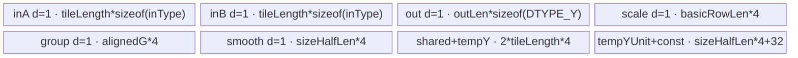
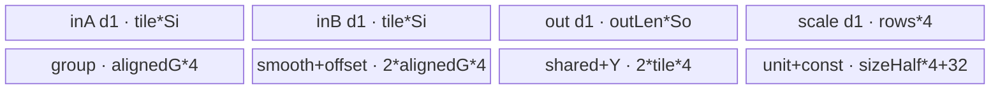
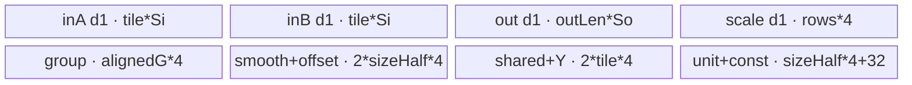

# SwiGluQuant 950 ACLNN 算子知识

## 算子速览

| 项目 | 内容 |
|---|---|
| 实际入口 | `aclnnSwiGluQuantV2GetWorkspaceSize` / `aclnnSwiGluQuantV2`，公开两段式 ACLNN；950 最新公开版本为 V2。 |
| 计算语义 | `x[...,2N]` 切半，`activateLeft` 选择 `A`，融合 `Swish(A)*B` 与动态或静态 smooth/offset 量化；动态 INT8/INT4 在 950 对绝对值最大值加 `1e-8` 下限。 |
| 输入输出 | x 为 FP16/BF16/FP32 ND；smooth/offset FP32；group INT32；y INT8/INT4；scale FP32。 |
| 执行类型 | 单 Kernel `swi_glu_quant`；APT entry 显式 `KERNEL_TASK_TYPE_DEFAULT(KERNEL_TYPE_AIV_ONLY)`，全部路线为 `AIV_VECTOR`，无 Cube/AIC/MIX_CV。 |
| Kernel 路线 | R-001 动态；R-002 静态 per-tensor；R-003 静态 per-channel；每条路线包含 FP16/BF16/FP32 key。 |
| 核心资源 | GM、AIV UB、depth=1 TQue/TBuf、Vector API、pipe/event；无跨 Kernel workspace 边。 |
| 来源闭包 | `source_closed`：公开 V2→框架 ACLNN bridge 边界→共用 Host/Tiling/POD→APT AIV-only router→arch35 三条 body→ascend950 binary config。 |
| 验证状态 | 已完成源码闭包检查；本次知识提取未执行编译、真机、数值或性能测试。 |

## 接口与语义

### 计算语义

令末轴为 `2N`。`activateLeft=true` 时 `A` 是左半、否则是右半，`B` 为另一半：

```text
Act = A/(1+exp(-A))*B
dynamic: tmp=Act*smooth[group,:]
         m=max(reduce_max(abs(tmp)),1e-8)
         scale=qmax/m, y=cast_rint(tmp*scale), qmax=127(INT8) or 7(INT4)
static per-tensor:  y=cast_rint(Act*s[group]+offset[group])
static per-channel: y=cast_rint(Act*s[group,:]+offset[group,:])
```

动态 `scaleOut` 保存乘法 scale；静态两条路线将 `scaleOut` 的有效行写为 0。group list 的 0 表示 cumsum，1 表示 count，后者在 UB 中原地前缀和后再消费；group 可空，此时全部行使用第 0 组。

### 输入、输出与属性

| 参数 | shape/layout | dtype | 约束、默认值与语义 |
|---|---|---|---|
| `x` | ND，维数≥2，末维 `2N<=8192` | FP16/BF16/FP32 | 连续；末维偶数；INT4 输出时末维被 4 整除。 |
| `smoothScalesOptional` | `[G]` 或 `[G,N]`，非 MoE 时 G=1 | FP32 | 文档要求非空；rank=1 选择静态 per-tensor，否则静态 per-channel；动态按向量使用。 |
| `offsetsOptional` | static 时对应 `[G]`/`[G,N]` | FP32 | 动态不读；静态读取。 |
| `groupIndexOptional` | `[G]` | INT32 | 可空；非空 `1<=G<=1024`，公开要求非递减且边界不超过 rowLen。 |
| `activateLeft` | scalar | BOOL | 选择激活左半或右半。 |
| `quantModeOptional` | scalar | STRING | 公开有效值 dynamic/static；`dynamic_msd` 不构成公开路线。 |
| `groupListType` | scalar | INT64 | 0=cumsum，1=count。 |
| `dstType` | scalar | INT64 enum | 2=INT8，29=INT4。 |
| `yOut` | `x.shape[:-1]+[N]` | INT8/INT4 | INT4 两元素/字节。 |
| `scaleOut` | `x.shape[:-1]` | FP32 | 动态 scale；静态为 0。 |

### 入口与版本

V2 在旧入口基础上公开 count group list、无 group、INT4 和 `dstType`，故是 950 实际最新公开入口。产品表明确 Ascend 950PR/950DT 支持；OpDef 注册 `ascend950`，全局 binary config 也列出 ascend950，平台 binary JSON 覆盖三输入 dtype 与两输出 dtype。固定仓不包含生成的 ACLNN bridge；该层仅作为 executor 框架边界，算子拥有的 Host/Tiling/Kernel 链路完整可见。

## Host/Launcher 执行流程

### 参数校验与前处理

生成 bridge 把 V2 参数映射到 `SwiGluQuant` OpDef。shape inference 将 y 的末维减半，将 scale 设为去掉末维的 shape；dtype inference 由 `dst_type` 决定 y，scale 固定 FP32。Tiling 顺序校验 x/smooth/offset/group dtype、y/scale dtype、4 个属性、输入与输出 shape；INT4 检查 `x_last%4==0`，MoE 检查 G 上限及 smooth/offset 第一维。公开 API 不支持非连续 Tensor，因此没有算子自有 Contiguous/ViewCopy 路线。

### 参数、Workspace 与生命周期

平台提供 `AIVCoreNum` 和 UB 字节数。Host 折叠前导维为 `rowLen`、令 `colLen=x_last/2`，计算核分配和 row tile，保存 POD，设置 `blockDim=realCoreNum` 与 key。workspace 申报为 `GetLibApiWorkSpaceSize()+realCoreNum*32`；entry 检查 workspace 与 user workspace 非空，但 arch35 body 不读写它。executor/runtime 拥有 GM 与 workspace 至用户 stream 上的单 Kernel 完成。

### 启动图与失败传播

```text
aclnnSwiGluQuantV2GetWorkspaceSize
  -> generated executor bridge
  -> SwiGluQuant OpDef + InferShape/InferDataType + Tiling4SwiGluQuant
aclnnSwiGluQuantV2(...,stream)
  -> swi_glu_quant_apt entry (AIV_ONLY), one node
     -> 106/206/306 dynamic arch35 body
     -> 104/204/304 static per-tensor arch35 body
     -> 105/205/305 static per-channel arch35 body
```

单节点无中间 workspace 边或跨节点同步。null workspace/userWS、越界 block 或未知 key 均直接无输出。`Tiling4SwiGluQuant` 调用 `GetTillingData` 后未检查其返回码，随后仍保存 POD 和设置 launch 参数；这是无效参数失败传播的固定源码缺口。

## Route 与参数设计

### 分核与资源计算

`realCoreNum=max(min(AIVCoreNum,rowLen),1)`；`headCoreNum=rowLen%realCoreNum`，头核 `ceil(rowLen/realCoreNum)` 行，尾核 `floor(...)` 行。令 `blockElems=32/sizeof(x)`、`alignedCol=AlignUp(colLen,blockElems)`、`dataNumSingleUb=UB/25`、`ubAvail=floor(dataNumSingleUb/alignedCol)`。完整列可驻留时 `basicColLen=colLen`，`basicRowLen=min(ubAvail,rowLenPerCore,255)`；Device 按 row tile 循环并以 `basicRowLenCal` 处理最后一轮。Host 在 `ubAvail=0` 时会给出切列参数，但 arch35 body 同样无列循环，因此该分支不是闭合 fallback。

### Route 选择

| 顺序 | Route | Key/模板 | 精确选择条件与优先级 | 不适用去向 |
|---:|---|---|---|---|
| 1 | R-001 动态 | 106/206/306，`SwiGluQuant<inType,DTYPE_Y>` | dtype base 100/200/300；`quant_mode==dynamic` 加 6 | 非 dynamic 进入 static rank 分类。 |
| 2 | R-002 per-tensor | 104/204/304，`SwiGluQuantStatic<inType, DTYPE_Y, QuantType::STATIC_PER_TENSOR>` | `quant_mode!=dynamic && smooth.rank==1`；公开域为 static | rank!=1 到 R-003。 |
| 3 | R-003 per-channel | 105/205/305，`SwiGluQuantStatic<inType, DTYPE_Y, QuantType::STATIC_PER_CHANNEL>` | `quant_mode!=dynamic && smooth.rank!=1`；公开域为 static | 无 fallback。 |

```text
valid params -> dtype base
  -> dynamic ? base+6
  -> static && smooth.rank==1 ? base+4
  -> static && smooth.rank!=1 ? base+5
```

### 模板/实现执行矩阵

| Route | key/selector | dtype/shape/platform 完整命中条件 | 执行拓扑与 Kernel 节点 | 实际模板/body | 内存与同步特征 | tail/fallback |
|---|---|---|---|---|---|---|
| R-001 | 106/206/306 | 950，dynamic，三输入 dtype，INT8/INT4 | 单 AIV-only entry | arch35 `SwiGluQuant::Compute` | FP32 Swish、smooth、abs/reduce、epsilon clamp、scale | row/col tail；无 fallback。 |
| R-002 | 104/204/304 | 950，static，[G] params | 单 AIV-only | arch35 `SwiGluQuantStatic<inType, DTYPE_Y, QuantType::STATIC_PER_TENSOR>` | G 标量驻留；Muls/Adds | zero scale；无 fallback。 |
| R-003 | 105/205/305 | 950，static，[G,N] params | 单 AIV-only | arch35 `SwiGluQuantStatic<inType, DTYPE_Y, QuantType::STATIC_PER_CHANNEL>` | 当前专家两向量驻留；Mul/Add | 专家边界换参。 |

### 隐藏性能 Guard

| Guard | Host/Tiling 条件 | Device/资源原因 | 影响 Route | 不满足时去向 | 源码符号 |
|---|---|---|---|---|---|
| 平台资源 | AIV cores>0、UB>0 | 产生 blockDim 和 tile 上界 | 全部 | GRAPH_FAILED | `GetCompileInfo` |
| 完整列驻留 | `(UB/25)/alignedCol>=1` | body 无 col loop | 全部 | 切列仅预留，不能发布为 fallback | `CalculateMaxUbSizePerRow` |
| DMA alignment | `sizeHalfLen=AlignUp(N,32/sizeof(x))` | DataCopy 对齐，否则 DataCopyPad | 全部 | 自动 padding | `InitParams/CopyIn` |
| row tile | `basicRowLen<=255` | 控制 UB 和有效行窄化 | 全部 | 增加 rowLoop | `CalculateMaxUbSizePerRow` |
| dynamic floor | `m=max(reduceMax,1e-8)` | 防止全零行除零 | R-001 | 固定使用 floor，无另一路线 | arch35 `SwiGluQuant::Compute` |
| group/INT4 | `G<=1024`；INT4 `x_last%4==0` | group UB 与 packed output | 全部 | GRAPH_FAILED | `CheckOpInputShape` |
| AIV-only entry | `KERNEL_TYPE_AIV_ONLY` | 禁止 AIC 调度 | 全部 | N/A | `swi_glu_quant_apt.cpp::swi_glu_quant` |

### POD/ABI

宏生成结构的 `sizeof/alignof/offsetof` 在固定仓不可见；仅能闭合声明顺序、字段类型和 Host/Device 用途。

| 结构 | 字段 | 类型/位宽 | ABI 布局 | 单位 | Host/launcher producer | Device consumer | 边界 |
|---|---|---|---|---|---|---|---|
| `SwiGluQuantTilingData` | `groupLen` | uint32/32 | 序号1；offset不可见 | expert | group shape/默认1 | group queue/scan | 1..1024。 |
| 同上 | `rowLen` | uint32/32 | 序号2 | row | 前导维乘积 | GM/scale extent | int32 乘积边界。 |
| 同上 | `colLen` | uint32/32 | 序号3 | element | x_last/2 | half axis/stride | <=4096。 |
| 同上 | `rowLenPerHeadCore` | uint32/32 | 序号4 | row/core | ceil split | core loop | head core。 |
| 同上 | `rowLenPerTailCore` | uint32/32 | 序号5 | row/core | floor split | core loop | tail core。 |
| 同上 | `basicRowLenHeadCore` | uint32/32 | 序号6 | row/tile | UB budget | rowLoop | <=255。 |
| 同上 | `basicRowLenTailCore` | uint32/32 | 序号7 | row/tile | UB budget | rowLoop | <=255。 |
| 同上 | `basicColLen` | uint32/32 | 序号8 | element/tile | UB budget | DMA/Vector | 公开 route=N。 |
| 同上 | `headCoreNum` | uint32/32 | 序号9 | core | rowLen%cores | baseRow mapping | 可0。 |
| 同上 | `realCoreNum` | uint32/32 | 序号10 | core | min(core,row) | entry guard | blockDim。 |
| 同上 | `activateLeft` | uint32/32 | 序号11 | flag | bool attr | A/B offset | 0/1。 |
| 同上 | `groupListType` | int64/64 | 序号12 | enum | V2 attr | count prefix sum | 0/1。 |
| 同上 | `dstType` | int64/64 | 序号13 | dtype enum | V2 attr | qmax/packing | 2/29。 |
| 同上 | `hasGroup` | int64/64 | 序号14 | flag | optional group presence | group path | 0/1。 |
| 同上 | `tilingKey` | uint32/32 | 序号15 | key | dtype+mode | router/context | listed keys only。 |

### Route 源码闭包

| Route | Key/selector | Host/Tiling producer | POD/参数 | Kernel entry/router 节点 | Kernel body/直接依赖 | 构建接线 |
|---|---|---|---|---|---|---|
| R-001 | 106/206/306 | `CalculateTilingKey/CalTilingData` | `SwiGluQuantTilingData` | `swi_glu_quant_apt.cpp::swi_glu_quant` | arch35 `swi_glu_quant.h` + base | ascend950 binary + global config |
| R-002 | 104/204/304 | 同上 | 同上 | 同 entry | arch35 static PER_TENSOR + base | 同上 |
| R-003 | 105/205/305 | 同上 | 同上 | 同 entry | arch35 static PER_CHANNEL + base | 同上 |

## Kernel 实现

### 公共执行流程

APT entry 标注 AIV-only，解析 POD 并按 key/dtype 实例化 arch35 模板。body 先将 group list 搬入 UB；count 模式经 `MTE2_S` event 后用标量循环原地转 cumsum，并在 `SyncAll` 后开始每核行处理。A/B 分别进入 depth=1 queue，FP16/BF16 升 FP32；`Muls(-1)→Exp→Adds(1)→Div(A)→Mul(B)` 融合生成 Act。Route 专属量化后，`CastQuantOut` 执行 FP32→INT32 RINT→half→INT8/INT4，CopyOut 只提交有效行/列与 FP32 scale。

### Route R-001：动态量化与零幅保护

#### 适用条件

##### 选择证据

| 层级 | 文件 | 符号 | 源码谓词/参数 | 结果/下一跳 |
|---|---|---|---|---|
| API | `docs/aclnnSwiGluQuantV2.md` | V2 workspace API | dynamic，dstType 2/29 | 动态路线。 |
| Tiling | `swi_glu_quant_tiling_utils.h` | `GetQuantMode/CalculateTilingKey` | dynamic→6 | 106/206/306。 |
| Router | `swi_glu_quant_apt.cpp` | `swi_glu_quant` | AIV-only + key | arch35 dynamic template。 |

#### Device 数据流

##### 函数级调用链

```text
swi_glu_quant_apt -> arch35 SwiGluQuant::Init/Process
  -> GroupCopyIn -> DuplicateConst -> row tile CopyIn(A,B,smooth)
  -> Compute(Swish*B -> smooth -> Abs -> ReduceMax -> Maxs(1e-8)
             -> qmax/max -> Mul -> CastQuantOut)
  -> base::CopyOut(y,scale)
```

##### 源码等价伪码

```text
for each assigned row tile:
  act = fp32(A)/(1+exp(-fp32(A))) * fp32(B)
  for valid row:
    expert = monotonic group scan(globalRow+1)
    v = act[row,:N]*smooth[expert,:N]
    m = max(reduce_max(abs(v)), 1e-8)
    s = qmax/m
    scaleOut[row]=s
    y[row,:N]=staged_cast_rint(v*s)
```

#### 内存与数据搬运

##### 资源与搬运表

| 层级/缓冲区 | offset/地址公式 | extent/容量公式 | dtype/layout | producer | consumer | owner/lifetime | 对齐/复用 |
|---|---|---|---|---|---|---|---|
| GM A/B | `(baseRow+ridx*basicRowLen)*2N+{0,N}`，activateLeft 交换 | validRows*N each | inType ND | caller | CopyIn | launch | pad to sizeHalfLen。 |
| in queues | UB | each `tileLength*sizeof(inType)` | inType | MTE2 | Compute | depth=1 tile | Free after cast。 |
| group/smooth | group index / expert*N | alignedG*4、sizeHalfLen*4 | INT32/FP32 | MTE2 | selector/Mul | group launch；smooth expert span | expert switch reload。 |
| FP32 temp | UB | `2*tileLength*4+sizeHalfLen*4+32` | FP32/int32/half views | Compute | Vector/cast | tile/row | shared buffer phase alias。 |
| y/scale queues | output row | `outLen*sizeof(DTYPE_Y)`、basicRowLen*4 | packed y/FP32 | Compute | CopyOut | tile | valid bytes only。 |

##### 分层内存布局



##### 字节账与复用顺序

```text
UB_total = 2*tileLength*sizeof(inType) + outLen*sizeof(DTYPE_Y) + basicRowLen*4
         + AlignUp(G,8)*4 + sizeHalfLen*4 + 2*tileLength*4 + sizeHalfLen*4 + 32
dynamic_ub = N/A
workspace_total = libApiWorkspace + realCoreNum*32
```

| 复用子区 | 写入者 | 读取者/消费点 | 下一次覆盖 | 同步或释放依据 | 安全条件 |
|---|---|---|---|---|---|
| sharedTempBuf | A FP32/row scratch | Swish/reduce/cast | B cast/next row | PIPE_V barriers | final reader before overwrite。 |
| smooth queue | expert DMA | row Mul | group boundary reload | Free/Alloc/EnQue/DeQue | monotonic group。 |
| tempYUnit | Act row | quant/cast | next row | PIPE_V | N valid lanes。 |

#### 同步、精度与尾块

##### 同步与数值边界表

| 阶段 | primitive/机制 | producer | consumer/等待点 | 保护对象 | 精度/尾块 |
|---|---|---|---|---|---|
| group | MTE2_S event + SyncAll | group DMA/prefix sum | row selector | groupLocal | count→cumsum。 |
| activation | PIPE_V barriers | each Vector op | next op | FP32 temps | input升FP32。 |
| reduce/scale | Abs→ReduceMax→Maxs→Div | row v | scale/Muls | 8-float reduction scratch | m floor=1e-8。 |
| output | staged casts + DataCopyPad | v*s | GM | packed INT4/INT8 | validRows and N guard。 |

#### 关键实现

##### 符号证据表

| 阶段 | 文件 | 符号/模板实例 | 实现事实 |
|---|---|---|---|
| Host/Tiling producer | `op_host/swi_glu_quant_tiling_utils.h` | `CalculateTilingKey/CalTilingData` | dynamic key 与资源。 |
| Kernel entry/router | `op_kernel/swi_glu_quant_apt.cpp` | `swi_glu_quant` | AIV-only，三 dtype key。 |
| Device body/helper | `op_kernel/arch35/swi_glu_quant.h`、base | `Compute/CastQuantOut` | FP32 fusion、epsilon clamp、packing。 |

### Route R-002：静态 per-tensor

#### 适用条件

##### 选择证据

| 层级 | 文件 | 符号 | 源码谓词/参数 | 结果/下一跳 |
|---|---|---|---|---|
| API | V2 doc | static `[G]` | 每专家标量 | per-tensor。 |
| Tiling | tiling utils | `smooth.rank==1` | base+4 | 104/204/304。 |
| Router | APT entry | corresponding keys | AIV-only | static PER_TENSOR。 |

#### Device 数据流

##### 函数级调用链

```text
APT entry -> arch35 SwiGluQuantStatic<inType,DTYPE_Y,PER_TENSOR>::Process
  -> group + A/B -> Swish*B
  -> load G smooth/offset -> ComputePerTensorQuant(Muls/Adds/CastQuantOut)
  -> zero scale -> CopyOut
```

##### 源码等价伪码

```text
load G scalar params per tile
for valid row: update expert; y=cast_rint(Act*s[expert]+o[expert])
fill scale rows with 0; copy y/scale
```

#### 内存与数据搬运

##### 资源与搬运表

| 层级/缓冲区 | offset/地址公式 | extent/容量公式 | dtype/layout | producer | consumer | owner/lifetime | 对齐/复用 |
|---|---|---|---|---|---|---|---|
| A/B queues | common offsets | each tileLength*sizeof(inType) | inType | CopyIn | Compute | tile | depth1。 |
| group/smooth/offset | 0 | each alignedG*4 | INT32/FP32 | DMA | scalar reads | group launch/params tile | padding。 |
| temp/output | common | 2*tileLength*4+sizeHalfLen*4+32; output queues | FP32/packed | Compute | CopyOut | tile/row | staged reuse。 |

##### 分层内存布局



##### 字节账与复用顺序

```text
UB_total=2*tileLength*sizeof(inType)+outLen*sizeof(DTYPE_Y)+basicRowLen*4
        +3*alignedG*4+2*tileLength*4+sizeHalfLen*4+32
dynamic_ub=N/A; workspace_total=libApiWorkspace+realCoreNum*32
```

| 复用子区 | 写入者 | 读取者/消费点 | 下一次覆盖 | 同步或释放依据 | 安全条件 |
|---|---|---|---|---|---|
| shared temp | activation stages | affine/cast | next stage/tile | PIPE_V | sequential stages。 |
| G params | DMA | all rows tile | tile end | Queue Free | values immutable。 |

#### 同步、精度与尾块

##### 同步与数值边界表

| 阶段 | primitive/机制 | producer | consumer/等待点 | 保护对象 | 精度/尾块 |
|---|---|---|---|---|---|
| static affine | Muls/Adds + PIPE_V | FP32 Act/scalars | casts | row temp | N lanes。 |
| scale/output | Duplicate zero + queues | Compute | CopyOut | valid rows | static scale=0。 |

#### 关键实现

##### 符号证据表

| 阶段 | 文件 | 符号/模板实例 | 实现事实 |
|---|---|---|---|
| Host/Tiling producer | tiling utils | `GetQuantMode` | rank1 key。 |
| Kernel entry/router | APT entry | keys 104/204/304 | PER_TENSOR mapping。 |
| Device body/helper | arch35 static header | `ComputePerTensorQuant` | scalar expert affine 与 zero scale。 |

### Route R-003：静态 per-channel

#### 适用条件

##### 选择证据

| 层级 | 文件 | 符号 | 源码谓词/参数 | 结果/下一跳 |
|---|---|---|---|---|
| API | V2 doc | static `[G,N]` | 通道参数 | per-channel。 |
| Tiling | tiling utils | smooth rank!=1 | base+5 | 105/205/305。 |
| Router | APT entry | corresponding keys | AIV-only | static PER_CHANNEL。 |

#### Device 数据流

##### 函数级调用链

```text
APT entry -> arch35 SwiGluQuantStatic<inType,DTYPE_Y,PER_CHANNEL>::Process
  -> group + A/B + current smooth/offset vectors
  -> Swish*B -> ComputePerChannelQuant(Mul/Add/Cast)
  -> reload params only at expert boundary -> zero scale -> CopyOut
```

##### 源码等价伪码

```text
load current expert vectors
for valid row:
  if global row crosses group boundary: free/reload smooth and offset
  y=cast_rint(Act*smooth[:N]+offset[:N])
scale=0; copy valid output
```

#### 内存与数据搬运

##### 资源与搬运表

| 层级/缓冲区 | offset/地址公式 | extent/容量公式 | dtype/layout | producer | consumer | owner/lifetime | 对齐/复用 |
|---|---|---|---|---|---|---|---|
| parameter GM | expert*N | N each | FP32 [G,N] | caller | DMA | launch | contiguous rows。 |
| smooth/offset queues | UB | each sizeHalfLen*4 | FP32 | DMA | Mul/Add | expert span | reload at boundary。 |
| common buffers | as R-002 | inputs/temp/output | mixed | common pipeline | common | tile/row | stage alias。 |

##### 分层内存布局



##### 字节账与复用顺序

```text
UB_total=2*tileLength*sizeof(inType)+outLen*sizeof(DTYPE_Y)+basicRowLen*4
        +alignedG*4+3*sizeHalfLen*4+2*tileLength*4+32
dynamic_ub=N/A; workspace_total=libApiWorkspace+realCoreNum*32
```

| 复用子区 | 写入者 | 读取者/消费点 | 下一次覆盖 | 同步或释放依据 | 安全条件 |
|---|---|---|---|---|---|
| smooth/offset | current expert DMA | row Mul/Add | expert transition | Queue Free/reallocate | group monotonic。 |
| tempYUnit | row Act | affine/cast | next row | PIPE_V | current row consumed。 |

#### 同步、精度与尾块

##### 同步与数值边界表

| 阶段 | primitive/机制 | producer | consumer/等待点 | 保护对象 | 精度/尾块 |
|---|---|---|---|---|---|
| expert transition | Queue lifecycle | parameter DMA | Mul/Add | two parameter vectors | switch only after old row complete。 |
| affine/output | Mul/Add/PIPE_V/casts/DataCopyPad | FP32 Act | GM | valid N/rows | static scale zero。 |

#### 关键实现

##### 符号证据表

| 阶段 | 文件 | 符号/模板实例 | 实现事实 |
|---|---|---|---|
| Host/Tiling producer | tiling utils | `CheckOpInputShape/GetQuantMode` | rank!=1 key。 |
| Kernel entry/router | APT entry | keys 105/205/305 | PER_CHANNEL mapping。 |
| Device body/helper | arch35 static header | `SmoothCopyIn/OffsetsCopyIn/ComputePerChannelQuant` | vector parameter reuse/switch。 |

## 算子特定优化

### Trick T-001：950 动态归约后夹紧到 `1e-8`

#### 触发与源码依据

- 适用 Route：R-001。
- 触发条件：每一动态量化行完成 `ReduceMax(abs(v))` 后，无条件执行；对全零或极小幅值行改变结果。
- Golden 来源：[`quant/swi_glu_quant/op_kernel/arch35/swi_glu_quant.h:303-312`](../../../../../../../cann-ops-raw/ascendc/ops-nn/955f8b33985b6d72989ebff341bb9c2c564a51bc/quant/swi_glu_quant/op_kernel/arch35/swi_glu_quant.h#L303-L312)

**官方源码（固定 Commit 连续逐字摘录）**：

```cpp
Abs(tmpLocal, tempFp32, basicColLen);
PipeBarrier<PIPE_V>();
ReduceMax(tmpLocal, tmpLocal, tmpLocal, basicColLen, false);
PipeBarrier<PIPE_V>();

AscendC::Maxs(tmpLocal, tmpLocal, MIN_VALUE, MAX_VALUE_NUM);
PipeBarrier<PIPE_V>();

Div(tmpLocal, constScale, tmpLocal, MAX_VALUE_NUM);
```

#### 机制与设计原因

`ReduceMax` 的标量结果位于 8-float scratch，`Maxs(...,1e-8,8)` 在计算 `qmax/m` 前建立正下限。它避免全零行直接除零，并把极小幅值行的 scale 上界限定为 `qmax/1e-8`。该机制只改变动态路线数值稳定性，不增加 GM 搬运；额外 Vector 指令通过 PIPE_V barrier 与 Div 严格排序。

#### 迁移边界

- 适用：输出乘法 scale 的对称逐行动态量化。
- 前提：scale 定义是 `qmax/maxabs`，scratch 至少 8 个 FP32，后续按源码乘回 tmp。
- 失效：若接口定义输出反向 scale `maxabs/qmax`，或零行有不同规范，需重新选择公式；不能机械复制。
- 未验证：本次知识提取未执行编译、真机、数值或性能测试。

#### 错误做法

A2/A3 对应 body 没有该夹紧，直接把其零行行为当成 950 等价会改变跨平台数值边界。

### Trick T-002：只在专家边界重载通道参数

#### 触发与源码依据

- 适用 Route：R-001、R-003。
- 触发条件：MoE 行按非递减 group 边界连续排列。
- Golden 来源：[`quant/swi_glu_quant/op_kernel/arch35/swi_glu_quant_static.h:262-280`](../../../../../../../cann-ops-raw/ascendc/ops-nn/955f8b33985b6d72989ebff341bb9c2c564a51bc/quant/swi_glu_quant/op_kernel/arch35/swi_glu_quant_static.h#L262-L280)

**官方源码（固定 Commit 连续逐字摘录）**：

```cpp
if (groupValue < realRowNum && smoothIndex != SMOOTH_INDEX_UPBOUND) {
    smoothIndex = GetSmoothIndex(realRowNum, groupValue, smoothIndex + 1);
    if (smoothIndex != SMOOTH_INDEX_UPBOUND) {
        smoothQueue.FreeTensor(smoothLocal);
        offsetsQueue.FreeTensor(offsetsLocal);
        smoothOffset = smoothIndex * basicColLen;
        SmoothCopyIn(smoothOffset);
        OffsetsCopyIn(smoothOffset);
```

#### 机制与设计原因

smooth/offset 向量在同一专家的连续行间驻留 UB，只有全局行号越过累计边界才同时释放并重载。这样参数 GM 流量按专家段而非按行增长，同时 Queue 生命周期保证两向量在消费完成前不被覆盖。

#### 迁移边界

- 适用：专家连续分段的 MoE 融合后处理。
- 前提：group list 非递减；count 已先转 cumsum；`basicColLen==colLen`。
- 失效：专家交错、需要随机 group id 或列分块时，必须重建索引和换参协议。
- 未验证：本次知识提取未执行编译、真机、数值或性能测试。

#### 错误做法

固定仓明确以单向 `GetSmoothIndex` 扫描；在非单调 group 上复用会选择错误参数。

## 模板与实现对比

| 对比维度 | R-001 动态 | R-002 per-tensor | R-003 per-channel | 设计选择依据 |
|---|---|---|---|---|
| 命中条件/优先级 | dynamic | static+rank1 | static+rank!=1 | mode 后 rank。 |
| 模板与 dtype | dynamic × 3 dtype | static scalar ×3 | static vector ×3 | key 百位。 |
| 循环与分核 | common row tiling | same | same | shared Host/base。 |
| Queue/TBuf/寄存器/dynamic UB/通信 window | N smooth + reduce scratch | G smooth/offset | N smooth/offset | no dynamic UB/comm。 |
| 内存总占用与复用 | expert smooth reuse | G scalars per tile | expert vectors reuse | parameter granularity。 |
| 搬运/Vector/SIMT/NDDMA/通信 API | Abs/ReduceMax/Maxs/Div | Muls/Adds | Mul/Add | AIV only。 |
| 同步、精度与 tail | FP32 + epsilon floor | FP32 affine | FP32 affine | shared staged cast/padding。 |
| fallback/失败边界 | unknown key no-op | scale=0 | group monotonic | no Device fallback。 |

## 平台差异

| 项目 | A2 | A3 | 950 |
|---|---|---|---|
| 支持状态 | 公开支持，另见无后缀卡 | 公开支持，另见无后缀卡 | 公开 V2 支持。 |
| Host/Launcher | 共用 Host | 共用 Host | 共用 Host，APT entry 明示 AIV-only。 |
| Kernel/资源 | dynamic 无 max floor | dynamic 无 max floor | arch35 dynamic 加 `max(1e-8)`；其余 body 逐字等同（版权行除外）。 |

## 限制与失败边界

- 输入必须连续；x 维数≥2、末维偶数且≤8192，INT4 时末维被4整除；G≤1024。
- 文档不公开 dynamic_msd；Host 检查接受它却落到 static key，不能视为支持。
- smooth 在源码 OpDef 中 optional，但 V2 文档要求非空且 body 会解引用；static offsets 也必须有效。
- `SetTotalShape` 用 int32 累乘前导维，无溢出检查。
- 顶层 Tiling 未传播 `GetTillingData` 失败；无效参数可能继续保存 POD。
- Host 的切列参数没有 Device col loop；仅完整 N 驻留路线闭合。
- POD 宏数值布局与生成 ACLNN bridge 固定仓不可见；本次未执行编译、真机、数值或性能测试。

## 源码索引

### 链路索引

| 链路阶段 | 文件 | 关键符号 | 支撑内容 |
|---|---|---|---|
| 入口声明/约束 | `quant/swi_glu_quant/docs/aclnnSwiGluQuantV2.md` | V2 APIs/products | public 950/latest interface。 |
| 入口实现 | `quant/swi_glu_quant/op_host/swi_glu_quant_def.cpp` | OpDef | V2 attrs/ascend950 config。 |
| shape/dtype | `quant/swi_glu_quant/op_host/swi_glu_quant_infershape.cpp` | infer functions | output contract。 |
| Host/Tiling | `quant/swi_glu_quant/op_host/swi_glu_quant_tiling.cpp` | `Tiling4SwiGluQuant` | resource/POD/launch/workspace。 |
| selector | `quant/swi_glu_quant/op_host/swi_glu_quant_tiling_utils.h` | checks/key/tiling | routes/guards。 |
| POD | `quant/swi_glu_quant/op_host/swi_glu_quant_tiling.h` | tiling data | 15 fields。 |
| Kernel entry/body | `quant/swi_glu_quant/op_kernel/swi_glu_quant_apt.cpp` | entry | AIV-only router。 |
| Kernel base | `quant/swi_glu_quant/op_kernel/arch35/swi_glu_quant_base.h` | base methods | buffers/address/cast/copyout。 |
| dynamic body | `quant/swi_glu_quant/op_kernel/arch35/swi_glu_quant.h` | dynamic class | epsilon dynamic quant。 |
| static body | `quant/swi_glu_quant/op_kernel/arch35/swi_glu_quant_static.h` | static class | two static routes。 |
| build | `quant/swi_glu_quant/op_host/config/ascend950/swi_glu_quant_binary.json` | six binaries | dtype/output coverage。 |
| Host build | `quant/swi_glu_quant/op_host/CMakeLists.txt` | `add_modules_sources(... ACLNNTYPE aclnn)` | Host/ACLNN module wiring。 |
| global build | `scripts/kernel/binary_config/ascendc_config.json` | `SwiGluQuant` | ascend950 compute unit。 |

### 实现复用检查

| 检查项 | 可复用事实 | 不得改变的约束 | 源码符号 |
|---|---|---|---|
| ABI/POD | 15 fields producer/consumer | declaration order/types/units | `SwiGluQuantTilingData` |
| 调用顺序 | group→input/params→Act→quant→copyout | expert switch and barriers | Process/Compute |
| workspace/内存 | single node; no private WS use | non-null WS guard; UB formulas | APT entry/InitBuffer |
| 同步 | queues, MTE2_S, SyncAll, PIPE_V | prefix sum and vector ordering | GroupCopyIn/Compute |
| 精度与尾块 | FP32 Act, dynamic floor, staged cast, INT4 pack | 1e-8 floor/N/validRows | arch35 Compute/CastQuantOut |
| 失败边界 | no-op guards/unknown key | Tiling failure gap, no col fallback | Tiling4/entry |