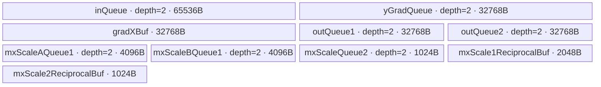
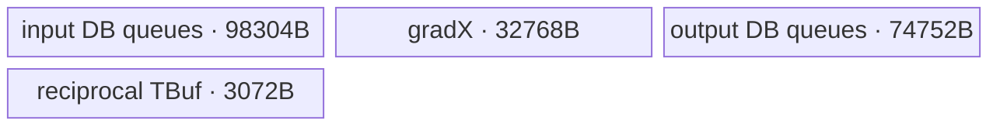
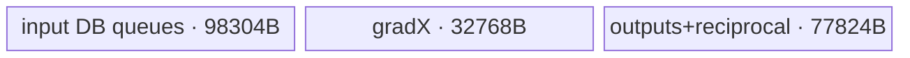

# SwigluBackwardMxQuantWithDualAxis 950 ACLNN 算子知识

## 算子速览

| 项目 | 内容 |
|---|---|
| 实际入口 | CANN 9.1.0 的无版本后缀两段式公开接口 `aclnnSwigluBackwardMxQuantWithDualAxisGetWorkspaceSize` / `aclnnSwigluBackwardMxQuantWithDualAxis` |
| 计算语义 | 先计算 SwiGLU 对 `x=[A,B]` 的反向梯度 `grad_x=[grad_A,grad_B]`，再分别以 32 元素为组沿末轴和倒数第二轴做 MX 动态量化 |
| 输入输出 | `x:[batch...,M,2N]`、`yGrad:[batch...,M,N]` 为 FP16/BF16；`y1Out/y2Out` 为 FP8 E4M3FN；两个 scale 输出为 FP8 E8M0，均为 ND |
| 执行类型 | 单 Kernel：`AIV_VECTOR`；entry 明确声明 `KERNEL_TYPE_AIV_ONLY`，无 Cube/AIC、SIMT、NDDMA 或通信节点 |
| Kernel 路线 | R-001/R-002：无 `groupIndex` 的 BLOCK，分别 FP16/BF16；R-003/R-004：有 `groupIndex` 且 `ceil(N/128)<AIV核数` 的 ROTATE；R-005/R-006：有 `groupIndex` 且 `ceil(N/128)>=AIV核数` 的 BLOCK |
| 核心资源 | GM 输入/四输出、AIV UB 中 7 个双缓冲 Queue、3 个 TBuf、MicroAPI RegTensor；算子 Kernel 不读 `workspace`，Tiling 仍上报平台 LibApi workspace |
| 来源闭包 | `source_closed`：公开 ACLNN 语义与平台、ACLNN 生成接线、OpDef、Host/Tiling、POD、binary config、Kernel entry/body 均闭合；自动生成 ACLNN bridge/非连续 Tensor 搬运属于框架边界 |
| 验证状态 | 已完成源码闭包检查；本次知识提取未执行编译、真机、数值或性能测试。 |

## 接口与语义

### 计算语义

令 `x=[A,B]` 沿末轴等分；固定公开实现只允许 `activateLeft=true`，所以左半部为激活支路、右半部为门控支路。对每个元素：

```text
s = sigmoid(A)
grad_A = yGrad * B * s * (1 + A * (1 - s))
grad_B = yGrad * A * s
grad_x = concat(grad_A, grad_B)
```

随后对 `grad_x` 分别按末轴 32 元素组和倒数第二轴 32 元素组求绝对值最大值，`scaleAlg=1` 使用源码中的 cuBLAS 风格指数提取规则生成 E8M0 scale 及 BF16 编码的倒数，再以 `CAST_RINT` 饱和转换到 FP8 E4M3FN。末轴结果写 `y1Out/mxscale1Out`，倒数第二轴结果写 `y2Out/mxscale2Out`；`mxscale2Out` 将相邻两个 32-row scale block 交织。

### 输入、输出与属性

| 参数 | shape/layout | dtype | 约束、默认值与语义 |
|---|---|---|---|
| `x` | `[batch...,M,2N]`, ND，rank 2～6 | FP16/BF16 | 非空；`2N` 必须是 64 的倍数 |
| `yGrad` | `[batch...,M,N]`, ND | 与 `x` 相同 | 非空；所有 batch/M 维与 `x` 一致 |
| `groupIndexOptional` | `[G]`, ND | INT64 | 可缺省；公开契约要求正的 cumsum，末值等于 `M`；可见 Tiling 只校验 rank/长度/dtype，值由 Device 读取 |
| `activateLeft` | 标量属性 | BOOL | API 文档解释左右两种语义，但固定 Host Tiling 仅接受 `true` |
| `roundModeOptional` | 标量属性 | STRING | 公开 FP8 路线只接受 `rint`，空指针默认 `rint` |
| `scaleAlg` | 标量属性 | INT64 | 固定 Host Tiling 仅接受 `1` |
| `dstDtype` | 标量属性 | INT64 | 必须等于输出 dtype 枚举；公开接口仅列 `36`（FP8 E4M3FN） |
| `maxDtypeValue` | 标量属性 | DOUBLE | 公开契约仅允许 0；算子拥有的 Tiling/POD/Kernel 不消费该属性 |
| `y1Out`,`y2Out` | 与 `x` 同 shape，ND | FP8 E4M3FN | 分别为末轴与倒数第二轴量化值 |
| `mxscale1Out` | `[batch...,M,ceil(2N/64),2]`, ND | FP8 E8M0 | 最后一维 2，pad 位置为 0；Host 以 `ceil(2N/64)` 校验倒数第二维 |
| `mxscale2Out` | 无分组 `[batch...,ceil(M/64),2N,2]`；有分组 `[batch...,floor(M/64)+G,2N,2]`，ND | FP8 E8M0 | 相邻 32-row scale 交织；Host 按上述式子校验 |

### 入口与版本

固定 Commit 只有公开、无版本后缀的 `aclnnSwigluBackwardMxQuantWithDualAxis`，没有更高版本 API。文档产品表只支持 Ascend 950PR/950DT，明确不支持 A2/A3。`op_host/CMakeLists.txt` 将 `ACLNNTYPE` 设为 `aclnn`、`SUPPORT_COMPUTE_UNIT` 设为 `ascend950`、Tiling 目录设为 `arch35`；OpDef 也只添加 `ascend950` 配置。ACLNN bridge/header 是构建系统生成边界，固定仓未签入其函数体；算子拥有的校验、selector、POD 和 Kernel 全部可见并已下钻。

`OpDef` 和 binary config 还列出 FP4/E5M2 binary，但本 Commit 的公开 ACLNN 文档及活动 `CheckDtype` 只允许 E4M3FN，这些配置条目不是公开 Host 可达路线，本文不纳入 Route。

## Host/Launcher 执行流程

### 参数校验与前处理

两段式 ACLNN 第一段检查公开参数并构造 executor；`AutoContiguous()` 使 `x/y_grad/group_index` 的非连续输入由框架转连续。进入算子 Tiling 后，`DoTiling` 固定按 `GetPlatformInfo → CheckDtype → GetAttr → CheckShape → ComputeTilingParams → SetTilingKeyAndCore → SetTilingData` 执行，任一步失败返回 `GRAPH_FAILED`。

可见校验包括：输入 FP16/BF16 且同 dtype；输出只为 E4M3FN/E8M0；`activateLeft=1`、`roundMode=rint`、`scaleAlg=1`、`dstDtype==y1 dtype`；所有 tensor 非空；rank、shape、`2N%64==0`；可选 `groupIndex` 为一维非空 INT64。固定仓未签入生成 bridge，因此 API 层对空指针、`maxDtypeValue=0` 和 group cumsum 值域的具体代码是框架边界，不将其补写为 Tiling 行为。

### 参数、Workspace 与生命周期

`GetPlatformInfo` 从 `PlatformAscendC` 取得 AIV 核数和 UB 字节数，并把 `GetLibApiWorkSpaceSize()` 写入唯一 workspace slot。Kernel entry 保留 `workspace` 参数但不读取它，因而没有算子自定义 workspace slice；ACLNN executor 及 AutoContiguous 可能需要的框架 workspace 总量由未签入的生成层管理。workspace 与 executor 由第一段接口返回，第二段在调用者给定 stream 上消费；输出由调用者持有。

### 启动图与失败传播

```text
aclnnSwigluBackwardMxQuantWithDualAxisGetWorkspaceSize
  -> 自动生成 ACLNN executor / AutoContiguous（框架边界）
  -> TilingForSwigluBackwardMxQuantWithDualAxis
     -> DoTiling -> key + blockDim + POD + lib-api workspace bytes
aclnnSwigluBackwardMxQuantWithDualAxis(workspace, executor, stream)
  -> [K1] swiglu_backward_mx_quant_with_dual_axis<<<blockDim, stream>>>
     -> SwigluBackwardMxQuantWithDualAxisBase::Init
     -> SwigluBackwardMxQuantWithDualAxisBase::Process
```

K1 输入为三路 GM、四路输出 GM、POD，执行族为 `AIV_VECTOR`，`blockDim=usedCoreNum`。单 Kernel 无跨节点边；stream 提交失败由 executor 返回，Tiling 任一失败阻止 launch。`workspace` 生命周期覆盖第二段调用，但 K1 不消费该地址。

## Route 与参数设计

### 分核与资源计算

令 `C=GetCoreNumAiv()`、`B=prod(batch dims)`、`nBlocks=ceil(N/128)`、`mBlocks=ceil(M/64)`。固定 tile 为 `64×128`（行×单半部列），完整 `grad_x` tile 为 `64×256`。

- 无 `groupIndex`：`usedCoreNum=min(C,B*mBlocks*nBlocks)`，强制 BLOCK。
- 有 `groupIndex`：`usedCoreNum=C`；`nBlocks<C` 选 ROTATE，否则选 BLOCK。
- 每 group `g`：`groupRows=end-start`，`blockCountG=ceil(groupRows/64)*nBlocks`。BLOCK 按商余数把连续 block 分给核；ROTATE 先以 `coreRotateOffset` 旋转核编号，再同样按商余数分配，并令下一 group 的起点增加 `blockCountG mod C`。
- `dimNTail=N%128==0?128:N%128`；每 tile 的 `calcRow`/`calcColAB` 分别取 64/128 或尾值。因为 `2N%64==0`，`N` 至少按 32 对齐。

Host 保守 UB 账为 209920 B，Device 实际 `InitBuffer` 账为 208896 B；差值来自 Host 将 `tmpScale2Ub` 算为 2048 B，而 Device 的 `mxScale2ReciprocalBuf_` 为 1024 B。Host 以保守值与平台 UB 比较，超出直接失败。

### Route 选择

| 顺序 | Route | Key/模板 | 精确选择条件与优先级 | 不适用去向 |
|---:|---|---|---|---|
| 1 | R-001 BLOCK/no-group/FP16 | `(BLOCK,RINT,1,NO_GROUP)` + FP16 binary | `groupIndex==nullptr && x.dtype=FP16`；无分组覆盖 selector | R-002 或失败 |
| 2 | R-002 BLOCK/no-group/BF16 | 同 key + BF16 binary | `groupIndex==nullptr && x.dtype=BF16` | grouped 路线或失败 |
| 3 | R-003 ROTATE/group/FP16 | `(ROTATE,RINT,1,GROUP)` + FP16 binary | `groupIndex!=nullptr && ceil(N/128)<C && x.dtype=FP16` | R-004/R-005 |
| 4 | R-004 ROTATE/group/BF16 | 同 key + BF16 binary | `groupIndex!=nullptr && ceil(N/128)<C && x.dtype=BF16` | R-005/R-006 |
| 5 | R-005 BLOCK/group/FP16 | `(BLOCK,RINT,1,GROUP)` + FP16 binary | `groupIndex!=nullptr && ceil(N/128)>=C && x.dtype=FP16` | R-006 或失败 |
| 6 | R-006 BLOCK/group/BF16 | 同 key + BF16 binary | `groupIndex!=nullptr && ceil(N/128)>=C && x.dtype=BF16` | 失败 |

```text
先做全部 dtype/属性/shape/UB 校验；任一失败 -> GRAPH_FAILED
if groupIndex 不存在:
    mode=BLOCK; isGroupIdx=NO_GROUP
else:
    isGroupIdx=GROUP
    mode = ROTATE if ceil(N/128) < C else BLOCK
roundMode=RINT; scaleAlg=1
再由 x.dtype 选择 fp16toe4m3 或 bf16toe4m3 binary
```

### 模板/实现执行矩阵

| Route | key/selector | dtype/shape/platform 完整命中条件 | 执行拓扑与 Kernel 节点 | 实际模板/body | 内存与同步特征 | tail/fallback |
|---|---|---|---|---|---|---|
| R-001 | BLOCK/RINT/1/NO_GROUP | 950；FP16；公开校验全过；无 group | 单 K1 | `Base<half,fp8_e4m3fn_t,BLOCK,CAST_RINT,1,0>` | 固定 208896 B UB；Queue 同步 | M/N 尾 tile；失败无 fallback |
| R-002 | 同上 | 同上但 BF16 | 单 K1 | `Base<bfloat16_t,fp8_e4m3fn_t,BLOCK,CAST_RINT,1,0>` | 同布局；量化前 BF16 路径不同 | 同上 |
| R-003 | ROTATE/RINT/1/GROUP | 950；FP16；group；`nBlocks<C` | 单 K1 | `Base<half,fp8_e4m3fn_t,ROTATE,CAST_RINT,1,1>` | 同 UB；每 group 旋转核起点 | 非正 groupRows 跳过；失败无 fallback |
| R-004 | 同上 | 同上但 BF16 | 单 K1 | `Base<bfloat16_t,fp8_e4m3fn_t,ROTATE,CAST_RINT,1,1>` | 同布局；BF16 量化乘法路径 | 同上 |
| R-005 | BLOCK/RINT/1/GROUP | 950；FP16；group；`nBlocks>=C` | 单 K1 | `Base<half,fp8_e4m3fn_t,BLOCK,CAST_RINT,1,1>` | 同 UB；连续 block 分核 | 同上 |
| R-006 | 同上 | 同上但 BF16 | 单 K1 | `Base<bfloat16_t,fp8_e4m3fn_t,BLOCK,CAST_RINT,1,1>` | 同布局；BF16 量化乘法路径 | 同上 |

### 隐藏性能 Guard

| Guard | Host/Tiling 条件 | Device/资源原因 | 影响 Route | 不满足时去向 | 源码符号 |
|---|---|---|---|---|---|
| 固定 tile 可装入 UB | `209920 <= ubSize` | 64×128 tile 的 DB Queue/TBuf 上界 | 全部 | `GRAPH_FAILED`，无小 tile fallback | `ComputeTilingParams` |
| 末维对齐 | `x.lastDim % 64 == 0` | `N` 至少 32 对齐，匹配 MX group/搬运 | 全部 | `GRAPH_FAILED` | `CheckYShape` |
| ROTATE 门槛 | `group && ceil(N/128)<C` | 每个 row block 的列块少于核数，跨 group 旋转起点 | R-003/R-004 | grouped BLOCK | `SetTilingKeyAndCore` |
| FP8 舍入 | `y=E4M3FN && roundMode==RINT` | entry 将模板值映射为 `CAST_RINT` | 全部 | `GRAPH_FAILED` | `GetAttr`, `RoundModeMapper` |
| scale 算法 | `scaleAlg==1` | 公共 Process 只走 `ComputeScaleCuBLAS` | 全部 | `GRAPH_FAILED`；OCP body 不可达 | `GetAttr`, `Process` |
| 输出 DMA 行路径 | `(rowWidth-dataLenAB)%32!=0` | 批量 DataCopy 的 UB 行 stride 不能整块表达 | 全部尾列 | 改为逐行 `DataCopyPad`，不是新 Route | `CopyOut` |
| group 有效行 | `groupEnd-groupStart>0` | 防止负/零范围参与 block 分配 | grouped | Device 跳过该 group | `Process` |

### POD/ABI

`SwigluBackwardMxQuantWithDualAxisTilingData` 仅含 13 个连续 `int64_t`，固定源码 ABI 为 `sizeof=104`、`alignof=8`。

| 结构 | 字段 | 类型/位宽 | ABI 布局 | 单位 | Host/launcher producer | Device consumer | 边界 |
|---|---|---|---|---|---|---|---|
| TilingData | `usedCoreNum` | `int64_t`/64 | offset 0 | core | `SetTilingData=usedCoreNum` | `Process` 空核保护/分核 | `>0` |
| TilingData | `dstType` | `int64_t`/64 | offset 8 | dtype enum | `=dstType` | 当前公开 body 不读 | 已校验为 E4M3FN |
| TilingData | `activateLeft` | `int64_t`/64 | offset 16 | bool-as-int | `=activateLeft` | `InitParams/Process` 选 A/B | 固定为 1 |
| TilingData | `dimM` | `int64_t`/64 | offset 24 | row | `=x[-2]` | `Process` group 范围 | `>0` |
| TilingData | `dimN` | `int64_t`/64 | offset 32 | element | `=x[-1]/2` | stride/offset | `N%32=0` |
| TilingData | `numGroups` | `int64_t`/64 | offset 40 | group | `=G` 或 1 | grouped `Process` | `>0` |
| TilingData | `blockW` | `int64_t`/64 | offset 48 | element | `=128` | `InitParams` tile 列宽 | 固定 128 |
| TilingData | `splitBlockH` | `int64_t`/64 | offset 56 | row | `=64` | `InitParams` tile 行数 | 固定 64 |
| TilingData | `dimNBlockNum` | `int64_t`/64 | offset 64 | block | `=ceil(N/128)` | `Process` block 二维映射 | `>=1` |
| TilingData | `dimNTail` | `int64_t`/64 | offset 72 | element | `=N%128?N%128:128` | 末列 `calcColAB` | 32..128 |
| TilingData | `yGradRowStride` | `int64_t`/64 | offset 80 | element | `=N` | Device 有字段但 `CopyInYGrad` 直接用 `dimN_` | inactive |
| TilingData | `dimGradX` | `int64_t`/64 | offset 88 | element | `=2N` | output/scale stride | 64 的倍数 |
| TilingData | `dimBatch` | `int64_t`/64 | offset 96 | batch | `=prod(x[0:-2])` | 无 group 时按 batch 形成逻辑 group | 乘法溢出未显式检查 |

### Route 源码闭包

| Route | Key/selector | Host/Tiling producer | POD/参数 | Kernel entry/router 节点 | Kernel body/直接依赖 | 构建接线 |
|---|---|---|---|---|---|---|
| R-001/R-002 | BLOCK/RINT/1/NO_GROUP + dtype binary | `SetTilingKeyAndCore` | 104 B `TilingData` | `swiglu_backward_mx_quant_with_dual_axis` | `Base::Init/Process/CopyIn/Compute*/CopyOut` | `SUPPORT_COMPUTE_UNIT=ascend950`; e4m3 binaries |
| R-003/R-004 | ROTATE/RINT/1/GROUP + dtype binary | 同上 | 同上 | 同上 | 同上，ROTATE 分核编译分支 | 同上 |
| R-005/R-006 | BLOCK/RINT/1/GROUP + dtype binary | 同上 | 同上 | 同上 | 同上，BLOCK 分核编译分支 | 同上 |

## Kernel 实现

### 公共执行流程

entry 保存 950 的 overflow-control SPR，置 0，解析 POD，创建 `TPipe`，实例化模板 body，依次调用 `Init/Process`，最后恢复 SPR。`Init` 绑定 GM、对输入关闭 L2 cache hint，并按固定 tile 分配 UB。`Process` 将每个逻辑 block 映射到一个 64-row×128-column-half tile：两次 GM→UB 搬入 A/B、一次搬入 yGrad；MicroAPI 以 FP32 计算 sigmoid 和两个梯度、再 RINT 回 FP16/BF16 到 `gradXBuf_`。M 尾补零到 64 行。

每 32 行调用一次 `ComputeScaleCuBLAS`：一次遍历同时收集末轴每 32 元素的 max 和倒数第二轴 max；生成末轴 E8M0 scale/倒数并在同一函数内直接产出 `y1`，随后生成倒数第二轴 scale/倒数，`ComputeY2ToFP8` 复用 `gradXBuf_` 产出 `y2`。相邻 32-row scale2 块在 UB 中交织后，五个输出 Queue 入队并由 `CopyOut` 提交 GM。单 Kernel 没有 workspace 交接或跨 Kernel 同步。

### Route R-001：BLOCK/no-group/FP16

#### 适用条件

##### 选择证据

| 层级 | 文件 | 符号 | 源码谓词/参数 | 结果/下一跳 |
|---|---|---|---|---|
| Host | `quant/swiglu_backward_mx_quant_with_dual_axis/op_host/arch35/swiglu_backward_mx_quant_with_dual_axis_tiling_arch35.cpp` | `CheckDtype/SetTilingKeyAndCore` | FP16；`isGroupIdx==0` 覆盖 mode | BLOCK/RINT/1/NO_GROUP |
| config | `quant/swiglu_backward_mx_quant_with_dual_axis/op_host/config/ascend950/swiglu_backward_mx_quant_with_dual_axis_binary.json` | `SwigluBackwardMxQuantWithDualAxis_fp16toe4m3` | x/yGrad FP16，y E4M3FN | FP16 binary |
| entry | `quant/swiglu_backward_mx_quant_with_dual_axis/op_kernel/swiglu_backward_mx_quant_with_dual_axis.cpp` | `swiglu_backward_mx_quant_with_dual_axis` | key + `DTYPE_X=half` | `Base<half,fp8_e4m3fn_t,TPL_MODE_BLOCK,CAST_RINT,TPL_SCALE_ALG_1,TPL_NO_GROUP_INDEX>` |

#### Device 数据流

##### 函数级调用链

```text
TilingForSwigluBackwardMxQuantWithDualAxis -> DoTiling -> K1 entry
  -> Init -> InitParams + InitBuffer
  -> Process[BLOCK]
     -> CopyIn + CopyInYGrad
     -> ComputeSwigluBackward -> PadZeroM(tail)
     -> ComputeScaleCuBLAS -> ComputeScaleCuBLASSecondLast
     -> ComputeY2ToFP8 -> Interleave(scale2) -> CopyOut
```

##### 源码等价伪码

```text
for batch-group g:
  blocks = ceil(M/64)*ceil(N/128); BLOCK 商余分核
  for assigned tile(rowBlock,colBlock):
    copy x.left/x.right/yGrad[calcRow,calcCol] to DB queues
    FP16 -> FP32; compute grad_A/grad_B; RINT -> FP16 gradXBuf
    zero rows [calcRow,ceil64(calcRow))
    for each 32-row block: compute both-axis max/scale; quantize y1 and y2 to E4M3FN
    interleave two scale2 row blocks; queue and copy valid rows/cols to GM
```

#### 内存与数据搬运

##### 资源与搬运表

| 层级/缓冲区 | offset/地址公式 | extent/容量公式 | dtype/layout | producer | consumer | owner/lifetime | 对齐/复用 |
|---|---|---|---|---|---|---|---|
| x GM→`inQueue_` | row=`absRowStart`, col=`colOffsetAB` 与 `+N` | 每支 `calcRow*calcCol*2 B`；buffer 容量 32768 B | FP16，A/B 两片 | `CopyIn` | backward | Queue depth 2 | src stride `(2N-calcCol)*2 B` |
| yGrad GM→Queue | `absRowStart*N+colOffsetAB` | 有效 `calcRow*calcCol*2 B`；容量 16384 B | FP16 | `CopyInYGrad` | backward | depth 2 | stride `(N-calcCol)*2 B` |
| `gradXBuf_` | row-major，B 从 `+calcCol` 起 | 32768 B | FP16，64×256 上界 | backward | scale/y1/y2 | 整个 tile | M 尾零填充 |
| output Queues | A/B GM offsets见 `Process` | y1/y2 各 16384 B/buffer；scale1 A/B 各2048 B；scale2 512 B | uint8 payload | compute | `CopyOut` | 均 depth 2 | y 尾列可逐行 DMA |
| reciprocal TBuf | scale1/scale2 | 2048 B/1024 B | BF16 bits in uint16 | scale | quantize | tile 内 | scale2 TBuf 先暂存 max 再覆盖倒数 |

##### 分层内存布局



##### 字节账与复用顺序

```text
UB_total = 65536+32768+32768+32768+32768+4096+4096+1024+2048+1024 = 208896 B
Host_guard = 209920 B <= platform UB
dynamic_ub = N/A（AIV TPipe 静态 InitBuffer）
workspace_total = GetLibApiWorkSpaceSize()；K1 自定义 slice = 0
```

| 复用子区 | 写入者 | 读取者/消费点 | 下一次覆盖 | 同步或释放依据 | 安全条件 |
|---|---|---|---|---|---|
| input DB slots | CopyIn | backward | 下个 tile | DeQue 后 `FreeTensor` | Queue depth 2 |
| `gradXBuf_` | backward/PadZeroM | scale/y1/y2 | 下个 tile | 同一核顺序执行 | 完成全部量化后才覆盖 |
| scale2 reciprocal TBuf | `ComputeScaleCuBLAS` 先写 abs max | `ComputeScaleCuBLASSecondLast` 覆盖为 reciprocal；Y2 读取 | 下个 32-row block | 同一函数/核程序序 | second-last 完成后才量化 Y2 |
| output DB slots | compute | CopyOut | `FreeTensor` 后 | EnQue/DeQue/FreeTensor | GM DMA 消费完成 |

#### 同步、精度与尾块

##### 同步与数值边界表

| 阶段 | primitive/机制 | producer | consumer/等待点 | 保护对象 | 精度/尾块 |
|---|---|---|---|---|---|
| 搬入→计算 | TQue EnQue/DeQue | MTE2 | Vector | x/yGrad slots | 只处理 `calcRow/calcCol` |
| backward | MicroAPI mask | register load | store gradX | 有效 lane | FP16→FP32 计算→RINT FP16 |
| M 尾 | `PadZeroM` | Vector | scale reduce | padded rows | zero 不扩大 abs max |
| 计算→搬出 | TQue EnQue/DeQue | Vector | MTE3 | 五个 output slots | 只写有效 y 行列；scale2 写对齐 64-row 组 |

#### 关键实现

##### 符号证据表

| 阶段 | 文件 | 符号/模板实例 | 实现事实 |
|---|---|---|---|
| Host/Tiling producer | `quant/swiglu_backward_mx_quant_with_dual_axis/op_host/arch35/swiglu_backward_mx_quant_with_dual_axis_tiling_arch35.cpp` | `ComputeTilingParams/SetTilingKeyAndCore` | 固定 tile、UB guard、BLOCK 与 blockDim |
| Kernel entry/router | `quant/swiglu_backward_mx_quant_with_dual_axis/op_kernel/swiglu_backward_mx_quant_with_dual_axis.cpp` | `swiglu_backward_mx_quant_with_dual_axis` | AIV-only、POD 解析、模板实例 |
| Device body/helper | `quant/swiglu_backward_mx_quant_with_dual_axis/op_kernel/arch35/swiglu_backward_mx_quant_with_dual_axis_regbase.h` | `Process/ComputeSwigluBackward/ComputeScaleCuBLAS/ComputeY2ToFP8/CopyOut` | 完整融合流水与 tail |

### Route R-002：BLOCK/no-group/BF16

#### 适用条件

##### 选择证据

| 层级 | 文件 | 符号 | 源码谓词/参数 | 结果/下一跳 |
|---|---|---|---|---|
| Host/config | `quant/swiglu_backward_mx_quant_with_dual_axis/op_host/arch35/swiglu_backward_mx_quant_with_dual_axis_tiling_arch35.cpp`; `quant/swiglu_backward_mx_quant_with_dual_axis/op_host/config/ascend950/swiglu_backward_mx_quant_with_dual_axis_binary.json` | `CheckDtype`, `SwigluBackwardMxQuantWithDualAxis_bf16toe4m3` | 无 group；BF16 | BLOCK/RINT/1/NO_GROUP BF16 binary |

#### Device 数据流

##### 函数级调用链

```text
与 R-001 相同；实例改为 Base<bfloat16_t,fp8_e4m3fn_t,BLOCK,CAST_RINT,1,0>
```

##### 源码等价伪码

```text
与 R-001 的 BLOCK 循环相同；backward 仍升 FP32 再 RINT 回 BF16；
ComputeScaleCuBLAS 的 Y1 路径先在 BF16 中乘 reciprocal，再 cast FP32 并转 E4M3FN。
```

#### 内存与数据搬运

##### 资源与搬运表

| 层级/缓冲区 | offset/地址公式 | extent/容量公式 | dtype/layout | producer | consumer | owner/lifetime | 对齐/复用 |
|---|---|---|---|---|---|---|---|
| 全部 GM/UB | 同 R-001 | 208896 B | 输入/gradX 为 BF16，其余相同 | 同 R-001 | 同 R-001 | 同 R-001 | 2 B 元素使容量不变 |

##### 分层内存布局



##### 字节账与复用顺序

```text
UB_total=208896 B；Host_guard=209920 B；dynamic_ub=N/A；workspace=LibApi workspace，K1 slice=0
```

| 复用子区 | 写入者 | 读取者/消费点 | 下一次覆盖 | 同步或释放依据 | 安全条件 |
|---|---|---|---|---|---|
| 全部子区 | 同 R-001 | 同 R-001 | 同 R-001 | Queue/同核顺序 | dtype 分支不改变生命周期 |

#### 同步、精度与尾块

##### 同步与数值边界表

| 阶段 | primitive/机制 | producer | consumer/等待点 | 保护对象 | 精度/尾块 |
|---|---|---|---|---|---|
| backward/quant | Queue + MicroAPI | MTE2/Vector | Vector/MTE3 | 同 R-001 | backward FP32→BF16；Y1 BF16 乘 reciprocal 后转 FP32；Y2 FP32 乘 reciprocal；RINT E4M3FN |

#### 关键实现

##### 符号证据表

| 阶段 | 文件 | 符号/模板实例 | 实现事实 |
|---|---|---|---|
| Host/Tiling producer | `quant/swiglu_backward_mx_quant_with_dual_axis/op_host/arch35/swiglu_backward_mx_quant_with_dual_axis_tiling_arch35.cpp` | `CheckDtype/SetTilingKeyAndCore` | BF16 + no-group BLOCK |
| Kernel entry/router | `quant/swiglu_backward_mx_quant_with_dual_axis/op_kernel/swiglu_backward_mx_quant_with_dual_axis.cpp` | `swiglu_backward_mx_quant_with_dual_axis` | BF16 binary 实例 |
| Device body/helper | `quant/swiglu_backward_mx_quant_with_dual_axis/op_kernel/arch35/swiglu_backward_mx_quant_with_dual_axis_regbase.h` | `ComputeSwigluBackward/ComputeScaleCuBLAS` | BF16 编译分支与公共 tail |

### Route R-003：ROTATE/group/FP16

#### 适用条件

##### 选择证据

| 层级 | 文件 | 符号 | 源码谓词/参数 | 结果/下一跳 |
|---|---|---|---|---|
| Host | `quant/swiglu_backward_mx_quant_with_dual_axis/op_host/arch35/swiglu_backward_mx_quant_with_dual_axis_tiling_arch35.cpp` | `SetTilingKeyAndCore` | group 存在且 `dimNBlockNum<totalCoreNum` | ROTATE/RINT/1/GROUP |
| Device | `quant/swiglu_backward_mx_quant_with_dual_axis/op_kernel/arch35/swiglu_backward_mx_quant_with_dual_axis_regbase.h` | `Process` | `mode==ROTATE` | 旋转核编号分配每 group blocks |

#### Device 数据流

##### 函数级调用链

```text
K1 -> Init(groupIndex GM) -> Process[ROTATE] -> 公共 CopyIn/backward/scale/y1/y2/CopyOut
```

##### 源码等价伪码

```text
for g in [0,G): start=(g?groupIndex[g-1]:0); end=groupIndex[g]
  if end-start<=0: continue
  myCore=(blockIdx-coreRotateOffset+C)%C
  按 head/tail 商余分配 group blocks
  coreRotateOffset=(coreRotateOffset+blockCountG)%C
  对本核 blocks 执行公共 tile 流水
```

#### 内存与数据搬运

##### 资源与搬运表

| 层级/缓冲区 | offset/地址公式 | extent/容量公式 | dtype/layout | producer | consumer | owner/lifetime | 对齐/复用 |
|---|---|---|---|---|---|---|---|
| groupIndex GM | `g`/`g-1` | G×8 B | INT64 cumsum | caller | `Process` | 调用期间 | L2 cache disabled |
| tile buffers | 同 R-001 | 208896 B | FP16/uint8 | 公共流水 | 公共流水 | 每核 | 同 R-001 |
| scale2 GM | `(groupStart/64+g)*2` 起 | 每 group 对齐 64-row | E8M0 interleaved | CopyOut | caller | output lifetime | group 边界保留额外 row-pair |

##### 分层内存布局


##### 字节账与复用顺序

```text
UB_total=208896 B；Host_guard=209920 B；dynamic_ub=N/A；workspace=LibApi workspace，K1 slice=0
```

| 复用子区 | 写入者 | 读取者/消费点 | 下一次覆盖 | 同步或释放依据 | 安全条件 |
|---|---|---|---|---|---|
| tile/reciprocal/output slots | 同 R-001 | 同 R-001 | 下个 assigned block | Queue/同核顺序 | 不同核写互斥 GM tile；group cumsum 合法 |

#### 同步、精度与尾块

##### 同步与数值边界表

| 阶段 | primitive/机制 | producer | consumer/等待点 | 保护对象 | 精度/尾块 |
|---|---|---|---|---|---|
| group scheduling | 静态互斥 block 映射 | Host key/POD | Device loop | GM 输出区 | 非正 groupRows 跳过；公开契约要求递增 cumsum |
| tile 流水 | Queue/MicroAPI | 同 R-001 | 同 R-001 | UB/GM | FP16 精度及 M/N tail 同 R-001 |

#### 关键实现

##### 符号证据表

| 阶段 | 文件 | 符号/模板实例 | 实现事实 |
|---|---|---|---|
| Host/Tiling producer | `quant/swiglu_backward_mx_quant_with_dual_axis/op_host/arch35/swiglu_backward_mx_quant_with_dual_axis_tiling_arch35.cpp` | `SetTilingKeyAndCore` | ROTATE selector |
| Kernel entry/router | `quant/swiglu_backward_mx_quant_with_dual_axis/op_kernel/swiglu_backward_mx_quant_with_dual_axis.cpp` | `swiglu_backward_mx_quant_with_dual_axis` | `Base<half,fp8_e4m3fn_t,TPL_MODE_ROTATE,CAST_RINT,TPL_SCALE_ALG_1,TPL_GROUP_INDEX>` |
| Device body/helper | `quant/swiglu_backward_mx_quant_with_dual_axis/op_kernel/arch35/swiglu_backward_mx_quant_with_dual_axis_regbase.h` | `Process` | group cumsum、核旋转、输出 offset |

### Route R-004：ROTATE/group/BF16

#### 适用条件

##### 选择证据

| 层级 | 文件 | 符号 | 源码谓词/参数 | 结果/下一跳 |
|---|---|---|---|---|
| Host/config | `quant/swiglu_backward_mx_quant_with_dual_axis/op_host/arch35/swiglu_backward_mx_quant_with_dual_axis_tiling_arch35.cpp`; `quant/swiglu_backward_mx_quant_with_dual_axis/op_host/config/ascend950/swiglu_backward_mx_quant_with_dual_axis_binary.json` | `SetTilingKeyAndCore`; `SwigluBackwardMxQuantWithDualAxis_bf16toe4m3` | group；`nBlocks<C`；BF16 | ROTATE/RINT/1/GROUP BF16 |

#### Device 数据流

##### 函数级调用链

```text
R-003 的 ROTATE 调度 + R-002 的 BF16 计算分支
```

##### 源码等价伪码

```text
按 group cumsum 和 rotating core offset 分块；每个 tile 执行 BF16→FP32 backward、
BF16/FP32 量化分支、scale2 interleave 和有效域 CopyOut。
```

#### 内存与数据搬运

##### 资源与搬运表

| 层级/缓冲区 | offset/地址公式 | extent/容量公式 | dtype/layout | producer | consumer | owner/lifetime | 对齐/复用 |
|---|---|---|---|---|---|---|---|
| group/tile buffers | R-003 offsets | 208896 B UB | BF16/uint8 | 公共流水 | 公共流水 | 每核/tile | R-002 dtype + R-003 group layout |

##### 分层内存布局



##### 字节账与复用顺序

```text
UB_total=208896 B；Host_guard=209920 B；dynamic_ub=N/A；workspace=LibApi workspace，K1 slice=0
```

| 复用子区 | 写入者 | 读取者/消费点 | 下一次覆盖 | 同步或释放依据 | 安全条件 |
|---|---|---|---|---|---|
| 全部 | 同 R-002/R-003 | 同 R-002/R-003 | 下一 tile | Queue/程序序 | dtype 与调度条件同时成立 |

#### 同步、精度与尾块

##### 同步与数值边界表

| 阶段 | primitive/机制 | producer | consumer/等待点 | 保护对象 | 精度/尾块 |
|---|---|---|---|---|---|
| 全流水 | Queue + ROTATE 映射 | Host/Vector | MTE3 | UB/互斥 GM tile | BF16 精度见 R-002；group tail 见 R-003 |

#### 关键实现

##### 符号证据表

| 阶段 | 文件 | 符号/模板实例 | 实现事实 |
|---|---|---|---|
| Host/Tiling producer | `quant/swiglu_backward_mx_quant_with_dual_axis/op_host/arch35/swiglu_backward_mx_quant_with_dual_axis_tiling_arch35.cpp` | `SetTilingKeyAndCore` | grouped ROTATE |
| Kernel entry/router | `quant/swiglu_backward_mx_quant_with_dual_axis/op_kernel/swiglu_backward_mx_quant_with_dual_axis.cpp` | `swiglu_backward_mx_quant_with_dual_axis` | BF16 ROTATE 实例 |
| Device body/helper | `quant/swiglu_backward_mx_quant_with_dual_axis/op_kernel/arch35/swiglu_backward_mx_quant_with_dual_axis_regbase.h` | `Process/ComputeScaleCuBLAS` | ROTATE + BF16 分支 |

### Route R-005：BLOCK/group/FP16

#### 适用条件

##### 选择证据

| 层级 | 文件 | 符号 | 源码谓词/参数 | 结果/下一跳 |
|---|---|---|---|---|
| Host | `quant/swiglu_backward_mx_quant_with_dual_axis/op_host/arch35/swiglu_backward_mx_quant_with_dual_axis_tiling_arch35.cpp` | `SetTilingKeyAndCore` | group；`dimNBlockNum>=totalCoreNum`；FP16 | BLOCK/RINT/1/GROUP |

#### Device 数据流

##### 函数级调用链

```text
K1 -> Init(groupIndex GM) -> Process[BLOCK] -> 公共 FP16 tile 流水
```

##### 源码等价伪码

```text
for each group: blocks=ceil(groupRows/64)*nBlocks
  用 blockIdx 直接做 head/tail 商余分配，不旋转核编号
  对 assigned blocks 执行 R-001 的 FP16 公共流水
```

#### 内存与数据搬运

##### 资源与搬运表

| 层级/缓冲区 | offset/地址公式 | extent/容量公式 | dtype/layout | producer | consumer | owner/lifetime | 对齐/复用 |
|---|---|---|---|---|---|---|---|
| group/tile/output | group offset 同 R-003；tile 同 R-001 | 208896 B UB | FP16/uint8 | 公共流水 | 公共流水 | 每核/tile | BLOCK 不旋转 |

##### 分层内存布局


##### 字节账与复用顺序

```text
UB_total=208896 B；Host_guard=209920 B；dynamic_ub=N/A；workspace=LibApi workspace，K1 slice=0
```

| 复用子区 | 写入者 | 读取者/消费点 | 下一次覆盖 | 同步或释放依据 | 安全条件 |
|---|---|---|---|---|---|
| 全部 | 同 R-001/R-003 | 同 R-001/R-003 | 下一 tile | Queue/程序序 | BLOCK 商余映射不重叠 |

#### 同步、精度与尾块

##### 同步与数值边界表

| 阶段 | primitive/机制 | producer | consumer/等待点 | 保护对象 | 精度/尾块 |
|---|---|---|---|---|---|
| 全流水 | Queue + BLOCK 映射 | Host/Vector | MTE3 | UB/GM | FP16；M/N/group tail 如前 |

#### 关键实现

##### 符号证据表

| 阶段 | 文件 | 符号/模板实例 | 实现事实 |
|---|---|---|---|
| Host/Tiling producer | `quant/swiglu_backward_mx_quant_with_dual_axis/op_host/arch35/swiglu_backward_mx_quant_with_dual_axis_tiling_arch35.cpp` | `SetTilingKeyAndCore` | grouped BLOCK |
| Kernel entry/router | `quant/swiglu_backward_mx_quant_with_dual_axis/op_kernel/swiglu_backward_mx_quant_with_dual_axis.cpp` | `swiglu_backward_mx_quant_with_dual_axis` | FP16 BLOCK grouped 实例 |
| Device body/helper | `quant/swiglu_backward_mx_quant_with_dual_axis/op_kernel/arch35/swiglu_backward_mx_quant_with_dual_axis_regbase.h` | `Process` | cumsum + BLOCK 商余分核 |

### Route R-006：BLOCK/group/BF16

#### 适用条件

##### 选择证据

| 层级 | 文件 | 符号 | 源码谓词/参数 | 结果/下一跳 |
|---|---|---|---|---|
| Host/config | `quant/swiglu_backward_mx_quant_with_dual_axis/op_host/arch35/swiglu_backward_mx_quant_with_dual_axis_tiling_arch35.cpp`; `quant/swiglu_backward_mx_quant_with_dual_axis/op_host/config/ascend950/swiglu_backward_mx_quant_with_dual_axis_binary.json` | `SetTilingKeyAndCore`; `SwigluBackwardMxQuantWithDualAxis_bf16toe4m3` | group；`nBlocks>=C`；BF16 | BLOCK/RINT/1/GROUP BF16 |

#### Device 数据流

##### 函数级调用链

```text
R-005 的 grouped BLOCK 调度 + R-002 的 BF16 计算分支
```

##### 源码等价伪码

```text
按 group cumsum 和直接 blockIdx 商余分块；执行 BF16 公共 tile 流水，
尾行补零、尾列按有效 dataLen 搬出，scale2 维持 64-row 对齐交织布局。
```

#### 内存与数据搬运

##### 资源与搬运表

| 层级/缓冲区 | offset/地址公式 | extent/容量公式 | dtype/layout | producer | consumer | owner/lifetime | 对齐/复用 |
|---|---|---|---|---|---|---|---|
| group/tile/output | 同 R-005 | 208896 B UB | BF16/uint8 | 公共流水 | 公共流水 | 每核/tile | BF16 不改变容量 |

##### 分层内存布局


##### 字节账与复用顺序

```text
UB_total=208896 B；Host_guard=209920 B；dynamic_ub=N/A；workspace=LibApi workspace，K1 slice=0
```

| 复用子区 | 写入者 | 读取者/消费点 | 下一次覆盖 | 同步或释放依据 | 安全条件 |
|---|---|---|---|---|---|
| 全部 | 同 R-002/R-005 | 同 R-002/R-005 | 下一 tile | Queue/程序序 | grouped BLOCK + BF16 条件 |

#### 同步、精度与尾块

##### 同步与数值边界表

| 阶段 | primitive/机制 | producer | consumer/等待点 | 保护对象 | 精度/尾块 |
|---|---|---|---|---|---|
| 全流水 | Queue + BLOCK 映射 | Host/Vector | MTE3 | UB/GM | BF16 精度、M/N/group tail 如前 |

#### 关键实现

##### 符号证据表

| 阶段 | 文件 | 符号/模板实例 | 实现事实 |
|---|---|---|---|
| Host/Tiling producer | `quant/swiglu_backward_mx_quant_with_dual_axis/op_host/arch35/swiglu_backward_mx_quant_with_dual_axis_tiling_arch35.cpp` | `SetTilingKeyAndCore` | grouped BLOCK |
| Kernel entry/router | `quant/swiglu_backward_mx_quant_with_dual_axis/op_kernel/swiglu_backward_mx_quant_with_dual_axis.cpp` | `swiglu_backward_mx_quant_with_dual_axis` | BF16 BLOCK grouped 实例 |
| Device body/helper | `quant/swiglu_backward_mx_quant_with_dual_axis/op_kernel/arch35/swiglu_backward_mx_quant_with_dual_axis_regbase.h` | `Process/ComputeScaleCuBLAS` | BLOCK + BF16 分支 |

## 算子特定优化

### Trick T-001：跨 group 旋转核起点

#### 触发与源码依据

- 适用 Route：R-003、R-004
- 触发条件：存在 `groupIndex` 且 `ceil(N/128)<AIV核数`
- Golden 来源：[`op_kernel/arch35/swiglu_backward_mx_quant_with_dual_axis_regbase.h:294-315`](../../../../../../../cann-ops-raw/ascendc/ops-nn/955f8b33985b6d72989ebff341bb9c2c564a51bc/quant/swiglu_backward_mx_quant_with_dual_axis/op_kernel/arch35/swiglu_backward_mx_quant_with_dual_axis_regbase.h#L294-L315)

**官方源码（固定 Commit 连续逐字摘录）**：

```cpp
if constexpr (mode == TPL_MODE_ROTATE) {
    int64_t usedCoreNumG = (blockCountG < totalCoreNum) ? blockCountG : totalCoreNum;
    int64_t myCoreInGroup = blockIdx_ - coreRotateOffset;
    if (myCoreInGroup < 0) {
        myCoreInGroup += totalCoreNum;
    }

    if (myCoreInGroup < usedCoreNumG) {
        int64_t headCoreNumG = blockCountG % usedCoreNumG;
        int64_t blockPerHeadCoreG = ops::CeilDiv(blockCountG, usedCoreNumG);
        int64_t blockPerTailCoreG = blockCountG / usedCoreNumG;
```

#### 机制与设计原因

单个窄 N group 的 block 数可能少于总核数。模板用前序 group 的 `blockCountG` 累加旋转逻辑核号，使不同 group 不总落在相同低编号核上；组内仍使用连续 block 的商余均分，因此不改变地址或输出布局。这是调度机制，不引入 workspace 或核间同步。

#### 迁移边界

- 适用：由多个独立 cumsum group 组成、单 group 并行宽度小于核数的 AIV tile 算子。
- 前提：group 输出区互斥，且每 group 能独立计算。
- 失效：无 group 或 `ceil(N/128)>=C` 必须使用 BLOCK 路线。
- 未验证：本次知识提取未执行编译、真机、数值或性能测试。

#### 错误做法

固定仓未提供可验证反例；源码明确的边界是非正 `groupRows` 被跳过。

### Trick T-002：同一次遍历生成末轴 scale 并直接量化 Y1

#### 触发与源码依据

- 适用 Route：全部公开 Route
- 触发条件：固定公开 `scaleAlg=1`、E4M3FN 输出
- Golden 来源：[`op_kernel/arch35/swiglu_backward_mx_quant_with_dual_axis_regbase.h:985-1025`](../../../../../../../cann-ops-raw/ascendc/ops-nn/955f8b33985b6d72989ebff341bb9c2c564a51bc/quant/swiglu_backward_mx_quant_with_dual_axis/op_kernel/arch35/swiglu_backward_mx_quant_with_dual_axis_regbase.h#L985-L1025)

**官方源码（固定 Commit 连续逐字摘录）**：

```cpp
__ubuf__ xDtype *xReadAddr = xAddrBase;
__ubuf__ uint16_t *recipReadAddr = recipBase;

for (uint16_t i = 0; i < blockCount; i++) {
    MicroAPI::DataCopy<xDtype, MicroAPI::PostLiteral::POST_MODE_UPDATE,
        MicroAPI::LoadDist::DIST_DINTLV_B16>(regA, regB, xReadAddr, dataLen);
    MicroAPI::DataCopy<uint16_t, MicroAPI::PostLiteral::POST_MODE_UPDATE,
        MicroAPI::LoadDist::DIST_E2B_B16>(scaleForMulFP16, recipReadAddr, 16);
```

#### 机制与设计原因

`ComputeScaleCuBLAS` 第一遍在寄存器中提取每 32 元素绝对最大值，同时累计倒数第二轴最大值；生成末轴 reciprocal 后，函数将同一 `gradXBuf_` tile 与广播 reciprocal 相乘并直接 cast/store 到 `outQueue1_`，所以公开路线不会再调用独立 `ComputeY1ToFP8`。这避免把末轴量化值再物化到额外 TBuf，也让 scale1 A/B 及 Y1 在同一 32-row 阶段完成。

#### 迁移边界

- 适用：scale 产生后即可消费、输入 tile 仍驻留 UB 的块量化。
- 前提：reciprocal buffer 与输入 tile 生命周期覆盖量化，FP16/BF16 各自保持源码规定的乘法/cast 顺序。
- 失效：`scaleAlg=0` 会改走 OCP scale 并随后调用独立 `ComputeY1ToFP8`，但该算法被公开 Host 拒绝，不是本文 Route。
- 未验证：本次知识提取未执行编译、真机、数值或性能测试。

#### 错误做法

不能在生成 Y1 前覆盖 `mxScale1ReciprocalBuf_` 或 `gradXBuf_`；源码以同一函数内程序序和 tile 生命周期保证二者有效。

## 模板与实现对比

| 对比维度 | R-001/R-002 no-group BLOCK | R-003/R-004 group ROTATE | R-005/R-006 group BLOCK | 设计选择依据 |
|---|---|---|---|---|
| 命中条件/优先级 | group 缺省，覆盖 mode | group 且 `nBlocks<C` | group 且 `nBlocks>=C` | 是否分组及列块相对核数 |
| 模板与 dtype | `(BLOCK,RINT,1,NO_GROUP)`；half/BF16 两 binary | `(ROTATE,RINT,1,GROUP)`；half/BF16 | `(BLOCK,RINT,1,GROUP)`；half/BF16 | dtype 决定编译分支，key 决定调度 |
| 循环与分核 | batch 当逻辑 group；全域连续商余 | cumsum group；核起点跨组旋转 | cumsum group；固定 blockIdx 商余 | 窄 group 扩散核占用 |
| Queue/TBuf/寄存器 | 208896 B UB | 相同 | 相同 | 固定 64×128 tile |
| 内存总占用与复用 | scale2 reciprocal TBuf 阶段复用 | 相同 | 相同 | 调度不改变 tile 资源 |
| 搬运/Vector API | DataCopyPad + MicroAPI；FP16/BF16 精度分支 | 相同 | 相同 | 单 AIV body |
| 同步、精度与 tail | Queue；M 补零，N 有效搬出 | 加 group 边界 | 加 group 边界 | 无跨核归约或 Atomic |
| fallback/失败边界 | 校验/UB 失败 | selector 转 BLOCK 或校验失败 | 校验失败 | 没有小 tile/SIMT fallback |

## 平台差异

| 项目 | A2 | A3 | 950 |
|---|---|---|---|
| 支持状态 | 公开 README/API 明确不支持 | 公开 README/API 明确不支持 | Ascend 950PR/950DT 支持 |
| Host/Launcher | 无公开支持链路 | 无公开支持链路 | `arch35` Tiling，`ascend950` OpDef/CMake/binary |
| Kernel/资源 | 无对应活动实现 | 无对应活动实现 | regbase 单 AIV Kernel，固定 tile 和 208896 B 实际 UB |

## 限制与失败边界

- 固定公开路线只允许 E4M3FN、`rint`、`scaleAlg=1`、`activateLeft=true`；OpDef/binary 中更宽的类型条目被当前 `CheckDtype/GetAttr` 拒绝，不能视为公开 Route。
- 固定 tile Host 保守需求 209920 B；UB 不足直接失败，没有更小 tile fallback。
- `dimBatch` 连乘、block 数乘法及若干 `int64_t→uint16_t/uint32_t` DMA 参数窄化没有可见溢出检查；公开 shape 文档未给出足以证明所有窄化安全的数值上限。
- Tiling 不检查 `groupIndex` 的 cumsum 数值。Device 对 `groupRows<=0` 跳过，但越界/末值不等于 `M` 的行为不应依赖；必须遵守公开契约。
- `maxDtypeValue` 的 API 约束和 AutoContiguous/executor workspace 细节位于未签入的 ACLNN 生成层；本文只把它们标为框架边界，不推测实现。
- 本次知识提取未执行编译、真机、数值或性能测试。

## 源码索引

### 链路索引

| 链路阶段 | 文件 | 关键符号 | 支撑内容 |
|---|---|---|---|
| 入口声明/约束 | `quant/swiglu_backward_mx_quant_with_dual_axis/docs/aclnnSwigluBackwardMxQuantWithDualAxis.md` | 两段式原型、产品表 | 公开 API、参数、平台、错误语义 |
| 入口声明/约束 | `quant/swiglu_backward_mx_quant_with_dual_axis/README.md` | 产品支持/公式 | 逻辑语义与 950-only 支持 |
| 入口实现 | `quant/swiglu_backward_mx_quant_with_dual_axis/op_host/CMakeLists.txt` | `ACLNNTYPE aclnn` | ACLNN 生成接线、950 Tiling 选择 |
| Host 定义 | `quant/swiglu_backward_mx_quant_with_dual_axis/op_host/swiglu_backward_mx_quant_with_dual_axis_def.cpp` | `SwigluBackwardMxQuantWithDualAxis` | dtype、AutoContiguous、ascend950 注册 |
| Host/Tiling | `quant/swiglu_backward_mx_quant_with_dual_axis/op_host/arch35/swiglu_backward_mx_quant_with_dual_axis_tiling_arch35.cpp` | `DoTiling` 及 helpers | 校验、资源、key、POD、workspace |
| POD | `quant/swiglu_backward_mx_quant_with_dual_axis/op_kernel/arch35/swiglu_backward_mx_quant_with_dual_axis_tilingdata.h` | `SwigluBackwardMxQuantWithDualAxisTilingData` | 104 B ABI |
| Host/Kernel selector | `quant/swiglu_backward_mx_quant_with_dual_axis/op_kernel/arch35/swiglu_backward_mx_quant_with_dual_axis_tiling_key.h` | `ASCENDC_TPL_ARGS_DECL/ASCENDC_TPL_SEL` | mode/round/scale/group 模板域与可实例化组合 |
| Kernel entry | `quant/swiglu_backward_mx_quant_with_dual_axis/op_kernel/swiglu_backward_mx_quant_with_dual_axis.cpp` | `swiglu_backward_mx_quant_with_dual_axis` | AIV-only entry、模板映射、SPR 生命周期 |
| Kernel body | `quant/swiglu_backward_mx_quant_with_dual_axis/op_kernel/arch35/swiglu_backward_mx_quant_with_dual_axis_regbase.h` | `SwigluBackwardMxQuantWithDualAxisBase` | 全部 Device 循环、内存、精度、tail |
| 构建接线 | `quant/swiglu_backward_mx_quant_with_dual_axis/op_host/config/ascend950/swiglu_backward_mx_quant_with_dual_axis_binary.json` | e4m3 binary entries | FP16/BF16→E4M3FN binary 选择 |

每行只写一个文件，并确保该文件存在于 Frontmatter `sources`。

### 实现复用检查

| 检查项 | 可复用事实 | 不得改变的约束 | 源码符号 |
|---|---|---|---|
| ABI/POD | 13×int64 连续 POD | 顺序、位宽、元素/core 单位和 inactive 字段 | `TilingData`, `SetTilingData` |
| 调用顺序 | copy→backward→scale/Y1→Y2→interleave→copyout | scale reciprocal 与 gradX 生命周期 | `Process` |
| workspace/内存 | 固定 tile UB 布局；K1 不用 workspace | depth=2、容量、209920 B Host guard | `Init`, `ComputeTilingParams` |
| 同步 | Queue 管理 MTE2↔Vector↔MTE3 | DeQue/FreeTensor 次序；同核 TBuf 程序序 | `CopyIn`, `Process`, `CopyOut` |
| 精度与尾块 | backward FP32、RINT 回输入 dtype、饱和 RINT E4M3FN | FP16/BF16 量化乘法顺序、M 尾零和 N 有效域 | `ComputeSwigluBackward`, `ComputeScaleCuBLAS`, `ComputeY2ToFP8` |
| 失败边界 | 校验或 UB 不足即失败；group 非正范围跳过 | 不把 dormant binary 或 OCP body 当公开 fallback | `DoTiling`, `Process` |
