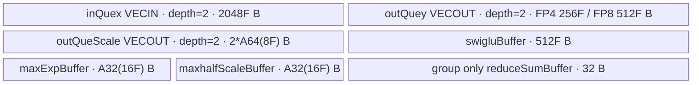

# SwigluMxQuant 950 ACLNN 算子知识

## 算子速览

| 项目 | 内容 |
|---|---|
| 实际入口 | CANN 9.1.0 两段式公开 API `aclnnSwigluMxQuantGetWorkspaceSize` → `aclnnSwigluMxQuant`；固定仓没有后缀版本，是 950 实际支持的最新公开版本。 |
| 计算语义 | 沿尾轴把 `x[...,2N]` 做传统左右半区或奇偶变体 SwiGLU，得到 `[...,N]`；每 32 个结果求一个 E8M0 scale，并量化成 FP4/FP8。 |
| 输入输出 | `x`: FP16/BF16、ND、rank 2～7；可选 `groupIndex`: INT32/INT64；`y`: E2M1/E1M2/E4M3FN/E5M2；`mxscale`: E8M0。当前只支持 `activateDim=axis=-1`。 |
| 执行类型 | 单 Kernel `AIV_VECTOR`；entry 显式 `KERNEL_TYPE_AIV_ONLY`，全部可达节点均无 Cube/AIC、MIX_CV、SIMT、NDDMA 或 AICPU。 |
| Kernel 路线 | R-001～R-006：`groupIndex` 无/INT32/INT64 × FP4/FP8 存储族；每条 Route 内保留 binary 的 FP16/BF16 与具体低精度 subtype 实例，以及运行时 SwiGLU/scale/round 分支。 |
| 核心资源 | GM、3 个 depth=2 `TQue`、3 个公共 `TBuf`，group Route 另有一个 32B reduction `TBuf`，以及 MicroAPI RegTensor；算子自有 workspace 为 0。 |
| 来源闭包 | `source_closed`：公开 ACLNN 文档 → `ACLNNTYPE aclnn` 生成 bridge/OpDef → infer/tiling/POD → key/router → 单 AIV body/helper → 950 binary/CMake 已闭合。 |
| 验证状态 | 已完成源码闭包检查；本次知识提取未执行编译、真机、数值或性能测试。 |

## 接口与语义

### 计算语义

令输入合轴为 `[M,2N]`。`swigluMode=0` 时，`activateLeft=true` 取左半为门控，否则取右半为门控：

```text
gate, linear = selected_half(x), other_half(x)
s = gate / (1 + exp(-gate)) * linear
```

`swigluMode=1` 时，按偶/奇位置反交织，并在 FP32 中计算：

```text
gate   = min(even(x), clampLimit)
linear = clamp(odd(x), -clampLimit, clampLimit)
s      = gate / (1 + exp(-gluAlpha*gate)) * (linear + gluBias)
```

随后按尾轴每 32 个 `s` 分块。`scaleAlg=0` 使用 OCP：从块内最大绝对值的指数产生 `sharedExp=maxExp-emax(dst)`，输出 `mxscale=2^sharedExp`，量化乘数为 `2^-sharedExp`。FP8 的 `scaleAlg=1` 使用 cuBLAS 规则：先以目标 FP8 最大值的倒数缩放块最大值，再按正规/非正规数及尾数向上修正指数。两者最终把 `s*reciprocalScale` cast 到目标 dtype。尾块补零参与固定 32 元素块计算，但只回写有效 `y`；scale 个数补成偶数并表示为 `[...,ceil(N/64),2]`。

### 输入、输出与属性

| 参数 | shape/layout | dtype | 约束、默认值与语义 |
|---|---|---|---|
| `x` | `[X1,...,2N]`, ND，rank 2～7 | FP16/BF16 | 非空；`activateDim` 对应维必须为偶数；OpDef `AutoContiguous()` 使非连续输入在生成 bridge 边界连续化。 |
| `groupIndexOptional` | `[groupNum]`, ND | INT64（API 文档）；OpDef/Kernel 也接线 INT32 | 可空；`1<=groupNum<=256`。Kernel 对全部元素求和作为有效行数，不按组切换量化边界。 |
| `activateDim` | 标量 | INT64 | 默认 `-1`；正尾轴会归一化为 `-1`，当前其它轴失败。 |
| `activateLeft` | 标量 | BOOL | 默认 `false`；仅 `swigluMode=0` 决定哪一半作为 gate。 |
| `swigluMode` | 标量 | INT64 | `0/1`；`1` 使用奇偶反交织、clamp、alpha、bias。 |
| `clampLimit`,`gluAlpha`,`gluBias` | 标量 | ACLNN double，OpDef/POD float | 默认 `7.0/1.702/1.0`；mode 1 要求 `clampLimit>0`。double→float 属于生成 bridge 边界。 |
| `groupMode` | 标量 | INT64 | 文档列 `0=count,1=cumsum`；proto 注释写当前仅 0，而 Device 不读取该字段，见限制。 |
| `axis` | 标量 | INT64 | 默认 `-1`；当前仅尾轴。块长固定 32。 |
| `dstType` | 标量 | INT64 | `35/36/40/41` = E5M2/E4M3FN/E2M1/E1M2，必须与 `yOut` dtype 相同。 |
| `roundModeOptional` | 字符串 | char* | 空指针/默认 `rint`；FP4 支持 `rint/round/floor`，FP8 只允许 `rint`。 |
| `scaleAlg` | 标量 | INT64 | 当前公开支持 `0/1`；FP4 只允许 0。Host 接受 2，但固定 Kernel 将非 0 FP8 都走 BLAS 分支，API 文档又写“当前仅 0,1”，故 2 不发布为有效语义。 |
| `maxDtypeValue` | 标量 | ACLNN double，POD float | API 文档称仅 `scaleAlg=2` FP4 生效，但公开当前不支持 2，且 Device 不读取；保留 ABI 字段。 |
| `yOut` | 与 `x` 同 rank、尾轴减半，ND | FP4/FP8 | FP4 以两元素/字节打包，要求输入尾轴能被 4 整除；FP8 一元素/字节。 |
| `mxscaleOut` | `[X1,...,ceil(N/64),2]`, ND | E8M0 | 每 32 个 `y` 一 scale，奇数个 scale group 补一字节 0。 |

### 入口与版本

公开文档只给出无版本后缀的两段式 API。第一段返回 `workspaceSize` 和包含算子流程的 executor，第二段在调用者给定 stream 上执行。固定仓没有手写 `op_api/*.cpp`；`op_host/CMakeLists.txt::add_modules_sources(... ACLNNTYPE aclnn ...)`、OpDef 与公开原型共同构成允许标注的 ACLNN 生成 bridge 边界，不臆造其内部代码。

README 与 API 产品表均明确 Ascend 950PR/950DT 支持、A2/A3 不支持；OpDef 只 `AddConfig("ascend950")`，Host CMake、16 项 950 binary config 和全局 kernel config 也仅接线 `ascend950`，无平台冲突。

## Host/Launcher 执行流程

### 参数校验与前处理

1. ACLNN 第一段按文档检查 `x/yOut/mxscaleOut` 非空，dtype、rank、属性枚举及输出 shape；生成 bridge 对两个输入执行 OpDef 的 `AutoContiguous`。
2. `InferShapeForSwigluMxQuant` 将正/负 `activateDim`、`axis` 归一化，拒绝 rank≤1、越界轴、激活轴奇数与非尾轴量化；`y` 在激活轴减半，`mxscale` 把尾轴设为 `ceil(N/64)` 后追加维 2。未知 rank 原样传播。
3. `Tiling4SwigluMxQuant` 固定顺序为 `GetNpuInfo → ValidateInput → ParseAttrs → ValidateOutput → PreProcess → CalculateTiling → FillTilingData → SetParams`；任一步 `GRAPH_FAILED` 都阻断 launch。
4. Tiling 再次拒绝空张量、rank<2、非法可选输入、输出 dtype/shape 不匹配、非 `activateDim=axis=-1`、FP4 输入尾轴不被 4 整除、FP8 非 rint，以及 FP4 非 OCP。

### 参数、Workspace 与生命周期

`GetNpuInfo` 从 950 平台产生 `totalCoreNum=GetCoreNumAiv()` 与 `ubSize=GetCoreMemSize(UB)`。Tiling 把 27 字段 POD 写入 executor 所管理的 tiling 区，`SetBlockDim(usedCoreNum)`，并令：

```text
operator_owned_workspace = 0
workspace[0] = GetLibApiWorkSpaceSize()
```

entry 调用 `GetUserWorkspace(workspace)` 后只把该指针传给 `Init`，body 不绑定或读写它；因此没有算子自有 workspace slice，非零 workspace 属于 AscendC 库/ACLNN executor。输入、输出、POD 和 workspace 由调用者/executor 保持到同一 stream 中 K1 完成；生成 executor 的额外 contiguous 临时区及 cleanup offset 在固定仓不可见，调用者必须使用第一段返回总量。

### 启动图与失败传播

```text
aclnnSwigluMxQuantGetWorkspaceSize
  -> generated ACLNN bridge / SwigluMxQuant OpDef
  -> InferShapeForSwigluMxQuant
  -> Tiling4SwigluMxQuant
       key=1000(no group) | 1100(INT32) | 1200(INT64)
       blockDim=usedCoreNum; POD=SwigluMxQuantTilingData
aclnnSwigluMxQuant(workspace,workspaceSize,executor,stream)
  -> [K1, AIV_VECTOR] swiglu_mx_quant(x,group_index,y,mxscale,workspace,tiling)
       -> SwigluMxQuantLastLast<T,U,T_IDX,isGroupIndex>::Init/Process
```

这是单 Kernel 图，没有跨 Kernel 边。K1 的 GM 输出直接属于调用者；Host/Tiling/launch 任一失败均无后继节点。stream 内提交顺序由 ACLNN executor 边界保证，固定仓未公开 executor 的具体异常 cleanup。

## Route 与参数设计

### 分核与资源计算

记 `F0=maxBasicNumUbDim1`、`F1=maxBasicNumUbDim2`、`F=F0*F1`。尾轴基本块固定 `basicDim1=1,basicDim2=256`。Host 从 `availableUB=ubSize-32-128` 计算每 basic block 字节：

```text
FP4: bytesPerBasic = 2*(1024 input + 128 y + 8 scale) + 16 reciprocal + 16 maxExp + 512 swiglu = 2864 B
FP8: bytesPerBasic = 2*(1024 input + 256 y + 8 scale) + 16 reciprocal + 16 maxExp + 512 swiglu = 3120 B
ubTotalBasicBlock = floor(availableUB / bytesPerBasic)
basicPerRow = ceil(N/256)
```

若 `ubTotalBasicBlock>=basicPerRow`，一次装入整行，`F1=basicPerRow`、`F0=floor(ubTotalBasicBlock/basicPerRow)`；否则 `F1=ubTotalBasicBlock,F0=1`，尾轴循环 `ceil(basicPerRow/F1)` 次。行数 `M=product(x.shape[:-1])`，`usedCoreNum=min(M,totalAiv)`；前 `M%usedCoreNum` 核多一行，并以 `F0` 行为一轮形成 former/tail core 循环。源码未显式检查 `ubTotalBasicBlock>0`，这是 950 UB 的隐含前提。

### Route 选择

| 顺序 | Route | Key/模板 | 精确选择条件与优先级 | 不适用去向 |
|---:|---|---|---|---|
| 1 | R-001 无 group FP4 | `1000; LastLast<T,fp4x2_*,int32,false>` | `groupIndex=null && y∈{E2M1,E1M2}`；binary 再选 `T=half/bfloat16_t` | dtype/属性非法则失败；FP8 到 R-002 |
| 2 | R-002 无 group FP8 | `1000; LastLast<T,fp8_*,int32,false>` | `groupIndex=null && y∈{E4M3FN,E5M2}` | dtype/属性非法则失败 |
| 3 | R-003 INT32 group FP4 | `1100; LastLast<T,fp4x2_*,int32,true>` | 可选输入存在且 OpDef dtype INT32，`y` 为 FP4 | FP8 到 R-004 |
| 4 | R-004 INT32 group FP8 | `1100; LastLast<T,fp8_*,int32,true>` | 同上且 `y` 为 FP8 | 非法失败 |
| 5 | R-005 INT64 group FP4 | `1200; LastLast<T,fp4x2_*,int64,true>` | 可选输入存在且 dtype INT64，`y` 为 FP4 | FP8 到 R-006 |
| 6 | R-006 INT64 group FP8 | `1200; LastLast<T,fp8_*,int64,true>` | 同上且 `y` 为 FP8 | 非法失败 |

```text
ValidateInput: groupIndex absent -> type=0; INT32 -> 1; INT64 -> 2
ValidateOutput/attributes
  -> key = 1000 + groupIndexType*100 + activateDimIndex*10 + axisIndex
  -> 当前 activateDimIndex=axisIndex=0，所以 key∈{1000,1100,1200}
  -> binary config 以 DTYPE_X × DTYPE_Y 选择 T/U
  -> router 以 key 选择 T_IDX/isGroupIndex
  -> body 内 swigluMode、activateLeft、scaleAlg、roundMode 再运行时分支
```

### 模板/实现执行矩阵

| Route | key/selector | dtype/shape/platform 完整命中条件 | 执行拓扑与 Kernel 节点 | 实际模板/body | 内存与同步特征 | tail/fallback |
|---|---|---|---|---|---|---|
| R-001 | 1000 + FP4 binary | 950；FP16/BF16→E2M1/E1M2；尾轴 FP4 guard；OCP | K1 AIV | `LastLast<T,fp4x2_*,int32,false>`；V1/V2→OCP→`ComputeData` | 公共 3Q+3Buf，无 reduce buf | 尾部补零，packed FP4 只写有效字节 |
| R-002 | 1000 + FP8 binary | 950；FP16/BF16→E4M3FN/E5M2；rint；alg 0/1 | K1 AIV | `LastLast<T,fp8_*,int32,false>`；OCP/BLAS→`ComputeDataF8` | FP8 outQ 容量是 FP4 的 2 倍 | 尾部补零，只写有效元素 |
| R-003 | 1100 + FP4 binary | R-001 + group INT32 | K1 AIV | `LastLast<T,fp4x2_*,int32,true>` + `ReduceAllVf<int32>` | 公共布局 + 32B reduce buf；输入 queue 暂存 group | 有效行数取 group sum；多余核 return |
| R-004 | 1100 + FP8 binary | R-002 + group INT32 | K1 AIV | `LastLast<T,fp8_*,int32,true>` | 同 R-003，FP8 outQ | 同上 |
| R-005 | 1200 + FP4 binary | R-001 + group INT64 | K1 AIV | `LastLast<T,fp4x2_*,int64,true>` + `ReduceAllVf<int64>` | 同 group 布局，INT64 每 vreg lane 数较少 | 同上 |
| R-006 | 1200 + FP8 binary | R-002 + group INT64 | K1 AIV | `LastLast<T,fp8_*,int64,true>` | 同 group 布局，FP8 outQ | 同上 |

### 隐藏性能 Guard

| Guard | Host/Tiling 条件 | Device/资源原因 | 影响 Route | 不满足时去向 | 源码符号 |
|---|---|---|---|---|---|
| 950-only | 文档支持 950；CMake/config 仅 950 | 只有 arch35 Regbase body | 全部 | A2/A3 不发布 | `README.md::产品支持情况`; `swiglu_mx_quant_def.cpp::SwigluMxQuant` |
| 当前轴域 | normalized `activateDim==-1 && axis==-1` | 唯一 body 是 `LastLast`，地址公式按尾轴 | 全部 | `GRAPH_FAILED` | `ParseAttrs`; `CalculateTilingKey` |
| UB 可容纳一块 | `floor((ub-160)/2864 or 3120)>=1`（隐含） | 否则 `F1=0` 后续除零 | 全部 | 无 fallback；资源前提 | `CalculateTiling` |
| FP4 对齐 | `inputDim2%4==0` | 输出两 FP4/byte，SwiGLU 后长度需偶数 | R-001/3/5 | `GRAPH_FAILED` | `PreProcess`; `CopyOut` |
| FP8 round | FP8 ⇒ `roundMode==1(rint)` | FP8 helper固定饱和 RINT cast traits | R-002/4/6 | `GRAPH_FAILED` | `ValidateOutput`; `ComputeDataF8` |
| 32/64 scale padding | `alignN=ceil(N/32)*32`，若 scale 数奇则再加 32 | `mxscale` 成对存为末维 2；Vector 每次处理 8 个 scale | 全部 | UB 尾部置零、GM 仅写 padded scale | `Process`; `ComputeVfSwigluV1/V2`; `CopyOut` |
| group 上限 | `1<=groupIndexNum<=256` | 每核把整表搬入已有 inQ，并在寄存器归约 | R-003～006 | `GRAPH_FAILED` | `ValidateInput`; `InitGroupIndex` |
| group queue 容量 | `groupIndexNum*sizeof(T_IDX) <= F*512*sizeof(T)` | `AllocTensor<T_IDX>` 只借用 inQ 的一个 slot；Host 未单独按 group 字节扩容 | R-003～006 | 固定源码无 fallback；950 tiling/shape 必须满足 | `Init`; `InitGroupIndex` |
| 空闲核 | `blockIdx>=realCoreNum` | group sum 可能小于 Host 按 M 选的 blockDim | R-003～006 | Device 立即 return | `InitGroupIndex`; `Process` |

### POD/ABI

`SwigluMxQuantTilingData` 是标准顺序的 23 个 `int64_t` 后接 4 个 `float`：自然对齐 8B，总大小 200B。Host 先 `memset_s` 为零再逐字段写；下表的 inactive 字段仍占 ABI 槽，不能重排。

| 结构 | 字段 | 类型/位宽 | ABI 布局 | 单位 | Host/launcher producer | Device consumer | 边界 |
|---|---|---|---|---|---|---|---|
| `SwigluMxQuantTilingData` | `usedCoreNum` | int64/64 | off 0 | AIV core | `min(M,totalCoreNum)` | `Init→realCoreNum_` | >0 |
| 同上 | `inputDim1` | int64/64 | off 8 | row | `product(x[:-1])` | `Init→dim0Size_`；无 group 分核 | >0 |
| 同上 | `inputDim2` | int64/64 | off 16 | input element/row | `x[-1]` | `dim1Size_,halfInput_` 与 GM stride | 偶数；FP4 时 4 对齐 |
| 同上 | `outputDim2` | int64/64 | off 24 | output element/row | `y[-1]` | Device 未直接读取 | 必须 `inputDim2/2` |
| 同上 | `basicDim2` | int64/64 | off 32 | output element/basic | 常量 256 | Device 未直接读取 | 固定 256 |
| 同上 | `basicDim1` | int64/64 | off 40 | row/basic | 常量 1 | Device 未直接读取 | 固定 1 |
| 同上 | `maxBasicNumUbDim2` | int64/64 | off 48 | basic/UB loop | UB 公式所得 `F1` | `factorDim1Size_`、尾轴步长 | ≥1 隐含 |
| 同上 | `maxBasicNumUbDim1` | int64/64 | off 56 | row/UB loop | UB 公式所得 `F0` | `factorDim0Size_`、queue 容量 | ≥1 |
| 同上 | `ubLoopPerRow` | int64/64 | off 64 | loop/row | `ceil(basicPerRow/F1)` | `loopTimesDim1_` | ≥1 |
| 同上 | `ubTailPerRow` | int64/64 | off 72 | valid output element | 最后一尾轴 loop 长度 | `tailDim1_`、mask/copyout | 1..F1*256 |
| 同上 | `frontCoreNum` | int64/64 | off 80 | core | `M%usedCoreNum` | no-group `tailBlock_` | group Route 会重算 |
| 同上 | `frontCoreBasicNumDim1` | int64/64 | off 88 | row/core | `floor(M/C)+1` | Device 不直接读 | front core |
| 同上 | `frontCoreLoopTimes` | int64/64 | off 96 | loop/core | `ceil(frontRows/F0)` | no-group former loop | group Route 会重算 |
| 同上 | `frontCoreLastLoopBasicNum` | int64/64 | off 104 | row | former 尾轮 | no-group `tailBDim0_` | 1..F0 |
| 同上 | `tailCoreBasicNumDim1` | int64/64 | off 112 | row/core | `floor(M/C)` | no-group `blockFactor_` | group Route 会重算 |
| 同上 | `tailCoreLoopTimes` | int64/64 | off 120 | loop/core | `ceil(tailRows/F0)` | no-group tail loop | ≥1，M>0 |
| 同上 | `tailCoreLastLoopBasicNum` | int64/64 | off 128 | row | tail 尾轮 | no-group `tailTDim0_` | 1..F0 |
| 同上 | `activateLeft` | int64/64 | off 136 | bool-as-int | attr `?1:0` | mode0 交换 gate/linear 指针 | mode1 不读取分支语义 |
| 同上 | `swigluMode` | int64/64 | off 144 | enum | attr | `CopyIn/Compute` 选择 V1/V2 | 公开 0/1 |
| 同上 | `roundMode` | int64/64 | off 152 | enum | `rint/round/floor→1/4/2` | FP4 `ComputeData` cast 选择 | FP8 只能 1 |
| 同上 | `scaleAlg` | int64/64 | off 160 | enum | attr | FP8 `ComputeF8` 0→OCP，非0→BLAS | 发布 0/1；FP4 Host 限 0 |
| 同上 | `groupMode` | int64/64 | off 168 | enum | attr | Device 未读取 | 语义冲突见限制 |
| 同上 | `groupIndexNum` | int64/64 | off 176 | element | optional shape[0] 或 0 | `InitGroupIndex` copy/reduce | group 1..256 |
| 同上 | `clampLimit` | float/32 | off 184 | scalar | attr float | V2 clamp | mode0 inactive |
| 同上 | `gluAlpha` | float/32 | off 188 | scalar | attr float | V2 sigmoid exponent | mode0 inactive |
| 同上 | `gluBias` | float/32 | off 192 | scalar | attr float | V2 linear bias | mode0 inactive |
| 同上 | `maxDtypeValue` | float/32 | off 196 | scalar | attr float | Device 未读取 | 保留字段 |

### Route 源码闭包

| Route | Key/selector | Host/Tiling producer | POD/参数 | Kernel entry/router 节点 | Kernel body/直接依赖 | 构建接线 |
|---|---|---|---|---|---|---|
| R-001/R-002 | 1000 + dtype binary | `Tiling4SwigluMxQuant/CalculateTilingKey` | `SwigluMxQuantTilingData` | `swiglu_mx_quant` no-group branch | `LastLast<...,int32,false>` 全方法 + common traits | 950 CMake + 16 binary entries + global config |
| R-003/R-004 | 1100 + dtype binary | 同上，group type=1 | 同上，`groupIndexNum` active | entry INT32 group branch | `LastLast<...,int32,true>` + `ReduceAllVf<int32>` | 同上 |
| R-005/R-006 | 1200 + dtype binary | 同上，group type=2 | 同上，`groupIndexNum` active | entry INT64 group branch | `LastLast<...,int64,true>` + `ReduceAllVf<int64>` | 同上 |

## Kernel 实现

### 公共执行流程

entry 声明 AIV-only，解析 POD，保存并清零 950 overflow-control SPR，按 key 构造 `LastLast` 实例，执行 `Init→Process`，最后恢复 SPR。`Init` 绑定 GM、分配 UB、读取 POD 并确定每核行区间。`Process` 对行 chunk、尾轴 chunk 嵌套执行 `CopyIn→Compute→CopyOut`。

`CopyIn` 在 mode0 分别搬 gate/linear 两个连续半区；mode1 一次搬 `2*validN` 并在 Vector 中 DeInterleave。`ComputeVfSwigluV1/V2` 都升 FP32 做 sigmoid/mul，再按 RINT 降回 FP16/BF16 到 `swigluBuffer_`；OCP 或 BLAS helper 每 32 元素求 scale/reciprocal，FP4/FP8 helper量化到 outQ。`CopyOut` 只回写有效 `y`，同时按每行偶数个 scale 回写 `mxscale`。

公共 AIV 资源账（`A32(z)=ceil(z/32)*32`、`A64(z)=ceil(z/64)*64`）：

```text
inQuex      = 2 * F*512*sizeof(T) = 2048F B
outQuey     = FP4: 2*F*128 = 256F B; FP8: 2*F*256 = 512F B
outQueScale = 2 * A64(8F) B
swigluBuf   = F*256*sizeof(T) = 512F B
maxExpBuf   = A32(16F) B
halfScaleBuf= A32(16F) B
reduceBuf   = group Route: GetUbBlockSize()=32 B; no-group: 0
UB_total    = 上述各项求和
Host guard  = FP4 2864F / FP8 3120F，另从 ubSize 预留 32B group 与 128B alignment
dynamic_ub  = N/A；AIV TPipe 静态 UB
workspace_total(operator-owned) = 0；library workspace = GetLibApiWorkSpaceSize()
```



公共复用协议：`inQuex` 以 `Alloc→EnQue→DeQue→Free` 交接 MTE2/Vector，`outQuey/outQueScale` 以 `Alloc→EnQue→DeQue→Free` 交接 Vector/MTE3；`swigluBuffer_` 每个 tile 先被 V1/V2 写、随后被 max/quant helper 读，下个 tile 才覆盖；`maxExpBuffer_` 与 `maxhalfScaleBuffer_` 分别在求最大值/scale 后由紧邻的 scale/quant 阶段消费。group 初始化借用一个 `inQuex` slot，释放后才进入主循环。

### Route R-001：无 group FP4

#### 适用条件

##### 选择证据

| 层级 | 文件 | 符号 | 源码谓词/参数 | 结果/下一跳 |
|---|---|---|---|---|
| Host/Tiling | `op_host/arch35/swiglu_mx_quant_tiling_arch35.cpp` | `ValidateInput/CalculateTilingKey` | optional desc为空，`groupIndexType=0`；当前轴 index 均 0 | key 1000 |
| Binary | `op_host/config/ascend950/swiglu_mx_quant_binary.json` | 8 个 FP4 项中的无/可选 dtype specialization | `x=FP16/BF16,y=E2M1/E1M2` | `DTYPE_X/DTYPE_Y` |
| Router | `op_kernel/swiglu_mx_quant_apt.cpp` | key 1000 branch | `TILING_KEY_VAR==1000` | `LastLast<DTYPE_X,DTYPE_Y,int32,false>` |

#### Device 数据流

##### 函数级调用链

```text
swiglu_mx_quant<1000> -> LastLast<T,fp4x2_*,int32,false>::Init -> Process
  -> CopyIn -> ComputeVfSwigluV1 | ComputeVfSwigluV2
  -> ComputeVfMaxExpVf -> ComputeScale
  -> ComputeData<round trait> -> CopyOut
```

##### 源码等价伪码

```text
for rowChunk assigned to core:
  for nChunk:
    DMA mode0 two half-ranges or mode1 interleaved 2N range
    FP32 SwiGLU -> cast T, zero padded tail to multiple of 64 scales
    every 32: reduce exponent -> E8M0 scale + reciprocal
    multiply reciprocal; E2M1/E1M2 round; pack 2 FP4/byte
    DMA valid packed y and padded scale pairs to GM
```

#### 内存与数据搬运

##### 资源与搬运表

| 层级/缓冲区 | offset/地址公式 | extent/容量公式 | dtype/layout | producer | consumer | owner/lifetime | 对齐/复用 |
|---|---|---|---|---|---|---|---|
| x GM→inQ | `(blockOffset+rowLoop*F0)*2N+nLoop*F1*256`；第二半 `+N` | mode0 `rows×validN` 两路；mode1 `rows×2validN` | T/ND | `CopyIn` MTE2 | SwiGLU helper | queue slot | GM row stride `(2N-valid*)*2B` |
| swigluBuf | row offset `row*alignedN` | `F*256` T | T, padded rows | V1/V2 | max/quant | TBuf/tile | tail zero |
| outQ→y GM | row base `(globalRow*2N/4)+nLoop*F1*128` | `rows×validN/2` byte | packed FP4 | `ComputeData` | `CopyOut` | queue slot | UB stride skips aligned tail |
| scaleQ→GM | `globalRow*evenScaleCount+nLoop*F1*8` | `rows×alignedN/32` byte | E8M0 pair layout | `ComputeScale` | `CopyOut` | queue slot | compact copy |

##### 分层内存布局

使用公共图的 FP4 容量；无 `reduceSumBuffer_`。

##### 字节账与复用顺序

```text
UB_total = 2048F + 256F + 2*A64(8F) + 512F + 2*A32(16F)
UB_total <= ubSize（Host 以 2864F 并预留 128B 对齐验证）
dynamic_ub=N/A; workspace_total(operator-owned)=0
```

| 复用子区 | 写入者 | 读取者/消费点 | 下一次覆盖 | 同步或释放依据 | 安全条件 |
|---|---|---|---|---|---|
| inQ slot | `CopyIn` | V1/V2 | `FreeTensor` 后 | queue 协议 | depth=2 已计入 |
| max/reciprocal TBuf | max/scale helper | scale/FP4 quant | 下一 tile | 同一 Vector 程序顺序 | quant 完成前不覆盖 |
| outQ/scaleQ slot | quant/scale | `CopyOut` | `FreeTensor` 后 | queue 协议 | 仅写有效区 |

#### 同步、精度与尾块

##### 同步与数值边界表

| 阶段 | primitive/机制 | producer | consumer/等待点 | 保护对象 | 精度/尾块 |
|---|---|---|---|---|---|
| MTE2→V | TQue | `CopyIn` | `DeQue` | x tile | DataCopyPad |
| SwiGLU | MicroAPI mask | FP32计算 | TBuf store | swiglu tile | RINT 降回 T；tail补0 |
| quant | Vector 顺序 | max→scale | `ComputeData` | scale/reciprocal | FP4按 runtime round；负零专项处理 |
| V→MTE3 | TQue | quant/scale | `CopyOut` DeQue | y/scale | FP4仅有效字节 |

#### 关键实现

##### 符号证据表

| 阶段 | 文件 | 符号/模板实例 | 实现事实 |
|---|---|---|---|
| Host/Tiling producer | `op_host/arch35/swiglu_mx_quant_tiling_arch35.cpp` | `CalculateTiling/FillTilingData/SetParams` | FP4 UB、core、POD、key 1000 |
| Kernel entry/router | `op_kernel/swiglu_mx_quant_apt.cpp` | key 1000 | no-group template |
| Device body/helper | `op_kernel/arch35/swiglu_mx_quant_last_last.h` | `CopyIn/Compute/ComputeData/CopyOut` | FP4 packed全链路 |

### Route R-002：无 group FP8

#### 适用条件

##### 选择证据

| 层级 | 文件 | 符号 | 源码谓词/参数 | 结果/下一跳 |
|---|---|---|---|---|
| Host/Tiling | `op_host/arch35/swiglu_mx_quant_tiling_arch35.cpp` | `ValidateOutput/CalculateTilingKey` | no group；FP8 且 rint；scaleAlg 0/1 | key 1000 |
| Binary | `op_host/config/ascend950/swiglu_mx_quant_binary.json` | FP8 entries | FP16/BF16×E4M3FN/E5M2 | `DTYPE_X/DTYPE_Y` |
| Router | `op_kernel/swiglu_mx_quant_apt.cpp` | key 1000 | 同 R-001 key | `LastLast<T,fp8_*,int32,false>` |

#### Device 数据流

##### 函数级调用链

```text
swiglu_mx_quant<1000> -> Init -> Process -> CopyIn -> V1|V2
  -> ComputeF8: [alg0 MaxExp+ComputeScale | alg1 AbsMax+ComputeScaleBLAS]
  -> ComputeDataF8 -> CopyOut
```

##### 源码等价伪码

```text
s = FP32 SwiGLU then cast T
if scaleAlg==0: exponent reduce -> OCP E8M0/reciprocal
else: abs-max -> multiply 1/max(dst) -> ceil exponent -> E8M0/reciprocal
FP16 input path casts s and reciprocal to FP32 before multiply;
BF16 path multiplies in T then splits to FP32; saturating RINT cast to FP8; write valid bytes
```

#### 内存与数据搬运

##### 资源与搬运表

| 层级/缓冲区 | offset/地址公式 | extent/容量公式 | dtype/layout | producer | consumer | owner/lifetime | 对齐/复用 |
|---|---|---|---|---|---|---|---|
| GM/inQ/swiglu | 同 R-001 | input `2N`, result `N` | FP16/BF16 | MTE2/V1/V2 | F8 scale/quant | tile | tail zero |
| outQ→y | `globalRow*N+nLoop*F1*256` | `rows×validN` byte | FP8 | `ComputeDataF8` | MTE3 | queue slot | aligned UB, compact GM |
| scale | 同 R-001 | `rows×alignedN/32` | E8M0 | OCP/BLAS scale | MTE3 | queue slot | even scale count |

##### 分层内存布局

使用公共图的 FP8 容量；无 reduction 区。

##### 字节账与复用顺序

```text
UB_total = 2048F + 512F + 2*A64(8F) + 512F + 2*A32(16F)
UB_total <= ubSize（Host 以 3120F 并预留 128B 对齐验证）
dynamic_ub=N/A; workspace_total(operator-owned)=0
```

| 复用子区 | 写入者 | 读取者/消费点 | 下一次覆盖 | 同步或释放依据 | 安全条件 |
|---|---|---|---|---|---|
| swiglu/max/reciprocal | V1/V2→max→scale | `ComputeDataF8` | 下一 tile | 同一 Vector 顺序 | alg 分支完成再量化 |
| outQ/scaleQ | quant/scale | CopyOut | FreeTensor 后 | TQue | valid tail |

#### 同步、精度与尾块

##### 同步与数值边界表

| 阶段 | primitive/机制 | producer | consumer/等待点 | 保护对象 | 精度/尾块 |
|---|---|---|---|---|---|
| GM↔UB | TQue | MTE2/Vector | DeQue/Free | tile | tail pad0 |
| OCP/BLAS | runtime branch | max helper | scale helper | max/scale TBuf | NaN/Inf/zero有 Select 分支 |
| FP8 cast | RegTensor SAT+RINT | reciprocal multiply | outQ | FP8 lanes | padded lane不回写 y |

#### 关键实现

##### 符号证据表

| 阶段 | 文件 | 符号/模板实例 | 实现事实 |
|---|---|---|---|
| Host/Tiling producer | `op_host/arch35/swiglu_mx_quant_tiling_arch35.cpp` | `ValidateOutput/CalculateTiling` | FP8 guard/3120B basic |
| Kernel entry/router | `op_kernel/swiglu_mx_quant_apt.cpp` | key 1000 | dtype binary+no-group |
| Device body/helper | `op_kernel/arch35/swiglu_mx_quant_last_last.h` | `ComputeF8/ComputeScaleBLAS/ComputeDataF8` | OCP/BLAS/FP8完整路径 |

### Route R-003：INT32 group FP4

#### 适用条件

##### 选择证据

| 层级 | 文件 | 符号 | 源码谓词/参数 | 结果/下一跳 |
|---|---|---|---|---|
| Host/Tiling | `op_host/arch35/swiglu_mx_quant_tiling_arch35.cpp` | `ValidateInput` | optional desc存在且 dtype INT32 | type=1,key1100 |
| Router | `op_kernel/swiglu_mx_quant_apt.cpp` | key1100 | `TILING_KEY_VAR==1100` | `LastLast<T,fp4x2_*,int32,true>` |

#### Device 数据流

##### 函数级调用链

```text
Init -> InitGroupIndex -> DataCopyPad<int32> -> ReduceAllVf<int32> -> V_S event -> scalar sum/retiling
  -> Process -> R-001 FP4 pipeline
```

##### 源码等价伪码

```text
each launched core copies groupIndex[0:groupNum], vector-reduces sum, waits V_S, reads scalar allNum
realCore=min(hostCore,allNum); redistribute allNum rows; idle cores return
then execute the no-group FP4 tile pipeline on [0,allNum)
```

#### 内存与数据搬运

##### 资源与搬运表

| 层级/缓冲区 | offset/地址公式 | extent/容量公式 | dtype/layout | producer | consumer | owner/lifetime | 对齐/复用 |
|---|---|---|---|---|---|---|---|
| group GM→inQ | offset 0 | `groupNum*4B` | INT32 vector | MTE2 | `ReduceAllVf` | temporary queue slot | 主循环前释放 |
| reduceBuf | offset 0 | 32B | INT32 scalar at lane0 | Vector | scalar `GetValue(0)` | TBuf/kernel | V_S event |
| main tile | 同 R-001 | 同 R-001 + 32B | FP4 | 同 R-001 | 同 R-001 | kernel | group init后复用 inQ |

##### 分层内存布局

公共 FP4 图加 32B `reduceSumBuffer_`。

##### 字节账与复用顺序

```text
UB_total = R-001 UB_total + 32B
UB_total <= ubSize（Host 的 RESERVED_UB_SIZE=32 覆盖 reduction）
```

| 复用子区 | 写入者 | 读取者/消费点 | 下一次覆盖 | 同步或释放依据 | 安全条件 |
|---|---|---|---|---|---|
| inQ slot | group DataCopy | ReduceAllVf | Free后主 CopyIn | queue协议 + V_S | group表先消费完 |
| reduceBuf lane0 | ReduceAllVf | scalar read | 不再使用 | SetFlag/WaitFlag V_S | groupNum≤256 |

#### 同步、精度与尾块

##### 同步与数值边界表

| 阶段 | primitive/机制 | producer | consumer/等待点 | 保护对象 | 精度/尾块 |
|---|---|---|---|---|---|
| group reduce | `SetFlag/WaitFlag<V_S>` | Vector ReduceSum | scalar GetValue | reduce lane0 | INT32求和转 int64 |
| main | 同 R-001 | 同 R-001 | 同 R-001 | tiles | FP4 tail |

#### 关键实现

##### 符号证据表

| 阶段 | 文件 | 符号/模板实例 | 实现事实 |
|---|---|---|---|
| Host/Tiling producer | `op_host/arch35/swiglu_mx_quant_tiling_arch35.cpp` | `ValidateInput/CalculateTilingKey` | INT32→1100 |
| Kernel entry/router | `op_kernel/swiglu_mx_quant_apt.cpp` | key1100 | int32,true |
| Device body/helper | `op_kernel/arch35/swiglu_mx_quant_last_last.h` | `InitGroupIndex/ReduceAllVf<int32>` | 全表求和和核内重分配 |

### Route R-004：INT32 group FP8

#### 适用条件

##### 选择证据

| 层级 | 文件 | 符号 | 源码谓词/参数 | 结果/下一跳 |
|---|---|---|---|---|
| Host/Tiling | `op_host/arch35/swiglu_mx_quant_tiling_arch35.cpp` | `ValidateInput/ValidateOutput` | group INT32 + FP8/rint/alg0或1 | key1100 |
| Router | `op_kernel/swiglu_mx_quant_apt.cpp` | key1100 | binary FP8 specialization | `LastLast<T,fp8_*,int32,true>` |

#### Device 数据流

##### 函数级调用链

```text
InitGroupIndex/ReduceAllVf<int32> -> Process -> R-002 OCP|BLAS FP8 pipeline
```

##### 源码等价伪码

```text
reduce INT32 group counts and redivide valid rows exactly as R-003;
for each resulting row tile execute R-002 scaleAlg0/1 FP8 quantization
```

#### 内存与数据搬运

##### 资源与搬运表

| 层级/缓冲区 | offset/地址公式 | extent/容量公式 | dtype/layout | producer | consumer | owner/lifetime | 对齐/复用 |
|---|---|---|---|---|---|---|---|
| group/reduce | 同 R-003 | groupNum*4B + 32B | INT32 | MTE2/Vector | scalar | init phase | V_S |
| main FP8 | 同 R-002 | R-002 UB +32B | FP8 | OCP/BLAS | CopyOut | tile | queue |

##### 分层内存布局

公共 FP8 图加 32B reduction 区。

##### 字节账与复用顺序

```text
UB_total = R-002 UB_total + 32B <= ubSize
dynamic_ub=N/A; operator workspace=0
```

| 复用子区 | 写入者 | 读取者/消费点 | 下一次覆盖 | 同步或释放依据 | 安全条件 |
|---|---|---|---|---|---|
| inQ/reduce | 同 R-003 | 同 R-003 | group完成后主tile | queue+V_S | sum合法 |
| FP8 buffers | 同 R-002 | 同 R-002 | 下一tile | queue/程序顺序 | alg branch闭合 |

#### 同步、精度与尾块

##### 同步与数值边界表

| 阶段 | primitive/机制 | producer | consumer/等待点 | 保护对象 | 精度/尾块 |
|---|---|---|---|---|---|
| group | V_S | ReduceAllVf | scalar | row count | INT32→int64 |
| main | queue+RegTensor | OCP/BLAS | CopyOut | FP8 data | 同 R-002 |

#### 关键实现

##### 符号证据表

| 阶段 | 文件 | 符号/模板实例 | 实现事实 |
|---|---|---|---|
| Host/Tiling producer | `op_host/arch35/swiglu_mx_quant_tiling_arch35.cpp` | `ValidateInput/Output` | group+FP8 guard |
| Kernel entry/router | `op_kernel/swiglu_mx_quant_apt.cpp` | key1100 | INT32 group FP8 |
| Device body/helper | `op_kernel/arch35/swiglu_mx_quant_last_last.h` | `InitGroupIndex/ComputeF8` | group前缀+FP8 body |

### Route R-005：INT64 group FP4

#### 适用条件

##### 选择证据

| 层级 | 文件 | 符号 | 源码谓词/参数 | 结果/下一跳 |
|---|---|---|---|---|
| Host/Tiling | `op_host/arch35/swiglu_mx_quant_tiling_arch35.cpp` | `ValidateInput` | group dtype INT64 | type=2,key1200 |
| Router | `op_kernel/swiglu_mx_quant_apt.cpp` | key1200 | FP4 binary | `LastLast<T,fp4x2_*,int64,true>` |

#### Device 数据流

##### 函数级调用链

```text
InitGroupIndex -> DataCopyPad<int64> -> ReduceAllVf<int64> -> V_S -> row retiling
  -> R-001 FP4 pipeline
```

##### 源码等价伪码

```text
same as R-003, but vfTidx=VRegBytes/8 and allNum is reduced in INT64;
then packed FP4 pipeline
```

#### 内存与数据搬运

##### 资源与搬运表

| 层级/缓冲区 | offset/地址公式 | extent/容量公式 | dtype/layout | producer | consumer | owner/lifetime | 对齐/复用 |
|---|---|---|---|---|---|---|---|
| group GM→inQ | 0 | `groupNum*8B` | INT64 | MTE2 | ReduceAllVf | init slot | groupNum≤256 |
| reduce/main | 同 R-003/R-001 | 32B + FP4 common | INT64 scalar/FP4 | Vector | scalar/main | kernel | V_S+queues |

##### 分层内存布局

公共 FP4 图加 32B reduction 区；INT64 group 表最大 2048B，仍必须满足单个 inQ slot 的容量 guard `2048<=F*512*sizeof(T)`，源码没有独立 group buffer fallback。

##### 字节账与复用顺序

```text
UB_total = R-001 UB_total + 32B <= ubSize
```

| 复用子区 | 写入者 | 读取者/消费点 | 下一次覆盖 | 同步或释放依据 | 安全条件 |
|---|---|---|---|---|---|
| group inQ/reduce | MTE2/Vector | scalar | main loop | queue+V_S | INT64无窄化到归约结果 |
| main | 同 R-001 | 同 R-001 | 下一tile | queue | valid rows |

#### 同步、精度与尾块

##### 同步与数值边界表

| 阶段 | primitive/机制 | producer | consumer/等待点 | 保护对象 | 精度/尾块 |
|---|---|---|---|---|---|
| group | V_S | INT64 ReduceSum | GetValue | allNum | INT64保持 |
| FP4 | 同 R-001 | 同 R-001 | CopyOut | packed output | 同 R-001 |

#### 关键实现

##### 符号证据表

| 阶段 | 文件 | 符号/模板实例 | 实现事实 |
|---|---|---|---|
| Host/Tiling producer | `op_host/arch35/swiglu_mx_quant_tiling_arch35.cpp` | `ValidateInput/CalculateTilingKey` | INT64→1200 |
| Kernel entry/router | `op_kernel/swiglu_mx_quant_apt.cpp` | key1200 | int64,true |
| Device body/helper | `op_kernel/arch35/swiglu_mx_quant_last_last.h` | `ReduceAllVf<int64>` + FP4 helpers | INT64归约/FP4 |

### Route R-006：INT64 group FP8

#### 适用条件

##### 选择证据

| 层级 | 文件 | 符号 | 源码谓词/参数 | 结果/下一跳 |
|---|---|---|---|---|
| Host/Tiling | `op_host/arch35/swiglu_mx_quant_tiling_arch35.cpp` | `ValidateInput/Output` | INT64 group + FP8/rint/alg0或1 | key1200 |
| Router | `op_kernel/swiglu_mx_quant_apt.cpp` | key1200 | FP8 binary | `LastLast<T,fp8_*,int64,true>` |

#### Device 数据流

##### 函数级调用链

```text
InitGroupIndex/ReduceAllVf<int64> -> Process -> R-002 OCP|BLAS FP8 pipeline
```

##### 源码等价伪码

```text
INT64 group sum -> valid-row distribution -> FP32 SwiGLU -> OCP/BLAS scale -> FP8 SAT RINT -> GM
```

#### 内存与数据搬运

##### 资源与搬运表

| 层级/缓冲区 | offset/地址公式 | extent/容量公式 | dtype/layout | producer | consumer | owner/lifetime | 对齐/复用 |
|---|---|---|---|---|---|---|---|
| group/reduce | 同 R-005 | groupNum*8B +32B | INT64 | MTE2/Vector | scalar | init | V_S |
| main FP8 | 同 R-002 | R-002 UB | FP8 | Vector | MTE3 | tile | queues |

##### 分层内存布局

公共 FP8 图加 32B reduction 区。

##### 字节账与复用顺序

```text
UB_total = R-002 UB_total + 32B <= ubSize
```

| 复用子区 | 写入者 | 读取者/消费点 | 下一次覆盖 | 同步或释放依据 | 安全条件 |
|---|---|---|---|---|---|
| group inQ/reduce | 同 R-005 | scalar | main | queue+V_S | group合法 |
| FP8 common | 同 R-002 | CopyOut | 下一tile | queues | alg0/1 |

#### 同步、精度与尾块

##### 同步与数值边界表

| 阶段 | primitive/机制 | producer | consumer/等待点 | 保护对象 | 精度/尾块 |
|---|---|---|---|---|---|
| group | V_S | INT64 reduce | scalar | row count | 无INT32窄化 |
| FP8 | RegTensor+TQue | scale/quant | MTE3 | y/scale | rint、tail同R-002 |

#### 关键实现

##### 符号证据表

| 阶段 | 文件 | 符号/模板实例 | 实现事实 |
|---|---|---|---|
| Host/Tiling producer | `op_host/arch35/swiglu_mx_quant_tiling_arch35.cpp` | `ValidateInput/Output` | INT64 group/FP8 |
| Kernel entry/router | `op_kernel/swiglu_mx_quant_apt.cpp` | key1200 | INT64,true FP8 |
| Device body/helper | `op_kernel/arch35/swiglu_mx_quant_last_last.h` | `InitGroupIndex/ComputeF8/ComputeDataF8` | 完整组合 |

## 算子特定优化

### Trick T-001：SwiGLU 与块量化共用单次 tile，不物化 GM 中间结果

#### 触发与源码依据

- 适用 Route：R-001～R-006。
- 触发条件：所有公开支持输入；每个 `(rowChunk,nChunk)` 都按固定 `CopyIn→Compute→CopyOut`。
- Golden 来源：[`op_kernel/arch35/swiglu_mx_quant_last_last.h:356-365`](../../../../../../../cann-ops-raw/ascendc/ops-nn/955f8b33985b6d72989ebff341bb9c2c564a51bc/quant/swiglu_mx_quant/op_kernel/arch35/swiglu_mx_quant_last_last.h#L356-L365)

**官方源码（固定 Commit 连续逐字摘录）**：

```cpp
CopyIn(dim0LoopIdx, dim1LoopIdx, dim0Size, dim1SizeNow);
Compute(dim0Size, dim1SizeNow, dim1AlignSizeNow, isTailDim1);
CopyOut(dim0LoopIdx, dim1LoopIdx, dim0Size, dim1SizeNow, dim1AlignSizeNow);
```

#### 机制与设计原因

SwiGLU 结果写入 `swigluBuffer_` 后立即被同一 Kernel 的 max/scale/quant helper 消费，GM 只承载原输入和最终 `y/mxscale`。因此源码可证明省掉独立 SwiGLU 输出的 GM 写回、第二 Kernel 的 GM 读入和跨 Kernel workspace；`F0*F1` 由 Host 的 UB 账控制，融合不越过单 tile 生命周期。

#### 迁移边界

- 适用：激活后立刻做独立 32 元素块量化、可在一个 AIV tile 内闭合的融合算子。
- 前提：950、尾轴激活与量化、相同输出布局、UB 足以容纳三队列和临时区。
- 失效：若需要跨 tile/group 的统计量或非尾轴 layout transform，必须重新设计 route/launch graph，不能照搬本 body。
- 未验证：本次知识提取未执行编译、真机、数值或性能测试。

#### 错误做法

固定仓未提供可验证反例；从生命周期可证不能在量化完成前覆盖 `swigluBuffer_`。

### Trick T-002：mode0 双半区 DMA 与 mode1 单次交织 DMA 分流

#### 触发与源码依据

- 适用 Route：R-001～R-006。
- 触发条件：`swigluMode=0` 走两个连续半区；`swigluMode=1` 走一段 `2*validN` 后寄存器 `DeInterleave`。
- Golden 来源：[`op_kernel/arch35/swiglu_mx_quant_last_last.h:1171-1185`](../../../../../../../cann-ops-raw/ascendc/ops-nn/955f8b33985b6d72989ebff341bb9c2c564a51bc/quant/swiglu_mx_quant/op_kernel/arch35/swiglu_mx_quant_last_last.h#L1171-L1185)

**官方源码（固定 Commit 连续逐字摘录）**：

```cpp
if (swigluMode_ == 0) {
    DataCopyPad(xlocal, xGm_[offset], copyInParam, copyPadParams);
    DataCopyPad(xlocal[factorDim0Size_ * factorDim1Size_ * QUANT_ONCE_NUM], xGm_[offset + halfInput_], copyInParam,
        copyPadParams);
} else {
    copyInParam.blockLen = dim1OnceSize * CONST_2 * sizeof(T);
    DataCopyPad(xlocal, xGm_[offset], copyInParam, copyPadParams);
}
```

#### 机制与设计原因

传统布局需要两个相距 `N` 的连续区，分别 DMA 可让后续 V1 直接使用两个 UB 半区；变体布局的偶/奇元素本来交织，合并为一段 DMA 后用寄存器 `DeInterleave`，避免逐元素 GM gather。两支都填入同一 inQ 容量，后续量化不变。

#### 迁移边界

- 适用：同一语义有 split-half 与 even/odd 两种物理布局。
- 前提：mode1 的 2N 连续范围和寄存器反交织 stride 与源码一致。
- 失效：非连续尾轴、非单位元素 stride 或 axis≠-1 不能复用这些 offset。
- 未验证：本次知识提取未执行编译、真机、数值或性能测试。

#### 错误做法

固定仓未提供可验证反例；把 mode1 误用 mode0 的 `+halfInput_` 两段 DMA 会改变偶/奇配对语义。

### Trick T-003：group 表借用 input queue，并在每核本地重算有效行分配

#### 触发与源码依据

- 适用 Route：R-003～R-006。
- 触发条件：`isGroupIndex=true` 且 `1<=groupIndexNum<=256`。
- Golden 来源：[`op_kernel/arch35/swiglu_mx_quant_last_last.h:201-219`](../../../../../../../cann-ops-raw/ascendc/ops-nn/955f8b33985b6d72989ebff341bb9c2c564a51bc/quant/swiglu_mx_quant/op_kernel/arch35/swiglu_mx_quant_last_last.h#L201-L219)

**官方源码（固定 Commit 连续逐字摘录）**：

```cpp
LocalTensor<T_IDX> groupIndexUb = inQuex_.AllocTensor<T_IDX>();
DataCopyPad(groupIndexUb, groupIndexGm_[0], copyInParam, copyPadParams);
inQuex_.EnQue(groupIndexUb);
groupIndexUb = inQuex_.DeQue<T_IDX>();
ReduceAllVf<T_IDX>(reduceSumUb, groupIndexUb, groupIndexNum_);
inQuex_.FreeTensor(groupIndexUb);
```

#### 机制与设计原因

初始化阶段暂借主输入 queue 的一个 slot 存 group 表，仅额外分配一个 UB block 的 scalar reduction 区；释放 slot 并完成 V_S 同步后才进入主 tile pipeline。这样 group Route 额外常驻 UB 只有 32B。每核独立求相同总行数，再把有效行均分并让多余核早退，不需要跨核 atomic/workspace。

#### 迁移边界

- 适用：小型只读控制向量，其归约结果在每核相同，且主 queue 初始化阶段空闲。
- 前提：group 表最大字节数不超过 inQ 单 slot，归约在主队列复用前完成。
- 失效：需要跨核共享可变状态、分组边界本身影响计算，或 group 表大于 queue slot 时必须另设通信/存储方案。
- 未验证：本次知识提取未执行编译、真机、数值或性能测试。

#### 错误做法

若在 `FreeTensor(groupIndexUb)` 前启动主 `CopyIn`，会破坏同一 queue slot 的 owner/lifetime；源码以严格初始化顺序避免该覆盖。

## 模板与实现对比

| 对比维度 | R-001 无group FP4 | R-002 无group FP8 | R-003/5 group FP4 | R-004/6 group FP8 | 设计选择依据 |
|---|---|---|---|---|---|
| 命中条件/优先级 | key1000+FP4 binary | key1000+FP8 binary | key1100/1200+FP4 | key1100/1200+FP8 | group dtype决定 key；输出 dtype决定 binary/body编译分支 |
| 模板与 dtype | `T,fp4x2_*` | `T,fp8_*` | 加 `int32/64,true` | 同左+FP8 | 16 binary 覆盖 T/U，key覆盖 group模板 |
| 循环与分核 | Host 按 M | 同左 | Device 按 group sum 重算 | 同左 | group有效行可小于 M |
| Queue/TBuf/寄存器/dynamic UB/通信 window | FP4 outQ 256F | FP8 outQ 512F | +32B reduce | +32B reduce | 无 dynamic UB/通信 |
| 内存总占用与复用 | 约 2864F+align | 3120F+align | 前者+32B | 前者+32B | Host按输出字节数区分 |
| 搬运/Vector/SIMT/NDDMA/通信 API | packed FP4 | normal B8 FP8 | 加 group DataCopy+ReduceSum | 同左 | 全部 AIV，无其它节点 |
| 同步、精度与 tail | queue；FP4三round | queue；FP8 RINT，OCP/BLAS | 加 V_S | 加 V_S | scale尾部偶数padding |
| fallback/失败边界 | shape/attr失败 | shape/attr失败 | group非法失败/闲核return | 同左 | 无第二 Kernel fallback |

## 平台差异

| 项目 | A2 | A3 | 950 |
|---|---|---|---|
| 支持状态 | 公开 README/API 明确不支持 | 公开 README/API 明确不支持 | Ascend 950PR/950DT 支持 |
| Host/Launcher | 无公开支持链路 | 无公开支持链路 | arch35 tiling，3 keys，单 AIV launch |
| Kernel/资源 | N/A | N/A | Regbase/MicroAPI；AIV-only；16 dtype binaries |

## 限制与失败边界

- 仅 950、`activateDim=axis=-1`、非空 rank 2～7；A2/A3 卡不生成。FP4 要求输入尾轴被 4 整除，FP8 只允许 rint，FP4 只允许 `scaleAlg=0`。
- 公开文档称 `groupIndexOptional` 为 INT64，OpDef/binary/router 同时支持 INT32；卡保留源码可达 INT32 Route，但调用者能否从当前 ACLNN header 传 INT32 受生成 bridge 签名约束，固定仓没有该 header 实体。
- `groupMode` 存在公开性冲突：ACLNN 文档列 0/1，proto 注释写“当前仅 0”，Host 不校验 0/1，Device 完全不读而总是对 group 表求和。不得据此宣称 cumsum 模式有正确 Device 语义；复用时应限制为 count 模式。
- API 文档写 `scaleAlg` 范围 0/1/2 但又明确“当前仅 0,1”；Host 接受 2，FP4 随后拒绝，FP8 Device 把所有非 0 当 BLAS。正式语义只覆盖 0/1，不把 2 推测为独立算法。
- Host 的 UB 公式按每 basic block 线性估计，并额外预留 128B 对齐；Device 对 scale/max buffers 分别 A64/A32。`ubTotalBasicBlock` 缺少显式 0 guard，要求 950 UB 至少容纳一个 2864B/3120B basic block及预留区。
- group 值内容只在 Device 读取，固定 Host 不校验每项>0或和≤M；公开 API 约束要求两者成立。和为0时所有已启动核都会在 `Process` 早退，输出不被写；和<M 时未覆盖输出按文档为垃圾数据。
- entry 收到 user workspace 但 body 不使用；生成 ACLNN executor、AutoContiguous 临时区及系统 library workspace 的精确 offset/cleanup 在固定仓不可见。
- 本次知识提取未执行编译、真机、数值或性能测试。

## 源码索引

### 链路索引

| 链路阶段 | 文件 | 关键符号 | 支撑内容 |
|---|---|---|---|
| 入口声明/约束 | `quant/swiglu_mx_quant/docs/aclnnSwigluMxQuant.md` | `aclnnSwigluMxQuant*` | 原型、语义、约束、950支持表 |
| 入口声明/约束 | `quant/swiglu_mx_quant/README.md` | 产品支持/计算公式 | 950-only 与算子语义 |
| 入口实现 | `quant/swiglu_mx_quant/op_host/swiglu_mx_quant_def.cpp` | `SwigluMxQuant::SwigluMxQuant` | dtype组合、AutoContiguous、ascend950接线 |
| InferShape | `quant/swiglu_mx_quant/op_host/swiglu_mx_quant_infershape.cpp` | `ComputeInferShape/InferDataTypeForSwigluMxQuant` | y/mxscale shape 与 dtype |
| Host/Tiling | `quant/swiglu_mx_quant/op_host/arch35/swiglu_mx_quant_tiling_arch35.cpp` | `Tiling4SwigluMxQuant` 及类方法 | 校验、UB/core、key、POD、workspace |
| POD | `quant/swiglu_mx_quant/op_kernel/arch35/swiglu_mx_quant_tiling_data.h` | `SwigluMxQuantTilingData` | 200B ABI |
| Kernel entry | `quant/swiglu_mx_quant/op_kernel/swiglu_mx_quant_apt.cpp` | `swiglu_mx_quant` | AIV-only、3 key router、SPR |
| Kernel helper | `quant/swiglu_mx_quant/op_kernel/arch35/swiglu_mx_quant_common.h` | constants/cast traits | dtype常量与精度策略 |
| Kernel body | `quant/swiglu_mx_quant/op_kernel/arch35/swiglu_mx_quant_last_last.h` | `SwigluMxQuantLastLast` 全方法 | UB、循环、SwiGLU、scale、quant、copy |
| Binary config | `quant/swiglu_mx_quant/op_host/config/ascend950/swiglu_mx_quant_binary.json` | `op_list` 16项 | 950 dtype组合 |
| 构建接线 | `quant/swiglu_mx_quant/op_host/CMakeLists.txt` | `SUPPORT_COMPUTE_UNIT/add_modules_sources` | ascend950、arch35、ACLNN bridge |
| 构建接线 | `scripts/kernel/binary_config/ascendc_config.json` | `SwigluMxQuant` | 950 kernel编译与 no-dcache-flush |

### 实现复用检查

| 检查项 | 可复用事实 | 不得改变的约束 | 源码符号 |
|---|---|---|---|
| ABI/POD | 200B POD producer/consumer闭合 | 23×int64后4×float的顺序、位宽、单位 | `SwigluMxQuantTilingData`; `FillTilingData` |
| 调用顺序 | 单 K1；tile内 CopyIn→Compute→CopyOut | group init必须先于主 queue复用 | `Process`; `InitGroupIndex` |
| workspace/内存 | operator workspace 0；精确 3Q/3Buf/+reduce 账 | depth=2、A64/A32对齐、32B group reserve | `CalculateTiling`; `Init` |
| 同步 | queue协议；group额外 V_S | scalar read前必须 WaitFlag | `InitGroupIndex` |
| 精度与尾块 | SwiGLU升FP32；OCP/BLAS；FP4/FP8专用cast | FP8 rint、尾部补0、只写有效y、scale偶数padding | `ComputeVfSwigluV1/V2`; `ComputeScale*`; `ComputeData*` |
| 失败边界 | Host各阶段失败阻断launch，闲核早退 | 950-only、尾轴、非空、group内容/API冲突 | `Tiling4SwigluMxQuant`; `Process` |
