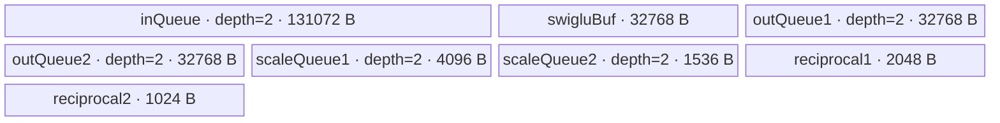
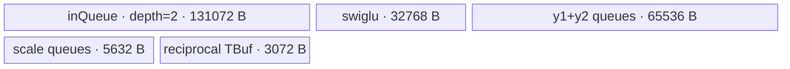
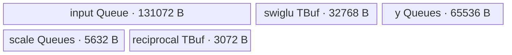
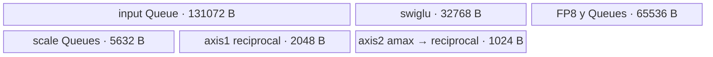
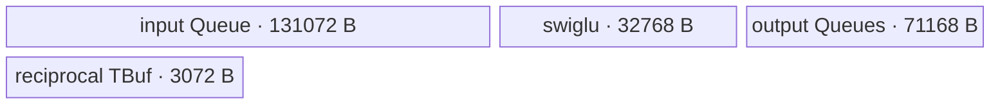
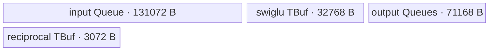

# SwigluMxQuantWithDualAxis 950 ACLNN 算子知识

## 算子速览

| 项目 | 内容 |
|---|---|
| 实际入口 | `aclnnSwigluMxQuantWithDualAxisGetWorkspaceSize` + `aclnnSwigluMxQuantWithDualAxis`，公开两段式 ACLNN。 |
| 计算语义 | 将 `[M,2N]` 沿末轴对半拆分，计算 `SiLU(act) * gate`，再把结果分别按末轴 32 元素组和倒数第二轴 32 行组做动态 MX 量化。 |
| 输入输出 | `x` 为二维 ND FLOAT16/BFLOAT16；可选 `groupIndex` 为一维 INT64 cumsum；`y1/y2` 为 FP4/FP8 `[M,N]`，`mxscale1/mxscale2` 为 FLOAT8_E8M0 三维张量。 |
| 执行类型 | 单 Kernel `AIV_VECTOR`；entry 显式声明 `KERNEL_TYPE_AIV_ONLY`，可达 body 只有 DMA、TPipe Queue/TBuf 和 MicroAPI Vector，无 Cube/AIC 或 MIX_CV。 |
| Kernel 路线 | R-001 OCP 无分组 BLOCK；R-002 OCP 分组 ROTATE；R-003 OCP 分组 BLOCK；R-004 CuBLAS 无分组 BLOCK；R-005 CuBLAS 分组 ROTATE；R-006 CuBLAS 分组 BLOCK。每条路线再由输入/输出 dtype 与 round 模板实例化。 |
| 核心资源 | GM 输入/四路输出；1 个 depth=2 VECIN Queue、4 个 depth=2 VECOUT Queue、3 个 TBuf、MicroAPI RegTensor；固定 UB 预算 238080 B；workspace 仅为平台 LibApi workspace。 |
| 来源闭包 | `source_closed`：公开 ACLNN 契约、生成式 ACLNN/OpDef 接线、950 Host/Tiling/POD、模板 selector、单 AIV entry/body 与 ascend950 构建接线闭合；自动生成 ACLNN inner bridge 作为框架边界。 |
| 验证状态 | 已完成源码闭包检查；本次知识提取未执行编译、真机、数值或性能测试。 |

## 接口与语义

### 计算语义

令 `x=[M,2N]`。`activateLeft=true` 时 `act=x[:,0:N]`、`gate=x[:,N:2N]`；为 false 时二者交换。中间值只存在 UB：

```text
s = SiLU(act) * gate = act / (1 + exp(-act)) * gate
```

对 `s` 的末轴每连续 32 个元素，以及倒数第二轴每连续 32 行、同一列的元素，分别执行：

```text
OCP:    shared_exp = floor(log2(max(abs(group)))) - emax(dst)
CuBLAS: shared_exp = rounded_exponent(max(abs(group)) / max_finite(dst))
scale = 2^shared_exp
q = cast_dst(s / scale, roundMode)
```

末轴结果为 `y1/mxscale1`，倒数第二轴结果为 `y2/mxscale2`。`mxscale1` 把 32 元素 scale 组数补成偶数后以末维 2 表示；`mxscale2` 每两个 32 行组交织，group 边界重新开始行分组。

### 输入、输出与属性

| 参数 | shape/layout | dtype | 约束、默认值与语义 |
|---|---|---|---|
| `x` | `[M,2N]`，二维 ND；ACLNN 允许非连续 | FLOAT16、BFLOAT16 | 必填且非空；末维偶数；FP4 输出时末维还须被 4 整除。 |
| `groupIndexOptional` | `[G]`，一维 ND；ACLNN 允许非连续 | INT64 | 可选；cumsum 边界，公开契约要求各值大于 0、末值等于 M；存在时 `G>0`。 |
| `activateLeft` | Host 标量 | bool | true：左半为 act；false：右半为 act；默认 true。 |
| `roundModeOptional` | Host 字符串 | `char*` | 空指针默认 `rint`；FP8 仅 `rint`；FP4 支持 `rint/floor/round`。 |
| `scaleAlg` | Host 标量 | int64 | 0=OCP，1=CuBLAS；FP4 只允许 0。 |
| `dstType` | Host 标量 | int64 | 35=FLOAT8_E5M2，36=FLOAT8_E4M3FN，40=FLOAT4_E2M1，41=FLOAT4_E1M2；必须与两路 y dtype 相同。 |
| `maxDtypeValue` | Host 标量 | double | 预留参数，当前公开契约只允许 0；本算子 Host/Tiling 与 Kernel 均不读取它。 |
| `y1Out`、`y2Out` | `[M,N]`，二维 ND；ACLNN 允许非连续 | 同一种 FP4/FP8 | 分别使用 -1/-2 轴 scale；FP4 在 GM 中两个 4-bit 元素打包成一个字节。 |
| `mxscale1Out` | `[M,ceil(N/64),2]`，ND | FLOAT8_E8M0 | 等价每行 `ceil(N/32)` 个 scale 补成偶数，pad 为 0。 |
| `mxscale2Out` | 无 group：`[ceil(M/64),N,2]`；有 group：`[floor(M/64)+G,N,2]` | FLOAT8_E8M0 | 每两个 32 行 scale 交织；每个 group 独立补足 64 行块。 |
| `workspaceSize`、`executor` | Host 输出 | `uint64_t*`、`aclOpExecutor**` | 第一段返回 workspace 字节数及包含 launch 的 executor。 |
| `workspace`、`stream` | Device 地址、ACL stream | `void*`、`aclrtStream` | 第二段使用第一段返回值在指定 stream 执行。 |

### 入口与版本

固定仓只公开未带版本后缀的 `aclnnSwigluMxQuantWithDualAxis`，没有同语义 V2/V3，因此它是 950 实际支持的最新公开版本。`op_host/CMakeLists.txt` 通过 `ACLNNTYPE aclnn` 生成 ACLNN bridge，固定仓未提交该生成体；其参数整理、非连续 Tensor 处理与 executor 构造属于明确的框架边界。算子拥有的 OpDef、校验、Tiling、POD、entry 和 body 均已继续追踪。

公开 README 与 ACLNN 文档明确 Ascend 950PR/950DT 支持、A2/A3 不支持；OpDef `.AddConfig("ascend950")`、`SUPPORT_COMPUTE_UNIT "ascend950"`、ascend950 binary JSON 和全局 binary config 与之相符。本卡因此只覆盖 950。

## Host/Launcher 执行流程

### 参数校验与前处理

1. ACLNN 第一段按公开契约检查必填指针、二维 shape、dtype/format、属性组合、输出 shape 与平台；生成式 bridge 的展开体不在固定仓。
2. OpDef 对 `x/group_index` 启用 `.AutoContiguous()`；输出由调用者提供。固定仓无法展开自动插入的 Contiguous/ViewCopy 节点，也没有算子自有额外前处理节点。
3. `DoTiling` 严格执行 `GetPlatformInfo -> CheckDtype -> GetAttr -> CheckShape -> ComputeTilingParams -> SetTilingKeyAndCore -> SetTilingData`；任一步返回失败即终止。
4. `CheckDtype` 检查 x、可选 group、两路 y 同 dtype、两路 scale 为 E8M0，并先保存 `yDtype`；`GetAttr` 再检查 round、scaleAlg、FP4/FP8 组合及 `dstType==yDtype`。
5. `CheckShape` 拒绝空 x/y/scale、非二维 x/y、`x.shape[0] != y1.shape[0]`、两路 y shape 不同、错误 scale shape；group 只在这里检查 rank=1 和 `G>0`。group 值域属于公开契约，当前 Tiling 源码不读取其值。

### 参数、Workspace 与生命周期

平台 producer 为 `PlatformAscendC`：`totalCoreNum=GetCoreNumAiv()`、`ubSize=GetCoreMemSize(UB)`、`workspaceSize=GetLibApiWorkSpaceSize()`。Kernel entry 接收 `workspace` 但 body 不读取，因此该区是平台库保留 workspace，不是算子自有中间张量；调用者/executor 在第二段 stream 完成前拥有它。

Host 固定 `W=256`、`H=64`、输入字节数 2，计算的每核 UB 需求为：

```text
inHalfSize = H*W = 16384 elements
swiglu = H*W*2 = 32768 B
inputQueue = swiglu*2(左右半)*2(depth) = 131072 B
y1Queue + y2Queue = 2 * (H*W*2(depth)) = 65536 B
scale1Queue = H*32*2 = 4096 B
scale2Queue = W*3*2 = 1536 B
scale1Reciprocal = H*32 = 2048 B
scale2Reciprocal = W*2*2 = 1024 B
allNeedUb = 238080 B
```

若平台 UB 小于 238080 B，Tiling 返回 `GRAPH_FAILED`。POD 全部为 int64_t，写入前清零，不存在未初始化 inactive 字段。

### 启动图与失败传播

```text
aclnnSwigluMxQuantWithDualAxisGetWorkspaceSize
  -> [generated ACLNN bridge / AutoContiguous / executor boundary]
  -> SwigluMxQuantWithDualAxis OpDef
  -> TilingForSwigluMxQuantWithDualAxis::DoTiling
  -> single AIV launch on caller stream:
       swiglu_mx_quant_with_dual_axis<mode,roundMode,scaleAlg,isGroupIdx>
       inputs  = x, optional group_index
       outputs = y1, mx_scale1, y2, mx_scale2
       POD     = SwigluMxQuantWithDualAxisTilingData
       blockDim= usedCoreNum
       workspace = LibApi workspace; body unused
```

只有一个 Device 节点，无跨 Kernel workspace 边。Tiling/bridge 失败阻断 launch；entry 在 950 保存 SPR 60，`Init` 清零 overflow mode，`Process` 完成后恢复。四路结果由各核写入互不重叠的 GM tile，生命周期延续到调用 stream 完成。

## Route 与参数设计

### 分核与资源计算

令 `nBlocks=ceil(N/256)`。无 group 时：

```text
mBlocks = ceil(M/64)
tasks = mBlocks*nBlocks
usedCoreNum = min(tasks,totalAivCoreNum)
mode = BLOCK
```

有 group 时 `usedCoreNum=totalAivCoreNum`。对每个 group `g`：`rows=end-start`、`mBlocksG=ceil(rows/64)`、`tasksG=mBlocksG*nBlocks`。`mode=ROTATE` 当且仅当 `nBlocks < totalAivCoreNum`，否则 `BLOCK`。两种 mode 都把 `tasksG` 按 `head=tasksG%usedCoreNumG` 分成前核 `ceil(tasksG/usedCoreNumG)` 个任务与后核 `floor(...)` 个任务；ROTATE 还令下一 group 的起始物理核偏移 `(offset+tasksG)%totalAivCoreNum`。

每任务映射 `rowBlock=task/nBlocks`、`colBlock=task%nBlocks`，有效域：

```text
calcRow = last row block ? (rows%64 or 64) : 64
calcCol = last col block ? (N%256 or 256) : 256
absRowStart = groupStart + rowBlock*64
colOffset = colBlock*256
```

### Route 选择

下表中的 dtype 子实例不互相合并：每个 Route 行表示相同 Host 调度与 scale 算法的集合，具体 `DTYPE_X/DTYPE_Y1/roundMode` 仍是独立编译实例。FP4 的 E2M1/E1M2 与三种 round、FP8 的 E4M3/E5M2 与固定 RINT 都逐项受 Host 与 binary config 约束。

| 顺序 | Route | Key/模板 | 精确选择条件与优先级 | 不适用去向 |
|---:|---|---|---|---|
| 1 | R-001 OCP 无分组 BLOCK | `(mode=1, round={4,0,1}, scaleAlg=0, isGroupIdx=0)` | group 不存在；`scaleAlg==0`；mode 被强制 BLOCK。FP8 仅 round=4，FP4 可 4/0/1。 | 有 group 去 R-002/R-003；算法 1 去 R-004。 |
| 2 | R-002 OCP 分组 ROTATE | `(0,{4,0,1},0,1)` | group 存在；`scaleAlg==0 && ceil(N/256)<totalAivCoreNum`。 | `nBlocks>=cores` 去 R-003。 |
| 3 | R-003 OCP 分组 BLOCK | `(1,{4,0,1},0,1)` | group 存在；`scaleAlg==0 && ceil(N/256)>=totalAivCoreNum`。 | 无其它调度 fallback。 |
| 4 | R-004 CuBLAS 无分组 BLOCK | `(1,4,1,0)` | group 不存在；`scaleAlg==1 && y dtype in {FP8_E4M3FN,FP8_E5M2} && round=rint`。 | 有 group 去 R-005/R-006；非法 dtype/round 失败。 |
| 5 | R-005 CuBLAS 分组 ROTATE | `(0,4,1,1)` | group 存在；算法/FP8/round 合法；`ceil(N/256)<totalAivCoreNum`。 | `nBlocks>=cores` 去 R-006。 |
| 6 | R-006 CuBLAS 分组 BLOCK | `(1,4,1,1)` | group 存在；算法/FP8/round 合法；`ceil(N/256)>=totalAivCoreNum`。 | 无其它 fallback。 |

```text
validate x/y/scale dtype and shape
validate roundMode, scaleAlg, dstType
isGroupIdx = optional group desc exists
mode = (ceil(N/256) < totalAivCoreNum) ? ROTATE : BLOCK
if !isGroupIdx: mode = BLOCK
if scaleAlg == 0:
  dispatch R-001/R-002/R-003 by isGroupIdx and mode
else:
  dispatch R-004/R-005/R-006 by isGroupIdx and mode
```

### 模板/实现执行矩阵

| Route | key/selector | dtype/shape/platform 完整命中条件 | 执行拓扑与 Kernel 节点 | 实际模板/body | 内存与同步特征 | tail/fallback |
|---|---|---|---|---|---|---|
| R-001 | `(1,round,0,0)` | 950；合法二维非空 shape；无 group；FP4/FP8 合法组合 | 单 AIV Kernel | `Base<DTYPE_X,DTYPE_Y1,1,RoundModeMapper,0,0>`；`ComputeScaleOcp` + dtype-specific ComputeY | 固定 238080 B UB；Queue 顺序；无 group GM 读 | 64×256 tile；行/列 pad；失败不 fallback。 |
| R-002 | `(0,round,0,1)` | 同上且 group 存在、`nBlocks<cores` | 单 AIV Kernel | `Base<...,0,...,0,1>`；OCP；group cumsum + core rotate | 同 UB；group_index L2 cache disable | 组内行尾补 0；非活动核 continue。 |
| R-003 | `(1,round,0,1)` | group 存在、`nBlocks>=cores` | 单 AIV Kernel | `Base<...,1,...,0,1>`；OCP；每 group 全核均分 | 同 UB | 组内 task 均分；无 fallback。 |
| R-004 | `(1,4,1,0)` | 无 group；FP8；rint；CuBLAS | 单 AIV Kernel | `Base<...,1,RINT,1,0>`；`ComputeScaleCuBLAS` + second-last + FP8 ComputeY | 同 UB；scale2 reciprocal TBuf 先暂存 amax 再覆写倒数 | 公共 tail；非法组合 Host 失败。 |
| R-005 | `(0,4,1,1)` | group；FP8；rint；`nBlocks<cores` | 单 AIV Kernel | `Base<...,0,RINT,1,1>`；CuBLAS + rotate | 同 UB；group cumsum | 公共 group tail。 |
| R-006 | `(1,4,1,1)` | group；FP8；rint；`nBlocks>=cores` | 单 AIV Kernel | `Base<...,1,RINT,1,1>`；CuBLAS + block | 同 UB | 公共 group tail。 |

### 隐藏性能 Guard

| Guard | Host/Tiling 条件 | Device/资源原因 | 影响 Route | 不满足时去向 | 源码符号 |
|---|---|---|---|---|---|
| 固定 UB 基块 | `allNeedUb=238080 <= ubSize` | 64×256 的 input/swiglu/output/scale/reciprocal 全部同时驻留 UB | 全部 | `GRAPH_FAILED`，没有小 tile fallback | `ComputeTilingParams`、`Init` |
| FP4 pack | `x.shape[1] % 4 == 0` | `N` 必须偶数，CopyOut 用 `dataLen/2` 字节和 `yOffset/2` | 所有 FP4 子实例 | `CheckYShape` 失败 | `CheckYShape`、`CopyOut` |
| FP8 round | `roundMode==rint` | FP8 entry mapper固定 RINT；Host 不允许 floor/round | FP8 子实例 | `GetAttr` 失败 | `GetAttr`、`RoundModeMapper` |
| CuBLAS dtype | `scaleAlg==1 => y is FP8` | CuBLAS 常量 `invDtypeMax_` 仅对 E4M3/E5M2 初始化 | R-004～R-006 | FP4 组合在 Host 失败 | `GetAttr`、`InitParams` |
| 调度 mode | group 且 `ceil(N/256)<totalCoreNum` 才 ROTATE | 小 N 时不同 group 轮转物理核起点，避免总从 core 0 开始；无 group 明确强制 BLOCK | R-001～R-006 | 选择另一调度 Route | `SetTilingKeyAndCore`、`Process` |
| 列 tail | `calcCol<256` | input DMA 不填 pad；`ComputeSwiglu` 用 ZEROING mask 写满到 `ceil(calcCol/64)*64`，其余列不进入有效 CopyOut | 全部 | 同 Route 内 mask tail | `CopyInSwiglu`、`ComputeSwiglu` |
| 行 tail | `calcRow<64` | scale2 固定按两个 32 行组归约，缺行必须显式为 0 | 全部 | `PadZeroM`，无另一路由 | `Process`、`PadZeroM` |
| 950 overflow SPR | `__NPU_ARCH__==3510` | Kernel 暂时清零浮点 overflow 控制并在结束恢复 | 全部 | 其它架构不编译该段；本卡只覆盖 950 | entry、`Init` |
| int64 任务乘法 | `mBlocks*nBlocks`、offset 计算无显式 overflow check | 任务数与 GM offset 均为 int64_t | 全部 | 固定仓无 fallback；超大 shape 行为不闭合 | `ComputeTilingParams`、`Process` |

### POD/ABI

`SwigluMxQuantWithDualAxisTilingData` 由 10 个连续 `int64_t` 组成；自然布局可得 `sizeof=80`、`alignof=8`，offset 依次递增 8。Host 与 Device include 同一头文件，Host 先以 `memset_s` 清零再逐字段赋值。

| 结构 | 字段 | 类型/位宽 | ABI 布局 | 单位 | Host/launcher producer | Device consumer | 边界 |
|---|---|---|---|---|---|---|---|
| `SwigluMxQuantWithDualAxisTilingData` | `usedCoreNum` | int64/64 | offset 0 | core | no-group 为 `min(tasks,total)`；group 为 `total` | `Process` 活动核 guard/分工；同时为 blockDim | 必须 >0。 |
| 同上 | `dstType` | int64/64 | offset 8 | GE dtype code | `GetAttr` 从 attr 读取 | 固定 body 不读，binary `DTYPE_Y1` 承载 | 35/36/40/41。 |
| 同上 | `activateLeft` | int64/64 | offset 16 | bool | bool attr 转 1/0 | `InitParams`，选择左右半指针 | 仅 0/1。 |
| 同上 | `dimM` | int64/64 | offset 24 | row | `x.shape[0]` | group 默认终点、任务/GM offset | 非空校验后 >0。 |
| 同上 | `dimN` | int64/64 | offset 32 | element/row | `x.shape[1]/2` | 输入 stride、输出 stride、scale stride | >0；FP4 时偶数。 |
| 同上 | `numGroups` | int64/64 | offset 40 | group | group shape[0]；无 group 默认 1 | 仅 `isGroupIdx=1` 的 group loop 读取 | >0；无 group 值不影响 loop。 |
| 同上 | `blockW` | int64/64 | offset 48 | element/row | 常量 256 | 固定 body 实际用编译常量 `ONCE_ROW_LEN=256`，字段不读 | ABI 保留，须与实现一致。 |
| 同上 | `splitBlockH` | int64/64 | offset 56 | row | 常量 64 | 固定 body用 `DOUBLE_BLOCK_SIZE=64`，字段不读 | ABI 保留。 |
| 同上 | `dimNBlockNum` | int64/64 | offset 64 | 256-column task block | `ceil(dimN/256)` | `Process` 的 task→row/column 映射 | 至少 1。 |
| 同上 | `dimNTail` | int64/64 | offset 72 | element | `N%256`，整除时取 256 | `InitParams`/最后列块 `calcCol` | `[1,256]`。 |

### Route 源码闭包

| Route | Key/selector | Host/Tiling producer | POD/参数 | Kernel entry/router 节点 | Kernel body/直接依赖 | 构建接线 |
|---|---|---|---|---|---|---|
| R-001 | `(1,round,0,0)` | `GetAttr/ComputeTilingParams/SetTilingKeyAndCore` | 公共 80 B POD | `swiglu_mx_quant_with_dual_axis<1,round,0,0>` | `Process/CopyInSwiglu/ComputeSwiglu/ComputeScaleOcp/ComputeY*/CopyOut` | ascend950 CMake、binary JSON、global config |
| R-002 | `(0,round,0,1)` | 同上 + group desc | 同上 | `<0,round,0,1>` | 同 OCP body + ROTATE/group compile branches | 同上 |
| R-003 | `(1,round,0,1)` | 同上 | 同上 | `<1,round,0,1>` | 同 OCP body + BLOCK/group branches | 同上 |
| R-004 | `(1,4,1,0)` | 同上；FP8 guard | 同上 | `<1,4,1,0>` | `ComputeScaleCuBLAS/SecondLast` + FP8 ComputeY | 同上 |
| R-005 | `(0,4,1,1)` | 同上 + group/ROTATE | 同上 | `<0,4,1,1>` | CuBLAS + ROTATE/group branches | 同上 |
| R-006 | `(1,4,1,1)` | 同上 + group/BLOCK | 同上 | `<1,4,1,1>` | CuBLAS + BLOCK/group branches | 同上 |

## Kernel 实现

### 公共执行流程

entry 解析 80 B POD，创建 `TPipe`，把 ACLNN 的 FP4/FP8 物理输出统一绑定为 `GlobalTensor<uint8_t>`，按 tuple 构造 `Base` 并执行 `Init/Process`。每个 task 先用二维 `DataCopyPad` 把 x 的左右半块放入同一 input Queue 的两个 64×256 子区；Vector 以 FP32 计算 SwiGLU 并把列尾和行尾补零。随后每 32 行同时计算两轴 scale 与 reciprocal，按输出 dtype 生成 y1/y2，原地交织 scale2，最后四次 DMA 直接写 GM。单 Kernel 无跨节点边或算子自有 workspace。

### Route R-001：OCP 无分组 BLOCK

#### 适用条件

##### 选择证据

| 层级 | 文件 | 符号 | 源码谓词/参数 | 结果/下一跳 |
|---|---|---|---|---|
| ACLNN | `docs/aclnnSwigluMxQuantWithDualAxis.md` | 参数约束 | group 可选；`scaleAlg=0`；合法 dtype/round | OCP，无 group。 |
| Host | `...tiling_arch35.cpp` | `SetTilingKeyAndCore` | `isGroupIdx==0` 时 `mode=BLOCK` | tuple `(1,round,0,0)`。 |
| Router | `op_kernel/swiglu_mx_quant_with_dual_axis_apt.cpp` | entry template | tuple 编译参数 | 实例化 `Base<...,1,...,0,0>`。 |
| Body | `...regbase.h` | `Process` | `numGroups=1`；不读取 group GM | 连续 `[0,M)` task。 |

#### Device 数据流

##### 函数级调用链

```text
swiglu_mx_quant_with_dual_axis<1,round,0,0>
  -> Init -> InitParams + eight InitBuffer calls
  -> Process -> block task loop
    -> CopyInSwiglu -> ComputeSwiglu -> optional PadZeroM
    -> ComputeScaleOcp -> ComputeY1ToFP4/FP8 -> ComputeY2ToFP4/FP8
    -> ComputeInterleave(scale2) -> CopyOut
```

##### 源码等价伪码

```text
tasks = ceil(M/64)*ceil(N/256); split contiguously over used cores
for assigned task:
  (rowBlock,colBlock) = divmod(task,nBlocks)
  DMA left/right x[rows,cols] into two input-queue halves
  for valid row and VF column: swiglu = fp32(act/(1+exp(-act))*gate); cast B16
  zero column mask and missing rows to a 64x256 tile
  for blk in {rows 0..31, rows 32..63}:
    exponent-reduce OCP scale1 per 32 columns and scale2 per column
    multiply reciprocal; cast/pack FP4 or FP8 into y1/y2
  interleave two scale2 rows in place; DMA four valid outputs to GM
```

#### 内存与数据搬运

##### 资源与搬运表

| 层级/缓冲区 | offset/地址公式 | extent/容量公式 | dtype/layout | producer | consumer | owner/lifetime | 对齐/复用 |
|---|---|---|---|---|---|---|---|
| GM x left/right | `row*(2N)+col` / `+N` | `calcRow*calcCol` each | xDtype ND | caller | `CopyInSwiglu` | caller/stream | 2-D DMA，srcStride=`(2N-calcCol)*2` B。 |
| `inQueue_` | 0 / `H*W` elements | 2 buffers × 65536 B | two xDtype halves | DMA | SwiGLU | TPipe/FreeTensor | depth 2；两个 half 不别名。 |
| `swigluBuf_` | 0 | 32768 B | xDtype 64×256 | SwiGLU/pad | scale + quant | TPipe/current task | 单 TBuf，下一 task 覆盖。 |
| output/scale Queues | local 0 | y 各 32768 B；s1 4096 B；s2 1536 B | uint8 physical | Compute | CopyOut | TPipe/FreeTensor | 各 depth 2。 |
| reciprocal TBuf | blk offsets `r1Off/r2Off` | 2048 B + 1024 B | uint16 BF16 exponent | OCP scale | ComputeY | TPipe/current task | 无跨 task 持久化。 |
| GM outputs | `y=row*N+col`；scale offsets见 CopyOut | 有效 tile | packed FP4/FP8/E8M0 | CopyOut | caller | caller/stream | scale2 每两行交织。 |

##### 分层内存布局



##### 字节账与复用顺序

```text
UB_total = 131072+32768+32768+32768+4096+1536+2048+1024 = 238080 B
UB_total <= ubSize is checked by Host Tiling
dynamic_ub = N/A（AIV TPipe InitBuffer）
workspace_total = GetLibApiWorkSpaceSize()（body 不使用）
```

| 复用子区 | 写入者 | 读取者/消费点 | 下一次覆盖 | 同步或释放依据 | 安全条件 |
|---|---|---|---|---|---|
| input Queue slot | `CopyInSwiglu` | `ComputeSwiglu` | 后续 task | EnQue→DeQue→FreeTensor | FreeTensor 后复用。 |
| `swigluBuf_` | SwiGLU/pad | scale 与两路 quant | 下一 task | 同一核顺序 | 四路 output EnQue 前不可覆盖。 |
| reciprocal buffers | scale helper | ComputeY1/Y2 | 下一 32 行块/task | 同一核顺序 | 当前两路量化完成后覆盖。 |
| output Queue slot | ComputeY/Interleave | CopyOut | 后续 task | EnQue→DeQue→FreeTensor | DMA 发起并 FreeTensor 后复用。 |

#### 同步、精度与尾块

##### 同步与数值边界表

| 阶段 | primitive/机制 | producer | consumer/等待点 | 保护对象 | 精度/尾块 |
|---|---|---|---|---|---|
| x DMA→SwiGLU | TQue EnQue/DeQue | MTE2 | Vector | input slot | `calcCol` 行搬运，Vector mask 写零到 64 对齐。 |
| SwiGLU | RegTensor + ZEROING mask | B16 input | B16 UB output | `swigluBuf_` | 输入升 FP32 做 Exp/Div/Mul，再 RINT 降回 xDtype。 |
| 行 pad | `PadZeroM` | Vector | scale reduce | 缺失行 | `calcRow` 向 64 补零。 |
| OCP scale | exponent mask/reduce/select | swiglu | reciprocal/scale | scale registers/TBuf | FP16 先 TRUNC 为 BF16 指数；INF/NAN、0 有特殊编码。 |
| quant→GM | SAT cast + Queue | Vector | MTE3 | four output slots | FP8 RINT；FP4按模板 round，GM 只写有效 y 行列。 |

#### 关键实现

##### 符号证据表

| 阶段 | 文件 | 符号/模板实例 | 实现事实 |
|---|---|---|---|
| Host/Tiling producer | `op_host/arch35/swiglu_mx_quant_with_dual_axis_tiling_arch35.cpp` | `ComputeTilingParams/SetTilingKeyAndCore` | no-group 核数与 BLOCK tuple。 |
| Kernel entry/router | `op_kernel/swiglu_mx_quant_with_dual_axis_apt.cpp` | `<1,round,0,0>` | AIV-only entry、round mapper、POD解析。 |
| Device body/helper | `op_kernel/arch35/swiglu_mx_quant_with_dual_axis_regbase.h` | `Process/ComputeScaleOcp/ComputeY*/CopyOut` | 融合激活、双轴 OCP、pack 与 tail。 |

### Route R-002：OCP 分组 ROTATE

#### 适用条件

##### 选择证据

| 层级 | 文件 | 符号 | 源码谓词/参数 | 结果/下一跳 |
|---|---|---|---|---|
| ACLNN | API 文档 | `groupIndexOptional` | 一维 cumsum group 存在 | group 路线。 |
| Host | tiling cpp | `SetTilingKeyAndCore` | `isGroupIdx==1 && nBlocks<totalCoreNum` | `(0,round,0,1)`。 |
| Router | apt cpp | entry template | mode=ROTATE、scale=OCP、group=1 | `Base<...,0,...,0,1>`。 |
| Body | regbase h | `Process` | 逐 group 读边界并更新 `coreRotateOffset` | R-002。 |

#### Device 数据流

##### 函数级调用链

```text
entry<0,round,0,1> -> Init(group GM + common UB) -> Process
  -> group boundary load -> ROTATE core mapping
  -> CopyInSwiglu -> FP32 SwiGLU/pad -> OCP dual-axis scale/quant
  -> scale2 interleave -> four-output CopyOut
```

##### 源码等价伪码

```text
offset=0
for g in [0,G):
  start=(g?group[g-1]:0); end=group[g]; rows=end-start
  if rows<=0: continue
  tasksG=ceil(rows/64)*nBlocks; active=min(tasksG,totalCores)
  my=(blockIdx-offset+totalCores)%totalCores
  if my<active: split contiguous tasksG across active cores and run common fused OCP tile pipeline
  offset=(offset+tasksG)%totalCores
```

#### 内存与数据搬运

##### 资源与搬运表

| 层级/缓冲区 | offset/地址公式 | extent/容量公式 | dtype/layout | producer | consumer | owner/lifetime | 对齐/复用 |
|---|---|---|---|---|---|---|---|
| GM group | `g-1,g` | G int64 | cumsum | caller | `GetValue` | caller/stream | L2 cache disabled；scalar reads。 |
| GM x/output | `absRowStart=start+rowBlock*64` | common valid tile | common | caller/Kernel | common pipeline | stream | group resets row grouping。 |
| UB queues/TBuf | common offsets | 238080 B | common | common pipeline | common pipeline | per core | 与 R-001 相同容量。 |
| GM scale2 | `((start/64+g)*2 + rowBlock*2)*N + col*2` | 2×calcCol bytes/task | E8M0 interleaved | CopyOut | caller | stream | 每 group 独立 64 行 pad。 |

##### 分层内存布局



##### 字节账与复用顺序

```text
UB_total = 238080 B；dynamic_ub=N/A；workspace=GetLibApiWorkSpaceSize() and body-unused
group_index stays in GM; no UB allocation is added by grouping or ROTATE
```

| 复用子区 | 写入者 | 读取者/消费点 | 下一次覆盖 | 同步或释放依据 | 安全条件 |
|---|---|---|---|---|---|
| common input/output Queue slots | DMA/Vector | Vector/DMA | 下一 group task | Queue FreeTensor | 每 group 当前 task完成。 |
| `swigluBuf_`/reciprocal | 当前 group task | 当前 scale/quant | 下一 task | 同一 AIV 顺序 | 当前四路输出已 EnQue。 |
| core assignment state | `coreRotateOffset` | next group mapping | 下一 group更新 | per-core scalar order | 所有核以相同 group/task公式更新。 |

#### 同步、精度与尾块

##### 同步与数值边界表

| 阶段 | primitive/机制 | producer | consumer/等待点 | 保护对象 | 精度/尾块 |
|---|---|---|---|---|---|
| group boundary | GM scalar `GetValue` | caller data | same-core scheduling | start/end | 固定仓无跨核同步；值须满足公开 cumsum 契约。 |
| ROTATE | deterministic scalar mapping | Host tuple | per-core loop | task ownership | 不产生重叠 task。 |
| tile pipeline | Queue + same-core order | DMA/Vector | Vector/DMA | common UB | 与 R-001 相同 FP32 SwiGLU、OCP、tail。 |

#### 关键实现

##### 符号证据表

| 阶段 | 文件 | 符号/模板实例 | 实现事实 |
|---|---|---|---|
| Host/Tiling producer | tiling cpp | `SetTilingKeyAndCore` | group + small nBlocks 选择 ROTATE。 |
| Kernel entry/router | apt cpp | `<0,round,0,1>` | group OCP AIV 实例。 |
| Device body/helper | regbase h | `Process` lines 290-367 | cumsum、轮转核映射、group task。 |

### Route R-003：OCP 分组 BLOCK

#### 适用条件

##### 选择证据

| 层级 | 文件 | 符号 | 源码谓词/参数 | 结果/下一跳 |
|---|---|---|---|---|
| ACLNN | API 文档 | group/scale 约束 | group + OCP | 候选。 |
| Host | tiling cpp | `SetTilingKeyAndCore` | `nBlocks>=totalCoreNum` | `(1,round,0,1)`。 |
| Router | apt cpp | entry template | BLOCK/OCP/group | `Base<...,1,...,0,1>`。 |
| Body | regbase h | `Process` BLOCK branch | 每 group 用全部 `usedCoreNum` 均分任务 | R-003。 |

#### Device 数据流

##### 函数级调用链

```text
entry<1,round,0,1> -> group boundary loop -> BLOCK task split
  -> CopyInSwiglu -> ComputeSwiglu/PadZeroM
  -> ComputeScaleOcp -> dtype-specific y1/y2 -> Interleave -> CopyOut
```

##### 源码等价伪码

```text
for each valid group:
  tasksG=ceil(groupRows/64)*nBlocks; used=totalCores
  head=tasksG%used; perHead=ceil(tasksG/used); perTail=floor(tasksG/used)
  blockIdx<head ? head interval : tail interval
  for each owned (rowBlock,colBlock): execute complete fused OCP pipeline
```

#### 内存与数据搬运

##### 资源与搬运表

| 层级/缓冲区 | offset/地址公式 | extent/容量公式 | dtype/layout | producer | consumer | owner/lifetime | 对齐/复用 |
|---|---|---|---|---|---|---|---|
| group/x/outputs GM | 同 R-002 group 公式 | group task valid tile | ND/packed | caller/Kernel | Kernel/caller | stream | BLOCK 只改变 owner core。 |
| queues/TBuf | 固定 local 0 | 238080 B | common | common helpers | common helpers | each core | Queue depth/复用不变。 |
| workspace | N/A offset | LibApi size | opaque | executor | runtime | stream | body未读。 |

##### 分层内存布局



##### 字节账与复用顺序

```text
UB_total=238080 B <= ubSize；dynamic_ub=N/A；workspace_total=LibApi workspace
BLOCK 与 ROTATE 不改变任何 InitBuffer；只改变 task→core 映射
```

| 复用子区 | 写入者 | 读取者/消费点 | 下一次覆盖 | 同步或释放依据 | 安全条件 |
|---|---|---|---|---|---|
| Queue slots | current task | current pipeline | next owned task | EnQue/DeQue/FreeTensor | task完成。 |
| TBuf | current task | scale/quant | next task | same-core order | quant完成。 |

#### 同步、精度与尾块

##### 同步与数值边界表

| 阶段 | primitive/机制 | producer | consumer/等待点 | 保护对象 | 精度/尾块 |
|---|---|---|---|---|---|
| BLOCK ownership | integer partition | per-core Process | task loop | GM output tiles | head/tail cores不重叠。 |
| common OCP | Queue/MicroAPI | DMA/Vector | Vector/DMA | UB/GM | 同 R-001；group 行尾独立补到64。 |

#### 关键实现

##### 符号证据表

| 阶段 | 文件 | 符号/模板实例 | 实现事实 |
|---|---|---|---|
| Host/Tiling producer | tiling cpp | `SetTilingKeyAndCore` | `nBlocks>=cores` 选择 BLOCK。 |
| Kernel entry/router | apt cpp | `<1,round,0,1>` | group BLOCK OCP。 |
| Device body/helper | regbase h | `Process` lines 338-365 | former/tail core连续任务划分。 |

### Route R-004：CuBLAS 无分组 BLOCK

#### 适用条件

##### 选择证据

| 层级 | 文件 | 符号 | 源码谓词/参数 | 结果/下一跳 |
|---|---|---|---|---|
| ACLNN | API 文档 | `scaleAlg=1` | 仅 FP8 + rint | CuBLAS。 |
| Host | tiling cpp | `GetAttr/SetTilingKeyAndCore` | no-group 强制 BLOCK | `(1,4,1,0)`。 |
| Router | apt cpp | `RoundModeMapper`/entry | FP8 映射 RINT | `Base<...,1,RINT,1,0>`。 |
| Body | regbase h | `Process` constexpr branch | `scaleAlg!=0` | `ComputeScaleCuBLAS`。 |

#### Device 数据流

##### 函数级调用链

```text
entry<1,4,1,0> -> common no-group BLOCK task loop -> fused SwiGLU
  -> ComputeScaleCuBLAS
     -> axis1 abs-max/FP32 exponent rounding
     -> axis2 abs-max temporary store
     -> ComputeScaleCuBLASSecondLast(axis2 scale/reciprocal)
  -> ComputeY1ToFP8 + ComputeY2ToFP8 -> Interleave -> CopyOut
```

##### 源码等价伪码

```text
for each 32-row half-tile:
  deinterleave B16 data; clear sign bit; reduce abs max for each axis
  axis1: fp32(max)*inv(maxFiniteDst); round exponent upward when mantissa requires
         emit E8M0 scale and BF16-form reciprocal
  axis2: store column abs maxima into reciprocal TBuf
  second pass: convert axis2 maxima to fp32, apply same exponent rounding,
               overwrite TBuf with reciprocal and emit scale
  fp32/BF16 reciprocal multiply -> saturated FP8 RINT output
```

#### 内存与数据搬运

##### 资源与搬运表

| 层级/缓冲区 | offset/地址公式 | extent/容量公式 | dtype/layout | producer | consumer | owner/lifetime | 对齐/复用 |
|---|---|---|---|---|---|---|---|
| common GM/Queues | R-001 formulas | common | common | common | common | stream/TPipe | unchanged。 |
| `mxScale2ReciprocalBuf_` phase 1 | `r2Off` | 512 uint16 per 32-row blk | interleaved abs max | `ComputeScaleCuBLAS` | `SecondLast` | current blk | TBuf临时语义。 |
| same TBuf phase 2 | same physical subregion | same 1024 B total | BF16 reciprocal | `SecondLast` | `ComputeY2ToFP8` | current task | 原地覆写需 phase1 已读完。 |
| scale Queues/FP8 y Queues | common | s1 4096+s2 1536+y 65536 B | uint8 | CuBLAS/quant | CopyOut | Queue | depth 2。 |

##### 分层内存布局



##### 字节账与复用顺序

```text
UB_total=238080 B；CuBLAS复用既有 reciprocal TBuf，不增加 UB
dynamic_ub=N/A；workspace_total=GetLibApiWorkSpaceSize()（body未读）
```

| 复用子区 | 写入者 | 读取者/消费点 | 下一次覆盖 | 同步或释放依据 | 安全条件 |
|---|---|---|---|---|---|
| axis2 reciprocal TBuf | CuBLAS first phase写amax | SecondLast读amax并写reciprocal；ComputeY2读reciprocal | next blk/task | 函数调用顺序 | SecondLast 不得在 amax 归约前执行；quant 不得在覆写前执行。 |
| common Queue/TBuf | common helpers | common helpers | next task | Queue/same-core | 同 R-001。 |

#### 同步、精度与尾块

##### 同步与数值边界表

| 阶段 | primitive/机制 | producer | consumer/等待点 | 保护对象 | 精度/尾块 |
|---|---|---|---|---|---|
| CuBLAS axis1 | abs bitmask + FP32 Mul/bit exponent | swiglu regs | scale/reciprocal | registers | 零与 INF/NAN有 Select；目标倒数由 dtype 常量给出。 |
| CuBLAS axis2 | same-core two-pass TBuf | first phase | SecondLast/ComputeY2 | reciprocal TBuf | phase顺序固定，无 event。 |
| FP8 cast | SAT + RINT | reciprocal multiply | y Queue | FP8 output | Host 与 mapper共同强制 RINT；有效 GM tail同 R-001。 |

#### 关键实现

##### 符号证据表

| 阶段 | 文件 | 符号/模板实例 | 实现事实 |
|---|---|---|---|
| Host/Tiling producer | tiling cpp | `GetAttr/SetTilingKeyAndCore` | FP8/CuBLAS合法性与 no-group BLOCK。 |
| Kernel entry/router | apt cpp | `<1,4,1,0>` | FP8 RINT AIV 实例。 |
| Device body/helper | regbase h | `ComputeScaleCuBLAS/ComputeScaleCuBLASSecondLast/ComputeY*FP8` | 两轴 amax、两阶段 axis2 与 FP8 cast。 |

### Route R-005：CuBLAS 分组 ROTATE

#### 适用条件

##### 选择证据

| 层级 | 文件 | 符号 | 源码谓词/参数 | 结果/下一跳 |
|---|---|---|---|---|
| ACLNN | API 文档 | group + scaleAlg | group、FP8、rint、算法1 | 候选。 |
| Host | tiling cpp | `SetTilingKeyAndCore` | `nBlocks<totalCoreNum` | `(0,4,1,1)`。 |
| Router | apt cpp | entry | tuple | `Base<...,0,RINT,1,1>`。 |
| Body | regbase h | `Process` + CuBLAS helpers | ROTATE group tasks + scaleAlg branch | R-005。 |

#### Device 数据流

##### 函数级调用链

```text
entry<0,4,1,1> -> group cumsum + ROTATE mapping -> fused SwiGLU/pad
  -> CuBLAS dual-axis scale (axis2 two-pass) -> FP8 y1/y2
  -> scale2 interleave -> group-aware CopyOut
```

##### 源码等价伪码

```text
for group: read cumsum; compute group rows/tasks; rotate starting core
for owned tile: common x DMA and FP32 SwiGLU
for each 32-row block: CuBLAS abs-max scale/reciprocal then FP8 quant
write y by absolute row; write scale2 by (groupStart/64+g+rowBlock)*2
```

#### 内存与数据搬运

##### 资源与搬运表

| 层级/缓冲区 | offset/地址公式 | extent/容量公式 | dtype/layout | producer | consumer | owner/lifetime | 对齐/复用 |
|---|---|---|---|---|---|---|---|
| group GM + outputs | R-002 group offsets | valid group tile | int64/FP8/E8M0 | caller/Kernel | Kernel/caller | stream | ROTATE changes core only。 |
| axis2 TBuf | R-004 phase alias | 1024 B | amax→reciprocal | CuBLAS helpers | FP8 quant | task | same physical region。 |
| remaining UB | common | total 238080 B | common | common pipeline | common pipeline | core | group/ROTATE add no UB。 |

##### 分层内存布局



##### 字节账与复用顺序

```text
UB_total=238080 B；dynamic_ub=N/A；workspace=LibApi workspace/body-unused
axis2 1024 B TBuf follows amax→reciprocal→quant overwrite protocol
```

| 复用子区 | 写入者 | 读取者/消费点 | 下一次覆盖 | 同步或释放依据 | 安全条件 |
|---|---|---|---|---|---|
| axis2 TBuf | first/second CuBLAS phases | SecondLast/ComputeY2 | next tile | same-core order | phase chain完整。 |
| Queue slots | current group tile | current Compute/CopyOut | next owned tile | FreeTensor | 当前 tile DMA提交。 |

#### 同步、精度与尾块

##### 同步与数值边界表

| 阶段 | primitive/机制 | producer | consumer/等待点 | 保护对象 | 精度/尾块 |
|---|---|---|---|---|---|
| group ROTATE | scalar deterministic mapping | cumsum/task counts | tile loop | GM ownership | 非活动核 continue。 |
| CuBLAS/FP8 | same-core phase order + Queue | swiglu | GM | TBuf/Queues | RINT、SAT、group tail补零。 |

#### 关键实现

##### 符号证据表

| 阶段 | 文件 | 符号/模板实例 | 实现事实 |
|---|---|---|---|
| Host/Tiling producer | tiling cpp | `SetTilingKeyAndCore` | group ROTATE CuBLAS key。 |
| Kernel entry/router | apt cpp | `<0,4,1,1>` | AIV-only FP8 instance。 |
| Device body/helper | regbase h | `Process/ComputeScaleCuBLAS/SecondLast` | cumsum轮转与两阶段scale。 |

### Route R-006：CuBLAS 分组 BLOCK

#### 适用条件

##### 选择证据

| 层级 | 文件 | 符号 | 源码谓词/参数 | 结果/下一跳 |
|---|---|---|---|---|
| ACLNN | API 文档 | group/CuBLAS约束 | group + FP8 + rint | 候选。 |
| Host | tiling cpp | `SetTilingKeyAndCore` | `nBlocks>=totalCoreNum` | `(1,4,1,1)`。 |
| Router | apt cpp | entry | BLOCK/CuBLAS/group | `Base<...,1,RINT,1,1>`。 |
| Body | regbase h | `Process` | BLOCK former/tail task split | R-006。 |

#### Device 数据流

##### 函数级调用链

```text
entry<1,4,1,1> -> group cumsum + BLOCK task split
  -> CopyInSwiglu -> FP32 activation/pad -> CuBLAS dual-axis scale
  -> FP8 y1/y2 -> scale2 interleave -> CopyOut
```

##### 源码等价伪码

```text
for each group:
  split all group tasks across all cores using head/tail counts
  each core executes its contiguous tiles
  each tile executes fused SwiGLU + CuBLAS scale + FP8 quant + direct GM output
```

#### 内存与数据搬运

##### 资源与搬运表

| 层级/缓冲区 | offset/地址公式 | extent/容量公式 | dtype/layout | producer | consumer | owner/lifetime | 对齐/复用 |
|---|---|---|---|---|---|---|---|
| GM | R-002 group offsets | group valid tile | ND/FP8/E8M0 | caller/Kernel | Kernel/caller | stream | BLOCK ownership。 |
| UB | fixed local 0 | 238080 B | Queues/TBuf | common/CuBLAS | common/quant | core | identical allocation to all routes。 |
| workspace | N/A | LibApi workspace | opaque | executor | runtime | stream | Kernel body ignores pointer。 |

##### 分层内存布局



##### 字节账与复用顺序

```text
UB_total=238080 B <= ubSize；dynamic_ub=N/A；workspace_total=LibApi workspace
BLOCK only changes task ownership; CuBLAS TBuf alias protocol remains amax→reciprocal→quant
```

| 复用子区 | 写入者 | 读取者/消费点 | 下一次覆盖 | 同步或释放依据 | 安全条件 |
|---|---|---|---|---|---|
| Queue/TBuf | current tile helpers | current tile helpers/CopyOut | next tile | Queue + same-core order | 完成当前 phase/FreeTensor。 |

#### 同步、精度与尾块

##### 同步与数值边界表

| 阶段 | primitive/机制 | producer | consumer/等待点 | 保护对象 | 精度/尾块 |
|---|---|---|---|---|---|
| BLOCK ownership | former/tail integer split | per-core scalar | tile loop | output GM ranges | 每 task唯一 owner。 |
| CuBLAS/FP8 | two-pass TBuf + Queue | swiglu | CopyOut | UB/GM | FP8 RINT；列/组行 tail mask/pad。 |

#### 关键实现

##### 符号证据表

| 阶段 | 文件 | 符号/模板实例 | 实现事实 |
|---|---|---|---|
| Host/Tiling producer | tiling cpp | `SetTilingKeyAndCore` | group BLOCK CuBLAS tuple。 |
| Kernel entry/router | apt cpp | `<1,4,1,1>` | AIV-only FP8 instance。 |
| Device body/helper | regbase h | `Process/ComputeScaleCuBLAS/ComputeY*FP8/CopyOut` | 全核均分、量化与直接写回。 |

## 算子特定优化

### Trick T-001：SwiGLU 中间值只在 UB 物化并立即双轴量化

#### 触发与源码依据

- 适用 Route：R-001～R-006。
- 触发条件：所有合法调用；单 Kernel task 已完成左右半输入 DMA。
- Golden 来源：[`op_kernel/arch35/swiglu_mx_quant_with_dual_axis_regbase.h:366-390`](../../../../../../../cann-ops-raw/ascendc/ops-nn/955f8b33985b6d72989ebff341bb9c2c564a51bc/quant/swiglu_mx_quant_with_dual_axis/op_kernel/arch35/swiglu_mx_quant_with_dual_axis_regbase.h#L366-L390)

**官方源码（固定 Commit 连续逐字摘录）**：

```cpp
CopyInSwiglu(absRowStart, colOffset, calcRow, calcCol);

LocalTensor<xDtype> xLocal = inQueue_.template DeQue<xDtype>();
LocalTensor<xDtype> swigluLocal = swigluBuf_.template Get<xDtype>();

auto actAddr = (__ubuf__ xDtype *)xLocal.GetPhyAddr();
auto gateAddr = (__ubuf__ xDtype *)xLocal[inHalfSize_].GetPhyAddr();
if (activateLeft_ == 0) {
    actAddr = (__ubuf__ xDtype *)xLocal[inHalfSize_].GetPhyAddr();
    gateAddr = (__ubuf__ xDtype *)xLocal.GetPhyAddr();
}
auto swigluAddr = (__ubuf__ xDtype *)swigluLocal.GetPhyAddr();
uint32_t alignDim1OutAlgin = ops::CeilDiv(calcCol, DOUBLE_BLOCK_SIZE) * DOUBLE_BLOCK_SIZE;
uint32_t calcPadRowAlgin = ops::CeilDiv(calcRow, DOUBLE_BLOCK_SIZE) * DOUBLE_BLOCK_SIZE;
ComputeSwiglu(static_cast<uint16_t>(calcCol), static_cast<uint16_t>(calcRow), actAddr, gateAddr, swigluAddr,
    alignDim1OutAlgin);
inQueue_.template FreeTensor(xLocal);
```

#### 机制与设计原因

左右半输入共享一个 Queue slot，`activateLeft` 只交换 UB 指针；SwiGLU 写入单个 `swigluBuf_`，紧接着同一 task 的 scale 与 y helper 读取它。没有把 `[M,N]` 激活中间值写到 GM，也没有第二个 Kernel/stream 边，因而源码可证明消除了中间 GM 物化与一次 producer→consumer 全量往返。FP32 Exp/Div/Mul 后才降回输入 dtype，量化 scale 对这个已融合结果执行。

#### 迁移边界

- 适用：激活结果只供紧随其后的双轴量化、64×256 固定 tile 可装入 UB 的融合实现。
- 前提：950 AIV、输入 FP16/BF16、`allNeedUb<=ubSize`、四路输出可直接按 tile 写 GM。
- 失效：需要外部复用完整 SwiGLU 输出、需跨 Kernel 消费或 UB 不足时必须重新设计中间存储/切片；固定仓没有小 tile fallback。
- 未验证：本次知识提取未执行编译、真机、数值或性能测试。

#### 错误做法

固定仓未提供可验证反例。

### Trick T-002：小 N 的分组任务轮转物理核起点

#### 触发与源码依据

- 适用 Route：R-002、R-005。
- 触发条件：group 存在且 `ceil(N/256)<totalAivCoreNum`。
- Golden 来源：[`op_kernel/arch35/swiglu_mx_quant_with_dual_axis_regbase.h:313-335`](../../../../../../../cann-ops-raw/ascendc/ops-nn/955f8b33985b6d72989ebff341bb9c2c564a51bc/quant/swiglu_mx_quant_with_dual_axis/op_kernel/arch35/swiglu_mx_quant_with_dual_axis_regbase.h#L313-L335)

**官方源码（固定 Commit 连续逐字摘录）**：

```cpp
if constexpr (mode == TPL_MODE_ROTATE) {
    int64_t usedCoreNumG = (blockCountG < totalCoreNum) ? blockCountG : totalCoreNum;
    int64_t myCoreInGroup = blockIdx_ - coreRotateOffset;
    if (myCoreInGroup < 0) {
        myCoreInGroup += totalCoreNum;
    }

    if (myCoreInGroup < usedCoreNumG) {
        int64_t headCoreNumG = blockCountG % usedCoreNumG;
        int64_t blockPerHeadCoreG = ops::CeilDiv(blockCountG, usedCoreNumG);
        int64_t blockPerTailCoreG = blockCountG / usedCoreNumG;
        if (myCoreInGroup < headCoreNumG) {
            loopPerCoreG = blockPerHeadCoreG;
            blockOffsetG = myCoreInGroup * loopPerCoreG;
        } else {
            loopPerCoreG = blockPerTailCoreG;
            blockOffsetG = headCoreNumG * blockPerHeadCoreG + (myCoreInGroup - headCoreNumG) * loopPerCoreG;
        }
    }
    coreRotateOffset = (coreRotateOffset + blockCountG) % totalCoreNum;
```

#### 机制与设计原因

当列块少于核数时，单个 group 可能只使用一段核。每处理一个 group，起始核按该 group 的任务数循环平移；`myCoreInGroup` 把物理核映射回 group 内逻辑核，再用 former/tail 公式分连续 task。源码可证明这改变了跨 group 的调度分布，同时保持每 group 内无重叠 ownership；它不增加 UB 或 workspace。

#### 迁移边界

- 适用：多个独立 group、每组 task 数可能小于物理核数、各 group 可按相同确定性公式在所有核上计算 offset。
- 前提：group cumsum 合法、所有核以同样顺序遍历 group、task 对 GM 输出互斥。
- 失效：无 group 或 `nBlocks>=cores` 时 Host 选择 BLOCK；不能只在部分核更新 rotate offset。
- 未验证：本次知识提取未执行编译、真机、数值或性能测试。

#### 错误做法

固定仓未提供可验证反例。

### Trick T-003：一次寄存器遍历同时形成两轴 OCP 归约

#### 触发与源码依据

- 适用 Route：R-001～R-003。
- 触发条件：`scaleAlg=0`；当前 32×256 swiglu 子块已在 UB。
- Golden 来源：[`op_kernel/arch35/swiglu_mx_quant_with_dual_axis_regbase.h:738-767`](../../../../../../../cann-ops-raw/ascendc/ops-nn/955f8b33985b6d72989ebff341bb9c2c564a51bc/quant/swiglu_mx_quant_with_dual_axis/op_kernel/arch35/swiglu_mx_quant_with_dual_axis_regbase.h#L738-L767)

**官方源码（固定 Commit 连续逐字摘录）**：

```cpp
for (uint16_t i = 0; i < blockCount; i++) {
    MicroAPI::DataCopy<xDtype, MicroAPI::PostLiteral::POST_MODE_UPDATE,
        MicroAPI::LoadDist::DIST_DINTLV_B16>(x0, x1, xAddr, 256);
    if constexpr (IsSameType<xDtype, half>::value) {
        MicroAPI::And(x0ExpFP16, (MicroAPI::RegTensor<uint16_t> &)x0, expMaskFP16, maskAll);
        MicroAPI::And(x1ExpFP16, (MicroAPI::RegTensor<uint16_t> &)x1, expMaskFP16, maskAll);
        MicroAPI::Compare<uint16_t, CMPMODE::NE>(infNanDataMask0, x0ExpFP16, expMaskFP16, maskAll);
        MicroAPI::Compare<uint16_t, CMPMODE::NE>(infNanDataMask1, x1ExpFP16, expMaskFP16, maskAll);
        MicroAPI::Cast<bfloat16_t, xDtype, CAST_HALF_TO_BF16>(x0BF16, x0, maskAll);
        MicroAPI::Cast<bfloat16_t, xDtype, CAST_HALF_TO_BF16>(x1BF16, x1, maskAll);
        MicroAPI::And(x0ExpBF16, (MicroAPI::RegTensor<uint16_t> &)x0BF16, expMaskBF16, maskAll);
        MicroAPI::And(x1ExpBF16, (MicroAPI::RegTensor<uint16_t> &)x1BF16, expMaskBF16, maskAll);
        MicroAPI::Select<uint16_t>(x0ExpBF16, x0ExpBF16, expMaskBF16, infNanDataMask0);
        MicroAPI::Select<uint16_t>(x1ExpBF16, x1ExpBF16, expMaskBF16, infNanDataMask1);
    } else {
        MicroAPI::And(x0ExpBF16, (MicroAPI::RegTensor<uint16_t> &)x0, expMaskBF16, maskAll);
        MicroAPI::And(x1ExpBF16, (MicroAPI::RegTensor<uint16_t> &)x1, expMaskBF16, maskAll);
    }

    MicroAPI::Max(expMaxDim1, x0ExpBF16, x1ExpBF16, maskAll);
    MicroAPI::ReduceMaxWithDataBlock(expMaxDim1, expMaxDim1, maskAll);
    MicroAPI::Max(expMax1Dim2, expMax1Dim2, x0ExpBF16, maskAll);
    MicroAPI::Max(expMax2Dim2, expMax2Dim2, x1ExpBF16, maskAll);
```

#### 机制与设计原因

每行只从 UB deinterleave-load 一次，就同时更新末轴的 32 元素 ReduceMax 和倒数第二轴的逐列累计 Max。两轴 scale 不需要分别重扫 swiglu tile。FP16 先识别 INF/NaN，再以 TRUNC cast 到 BF16 指数域；BF16 直接提取指数，从而保持特殊值处理路径可证明。

#### 迁移边界

- 适用：两轴共享同一 32×W 数据块，scale 可由指数最大值表示的 OCP MX 量化。
- 前提：输入已对缺列/缺行补零，`DIST_DINTLV_B16` 与 256 列布局一致。
- 失效：CuBLAS 需要绝对值与 FP32 乘法，走 R-004～R-006；不同分组宽度需重做 reduce/store 分布。
- 未验证：本次知识提取未执行编译、真机、数值或性能测试。

#### 错误做法

固定仓未提供可验证反例。

### Trick T-004：scale2 在输出 Queue 内原地交织

#### 触发与源码依据

- 适用 Route：R-001～R-006。
- 触发条件：64 行 tile 被拆为两个 32 行 scale 块。
- Golden 来源：[`op_kernel/arch35/swiglu_mx_quant_with_dual_axis_regbase.h:446-452`](../../../../../../../cann-ops-raw/ascendc/ops-nn/955f8b33985b6d72989ebff341bb9c2c564a51bc/quant/swiglu_mx_quant_with_dual_axis/op_kernel/arch35/swiglu_mx_quant_with_dual_axis_regbase.h#L446-L452)

**官方源码（固定 Commit 连续逐字摘录）**：

```cpp
for (int64_t blk = 1; blk < calcBlockLoop; blk += 2) {
    auto src0Addr = (__ubuf__ uint8_t *)mxScale2[(blk - 1) * ubRowLen_].GetPhyAddr();
    auto src1Addr = (__ubuf__ uint8_t *)mxScale2[blk * ubRowLen_].GetPhyAddr();
    auto dstAddr = (__ubuf__ uint8_t *)mxScale2[(blk - 1) * ubRowLen_].GetPhyAddr();
    ComputeInterleave(dstAddr, src0Addr, src1Addr);
}
```

#### 机制与设计原因

两个 32 行组的逐列 E8M0 scale 已在同一 `mxScaleQueue2_` slot 的相邻 256 B 子区。`ComputeInterleave` 以 `DIST_INTLV_B8` 把结果写回第一子区，之后 CopyOut 直接按两行交织布局搬出；没有额外临时 Queue/TBuf，也避免单独的 layout-transform Kernel。

#### 迁移边界

- 适用：相邻两组等长 B8 scale、输出规定交织布局、源读取完成后允许覆盖第一子区。
- 前提：Queue slot 至少按 `W*3` B 分配，为两个源区和原地写回留出容量；CopyOut 在交织后才 DeQue。
- 失效：非成对 group、不同元素宽度或要求保留原始两行布局时需另行分配/搬运；当前行尾通过 64 行 pad 保证成对。
- 未验证：本次知识提取未执行编译、真机、数值或性能测试。

#### 错误做法

固定仓未提供可验证反例。

## 模板与实现对比

| 对比维度 | R-001 无组 OCP | R-002/003 分组 OCP | R-004 无组 CuBLAS | R-005/006 分组 CuBLAS | 设计选择依据 |
|---|---|---|---|---|---|
| 命中条件/优先级 | 无 group，算法0 | group，算法0；按 nBlocks 选 ROTATE/BLOCK | 无 group，算法1、FP8/RINT | group，算法1、FP8/RINT；按 nBlocks 选 mode | Host 先做合法性，再组成 tuple。 |
| 模板与 dtype | FP16/BF16 × FP4/FP8 × 合法 round | 同左 + `isGroupIdx=1` | FP16/BF16 × FP8；round=RINT | 同左 + group | binary config 有 8 个输入/输出 dtype bin；TPL 承载 mode/round/alg/group。 |
| 循环与分核 | 全 M 单 group，BLOCK | 逐 cumsum group；ROTATE 或全核 BLOCK | 同 R-001 | 同 R-002/003 | group 边界决定独立 64 行 pad。 |
| Queue/TBuf/寄存器/dynamic UB/通信 window | 固定 238080 B；RegTensor；无 dynamic UB/通信 | 相同 | 相同，axis2 reciprocal TBuf 暂存 amax | 相同 | 所有 tuple 共用 InitBuffer 形状。 |
| 内存总占用与复用 | fixed Queue/TBuf | grouping 不增加 UB | two-pass TBuf alias | alias + group | Host 单一 UB gate。 |
| 搬运/Vector/SIMT/NDDMA/通信 API | DataCopyPad + MicroAPI 指数归约 | 同左 + group scalar read | DataCopyPad + abs max/FP32 exponent | 同左 + group scalar read | 全部 AIV_VECTOR；无 SIMT/NDDMA/通信。 |
| 同步、精度与 tail | Queue；FP32 SwiGLU；OCP特殊值；行列 pad | 同左，按 group pad | Queue；FP32 CuBLAS scale；FP8 RINT | 同左，按 group pad | 模板 round 与算法 constexpr 消除运行时分支。 |
| fallback/失败边界 | UB/shape/attr失败 | 同左；非法 group 值无 Device 保护 | FP4/非RINT失败 | 同左 | 无小 tile或算法 fallback。 |

## 平台差异

| 项目 | A2 | A3 | 950 |
|---|---|---|---|
| 支持状态 | 公开 README/API 明确不支持；未生成卡 | 公开 README/API 明确不支持；未生成卡 | Ascend 950PR/950DT 公开支持。 |
| Host/Launcher | 无支持接线 | 无支持接线 | `arch35` Tiling，`SUPPORT_COMPUTE_UNIT=ascend950`，单 AIV launch。 |
| Kernel/资源 | 无公开可达 Kernel | 无公开可达 Kernel | regbase MicroAPI Vector；固定 238080 B UB；950 SPR 60 保存/清零/恢复。 |

## 限制与失败边界

- 只覆盖公开 `aclnnSwigluMxQuantWithDualAxis`，不覆盖非 DualAxis、Backward、Grad、原地或其它量化变体。
- 固定仓不包含自动生成 ACLNN bridge 展开体；AutoContiguous/executor 的内部节点、额外 workspace 细分与错误传播细节属于框架边界，未推测补齐。
- A2/A3 由公开文档明确标为不支持；不能以 `arch35` 或 kernel 文件存在推翻该结论。
- 输入/输出必须非空且 shape 合法；FP4 要求 `x.shape[1]%4==0`；FP8 只允许 rint；FP4 只允许 `scaleAlg=0`；`maxDtypeValue` 当前只允许 0 且实现不读。
- 公开契约要求 group cumsum 每值大于 0、末值为 M。可见 Tiling 只校验 rank 与 G>0，Kernel 对 `groupRows<=0` 直接跳过，未校验最后边界；生成式 ACLNN 是否执行值校验在固定仓不可见，调用者不得依赖 Device 修复非法 group。
- 固定 64×256 tile 需要 238080 B UB，空间不足直接 `GRAPH_FAILED`，没有更小 tile fallback。
- task/offset 的 int64 乘加没有显式 overflow check；固定仓无法闭合超大 shape 溢出行为。
- `blockW/splitBlockH/dstType` POD 字段在固定 body 不直接读取，但属于 80 B ABI，不可删除或改序。
- 本次知识提取未执行编译、真机、数值或性能测试。

## 源码索引

### 链路索引

| 链路阶段 | 文件 | 关键符号 | 支撑内容 |
|---|---|---|---|
| 入口声明/约束 | `quant/swiglu_mx_quant_with_dual_axis/docs/aclnnSwigluMxQuantWithDualAxis.md` | 两段式函数原型、产品表、参数/错误约束 | 公开 API、950 支持与 A2/A3 不支持。 |
| 入口声明/语义 | `quant/swiglu_mx_quant_with_dual_axis/README.md` | 产品支持、公式、参数表 | 逻辑语义与平台交叉证据。 |
| 入口实现/OpDef | `quant/swiglu_mx_quant_with_dual_axis/op_host/swiglu_mx_quant_with_dual_axis_def.cpp` | `SwigluMxQuantWithDualAxis`、`OP_ADD` | dtype组合、AutoContiguous、默认属性、ascend950 config。 |
| Host 声明 | `quant/swiglu_mx_quant_with_dual_axis/op_host/arch35/swiglu_mx_quant_with_dual_axis_tiling_arch35.h` | TilingParam、Tiling class | Host 参数与方法边界。 |
| Host/Tiling | `quant/swiglu_mx_quant_with_dual_axis/op_host/arch35/swiglu_mx_quant_with_dual_axis_tiling_arch35.cpp` | `DoTiling` 及全部 helper | 校验、核/UB/workspace、tuple、POD producer。 |
| POD | `quant/swiglu_mx_quant_with_dual_axis/op_kernel/arch35/swiglu_mx_quant_with_dual_axis_tilingdata.h` | `SwigluMxQuantWithDualAxisTilingData` | 80 B Host/Device ABI。 |
| selector | `quant/swiglu_mx_quant_with_dual_axis/op_kernel/arch35/swiglu_mx_quant_with_dual_axis_tiling_key.h` | `ASCENDC_TPL_ARGS_DECL/SEL` | mode/round/algorithm/group 可编译 tuple。 |
| Kernel entry | `quant/swiglu_mx_quant_with_dual_axis/op_kernel/swiglu_mx_quant_with_dual_axis_apt.cpp` | `RoundModeMapper`、`swiglu_mx_quant_with_dual_axis` | AIV-only、POD解析、模板实例与 SPR 生命周期。 |
| Kernel body | `quant/swiglu_mx_quant_with_dual_axis/op_kernel/arch35/swiglu_mx_quant_with_dual_axis_regbase.h` | `Base::Init/Process/CopyInSwiglu/Compute*/CopyOut` | 全部 Device 循环、DMA、Vector、UB、精度、tail。 |
| Kernel 平台常量 | `common/inc/op_kernel/platform.h` | `GetUbBlockSize/GetVRegSize` | 32 B UB block 与 Vector register 宽度 producer。 |
| Kernel 公共 helper | `common/inc/op_kernel/kernel_utils.h` | `CeilAlign/CeilDiv` | Device 对齐、上取整与零除保护语义。 |
| binary 接线 | `quant/swiglu_mx_quant_with_dual_axis/op_host/config/ascend950/swiglu_mx_quant_with_dual_axis_binary.json` | `op_list` 八个 bin | FP16/BF16 到四种 FP4/FP8 的 ascend950 实例。 |
| Host 构建 | `quant/swiglu_mx_quant_with_dual_axis/op_host/CMakeLists.txt` | `SUPPORT_COMPUTE_UNIT`、`add_modules_sources` | ascend950、arch35、ACLNN 生成接线。 |
| Kernel 构建 | `scripts/kernel/binary_config/ascendc_config.json` | `SwigluMxQuantWithDualAxis` entry | ascend950 kernel 与 `--cce-no-dcache-flush`。 |

### 实现复用检查

| 检查项 | 可复用事实 | 不得改变的约束 | 源码符号 |
|---|---|---|---|
| ABI/POD | 10 个 int64_t 的 80 B 结构可原样复用 | 字段顺序、位宽、offset；unused 字段也不能删 | `SwigluMxQuantWithDualAxisTilingData` |
| 调用顺序 | `CopyIn -> SwiGLU/pad -> scale -> y1/y2 -> interleave -> CopyOut` | scale reciprocal 必须先于对应 quant；interleave 必须先于 scale2 CopyOut | `Process` |
| workspace/内存 | 固定 238080 B UB 与 LibApi workspace 模式 | depth=2 必须计入；axis2 TBuf alias phase顺序不可变 | `ComputeTilingParams`、`Init`、`ComputeScaleCuBLAS` |
| 同步 | TQue EnQue/DeQue/FreeTensor 与同核函数顺序 | input/output Queue 释放前不可复用；无跨核共享 UB | `CopyInSwiglu`、`Process`、`CopyOut` |
| 精度与尾块 | FP32 SwiGLU、OCP/CuBLAS特殊值、FP4/FP8 cast、64×256 pad | FP8 RINT、FP4 pack、缺行/缺列置零、group 独立行块 | `ComputeSwiglu`、`ComputeScale*`、`ComputeY*`、`PadZeroM` |
| 失败边界 | Host 失败即不 launch；无小 UB fallback | 不得放宽平台、dtype、shape、round、algorithm 或 group 契约 | `DoTiling`、公开 ACLNN 文档 |
