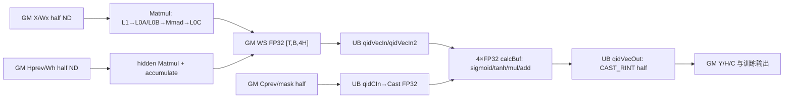

# LSTM A2/A3 ACLNN 算子知识

## 算子速览

| 项目 | 内容 |
|---|---|
| 实际入口 | 公开两段式接口 `aclnnLSTMGetWorkspaceSize` → `aclnnLSTM`；固定仓只公开这一版本，无 `V2` 入口。 |
| 计算语义 | 按层、按方向执行 LSTM：两次矩阵乘产生四门预激活，Vector 计算 `f/i/o=sigmoid`、`j=tanh`、`c=f*c_prev+i*j`、`h=o*tanh(c)`。 |
| 输入输出 | `input`、`params`、可选 `hx` 为同 dtype 的 ND FP16/FP32；可选 `batchSizes` 为 INT64；输出 `output/hy/cy`，训练时另输出七组逐层逐方向中间量。 |
| 执行类型 | 每个底层 `DynamicRNN` 节点是单 Kernel `MIX_CV`：Matmul Cube/AIC 产生 FP32 workspace，AIV/Vector 门控消费；ACLNN 图还含通用 Contiguous、Concat、Transpose、Add/Zero、Slice、mask 与 ViewCopy 节点。 |
| Kernel 路线 | R-001：key `10000001`，`LstmMmSplitNDNDFP16<half>`；R-002：key `10000002`，`LstmMmSplitNDNDFP32<float>`。 |
| 核心资源 | GM 输入/输出；主 workspace `16*T*B*H` 字节；Matmul 库系统 workspace；Matmul 内部 L1/L0A/L0B/L0C；Vector UB 队列与 4 路 FP32 `calcBuf`。 |
| 来源闭包 | `source_closed`：公开 ACLNN 组合图、`DynamicRNN` Host/Tiling/POD、两个可达 key、MIX_CV body、workspace 交接、`SyncAll` 与构建接线均闭合；通用 ACLNN 节点和 AscendC Matmul 库内部按框架/库边界标注。 |
| 验证状态 | 已完成源码闭包检查；本次知识提取未执行编译、真机、数值或性能测试。 |

## 接口与语义

### 计算语义

对时间步 `t`，ACLNN 先把 PyTorch 风格的 `weight_ih` 与 `weight_hh` 沿第 1 维拼接，再转置成 `W∈R^{(I+H)×4H}`；两份 bias 相加，未传 bias 时生成零向量。底层按门序 `ifjo` 计算：

```text
Gx[t] = X[t] * W_x + b                  // inputMM，一次覆盖全部 T
Gh[t] = H[t-1] * W_h                    // hiddenMM，逐时间步
G[t]  = Gx[t] + Gh[t]                   // FP32 workspace 中原位累加
i[t]  = sigmoid(G_i[t])
f[t]  = sigmoid(G_f[t] + forget_bias)   // ACLNN 固定传 0.0
j[t]  = tanh(G_j[t])
o[t]  = sigmoid(G_o[t])
c[t]  = f[t] * c[t-1] + i[t] * j[t]
h[t]  = o[t] * tanh(c[t])
```

`seq_length` 在底层不是长度向量，而是 ACLNN data 模式由 `batchSizes` 生成的 `[T,B,H]` 0/1 mask；mask 为 0 时保留历史 `c/h`，但 `y` 写 0。反向方向通过反转 workspace 与输出的时间偏移实现。`cell_clip=-1.0`，因此 ACLNN 路线不会进入 `cellClip > 0` 的裁剪分支。

### 输入、输出与属性

| 参数 | shape/layout | dtype | 约束、默认值与语义 |
|---|---|---|---|
| `input` | 定长：`[T,B,I]` 或 `batchFirst=true` 时 `[B,T,I]`；data 模式：`[T*B,I]`；ND | FP16/FP32 | 非空时 `I>0`；所有浮点输入输出 dtype 一致。 |
| `params` | 每层每方向 `weight_ih:[4H,I_cur]`、`weight_hh:[4H,H]`，可选两份 `[4H]` bias；ND | 同 `input` | 长度 `2*D*B_bias*numLayers`；后续层 `I_cur=D*H`。 |
| `hx` | 两个 `[D*numLayers,B,H]` tensor；ND | 同 `input` | 可空；非空时列表长度 2，分别为初始 `h/c`。 |
| `batchSizes` | `[T]`；ND | INT64 | 可空；非空选择 data 模式，元素值检查未在该固定 Host 源码中实现，只由 shape 用于构造 `[T,B,H]` mask。 |
| `hasBias` | 标量属性 | bool | `false` 时 Host 生成 `[4H]` 零 bias，底层仍收到必选 bias。 |
| `numLayers` | 标量属性 | int64 | data 模式显式要求 `>=1`；定长模式通过列表/shape 循环间接约束。 |
| `dropout` | 标量属性 | double | 文档声明当前不支持；固定 Host 未读取该参数，调用者应传 `0.0`。 |
| `train` | 标量属性 | bool | `true` 时七组中间输出列表均为必选且长度 `D*numLayers`；`false` 时底层仍分配部分临时门输出，但不提交训练输出。 |
| `bidirectional` | 标量属性 | bool | `D=2` 时每层启动正向和反向两个 `DynamicRNN`，再沿特征轴拼接。 |
| `batchFirst` | 标量属性 | bool | 定长模式在入口/出口各做一次 `[0,1]` 轴转置；data 模式不读取此值。 |
| `output` | `[T,B,DH]` 或定长 `batchFirst=true` 时 `[B,T,DH]`；ND | 同 `input` | 最后一层所有方向的 `y`。 |
| `hy/cy` | `[D*numLayers,B,H]`；ND | 同 `input` | 正向取 `T-1`，反向取时间索引 0。 |
| `iOut/jOut/fOut/oOut/hOut/cOut/tanhCOut` | 每项列表长度 `D*numLayers`，tensor `[T,B,H]`；ND | 同 `input` | 仅 `train=true` 有效并要求非空。 |

### 入口与版本

入口声明和文档均只给出 `aclnnLSTMGetWorkspaceSize`/`aclnnLSTM`，固定 Commit 未出现同语义版本后缀，因此本卡取该平台实际可达的唯一、也是最新公开版本。公开产品表明确支持 Atlas A2 与 A3，`l0op::DynamicRNN` 又把当前实现限制为 `ASCEND910B` 或 `ASCEND910_93`，`DynamicRNN` OpDef 和 Kernel CMake 对这两个 compute unit 接线。公开产品表明确 Ascend 950PR/950DT 不支持，所以不生成 950 卡。

## Host/Launcher 执行流程

### 参数校验与前处理

1. `aclnnLSTMGetWorkspaceSize` 检查 `workspaceSize/executor`，随后按 `batchSizes != nullptr` 分流。
2. 定长模式按顺序检查必选指针、dtype、tensor-list 长度、rank 和 shape；空 `input` 在这些检查前直接返回 workspace 0。data 模式先检查指针、`numLayers>=1`、rank/list/shape/dtype，再处理空输入。
3. 所有输入调用普通 `Contiguous`。定长 `batchFirst=true` 额外把输入转成 `[T,B,I]`；data 模式把 `[T*B,I]` reshape 为 `[T,B,I]`。
4. data 模式的 `GetMask` 依次建立 `Arange(B)`，把 batch 索引和 `batchSizes` 广播到 `[T,B,H]`，做 `Greater` 后 cast 到输入 dtype。
5. 每层每方向：Slice 当前层 `h0/c0`；Concat `weight_ih/weight_hh` 后转置；两 bias 相加或生成零 bias；调用 `l0op::DynamicRNN`。
6. 双向层把两方向 `y` 沿轴 2 Concat，作为下一层输入；最终通过 Slice/Concat/ViewCopy 形成 `output/hy/cy` 和训练中间输出。普通 `Contiguous/ViewCopy` 与这些通用 ACLNN 节点的 Device 内部属于框架边界；本卡闭合它们在 LSTM 图中的 shape、顺序、owner 与依赖。

### 参数、Workspace 与生命周期

第一段接口用 `CREATE_EXECUTOR` 建立整张组合图，所有临时 tensor、tensor-list、shape/perm 数组都由 executor 持有，最后以 `GetWorkspaceSize()` 返回整图 workspace 并 `ReleaseTo(executor)`。第二段 `aclnnLSTM` 只调用 `CommonOpExecutorRun(workspace, workspaceSize, executor, stream)`；各节点按 executor 顺序提交到同一 `stream`，任一 Host 构图空指针或返回码失败都会立即停止构图。

每个 `DynamicRNN` 节点自身声明：

```text
main_ws_bytes = T * B * 4H * sizeof(float) = 16*T*B*H
node_ws_bytes = main_ws_bytes + GetLibApiWorkSpaceSize()
blockDim       = ceil((2 * AiCore_count) / 2) = AiCore_count
scheduleMode   = 1
```

主 workspace 由 `outputGm.workspace` 作为 FP32 `[T,B,4H]` 使用；系统 workspace 交给 `GetSysWorkSpacePtr()` 注册两个 Matmul 对象。系统区在 executor 总 workspace 中的准确切片 offset 属于运行时/Matmul 库边界，固定仓不暴露，不能自行假定紧邻主区的方向。多层/多方向以及前后处理节点的总 workspace 由 executor 汇总，固定 Host 不公开逐节点总和公式。

### 启动图与失败传播

```text
aclnnLSTMGetWorkspaceSize
  -> [Contiguous; optional input/output Transpose]
  -> [data mode: Arange -> Unsqueeze/Broadcast -> Greater -> Cast mask]
  -> for layer in [0,L):
       for direction in [0,D):
         Slice(h0,c0)
         Concat(weight_ih,weight_hh) -> Transpose
         Add(bias_ih,bias_hh) or ZerosLike
         DynamicRNN (single MIX_CV kernel, key by dtype)
       if D==2: Concat(y_forward,y_reverse)
  -> Slice/Concat/ViewCopy final and optional training outputs
  -> aclnnLSTM -> CommonOpExecutorRun(same stream)
```

每个 `DynamicRNN` launch 的 `ADD_TO_LAUNCHER_LIST_AICORE` 失败会返回全空 tuple，ACLNN 的 `CallBaseOp`/`LstmSingleLayerDirec` 检测空结果并停止后续构图。`DynamicRNN` 仅允许 SoC `ASCEND910B`/`ASCEND910_93`；其它 SoC 在加入 launcher 前返回全空 tuple。空 `input` 不建图并返回 workspace 0。固定源码未给出第二段某个 Device 节点运行失败后 executor 对已提交节点的回滚语义。

## Route 与参数设计

### 分核与资源计算

Tiling 先从 `x:[T,B,I]` 和 `weight:[I+H,4H]` 得到 `T/B/I/H`，再读 bias、mask、初始状态是否存在及 `direction/isTraining/gateOrder/cellClip/forgetBias`。`supportL0c2out` 为真时进入本卡 AscendC 路线：

```text
AIC = platform.GetCoreNumByType("AiCore")
AIV_logical = 2*AIC
usedCoreNum = AIV_logical
inputMM:  M=T*B, N=4H, K=I, A/B=GM.ND(dtype), C=GM.ND(FP32), bias=dtype
hiddenMM: M=B,   N=4H, K=H, A/B=GM.ND(dtype), C=GM.ND(FP32), no bias
blockDim = ceil(usedCoreNum/2)
```

两路 `MultiCoreMatmulTiling` 都以 `SetBufferSpace(-1,-1,-1)` 让库选择 L1/L0 资源，并把完整结果写入两个 `TCubeTiling`。当前固定仓没有 `TCubeTiling` 或 Matmul tiling 库的定义，故具体 `baseM/baseN/baseK/step/depth` 数值与 `sizeof(TCubeTiling)` 不可见；不可用经验值补齐。Kernel 可见且实际消费的字段包括 `M/N/singleCoreM/singleCoreN/singleCoreK/usedCoreNum`。

Vector 侧以 `usedCoreNum` 划分 B 轴：`vectorCoreM=ceil(B,usedCoreNum)`，`vectorCoreNum=ceil(B,vectorCoreM)`。FP16 的 `calcMaxSize=21504/4=5376` 个 FP32 元素，FP32 为 `16384/4=4096`；`vectorSplitN=ceil(H,calcMaxSize)`，多段时 `vectorBaseN=ceil(ceil(H/vectorSplitN),32/sizeof(T))*32/sizeof(T)`，再由 `vectorBaseM=min(vectorCoreM,floor(calcMaxSize/vectorBaseN))` 切 M。每次有效量 `calcM*calcN`，UB 物理量为 `calcSizeAlign=calcM*ceil(calcN,32/sizeof(T))*32/sizeof(T)`。

### Route 选择

| 顺序 | Route | Key/模板 | 精确选择条件与优先级 | 不适用去向 |
|---:|---|---|---|---|
| 1 | R-001 FP16 MIX_CV | `10000001` / `LstmMmSplitNDNDFP16<half>` | `supportL0c2out` 且输入 dtype 枚举值为 1（FP16）；ACLNN dtype 校验通过 | dtype 为 FP32 则 R-002；其它 dtype 在 API/Tiling 失败 |
| 2 | R-002 FP32 MIX_CV | `10000002` / `LstmMmSplitNDNDFP32<float>` | `supportL0c2out` 且输入 dtype 枚举值为 0（FP32）；ACLNN dtype 校验通过 | 无下一公开 Route，失败 |

```text
SoC not ASCEND910B/ASCEND910_93 -> l0op::DynamicRNN returns null tuple
supportL0c2out == false          -> legacy schedule branch（当前两 compute unit 的公开 ACLNN 路线不以此证明）
supportL0c2out == true:
  dtype == FP16 -> key 10000001 -> R-001
  dtype == FP32 -> key 10000002 -> R-002
  otherwise     -> API/Tiling failure; no public fallback
```

`isTraining/isSeqLength/isInithc/direction` 是同一 key 内由 POD 控制的真实子路径，不能当作独立 key：它们分别改变输出提交、mask 保留、首时间步和时间地址方向；后文逐项保留，不把分支外推为相同数据流。entry 中存在 key `10000004` 的 BF16 实例，但 ACLNN dtype 列表和 `CalcTilingKey` 都不会产生它，属于不可达 dormant 分支，不是公开 Route。

### 模板/实现执行矩阵

| Route | key/selector | dtype/shape/platform 完整命中条件 | 执行族与 kernel 节点 | 实际模板/body | 内存与同步特征 | tail/fallback |
|---|---|---|---|---|---|---|
| R-001 FP16 MIX_CV | `10000001` | A2/A3 公开支持；SoC 为 910B/910_93；FP16；合法 `T,B,I,H` 与列表/shape | 每层每方向一个 `dynamic_rnn` MIX_CV；ACLNN 另有通用前后处理节点 | `LstmMmSplitNDNDFP16<half>`；GM/ND half × half → GM FP32 Matmul，FP32 Vector，RINT cast 回 half | FP32 `[T,B,4H]` workspace；每时间步 `inputMM/hiddenMM -> SyncAll -> Vector -> SyncAll`；FP16 UB 另有 cast 队列 | Matmul `SetTail` 处理末 M/N 核；Vector pad 到 16 half；不支持则失败，无 Kernel fallback |
| R-002 FP32 MIX_CV | `10000002` | 同平台/shape，dtype FP32 | 同上 | `LstmMmSplitNDNDFP32<float>`；GM/ND float × float → GM FP32，Vector 保持 FP32 | 同一 workspace；FP32 UB 无输入/输出 cast 辅助队列 | Matmul `SetTail`；Vector pad 到 8 float；不支持则失败 |

### 隐藏性能 Guard

| Guard | Host/Tiling 条件 | Device/资源原因 | 影响 Route | 不满足时去向 | 源码符号 |
|---|---|---|---|---|---|
| 平台门 | SoC 必须为 `ASCEND910B` 或 `ASCEND910_93` | 只有这两个 target 注册 `dynamic_rnn_910b.cpp` | R-001/R-002 | l0 返回空 tuple | `op_host/op_api/dynamic_rnn.cpp::DynamicRNN` |
| AscendC 门 | `Intrinsic_fix_pipe_l0c2out` 存在 | 选择本卡 MIX_CV Tiling/body | R-001/R-002 | 进入 legacy schedule；不归入本卡公开 Route | `TilingForDynamicRNN` |
| dtype | FP16 或 FP32 且全输入输出一致 | key 与 Matmul/Vector模板固定 | 各自 Route | API/Tiling 失败 | `CheckDtypeValid`、`CheckParamsDtype`、`CalcTilingKey` |
| shape | `w[0]=I+H`、`w[1]=4H`、bias=`4H` | 两路 M/N/K 与 workspace gate layout | 两 Route | Tiling 失败 | `DynamicRNNTiling::CheckParamsShape` |
| Matmul 尾核 | `m/n` 核索引等于 `notTail*CoreCount` | 最后 tile 不能越过 M/N | 两 Route | `SetTail`；无另一路 | `CalcGMOffset`、`ProcessInputMM`、`ProcessHiddenMM` |
| Vector N 切分 | `H > calcMaxSize` 时 `vectorSplitN>1` | 单次 4 路 FP32 calcBuf 与队列受 UB 限制 | 两 Route | 同 key 内多段 N 循环 | `InitVars` |
| Vector M 尾块 | 最后一逻辑核/最后 M 段使用 `vectorBaseTailM/vectorTailTailM` | B 不能整除核或 `vectorBaseM` | 两 Route | 同 key 内缩短 `calcM` | `CalcVecScaler` / `ProcessVectorOnce` |
| 初始状态 | `isInithc==0` | `h0=c0=0`，t=0 不需 hiddenMM | 两 Route | 先执行 `ProcessInitalT`，循环从 t=1 | `Process` |
| data mask | `isSeqLength==1` | 无效 batch 保留历史状态且 y 清零 | 两 Route | 无 mask 时直接提交计算状态 | `GetMask`、`CopyOutYH` / `ProcessVectorOnce` |
| 训练输出 | `isTraining==1` | 七类中间量仅训练需要 | 两 Route | 推理跳过这些 GM 写 | `InitBuffers`、Vector body |
| 反向方向 | `direction==1` | workspace/output 的时间地址反转 | 两 Route | 正向按 t 递增地址 | `ProcessHiddenMM`、`CalcVecScaler` |

### POD/ABI

`DynamicRNNTilingData` 用 tiling 宏顺序声明。固定仓可确认标量类型/位宽和 producer/consumer，但宏展开、`TCubeTiling` 定义、整体 `sizeof/alignof/offsetof` 位于外部 CANN tiling 依赖，故准确 ABI offset 必须以目标 SDK 生成结果为准，不能在本卡猜测。

| 结构 | 字段 | 类型/位宽 | ABI 布局 | 单位 | Host/launcher producer | Device consumer | 边界 |
|---|---|---|---|---|---|---|---|
| `DynamicRNNTilingData` | `tilingKey` | int64/64 | 宏顺序第 1；offset/整体布局固定仓不可见 | key | `CalcTilingKey` → `set_tilingKey` | entry `TILING_KEY_IS` | 仅 10000001/10000002 公开可达 |
| 同上 | `usedCoreNum` | int64/64 | 宏顺序第 2；精确 offset 不可见 | 逻辑 Vector core 数 | `2*AiCore_count` | `InitVars` 的 B 分核 | `blockDim=ceil(value/2)` |
| 同上 | `timeStep` | int64/64 | 宏顺序第 3 | 元素轴 T | `GetOpInfo` | workspace/时间循环/地址 | 非空入口下正值 |
| 同上 | `batch` | int64/64 | 宏顺序第 4 | 元素轴 B | `GetOpInfo` | workspace、Vector M | shape 校验约束 |
| 同上 | `inputSize` | int64/64 | 宏顺序第 5 | 元素轴 I/K1 | `GetOpInfo` | weight 分片、inputMM | `I>0` |
| 同上 | `hiddenSize` | int64/64 | 宏顺序第 6 | 元素轴 H/K2 | `w.dim0-I` | gate offset、workspace、hiddenMM | `w.dim1=4H` |
| 同上 | `isBias` | int64/64 | 宏顺序第 7 | bool 值 | bias shape 非空 | inputMM `SetBias` | ACLNN 无 bias 时先造零 bias，故仍为 1 |
| 同上 | `isInithc` | int64/64 | 宏顺序第 8 | bool 值 | init_h/init_c 均存在 | `Process` 首步分支 | 仅成对存在才为 1 |
| 同上 | `isSeqLength` | int64/64 | 宏顺序第 9 | bool 值 | seq input 存在 | Vector mask 分支 | data 模式为 1，定长为 0 |
| 同上 | `isHF32` | int64/64 | 宏顺序第 10 | bool 值 | 固定置 0 | 当前 body 无读取 | inactive，必须保持 0 |
| 同上 | `isCached` | int64/64 | 宏顺序第 11 | bool 值 | 固定置 0 | 当前 body 无读取 | inactive，必须保持 0 |
| 同上 | `cacheLength` | int64/64 | 宏顺序第 12 | 元素数 | 固定置 0 | 当前 body 无读取 | inactive，必须保持 0 |
| 同上 | `gateOrder` | int64/64 | 宏顺序第 13 | enum | `ijfo->0`，其它合法 `ifjo->1` | `InitVars` 的 i/j/f/o offset | ACLNN 固定 `ifjo` |
| 同上 | `direction` | int64/64 | 宏顺序第 14 | enum 0/1 | `UNIDIRECTIONAL->0`，其它合法 REDIRECTIONAL->1 | 时间地址 | ACLNN 每方向分别传入 |
| 同上 | `isTraining` | int64/64 | 宏顺序第 15 | bool 值 | attr `train` | 输出 GM 绑定/写出 | 0 时训练输出不提交 |
| 同上 | `cellClip` | float/32 | 宏顺序第 16 | 数值 | attr；ACLNN 固定 -1.0 | Vector `>0` 分支 | ACLNN Route inactive |
| 同上 | `forgetBias` | float/32 | 宏顺序第 17 | 数值 | attr；ACLNN 固定 0.0 | f 门 `Adds` | FP32/FP16 Vector 均读取 |
| 同上 | `inputMMParam` | `TCubeTiling`/外部定义 | 紧随标量；`sizeof/alignof/offset` 固定仓不可见 | Matmul 参数 | `MultiCoreMatmulTiling::GetTiling` | `REGIST_MATMUL_OBJ`、offset/tail | M=`T*B`, N=`4H`, K=`I` |
| 同上 | `hiddenMMParam` | `TCubeTiling`/外部定义 | 最后字段；精确 ABI 固定仓不可见 | Matmul 参数 | `MultiCoreMatmulTiling::GetTiling` | 同上 | M=`B`, N=`4H`, K=`H` |

### Route 源码闭包

| Route | Key/selector | Host/Tiling producer | POD/参数 | Kernel entry/router | Kernel body/直接依赖 | 构建接线 |
|---|---|---|---|---|---|---|
| R-001 FP16 MIX_CV | dtype FP16 → 10000001 | `dynamic_lstm_tiling.cpp::GetMMTilingDataSplit/CalcTilingKey/SetTilingData` | `dynamic_lstm_tiling.h::DynamicRNNTilingData` + 2×`TCubeTiling` | `dynamic_rnn_910b.cpp::dynamic_rnn` → `LstmMmSplitNDNDFP16<half>` | `LstmFP16.h/.cpp`、`dynamic_rnn_common.h` | `dynamic_rnn_def.cpp` + `op_kernel/CMakeLists.txt`，910B/910_93 |
| R-002 FP32 MIX_CV | dtype FP32 → 10000002 | 同上 | 同上 | `dynamic_rnn_910b.cpp::dynamic_rnn` → `LstmMmSplitNDNDFP32<float>` | `LstmFP32.h/.cpp`、`dynamic_rnn_common.h` | 同上 |

## Kernel 实现

### 公共执行流程

两个 Route 共用一个 entry 和 base class。entry 解析 POD，分别把 `inputMMParam/hiddenMMParam` 注册给两个 Matmul 对象，再按 key 构造具体类并调用 `Init`、`Process`。`InitBuffers` 将拼接转置后的 weight 分为连续的 `W_x:[I,4H]` 和 `W_h:[H,4H]`；主 workspace 映射为 FP32 `[T,B,4H]`。

任务图不是两个 Kernel，而是一个 MIX_CV launch 内按阶段复用 GM workspace：

```text
Cube inputMM:   X[T*B,I] × W_x[I,4H] + bias -> WS[T,B,4H]
SyncAll
if no hx: Vector t0(WS) -> C/H/Y[time0]; SyncAll
for remaining t in logical direction:
  Cube hiddenMM: H_prev[B,H] × W_h[H,4H] -> accumulate WS[t,B,4H]
  SyncAll
  Vector gates/state: WS[t] -> C/H/Y (+ training outputs)
  SyncAll
```

Matmul 模板真实类型为 GM.ND `T×T` 输入、FP32 C；inputMM 的 C 在 GM，hiddenMM 的 C 位置是 `VECCALC` 模板位但 `IterateAll` 目标仍是 FP32 GM workspace，并以 `true` 累加。通用 Matmul 内部的 GM→L1→L0A/L0B→Mmad→L0C→GM 路径、tile 和 scheduler 由两份 `TCubeTiling` 驱动；固定仓只包含接口实例，不包含库 body，故不能宣称具体 L1/L0 容量或 double-buffer 深度。

### Route R-001：FP16 MIX_CV

#### 适用条件

##### 选择证据

| 层级 | 文件 | 符号 | 源码谓词/参数 | 结果/下一跳 |
|---|---|---|---|---|
| API | `op_host/op_api/aclnn_lstm.cpp` | `DTYPE_SUPPORT_LIST` / `CheckDtypeValid` | dtype 为 `DT_FLOAT16` 且全 tensor 一致 | 继续构图，否则参数错误 |
| L0 | `op_host/op_api/dynamic_rnn.cpp` | `l0op::DynamicRNN` | SoC 为 910B/910_93 | 添加 AICore launcher，否则空 tuple |
| Tiling | `op_host/dynamic_lstm_tiling.cpp` | `CalcTilingKey` | `dataType == 1` | key=10000001 |
| Router | `op_kernel/dynamic_rnn_910b.cpp` | `TILING_KEY_IS(10000001)` | key 命中 | 实例化 `LstmMmSplitNDNDFP16<half>` |

#### Device 数据流

##### 函数级调用链

```text
dynamic_rnn(args, workspace, rnnTiling)
  -> LstmMmSplitNDNDFP16<half>::Init
    -> InitBuffers -> InitVars -> InitQue
  -> Process
    -> ProcessInputMM
    -> [no hx] ProcessInitalT -> ProcessVectorInitHC
    -> loop t: ProcessHiddenMM -> ProcessVector -> ProcessVectorOnce
      -> CopyInFJ/CopyInIO/CopyInC
      -> AddfSigmoid + InitCMulfSigmoid
      -> CaljTanh + CaliSigmoid
      -> CalAddTanh + CaloSigmoid
      -> CopyOutYH
```

##### 源码等价伪码

```text
// 源码等价伪码；所有门和状态 Vector 中间量为 FP32
inputMM.IterateAll(WS[inputTile], accumulate=false)
if hx_missing:
  SyncAll()
  for owned (B,H) tile at first logical time:
    i=sigmoid(ws_i); j=tanh_corrected(ws_j); f=sigmoid(ws_f+0); o=sigmoid(ws_o)
    c=i*j
    if seqMask: c*=mask
    h=o*tanh_corrected(c); y=h
    cast_rint_and_store(c,h,y[,i,j,f,o,tanhc])
  set prev_h/prev_c to first outputs
for t = (hx_missing ? 1 : 0) .. T-1:
  hiddenMM.IterateAll(WS[logical_t], accumulate=true)
  SyncAll()
  for owned (B,H) tile:
    f=sigmoid(ws_f+0); i=sigmoid(ws_i); j=tanh_corrected(ws_j); o=sigmoid(ws_o)
    c_new=f*fp32(c_prev)+i*j
    if seqMask: c_new=c_new*mask+c_prev*(1-mask)
    h_new=o*tanh_corrected(c_new)
    if seqMask: y=h_new*mask; h_new=y+h_prev*(1-mask)
    cast_rint_and_store(c_new,h_new,y[,training intermediates])
  set prev_h/prev_c to logical_t outputs
  SyncAll()
```

#### 内存与数据搬运

##### 资源与搬运表

| 层级/缓冲区 | offset/地址公式 | extent/容量公式 | dtype/layout | producer | consumer | owner/lifetime | 对齐/复用 |
|---|---|---|---|---|---|---|---|
| GM `x` | `[t,b,i]`，Matmul A offset=`mCoreIdx*I*singleCoreM` | `T*B*I*2` bytes | FP16/ND | ACLNN contiguous/reshape | inputMM | executor，节点完成前 | Matmul 库处理 K/tail |
| GM `W_x/W_h` | `W_h` 起点=`I*4H` half | `(I+H)*4H*2` bytes | FP16/ND | Host Concat+Transpose | 两 Matmul | executor | B tile offset=`nCoreIdx*singleCoreN` |
| L1/L0A/L0B/L0C | 由 `TCubeTiling` | 固定仓不可见 | Matmul 内部格式 | Matmul prologue/mainloop | FP32 C 写出 | Matmul 调用期 | `SetBufferSpace(-1,-1,-1)`；不得假定 base/step/depth |
| GM 主 workspace | `logical_t*4BH + b*4H + gate*H + h` | `T*B*4H*4 = 16TBH` bytes | FP32/ND `[T,B,4H]` | inputMM，hiddenMM 原位累加 | Vector 门控 | 单 `DynamicRNN` 节点 | 不同 t 不重叠；tile COffset 按 Matmul 核分布 |
| UB `qidVecIn` | 队列单槽 | `baseVector*4` bytes | FP32 | GM→UB `DataCopyPad` | f/j 与临时 tanh | 本次 tile | depth=1 |
| UB `qidVecIn2` | 队列单槽 | `baseVector*4` bytes | FP32 | GM→UB | i/o | 本次 tile | depth=1 |
| UB `qidCIn` | 队列单槽 | `baseVector*2` bytes | FP16 | prev c/h/mask GM→UB | cast 到 FP32 | 本次 tile | depth=1，尾 N pad 到 16 |
| UB `qidVecOut` | 队列单槽 | `baseVector*2` bytes | FP16 | FP32 `CAST_RINT` | GM 输出 | 本次 store | depth=1 |
| UB `calcBuf` | 4 个连续子区 | `4*baseVector*4` bytes | FP32 | Vector API | 门/状态复用 | Kernel lifetime，tile 间复用 | `ubLocal1..4` alias 四分区 |
| 寄存器 | N/A | 固定源码未声明 RegTensor/显式寄存器缓冲 | N/A | Vector intrinsic 内部 | Vector intrinsic 内部 | API 调用期 | 实际替代路径为 UB `LocalTensor` |
| GM outputs | `logical_t*BH+b*H+h` | 每个 `T*B*H*2` bytes | FP16/ND | Vector | ACLNN 后处理/下一时间步 | executor | 2D stride，尾 N pad 只在 UB |

##### 分层内存布局



```text
block-beta UB：blockIdx 先领连续 vectorCoreM 行；mIdx 再切 vectorBaseM 行；
nIdx 领 vectorBaseN 列，物理行长 align(calcN,16)，四个 FP32 calcBuf 子区等长复用。
```

##### 字节账、交接边与复用顺序

```text
main_workspace = 16*T*B*H bytes
system_workspace = PlatformAscendC::GetLibApiWorkSpaceSize() bytes
node_workspace = main_workspace + system_workspace
UB_total = (4 + 4 + 2 + 2 + 16) * baseVector = 28*baseVector bytes
baseVector <= 5376 FP32-element slots
L1/L0 = TCubeTiling-selected; exact byte capacities are outside the fixed repository
```

| 边/复用子区 | producer | offset/extent | dtype/layout | consumer | ordering/sync | owner/lifetime | 安全条件 |
|---|---|---|---|---|---|---|---|
| inputMM→Vector | `ProcessInputMM` | full `[T,B,4H]`, 16TBH bytes | FP32/ND | all Vector time steps | `SyncAll` before first Vector | node workspace | inputMM 所有 tile 完成后消费 |
| inputMM→hiddenMM | inputMM | time slice `logical_t*4BH`, `4BH*4` bytes | FP32/ND | hiddenMM accumulate | first global `SyncAll`；每 t 前序 Vector 另有 barrier | node workspace | 同 t 只在 hiddenMM 阶段写 |
| hiddenMM→Vector | `ProcessHiddenMM(t)` | same time slice | FP32/ND | `ProcessVector(t)` | immediate `SyncAll` | node workspace | barrier 后才跨核重分区读取 |
| output H/C→next hiddenMM | Vector | time slice `[BH]` each | FP16/ND | next t `SetTensorA`/state load | loop-end `SyncAll` | output tensor alias as prev state | 指针只在 barrier 后更新 |
| `calcBuf` aliases | Vector methods | 4×`baseVector` FP32 | FP32 | successive gate/state stages | `PIPE_V` barriers | Kernel local | 源码调用序保证前值不再使用才覆盖 |

#### 同步、精度与尾块

##### 同步与数值边界表

| 阶段 | primitive/机制 | producer | consumer/等待点 | 保护对象 | 精度/尾块 |
|---|---|---|---|---|---|
| inputMM 完成 | `SyncAll` | Cube inputMM | t0 Vector 或首 hiddenMM | 整个 FP32 workspace | input/weight FP16，累加/输出 FP32 |
| 每步 hiddenMM | `SyncAll` | Cube accumulate | Vector gates | 当前 `4BH` slice | Matmul M/N 尾核 `SetTail` |
| Vector 运算 | `PipeBarrier<PIPE_V>` + TQue EnQue/DeQue | DataCopy/Vector API | 后续 API/CopyOut | UB 子区 | N pad 到 16 half，计算只提交有效 `calcN` stride |
| 每步状态提交 | `SyncAll` | Vector H/C stores | 下一时间步 hiddenMM/状态读取 | GM H/C | output `CAST_RINT` 到 FP16 |
| tanh | `Tanh` 后局部多项式 Select | Vector | j/c 门后续 | FP32 UB | `abs(x)<=0.55` 选择多项式结果，其它保留 Tanh API |
| mask | `c=c_new*m+c_prev*(1-m)`；`y=h*m` | Vector | 输出与下一步 | 无效 batch 状态 | mask 已 cast 到 FP16，入 UB 后转 FP32 |

#### 关键实现

##### 符号证据表

| 阶段 | 文件 | 符号/模板实例 | 实现事实 |
|---|---|---|---|
| Host/Tiling producer | `op_host/dynamic_lstm_tiling.cpp` | `GetMMTilingDataSplit` | 两个 ND Matmul，C=FP32；usedCoreNum=2×AiCore；workspace 公式 |
| Kernel entry/router | `op_kernel/dynamic_rnn_910b.cpp` | key 10000001 | 注册两个 Matmul 对象并构造 FP16 类 |
| Device body/helper | `op_kernel/LstmFP16.cpp` | `Process`、`ProcessVectorOnce` | inputMM 一次、hiddenMM 逐步、FP32 Vector、mask/训练/tail |
| Device body/helper | `op_kernel/dynamic_rnn_common.h` | `InitVars/InitQue/TanhPartialHighPrecision` | Vector 分片、28×baseVector UB、tanh 小区间修正 |

### Route R-002：FP32 MIX_CV

#### 适用条件

##### 选择证据

| 层级 | 文件 | 符号 | 源码谓词/参数 | 结果/下一跳 |
|---|---|---|---|---|
| API | `op_host/op_api/aclnn_lstm.cpp` | `DTYPE_SUPPORT_LIST` / `CheckDtypeValid` | dtype 为 `DT_FLOAT` 且全 tensor 一致 | 继续，否则参数错误 |
| L0 | `op_host/op_api/dynamic_rnn.cpp` | `l0op::DynamicRNN` | SoC 为 910B/910_93 | 添加 launcher，否则空 tuple |
| Tiling | `op_host/dynamic_lstm_tiling.cpp` | `CalcTilingKey` | `dataType == 0` | key=10000002 |
| Router | `op_kernel/dynamic_rnn_910b.cpp` | `TILING_KEY_IS(10000002)` | key 命中 | `LstmMmSplitNDNDFP32<float>` |

#### Device 数据流

##### 函数级调用链

```text
dynamic_rnn
  -> LstmMmSplitNDNDFP32<float>::Init
    -> InitBuffers -> InitVars -> InitQue
  -> Process
    -> ProcessInputMM
    -> [no hx] ProcessInitalT -> ProcessVectorInitHC
    -> loop t: ProcessHiddenMM -> ProcessVector -> ProcessVectorOnce
      -> CopyGate / CopyWithSigmoid / CopyWithTanhHighPrecision
      -> CopyWithMul / CopyInHC / CopyInSeq
      -> CopyOutput
```

##### 源码等价伪码

```text
inputMM(X, Wx, bias) -> WS_fp32[T,B,4H]
if no hx:
  SyncAll; vector_t0_without_recurrent_product()
for t from (hx ? 0 : 1):
  SyncAll
  hiddenMM(Hprev, Wh, WS[t], accumulate=true)
  SyncAll
  for owned B/H tile:
    f=sigmoid(ws_f+0); c1=f*c_prev
    j=tanh_corrected(ws_j); i=sigmoid(ws_i); c=c1+j*i
    optional mask/state preserve
    optional clip (ACLNN cellClip=-1, inactive)
    tanhc=tanh_corrected(c); o=sigmoid(ws_o); h=o*tanhc
    store FP32 outputs and optional training tensors
  SyncAll
```

#### 内存与数据搬运

##### 资源与搬运表

| 层级/缓冲区 | offset/地址公式 | extent/容量公式 | dtype/layout | producer | consumer | owner/lifetime | 对齐/复用 |
|---|---|---|---|---|---|---|---|
| GM `x/W` | 与 R-001 相同元素公式 | `TBI*4` 与 `(I+H)4H*4` bytes | FP32/ND | ACLNN 前处理 | Matmul | executor | Matmul tail |
| L1/L0A/L0B/L0C | `TCubeTiling` 驱动 | 固定仓不可见 | Matmul 内部 | Matmul 库 | FP32 GM C | Matmul 调用期 | 外部库边界 |
| GM 主 workspace | `logical_t*4BH + b*4H + gate*H+h` | `16TBH` bytes | FP32/ND | 两 Matmul | Vector | node workspace | 同 R-001 |
| UB `qidVecIn` | 单槽 | `baseVector*4` bytes | FP32 | GM gates/state/mask | Vector | tile lifetime | depth=1，N pad 到 8 |
| UB `qidVecOut` | 单槽 | `baseVector*4` bytes | FP32 | Vector | GM output | store lifetime | depth=1 |
| UB `calcBuf` | 4 连续子区 | `16*baseVector` bytes | FP32 | Vector | Vector | Kernel lifetime | 四区按阶段 alias |
| FP16 专属队列 | N/A | 0 | N/A | N/A | N/A | N/A | FP32 无 cast，不初始化 `qidCIn/qidVecIn2` |
| 寄存器 | N/A | 固定源码未声明 RegTensor/显式寄存器缓冲 | N/A | Vector intrinsic 内部 | Vector intrinsic 内部 | API 调用期 | 实际替代路径为 UB `LocalTensor` |
| GM outputs | time/B/H offset | 每个 `TBH*4` bytes | FP32/ND | Vector | ACLNN/下一步 | executor | 有效 `calcN` 写出 |

##### 分层内存布局


```text
block-beta UB：blockIdx/mIdx/nIdx 的行列映射同 R-001；物理行长 align(calcN,8)，
qidVecIn、qidVecOut 与四个 FP32 calcBuf 子区按单槽/阶段顺序复用。
```

##### 字节账、交接边与复用顺序

```text
main_workspace = 16*T*B*H bytes
system_workspace = GetLibApiWorkSpaceSize() bytes
UB_total = (4 + 4 + 16) * baseVector = 24*baseVector bytes
baseVector <= 4096 FP32 elements
L1/L0 = TCubeTiling-selected; exact byte capacities unavailable in fixed repository
```

| 边/复用子区 | producer | offset/extent | dtype/layout | consumer | ordering/sync | owner/lifetime | 安全条件 |
|---|---|---|---|---|---|---|---|
| inputMM→hiddenMM/Vector | `ProcessInputMM` | 全 workspace/当前 time slice | FP32/ND | hiddenMM、Vector | `SyncAll` | node workspace | 与 R-001 相同 |
| hiddenMM→Vector | `ProcessHiddenMM` | 当前 `4BH*4` bytes | FP32/ND | `ProcessVector` | `SyncAll` | node workspace | 完成累加后读取 |
| H/C→下一步 | `CopyOutput` | 各 `BH*4` bytes | FP32/ND | hiddenMM/Vector | loop `SyncAll` | output owner | 防止下一步提前读取 |
| `calcBuf` 四区 | 门/状态阶段 | 4×baseVector | FP32 | 后继阶段 | `PIPE_V` | Kernel local | 调用顺序和 barrier 防覆盖 |

#### 同步、精度与尾块

##### 同步与数值边界表

| 阶段 | primitive/机制 | producer | consumer/等待点 | 保护对象 | 精度/尾块 |
|---|---|---|---|---|---|
| Cube/Vector 交接 | `SyncAll` | inputMM/hiddenMM | Vector | FP32 workspace | 全 FP32，不 cast |
| 时间递归 | loop 末 `SyncAll` | Vector outputs | 下一 t | H/C GM | 防跨核读取未完成 |
| UB pipeline | Queue + `PIPE_V` barrier | GM copy/Vector | Vector/store | UB alias | N pad 到 8 float，GM 仅写有效 `calcN` |
| Matmul tail | `SetTail` | Tiling | Matmul | M/N 尾 tile | K 不切分注释为 1 个 subK；库内 K tail 细节不可见 |
| tanh | 同 R-001 的小区间多项式 Select | Vector | state更新 | FP32 | 保持 FP32 输出 |

#### 关键实现

##### 符号证据表

| 阶段 | 文件 | 符号/模板实例 | 实现事实 |
|---|---|---|---|
| Host/Tiling producer | `op_host/dynamic_lstm_tiling.cpp` | `GetMMTilingDataSplit/CalcTilingKey` | FP32 key 与两份 Matmul tiling |
| Kernel entry/router | `op_kernel/dynamic_rnn_910b.cpp` | key 10000002 | 构造 `LstmMmSplitNDNDFP32<float>` |
| Device body/helper | `op_kernel/LstmFP32.cpp` | `ProcessInputMM/ProcessHiddenMM/ProcessVectorOnce/Process` | workspace 累加、门控、mask、同步与 tail |
| Device body/helper | `op_kernel/dynamic_rnn_common.h` | `InitVars/InitQue/TanhPartialHighPrecision` | 24×baseVector UB 与 tanh 修正 |

## 算子特定优化

### Trick T-001：输入矩阵乘一次物化、循环隐藏矩阵乘原位累加

#### 触发与源码依据

- 适用 Route：R-001、R-002。
- 触发条件：所有合法非空 `DynamicRNN`；`inputMM` 覆盖 `[T*B,4H]`，随后每个时间步 `hiddenMM` 以 accumulate=true 写同一 time slice。
- Golden 来源：[`op_kernel/LstmFP16.cpp:585-620`](../../../../../../../cann-ops-raw/ascendc/ops-nn/955f8b33985b6d72989ebff341bb9c2c564a51bc/rnn/dynamic_rnn/op_kernel/LstmFP16.cpp#L585-L620)

**官方源码（固定 Commit 连续逐字摘录）**：

```cpp
template <typename T>
__aicore__ inline void LstmMmSplitNDNDFP16<T>::Process()
{
    this->ProcessInputMM();
    if (this->tiling->isInithc == 0) {
        SyncAll();
        this->ProcessInitalT();
        if (this->tiling->direction == 1) {
            this->inputGm.initCGm =
                this->outputGm.outCGm[(this->tiling->timeStep - 1) * this->tiling->batch * this->tiling->hiddenSize];
            this->inputGm.initHGm =
                this->outputGm.outHGm[(this->tiling->timeStep - 1) * this->tiling->batch * this->tiling->hiddenSize];
        } else {
            this->inputGm.initCGm = this->outputGm.outCGm;
            this->inputGm.initHGm = this->outputGm.outHGm;
        }
    }

    int64_t tIdx = this->tiling->isInithc == 0 ? 1 : 0;

    this->hiddenMM.SetTensorB(this->inputGm.weightHiddenGm[this->hiddenOffsets.BOffset]);
    if (this->hiddenTail.nCoreIndx == this->hiddenTail.notTailNCoreCount &&
        this->hiddenTail.mCoreIndx == this->hiddenTail.notTailMCoreCount) {
        this->hiddenMM.SetTail(this->hiddenTail.tailSingleCoreM, this->hiddenTail.tailSingleCoreN);
    } else if (this->hiddenTail.nCoreIndx == this->hiddenTail.notTailNCoreCount) {
        this->hiddenMM.SetTail(this->hiddenMMTiling.singleCoreM, this->hiddenTail.tailSingleCoreN);
    } else if (this->hiddenTail.mCoreIndx == this->hiddenTail.notTailMCoreCount) {
        this->hiddenMM.SetTail(this->hiddenTail.tailSingleCoreM, this->hiddenMMTiling.singleCoreN);
    }
    SyncAll();
    for (tIdx; tIdx < this->tiling->timeStep; tIdx++) {
        this->ProcessHiddenMM(tIdx);

        SyncAll();

        this->ProcessVector(tIdx);
```

#### 机制与设计原因

`X*W_x+b` 与时间递归无关，因此先一次性物化到 FP32 `[T,B,4H]`；每步仅把 `H_prev*W_h` 累加到对应 slice。这样源码不重复读取同一时间步输入做完整拼接 MatMul，且 workspace 同时是 Cube 输出和 Vector 输入。这里能证明调度与搬运减少，不能据此推断实际性能收益。

#### 迁移边界

- 适用：输入项可跨时间步预计算、递归项逐步依赖的门控单元。
- 前提：有 `16TBH` 字节主 workspace；两 Matmul 输出同为 FP32 ND `[B,4H]`；每次累加前后保持 `SyncAll`。
- 失效：workspace 不足、输入项本身依赖前态、或输出 layout/dtype 不一致时必须重做 Tiling/交接协议。
- 未验证：本次知识提取未执行编译、真机、数值或性能测试。

#### 错误做法

若去掉 hiddenMM 后的 `SyncAll`，Vector 可能按不同 B/H 分核读取尚未完成的 workspace tile；固定源码明确在交接处同步。

### Trick T-002：FP16 MatMul 输出与全部门控保持 FP32，最后一次性 RINT 回写

#### 触发与源码依据

- 适用 Route：R-001。
- 触发条件：key 10000001；Matmul C 类型 FP32，Vector calcBuf FP32，输出才 cast 为模板输入类型。
- Golden 来源：[`op_kernel/LstmFP16.cpp:84-101`](../../../../../../../cann-ops-raw/ascendc/ops-nn/955f8b33985b6d72989ebff341bb9c2c564a51bc/rnn/dynamic_rnn/op_kernel/LstmFP16.cpp#L84-L101)

**官方源码（固定 Commit 连续逐字摘录）**：

```cpp
{
    auto outLocal = this->qidVecOut.template AllocTensor<T>();
    PipeBarrier<PIPE_V>();
    Cast(outLocal, ub, RoundMode::CAST_RINT, this->calcSizeAlign);
    this->qidVecOut.EnQue(outLocal);

    outLocal = this->qidVecOut.template DeQue<T>();

    DataCopyParams dataCopyParams;
    dataCopyParams.blockCount = this->calcM;
    dataCopyParams.blockLen = this->calcN * sizeof(T);
    dataCopyParams.srcStride = 0;
    dataCopyParams.dstStride = (this->tiling->hiddenSize - this->calcN) * sizeof(T);

    DataCopyPad(gm[offset], outLocal, dataCopyParams);

    this->qidVecOut.FreeTensor(outLocal);
}
```

#### 机制与设计原因

两路 Matmul 的 C 均为 FP32，FP16 状态进入 UB 后先 `CAST_NONE` 到 FP32，sigmoid/tanh/mul/add 都在 FP32 `calcBuf` 完成，只有 GM 输出提交前做 `CAST_RINT`。这避免在每个门之间反复降精度；额外成本是主 workspace 固定按 4 字节元素和三个辅助队列。

#### 迁移边界

- 适用：FP16 输入但门控对中间精度敏感的融合单元。
- 前提：FP32 workspace/UB 容量与最终 `RINT` 舍入语义可接受。
- 失效：要求全程 FP16、不同 rounding、量化输出或 workspace 不能容纳 FP32 时需独立路线。
- 未验证：本次知识提取未执行编译、真机、数值或性能测试。

#### 错误做法

把 workspace 改为 FP16 会同时破坏 Matmul C 模板、hiddenMM 原位累加和 Vector GM 读取 dtype，不能只改 `sizeof(T)`。

### Trick T-003：Tanh API 后对小幅值区间做多项式覆盖

#### 触发与源码依据

- 适用 Route：R-001、R-002 的 `j` 和 `tanh(c)`。
- 触发条件：所有有效 Vector tile；仅 `abs(x)<=0.55` 的 lane 选择多项式结果。
- Golden 来源：[`op_kernel/dynamic_rnn_common.h:522-531`](../../../../../../../cann-ops-raw/ascendc/ops-nn/955f8b33985b6d72989ebff341bb9c2c564a51bc/rnn/dynamic_rnn/op_kernel/dynamic_rnn_common.h#L522-L531)

**官方源码（固定 Commit 连续逐字摘录）**：

```cpp
// temp1Tensor: abs(x)
Abs(temp1Tensor, inputTensor, calcSizeAlign);
PipeBarrier<PIPE_V>();
// tanhMaskTensor: mask for abs(x) <= 0.55, inplace
auto tanhMaskTensor = temp1Tensor.template ReinterpretCast<uint8_t>();
int64_t cnt256B = SIZE_256 / sizeof(float);
CompareScalar(tanhMaskTensor, temp1Tensor, 0.55f, CMPMODE::LE, Ceil(calcSizeAlign, cnt256B) * cnt256B);  // Tanh多项式实现范围
PipeBarrier<PIPE_V>();
// pick higher result into tanhLowTensor
Select(tanhLowTensor, tanhMaskTensor, temp2Tensor, tanhLowTensor, SELMODE::VSEL_TENSOR_TENSOR_MODE, calcSizeAlign);
```

#### 机制与设计原因

源码先运行通用 `Tanh`，并行计算奇次多项式；mask 只在 `|x|<=0.55` 覆盖结果，区间外保留通用 Tanh。这是明确的数值路径选择，不应简写成“调用 tanh”。

#### 迁移边界

- 适用：同为 FP32 Vector 中间量、可提供两块临时 FP32 buffer 的 tanh 后处理。
- 前提：阈值、系数、mask 的 256B 比较长度和最终 Select 顺序保持一致。
- 失效：不同 dtype/误差要求或缺少临时 UB 时需重新验证系数与阈值。
- 未验证：本次知识提取未执行编译、真机、数值或性能测试。

#### 错误做法

固定源码未提供可验证反例；但不能把多项式无条件用于 `|x|>0.55`，源码明确以 mask 限定覆盖范围。

## 模板与实现对比

| 对比维度 | R-001 FP16 MIX_CV | R-002 FP32 MIX_CV | 设计选择依据 |
|---|---|---|---|
| 命中条件/优先级 | dtype FP16，key 10000001 | dtype FP32，key 10000002 | `CalcTilingKey` 仅按 dtype 分发 |
| 执行族/节点图 | 单 `dynamic_rnn` MIX_CV；每层每方向重复 | 相同 | Host 组合拓扑由 L/D 决定，不由 key 改变 |
| M/N/K、tile 与 scheduler | input `(TB,4H,I)`，hidden `(B,4H,H)`；库选 tile | 相同 shape | 两 Route 都用 `MultiCoreMatmulTiling` 与 ND |
| workspace/L1/L0/UB | 主 WS FP32；UB `28*baseVector`，上界槽 5376 | 主 WS FP32；UB `24*baseVector`，上界槽 4096 | FP16 需要输入/输出 cast 队列；Matmul L1/L0 由外部库 tiling |
| AIC/AIV 或 kernel 交接 | FP32 GM workspace + `SyncAll` | 相同 | Cube/Vector 对同一 slice 的 producer-consumer 关系 |
| 同步、精度与 tail | Matmul FP32 C；Vector FP32；RINT→FP16；16 元素块 | 全 FP32；8 元素块 | `32/sizeof(T)` 决定 pad；Matmul `SetTail` |
| fallback/失败边界 | 无公开 fallback | 无公开 fallback | API 只支持这两 dtype；BF16 router 不可达 |

## 平台差异

| 项目 | A2 | A3 | 950 |
|---|---|---|---|
| 支持状态 | 公开 `aclnnLSTM` 产品表支持 | 公开产品表支持 | 公开产品表明确 950PR/950DT 不支持 |
| Host/Launcher | 与 A3 共用 ACLNN Host；底层仅接 910B/910_93 | 与 A2 共用；底层仅接 910B/910_93 | `l0op::DynamicRNN` 不接受，且无 OpDef/Kernel compute unit |
| Kernel/资源 | 共用 `dynamic_rnn_910b.cpp`、Tiling 与 FP16/FP32 Route；具体 core/UB/L1 数由平台信息产生 | 同左 | N/A；不生成 `_950` 卡 |

固定仓未在产品名与 `ASCEND910B`/`ASCEND910_93` 之间逐项标注映射，因此本卡只陈述公开 A2/A3 支持和两 compute unit 共同接线，不自行绑定产品标签到某一 SoC 枚举。

## 限制与失败边界

- 只支持 FP16/FP32 ND，所有浮点输入输出 dtype 必须一致；950、BF16 ACLNN Route 不支持。entry 中 BF16 分支没有 Host key producer，不能当成支持证据。
- `dropout` 文档声明不支持且 Host 不读取；`cellClip=-1`、`forgetBias=0`、`gateOrder=ifjo`、`cellDepth=1`、无 peephole/projection 是 ACLNN 到底层的固定属性。
- 通用 Concat/Transpose/Add/Zero/Slice/mask/ViewCopy 节点在 executor 中按同 stream 排序；其 Device body 和逐节点 workspace 位于通用 ACLNN 实现边界，不可用本卡的 `DynamicRNN` workspace 公式替代整图 workspace。
- `TCubeTiling` ABI、Matmul 内部 base/step/depth、L1/L0 字节容量和 system workspace offset 在固定仓不可见；迁移时必须由相同 CANN 9.1 Matmul tiling/runtime 生成，不能手填。
- data 模式 Host 以 `input.shape[0]/T` 推出 B 并构造 mask；固定源码未逐元素验证 `batchSizes` 正值、降序及首项等于 B，调用者仍必须遵守公开文档约束。
- 固定源码的 data 模式 `CheckDtypes` 无条件调用 `CheckTensorListDtype(inputs.hx,...)`，而 helper 直接读取 `tensorList->Size()`；当 `hx==nullptr` 时源码没有可见空指针保护。此路径的运行时补偿在固定仓不可见，不应假设安全。
- FP32 无初始状态的 t=0 路径在 `ProcessVectorInitHC` 用 `iOffset` 调用 `CopyWithSigmoidAddBias` 生成名为 `fSigmoid` 的值；这与常规 f 门 offset 不一致，是固定源码可见行为。没有运行测试，不能推断其数值影响或替源码修正。
- 空输入直接返回 workspace 0；第二段 Device 失败后的部分输出状态、executor 回滚和资源释放细节固定仓不可见。
- 本次知识提取未执行编译、真机、数值或性能测试。

## 源码索引

### 链路索引

| 链路阶段 | 文件 | 关键符号 | 支撑内容 |
|---|---|---|---|
| 入口声明/约束 | `rnn/dynamic_rnn/docs/aclnnLSTM.md` | 产品表、函数原型、参数与约束 | A2/A3 支持、950 不支持、接口语义 |
| 入口声明/约束 | `rnn/dynamic_rnn/op_host/op_api/aclnn_lstm.h` | `aclnnLSTMGetWorkspaceSize/aclnnLSTM` | C ABI |
| 入口实现 | `rnn/dynamic_rnn/op_host/op_api/aclnn_lstm.cpp` | `LstmDataRun`、`LstmSingleLayerDirec`、入口 | 参数校验、组合图、层/方向、workspace executor |
| Launcher | `rnn/dynamic_rnn/op_host/op_api/dynamic_rnn.cpp` | `l0op::DynamicRNN` | SoC guard 和 `ADD_TO_LAUNCHER_LIST_AICORE` |
| Host/Tiling | `rnn/dynamic_rnn/op_host/dynamic_rnn_tiling.cpp` | `TilingForDynamicRNN` | AscendC selector、shape/attr 校验、注册 |
| Host/Tiling | `rnn/dynamic_rnn/op_host/dynamic_lstm_tiling.cpp` | `TilingWithAscendC`、`GetMMTilingDataSplit` | core、Matmul、workspace、key、POD producer |
| POD | `rnn/dynamic_rnn/op_host/dynamic_lstm_tiling.h` | `DynamicRNNTilingData` | 字段顺序和两个 `TCubeTiling` |
| Kernel entry/body | `rnn/dynamic_rnn/op_kernel/dynamic_rnn_910b.cpp` | `dynamic_rnn` | key router、Matmul 注册 |
| Kernel body | `rnn/dynamic_rnn/op_kernel/dynamic_rnn_common.h` | `LstmMmSplitNDNDBase` | GM/UB、分核、offset、tanh helper |
| Kernel body | `rnn/dynamic_rnn/op_kernel/LstmFP16.h` | `LstmMmSplitNDNDFP16` | FP16 Matmul type traits |
| Kernel body | `rnn/dynamic_rnn/op_kernel/LstmFP16.cpp` | `Process` / Vector helpers | R-001 完整 body |
| Kernel body | `rnn/dynamic_rnn/op_kernel/LstmFP32.h` | `LstmMmSplitNDNDFP32` | FP32 Matmul type traits |
| Kernel body | `rnn/dynamic_rnn/op_kernel/LstmFP32.cpp` | `Process` / Vector helpers | R-002 完整 body |
| 构建接线 | `rnn/dynamic_rnn/op_host/dynamic_rnn_def.cpp` | `DynamicRNN` OpDef | dtype/layout 与 910B/910_93 config |
| 构建接线 | `rnn/dynamic_rnn/op_kernel/CMakeLists.txt` | `add_kernel_sources` | `dynamic_rnn_910b.cpp` compute units |

### 实现复用检查

| 检查项 | 可复用事实 | 不得改变的约束 | 源码符号 |
|---|---|---|---|
| ABI/POD | 17 个标量字段后接 2×`TCubeTiling` | 顺序、位宽、宏生成 ABI、inactive 字段置 0 | `DynamicRNNTilingData`、`SetTilingData` |
| 调用顺序 | inputMM 一次；无 hx 时 t0 Vector；其余逐步 hiddenMM→Vector | 时间方向、首步起点、每层每方向 Host 拓扑 | `Process`、`LstmDataRun` |
| workspace/内存 | 主区固定 FP32 `[T,B,4H]` | `16TBH` 字节、time/gate offset、系统区由 runtime 管理 | `TilingWithAscendC`、`InitBuffers` |
| 同步 | Cube/Vector 和时间递归使用 `SyncAll`；UB 用 queue/PIPE_V | 不得把同 stream Host 顺序替代 Kernel 内 barrier | 两 Route `Process` |
| 精度与尾块 | FP16 Route FP32 中间 + RINT；FP32 保持 FP32；Matmul/Vector 各自尾块 | tanh 修正阈值/系数、pad 粒度、有效 calcN | `CopyOutput`、`TanhPartialHighPrecision`、`SetTail` |
| 失败边界 | Host 空指针/shape/dtype、SoC guard、Tiling 失败均停止后继 | 不得启用 dormant BF16 或 950；不假设 fallback | `CheckParams*`、`DynamicRNN`、`CalcTilingKey` |