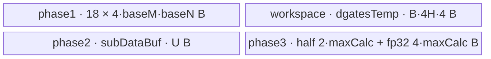

# ThnnFusedLstmCellBackward A2/A3 ACLNN 算子知识

## 算子速览

| 项目 | 内容 |
|---|---|
| 实际入口 | `aclnnThnnFusedLstmCellBackwardGetWorkspaceSize` + `aclnnThnnFusedLstmCellBackward`，CANN 9.1.0 公开两段式 ACLNN |
| 计算语义 | 单时间步 LSTM 的逐元素反向；可选地把 `dgates[B,4H]` 沿 batch 归约为 `db[4H]` |
| 输入输出 | `dhy/dc/cx/cy:[B,H]`，`storage/dgates:[B,4H]`，`dc_prev:[B,H]`，`db:[4H]`；ND；全体同为 FP32 或 FP16 |
| 执行类型 | 单 Device 节点 `AIV_VECTOR`；节点内部依次为门梯度、可选 batch 归约、FP16+bias 时的最终 Cast |
| Kernel 路线 | R-001 FP32 无 bias；R-002 FP16 无 bias；R-003/R-004 FP32 bias 单级/多级归约；R-005/R-006 FP16 bias 单级/多级归约 |
| 核心资源 | GM + `TBuf<VECCALC>`；门梯度阶段 18 个 FP32 TBuf，归约阶段独占整块 UB，FP16+bias 使用 FP32 workspace |
| 来源闭包 | `source_closed`：公开 ACLNN、L0 launcher、OpDef/Tiling/POD、key 0 entry、AIV body、同步和通用构建生成路径闭合 |
| 验证状态 | 已完成源码闭包检查；本次知识提取未执行编译、真机、数值或性能测试。 |

## 接口与语义

### 计算语义

令 `storage` 每行按 `[i,f,j,o]` 四段存放已经激活的门值，`g_c=tanh(cy)`，则每个 `(b,h)`：

```text
dc_total = dhy * o * (1 - g_c * g_c) + dc
dc_prev  = dc_total * f
di = dc_total * j  * i * (1 - i)
df = dc_total * cx * f * (1 - f)
dj = dc_total * i  * (1 - j * j)
do = dhy * g_c     * o * (1 - o)
dgates[b,:] = concat(di, df, dj, do)
db[:] = sum_b(dgates[b,:])              # 仅 hasBias=true
```

Kernel 全部逐元素计算使用 FP32 LocalTensor；FP16 输入先升为 FP32，最后按 Route 降回 FP16。

### 输入、输出与属性

| 参数 | shape/layout | dtype | 约束、默认值与语义 |
|---|---|---|---|
| `gradHyOptional` | `[B,H]` / ND | FP32、FP16 | 名称和文档称 optional，但固定实现 `CheckNotNull` 要求非空；`B,H>0` |
| `gradCOptional` | `[B,H]` / ND | 同 `gradHyOptional` | 固定实现同样要求非空 |
| `cx` | `[B,H]` / ND | 同上 | 上一时刻 cell state |
| `cy` | `[B,H]` / ND | 同上 | 当前 cell state |
| `storage` | `[B,4H]` / ND | 同上 | 每行依次为 `i/f/j/o` 四门激活值 |
| `hasBias` | 标量属性 | bool | `false` 时不计算/写 `db`；OpDef 默认 `false` |
| `gradGatesOut` | `[B,4H]` / ND | 同输入 | 四门 pre-activation 梯度 |
| `gradCxOut` | `[B,H]` / ND | 同输入 | `dc_prev` |
| `gradBiasOut` | `[4H]` / ND | 同输入 | `hasBias=true` 时校验 shape 并写入；API 实现无条件要求指针非空 |

API 允许非连续 Tensor；实现先对五个输入调用框架 `Contiguous`，最后用 `ViewCopy` 提交两项或三项输出。公开文档声明默认确定性；输入含 Inf 时输出为 NaN，输入含 NaN 时输出为 NaN。

### 入口与版本

固定 Commit 中只公开这一组无版本后缀入口，未发现同语义的更新 ACLNN 版本。公开产品表同时支持 Atlas A2 与 A3，明确不支持 Ascend 950PR/950DT。OpDef 的活动 AICore 配置为 `ascend910b` 与 `ascend910_93`；A2/A3 共用同一 Host、POD 与 Kernel 源码。

## Host/Launcher 执行流程

### 参数校验与前处理

`aclnnThnnFusedLstmCellBackwardGetWorkspaceSize` 的顺序是：创建 executor → `CheckParams` → 空输入快返 → 五次 `l0op::Contiguous` → `l0op::ThnnFusedLstmCellGrad` → 两次必需 `ViewCopy` 与一次条件 `ViewCopy` → 返回 executor 总 workspace。

`CheckParams` 依次检查：所有八个 Tensor 指针非空；全体 dtype 属于 `{FP32,FP16}` 且与 `gradHyOptional` 相同；`gradHyOptional` 为二维且 `B,H>0`，其余 shape 精确匹配；所有 storage format 为 ND。由于 shape 校验先要求正 `B,H` 且其它输入精确匹配，后续空输入快返在正常有效输入域不可达，但仍保留为 executor 边界。

L0 层按 `storage`/`cx` view shape 分配 `gradInGates`、`gradCPrev`；有 bias 时分配 `[4H]`，否则分配一个无 shape 的占位 Tensor。`ADD_TO_LAUNCHER_LIST_AICORE` 失败即返回三个空指针并阻断 ViewCopy。

### 参数、Workspace 与生命周期

Tiling 从平台读取 AIV 核数 `C`、UB 字节数 `U` 和 `sysWorkspaceSize`。算子私有 workspace：

```text
A = 32 / sizeof(T)                         # FP32:8, FP16:16
baseReduceN = min(align_up(ceil(4H/C), A), 128)
maxReduceNumOnce = floor((U - 1024) / (4 * baseReduceN))
W_dgates = (T=FP16 && hasBias) ? B*4H*4 : 0
W_reduce = (B > maxReduceNumOnce) ? ceil(B/maxReduceNumOnce)*4H*4 : 0
tiling workspace[0] = sysWorkspaceSize + W_dgates + W_reduce
```

Kernel 将其收到的 operator workspace 视为本地基址：FP16+bias 的 `dgatesTemp` 从 0 开始；`reduceTemp` 紧随其后。executor 对 `sysWorkspaceSize` 以及 Contiguous/ViewCopy workspace 的聚合与偏移属于框架边界，固定仓只公开最终 `uniqueExecutor->GetWorkspaceSize()`，不能把上式误写成公开 ACLNN 返回值的完整闭式。

所有 launcher 与 ViewCopy 由第一段返回的 executor 持有；第二段 `CommonOpExecutorRun(workspace, workspaceSize, executor, stream)` 在给定 stream 上执行。Kernel 内 workspace 在 Kernel 完成前有效，输出 ViewCopy 在其后消费临时输出。

### 启动图与失败传播

```text
aclnn GetWorkspaceSize
  -> Contiguous(dhy, dc, cx, cy, storage)       # 框架节点，按需
  -> ThnnFusedLstmCellGrad launcher
       -> thnn_fused_lstm_cell_grad<<<C, stream>>>(..., POD key=0)
          -> ProcessDgates
          -> [hasBias] SyncAll -> ProcessReduce
          -> [hasBias && FP16] SyncAll -> CastDgatesBack
  -> ViewCopy(dgates, gradGatesOut)
  -> ViewCopy(dcPrev, gradCxOut)
  -> [hasBias] ViewCopy(db, gradBiasOut)
```

核心算子只有一个 Device Kernel；三阶段是同一次 launch 内的全核阶段。`SetScheduleMode(1)` 仅在 bias 路线启用，为 Kernel 的 `SyncAll` 提供跨核调度条件。每个 API/L0/launch/ViewCopy 失败均通过 `CHECK_RET`/空指针检查阻断后续节点；第二段直接返回 executor 运行状态。框架节点内部 workspace、事件和 cleanup 在固定仓不可见。

## Route 与参数设计

### 分核与资源计算

门梯度切分先按 batch：

```text
singleCoreM = ceil(B/C)
mCnt = ceil(B/singleCoreM)
singleCoreMTail = B - (mCnt-1)*singleCoreM
nTarget = (B<C) ? ceil(C/mCnt) : 1
singleCoreN = align_up(ceil(H/nTarget), A)
nCnt = ceil(H/singleCoreN)
singleCoreNTail = H - (nCnt-1)*singleCoreN
sizeLimit = floor((U-1024)/(18*4*A))*A
baseN = (singleCoreN<sizeLimit) ? align_up(singleCoreN,A) : sizeLimit
baseM = floor(sizeLimit/baseN)
```

逻辑块 `(mCntIndex,nCntIndex)` 以 `totalIndex % C` 轮转映射到 AIV core；核内再以 `baseM × baseN` 切 tile。`nShapeAligned=align_up(nShape,32/sizeof(T))`，所有 Vector 运算长度为 `mShape*nShapeAligned`，GM CopyOut 只写实际 `nShape`。

归约把 `4H` 列按 `baseReduceN` 基块均衡给最多 `C` 核。每核的尾列由 `singleCoreReduceNTail`、核内尾块由 `baseReduceNTail` 表示；batch 大于 `maxReduceNumOnce` 时对 batch 分组并重复树形归约，直至只剩一行。

### Route 选择

| 顺序 | Route | Key/模板 | 精确选择条件与优先级 | 不适用去向 |
|---:|---|---|---|---|
| 1 | R-001 FP32 无 bias | key 0 / `ThnnFusedLstmCellGrad<float>` | dtype=FP32 且 `hasBias=false` | 检查 R-002 |
| 2 | R-002 FP16 无 bias | key 0 / `ThnnFusedLstmCellGrad<half>` | dtype=FP16 且 `hasBias=false` | 检查 R-003 |
| 3 | R-003 FP32 bias 单级 | key 0 / float | dtype=FP32，`hasBias=true`，`B<=maxReduceNumOnce` | 检查 R-004 |
| 4 | R-004 FP32 bias 多级 | key 0 / float | dtype=FP32，`hasBias=true`，`B>maxReduceNumOnce` | 检查 R-005 |
| 5 | R-005 FP16 bias 单级 | key 0 / half | dtype=FP16，`hasBias=true`，`B<=maxReduceNumOnce` | 检查 R-006 |
| 6 | R-006 FP16 bias 多级 | key 0 / half | dtype=FP16，`hasBias=true`，`B>maxReduceNumOnce` | 不支持 dtype/shape 则 Host 失败 |

```text
if dtype not in {FP32, FP16}: fail
if !hasBias: FP32 ? R-001 : R-002
else if dtype==FP32: B<=maxReduceNumOnce ? R-003 : R-004
else: B<=maxReduceNumOnce ? R-005 : R-006
```

Host 始终设置 key 0；上述 Route 是 key 0 body 内实际改变内存、同步、精度或归约拓扑的可达实现族，而非额外 TilingKey。

### 模板/实现执行矩阵

| Route | key/selector | dtype/shape/platform 完整命中条件 | 执行拓扑与 Kernel 节点 | 实际模板/body | 内存与同步特征 | tail/fallback |
|---|---|---|---|---|---|---|
| R-001 | 0 | FP32，`B,H>0`，无 bias，A2/A3 | 单 AIV；门梯度 | `ThnnFusedLstmCellGrad<float>::ProcessDgates` | 18 FP32 TBuf；无跨核 barrier、无私有 workspace | M/N 两级 tail；无 dtype fallback |
| R-002 | 0 | FP16，其余同 R-001 | 单 AIV；门梯度+tile 内 Cast | `ThnnFusedLstmCellGrad<half>` | 同一 TBuf 上半区暂存 FP16，FP32 计算后每 tile 降精度 | 有效 `nShape` CopyOut |
| R-003 | 0 | FP32，bias，`B<=maxReduceNumOnce` | 门梯度→SyncAll→单级归约 | float body | Reset 后整 UB 作归约；无 reduceTemp | 列 tail；直接写 db |
| R-004 | 0 | FP32，bias，`B>maxReduceNumOnce` | 门梯度→SyncAll→多级归约 | float body | `W_reduce`，每级 MTE3→MTE2 同步 | 最后一级写 db |
| R-005 | 0 | FP16，bias，`B<=maxReduceNumOnce` | 门梯度→SyncAll→归约→SyncAll→CastBack | half body | `W_dgates` 保存 FP32；两次全核 barrier | CastBack 尾段 `calcTail` |
| R-006 | 0 | FP16，bias，`B>maxReduceNumOnce` | 同 R-005，归约多级 | half body | `W_dgates+W_reduce`，reduceTemp 位于其后 | 多级 tail + CastBack tail |

### 隐藏性能 Guard

| Guard | Host/Tiling 条件 | Device/资源原因 | 影响 Route | 不满足时去向 | 源码符号 |
|---|---|---|---|---|---|
| dtype/对齐 | FP32→`A=8`，FP16→`A=16` | 32B GM block；FP16 还要在 FP32 buffer 内暂存原始值 | 全部 | 非 FP32/FP16 失败 | `CheckParamsDtype`, `InitVars` |
| 18-buffer UB 上界 | `sizeLimit=floor((U-1024)/(18*4*A))*A` | 门梯度阶段恰有 18 个等容 FP32 TBuf | 全部 | 无 fallback；平台 UB 太小时源码未提供保护 | `VectorBlockCalculate`, `InitVectorBuf` |
| 归约列宽 | `baseReduceN<=128` 且按 A 对齐 | 控制一次 batch×列块装入归约 TBuf | R-003..006 | 固定 cap，无另一路线 | `ReduceBlockCalculate` |
| 单/多级归约 | `B>maxReduceNumOnce` | 单次 UB 不能容纳全部 batch 行 | R-003↔004，R-005↔006 | 使用 reduceTemp 多级归约 | `ReduceBlockCalculate`, `ProcessReduce` |
| FP16+bias 中间精度 | `inputDSize!=4 && isBias==1` | bias 必须从未降精度的 dgates 求和 | R-005/006 | 无 bias 则 R-002；FP32 则 R-003/004 | `Init`, `StoreDgatesResults` |
| 跨核阶段 | `isBias==1` 时 `SetScheduleMode(1)` | `SyncAll` 保护 dgates producer→reduce consumer | bias routes | 无 bias 不进入归约 | `Init`, `Process` |
| 归约 Copy 行数 | 源码令 `copyInLoop=ceil(mLines/4095)`，但没有 Host 谓词保证 `mLines<=4095` | `blockCount` 转为 `uint16_t`；循环的各段都写同一个 UB 基址 | bias routes | 没有 fallback；`mLines>4095` 属于源码可见风险边界 | `LoadDataForReduce` |

### POD/ABI

`ThnnFusedLstmCellGradTilingData` 由 18 个 `int64_t` 字段按下表声明顺序生成。宏 `BEGIN_TILING_DATA_DEF/TILING_DATA_FIELD_DEF` 的展开不在固定仓，因此精确 `sizeof/alignof/offsetof` 不可见；Host/Device 使用同名生成结构与序列化宏，字段顺序可见。

| 结构 | 字段 | 类型/位宽 | ABI 布局 | 单位 | Host/launcher producer | Device consumer | 边界 |
|---|---|---|---|---|---|---|---|
| `ThnnFusedLstmCellGradTilingData` | `ubSize` | int64/64 | 顺序 1；精确 offset 不可见 | byte | 平台 UB | `InitSubDataBuf/CastDgatesBack` | 必须大于 1024 才能产生正容量 |
| 同上 | `batch` | int64/64 | 顺序 2 | element rows | `dhy.shape[0]` | GM extent、归约 | `>0` |
| 同上 | `hiddenSize` | int64/64 | 顺序 3 | element columns | `dhy.shape[1]` | 所有地址/extent | `>0` |
| 同上 | `singleCoreM` | int64/64 | 顺序 4 | rows | `ceil(B/C)` | M core 分块 | 正值 |
| 同上 | `singleCoreMTail` | int64/64 | 顺序 5 | rows | 尾式 | 最后 M 块 | `(0,singleCoreM]` |
| 同上 | `singleCoreN` | int64/64 | 顺序 6 | elements | 对齐公式 | N core 分块 | A 对齐，可能大于 H |
| 同上 | `singleCoreNTail` | int64/64 | 顺序 7 | elements | 尾式 | 最后 N 块 | 正有效元素数 |
| 同上 | `baseN` | int64/64 | 顺序 8 | elements | `min(singleCoreN,sizeLimit)` | 核内 N tile/UB | A 对齐 |
| 同上 | `baseM` | int64/64 | 顺序 9 | rows | `sizeLimit/baseN` | 核内 M tile/UB | 固定仓无零容量保护 |
| 同上 | `mCnt` | int64/64 | 顺序 10 | logical blocks | `ceil(B/singleCoreM)` | core 轮转循环 | `>=1` |
| 同上 | `nCnt` | int64/64 | 顺序 11 | logical blocks | `ceil(H/singleCoreN)` | core 轮转循环 | `>=1` |
| 同上 | `singleCoreReduceN` | int64/64 | 顺序 12 | columns in 4H | 均衡后的基块数×`baseReduceN` | 归约核列域 | bias 时活动 |
| 同上 | `singleCoreReduceNTail` | int64/64 | 顺序 13 | columns | 归约尾式 | 最后归约核 | bias 时活动 |
| 同上 | `baseReduceN` | int64/64 | 顺序 14 | columns | 对齐且 cap 128 | 核内归约列块 | bias 时活动 |
| 同上 | `nReduceCnt` | int64/64 | 顺序 15 | AIV cores | `min(C,baseBlockCount)` 后再均衡 | `blockIdx<nReduceCnt` | bias 时活动 |
| 同上 | `maxReduceNumOnce` | int64/64 | 顺序 16 | rows/pass | `(U-1024)/(4*baseReduceN)` | 分级归约、workspace guard | bias 时活动 |
| 同上 | `reduceBlockSize` | int64/64 | 顺序 17 | rows | `B` | 初始 `reduceNumLeft` | bias 时活动 |
| 同上 | `isBias` | int64/64 | 顺序 18 | boolean 0/1 | attr bool→0/1 | 阶段、workspace、输出分支 | 只取 0/1 |

### Route 源码闭包

| Route | Key/selector | Host/Tiling producer | POD/参数 | Kernel entry/router 节点 | Kernel body/直接依赖 | 构建接线 |
|---|---|---|---|---|---|---|
| R-001..006 | key 0 + dtype compile specialization + body guards | `TilingFunc4ThnnFusedLstmCellGrad` / `Init` | `ThnnFusedLstmCellGradTilingData` 全字段 | `thnn_fused_lstm_cell_grad`, `TILING_KEY_IS(0)` | `ThnnFusedLstmCellGrad<T>::Process` 及同头文件 helper | 算子 `CMakeLists.txt`→`add_modules_sources`；`gen_ops_info.cmake::get_op_type_and_validate/prepare_compile_from_config` 从 OpDef 与 `op_kernel` 生成 |

## Kernel 实现

### 公共执行流程

Entry 用 `GET_TILING_DATA` 解析 POD，构造本地 `TPipe`；仅 key 0 实例化 `ThnnFusedLstmCellGrad<DTYPE_DHY>`，未知 key 不执行任何 body。`Init` 绑定五个输入、三个输出和条件 workspace，随后：

```text
InitVectorBuf(18 × FP32 tile buffers)
ProcessDgates
if isBias:
  SyncAll
  pipe.Reset; InitSubDataBuf(U bytes)
  ProcessReduce
  if T != float:
    SyncAll
    pipe.Reset; CastDgatesBack
```

`ProcessDgates` 的每个逻辑 tile 只由 `totalIndex % blockDim` 对应的核处理。输入/输出用 `DataCopyPad` 的二维参数搬运，MTE2→V、V→MTE3、MTE3→MTE2 由显式 event helper 保序，Vector 指令间用 `PipeBarrier<PIPE_V>`。无 TQue；TBuf 生命周期由阶段性 `pipe.Reset()` 切断。

### Route R-001：FP32 无 bias

#### 适用条件

##### 选择证据

| 层级 | 文件 | 符号 | 源码谓词/参数 | 结果/下一跳 |
|---|---|---|---|---|
| API | `op_api/aclnn_thnn_fused_lstm_cell_backward.cpp` | `CheckDtypeValid` | 全体 FP32 | 接受 |
| Tiling | `op_host/thnn_fused_lstm_cell_grad_tiling.cpp` | `CheckAttr/Init` | `isBias=0`，key 0，blockDim=C | key 0 |
| Router | `op_kernel/thnn_fused_lstm_cell_grad.cpp` | `thnn_fused_lstm_cell_grad` | `TILING_KEY_IS(0)`, `DTYPE_DHY=float` | float body |
| Body | `op_kernel/thnn_fused_lstm_cell_grad.h` | `Process` | `tiling.isBias==0` | 仅 `ProcessDgates` |

#### Device 数据流

##### 函数级调用链

```text
ThnnFusedLstmCellGrad launcher -> thnn_fused_lstm_cell_grad
  -> Init -> InitVectorBuf -> ProcessDgates -> SubProcessDgates
    -> ProcessDgatesOnce -> LoadDgatesInputData<float>
    -> ComputeDgates -> StoreDgatesResults<float>
```

##### 源码等价伪码

```text
for logical tile assigned to blockIdx:
  derive M/N core extent and GM offsets
  for each baseM×baseN tile:
    nAligned=align_up(nShape,8); L=mShape*nAligned
    2D-copy dhy,dc,cx,cy and storage.i/f/j/o to FP32 TBuf; wait MTE2->V
    compute tanh(cy), dc_total, dc_prev, di/df/dj/do over L lanes
    wait V->MTE3; copy actual nShape columns of four gates and dc_prev to GM
    wait MTE3->MTE2 before buffer reuse
```

#### 内存与数据搬运

##### 资源与搬运表

| 层级/缓冲区 | offset/地址公式 | extent/容量公式 | dtype/layout | producer | consumer | owner/lifetime | 对齐/复用 |
|---|---|---|---|---|---|---|---|
| 输入 GM | `m*H+n`; storage `m*4H+gate*H+n` | `[B,H]`, `[B,4H]` | FP32 ND | caller | Copy helpers | caller/executor | 二维 stride；有效 N |
| 18 个 TBuf | 独立 UB 子区 | 每个 `4*baseM*baseN` B | FP32 tile | Copy/Vector | Vector/CopyOut | TPipe，门阶段 | 无 depth；跨 tile 覆盖 |
| 输出 GM | 同输入 tile 映射 | `dgates[B,4H]`, `dcPrev[B,H]` | FP32 ND | CopyOut | ViewCopy | executor | 只写 `nShape` |
| workspace | N/A | 0 个算子私有字节 | N/A | N/A | N/A | N/A | 仅系统/框架部分可能存在 |

##### 分层内存布局


##### 字节账与复用顺序

```text
UB_dgates = 18 * 4 * baseM * baseN
baseM*baseN <= sizeLimit <= floor((U-1024)/(18*4*A))*A
UB_dgates <= U-1024
dynamic_ub = N/A
workspace_private = 0
```

| 复用子区 | 写入者 | 读取者/消费点 | 下一次覆盖 | 同步或释放依据 | 安全条件 |
|---|---|---|---|---|---|
| 各输入/输出 TBuf | CopyIn/Vector | Vector/CopyOut | 下一 tile CopyIn/Vector | `MTE3ToMTE2Sync` | 当前 tile 已提交 |
| `dcBuf` | `tanh²`→`dc_total`→`dc_prev` | 后续门梯度/CopyOut | 下一 tile | PIPE_V barrier + MTE3 event | 保持源码顺序 |
| `tmpDiBuf` | `dc*j`，后复用为 `1-o` | di、do | 下一 tile | 对应 PIPE_V barrier | di 已消费后才覆盖 |

#### 同步、精度与尾块

##### 同步与数值边界表

| 阶段 | primitive/机制 | producer | consumer/等待点 | 保护对象 | 精度/尾块 |
|---|---|---|---|---|---|
| CopyIn | `MTE2_V` event | DataCopyPad | Vector | 8 路输入 TBuf | padding lane 不写 GM；Vector 长度为 L |
| Compute | `PipeBarrier<PIPE_V>` | 依赖 Vector op | 下一依赖 op | 原地 `dc/di/df/dj/tmpDi` | FP32 全程 |
| CopyOut | `V_MTE3`, `MTE3_MTE2` | Vector/MTE3 | CopyOut/下一 tile | 输出与 TBuf 复用 | GM 仅 actual `nShape` |

#### 关键实现

##### 符号证据表

| 阶段 | 文件 | 符号/模板实例 | 实现事实 |
|---|---|---|---|
| Host/Tiling producer | `op_host/thnn_fused_lstm_cell_grad_tiling.cpp` | `VectorBlockCalculate` | 18-buffer UB 反推 tile |
| Kernel entry/router | `op_kernel/thnn_fused_lstm_cell_grad.cpp` | `thnn_fused_lstm_cell_grad` | key 0→`<float>` |
| Device body/helper | `op_kernel/thnn_fused_lstm_cell_grad.h` | `ProcessDgates/ComputeDgates/CopyOutputGate` | 地址、公式、同步和 tail |

### Route R-002：FP16 无 bias

#### 适用条件

##### 选择证据

| 层级 | 文件 | 符号 | 源码谓词/参数 | 结果/下一跳 |
|---|---|---|---|---|
| API/Tiling | `op_api/aclnn_thnn_fused_lstm_cell_backward.cpp`; `op_host/thnn_fused_lstm_cell_grad_tiling.cpp` | `CheckDtypeValid`, `CheckAttr` | FP16，`isBias=0` | key 0，A=16 |
| Router | `op_kernel/thnn_fused_lstm_cell_grad.cpp` | entry | `DTYPE_DHY=half` | half body |
| Body | `op_kernel/thnn_fused_lstm_cell_grad.h` | `Load/StoreDgatesResults` | half 且无 bias | tile 内升/降精度 |

#### Device 数据流

##### 函数级调用链

```text
entry<half> -> ProcessDgates
  -> CopyInput/CopyGateInput<half> into upper half of each FP32 TBuf
  -> Cast half->float -> ComputeDgates<float>
  -> Cast gates/dcPrev float->half -> CopyOut
```

##### 源码等价伪码

```text
for assigned tile:
  L=mShape*align_up(nShape,16)
  copy half inputs to ReinterpretCast<half>()[L] in each 4L-byte TBuf
  wait; cast each source half[L:2L] to float[0:L]
  compute all formulas in FP32
  cast di/df/dj/do and dc_prev back into half view at buffer base
  copy only actual nShape columns to GM
```

#### 内存与数据搬运

##### 资源与搬运表

| 层级/缓冲区 | offset/地址公式 | extent/容量公式 | dtype/layout | producer | consumer | owner/lifetime | 对齐/复用 |
|---|---|---|---|---|---|---|---|
| 18 TBuf | 与 R-001 相同 | 每个 `4*baseM*baseN` B | FP32/FP16 reinterpret | half CopyIn→Cast | FP32 Vector | TPipe/每 tile | 输入暂存在字节 `[2L,4L)`，Cast 写 `[0,4L)` |
| 输出 GM | tile 实际地址 | 同逻辑输出 | FP16 ND | Cast+CopyOut | ViewCopy | executor | N 按 16 元素对齐计算，实际 N 写出 |
| workspace | N/A | 私有 0 | N/A | N/A | N/A | N/A | 无 bias |

##### 分层内存布局


##### 字节账与复用顺序

```text
UB_total = 18 * 4 * baseM * baseN <= U-1024
workspace_private = 0
```

| 复用子区 | 写入者 | 读取者/消费点 | 下一次覆盖 | 同步或释放依据 | 安全条件 |
|---|---|---|---|---|---|
| 输入 TBuf 上半区→全 TBuf | half CopyIn | Cast | FP32 Cast 结果覆盖 | `MTE2ToVSync`，Cast 后 PIPE_V barrier | 源从 offset L 个 half 开始，容量精确容纳 |
| 输出 TBuf | FP32 compute | half Cast/CopyOut | 下一 tile | V→MTE3→MTE2 | Cast 在 CopyOut 前完成 |

#### 同步、精度与尾块

##### 同步与数值边界表

| 阶段 | primitive/机制 | producer | consumer/等待点 | 保护对象 | 精度/尾块 |
|---|---|---|---|---|---|
| 输入 Cast | `MTE2_V` + PIPE_V | half GM | FP32 compute | 同 TBuf 双视图 | `CAST_NONE` |
| 输出 Cast | PIPE_V + `V_MTE3` | FP32 result | half GM | gate/dc buffers | half 使用 `CAST_NONE` |
| tail | DataCopyPad | aligned UB | GM | 输出边界 | 只写实际 `nShape` |

#### 关键实现

##### 符号证据表

| 阶段 | 文件 | 符号/模板实例 | 实现事实 |
|---|---|---|---|
| Host/Tiling producer | `op_host/thnn_fused_lstm_cell_grad_tiling.cpp` | `CheckParamsDtype/VectorBlockCalculate` | FP16 字节数与 A=16 |
| Kernel entry/router | `op_kernel/thnn_fused_lstm_cell_grad.cpp` | `<DTYPE_DHY>` | half 实例 |
| Device body/helper | `op_kernel/thnn_fused_lstm_cell_grad.h` | `LoadDgatesInputData<half>`, `StoreDgatesResults` | buffer 双视图和 Cast |

### Route R-003：FP32 bias 单级归约

#### 适用条件

##### 选择证据

| 层级 | 文件 | 符号 | 源码谓词/参数 | 结果/下一跳 |
|---|---|---|---|---|
| Tiling | `op_host/thnn_fused_lstm_cell_grad_tiling.cpp` | `Init` | FP32，bias，`B<=maxReduceNumOnce` | `W_reduce=0`, schedule mode 1 |
| Body | `op_kernel/thnn_fused_lstm_cell_grad.h` | `Process/ProcessReduce` | bias；while 首轮后 `reduceNumLeft=0` | 单级归约 |

#### Device 数据流

##### 函数级调用链

```text
float ProcessDgates -> SyncAll -> pipe.Reset -> InitSubDataBuf
  -> ProcessReduce -> SubProcessReduce
    -> LoadDataForReduce(dgatesGm) -> BinarySum -> StoreReduceResult(dbGm)
```

##### 源码等价伪码

```text
produce FP32 dgates and dc_prev as R-001; all-core barrier
for each assigned 4H column tile:
  load B rows × nReduceShape from dgates GM into U-byte TBuf
  binary-tree add row pairs in place
  write first reduced row to db GM
```

#### 内存与数据搬运

##### 资源与搬运表

| 层级/缓冲区 | offset/地址公式 | extent/容量公式 | dtype/layout | producer | consumer | owner/lifetime | 对齐/复用 |
|---|---|---|---|---|---|---|---|
| dgates GM | `[row*4H+reduceOffset]` | `B×nReduceShape` per tile | FP32 row-major | gate phase | reduce CopyIn | output/executor | SyncAll before read |
| `subDataBuf` | UB base | U bytes | FP32 rows×aligned columns | DataCopyPad | BinarySum | TPipe/reduce phase | pipe.Reset replaces 18 buffers |
| db GM | `reduceOffset` | actual nReduceShape | FP32 | StoreReduceResult | caller | output | one row CopyOut |

##### 分层内存布局


##### 字节账与复用顺序

```text
UB_gate = 18*4*baseM*baseN <= U-1024
pipe.Reset()
UB_reduce = U
workspace_private = 0
```

| 复用子区 | 写入者 | 读取者/消费点 | 下一次覆盖 | 同步或释放依据 | 安全条件 |
|---|---|---|---|---|---|
| 整 UB | gate TBuf 集 | gate CopyOut | `subDataBuf` 初始化 | `SyncAll` 后 `pipe.Reset` | 全核 gate 输出已完成 |
| `subDataBuf` | CopyIn | BinarySum/CopyOut | 下一列 tile | `MTE3ToMTE2Sync` | db 已提交 |

#### 同步、精度与尾块

##### 同步与数值边界表

| 阶段 | primitive/机制 | producer | consumer/等待点 | 保护对象 | 精度/尾块 |
|---|---|---|---|---|---|
| 跨阶段 | `SyncAll` + schedule mode 1 | 所有 dgates core | reduce core | dgates GM | FP32 |
| 归约 | PIPE_V tree + MTE events | CopyIn/row adds | db CopyOut | subDataBuf | 奇数行由树形边界保留；列 tail 有效长度 |

#### 关键实现

##### 符号证据表

| 阶段 | 文件 | 符号/模板实例 | 实现事实 |
|---|---|---|---|
| Host/Tiling producer | `op_host/thnn_fused_lstm_cell_grad_tiling.cpp` | `ReduceBlockCalculate/Init` | 单级阈值、schedule mode |
| Kernel entry/router | `op_kernel/thnn_fused_lstm_cell_grad.cpp` | key 0 float | 单 launch |
| Device body/helper | `op_kernel/thnn_fused_lstm_cell_grad.h` | `ProcessReduce/BinarySum` | FP32 树形 batch 归约 |

### Route R-004：FP32 bias 多级归约

#### 适用条件

##### 选择证据

| 层级 | 文件 | 符号 | 源码谓词/参数 | 结果/下一跳 |
|---|---|---|---|---|
| Tiling | `op_host/thnn_fused_lstm_cell_grad_tiling.cpp` | `Init` | FP32，bias，`B>maxReduceNumOnce` | 分配 `W_reduce` |
| Body | `op_kernel/thnn_fused_lstm_cell_grad.h` | `ProcessReduce` | `reduceSubRepeatTimes>1` | 写 reduceTemp 并继续 while |

#### Device 数据流

##### 函数级调用链

```text
ProcessDgates -> SyncAll -> ProcessReduce
  -> pass0: dgatesGm -> BinarySum -> reduceTempGm
  -> pass1..k: reduceTempGm -> BinarySum -> reduceTempGm or dbGm
```

##### 源码等价伪码

```text
rows=B
while rows>=1:
  group=min(rows,maxReduceNumOnce); groups=ceil(rows/group)
  for each group: load group rows, tree-sum
    if groups>1: store one FP32 row at reduceTemp[groupIndex,:]
    else: store db
  rows = groups>1 ? groups : 0
```

#### 内存与数据搬运

##### 资源与搬运表

| 层级/缓冲区 | offset/地址公式 | extent/容量公式 | dtype/layout | producer | consumer | owner/lifetime | 对齐/复用 |
|---|---|---|---|---|---|---|---|
| reduceTemp GM | `groupIndex*4H+colOffset` | `ceil(B/maxR)*4H` FP32 | row-major | pass0/中间 pass | 下一 pass | workspace/kernel | 原地跨 pass 压缩 |
| subDataBuf | UB base | U bytes | FP32 | 当前 pass CopyIn | BinarySum | reduce phase | 每 group 覆盖 |
| db GM | colOffset | `4H` | FP32 | 最后 pass | caller | output | 最后一级才写 |

##### 分层内存布局


##### 字节账与复用顺序

```text
UB_reduce = U
workspace_private = W_reduce = ceil(B/maxReduceNumOnce)*4H*4
```

| 复用子区 | 写入者 | 读取者/消费点 | 下一次覆盖 | 同步或释放依据 | 安全条件 |
|---|---|---|---|---|---|
| reduceTemp 前缀 | 当前 pass group | 下一 pass CopyIn | 下一 pass 输出前缀 | 每 group `MTE3ToMTE2Sync` | 下一 pass 输出行数不大于输入行数，且按组顺序处理 |

#### 同步、精度与尾块

##### 同步与数值边界表

| 阶段 | primitive/机制 | producer | consumer/等待点 | 保护对象 | 精度/尾块 |
|---|---|---|---|---|---|
| pass 间 | `MTE3_MTE2` event | reduceTemp Store | 下一 CopyIn | 同一 workspace | FP32；最后 group 用 `reduceBlockSizeTail` |
| 树归约 | PIPE_V barrier | 每层 Add | 下一层 | 行首向量 | 非 2 次幂行数由 `mid<rightEnd` 保护 |

#### 关键实现

##### 符号证据表

| 阶段 | 文件 | 符号/模板实例 | 实现事实 |
|---|---|---|---|
| Host/Tiling producer | `op_host/thnn_fused_lstm_cell_grad_tiling.cpp` | `Init` | `W_reduce` 公式 |
| Kernel entry/router | `op_kernel/thnn_fused_lstm_cell_grad.cpp` | key 0 float | 单 launch 多阶段 |
| Device body/helper | `op_kernel/thnn_fused_lstm_cell_grad.h` | `ProcessReduce/LoadDataForReduce/StoreReduceResult` | workspace 多级边和同步 |

### Route R-005：FP16 bias 单级归约

#### 适用条件

##### 选择证据

| 层级 | 文件 | 符号 | 源码谓词/参数 | 结果/下一跳 |
|---|---|---|---|---|
| Tiling | `op_host/thnn_fused_lstm_cell_grad_tiling.cpp` | `Init` | FP16，bias，`B<=maxReduceNumOnce` | `W_dgates=B*4H*4`, `W_reduce=0` |
| Body | `op_kernel/thnn_fused_lstm_cell_grad.h` | `StoreDgatesResults/Process` | half+bias | FP32 temp→reduce→barrier→CastBack |

#### Device 数据流

##### 函数级调用链

```text
half ProcessDgates -> FP32 dgatesTemp + FP16 dcPrev
  -> SyncAll -> ProcessReduce(dgatesTemp -> FP16 db)
  -> SyncAll -> CastDgatesBack(dgatesTemp -> FP16 dgates)
```

##### 源码等价伪码

```text
compute tile in FP32; store four gate gradients as FP32 to dgatesTemp
cast/store dc_prev to FP16
all-core barrier; tree-reduce dgatesTemp over B in FP32; cast final db to FP16
all-core barrier; distribute flat dgatesTemp chunks round-robin across cores
cast each valid chunk FP32->FP16 and write final dgates
```

#### 内存与数据搬运

##### 资源与搬运表

| 层级/缓冲区 | offset/地址公式 | extent/容量公式 | dtype/layout | producer | consumer | owner/lifetime | 对齐/复用 |
|---|---|---|---|---|---|---|---|
| dgatesTemp | tile gate offset | `B*4H` elements | FP32 row-major | gate phase | reduce + CastBack | workspace/kernel | 保持未降精度 |
| subDataBuf | UB base | U bytes | FP32 | dgatesTemp CopyIn | BinarySum | reduce phase | Reset 后独占 |
| Cast buffers | UB base/独立 | `2*maxCalcNum` + `4*maxCalcNum` bytes | half + FP32 | CopyIn/Cast | CopyOut | cast phase | Reset 后重新布局 |
| db/dgates GM | flat/tiled | | FP16 | Cast | caller/ViewCopy | output | 仅有效尾块 |

##### 分层内存布局



##### 字节账与复用顺序

```text
UB_phase1 <= U-1024
UB_phase2 = U
maxCalcNum=floor((U-1024)/(2+4)/16)*16
UB_phase3=6*maxCalcNum <= U-1024
workspace_private=W_dgates=B*4H*4
```

| 复用子区 | 写入者 | 读取者/消费点 | 下一次覆盖 | 同步或释放依据 | 安全条件 |
|---|---|---|---|---|---|
| dgatesTemp | gate core | reduce core、CastBack core | Kernel 完成后释放 | 两次 `SyncAll` | reduce 完成后才允许 CastBack 阶段继续 |
| 整 UB | phase1→phase2→phase3 | 各阶段 | `pipe.Reset` | 前一阶段全核 barrier | bias schedule mode 1 |

#### 同步、精度与尾块

##### 同步与数值边界表

| 阶段 | primitive/机制 | producer | consumer/等待点 | 保护对象 | 精度/尾块 |
|---|---|---|---|---|---|
| gate→reduce | SyncAll | FP32 dgatesTemp | reduce | workspace | 保留 FP32 |
| reduce→CastBack | SyncAll | reduce readers | CastBack/writer | dgatesTemp 生命周期 | db 最终 `CAST_NONE` 到 FP16 |
| CastBack | MTE2/V/MTE3 events | FP32 temp | FP16 output | 双 TBuf | `calcTail` 保护最后平铺段 |

#### 关键实现

##### 符号证据表

| 阶段 | 文件 | 符号/模板实例 | 实现事实 |
|---|---|---|---|
| Host/Tiling producer | `op_host/thnn_fused_lstm_cell_grad_tiling.cpp` | `Init` | FP32 dgates workspace |
| Kernel entry/router | `op_kernel/thnn_fused_lstm_cell_grad.cpp` | key 0 half | half body |
| Device body/helper | `op_kernel/thnn_fused_lstm_cell_grad.h` | `StoreDgatesResults/ProcessReduce/CastDgatesBack` | 延迟降精度和两次 barrier |

### Route R-006：FP16 bias 多级归约

#### 适用条件

##### 选择证据

| 层级 | 文件 | 符号 | 源码谓词/参数 | 结果/下一跳 |
|---|---|---|---|---|
| Tiling | `op_host/thnn_fused_lstm_cell_grad_tiling.cpp` | `Init` | FP16，bias，`B>maxReduceNumOnce` | `W_dgates+W_reduce` |
| Body | `op_kernel/thnn_fused_lstm_cell_grad.h` | `InitGlobalBuffers/ProcessReduce` | reduceOffset 非零且多组 | temp 切片串接，多级归约 |

#### Device 数据流

##### 函数级调用链

```text
FP16 inputs -> FP32 dgatesTemp
  -> SyncAll -> dgatesTemp -> reduceTemp(pass0..k) -> FP16 db
  -> SyncAll -> dgatesTemp -> FP16 dgates
```

##### 源码等价伪码

```text
dgatesTemp = workspace[0 : B*4H floats]
reduceTemp = workspace[B*4H floats :]
run R-005 gate and CastBack paths
between them run R-004 multi-pass tree, with first pass reading dgatesTemp
```

#### 内存与数据搬运

##### 资源与搬运表

| 层级/缓冲区 | offset/地址公式 | extent/容量公式 | dtype/layout | producer | consumer | owner/lifetime | 对齐/复用 |
|---|---|---|---|---|---|---|---|
| dgatesTemp | workspace byte 0 | `B*4H*4` bytes | FP32 | gates | reduce pass0/CastBack | Kernel | 不与 reduceTemp 重叠 |
| reduceTemp | workspace byte `B*4H*4` | `ceil(B/maxR)*4H*4` bytes | FP32 | reduce pass | later pass | Kernel | 压缩复用 |
| UB | 分阶段布局 | 同 R-005 | FP32/half | 各阶段 | 各阶段 | TPipe | Reset + SyncAll |

##### 分层内存布局


##### 字节账与复用顺序

```text
workspace_private = B*4H*4 + ceil(B/maxReduceNumOnce)*4H*4
UB 各阶段上界同 R-005，任一时刻不求和
```

| 复用子区 | 写入者 | 读取者/消费点 | 下一次覆盖 | 同步或释放依据 | 安全条件 |
|---|---|---|---|---|---|
| reduceTemp 前缀 | 当前归约 pass | 下一 pass | 下一 pass 输出 | MTE3→MTE2 event | 输出行数单调缩小 |
| dgatesTemp | gate phase | reduce pass0、CastBack | Kernel 结束 | gate/reduce 两道 SyncAll | reduceTemp 使用独立 offset |

#### 同步、精度与尾块

##### 同步与数值边界表

| 阶段 | primitive/机制 | producer | consumer/等待点 | 保护对象 | 精度/尾块 |
|---|---|---|---|---|---|
| 跨阶段 | 两次 SyncAll | gate/reduce | reduce/CastBack | 两片 workspace 与 UB Reset | 归约全 FP32，最终 FP16 |
| 多级归约 | PIPE_V + MTE event | 每 pass | 下一 pass | reduceTemp | group tail、列 tail |
| CastBack | round-robin loop | flat chunk | dgates GM | 有效 flat extent | 最后一块 `calcTail` |

#### 关键实现

##### 符号证据表

| 阶段 | 文件 | 符号/模板实例 | 实现事实 |
|---|---|---|---|
| Host/Tiling producer | `op_host/thnn_fused_lstm_cell_grad_tiling.cpp` | `Init` | 两片 workspace 的和 |
| Kernel entry/router | `op_kernel/thnn_fused_lstm_cell_grad.cpp` | key 0 half | 单 Kernel |
| Device body/helper | `op_kernel/thnn_fused_lstm_cell_grad.h` | `InitGlobalBuffers/ProcessReduce/CastDgatesBack` | offset、lifetime、精度、tail |

## 算子特定优化

### Trick T-001：FP16+bias 延迟降精度

#### 触发与源码依据

- 适用 Route：R-005、R-006
- 触发条件：`tiling.isBias==1 && T!=float`
- Golden 来源：[`op_kernel/thnn_fused_lstm_cell_grad.h:550-575`](../../../../../../../cann-ops-raw/ascendc/ops-nn/955f8b33985b6d72989ebff341bb9c2c564a51bc/rnn/thnn_fused_lstm_cell_grad/op_kernel/thnn_fused_lstm_cell_grad.h#L550-L575)

**官方源码（固定 Commit 连续逐字摘录）**：

```cpp
if ((tiling.isBias == 1 && !std::is_same<T, float>::value)) {
  VToMTE3Sync();
  CopyOutputGate(outputGm.dgatesTempGm, diTensor, I_GATE_IDX, nShapeAligned);
  CopyOutputGate(outputGm.dgatesTempGm, dfTensor, F_GATE_IDX, nShapeAligned);
  CopyOutputGate(outputGm.dgatesTempGm, djTensor, J_GATE_IDX, nShapeAligned);
  CopyOutputGate(outputGm.dgatesTempGm, doTensor, O_GATE_IDX, nShapeAligned);
} else if constexpr (std::is_same<T, float>::value) {
```

#### 机制与设计原因

FP16+bias 不在 tile CopyOut 时把四门梯度降为 FP16，而是把 FP32 Vector 结果写入 `dgatesTempGm`；`ProcessReduce` 从该 FP32 workspace 求和，归约完成后 `CastDgatesBack` 才生成 FP16 `dgates`。这避免 bias 归约累加已降精度的数据。代价是 `B*4H*4` 字节 workspace 和第二次全核同步。

#### 迁移边界

- 适用：低精度逐元素输出同时需要跨 batch 归约的路线。
- 前提：有足够 FP32 workspace，能提供 gate→reduce→CastBack 的全核顺序。
- 失效：无 bias 时直接走 R-002；FP32 输入走 R-003/R-004。
- 未验证：本次知识提取未执行编译、真机、数值或性能测试。

#### 错误做法

固定仓存在可验证的相反分支：R-002 在无 bias 时可逐 tile 立即降为 FP16；把该分支直接搬到 bias 路线会改变 `ProcessReduce` 的输入精度与 workspace 协议。

### Trick T-002：UB 约束下的多级原地 batch 归约

#### 触发与源码依据

- 适用 Route：R-004、R-006；R-003/R-005 是单级退化形态
- 触发条件：`B>maxReduceNumOnce`
- Golden 来源：[`op_kernel/thnn_fused_lstm_cell_grad.h:622-630`](../../../../../../../cann-ops-raw/ascendc/ops-nn/955f8b33985b6d72989ebff341bb9c2c564a51bc/rnn/thnn_fused_lstm_cell_grad/op_kernel/thnn_fused_lstm_cell_grad.h#L622-L630)

**官方源码（固定 Commit 连续逐字摘录）**：

```cpp
while (reduceNumLeft >= 1) {
  int64_t reduceBlockSize = reduceNumLeft > maxReduceNumOnce ? maxReduceNumOnce : reduceNumLeft;
  int64_t reduceSubRepeatTimes = CeilDiv(reduceNumLeft, reduceBlockSize);
  int64_t reduceBlockSizeTail = reduceNumLeft - (reduceSubRepeatTimes - 1) * maxReduceNumOnce;
  reduceNumLeft = (reduceNumLeft > 1 && reduceSubRepeatTimes > 1) ? reduceSubRepeatTimes : 0;
  SubProcessReduce(reduceNumLeft, reduceBlockSize, reduceBlockSizeTail, reduceSubRepeatTimes, loopTime);
  loopTime++;
}
```

#### 机制与设计原因

每次只装入 `maxReduceNumOnce × baseReduceN` 的 FP32 子矩阵，在 UB 内二叉树求和；多组结果写到 reduceTemp 前缀，下一 pass 继续压缩。workspace 只按首轮最大组数 `ceil(B/maxReduceNumOnce)` 分配，后续行数单调缩小，因此不需为每一级各分配一片。

#### 迁移边界

- 适用：一维批量归约超出 UB、输出列可独立分核的场景。
- 前提：中间结果保持同一 FP32 row-major 布局，MTE3→MTE2 顺序完整。
- 失效：`B<=maxReduceNumOnce` 时退化到 R-003/R-005 的单级直接写 db。
- 未验证：本次知识提取未执行编译、真机、数值或性能测试。

#### 错误做法

不能让下一 pass 在当前 pass 的 workspace Store 完成前读取；源码以 `MTE3ToMTE2Sync` 保护同片 reduceTemp 的跨 pass 复用。

### Trick T-003：由 18 个 FP32 工作集反推二维 tile

#### 触发与源码依据

- 适用 Route：全部
- 触发条件：门梯度阶段
- Golden 来源：[`op_host/thnn_fused_lstm_cell_grad_tiling.cpp:201-220`](../../../../../../../cann-ops-raw/ascendc/ops-nn/955f8b33985b6d72989ebff341bb9c2c564a51bc/rnn/thnn_fused_lstm_cell_grad/op_host/thnn_fused_lstm_cell_grad_tiling.cpp#L201-L220)

**官方源码（固定 Commit 连续逐字摘录）**：

```cpp
int64_t sizeLimit = (rnnParams_.ubSize - DEFAULT_UB_RESERVE_SIZE) / hiddenUbNum / FP32_BYTES / alignedPara_ *
    alignedPara_;
rnnParams_.baseN = rnnParams_.singleCoreN < sizeLimit ?
                   Ops::Base::CeilAlign(rnnParams_.singleCoreN, alignedPara_) : sizeLimit;
rnnParams_.baseM = sizeLimit / rnnParams_.baseN;
```

#### 机制与设计原因

Host 先按真实的 18 个 FP32 TBuf 预算得到单 tile 最大元素数，再优先容纳 N、用剩余容量扩展 M。即使外部 dtype 是 FP16，计算工作集仍按 FP32 计费，确保升精度路径不低估 UB；`alignedPara` 又保持 GM 32B 对齐。

#### 迁移边界

- 适用：多个等容 FP32 中间 Tensor 的二维逐元素融合。
- 前提：buffer 数仍为 18、每个容量仍为 `baseM*baseN*4`，保留 1024B 的约束不变。
- 失效：改变 buffer 数、dtype 或引入 double buffer 后必须重算，不能复用该常数。
- 未验证：本次知识提取未执行编译、真机、数值或性能测试。

#### 错误做法

固定仓未提供可验证反例；但源码公式明确表明不能按输入 FP16 的 2 字节估算这 18 个计算 buffer。

## 模板与实现对比

| 对比维度 | R-001 | R-002 | R-003 | R-004 | R-005 | R-006 | 设计选择依据 |
|---|---|---|---|---|---|---|---|
| 命中条件/优先级 | FP32/no-bias | FP16/no-bias | FP32/bias/单级 | FP32/bias/多级 | FP16/bias/单级 | FP16/bias/多级 | dtype→bias→B 阈值 |
| 模板与 dtype | float | half/FP32 compute | float | float | half/FP32 compute | half/FP32 compute | 只编译 API 支持 dtype |
| 循环与分核 | M×N tile | 同左 | +列分核/一次 batch tree | +多 pass | +一次 tree+flat Cast | +多 pass+flat Cast | bias 决定归约 |
| Queue/TBuf | 18 TBuf | 18 双视图 TBuf | +整 UB reduce | 同左 | +整 UB+2 Cast TBuf | 同左 | `pipe.Reset` 分阶段复用 |
| 内存总占用与复用 | 无私有 WS | 无私有 WS | 无私有 WS | W_reduce | W_dgates | W_dgates+W_reduce | 保留 FP32/超 UB 才分配 |
| 搬运/Vector API | FP32 Copy/Vector | half Cast | +FP32 tree Add | +temp GM | +FP32 temp/Cast | 两者组合 | 避免低精度归约 |
| 同步、精度与 tail | tile events/FP32 | tile Cast | 1×SyncAll | 1×SyncAll+pass event | 2×SyncAll | 2×SyncAll+pass event | producer/consumer 边 |
| fallback/失败边界 | 无 | 无 | B 大→R-004 | N/A | B 大→R-006 | N/A | 不支持 dtype/shape 在 Host 失败 |

## 平台差异

| 项目 | A2 | A3 | 950 |
|---|---|---|---|
| 支持状态 | 公开支持 | 公开支持 | 公开文档明确不支持 |
| Host/Launcher | 与 A3 共用；OpDef 含 `ascend910b`/`ascend910_93` 配置 | 与 A2 共用 | 不生成 `_950` 卡 |
| Kernel/资源 | 同一 key 0 AIV body；C、U 运行时读取 | 同一源码，C、U 随平台信息取值 | 无公开可发布链路 |

## 限制与失败边界

- 实际 API 实现与参数名/文档的 optional 表述不一致：`gradHyOptional`、`gradCOptional` 仍被 `CheckNotNull` 强制非空；`gradBiasOut` 即使 `hasBias=false` 也必须是非空指针，但此时不校验 `[4H]` shape、不启动 bias ViewCopy。
- 仅支持全体同 dtype 的 FP32/FP16、ND、正二维 `B,H`；固定 Host 不支持 BF16，Kernel 中 BF16 constexpr 分支是不可达代码，不属于正式 Route。
- `sizeLimit/baseN/baseM` 与 `maxReduceNumOnce` 未显式检查平台 UB 过小导致的零值；A2/A3 正常平台资源是隐含前提，固定仓没有资源不足 fallback。
- Tiling 的 `int64_t` shape/字节乘法未显式做溢出检查；Device `DataCopyExtParams` 又窄化 blockCount/blockLen/stride，超大 shape 的安全上界固定仓未给出。
- `InitGlobalBuffers` 给 `storageGm.SetGlobalBuffer` 的声明 extent 是 `B*H`，但 gate Copy 实际按 `[B,4H]` 地址访问；固定源码可见此差异，本次未用运行验证判断该 extent 元数据是否参与边界检查。
- 归约 `LoadDataForReduce` 以 `MAX_COPY_LINES=4095` 计算分段，却让每段 `DataCopyPad` 都写 `subDataTensor` 基址而没有目标 UB offset，且整除 4095 时末段 `curLines=mLines%4095` 为 0；Host 也未保证 `maxReduceNumOnce<=4095`。因此 `mLines>4095`（以及整除边界）的真实行为存在固定源码可见风险，不能按“正确分段”迁移。
- unknown TilingKey 在 entry 中没有 error/fallback body；公开 Host 只产生 key 0。
- Contiguous/ViewCopy、executor 聚合 workspace、系统 workspace 映射及 runtime stream 错误清理属于固定仓外框架边界。已完成源码闭包检查；本次知识提取未执行编译、真机、数值或性能测试。

## 源码索引

### 链路索引

| 链路阶段 | 文件 | 关键符号 | 支撑内容 |
|---|---|---|---|
| 入口声明/约束 | `rnn/thnn_fused_lstm_cell_grad/docs/aclnnThnnFusedLstmCellBackward.md` | 产品表、函数原型 | 公开语义、A2/A3 支持与 950 不支持 |
| 入口声明/约束 | `rnn/thnn_fused_lstm_cell_grad/op_api/aclnn_thnn_fused_lstm_cell_backward.h` | 两段式 API | ABI 参数顺序 |
| 入口实现 | `rnn/thnn_fused_lstm_cell_grad/op_api/aclnn_thnn_fused_lstm_cell_backward.cpp` | `CheckParams`, GetWorkspaceSize, executor run | 校验、Contiguous、ViewCopy、失败传播 |
| 入口实现 | `rnn/thnn_fused_lstm_cell_grad/op_api/thnn_fused_lstm_cell_grad.cpp` | `l0op::ThnnFusedLstmCellGrad` | 输出分配和 AICore launcher |
| 平台注册 | `rnn/thnn_fused_lstm_cell_grad/op_host/thnn_fused_lstm_cell_grad_def.cpp` | `ThnnFusedLstmCellGrad::ThnnFusedLstmCellGrad` | dtype、format、attr、910b/910_93 配置 |
| Host/Tiling | `rnn/thnn_fused_lstm_cell_grad/op_host/thnn_fused_lstm_cell_grad_tiling.h` | POD 定义 | 字段顺序和类型 |
| Host/Tiling | `rnn/thnn_fused_lstm_cell_grad/op_host/thnn_fused_lstm_cell_grad_tiling.cpp` | `Init/VectorBlockCalculate/ReduceBlockCalculate` | block、tile、workspace、key 0 |
| Kernel entry/body | `rnn/thnn_fused_lstm_cell_grad/op_kernel/thnn_fused_lstm_cell_grad.cpp` | `thnn_fused_lstm_cell_grad` | key router 与模板实例 |
| Kernel entry/body | `rnn/thnn_fused_lstm_cell_grad/op_kernel/thnn_fused_lstm_cell_grad.h` | `ThnnFusedLstmCellGrad<T>` | 全部阶段、内存、同步、精度、tail |
| 构建接线 | `rnn/thnn_fused_lstm_cell_grad/CMakeLists.txt` | `add_modules_sources` | API/Host/Tiling 纳入模块 |
| 构建接线 | `cmake/gen_ops_info.cmake` | `get_op_type_and_validate`, `prepare_compile_from_config` | 从 OpDef 与 op_kernel 目录生成/编译 kernel |

### 实现复用检查

| 检查项 | 可复用事实 | 不得改变的约束 | 源码符号 |
|---|---|---|---|
| ABI/POD | 18 个 int64 字段的 producer/consumer 关系 | 字段声明顺序、元素/字节单位、bias inactive 字段 | `ThnnFusedLstmCellGradTilingData`, `SetTilingData` |
| 调用顺序 | gate→可选 reduce→可选 CastBack | bias 路线两道阶段边和 executor ViewCopy 次序 | `Process`, GetWorkspaceSize |
| workspace/内存 | FP16 gate temp 与多级 reduce temp 可独立复用 | offset、FP32 extent、`pipe.Reset` 阶段互斥 | `Init`, `InitGlobalBuffers` |
| 同步 | tile event + bias `SyncAll` + pass event | schedule mode 1、producer 完成后才能消费/覆盖 | `Process`, sync helpers |
| 精度与尾块 | FP16 输入升 FP32、bias 延迟降精度 | half `CAST_NONE`、实际 N/flat tail、FP32 tree 顺序 | `Load/StoreDgatesResults`, `BinarySum`, `CastDgatesBack` |
| 失败边界 | Host dtype/shape/format 失败，无 Device fallback | optional 名称不能解释为可传空，unknown key 不可用 | `CheckParams`, entry router |