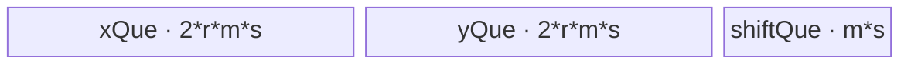
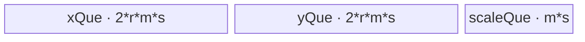
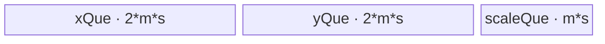

# Modulate 950 ACLNN 算子知识

## 算子速览

| 项目 | 内容 |
|---|---|
| 实际入口 | 最新且唯一公开版本 `aclnnModulateGetWorkspaceSize` + `aclnnModulate`，两段式 ACLNN |
| 计算语义 | `out[b,l,d]=self[b,l,d]*(1+scale[b,d])+shift[b,d]`；可分别省略 scale 或 shift |
| 输入输出 | self/out `[B,L,D]`；scale/shift `[B,D]` 或 `[B,1,D]`；ND；FLOAT/FLOAT16/BFLOAT16 |
| 执行类型 | 单 Kernel `AIV_VECTOR`，950 regbase/MicroAPI；外层可含框架 Contiguous/ViewCopy |
| Kernel 路线 | R-001～003：切 L 的 both/shift-only/scale-only；R-004～006：切 D 的三种模板状态 |
| 核心资源 | GM；X/Y 各双 buffer；Scale/Shift 按模板条件各单 buffer；MicroAPI RegTensor/MaskReg；workspace=0（Modulate 节点） |
| 来源闭包 | `source_closed`：公开 ACLNN→L0→950 regbase selector/POD/key tuple→arch35 entry→L/D MicroAPI body→公共 load/store helper→ascend950 config/CMake 已闭合 |
| 验证状态 | 已完成源码闭包检查；本次知识提取未执行编译、真机、数值或性能测试。 |

## 接口与语义

### 计算语义

scale/shift 沿 L 广播，实际 Kernel 对存在的 scale 先加 1，再乘 self；存在 shift 时再加 shift。BF16 通过公共 helper 升为 FP32 寄存器计算并以 `CAST_RINT` 降回 BF16；FLOAT16、FLOAT 使用本 dtype 的 MicroAPI 寄存器运算。公开头注释写成 `self*scale+shift`，与文档和 body 的 `Adds(scaleReg,1.0f)` 冲突，本卡以 body 为准。

### 输入、输出与属性

| 参数 | shape/layout | dtype | 约束、默认值与语义 |
|---|---|---|---|
| `self` | `[B,L,D]` / ND | FLOAT/FLOAT16/BFLOAT16 | 必需，rank=3 |
| `scaleOptional` | `[B,D]` 或 `[B,1,D]` / ND | 同 self | 可选，B/D 匹配；存在时使用 `1+scale` |
| `shiftOptional` | `[B,D]` 或 `[B,1,D]` / ND | 同 self | 可选，B/D 匹配 |
| `out` | 同 self / ND | 同 self | 必需；shape/dtype 相同 |

API 支持非连续 tensor，并在 executor 中添加 `Contiguous` 与 `ViewCopy`。不过 `CheckShape` 在 optional 判空前读取两个 optional 的 storage format，因此 null optional 的公开路径存在空指针边界。

### 入口与版本

固定 Commit 仅存在无后缀 `aclnnModulate`。公开文档列出 Ascend 950PR/950DT；OpDef 注册 `ascend950`，binary config 为三 dtype 提供二进制项，Kernel CMake 为 ascend950 选用 `arch35/modulate.cpp`。`ModulateTilingFunc` 通过 `IsRegbaseSocVersion` 选择 `ModulateTilingForRegbase`，不复用 A2/A3 body。ACLNN 使用 `ASCEND910B ≤ SocVersion ≤ ASCEND910E` 的平台族 dtype selector；生产平台枚举定义属于框架边界，固定仓未见与公开 950 支持、OpDef/config/CMake 接线相冲突的分支。

## Host/Launcher 执行流程

### 参数校验与前处理

第一段接口依次创建 executor、检查 self/out 非空、检查平台 dtype 列表与同 dtype、检查 self rank=3、optional rank 2/3 与 B/D、out shape。空 tensor 直接返回零 workspace；两个 optional 均缺时意图执行 `Contiguous(self)→ViewCopy(out)`；至少一个 optional 存在时执行各输入 `Contiguous→l0op::Modulate→ViewCopy`。`l0op::Modulate` 分配同 self shape/dtype 的临时输出并用 `ADD_TO_LAUNCHER_LIST_AICORE` 添加一个 Modulate 节点。optional null 的前置解引用限制仍适用。

### 参数、Workspace 与生命周期

Modulate regbase Tiling 的 `GetWorkspaceSize` 写 0；`PostTiling` 把 workspace[0] 置 0，并把 local memory size 设为完整平台 UB `ubSize_`。Kernel 参数中的 workspace 未读取。executor 仍可能因 Contiguous/ViewCopy 产生框架 workspace，第一段以 `uniqueExecutor->GetWorkspaceSize()` 返回总量；临时 tensor 与 workspace 在第二段同 stream 执行完成前有效。

### 启动图与失败传播

```text
aclnnModulateGetWorkspaceSize
  -> Contiguous inputs                      # framework boundary
  -> ModulateAiCore / ADD_TO_LAUNCHER_LIST_AICORE
       -> arch35 modulate<strategy,isScale,isShift>(x,scale,shift,tempY,workspace,tiling)
  -> ViewCopy(tempY,out)                    # framework boundary
aclnnModulate -> CommonOpExecutorRun(workspace,size,executor,stream)
```

单 Device 节点 blockDim 由 L/D 分核得到；POD 是 80 字节 `ModulateRegbaseTilingData`，key 是 `(tilingStrategy,isScale,isShift)` 模板 tuple。无跨 Kernel workspace 边；同 stream executor 顺序保证 tempY 在 ViewCopy 前可见。TilingBase 任一步非成功、launcher 添加失败或 API `CHECK_RET` 均阻断后续节点。

## Route 与参数设计

### 分核与资源计算

设 `C=totalCoreNum_`、`U=ubSize_`、`s=sizeof(T)`、`A=ceil(D/(32/s))*(32/s)`。策略：

```text
if B*L < C:
  tileD=floor(D/C)
  choose L when B*L*tileD*s < 32KiB, otherwise D
else choose L
```

两策略均有：

```text
blockDim=max(1,min(dataNum,C)); dataNum=BL(L路) 或 D(D路)
formerCoreNum=dataNum mod blockDim
tailCoreNum=blockDim-formerCoreNum
formerDataNum=ceil(dataNum/blockDim)
tailDataNum=floor(dataNum/blockDim)
```

L 路令 `p=1+(isScale&&isShift)`，即单 optional 占 1 份参数 buffer、both 占 2 份。若 `(2*2*2+p)*A*s < U`，可多行：`maxCopyRows=floor((floor(U/(A*s))-p)/4)`，再取不超过 `formerDataNum`，并令 `maxCalcNum=D`。否则单行：`maxCopyRows=1`，`maxDInUB=floorAlign(floor(U/(4+p)),32)/s`，`maxCalcNum=min(D,maxDInUB)`。D 路固定单行并用同一单行公式，`maxCalcNum=min(formerDataNum,maxDInUB)`。

### Route 选择

| 顺序 | Route | Key/模板 | 精确选择条件与优先级 | 不适用去向 |
|---:|---|---|---|---|
| 1 | R-001 L/both | `(L,true,true)` | L策略且两 optional 存在 | R-002/003 |
| 2 | R-002 L/shift-only | `(L,false,true)` | L策略、scale缺失、shift存在 | R-003或失败 |
| 3 | R-003 L/scale-only | `(L,true,false)` | L策略、scale存在、shift缺失 | 两者皆缺意图走ViewCopy |
| 4 | R-004 D/both | `(D,true,true)` | `BL<C && BL*floor(D/C)*s>=32KiB` 且两 optional 存在 | R-005/006 |
| 5 | R-005 D/shift-only | `(D,false,true)` | D策略、scale缺失、shift存在 | R-006或失败 |
| 6 | R-006 D/scale-only | `(D,true,false)` | D策略、scale存在、shift缺失 | 两者皆缺意图走ViewCopy |

```text
IsRegbaseSocVersion -> ModulateTilingForRegbase::DoTiling
SelectStrategy -> L(0) or D(1)
GET_TPL_TILING_KEY(strategy,isScale,isShift)
-> compile-time arch35 modulate<strategy,isScale,isShift>
-> ModulateL<T,...> or ModulateD<T,...>
```

### 模板/实现执行矩阵

| Route | key/selector | dtype/shape/platform 完整命中条件 | 执行拓扑与 Kernel 节点 | 实际模板/body | 内存与同步特征 | tail/fallback |
|---|---|---|---|---|---|---|
| R-001 | L,true,true | 950、L策略、both | 单AIV | `ModulateL<T,true,true>`→`ComputeScaleShift` | X/Y双buffer，S/H单buffer，MicroAPI mask | core行尾、batch、D chunk、row group |
| R-002 | L,false,true | 950、L策略、shift-only | 单AIV | `ModulateL<T,false,true>`→`ComputeShift` | X/Y双+H单 | 同上 |
| R-003 | L,true,false | 950、L策略、scale-only | 单AIV | `ModulateL<T,true,false>`→`ComputeScale` | X/Y双+S单 | 同上 |
| R-004 | D,true,true | 950、D策略、both | 单AIV | `ModulateD<T,true,true>`→`ComputeScaleShift` | X/Y双+S/H单；单行 | D核尾/chunk、B/L |
| R-005 | D,false,true | 950、D策略、shift-only | 单AIV | `ModulateD<T,false,true>`→`ComputeShift` | X/Y双+H单 | 同上 |
| R-006 | D,true,false | 950、D策略、scale-only | 单AIV | `ModulateD<T,true,false>`→`ComputeScale` | X/Y双+S单 | 同上 |

### 隐藏性能 Guard

| Guard | Host/Tiling 条件 | Device/资源原因 | 影响 Route | 不满足时去向 | 源码符号 |
|---|---|---|---|---|---|
| D策略阈值 | `BL<C && BL*floor(D/C)*s>=32KiB` | D分核需足够每核工作量 | R-004～006 | L路线 | `SelectStrategy` |
| 多行 UB | `(8+p)*A*s<U` | 两个双buffer×至少2行，加参数buffer | R-001～003 | 单行分D chunk | `CalcTilingParamL` |
| 单行 UB | `maxDInUB=floorAlign(U/(4+p),32)/s` | X/Y双buffer共4份，参数p份 | 全部单行 | 缩小D chunk | `CalcTilingParamL/D` |
| 32B 行对齐 | `xAlign=32/s`, `calCountAlign=ceil(calCount/xAlign)*xAlign` | DataCopyPad与寄存器行起址 | 全部 | pad无效lane | `InitBuffers/CopyInX/Compute*` |
| MicroAPI mask | `vfLoop=ceil(calCount/VL)`，`UpdateMask(sreg)` | 最后寄存器只提交有效lane | 全部 | 最后loop掩码 | `Compute*` |
| DMA窄化 | rows→uint16，bytes/stride→uint32 | DataCopyExtParams ABI | 全部 | 无显式fallback | `CopyInX/CopyOutY` |
| 模板 optional | isScale/isShift 编译期bool | 消除无用 Queue、load与算术 | 全部 | 选另一个tuple | key声明/entry |
| unknown tuple | 仅合法 selector 组合实例化 | entry constexpr只含L/D | 全部 | Host key生成失败/不可达；无Device fallback | tiling key/entry |

### POD/ABI

`ModulateRegbaseTilingData` 是 `#pragma pack(push,8)` 下十个连续 `uint64_t`：`sizeof=80`、`alignof=8`，offset 依次为 0～72。

| 结构 | 字段 | 类型/位宽 | ABI 布局 | 单位 | Host/launcher producer | Device consumer | 边界 |
|---|---|---|---|---|---|---|---|
| `ModulateRegbaseTilingData` | `inputB` | uint64/64 | off0 | 元素维 | x dim0 | B循环/地址 | xShape非空 |
| 同上 | `inputL` | uint64/64 | off8 | 元素维 | x dim1 | L/batch地址 | 同上 |
| 同上 | `inputD` | uint64/64 | off16 | 元素维 | x dim2 | stride/D循环 | 同上 |
| 同上 | `formerCoreNum` | uint64/64 | off24 | core | `dataNum%blockDim` | 大核判断 | 可0 |
| 同上 | `tailCoreNum` | uint64/64 | off32 | core | `blockDim-formerCoreNum` | 仅日志/ABI，body不读分支值 | 可等blockDim |
| 同上 | `formerDataNum` | uint64/64 | off40 | 行或D元素 | ceil(data/blockDim) | 前核dataNum/Host UB上限 | ≥tail |
| 同上 | `tailDataNum` | uint64/64 | off48 | 行或D元素 | floor(data/blockDim) | 后核dataNum | blockDim≤data时≥1 |
| 同上 | `maxDInUB` | uint64/64 | off56 | T元素 | UB单行公式或D | InitBaseParams；body后续不直接读 | 辅助/审计字段 |
| 同上 | `maxCalcNum` | uint64/64 | off64 | T元素 | min(D或formerData,maxDInUB) | D chunk与buffer容量 | 必须>0，否则循环不前进 |
| 同上 | `maxCopyRows` | uint64/64 | off72 | 行 | UB公式，≤formerData | L行组/buffer容量 | D路=1 |

### Route 源码闭包

| Route | Key/selector | Host/Tiling producer | POD/参数 | Kernel entry/router 节点 | Kernel body/直接依赖 | 构建接线 |
|---|---|---|---|---|---|---|
| R-001～003 | `(L,isScale,isShift)` | `ModulateTilingForRegbase` L | 80B POD | `arch35/modulate.cpp` L constexpr | `ModulateL`, `ModulateBaseKernel::Compute*`, load/store helper | ascend950 config + arch35 CMake |
| R-004～006 | `(D,isScale,isShift)` | 同类 D | 同上 | 同 entry D constexpr | `ModulateD`, 同公共 body/helper | 同上 |

## Kernel 实现

### 公共执行流程

entry 按模板 strategy 构造 `ModulateL` 或 `ModulateD`；optional bool 同时控制 Queue 分配、GM load 与 `Compute` constexpr 分支。X `DataCopyPad` 使用 `blockCount=copyRows`、`blockLen=dataNum*s`、`srcStride=(D-dataNum)*s`、`dstStride=0`，并将每行补到 32B；Y 以相同有效行数/字节写回。`Compute*` 令 `VL=VECTOR_REG_WIDTH/sizeof(CAST_T)`，以 `UpdateMask` 遮蔽末寄存器 lane。BF16 helper 使用 `DIST_UNPACK_B16→FP32 Cast` 和 `FP32→CAST_RINT→DIST_PACK_B32`；其他 dtype 直接 `DIST_NORM`。

统一字节符号：`m=ceil(maxCalcNum/(32/s))*(32/s)`、`r=maxCopyRows`、`p=isScale+isShift`。X/Y 各有两个 `r*m*s` buffer，optional 各一个 `m*s` buffer，故 `UB_total=(4r+p)*m*s≤U`；无 dynamic UB、TBuf、workspace slice、通信 window。

### Route R-001：切 L、scale+shift

#### 适用条件

##### 选择证据

| 层级 | 文件 | 符号 | 源码谓词/参数 | 结果/下一跳 |
|---|---|---|---|---|
| Tiling | `op_host/modulate_regbase_tiling.cpp` | `SelectStrategy/GetTilingKey` | L且isScale/isShift | `(L,true,true)` |
| Entry | `op_kernel/arch35/modulate.cpp` | `modulate` | strategy=L | `ModulateL<T,true,true>` |
| Body | `modulate_regbase_common.h` | `Compute` | `isScale&&isShift` | `ComputeScaleShift` |

#### Device 数据流

##### 函数级调用链

```text
modulate<L,true,true> -> ModulateL::Init/Process
 -> CopyInScaleShift -> CopyInX -> ComputeScaleShift -> CopyOutY -> FreeScaleShift
```

##### 源码等价伪码

```text
core owns flattened rows [currentL,currentL+dataNum)
for each covered batch segment:
  for DId by numD<=maxCalcNum: load scale/shift[batch,DId]
    for rows by copyRows<=maxCopyRows: load strided X rows; reg scale+=1; y=x*scale+shift; store
```

#### 内存与数据搬运

##### 资源与搬运表

| 层级/缓冲区 | offset/地址公式 | extent/容量公式 | dtype/layout | producer | consumer | owner/lifetime | 对齐/复用 |
|---|---|---|---|---|---|---|---|
| GM X/Y | base=`currentL*D`; tile=`LIdPerD*D+DId` | copyRows×numD | T/ND | Host/Compute | Compute/ViewCopy | Kernel | src stride `(D-numD)*s` |
| GM S/H | base=`batchStart*D`; offset=`BId*D+DId` | numD | T/[B,D] | Host | Compute | batch/D tile | 跨行复用 |
| xQue/yQue | local row-major | 各 `2*r*m*s` | T/padded rows | CopyIn/Compute | Compute/CopyOut | TPipe | 两buffer |
| scaleQue/shiftQue | D tile | 各 `m*s` | T | CopyIn | Reg load | tile | 单buffer |
| RegTensor/MaskReg | `i*VL`, `row*m+i*VL` | VL lane | CAST_T | MicroAPI load | Adds/Mul/Add/store | VEC scope | mask tail |

##### 分层内存布局


##### 字节账与复用顺序

```text
UB_total=(4r+2)*m*s<=U; dynamic_ub=N/A; workspace_total=0 for Modulate node
```

| 复用子区 | 写入者 | 读取者/消费点 | 下一次覆盖 | 同步或释放依据 | 安全条件 |
|---|---|---|---|---|---|
| X/Y buffer | CopyIn/Compute | Compute/CopyOut | 下一row group | Queue DeQue/Free | consumer完成 |
| S/H buffer | CopyIn | 每row group Compute | 下一D tile | Compute re-EnQue；tile末DeQue/Free | 完整行循环完成 |

#### 同步、精度与尾块

##### 同步与数值边界表

| 阶段 | primitive/机制 | producer | consumer/等待点 | 保护对象 | 精度/尾块 |
|---|---|---|---|---|---|
| GM/UB | Queue EnQue/DeQue | DataCopyPad | Compute/CopyOut | buffers | 32B pad、有效bytes写 |
| Reg | UpdateMask | sreg | each MicroAPI op | last VL | BF16升FP32，half/float原dtype |
| S/H复用 | DeQue→Compute→EnQue | param Queue | next row group | param buffer | scale+1只在RegTensor，不污染UB |

#### 关键实现

##### 符号证据表

| 阶段 | 文件 | 符号/模板实例 | 实现事实 |
|---|---|---|---|
| Host/Tiling producer | `op_host/modulate_regbase_tiling.cpp` | `CalcTilingParamL/GetTilingKey/PostTiling` | UB、tuple、blockDim/POD |
| Kernel entry/router | `op_kernel/arch35/modulate.cpp` | `modulate<L,true,true>` | L body |
| Device body/helper | `op_kernel/arch35/modulate_regbase.h`, `modulate_regbase_common.h` | `ModulateL::Process/ComputeScaleShift` | batch/D/row循环、MicroAPI |

### Route R-002：切 L、仅 shift

#### 适用条件

##### 选择证据

| 层级 | 文件 | 符号 | 源码谓词/参数 | 结果/下一跳 |
|---|---|---|---|---|
| Tiling | `modulate_regbase_tiling.cpp` | `GetTilingKey` | L,false,true | tuple |
| Entry | `arch35/modulate.cpp` | `modulate` | L | `ModulateL<T,false,true>` |
| Body | `modulate_regbase_common.h` | `Compute` | isShift only | `ComputeShift` |

#### Device 数据流

##### 函数级调用链

```text
ModulateL<T,false,true>::Process -> CopyInShift -> CopyInX -> ComputeShift(Add) -> CopyOutY
```

##### 源码等价伪码

```text
flattened L core slice -> batch segment -> D chunks; load shift once/chunk; grouped rows y=x+shift
```

#### 内存与数据搬运

##### 资源与搬运表

| 层级/缓冲区 | offset/地址公式 | extent/容量公式 | dtype/layout | producer | consumer | owner/lifetime | 对齐/复用 |
|---|---|---|---|---|---|---|---|
| GM X/Y | `currentL*D + localRow*D + DId` | rows×numD | T/ND | Host/Compute | Compute/ViewCopy | Kernel | strided chunk |
| xQue/yQue | local padded rows | each `2*r*m*s` | T | CopyIn/Compute | Compute/CopyOut | TPipe | double |
| shiftQue | batch/D chunk | `m*s` | T | CopyInShift | ComputeShift | tile | single/re-EnQue |
| Reg | row*m+iVL | VL | BF16→float或T | load | Add/store | VEC scope | UpdateMask |

##### 分层内存布局



##### 字节账与复用顺序

```text
UB_total=(4r+1)*m*s<=U; dynamic_ub=N/A; workspace_total=0
```

| 复用子区 | 写入者 | 读取者/消费点 | 下一次覆盖 | 同步或释放依据 | 安全条件 |
|---|---|---|---|---|---|
| X/Y | CopyIn/Compute | Compute/CopyOut | next group | Queue Free | complete |
| shift | CopyIn | all groups/tile | next tile | re-EnQue then Free | row loop ends |

#### 同步、精度与尾块

##### 同步与数值边界表

| 阶段 | primitive/机制 | producer | consumer/等待点 | 保护对象 | 精度/尾块 |
|---|---|---|---|---|---|
| Queue | EnQue/DeQue | DMA | Vector/DMA | UB | group/chunk tail |
| Mask/cast | UpdateMask/helper | calCount | Add/store | lanes | BF16 FP32+RINT |

#### 关键实现

##### 符号证据表

| 阶段 | 文件 | 符号/模板实例 | 实现事实 |
|---|---|---|---|
| Host/Tiling producer | `op_host/modulate_regbase_tiling.cpp` | `CalcTilingParamL/GetTilingKey` | p=1、multirow/one-row |
| Kernel entry/router | `op_kernel/arch35/modulate.cpp` | `modulate<L,false,true>` | compile-time optional |
| Device body/helper | `modulate_regbase.h/common.h` | `ModulateL::Process/ComputeShift` | shift广播、mask tail |

### Route R-003：切 L、仅 scale

#### 适用条件

##### 选择证据

| 层级 | 文件 | 符号 | 源码谓词/参数 | 结果/下一跳 |
|---|---|---|---|---|
| Tiling | `modulate_regbase_tiling.cpp` | `GetTilingKey` | L,true,false | tuple |
| Entry | `arch35/modulate.cpp` | `modulate` | L | `ModulateL<T,true,false>` |
| Body | `modulate_regbase_common.h` | `Compute` | isScale only | `ComputeScale` |

#### Device 数据流

##### 函数级调用链

```text
ModulateL<T,true,false>::Process -> CopyInScale -> CopyInX -> ComputeScale(Adds+Mul) -> CopyOutY
```

##### 源码等价伪码

```text
per batch/D chunk load scale; for grouped rows: Reg scale=scale+1; y=x*scale; masked store
```

#### 内存与数据搬运

##### 资源与搬运表

| 层级/缓冲区 | offset/地址公式 | extent/容量公式 | dtype/layout | producer | consumer | owner/lifetime | 对齐/复用 |
|---|---|---|---|---|---|---|---|
| GM X/Y | `currentL*D+localRow*D+DId` | rows×numD | T/ND | Host/Compute | Compute/ViewCopy | Kernel | D stride |
| xQue/yQue | padded rows | each `2*r*m*s` | T | DMA/Compute | Compute/DMA | TPipe | double |
| scaleQue | batch/D chunk | `m*s` | T | DMA | Adds/Mul | tile | single/re-EnQue |
| Reg | row*m+iVL | VL | BF16→float或T | load/Adds | Mul/store | scope | mask |

##### 分层内存布局



##### 字节账与复用顺序

```text
UB_total=(4r+1)*m*s<=U; dynamic_ub=N/A; workspace_total=0
```

| 复用子区 | 写入者 | 读取者/消费点 | 下一次覆盖 | 同步或释放依据 | 安全条件 |
|---|---|---|---|---|---|
| X/Y | DMA/Compute | Compute/DMA | next group | Queue | consumed |
| scale | DMA | every group | next tile | re-EnQue/Free | scale+1仅寄存器、UB不变 |

#### 同步、精度与尾块

##### 同步与数值边界表

| 阶段 | primitive/机制 | producer | consumer/等待点 | 保护对象 | 精度/尾块 |
|---|---|---|---|---|---|
| Queue | queue protocol | DMA | Vector/DMA | buffers | group/D tail |
| Reg | UpdateMask | sreg | Adds/Mul/store | lanes | BF16 RINT，native其他dtype |

#### 关键实现

##### 符号证据表

| 阶段 | 文件 | 符号/模板实例 | 实现事实 |
|---|---|---|---|
| Host/Tiling producer | `modulate_regbase_tiling.cpp` | `CalcTilingParamL/GetTilingKey` | p1、key |
| Kernel entry/router | `arch35/modulate.cpp` | `modulate<L,true,false>` | L scale模板 |
| Device body/helper | `modulate_regbase.h/common.h` | `ModulateL::Process/ComputeScale` | scale Reg加1、Mul |

### Route R-004：切 D、scale+shift

#### 适用条件

##### 选择证据

| 层级 | 文件 | 符号 | 源码谓词/参数 | 结果/下一跳 |
|---|---|---|---|---|
| Tiling | `modulate_regbase_tiling.cpp` | `SelectStrategy/GetTilingKey` | `BL<C && BL*floor(D/C)*s>=32KiB`，both | `(D,true,true)` |
| Entry | `arch35/modulate.cpp` | `modulate` | strategy D | `ModulateD<T,true,true>` |
| Body | `modulate_regbase_common.h` | `Compute` | both | `ComputeScaleShift` |

#### Device 数据流

##### 函数级调用链

```text
modulate<D,true,true> -> ModulateD::Init/Process
 -> per B/D chunk CopyInScaleShift -> per L CopyInX -> ComputeScaleShift -> CopyOutY -> FreeScaleShift
```

##### 源码等价伪码

```text
core owns D interval [currentD,currentD+dataNum)
for b: for local DId by numD<=maxCalcNum: load S/H[b,currentD+DId]
  for l: load X[b,l,currentD+DId]; y=x*(1+s)+h; write numD
```

#### 内存与数据搬运

##### 资源与搬运表

| 层级/缓冲区 | offset/地址公式 | extent/容量公式 | dtype/layout | producer | consumer | owner/lifetime | 对齐/复用 |
|---|---|---|---|---|---|---|---|
| GM X/Y | base currentD；offset `b*L*D+l*D+DId` | one row×numD | T/ND | Host/Compute | Compute/ViewCopy | Kernel | D slice |
| GM S/H | base currentD；offset `b*D+DId` | numD | T/[B,D] | Host | Compute | B/chunk | across all L |
| xQue/yQue | padded one row | each `2*m*s` | T | DMA/Compute | Compute/DMA | TPipe | two buffers |
| scale/shiftQue | chunk | each `m*s` | T | DMA | Reg load | B/chunk | one buffer |
| Reg/Mask | iVL | VL | CAST_T | load | math/store | scope | tail mask |

##### 分层内存布局


##### 字节账与复用顺序

```text
UB_total=6*m*s<=U; dynamic_ub=N/A; workspace_total=0
```

| 复用子区 | 写入者 | 读取者/消费点 | 下一次覆盖 | 同步或释放依据 | 安全条件 |
|---|---|---|---|---|---|
| X/Y | per-L DMA/Compute | Compute/DMA | next L | Queue Free | line complete |
| S/H | per-B/chunk DMA | all L Compute | next chunk | re-EnQue each L; Free after L | complete L loop |

#### 同步、精度与尾块

##### 同步与数值边界表

| 阶段 | primitive/机制 | producer | consumer/等待点 | 保护对象 | 精度/尾块 |
|---|---|---|---|---|---|
| D core split | former/tail address | POD | SetGmAddr | non-overlap GM | last core length differs |
| Queue | EnQue/DeQue | DMA | Vector/DMA | UB | one row, chunk tail |
| MicroAPI | UpdateMask/helper | calCount | operations | lanes | BF16 FP32/RINT |

#### 关键实现

##### 符号证据表

| 阶段 | 文件 | 符号/模板实例 | 实现事实 |
|---|---|---|---|
| Host/Tiling producer | `op_host/modulate_regbase_tiling.cpp` | `CalcTilingParamD/GetTilingKey` | D core/UB/tuple |
| Kernel entry/router | `op_kernel/arch35/modulate.cpp` | `modulate<D,true,true>` | D模板 |
| Device body/helper | `modulate_regbase.h/common.h` | `ModulateD::Process/ComputeScaleShift` | D/B/L地址、广播、MicroAPI |

### Route R-005：切 D、仅 shift

#### 适用条件

##### 选择证据

| 层级 | 文件 | 符号 | 源码谓词/参数 | 结果/下一跳 |
|---|---|---|---|---|
| Tiling | `modulate_regbase_tiling.cpp` | `GetTilingKey` | D,false,true | tuple |
| Entry | `arch35/modulate.cpp` | `modulate` | D | `ModulateD<T,false,true>` |
| Body | `modulate_regbase_common.h` | `Compute` | shift only | `ComputeShift` |

#### Device 数据流

##### 函数级调用链

```text
ModulateD<T,false,true>::Process -> CopyInShift -> per L CopyInX/Add/CopyOut -> FreeShift
```

##### 源码等价伪码

```text
core D slice; per b/chunk load shift once; for each l masked y=x+shift
```

#### 内存与数据搬运

##### 资源与搬运表

| 层级/缓冲区 | offset/地址公式 | extent/容量公式 | dtype/layout | producer | consumer | owner/lifetime | 对齐/复用 |
|---|---|---|---|---|---|---|---|
| GM X/Y | `currentD+b*L*D+l*D+DId` | numD | T/ND | Host/Compute | Compute/ViewCopy | Kernel | D slice |
| xQue/yQue | one padded row | each `2*m*s` | T | DMA/Compute | Compute/DMA | TPipe | double |
| shiftQue | `currentD+b*D+DId` | `m*s` capacity | T | DMA | Add | B/chunk | one/re-EnQue |
| Reg | iVL | VL | BF16→float或T | load | Add/store | scope | mask |

##### 分层内存布局


##### 字节账与复用顺序

```text
UB_total=5*m*s<=U; dynamic_ub=N/A; workspace_total=0
```

| 复用子区 | 写入者 | 读取者/消费点 | 下一次覆盖 | 同步或释放依据 | 安全条件 |
|---|---|---|---|---|---|
| X/Y | per-L DMA/Compute | Add/DMA | next L | Queue | complete |
| shift | DMA | all L | next chunk | re-EnQue/Free | L loop ends |

#### 同步、精度与尾块

##### 同步与数值边界表

| 阶段 | primitive/机制 | producer | consumer/等待点 | 保护对象 | 精度/尾块 |
|---|---|---|---|---|---|
| Queue | protocol | DMA | Vector/DMA | UB | D core/chunk tail |
| Mask/helper | UpdateMask | sreg | Add/store | lanes | BF16 FP32+RINT |

#### 关键实现

##### 符号证据表

| 阶段 | 文件 | 符号/模板实例 | 实现事实 |
|---|---|---|---|
| Host/Tiling producer | `modulate_regbase_tiling.cpp` | `CalcTilingParamD/GetTilingKey` | p1、D key |
| Kernel entry/router | `arch35/modulate.cpp` | `modulate<D,false,true>` | optional compile-time |
| Device body/helper | `modulate_regbase.h/common.h` | `ModulateD::Process/ComputeShift` | broadcast/Add |

### Route R-006：切 D、仅 scale

#### 适用条件

##### 选择证据

| 层级 | 文件 | 符号 | 源码谓词/参数 | 结果/下一跳 |
|---|---|---|---|---|
| Tiling | `modulate_regbase_tiling.cpp` | `GetTilingKey` | D,true,false | tuple |
| Entry | `arch35/modulate.cpp` | `modulate` | D | `ModulateD<T,true,false>` |
| Body | `modulate_regbase_common.h` | `Compute` | scale only | `ComputeScale` |

#### Device 数据流

##### 函数级调用链

```text
ModulateD<T,true,false>::Process -> CopyInScale -> per L CopyInX/Adds+Mul/CopyOut -> FreeScale
```

##### 源码等价伪码

```text
core D slice; per b/chunk load scale; each l: Reg scale+=1, y=x*scale, masked store
```

#### 内存与数据搬运

##### 资源与搬运表

| 层级/缓冲区 | offset/地址公式 | extent/容量公式 | dtype/layout | producer | consumer | owner/lifetime | 对齐/复用 |
|---|---|---|---|---|---|---|---|
| GM X/Y | `currentD+b*L*D+l*D+DId` | numD | T/ND | Host/Compute | Compute/ViewCopy | Kernel | D slice |
| xQue/yQue | one padded row | each `2*m*s` | T | DMA/Compute | Compute/DMA | TPipe | double |
| scaleQue | `currentD+b*D+DId` | `m*s` capacity | T | DMA | Adds/Mul | B/chunk | one/re-EnQue |
| Reg | iVL | VL | BF16→float或T | load/Adds | Mul/store | scope | mask |

##### 分层内存布局



##### 字节账与复用顺序

```text
UB_total=5*m*s<=U; dynamic_ub=N/A; workspace_total=0
```

| 复用子区 | 写入者 | 读取者/消费点 | 下一次覆盖 | 同步或释放依据 | 安全条件 |
|---|---|---|---|---|---|
| X/Y | per-L DMA/Compute | Mul/DMA | next L | Queue | complete |
| scale | DMA | all L | next chunk | re-EnQue/Free | Adds只改Reg且L结束 |

#### 同步、精度与尾块

##### 同步与数值边界表

| 阶段 | primitive/机制 | producer | consumer/等待点 | 保护对象 | 精度/尾块 |
|---|---|---|---|---|---|
| Queue | protocol | DMA | Vector/DMA | UB | D tail |
| Reg | UpdateMask | calCount | Adds/Mul/store | lanes | BF16 RINT/native others |

#### 关键实现

##### 符号证据表

| 阶段 | 文件 | 符号/模板实例 | 实现事实 |
|---|---|---|---|
| Host/Tiling producer | `modulate_regbase_tiling.cpp` | `CalcTilingParamD/GetTilingKey` | D/p1 |
| Kernel entry/router | `arch35/modulate.cpp` | `modulate<D,true,false>` | scale template |
| Device body/helper | `modulate_regbase.h/common.h` | `ModulateD::Process/ComputeScale` | Reg scale+1/Mul |

## 算子特定优化

### Trick T-001：编译期 optional 特化消除无用 Queue 与计算

#### 触发与源码依据

- 适用 Route：R-001～R-006
- 触发条件：Host key tuple 的 `isScale/isShift`
- Golden 来源：[`vfusion/modulate/op_kernel/arch35/modulate_regbase_common.h:108-119`](https://gitcode.com/cann/ops-nn/blob/955f8b33985b6d72989ebff341bb9c2c564a51bc/vfusion/modulate/op_kernel/arch35/modulate_regbase_common.h#L108-119)

**官方源码（固定 Commit 连续逐字摘录）**：

```cpp
uint64_t maxCalcNumAlign = ops::CeilAlign(maxCalcNum_, xAlign_);
tpipe_.InitBuffer(xQue_, DOUBLE_BUFFER, maxCopyRows_ * maxCalcNumAlign * sizeof(T));
tpipe_.InitBuffer(yQue_, DOUBLE_BUFFER, maxCopyRows_ * maxCalcNumAlign * sizeof(T));
if constexpr (isScale) {
    tpipe_.InitBuffer(scaleQue_, NO_DOUBLE_BUFFER, maxCalcNumAlign * sizeof(T));
}
if constexpr (isShift) {
    tpipe_.InitBuffer(shiftQue_, NO_DOUBLE_BUFFER, maxCalcNumAlign * sizeof(T));
}
```

#### 机制与设计原因

optional 状态进入 TilingKey，而不是运行时 POD 枚举；entry 实例化对应 bool，`if constexpr` 同时删除未用 Queue、GM load、RegTensor 与算术。Host UB 公式也用 `p=1` 或 2 配套扩大可用 tile/row 数，形成 Host/Device 闭环。

#### 迁移边界

- 适用：少量 optional 组合可枚举且显著影响 UB/计算的元素算子。
- 前提：Host tuple、合法 selector、entry 模板 bool、UB 份数完全一致。
- 失效：运行时 optional 状态与 key 不一致会读空 GM 或跳过语义，不存在 Device fallback。
- 未验证：本次知识提取未执行编译、真机、数值或性能测试。

#### 错误做法

固定源码的 Host/Device成对特化说明不能只删除 Kernel Queue 而仍按 both 的 key/输入语义启动。

### Trick T-002：参数 Queue 跨行重入，scale+1 只驻留寄存器

#### 触发与源码依据

- 适用 Route：全部；scale 路额外执行 Adds
- 触发条件：同一 batch/D chunk 的 L 行循环
- Golden 来源：[`vfusion/modulate/op_kernel/arch35/modulate_regbase_common.h:170-190`](https://gitcode.com/cann/ops-nn/blob/955f8b33985b6d72989ebff341bb9c2c564a51bc/vfusion/modulate/op_kernel/arch35/modulate_regbase_common.h#L170-190)

**官方源码（固定 Commit 连续逐字摘录）**：

```cpp
if constexpr (isScale && isShift) {
    LocalTensor<T> scaleLocal = scaleQue_.DeQue<T>();
    LocalTensor<T> shiftLocal = shiftQue_.DeQue<T>();
    ComputeScaleShift(yLocal, xLocal, scaleLocal, shiftLocal, rows, calCount);
    scaleQue_.EnQue<T>(scaleLocal);
    shiftQue_.EnQue<T>(shiftLocal);
}
```

#### 机制与设计原因

scale/shift 每个 batch/D chunk 只从 GM 搬一次；每个 row group 计算时 DeQue，结束后重新 EnQue，直到 tile 尾才 Free。`Adds(scaleReg,scaleReg,1)` 发生在每个寄存器块，UB scaleLocal 保持原值，因而可安全服务下一 row group，无需重新搬运或回滚 UB。

#### 迁移边界

- 适用：参数在多行间广播，计算可在寄存器副本上修改参数。
- 前提：参数 Queue 在整段 L 循环后才 Free；每次 Compute 必须 re-EnQue；不得原地修改 UB 参数。
- 失效：参数随行变化或 UB 被原地覆盖时必须逐行装载/重建。
- 未验证：本次知识提取未执行编译、真机、数值或性能测试。

#### 错误做法

若在首个 row group 后直接 Free 参数 Queue，后续 `Compute` 无可 DeQue 数据；源码以 re-EnQue 明确避免该生命周期错误。

### Trick T-003：Host 联合选择多行与 D 分块

#### 触发与源码依据

- 适用 Route：R-001～R-003
- 触发条件：`minMultiRowSize < ubSize_`
- Golden 来源：[`vfusion/modulate/op_host/modulate_regbase_tiling.cpp:173-187`](https://gitcode.com/cann/ops-nn/blob/955f8b33985b6d72989ebff341bb9c2c564a51bc/vfusion/modulate/op_host/modulate_regbase_tiling.cpp#L173-187)

**官方源码（固定 Commit 连续逐字摘录）**：

```cpp
uint64_t minMultiRowSize = (X_Y_BUFFER_NUM * DOUBLE_BUFFER * MIN_MULTI_ROWS + 1 + hasScaleShift) * inputDAlign * xDtypeSize_;
if (minMultiRowSize < ubSize_) {
    tilingData_.maxCopyRows = (ubSize_ / (inputDAlign * xDtypeSize_) - hasScaleShift - 1) / DOUBLE_BUFFER / X_Y_BUFFER_NUM;
    tilingData_.maxDInUB = tilingData_.inputD;
    tilingData_.maxCalcNum = tilingData_.inputD;
} else {
    tilingData_.maxCopyRows = 1;
```

#### 机制与设计原因

只有完整 D 行、至少两行的 X/Y 双 buffer 加参数 buffer 能装入 UB 时，Host 才令 `maxCalcNum=D` 并按剩余槽位扩大 `maxCopyRows`；否则固定一行并把 D 切成 `maxCalcNum` chunk。这样多行 DMA 的 GM stride 与 UB padded row 布局保持闭合，同时不会牺牲超大 D 的可执行性。

#### 迁移边界

- 适用：连续行、行内可分块、广播参数的 Vector kernel。
- 前提：UB 公式计入 double buffer、optional 参数和32B对齐；多行时D必须完整。
- 失效：条件不满足回退单行D分块；不得在 `numD<D` 时按零GM stride合并多行。
- 未验证：本次知识提取未执行编译、真机、数值或性能测试。

#### 错误做法

固定源码通过 else 分支给出反例边界：大 D 不可强行多行，否则 `(4r+p)*alignedD*s` 超出 UB。

## 模板与实现对比

| 对比维度 | R-001～003 切L | R-004～006 切D | 设计选择依据 |
|---|---|---|---|
| 命中条件/优先级 | BL足够或D切分工作量<32KiB | BL<C且D切分累计≥32KiB | Host有序策略 |
| 模板与 dtype | `ModulateL<T,isScale,isShift>` | `ModulateD<T,isScale,isShift>` | optional编译期；BF16 FP32 Reg |
| 循环与分核 | flattened BL核片→batch→D→row group | D核片→B→D chunk→L | 广播与并行域 |
| Queue/TBuf/寄存器/dynamic UB/通信 window | X/Y双，S/H单；Reg/Mask；无TBuf/dynamic | 同，r=1 | p由optional决定 |
| 内存总占用与复用 | `(4r+p)*m*s`，参数跨row group | `(4+p)*m*s`，参数跨L | Host UB公式 |
| 搬运/Vector/SIMT/NDDMA/通信 API | DataCopyPad+MicroAPI DataCopy/Adds/Mul/Add | 同 | 全部AIV_VECTOR |
| 同步、精度与 tail | Queue；mask；BF16 unpack/cast/RINT/pack；row/D/batch尾 | Queue；mask；D核/chunk尾 | UpdateMask与有效DMA字节 |
| fallback/失败边界 | 多行不装下→单行D分块 | 无其他Kernel fallback | IsCapable恒true |

## 平台差异

| 项目 | A2 | A3 | 950 |
|---|---|---|---|
| 支持状态 | 公开支持，另见无后缀卡 | 同左 | 公开支持，本卡闭合 |
| Host/Launcher | 非regbase B/L/D、运行时status | 同左 | regbase L/D、optional进入模板key |
| Kernel/资源 | 常规Vector API；X/Y Queue depth2模板 | 同左 | arch35 MicroAPI RegTensor/Mask；X/Y InitBuffer双buffer；workspace0 |

## 限制与失败边界

- `CheckShape` 无条件解引用两个 optional 的 storage format；任一 optional 为 null 时公开 ACLNN 有空指针边界。因此 no-option ViewCopy 与单 optional 模板虽有源码实现，固定仓不能证明公开调用安全到达。
- API 头注释遗漏公式中的 `1+`；Device MicroAPI 明确执行 `Adds(scaleReg,1.0f)`。
- `maxCalcNum` 或 `maxCopyRows` 若为0，Device 的 `DId += numD` / `LIdPerD += copyRows` 循环不前进；固定 Host 对有效非空 shape 的资源公式意图生成正值，但没有显式终止 guard。
- Host/Device 把 rows 窄化为 uint16、calCount/mask state 与 DMA bytes/stride 窄化为 uint32，固定仓无超界 fallback。
- `SetTilingData` 只写前七字段，但 `PostTiling` 随后直接从完整成员 `tilingData_` memcpy 80字节到 raw POD；复用时必须保留后者，不能仅复制 `SetTilingData` 的字段清单。
- Modulate 节点 workspace=0；executor 的 Contiguous/ViewCopy workspace 和内部实现位于框架边界，固定仓不可见。
- key tuple 与 optional GM 指针必须一致；Device 无运行时纠错。no-option tuple虽在 selector笛卡尔积中合法，公开 API 意图绕过 Kernel。
- 本次知识提取未执行编译、真机、数值或性能测试。

## 源码索引

### 链路索引

| 链路阶段 | 文件 | 关键符号 | 支撑内容 |
|---|---|---|---|
| 入口声明/约束 | `vfusion/modulate/docs/aclnnModulate.md` | `aclnnModulate*` | 950公开支持、语义与约束 |
| 入口声明 | `vfusion/modulate/op_host/op_api/aclnn_modulate.h` | `aclnnModulate*` | C ABI |
| 入口实现 | `vfusion/modulate/op_host/op_api/aclnn_modulate.cpp` | `CheckParams/GetWorkspaceSize/aclnnModulate` | API图与失败边界 |
| Launcher | `vfusion/modulate/op_host/op_api/modulate.cpp` | `ModulateAiCore/l0op::Modulate` | AICore节点 |
| Tiling selector | `vfusion/modulate/op_host/modulate_tiling.cpp` | `ModulateTilingFunc/TilingPrepareForModulate` | regbase选择与平台资源 |
| Host/Tiling | `vfusion/modulate/op_host/modulate_regbase_tiling.cpp` | `ModulateTilingForRegbase` | 策略、UB、blockDim、workspace、POD/key |
| POD | `vfusion/modulate/op_kernel/arch35/modulate_struct.h` | `ModulateRegbaseTilingData` | 80B ABI |
| key | `vfusion/modulate/op_kernel/arch35/modulate_regbase_tiling_key.h` | `ASCENDC_TPL_ARGS_DECL/SEL` | tuple合法组合 |
| Kernel entry | `vfusion/modulate/op_kernel/arch35/modulate.cpp` | `modulate` | L/D constexpr router |
| Kernel route | `vfusion/modulate/op_kernel/arch35/modulate_regbase.h` | `ModulateL/ModulateD` | core/batch/D/L循环和地址 |
| Kernel common | `vfusion/modulate/op_kernel/arch35/modulate_regbase_common.h` | `ModulateBaseKernel/Compute*` | Queue、DMA、MicroAPI、tail |
| Tiling base | `common/inc/op_host/tiling_base.h` | `TilingBaseClass::DoTiling` | regbase步骤顺序与失败传播 |
| Kernel platform helper | `common/inc/op_kernel/platform.h` | `GetUbBlockSize` | UB block=32B |
| Kernel arithmetic helper | `common/inc/op_kernel/kernel_utils.h` | `CeilAlign` | local row对齐公式 |
| Kernel helper | `common/inc/op_kernel/load_store_utils.h` | `LoadOne/TwoTensorForDtypeT`, `StoreOneTensorForDtypeT` | BF16 unpack/cast/RINT/pack |
| 平台注册 | `vfusion/modulate/op_host/modulate_def.cpp` | `ops::Modulate` | ascend950 OpDef |
| binary config | `vfusion/modulate/op_host/config/ascend950/modulate_binary.json` | `Modulate` op_list | 950三dtype |
| 构建接线 | `vfusion/modulate/op_kernel/CMakeLists.txt` | `add_kernel_sources` | ascend950选择arch35 source |

### 实现复用检查

| 检查项 | 可复用事实 | 不得改变的约束 | 源码符号 |
|---|---|---|---|
| ABI/POD | pack8、10×uint64、80B | 顺序/offset/单位；后3字段必须由PostTiling复制 | `ModulateRegbaseTilingData/PostTiling` |
| 调用顺序 | Contiguous→Modulate→ViewCopy；Kernel param→X→Reg→Y | stream顺序；param跨行生命周期 | API、`Process/Compute` |
| workspace/内存 | Modulate workspace0；`(4r+p)*m*s` | X/Y双buffer、optional单buffer、32B对齐、U上界 | `CalcTilingParam*/InitBuffers` |
| 同步 | Queue DeQue/EnQue/Free；Reg scope mask | 参数每次Compute后re-EnQue，tile末才Free | `Compute/FreeScaleShift` |
| 精度与尾块 | BF16 FP32+RINT；half/float native；mask与有效DMA | VL、row stride、D/core/chunk尾不可改变 | `Compute*`, load/store helper |
| 失败边界 | TilingBase任一步失败停止；无Device fallback | optional null缺陷、key/GM一致性、窄化边界 | `DoTiling`, `CheckShape`, entry |