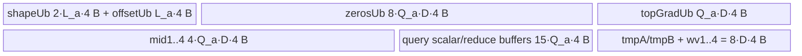

# MultiScaleDeformableAttentionGrad A2/A3 ACLNN 算子知识

## 算子速览

| 项目 | 内容 |
|---|---|
| 实际入口 | `aclnnMultiScaleDeformableAttentionGradGetWorkspaceSize` + `aclnnMultiScaleDeformableAttentionGrad`，公开 ACLNN 两段式接口；固定仓只有这一版本。 |
| 计算语义 | 对多尺度双线性采样反传，产生 `gradValue`、`gradLocation` 和 `gradAttnWeight`。自有 Kernel 内部以 FP32 计算，并对共享 `gradValue` 做 AtomicAdd。 |
| 输入输出 | 公开布局：`value[B,K,H,D]`、`spatialShape[L,2]`、`levelStartIndex[L]`、`location[B,Q,H,L,P,2]`、`attnWeight[B,Q,H,L,P]`、`gradOutput[B,Q,H*D]`；输出分别同 `value/location/attnWeight` shape。数值 dtype 支持 FP32/FP16/BF16，索引支持 INT32/INT64。 |
| 执行类型 | 框架 `Contiguous/Transpose/Cast/ViewCopy` 前后处理边界 + 单个自有 `AIV_VECTOR` Kernel；自有可达节点不含 Cube/AIC/MIX_CV。 |
| Kernel 路线 | R-001：ACLNN FP32 内核路线（key 0，`MultiScaleDeformableAttentionGrad_fp32_01`）。 |
| 核心资源 | GM 输入/输出；每核 25 个 `TBuf<VECCALC>`；8 个 HardEvent；`gradValue` AtomicAdd；Tiling 声明 16 MiB system workspace，但自有 Kernel 的 `workspace` 参数未读取。 |
| 来源闭包 | `source_closed`：公开 API→L0 launcher→Tiling/POD→FP32 binary→entry→全部 body/helper→A2/A3 构建接线闭合；框架通用前后处理以明确边界记录。 |
| 验证状态 | 已完成源码闭包检查；本次知识提取未执行编译、真机、数值或性能测试。 |

## 接口与语义

### 计算语义

令 `value[b,k,h,d]` 为展平后的多尺度特征，层 `l` 的高宽为 `(H_l,W_l)`，起点为 `start_l`。对采样坐标 `(u,v)`，Device 实现使用

```text
x = u * W_l - 0.5
y = v * H_l - 0.5
x0 = floor(x), y0 = floor(y)
dx = x - x0, dy = y - y0
w00 = 1 - dx - dy + dx*dy
w01 = dx - dx*dy
w10 = dy - dx*dy
w11 = dx*dy
```

四邻点的 `gradValue` 增量是 `attnWeight * gradOutput * wij`；`gradAttnWeight` 是 `gradOutput` 与四邻点双线性插值结果的通道内积；`gradLocation` 是插值对 `x/y` 的偏导与 `attnWeight * gradOutput` 的通道内积，并分别乘 `W_l/H_l` 回传到归一化坐标。落在 `(-1,W_l)×(-1,H_l)` 外的采样不贡献结果；边界附近只处理合法邻点。

### 输入、输出与属性

| 参数 | shape/layout | dtype | 约束、默认值与语义 |
|---|---|---|---|
| `value` | `[B,K,H,D]`, ND，可非连续 | FP32/FP16/BF16 | `D % 8 == 0 && D <= 256`；API 转连续并升为 FP32。 |
| `spatialShape` | `[L,2]`, ND，可非连续 | INT32/INT64 | API 转连续并转 INT32；Kernel 按 `[height,width]` 读取。 |
| `levelStartIndex` | `[L]`, ND，可非连续 | INT32/INT64 | 每层在 `K` 轴上的起点；API 转 INT32。 |
| `location` | `[B,Q,H,L,P,2]`, ND，可非连续 | FP32/FP16/BF16 | `Q < 500000, L<=16, H<=16, P<=16`；先转置为 `[B,H,L,P,2,Q]`，再转 FP32。坐标分量次序存在文档/实现冲突，见限制。 |
| `attnWeight` | `[B,Q,H,L,P]`, ND，可非连续 | FP32/FP16/BF16 | 转置为 `[B,H,L,P,Q]`，再转 FP32。 |
| `gradOutput` | `[B,Q,H*D]`, ND，可非连续 | FP32/FP16/BF16 | Kernel 将其按 `[B,Q,H,D]` 连续布局寻址；API 转 FP32。 |
| `gradValue` | 与 `value` 相同，允许非连续输出 | FP32/FP16/BF16 | 自有 Kernel 先产生 FP32，再 Cast 到目标 dtype 并 `ViewCopy`。 |
| `gradLocation` | 与 `location` 相同，允许非连续输出 | FP32/FP16/BF16 | 内部 `[B,H,L,P,2,Q]`，逆转置后 Cast/ViewCopy。 |
| `gradAttnWeight` | 与 `attnWeight` 相同，允许非连续输出 | FP32/FP16/BF16 | 内部 `[B,H,L,P,Q]`，逆转置后 Cast/ViewCopy。 |

### 入口与版本

公开文档和头文件只声明无版本后缀的两段式 API。第一段创建 executor、校验参数并编排通用 `Contiguous/Transpose/Cast`、自有 `MultiScaleDeformableAttentionGrad`、逆 `Transpose/Cast/ViewCopy`；第二段以调用者提供的 workspace 和 stream 执行 executor。README 与 API 文档均明确 A2、A3 支持；OpDef、binary config、Kernel CMake 和全局 binary config 对应 `ascend910b`、`ascend910_93`。固定仓没有 950/`ascend950` 声明或接线。

## Host/Launcher 执行流程

### 参数校验与前处理

1. `CheckNotNull` 要求 6 个输入和 3 个输出均非空；`workspaceSize/executor` 本身由两段式框架宏约束，算子代码未另行显式检查。
2. `CheckDtypeValid` 分别检查数值 tensor 属于 FP32/FP16/BF16、两个索引属于 INT32/INT64；源码没有检查所有数值 tensor dtype 相同。
3. `CheckFormat` 只显式拒绝 6 个输入的 `FRACTAL_NZ`；输出格式由后续 `ViewCopy` 处理。
4. `CheckShape` 检查各输入 rank、`spatialShape` 末维为 2、`location` 末维为 2，以及 `D/Q/L/H/P` 上界；源码没有验证各 tensor 之间的 B/Q/H/L/P/K 交叉一致性，也没有验证输出 shape。
5. 任一输入 `IsEmpty()` 时返回 workspace 0 和空执行流程，不启动自有 Kernel。
6. 非空时 6 个输入先 `Contiguous`；`location` 以 `{0,2,3,4,5,1}` 转置，`attnWeight` 以 `{0,2,3,4,1}` 转置；数值输入全部 Cast FP32，索引 Cast INT32。
7. L0 分配三个连续 FP32 输出并加入自有 AICore launcher；自有结果分别逆转置、Cast 到用户输出 dtype，再 `ViewCopy` 到用户 tensor。任一步返回空指针立即返回 `ACLNN_ERR_INNER_NULLPTR`。

### 参数、Workspace 与生命周期

executor 持有通用前后处理产生的连续 tensor、转置 tensor、Cast tensor、自有算子临时输出和最终 ViewCopy 节点；`GetWorkspaceSize()` 返回整条 executor 图所需字节，固定仓没有展开通用节点的 slice offset/extent，属于框架边界。自有 Tiling 另为该 Kernel 设置 `currentWorkspace[0]=16*1024*1024` 字节系统 workspace；entry 接收 `workspace`，但 body 不绑定或读取它。调用者必须在第二段保持第一段返回的 executor 和至少 `workspaceSize` 字节 Device workspace 有效，并在同一 `stream` 上交给 `CommonOpExecutorRun`。

### 启动图与失败传播

```text
ACLNN executor（同一 stream，框架按加入顺序执行）
  -> 6× Contiguous
  -> Transpose(location, [0,2,3,4,5,1])
  -> Transpose(attnWeight, [0,2,3,4,1])
  -> 4× Cast(numeric -> FP32) + 2× Cast(index -> INT32)
  -> N-001 MultiScaleDeformableAttentionGrad
       entry: multi_scale_deformable_attention_grad
       blockDim: core_used
       POD: MultiScaleDeformableAttentionGradTilingData
       workspace slice: Tiling 声明 16 MiB，Kernel 未读取
       outputs: FP32 gradValue / gradLocationNoTrans / gradAttnWeightNoTrans
  -> inverse Transpose(gradLocation, [0,5,1,2,3,4])
  -> inverse Transpose(gradAttnWeight, [0,4,1,2,3])
  -> 3× Cast(FP32 -> requested dtype)
  -> 3× ViewCopy(user outputs)
```

通用节点的 Device entry、workspace slice 和内部同步不在固定仓中，按 executor 框架边界处理；自有节点为单 Kernel，没有自有跨 Kernel workspace 边。L0 launcher 加入失败返回三个空指针，L2 随即返回内部空指针错误；第二段直接传播 `CommonOpExecutorRun` 状态。自有 Kernel 内所有 block 先由 block 0/1/2 分别清零三个输出，再通过 `SyncAll` 建立清零→Atomic/普通写的跨核顺序。

## Route 与参数设计

### 分核与资源计算

公开 ACLNN 将自有节点的所有数值输入规范为 FP32，所以 `dtype_size=4`、32 B 对齐元素数 `A=8`。令平台 UB 字节数为 `U_platform`、`U=U_platform-1024`、`L_a=ceil(L/8)*8`、`D=embedDims`，Host 计算：

```text
maxUbNum = floor_to_8((U/4 - 3*L_a - 8*D) / (15 + 13*D))
numQueriesper = ceil(Q / maxUbNum)
taskNum = numQueriesper * B * H * L * P
core_used = min(AIV_core_count, taskNum)
```

确定性标志为 1 时 Tiling 把候选核数改为 1，但公开文档明确暂不支持确定性实现。Device 将扁平任务按 `taskNumPerCore=ceil(taskNum/core_used)` 分成连续区间；第 `c` 核处理 `[c*taskNumPerCore, min((c+1)*taskNumPerCore,taskNum))`。每个任务是一组 `(b,h,l,p,nqloop)`；常规 query tile 长 `maxUbNum`，最后 tile 的有效元素数为 `Q-(numQueriesper-1)*maxUbNum`，分配/Vector 长度对齐到 8。

### Route 选择

| 顺序 | Route | Key/模板 | 精确选择条件与优先级 | 不适用去向 |
|---:|---|---|---|---|
| 1 | R-001 ACLNN FP32 内核 | key 0；`MultiScaleDeformableAttentionGrad_fp32_01`；`DTYPE_VALUE=float` | 非空公开 ACLNN 输入通过校验后，API 无条件把 `value/location/attnWeight/gradOutput` Cast 为 FP32，索引 Cast 为 INT32；OpDef/binary 仅注册 FP32/INT32 组合。 | 前处理失败则 ACLNN 报错；空输入直接成功且不 launch。 |

```text
任一输入为空？
  是 -> workspaceSize=0，成功返回，无 Kernel
  否 -> CheckParams 成功？
           否 -> 返回对应 ACLNN 错误
           是 -> Contiguous/Transpose/Cast 成功？
                    否 -> ACLNN_ERR_INNER_NULLPTR
                    是 -> FP32/INT32 L0 -> key 0 -> R-001
```

`SetTilingKeyMode` 含 `DT_FLOAT16 -> key 1`，但公开 ACLNN 在进入 L0 前已无条件 Cast FP32，且两个平台 binary config 只有 FP32 binary；因此 key 1 不属于公开入口 Route。

### 模板/实现执行矩阵

| Route | key/selector | dtype/shape/platform 完整命中条件 | 执行拓扑与 Kernel 节点 | 实际模板/body | 内存与同步特征 | tail/fallback |
|---|---|---|---|---|---|---|
| R-001 ACLNN FP32 内核 | key 0 / FP32 binary | A2/A3；非空；API dtype/rank/上界检查通过；内部 FP32/INT32 ND | 单节点 N-001 `multi_scale_deformable_attention_grad` | 非模板类 `MultiScaleDeformableAttentionGrad::{Init,InitBuffer,GetLocalTensor,ClearOutput,Process,Compute,GridSampleCompute,ComputeGradTogether,ComputeGradSeparate,ComputeGrad}` | 每核 TBuf 精确预算；8 HardEvent；输出先全局清零；`gradValue` AtomicAdd，另两输出按唯一任务地址写 | query 尾 tile 对齐 8；内部点走四邻点合并快路，边界走逐邻点保护；坐标域外跳过。 |

### 隐藏性能 Guard

| Guard | Host/Tiling 条件 | Device/资源原因 | 影响 Route | 不满足时去向 | 源码符号 |
|---|---|---|---|---|---|
| UB tile 上界 | `maxUbNum=floor_to_8((U/4-3L_a-8D)/(15+13D))` | 精确覆盖 3 个 level 元数据 buffer、`13*Q*D` 主 buffer、`15*Q` 标量/归约 buffer 与 `8*D` 邻点临时 buffer | R-001 tile/任务数/核数 | 源码没有 `maxUbNum==0` guard；若资源不足会进入后续除零风险，无 fallback。 | `MultiScaleDeformableAttentionGradTiling::Init` |
| 通道 DMA/Vector 对齐 | API 要求 `D%8==0 && D<=256` | FP32 下 8 元素为 32 B；邻点 `DataCopyPad` 的 `blockLen=D*4`，Vector 长度为 D | R-001 | `ACLNN_ERR_PARAM_INVALID` | `CheckShape` |
| query tile 对齐 | `maxUbNum` 向下对齐 8；尾 tile `AlignUp(tail,8)` | TBuf 分配与坐标 Vector 操作按 32 B 对齐，GM Copy 只搬有效 `thisCycleNum` | R-001 | 无独立 fallback，尾部由有效长度和 padding 隔离 | `Init`、`ScalarUpdate` |
| 内部/边界邻点 | `hLow>=0 && wLow>=0 && hLow<h-1 && wLow<w-1` | 内部点可批量搬四邻点并共享事件；边界点必须逐邻点检查避免越界 | R-001 body 子路径 | `ComputeGradSeparate` | `GridSampleCompute` |
| 输出清零核数 | `ClearOutput` 仅 block 0/1/2 分别清三个输出 | AtomicAdd 前必须清零，三输出各由一个 block 初始化 | R-001 | `core_used<3` 时固定仓没有替代清零路径；确定性单核尤其受影响 | `ClearOutput` |
| 平台 | OpDef/CMake/config 仅 `ascend910b`,`ascend910_93` | 只有这两个 compute unit 有 binary 和活动构建 | R-001 | 950 不发布 | `MultiScaleDeformableAttentionGrad` OpDef、`op_kernel/CMakeLists.txt` |

### POD/ABI

`BEGIN_TILING_DATA_DEF` 的生成宏实现在仓外依赖中；固定仓可确认字段声明顺序、类型和 Host/Device 对应，但不能从可见源码确认生成结构的原生 `sizeof/alignof/offsetof`，故不推测偏移。

| 结构 | 字段 | 类型/位宽 | ABI 布局 | 单位 | Host/launcher producer | Device consumer | 边界 |
|---|---|---|---|---|---|---|---|
| `MultiScaleDeformableAttentionGradTilingData` | `batchSize` | `uint64_t`/64 | 生成布局不可见 | batch | `set_batchSize(batch_size)` | `Init`: `batchSize`，GM extent/任务展开 | 来自 `value[0]` |
| 同上 | `numKeys` | `uint64_t`/64 | 生成布局不可见 | 元素 | `set_numKeys(spatial_size)` | `Init`: `numKeys`，value stride/extent | 来自 `value[1]` |
| 同上 | `numHeads` | `uint64_t`/64 | 生成布局不可见 | head | `set_numHeads(num_heads)` | `Init/ScalarUpdate`: head 展开与 stride | 来自 `value[2]` |
| 同上 | `embedDims` | `uint64_t`/64 | 生成布局不可见 | FP32 元素/head | `set_embedDims(channels)` | `Init/InitBuffer/Compute*`: DMA、Vector、stride、UB | Device 窄化到 `uint32_t embedDims`；API 限制 `<=256` |
| 同上 | `numLevels` | `uint64_t`/64 | 生成布局不可见 | level | `set_numLevels(num_levels)` | `Init/Process/ScalarUpdate` | 来自内部转置后 location dim 2 |
| 同上 | `numQueries` | `uint64_t`/64 | 生成布局不可见 | query | `set_numQueries(num_query)` | `Init/ScalarUpdate` | 来自内部转置后 location dim 5 |
| 同上 | `numPoints` | `uint64_t`/64 | 生成布局不可见 | point/level | `set_numPoints(num_point)` | `Init/Process/ScalarUpdate` | 来自内部转置后 location dim 3 |
| 同上 | `maxUbNum` | `uint64_t`/64 | 生成布局不可见 | query/tile | `set_maxUbNum(max_ub_num)` | `Init`: 窄化为 `uint32_t`，计算 tile/UB/offset | 向下对齐 8；无零值/窄化 guard |
| 同上 | `coreNum` | `uint64_t`/64 | 生成布局不可见 | AIV core | `set_coreNum(core_used)` | `Init`: 窄化为 `uint32_t`，分核 | `min(core_num,taskNum)`；无 `<3` guard |

### Route 源码闭包

| Route | Key/selector | Host/Tiling producer | POD/参数 | Kernel entry/router 节点 | Kernel body/直接依赖 | 构建接线 |
|---|---|---|---|---|---|---|
| R-001 ACLNN FP32 内核 | API Cast FP32→`SetTilingKeyMode(DT_FLOAT)`→key 0 | `op_host/op_api/aclnn_multi_scale_deformable_attention_grad.cpp::aclnnMultiScaleDeformableAttentionGradGetWorkspaceSize`；`op_host/multi_scale_deformable_attention_grad_tiling.cpp::{Init,RunKernelTiling}` | `op_host/multi_scale_deformable_attention_grad_tiling.h::MultiScaleDeformableAttentionGradTilingData`，9×uint64 | `op_kernel/multi_scale_deformable_attention_grad.cpp::multi_scale_deformable_attention_grad`，无运行时 router | `op_kernel/multi_scale_deformable_attention_grad.h::MultiScaleDeformableAttentionGrad` 全部方法；AscendC primitives 为库边界 | `op_host/multi_scale_deformable_attention_grad_def.cpp`；两个 binary JSON；`op_kernel/CMakeLists.txt`; `scripts/kernel/binary_config/ascendc_config.json` |

## Kernel 实现

### 公共执行流程

只有 R-001。entry 解析 POD，依次调用 `Init→InitBuffer→GetLocalTensor→ClearOutput→Process→ReleaseEventID`。每核从相同 GM 元数据复制 `spatialShape/levelStartIndex`，再遍历自己的连续扁平任务区间。每个任务读取一个 `(b,h,l,p)` 下的一段 query：计算坐标、floor 与双线性权重，逐 query 累加四邻点 `gradValue`，最后沿 D 维归约并写 `gradAttnWeight` 与两个 `gradLocation` 分量。自有 launch graph 没有第二个 Kernel 或自有 workspace 交接边。

### Route R-001：ACLNN FP32 内核

#### 适用条件

##### 选择证据

| 层级 | 文件 | 符号 | 源码谓词/参数 | 结果/下一跳 |
|---|---|---|---|---|
| API | `vfusion/multi_scale_deformable_attention_grad/op_host/op_api/aclnn_multi_scale_deformable_attention_grad.cpp` | `CheckParams` | 非空指针；dtype 在集合内；输入非 NZ；rank 与 `D/Q/L/H/P` 约束 | 失败返回参数错误；成功继续 |
| API | 同上 | `aclnnMultiScaleDeformableAttentionGradGetWorkspaceSize` | 非空输入；数值一律 `Cast(...DT_FLOAT)`，索引一律 `Cast(...DT_INT32)` | 调 L0 FP32/INT32 节点 |
| L0 | `vfusion/multi_scale_deformable_attention_grad/op_host/op_api/multi_scale_deformable_attention_grad.cpp` | `l0op::MultiScaleDeformableAttentionGrad` | 分配三个内部输出后 `ADD_TO_LAUNCHER_LIST_AICORE` | N-001；失败返回空 tuple |
| Tiling | `vfusion/multi_scale_deformable_attention_grad/op_host/multi_scale_deformable_attention_grad_tiling.cpp` | `SetTilingKeyMode` | `DT_FLOAT` | key 0 |
| Binary | `vfusion/multi_scale_deformable_attention_grad/op_host/config/ascend910b/multi_scale_deformable_attention_grad_binary.json`（A3 对应 JSON 同内容） | `MultiScaleDeformableAttentionGrad_fp32_01` | 6×FP32/INT32 输入、3×FP32 输出 | FP32 entry |

#### Device 数据流

##### 函数级调用链

```text
l0op::MultiScaleDeformableAttentionGrad -> ADD_TO_LAUNCHER_LIST_AICORE
  -> multi_scale_deformable_attention_grad(..., workspace, tiling_data)
    -> MultiScaleDeformableAttentionGrad::Init
    -> InitBuffer
    -> GetLocalTensor
    -> ClearOutput -> InitOutput(block 0/1/2) -> SyncAll
    -> Process
      -> per task: Compute
        -> ScalarUpdate
        -> coordinate CopyIn + Vector coordinate pipeline
        -> GridSampleCompute
          -> internal point: ComputeGradTogether
          -> boundary point: ComputeGradSeparate -> ComputeGrad<AddH,AddW>
        -> Sum(D) -> CopyOut gradWeight/gradLocation
    -> ReleaseEventID
```

##### 源码等价伪码

```text
# 伪码；地址均以元素计
c = GetBlockIdx()
task_per_core = ceil((B*H*L*P*ceil(Q/T)) / coreNum)
[start,end) = [c*task_per_core, min((c+1)*task_per_core, taskNum))

if c==0: zero gradValue
if c==1: zero gradLocation
if c==2: zero gradWeight
SyncAll()
copy spatialShape[0:2L], levelStartIndex[0:L] GM->UB

for flat_task in [start,end):
  decode flat_task as (b,h,l,p,nqloop), nqloop fastest
  q_valid = last_tile ? Q-(ceil(Q/T)-1)*T : T
  q_alloc = last_tile ? align_up(q_valid,8) : T
  load location.w[q_valid], location.h[q_valid], weight[q_valid]
  for q in q_valid: load gradOutput[b,q,h,0:D]
  x = location.w*W_l - 0.5; y = location.h*H_l - 0.5
  x0=floor(x); y0=floor(y); dx=x-x0; dy=y-y0; w11=dx*dy
  atomic mode on
  for q in [0,q_valid):
    if -1 < x < W_l and -1 < y < H_l:
      derive w00,w01,w10,w11
      if all four neighbors valid:
        load all 4 value vectors
        atomic-add (gradOutput*attnWeight*wij) to 4 gradValue vectors
        derive dV/dx,dV/dy with shared four-neighbor intermediates
      else:
        zero four sampled-value vectors
        for each valid neighbor:
          load it; atomic-add its gradValue contribution
          accumulate signed dV/dx,dV/dy
      per-channel gradWeight = gradOutput * interpolatedValue
  atomic mode off
  per-channel gradX = gradOutput*attnWeight*dV/dx*W_l
  per-channel gradY = gradOutput*attnWeight*dV/dy*H_l
  reduce D -> gradWeight[q], gradLocation.w[q], gradLocation.h[q]
  copy only q_valid results UB->GM
```

#### 内存与数据搬运

##### 资源与搬运表

令 `Q_a=numQueriesAlign`、`L_a=numLevelsAlign`、`D=embedDims`，自有路线固定 FP32/INT32（均 4 B）。

| 层级/缓冲区 | offset/地址公式 | extent/容量公式 | dtype/layout | producer | consumer | owner/lifetime | 对齐/复用 |
|---|---|---|---|---|---|---|---|
| GM `value` | `b*K*H*D + start_l*H*D + h*D + y*W_l*H*D + x*H*D` | `B*K*H*D` | FP32 `[B,K,H,D]` | API Cast | `ComputeGrad*` | executor/整节点 | 每次邻点搬 D 元素 |
| GM `location` | `2*(b*H*L*P*Q+h*L*P*Q+l*P*Q+p*Q)+coord*Q+q0` | `B*H*L*P*2*Q` | FP32 `[B,H,L,P,2,Q]` | API transpose+Cast | `Compute` | executor/整节点 | 每坐标搬 `q_valid*4` B，UB pad 到 `Q_a` |
| GM `attnWeight` | `b*H*L*P*Q+h*L*P*Q+l*P*Q+p*Q+q0` | `B*H*L*P*Q` | FP32 `[B,H,L,P,Q]` | API transpose+Cast | `Compute/GridSampleCompute` | executor/整节点 | 每 tile 搬 q_valid |
| GM `gradOutput` | `b*Q*H*D+q0*H*D+h*D` | `B*Q*H*D` | FP32 `[B,Q,H,D]` | API Cast | `Compute` | executor/整节点 | 每 query 搬 D 元素 |
| GM `gradValue` | 同 `value` | `B*K*H*D` | FP32 | `ComputeGrad*` AtomicAdd | 后续 API Cast | 自有输出至消费 | block 0 清零；邻点写冲突由 AtomicAdd 保护 |
| GM `gradLocation` | 同 location 内部布局 | `B*H*L*P*2*Q` | FP32 | `Compute` CopyOut | 逆转置 | 自有输出至消费 | 每任务地址唯一，写 q_valid |
| GM `gradWeight` | 同 weight | `B*H*L*P*Q` | FP32 | `Compute` CopyOut | 逆转置 | 自有输出至消费 | 每任务地址唯一，写 q_valid |
| UB `shapeUb+offsetUb` | 独立 TBuf | `(2L_a+L_a)*4` B | INT32 | `Process` DataCopyPad | `ScalarUpdate` | Kernel 全程 | 32 B 对齐容量 |
| UB 主通道区 | `zerosUb` 分 8 个 `Q_a*D` 子区；另 `topGradUb`、4×`midUb` | `(8+1+4)*Q_a*D*4` B | FP32 | `Duplicate`/CopyIn/Vector | 梯度、归约、CopyOut | 每 task 覆盖 | `zerosUb` 子区承载 gradH/gradW/topGradWeight/gradWeight 与四邻点值；mid 为 AtomicAdd 输出 staging |
| UB query 标量区 | 15 个 `Q_a` 等价 buffer | `15*Q_a*4` B | FP32/INT32 | CopyIn/Vector/Sum | 坐标、权重、输出 | 每 task 覆盖 | 包括 attention、x/y/sum、loc、im/low/lowFloat/dist/w4 |
| UB 邻点临时区 | `tmpA/tmpB` 各 `2D`；4×`wv` 各 D | `8*D*4` B | FP32 | `ComputeGrad*` | 插值/偏导 | 每 query 覆盖 | 无 queue；事件保护 DMA/Vector/CopyOut |
| workspace | entry 参数未绑定 | Tiling 声明 16 MiB system workspace | opaque | runtime | 未消费 | executor 节点期 | 自有算法不使用 |

##### 分层内存布局



所有对象均为 `TBuf<TPosition::VECCALC>`，没有 `TQue` 和 double buffer depth；LocalTensor 只是对应 TBuf 的视图，不重复计费。

##### 字节账与复用顺序

```text
UB_total = 4 * [3*L_a + 13*Q_a*D + 15*Q_a + 8*D]
          = 4 * [3*L_a + (13D+15)*Q_a + 8D]
Q_a <= maxUbNum
UB_total <= U_platform - 1024               # 由 Host maxUbNum 公式保证，前提是算术无下溢且 maxUbNum>0
dynamic_ub = N/A（AIV TBuf 静态按 Tiling 尺寸初始化）
workspace_total(self kernel) = 16 MiB system workspace 声明；算法读取 0 B
```

| 复用子区 | 写入者 | 读取者/消费点 | 下一次覆盖 | 同步或释放依据 | 安全条件 |
|---|---|---|---|---|---|
| `zerosUb[0..4)*Q_a*D` | 每 task 先 `Duplicate(0)`，随后邻点偏导/乘积写入 | `Mul/Sum` | 下一 task 的 `Duplicate` | task 尾的三个 Sum/CopyOut 及 `MTE3_S` flag 完成后才进入下一轮 | `WaitFlag<MTE3_S>` 阻止输出 buffer 提前覆盖 |
| `zerosUb[4..8)*Q_a*D` | `ComputeGradTogether/ComputeGrad` 搬四邻点 value | `Muls/Sub/Add` | 下一 query/邻点 | `MTE2_V` wait | 只在 CopyIn 完成后 Vector 读取 |
| `mid1..4[query*D]` | `Muls(topGrad*attnWeight,wij)` | Atomic DataCopyPad 到 gradValue | 下一 query | `V_MTE3` wait | 前一 Atomic CopyOut 已可见后覆盖 |
| `tmpA/tmpB` | 邻点偏导中间式 | 当前 query 的 Add/Sub | 下一邻点或 query | 同一 Vector 流顺序 | 不跨 query 保留 |
| `wv1..4` | 邻点 value×weight | 合并插值并形成 gradWeight | 下一 query | 同一 Vector 流；边界路径先清零 | 边界缺邻点必须保持 0 |

#### 同步、精度与尾块

##### 同步与数值边界表

| 阶段 | primitive/机制 | producer | consumer/等待点 | 保护对象 | 精度/尾块 |
|---|---|---|---|---|---|
| 输出初始化 | `InitOutput` + `SyncAll` | block 0/1/2 | 全部 block 的 `Process` | 三个 GM 输出 | 先置 FP32 0；依赖至少三个活跃 block 才覆盖三个输出 |
| task 入口复用 | `V_MTE2` | 上一 task Vector | 下一 task `Duplicate/CopyIn` | zeros/输入复用 | 初始人工置 flag，末尾 `GridSampleCompute` 后再置 |
| GM→UB 坐标/value | `MTE2_V` | `DataCopyPad` | 坐标或邻点 Vector 操作 | loc/weight/topGrad/value 子区 | GM 只搬有效元素；UB 对齐尾 lane 来自 pad/预清零，不写回 |
| gradValue | `SetAtomicAdd<float>` + `V_MTE3` | `Muls` 产生 mid | Atomic `DataCopyPad` | 共享 GM gradValue | 全 FP32；跨 task/core 冲突由 AtomicAdd 解决，默认非确定性 |
| gradLocation/weight | 三个独立 `V_MTE3` event | 三次 `Sum` | 各自 CopyOut | x/y/weightSum | `SumParams{q_valid,D,D}` 沿 D 归约；只写 q_valid |
| task 结束 | `MTE3_S` | 三个结果 CopyOut | 下一 task 的 Sum/复用 | query 输出 TBuf | 防止下一轮覆盖未完成输出 |
| 数值路线 | FP32 `Muls/Mul/Add/Sub/Sum` | API Cast FP32 | API 输出 Cast | 全计算链 | FP16/BF16 只在入口/出口转换；`floor` 使用 `CAST_FLOOR`；无 Kahan 或确定性归约 |
| 坐标尾界 | 标量 if | `hIm/wIm` 与 `hLow/wLow` | fast/boundary/skip | 邻点 GM 地址 | 域外不贡献；边界逐邻点 guard；query 尾用 q_valid 限制标量循环和 CopyOut |

#### 关键实现

##### 符号证据表

| 阶段 | 文件 | 符号/模板实例 | 实现事实 |
|---|---|---|---|
| Host/Tiling producer | `vfusion/multi_scale_deformable_attention_grad/op_host/multi_scale_deformable_attention_grad_tiling.cpp` | `MultiScaleDeformableAttentionGradTiling::{Init,RunKernelTiling}` | 从 storage shape/平台 AIV 核数/UB 生成 key、tile、core、workspace 和 POD |
| Kernel entry/router | `vfusion/multi_scale_deformable_attention_grad/op_kernel/multi_scale_deformable_attention_grad.cpp` | `multi_scale_deformable_attention_grad` | 解析唯一 POD，按固定顺序调用 body；无 key switch 或多 Kernel router |
| Device body/helper | `vfusion/multi_scale_deformable_attention_grad/op_kernel/multi_scale_deformable_attention_grad.h` | `Init/InitBuffer/Process/Compute/GridSampleCompute/ComputeGradTogether/ComputeGradSeparate/ComputeGrad` | 完整分核、地址、DMA、Vector、Atomic、event、归约与边界处理 |

## 算子特定优化

### Trick T-001：UB 反推 query tile 并保持 32 B 对齐

#### 触发与源码依据

- 适用 Route：R-001。
- 触发条件：所有非空公开 ACLNN 调用；内部固定 FP32，`data_align=32/4=8`。
- Golden 来源：[`multi_scale_deformable_attention_grad_tiling.cpp:108-114`](../../../../../../../cann-ops-raw/ascendc/ops-nn/955f8b33985b6d72989ebff341bb9c2c564a51bc/vfusion/multi_scale_deformable_attention_grad/op_host/multi_scale_deformable_attention_grad_tiling.cpp#L108-L114)

**官方源码（固定 Commit 连续逐字摘录）**：

```cpp
uint64_t data_align = block_bytes / dtype_size;
uint64_t num_levels_align = (num_levels + data_align - 1) / data_align * data_align;
max_ub_num = (ub_size / dtype_size - NUM_LEVEL_BUFFER * num_levels_align - NUM_EMEBDDIM_BUFFER * channels) /
              (NUM_QUERIE_BUFFER + NUM_CHANNEL_BUFFER * channels);
max_ub_num = max_ub_num / data_align * data_align;
uint64_t taskNum = ((num_query + max_ub_num - 1) / max_ub_num) * batch_size * num_heads * num_levels * num_point;
core_used = std::min(core_num, taskNum);
```

#### 机制与设计原因

Host 用与 `InitBuffer` 完全对应的系数反推最大 query tile：`3L_a` 是 shape/offset，`8D` 是 query 无关的邻点临时区，分母 `15+13D` 是每增加一个 query 的 UB 元素增量。再向下对齐 8，使 FP32 tile 容量为 32 B 整数倍。tile 变大时减少 `nqloop` 任务数和元数据/事件控制重复；资源不足时公式自动减小 tile，而不改变 Device body。

#### 迁移边界

- 适用：具有固定 per-query 通道区和少量 query 无关临时区的 AIV kernel。
- 前提：buffer 计数、dtype 字节数、32 B 对齐、1024 B reserve 与 Device `InitBuffer` 保持一致。
- 失效：新增/删除 TBuf、改变 dtype 或对齐后必须重推系数；`maxUbNum==0` 时不能进入当前实现，源码没有 fallback。
- 未验证：本次知识提取未执行编译、真机、数值或性能测试。

#### 错误做法

不能只按逻辑有效 `Q` 计算 UB，或漏计 4 个 `mid`、`zerosUb` 的 8 个子区和 `tmpA/tmpB` 的 `2D` 容量，否则 Host 选择的 tile 会超过 Device 实际分配。固定仓未提供可验证的超限运行反例。

### Trick T-002：内部点四邻点合并，边界点保守拆分

#### 触发与源码依据

- 适用 Route：R-001。
- 触发条件：采样在有效域内；若 `hLow>=0 && wLow>=0 && hLow<h-1 && wLow<w-1` 走合并路，否则逐邻点判断。
- Golden 来源：[`multi_scale_deformable_attention_grad.h:388-400`](../../../../../../../cann-ops-raw/ascendc/ops-nn/955f8b33985b6d72989ebff341bb9c2c564a51bc/vfusion/multi_scale_deformable_attention_grad/op_kernel/multi_scale_deformable_attention_grad.h#L388-L400)

**官方源码（固定 Commit 连续逐字摘录）**：

```cpp
w4 = w4Local.GetValue(query);
w1 = w4 + 1 - distH - distW;
w2 = distW - w4;
w3 = distH - w4;
if (hLow >= 0 && wLow >= 0 && hLow < h - 1 && wLow < w - 1) {
    ComputeGradTogether(distH, distW, w1, w2, w3, w4, attenWeight);
} else {
    Duplicate(wv1Local, (DTYPE_VALUE)0, embedDims);
    Duplicate(wv2Local, (DTYPE_VALUE)0, embedDims);
    Duplicate(wv3Local, (DTYPE_VALUE)0, embedDims);
    Duplicate(wv4Local, (DTYPE_VALUE)0, embedDims);
    ComputeGradSeparate(1 - distH, 1 - distW, distH, distW, w1, w2, w3, w4, attenWeight);
}
```

#### 机制与设计原因

内部点保证四个地址都合法，`ComputeGradTogether` 可连续发起四次 GM→UB 搬运，并从相同四邻点值复用插值与两个坐标偏导的中间式；边界点则预清零四个 `wv`，只对合法邻点调用带编译期 `AddH/AddW` 符号的 `ComputeGrad`，避免越界访问且让缺失邻点保持零贡献。这个分流同时改变搬运数量、Vector 中间式和边界安全，而不是普通控制封装。

#### 迁移边界

- 适用：规则网格双线性反传且大部分点拥有四个合法邻点的场景。
- 前提：四邻点布局与 `wStride/hStride` 一致，边界判断采用实现的半像素坐标域。
- 失效：边界点必须走 `ComputeGradSeparate`；坐标域外直接跳过，不能套用四邻点快路。
- 未验证：本次知识提取未执行编译、真机、数值或性能测试。

#### 错误做法

对边界点无条件搬四邻点会产生非法 GM 地址；不先清零 `wv1..4` 会把上一个 query 的邻点值带入 `gradAttnWeight`。源码的边界分支明确执行四次 `Duplicate(0)` 后才调用拆分 helper。

## 模板与实现对比

| 对比维度 | R-001 ACLNN FP32 内核 | R-002 | 设计选择依据 |
|---|---|---|---|
| 命中条件/优先级 | 非空公开 ACLNN 校验通过后唯一可达 | N/A：无第二 Route | API 无条件内部 FP32 化，binary 只有 FP32 |
| 模板与 dtype | 非模板 class，`DTYPE_VALUE=float` | N/A | 公共 API dtype 差异在框架 Cast 层吸收 |
| 循环与分核 | `(b,h,l,p,nqloop)` 扁平任务，连续 ceil 分核；query 内标量循环 | N/A | taskNum 限制 blockDim 不超过有效任务数 |
| Queue/TBuf/寄存器/dynamic UB/通信 window | 25 个 TBuf、若干标量/LocalTensor view、无 TQue/dynamic UB/通信 | N/A | Host 公式与 TBuf 字节账一一对应 |
| 内存总占用与复用 | `4[3L_a+(13D+15)Q_a+8D]`；task/query 粒度覆盖 | N/A | UB 决定最大 query tile |
| 搬运/Vector/SIMT/NDDMA/通信 API | `DataCopyPad` + FP32 Vector + `Sum` + Atomic GM CopyOut | N/A | AIV_VECTOR 单节点 |
| 同步、精度与 tail | 8 HardEvent + `SyncAll`；全 FP32；query tail align 8、只提交有效值 | N/A | 支持共享 gradValue 与尾 tile |
| fallback/失败边界 | 邻点边界拆分；坐标域外 skip；UB 零 tile/core<3 无 fallback | N/A | 固定源码行为 |

## 平台差异

| 项目 | A2 | A3 | 950 |
|---|---|---|---|
| 支持状态 | 支持；公开文档、`ascend910b` OpDef/config/CMake 接线闭合 | 支持；公开文档、`ascend910_93` OpDef/config/CMake 接线闭合 | 不支持发布：公开文档未列出，且无 `ascend950` OpDef、binary 或 Kernel 构建接线 |
| Host/Launcher | 与 A3 共用同一源码；平台提供 AIV core 数与 UB 大小 | 与 A2 共用同一源码；平台提供 AIV core 数与 UB 大小 | 固定仓无实现 |
| Kernel/资源 | 同一 FP32 body；实际 `core_used/maxUbNum` 随平台资源取值 | 同一 FP32 body；实际 `core_used/maxUbNum` 随平台资源取值 | 固定仓无实现 |

## 限制与失败边界

- 公开文档声明默认非确定性且暂不支持确定性；实现对 `GetDeterministic()==1` 设置单核，但 `ClearOutput` 依赖 block 0/1/2 分别清三个输出，单核只会清 `gradValue`。同样，任何导致 `core_used<3` 的非空 shape 都没有完整三输出清零路径。不得把该分支解释为可用确定性实现。
- README/API 文档把 `location` 末维描述为 `y,x`，但 Kernel 将内部 coord 0 读入 `locW` 并乘 W，将 coord 1 读入 `locH` 并乘 H；README 又使用 `(u,v)`、称输出先 u 后 v，并写出与 Kernel 链式求导乘 `W/H` 相反的 `1/W`、`1/H` 公式。固定源码存在坐标次序与缩放公式冲突，复用时必须以 Device 实现和调用方既有约定为准并实测确认，不得仅凭文档文字互换分量或倒置缩放。
- API 只检查各 dtype 属于支持集合，不检查数值输入/输出 dtype 一致；也未检查 B/Q/H/L/P/K 的跨 tensor shape 关系、`levelStartIndex` 内容或 `sum(H_l*W_l)==K`。不一致输入可能在自有 Kernel 形成错误 stride/越界，固定仓没有 fallback。
- `maxUbNum` 公式使用无符号算术，未检查 UB 扣除项下溢或结果为 0；结果还从 uint64 窄化为 Device uint32。当前公开 `D<=256,L<=16,Q<500000` 降低部分风险，但源码没有完整证明或错误返回。
- `D%8==0` 允许 D=0，但含 D=0 的 `value` 会被 API 空 tensor 快路截获；其他零维也依赖任一输入为空触发快路。
- 自有 Tiling 固定声明 16 MiB system workspace，但 Kernel 不使用 `workspace`；整条 ACLNN 的精确 workspace slice/offset 由通用 executor 的 Contiguous/Transpose/Cast/ViewCopy 节点决定，在固定仓中不可见。
- POD 生成宏、AscendC primitive 和 ACLNN executor 内部属于仓外框架边界；正文只记录算子源码可证明的调用、参数、顺序和所有者。
- 本次知识提取未执行编译、真机、数值或性能测试。

## 源码索引

### 链路索引

| 链路阶段 | 文件 | 关键符号 | 支撑内容 |
|---|---|---|---|
| 入口声明/约束 | `vfusion/multi_scale_deformable_attention_grad/README.md` | 产品表、公式、约束 | A2/A3 支持、语义与坐标描述冲突 |
| 入口声明/约束 | `vfusion/multi_scale_deformable_attention_grad/docs/aclnnMultiScaleDeformableAttentionGrad.md` | 两段式原型、产品表、约束 | 公开性、A2/A3、shape/dtype/确定性说明 |
| 入口实现 | `vfusion/multi_scale_deformable_attention_grad/op_host/op_api/aclnn_multi_scale_deformable_attention_grad.cpp` | `Check*`、两段式 API | 校验、空路、前后处理、executor/workspace、失败传播 |
| L0 Launcher | `vfusion/multi_scale_deformable_attention_grad/op_host/op_api/multi_scale_deformable_attention_grad.cpp` | `l0op::MultiScaleDeformableAttentionGrad` | 内部输出 shape/dtype、单自有节点加入顺序 |
| Host/Tiling | `vfusion/multi_scale_deformable_attention_grad/op_host/multi_scale_deformable_attention_grad_tiling.cpp` | `Init/RunKernelTiling/TilingPrepare*` | key、UB tile、core、POD、workspace |
| POD | `vfusion/multi_scale_deformable_attention_grad/op_host/multi_scale_deformable_attention_grad_tiling.h` | `MultiScaleDeformableAttentionGradTilingData` | 9 字段声明顺序与类型 |
| Kernel entry | `vfusion/multi_scale_deformable_attention_grad/op_kernel/multi_scale_deformable_attention_grad.cpp` | `multi_scale_deformable_attention_grad` | entry ABI 与固定调用链 |
| Kernel body | `vfusion/multi_scale_deformable_attention_grad/op_kernel/multi_scale_deformable_attention_grad.h` | `MultiScaleDeformableAttentionGrad` | 全部内存、循环、Vector、Atomic、同步、tail/helper |
| 构建接线 | `vfusion/multi_scale_deformable_attention_grad/op_host/multi_scale_deformable_attention_grad_def.cpp` | `ops::MultiScaleDeformableAttentionGrad` | FP32/INT32 OpDef 与 A2/A3 config |
| 构建接线 | `vfusion/multi_scale_deformable_attention_grad/op_host/config/ascend910b/multi_scale_deformable_attention_grad_binary.json` | `MultiScaleDeformableAttentionGrad_fp32_01` | A2 FP32 binary 输入输出签名 |
| 构建接线 | `vfusion/multi_scale_deformable_attention_grad/op_host/config/ascend910_93/multi_scale_deformable_attention_grad_binary.json` | `MultiScaleDeformableAttentionGrad_fp32_01` | A3 FP32 binary 输入输出签名 |
| 构建接线 | `vfusion/multi_scale_deformable_attention_grad/op_kernel/CMakeLists.txt` | `add_kernel_sources` | `ascend910b ascend910_93` Kernel 构建 |
| 构建接线 | `scripts/kernel/binary_config/ascendc_config.json` | `MultiScaleDeformableAttentionGrad` 条目 | 全局 compute unit 与 auto_sync 接线 |

### 实现复用检查

| 检查项 | 可复用事实 | 不得改变的约束 | 源码符号 |
|---|---|---|---|
| ABI/POD | 9 个 uint64 字段及 Host/Device 一一对应 | 字段顺序、生成宏、`embedDims/maxUbNum/coreNum` 的 uint32 窄化 | `MultiScaleDeformableAttentionGradTilingData`、`Init` |
| 调用顺序 | API 转置/升精度→单自有 Kernel→逆转置/降精度/ViewCopy | 四组 perm、FP32/INT32 内部 ABI、executor 顺序 | `aclnnMultiScaleDeformableAttentionGradGetWorkspaceSize` |
| workspace/内存 | UB 公式与 25 个 TBuf；自有 workspace 不读取 | 1024 B reserve、32 B 对齐、全部 buffer 系数、owner/lifetime | Tiling `Init`、Kernel `InitBuffer` |
| 同步 | 清零后 SyncAll；MTE2/V/MTE3/S 事件链；gradValue AtomicAdd | 至少三核清零前提、事件 wait/set 顺序、Atomic 作用域 | `ClearOutput/Process/Compute/GridSampleCompute/ComputeGrad*` |
| 精度与尾块 | 内部 FP32；floor/双线性；沿 D Sum；query tail 只提交有效值 | Cast 顺序、`-0.5` 坐标、W/H 链式缩放、8 元素对齐 | API Cast、`Init/ScalarUpdate/Compute` |
| 失败边界 | 空输入无 launch；参数/节点失败立即返回；边界逐邻点 | 不得补造 shape 交叉检查、UB/core fallback、950 支持或确定性保证 | `CheckParams`、两段式 API、`GridSampleCompute`、平台接线 |
