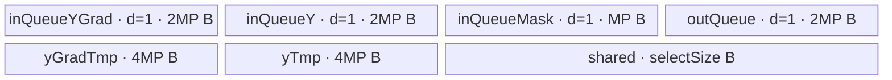
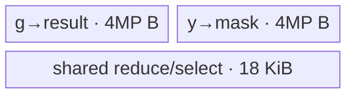

# ScaledMaskedSoftmaxBackward A2/A3 ACLNN 算子知识

## 算子速览

| 项目 | 内容 |
|---|---|
| 实际入口 | `aclnnScaledMaskedSoftmaxBackwardGetWorkspaceSize` + `aclnnScaledMaskedSoftmaxBackward`，公开 ACLNN 两段式接口；内部算子类型为 `ScaledMaskedSoftmaxGradV2` |
| 计算语义 | 对末轴逐行计算 `q=g*y`、`z=(q-sum_D(q)*y)*scale`，再按 bool `mask` 将真值位置清零 |
| 输入输出 | `gradOutput/y/out` 为 `[B,N,S,D]`、同 shape/dtype、ND，dtype 为 FP16/FP32/BF16；`mask` 为 bool `[B\|1,N\|1,S,D]`；A2/A3 上 `0<D<=4096`，实际 Tiling 要求四维长度均大于 0 |
| 执行类型 | 单个算子自有 `AIV_VECTOR` Kernel；无 Cube/AIC、MIX_CV、SIMT、NDDMA、通信或多 Kernel 节点 |
| Kernel 路线 | R-001 normal 16-bit；R-002 normal FP32；R-003 large 16-bit；R-004 large FP32；每条路线内部再按四种 `maskMoveMode` 选择广播搬运 helper |
| 核心资源 | GM 三输入一输出；normal 路线使用 4 个 depth=1 `TQue`、共享 `TBuf`，16-bit 另有两个 FP32 cast `TBuf`；large 路线使用两个输入 `TBuf`、共享 `TBuf`，并原地复用输入/转换区；算子 body 不读取 GM workspace |
| 来源闭包 | `source_closed`：公开 ACLNN wrapper → `aclnn_inner` 生成边界 → OpDef/Tiling/POD → 单 Kernel router → normal/large body/helper → A2/A3 binary config 与构建接线闭合 |
| 验证状态 | 已完成源码闭包检查；本次知识提取未执行编译、真机、数值或性能测试。 |

## 接口与语义

### 计算语义

令一行末轴索引为 `d`，`g=gradOutput[b,n,s,d]`，`p=y[b,n,s,d]`。Kernel 先计算

```text
q[d] = g[d] * p[d]
r[d] = q[d] - sum_{k=0}^{D-1}(q[k]) * p[d]
z[d] = r[d]                         , scale == 1
     = r[d] * float(scale)          , scale != 1
out[d] = z[d]                       , mask[bm,nm,s,d] == false
       = 0                          , mask[bm,nm,s,d] == true
bm = (mask.B == 1 ? 0 : b), nm = (mask.N == 1 ? 0 : n)
```

FP16/BF16 路线先把 `g/y` 升到 FP32，归约、缩放和掩码都在 FP32 完成，再降回原 dtype；FP32 路线全程 FP32。`D` 向上补齐至 64 元素倍数 `P`，数据 padding lane 在归约前清零，GM 输出只提交真实 `D` 元素。

### 输入、输出与属性

| 参数 | shape/layout | dtype | 约束、默认值与语义 |
|---|---|---|---|
| `gradOutput` | `[B,N,S,D]`，ND；公开 ACLNN 允许非连续 | FP16、FP32、BF16 | 上游梯度；与 `y/out` shape 相同；API 层允许维长为 0，但 Tiling 拒绝任一非正维 |
| `y` | `[B,N,S,D]`，ND；允许非连续 | 与 `gradOutput` 相同 | softmax 正向输出；dtype 一致性最终由 Tiling 再检查 |
| `mask` | `[B,N,S,D]`、`[1,N,S,D]`、`[B,1,S,D]` 或 `[1,1,S,D]`，ND；允许非连续 | BOOL | `true` 的输出位置清零；wrapper 实际要求指针非空，尽管内部 OpDef 将该输入标为 optional |
| `scale` | Host 标量 | DOUBLE API；POD 为 FP32 | 默认 1.0；生成 inner bridge 把属性送入内部 float attr，固定目录中不可见精确转换语句 |
| `fixTriuMask` | Host 标量 | BOOL | 只支持 `false`；`true` 在公开 wrapper 直接返回 `ACLNN_ERR_PARAM_INVALID` |
| `out` | `[B,N,S,D]`，ND | 与 `gradOutput` 相同 | `y` 的梯度；公开文档要求连续输出 |
| `workspaceSize/executor` | Host 输出 | `uint64_t*` / opaque | 第一段返回执行图及其 Device workspace 大小 |
| `workspace/stream` | Device 地址 / ACL stream | opaque | 第二段执行第一段生成的 executor；Kernel 参数中存在 workspace，但算子 body 未读取 |

### 入口与版本

固定 Commit 中该逻辑语义唯一公开入口为 `aclnnScaledMaskedSoftmaxBackward`，内部落到 `ScaledMaskedSoftmaxGradV2`；没有更高版本号的同语义公开 API。正向 `ScaledMaskedSoftmax`、其它 softmax grad、原地或量化变体不属于本卡。README 与 API 文档产品表明确列出 Atlas A2、A3；OpDef 的 `ascend910b/ascend910_93` 注册、对应 binary config 和 Kernel CMake 共同闭合两平台。公开文档未列 950，因此 `ascend950` 实现信号不用于发布 950 卡。

## Host/Launcher 执行流程

### 参数校验与前处理

第一段 wrapper 的顺序是：`CheckNotNull` 检查四个 Tensor；`CheckDtypeValid` 分别限定 `gradOutput/y/out` 为 FP16/FP32/BF16、`mask` 为 BOOL；A2/A3 执行 `CheckFormat` 排除 `FRACTAL_NZ`；`CheckShape` 要求 `gradOutput` rank=4、各维非负、`D<=4096`，要求 `y/out` shape 与其相同，并要求 mask rank=4、后两维完全相等、前两维相等或为 1。随后拒绝 `fixTriuMask=true`，把 `out` dtype 设为 `gradOutput` dtype，再调用生成的 `aclnnInnerScaledMaskedSoftmaxGradV2GetWorkspaceSize(..., false, ...)`。

`ScaledMaskedSoftmaxGradV2` OpDef 对三个输入声明 `.AutoContiguous()`；因此非连续输入的连续化由生成的 `aclnn_inner` executor 边界负责。该生成代码不在固定仓中，精确临时 Tensor、workspace slice 和空 Tensor 短路行为不可见。进入算子 Tiling 后会再次要求 `B/N/S/D>0`，检查 `y` dtype 等于 `gradOutput`，并检查 mask dtype/shape。

### 参数、Workspace 与生命周期

Tiling 从平台取得 `AIV coreNum` 与每核 UB 字节 `U`，产生 `blockDim=usedCoreNum`、Route key、POD 和 `workspace[0]=PlatformAscendC::GetLibApiWorkSpaceSize()`。这块 GM workspace 的 owner 是 ACLNN 调用者/生成 executor，生命周期覆盖第二段 stream 执行；Kernel entry 的 `workspace` 参数没有传入任何 body，也无跨 Kernel 中间边。`selectSize` 容易与 GM workspace 混淆：它是每核 `sharedBuffer` 的 UB 字节数，normal 路线还作为 `SoftMaxGradTilingFunc` 的 local workspace 参数。

### 启动图与失败传播

```text
公开 ACLNN 第一段
  -> Tensor/null/dtype/format/shape/fixTriuMask 校验
  -> aclnn_inner 生成边界（AutoContiguous、executor/workspace 合并）
  -> ScaledMaskedSoftmaxGradV2 Tiling：blockDim/key/POD/lib workspace
  -> 单节点 K0: scaled_masked_softmax_grad_v2(yGrad,y,mask,xGrad,workspace,tiling)
       -> R-001/R-002 NormalHeadDim<T>::Process
       -> R-003/R-004 LargeHeadDim<T>::Process
  -> executor 在调用者 stream 上完成并写 out
```

K0 的输入输出直接是 GM Tensor，POD 为 `ScaledMaskedSoftmaxGradV2TilingData`，grid/blockDim 为 `usedCoreNum`；每个 block 是一个 AIV core。没有算子自有节点间 workspace 边、event 或 owner 交接。wrapper 校验失败返回 ACLNN 错误；Tiling 任一步失败返回 `GRAPH_FAILED`，生成 executor 不应启动 K0；第二段直接转调 `aclnnInnerScaledMaskedSoftmaxGradV2` 并传播其状态。生成 executor 的 stream ordering 与 cleanup 细节属于固定仓不可见的框架边界。

## Route 与参数设计

### 分核与资源计算

记 `L=B*N*S`、`C=min(L, AIV_core_count)`、`P=ceil(D/64)*64`、`s=sizeof(T)`、`W1=GetSoftMaxGradMaxTmpSize([1,P],4,false,false)`：

```text
headLines = ceil(L/C)
tailLines = floor(L/C)
headCoreNum = L mod C
core b < headCoreNum: lineOffset=b*headLines, coreLines=headLines
otherwise: lineOffset=headCoreNum*headLines+(b-headCoreNum)*tailLines, coreLines=tailLines

normal (P<=1024):
  perLine = P * (3*s + (s==2 ? 8 : 0)) + P + W1
  M0 = floor(U/perLine)
  localWs0 = W1*M0
  selectSize = max(localWs0, 18 KiB)
  M = localWs0<18 KiB ? floor((U-18 KiB)/(perLine-W1)) : M0
  M = min(M, headLines)
  SoftMaxGradTilingFunc([M,P], 4, selectSize, ...)

large (P>1024):
  selectSize = 18 KiB
  perLine = P * (2*s + (s==2 ? 8 : 0))
  M = min(floor((U-18 KiB)/perLine), headLines)

loops = ceil(coreLines/M)
lastLoopLines = coreLines mod M; 0 改写为 M
```

前 `headCoreNum` 个核处理 `headLines`，其余处理 `tailLines`；`lineOffset*D` 是每核 `yGrad/y/xGrad` GM 基址。Tiling 没有显式检查 `M>0`，而后续会对 `M` 取模和除法；平台 UB 无法容纳一行时没有源码内 fallback。

### Route 选择

| 顺序 | Route | Key/模板 | 精确选择条件与优先级 | 不适用去向 |
|---:|---|---|---|---|
| 1 | R-001 normal 16-bit | key 1000 BF16 / 1001 FP16；`NormHeadDim<T>` | `P<=1024` 且 dtype BF16/FP16；mask mode 0/1/2/3 由 shape 独立写 POD | `P>1024` 去 R-003；非法 dtype/shape 失败 |
| 2 | R-002 normal FP32 | key 1002；`NormHeadDim<float>` | `P<=1024` 且 dtype FP32 | `P>1024` 去 R-004；非法 dtype/shape 失败 |
| 3 | R-003 large 16-bit | key 2000 BF16 / 2001 FP16；`LargeHeadDim<T>` | `P>1024` 且 dtype BF16/FP16；A2/A3 公开边界即 `1025<=D<=4096` | 其它 dtype 去 R-004 或失败 |
| 4 | R-004 large FP32 | key 2002；`LargeHeadDim<float>` | `P>1024` 且 dtype FP32；`1025<=D<=4096` | 非法 dtype/shape 失败 |

```text
CheckInputShape && CheckInputDtype && CheckCoreInfo
  -> P=ceil(D/64)*64
  -> P<=1024
       -> BF16: key 1000 -> R-001
       -> FP16: key 1001 -> R-001
       -> FP32: key 1002 -> R-002
  -> P>1024
       -> BF16: key 2000 -> R-003
       -> FP16: key 2001 -> R-003
       -> FP32: key 2002 -> R-004
  -> mask shape: BNSD/1NSD/B1SD/11SD -> maskMoveMode 0/1/2/3
```

### 模板/实现执行矩阵

| Route | key/selector | dtype/shape/platform 完整命中条件 | 执行拓扑与 Kernel 节点 | 实际模板/body | 内存与同步特征 | tail/fallback |
|---|---|---|---|---|---|---|
| R-001 normal 16-bit | 1000/1001 | A2/A3；BF16/FP16；`0<D<=1024`；四维正长；mask 可广播；`M>0` | 单 K0 | `NormHeadDim<bfloat16_t/half>::Process/ComputeSoftmaxGrad` | 4 个 depth=1 Queue、2 个 FP32 cast TBuf、共享 TBuf；Queue + `PIPE_V` | 最后 loop 改 `lineNum/calcNum/moveNum`；无 UB fallback |
| R-002 normal FP32 | 1002 | A2/A3；FP32；`0<D<=1024`；其余同上 | 单 K0 | `NormHeadDim<float>` | 4 Queue + 共享 TBuf，无 cast TBuf | 同 R-001 |
| R-003 large 16-bit | 2000/2001 | A2/A3；BF16/FP16；`1025<=D<=4096`；其余同上 | 单 K0 | `LargeHeadDim<bfloat16_t/half>::ProcessBit16` | 2 输入 TBuf + 2 FP32 TBuf + 共享 TBuf；显式 MTE2/V/MTE3 event | 尾 loop 更新三长度；无 UB fallback |
| R-004 large FP32 | 2002 | A2/A3；FP32；`1025<=D<=4096`；其余同上 | 单 K0 | `LargeHeadDim<float>::ProcessBit32` | 2 TBuf + 共享 TBuf；输入区原地出结果；显式 event | 同 R-003 |

### 隐藏性能 Guard

| Guard | Host/Tiling 条件 | Device/资源原因 | 影响 Route | 不满足时去向 | 源码符号 |
|---|---|---|---|---|---|
| 公开末轴边界 | wrapper `D<=4096`，Tiling `0<D<=4096` | POD 与 Vector 路线只为该范围计算；公开文档同样限制 `(0,4096]` | 全部 | ACLNN 或 Tiling 失败 | `CheckShape`; `CheckInputShape` |
| normal/large 阈值 | `P<=1024` | normal 使用 `SoftMaxGrad` 高阶 API；large 改用两级 `WholeReduceSum` | 全部 | 切换另一族 | `CalcTilingParams`; `SetTilingKey` |
| 每核 UB | 上述 `M` 公式隐含 `M>0` | 所有 Queue/TBuf 至少要容纳一行 | 全部 | 固定源码无 fallback/显式错误检查，后续存在除零风险 | `CalcNormHeadDimInfo`; `CalcLargeHeadDimInfo` |
| 64 元素 padding | `P=ceil(D/64)*64` | 归约 mask 为 64 FP32 元素，且连续 `DataCopy` 快路要求三路行宽一致 | 全部 | 非 64 倍数走逐行 `DataCopyPad` | `CalcTilingParams`; Base `CopyIn/CopyOut/CopyInMaskLines` |
| mask 广播模式 | 精确优先级：`B,N` 相等→0；`1,N`→1；`B,1`→2；`1,1`→3 | 避免物化 broadcast mask，只搬实际行并在 UB 复制 | 全部 | 非法 shape 在 API/Tiling 失败 | `SetMaskMode`; `CopyInMask*` |
| scale 快路 | `scale_ != 1.0f` 才执行 `Muls` | scale=1 避免一次全 tile Vector 乘法 | 全部 | 直接进入 mask Select | 两个 body 的 `DoScaleAndMask` |
| BF16 router guard | BF16 key 分支位于 `#if __CCE_AICORE__ >= 220` | BF16 模板只在相应编译目标实例化 | R-001/R-003 | 未编译目标对 key 无 body；A2/A3 binary config 均声明 BF16 | Kernel entry router |
| 未知 key | router 只列 1000/1001/1002/2000/2001/2002 | 没有 default body 或错误上报 | 全部 | entry 静默返回，输出不写；正常 Tiling 不产生未知 key | `scaled_masked_softmax_grad_v2` |
| 尾行 | 最后 loop 把 `lineNum=minLine` | DMA、Vector count 和 Select shape 只覆盖有效行 | 全部 | N/A | 两个 body 的 `Process/SetParams` |
| stride 窄化 | `stride/maskStride` 转 `uint16_t`，`blockCount/blockLen` 转 `uint32_t` | DataCopy 参数 ABI 位宽固定 | 全部 | 固定源码无显式溢出检查；在公开 D 范围 padding stride 很小 | Base `Init/SetDataCopyParams` |

### POD/ABI

`BEGIN_TILING_DATA_DEF` 宏按下列声明顺序生成序列化结构；宏实现与 `SoftMaxTiling` 内部字段不在固定算子源码中，因此精确 `sizeof/alignof/offsetof` 不可见，不作猜测。

| 结构 | 字段 | 类型/位宽 | ABI 布局 | 单位 | Host/launcher producer | Device consumer | 边界 |
|---|---|---|---|---|---|---|---|
| `ScaledMaskedSoftmaxGradV2TilingData` | `usedCoreNum` | `uint64_t`/64 | 声明 1 | core | `min(L,coreNum)` | Base `Init`; `Process` block guard | `1..coreNum`，Tiling 已拒绝空维 |
| 同上 | `batch` | `uint64_t`/64 | 声明 2 | 维长 | `set_batch(batch)` | Kernel 未读取 | 非活跃字段 |
| 同上 | `channel` | `uint64_t`/64 | 声明 3 | 维长 | `set_channel(channel)` | Base `linePerBatch`、mask 行映射 | 正数 |
| 同上 | `seqLength` | `uint64_t`/64 | 声明 4 | 维长 | `set_seqLength(seqLength)` | Base mask 行映射 | 正数 |
| 同上 | `headDim` | `uint64_t`/64 | 声明 5 | 元素/行 | `set_headDim(headDim)` | GM offset、DMA 有效宽度 | A2/A3 为 `1..4096` |
| 同上 | `totalLine` | `uint64_t`/64 | 声明 6 | 行 | `B*N*S` | Kernel 未读取 | Host 乘法无显式溢出检查 |
| 同上 | `paddedHeadDim` | `uint64_t`/64 | 声明 7 | 元素/行 | `ceil(D/64)*64` | UB stride、calc count、归约 shape | 64 元素倍数 |
| 同上 | `totalLinePerHeadCore` | `uint64_t`/64 | 声明 8 | 行/core | `ceil(L/C)` | Base 前核 loop/offset | 前 `headCoreNum` 核读取 |
| 同上 | `totalLinePerTailCore` | `uint64_t`/64 | 声明 9 | 行/core | `floor(L/C)` | Base 尾核 loop/offset | 其余核读取 |
| 同上 | `maxLinePerLoop` | `uint64_t`/64 | 声明 10 | 行/loop | normal/large UB 公式的 `M` | Base loop、UB capacity、offset | 源码隐含 `M>0` |
| 同上 | `tailLinePerHeadCore` | `uint64_t`/64 | 声明 11 | 行 | `headLines%M`，0→M | Base `minLine` | 前核最后 loop |
| 同上 | `tailLinePerTailCore` | `uint64_t`/64 | 声明 12 | 行 | `tailLines%M`，0→M | Base `minLine` | 尾核最后 loop |
| 同上 | `headCoreNum` | `uint64_t`/64 | 声明 13 | core | `L%C` | Base 前/尾核分支 | 可为 0 |
| 同上 | `maskMoveMode` | `uint64_t`/64 | 声明 14 | enum 0..3 | `SetMaskMode` shape 决策树 | `CopyInMask/CalcLineInfo` | 0 BNSD；1 1NSD；2 B1SD；3 11SD |
| 同上 | `selectSize` | `uint64_t`/64 | 声明 15 | UB 字节/core | normal 为 `max(W1*M,18KiB)`，large 为 18KiB | Base `InitBuffer(sharedBuffer,...)` | 必须与 UB 预算一致 |
| 同上 | `scale` | `float`/32 | 声明 16 | 无量纲 | `attrs[0]` float | `DoScaleAndMask` | API double 到内部 float 的转换代码不可见 |
| 同上 | `fixedTriuMask` | `uint32_t`/32 | 声明 17 | bool 编码 | `static_cast<uint32_t>(*attrs[1])` | Kernel 未读取 | 公开 wrapper 固定传 false |
| 同上 | `softmaxGradTilingData` | `SoftMaxTiling`/固定仓不可见 | 声明 18；内部 ABI 不可见 | high-level API POD | normal 的 `SoftMaxGradTilingFunc([M,P],4,selectSize,...)` | R-001/R-002 `SoftMaxGrad<float,false,false>` | large 路线不读取；不得外推内部字段 |

### Route 源码闭包

| Route | Key/selector | Host/Tiling producer | POD/参数 | Kernel entry/router 节点 | Kernel body/直接依赖 | 构建接线 |
|---|---|---|---|---|---|---|
| R-001 normal 16-bit | 1000/1001 | `CalcNormHeadDimInfo/SetTilingKey` | 公共 POD + `SoftMaxTiling` | `scaled_masked_softmax_grad_v2` → `NormHeadDim<bfloat16_t/half>` | norm header + Base copy/mask helpers | OpDef 910B/910_93 + 两 binary config + Kernel CMake |
| R-002 normal FP32 | 1002 | 同上 | 同上 | entry → `NormHeadDim<float>` | 同上 | 同上 |
| R-003 large 16-bit | 2000/2001 | `CalcLargeHeadDimInfo/SetTilingKey` | 公共 POD；nested softmax 字段 inactive | entry → `LargeHeadDim<bfloat16_t/half>` | large header + Base helpers | 同上 |
| R-004 large FP32 | 2002 | 同上 | 同上 | entry → `LargeHeadDim<float>` | 同上 | 同上 |

## Kernel 实现

### 公共执行流程

entry 解析 POD，构造 `GmTensor{yGrad,y,mask,xGrad}` 和每核 `TPipe`，按 key 实例化唯一 body。Base `Init` 计算 core 行域、`lineOffset`、loop/tail、padding、DMA stride，绑定三输入一输出 GM，并分配 `sharedBuffer`；16-bit 额外分配两个 FP32 TBuf。每个 loop 的 `offset=loop*M*D`。`D%64==0` 时 `yGrad/y/mask/out` 都按连续 `lineNum*D` 元素搬运。否则 A2/A3 的 `DataCopyPad` 参数为：数据输入 `blockCount=lineNum, blockLen=D*s` 字节、`srcStride=0`、`dstStride=(P-D-paddingNum)*s/32` 个 32B block、右 pad `paddingNum=(P-D)%(32/s)` 个 T 元素且填 0；输出交换 src/dst stride 并只写 `D*s` 字节/行；mask 使用 `blockLen=D` 字节、`dstStride=(P-D-maskPaddingNum)/32`、右 pad `maskPaddingNum=(P-D)%32` 个 bool 且填 true。余下完整 padding block 不参与 GM 有效输出，数据侧在归约前显式清零。

四种 mask GM 行映射为：mode 0 `currentLine`；mode 1 `currentLine%(N*S)`；mode 2 `currentLine%S+batch*S`；mode 3 `currentLine%S`。跨 batch/channel 的 loop 由 `CopyInMaskLines/Block/1NSD/B1SD/11SD` 分段搬运和重复，避免生成 broadcast GM Tensor。

### Route R-001：normal 16-bit

#### 适用条件

##### 选择证据

| 层级 | 文件 | 符号 | 源码谓词/参数 | 结果/下一跳 |
|---|---|---|---|---|
| API | `op_host/op_api/aclnn_scaled_masked_softmax_backward.cpp` | `CheckParams` / GetWorkspaceSize | 四 Tensor 非空、dtype/format/shape、`fixTriuMask=false` | inner executor 或 ACLNN 错误 |
| Tiling | `op_host/scaled_masked_softmax_grad_v2_tiling.cpp` | `CalcTilingParams/SetTilingKey` | `P<=1024`；BF16 不加 dtype key、FP16 加 1 | 1000/1001 |
| Router | `op_kernel/scaled_masked_softmax_grad_v2.cpp` | entry | key 1000/1001；BF16 受 `__CCE_AICORE__>=220` guard | `NormHeadDim<bfloat16_t/half>` |
| Platform | `op_host/scaled_masked_softmax_grad_v2_def.cpp` | OpDef constructor | `AddConfig("ascend910b")`、`AddConfig("ascend910_93")` | A2/A3 可达 |

#### Device 数据流

##### 函数级调用链

```text
Tiling4ScaledMaskedSoftmaxGradV2 -> key 1000/1001, blockDim=C, POD
  -> scaled_masked_softmax_grad_v2
    -> NormHeadDim<T>::Init -> Base<T>::Init -> InitBuffer(queues/cast/shared)
    -> NormHeadDim<T>::Process
      -> CopyIn -> Base::CopyIn(yGrad,y) -> EnQue
      -> CopyInMask -> Base::CopyInMask(mode helper) -> EnQue
      -> ComputeSoftmaxGrad
        -> Cast g/y to FP32 -> SoftMaxGrad -> optional Muls -> SelectWithBytesMask -> Cast_RINT to T
      -> CopyOut -> Base::CopyOut -> GM xGrad
```

##### 源码等价伪码

```text
for loop in [0, ceil(coreLines/M)):
  lines = last ? minLine : M; off = loop*M*D
  DMA g[off:lines,D], y[off:lines,D] -> padded [lines,P] T queues
  DMA broadcast-mapped mask rows -> [lines,P] bool queue
  gf = Cast<float>(g); yf = Cast<float>(y)
  zero gf/yf lanes [alignedHeadDim,P) when full padding blocks exist
  xf = SoftMaxGrad<float,false,false>(gf,yf,tmp=shared,tiling=softmaxPOD,shape=[lines,P])
  if scale != 1: xf *= scale
  xf = SelectWithBytesMask(mask, xf, 0, tmp=shared, shape=[lines,P])
  outT = Cast<T, RINT>(xf)
  DMA outT[lines,D] -> xGrad[off:]
```

#### 内存与数据搬运

##### 资源与搬运表

| 层级/缓冲区 | offset/地址公式 | extent/容量公式 | dtype/layout | producer | consumer | owner/lifetime | 对齐/复用 |
|---|---|---|---|---|---|---|---|
| GM `yGrad/y/xGrad` | core base `lineOffset*D`，loop `off=loop*M*D` | `lines*D` 有效元素 | T `[lines,D]` | caller / K0 | K0 / caller | executor 调用期间 | 非 64 倍数逐行 pad/crop |
| GM `mask` | mode 映射行 `maskLine*D` | 按 helper 分段 | bool `[Bm,Nm,S,D]` | caller | Base CopyInMask | executor 调用期间 | 广播行重复搬到 UB |
| `inQueueYGrad` | UB 子区 | `M*P*2` B，depth 1 | T `[M,P]` | CopyIn | Compute | 每 loop Alloc→Free | 32B DMA；P 为 64 倍数 |
| `inQueueY` | UB 子区 | `M*P*2` B，depth 1 | 同上 | CopyIn | Compute | 同上 | 同上 |
| `inQueueMask` | UB 子区 | `M*P` B，depth 1 | bool | CopyInMask | Select | Alloc→Free | padding byte 为 true；完整 padding block 不影响 GM 有效输出 |
| `outQueueXGrad` | UB 子区 | `M*P*2` B，depth 1 | T | final Cast | CopyOut | Alloc→Free | 只提交 `lines*D` |
| `yGradTmpBuffer` | UB 子区 | `M*P*4` B | FP32 | Cast(g)，后被 SoftMaxGrad 原地写结果 | scale/mask/final Cast | K0 core 生命周期 | 原地 `gf→xf` |
| `yTmpBuffer` | UB 子区 | `M*P*4` B | FP32 | Cast(y) | SoftMaxGrad | K0 core 生命周期 | loop 间覆盖 |
| `sharedBuffer` | UB 子区 | `selectSize` B | uint8/FP32 temp | SoftMaxGrad；后 Select | 两高阶 API | K0 core 生命周期 | 两阶段时序复用 |

##### 分层内存布局



##### 字节账与复用顺序

```text
UB_total = 2MP + 2MP + MP + 2MP + 4MP + 4MP + selectSize
         = 15MP + selectSize
UB_total <= U 由 CalcNormHeadDimInfo 的 M/selectSize 公式约束
dynamic_ub = N/A（AIV TPipe 静态 UB）
workspace_total = GetLibApiWorkSpaceSize()（系统库 workspace；Kernel body 不索引）
```

| 复用子区 | 写入者 | 读取者/消费点 | 下一次覆盖 | 同步或释放依据 | 安全条件 |
|---|---|---|---|---|---|
| `yGradTmpBuffer` | Cast(g) | SoftMaxGrad，随后 scale/Select | 下一 loop Cast(g) | Vector 顺序与 `PIPE_V` barrier | final Cast 已完成 |
| `sharedBuffer` | SoftMaxGrad temp | SoftMaxGrad | Select temp | SoftMaxGrad 返回后顺序调用 | 两 API 不并发 |
| 四 Queue | CopyIn/Compute | DeQue consumer | FreeTensor 后下一 loop Alloc | TQue EnQue/DeQue/FreeTensor | depth=1，不能提前复用 |

#### 同步、精度与尾块

##### 同步与数值边界表

| 阶段 | primitive/机制 | producer | consumer/等待点 | 保护对象 | 精度/尾块 |
|---|---|---|---|---|---|
| DMA→Vector | TQue EnQue/DeQue | CopyIn | Compute | 三输入 Queue | line tail 由 `lineNum` |
| cast/zero→SoftMax | Vector 顺序 + `PipeBarrier<PIPE_V>` after Duplicate | Cast/Duplicate | SoftMaxGrad | FP32 padded rows | padding lane 为 0，不进入 sum |
| scale→Select | `PipeBarrier<PIPE_V>` when Muls runs | Muls | Select | FP32 output | scale=1 无 Muls/barrier |
| FP32→T | `Cast_RINT` on A2/A3 compile branch | Select | out Queue | 有效及 padding lanes | GM 只写 D |
| Vector→DMA | TQue EnQue/DeQue | Compute | CopyOut | output Queue | 最后 loop 使用 `minLine` |

#### 关键实现

##### 符号证据表

| 阶段 | 文件 | 符号/模板实例 | 实现事实 |
|---|---|---|---|
| Host/Tiling producer | `op_host/scaled_masked_softmax_grad_v2_tiling.cpp` | `CalcNormHeadDimInfo/SetTilingKey` | 计算 15MP+shared 预算、SoftMax POD 与 1000/1001 |
| Kernel entry/router | `op_kernel/scaled_masked_softmax_grad_v2.cpp` | `scaled_masked_softmax_grad_v2` | key 到 BF16/FP16 normal 模板 |
| Device body/helper | `op_kernel/scaled_masked_softmax_grad_v2_norm_headdim.h` | `NormHeadDim<T>::ComputeSoftmaxGrad/DoSoftmaxGrad/DoScaleAndMask` | 升精度、高阶 SoftMaxGrad、scale、mask、降精度 |
| Device body/helper | `op_kernel/scaled_masked_softmax_grad_v2_base.h` | `CopyIn/CopyInMask*/CopyOut` | DMA、广播行映射与 tail crop |

### Route R-002：normal FP32

#### 适用条件

##### 选择证据

| 层级 | 文件 | 符号 | 源码谓词/参数 | 结果/下一跳 |
|---|---|---|---|---|
| API | wrapper cpp | `CheckDtypeValid/CheckShape` | FP32、合法四维与 mask | inner executor |
| Tiling | tiling cpp | `CalcNormHeadDimInfo/SetTilingKey` | `P<=1024 && dataType==DT_FLOAT` | key 1002 |
| Router | Kernel cpp | entry | `TILING_KEY_IS(1002)` | `NormHeadDim<float>` |
| Platform | def/config | OpDef + FP32 binary item | 910B/910_93 | A2/A3 可达 |

#### Device 数据流

##### 函数级调用链

```text
Tiling -> key 1002 -> entry -> NormHeadDim<float>::Init/Process
  -> Base::CopyIn + CopyInMask -> Queue
  -> SoftMaxGrad<float,false,false>(outQueueLocal,gQueueLocal,yQueueLocal,shared,...)
  -> optional Muls -> SelectWithBytesMask -> out Queue
  -> Base::CopyOut
```

##### 源码等价伪码

```text
for each assigned loop:
  load FP32 g/y and bool mask as padded [lines,P]
  zero full-block padding of g/y
  out = SoftMaxGrad(g,y, shared, softmaxPOD, [lines,P])
  free g/y queues
  if scale != 1: out *= scale
  out = mask ? 0 : out
  store [lines,D]
```

#### 内存与数据搬运

##### 资源与搬运表

| 层级/缓冲区 | offset/地址公式 | extent/容量公式 | dtype/layout | producer | consumer | owner/lifetime | 对齐/复用 |
|---|---|---|---|---|---|---|---|
| GM tensors | 同 R-001 | `lines*D` | FP32/bool ND | caller/K0 | K0/caller | executor | pad/crop 同 R-001 |
| `inQueueYGrad` | UB | `4MP` B，depth 1 | FP32 | CopyIn | SoftMaxGrad | loop | Queue lifecycle |
| `inQueueY` | UB | `4MP` B，depth 1 | FP32 | CopyIn | SoftMaxGrad | loop | Queue lifecycle |
| `inQueueMask` | UB | `MP` B，depth 1 | bool | mask helper | Select | loop | 广播搬运 |
| `outQueueXGrad` | UB | `4MP` B，depth 1 | FP32 | SoftMaxGrad | scale/Select/CopyOut | loop | 直接作为计算输出 |
| `sharedBuffer` | UB | `selectSize` B | API temp | SoftMaxGrad/Select | 同左 | core | 时序复用 |

##### 分层内存布局


##### 字节账与复用顺序

```text
UB_total = 4MP + 4MP + MP + 4MP + selectSize = 13MP + selectSize <= U
dynamic_ub = N/A
workspace_total = GetLibApiWorkSpaceSize(); body 不索引
```

| 复用子区 | 写入者 | 读取者/消费点 | 下一次覆盖 | 同步或释放依据 | 安全条件 |
|---|---|---|---|---|---|
| `sharedBuffer` | SoftMaxGrad | SoftMaxGrad | Select | 顺序调用 | SoftMaxGrad 已返回 |
| out Queue tensor | SoftMaxGrad | scale/Select/CopyOut | Free 后下一 loop | EnQue/DeQue/FreeTensor | CopyOut 完成 |

#### 同步、精度与尾块

##### 同步与数值边界表

| 阶段 | primitive/机制 | producer | consumer/等待点 | 保护对象 | 精度/尾块 |
|---|---|---|---|---|---|
| CopyIn→compute | TQue | DMA | SoftMaxGrad | g/y/mask | FP32，无 cast |
| padding | Duplicate + `PIPE_V` | zero fill | SoftMaxGrad | padded lanes | sum 只见 0 |
| scale/mask | `Muls` barrier + Select | SoftMaxGrad/Muls | Select | out tensor | scale float |
| output | TQue | Select | CopyOut | out | crop 到 D，tail lines 精确 |

#### 关键实现

##### 符号证据表

| 阶段 | 文件 | 符号/模板实例 | 实现事实 |
|---|---|---|---|
| Host/Tiling producer | tiling cpp | `CalcNormHeadDimInfo/SetTilingKey` | 13MP 预算、key 1002 |
| Kernel entry/router | Kernel cpp | entry key 1002 | `NormHeadDim<float>` |
| Device body/helper | norm header | `ComputeSoftmaxGrad` float constexpr 分支 | 无 cast buffer、out Queue 直接承接 SoftMaxGrad |
| Device body/helper | Base header | DMA/mask helpers | FP32 行搬运和广播 |

### Route R-003：large 16-bit

#### 适用条件

##### 选择证据

| 层级 | 文件 | 符号 | 源码谓词/参数 | 结果/下一跳 |
|---|---|---|---|---|
| API | wrapper cpp | `CheckShape/CheckDtypeValid` | BF16/FP16，`D<=4096` | inner executor |
| Tiling | tiling cpp | `CalcLargeHeadDimInfo/SetTilingKey` | `P>1024`；BF16/FP16 | key 2000/2001 |
| Router | Kernel cpp | entry | key 2000/2001 | `LargeHeadDim<bfloat16_t/half>` |
| Platform | def/config | OpDef + 16-bit binary item | 910B/910_93 | A2/A3 可达 |

#### Device 数据流

##### 函数级调用链

```text
Tiling -> key 2000/2001 -> entry -> LargeHeadDim<T>::Init -> Base::Init
  -> ProcessBit16 loop
    -> Base::CopyIn(g,y) -> MTE2_V event
    -> Cast g/y to FP32 -> DoSoftmaxGrad
       -> Mul -> zero padding -> ComputeReduceSum(two WholeReduceSum levels)
       -> Muls(y,sum) -> Sub -> V_MTE2 event -> Base::CopyInMask into yTmp alias
       -> optional scale -> SelectWithBytesMask
    -> Cast_RINT result into yTmp reinterpreted as T -> V_MTE3 event -> Base::CopyOut
```

##### 源码等价伪码

```text
for loop:
  load gT,yT -> inBufferYGrad/inBufferY
  wait MTE2; gf=Cast(gT); yf=Cast(yT)
  gf *= yf
  zero gf padding
  for row: partial[0:P/64] = reduce64(gf[row]); sum[row]=reduce(partial)
  for row: yf[row,0:P] *= sum[row] using mask=64, repeats=P/64
  gf -= yf
  wait V->MTE2; overwrite yf storage with broadcast-mapped bool mask
  if scale != 1: gf *= scale
  gf = mask ? 0 : gf
  reinterpret yf storage as T output; Cast_RINT(gf -> outputT)
  wait V->MTE3; store [lines,D]
```

#### 内存与数据搬运

##### 资源与搬运表

| 层级/缓冲区 | offset/地址公式 | extent/容量公式 | dtype/layout | producer | consumer | owner/lifetime | 对齐/复用 |
|---|---|---|---|---|---|---|---|
| GM tensors | 同 R-001 | `lines*D` | T/bool | caller/K0 | K0/caller | executor | mode-aware mask |
| `inBufferYGrad` | UB | `2MP` B | T | CopyIn g | Cast | core | loop overwrite |
| `inBufferY` | UB | `2MP` B | T | CopyIn y | Cast | core | loop overwrite |
| `yGradTmpBuffer` | UB | `4MP` B | FP32 | Cast g；原地 Mul/Sub/scale/Select | final Cast | core | 主结果原地 |
| `yTmpBuffer` | UB | `4MP` B | FP32→bool→T | Cast y；Muls；mask DMA；final cast dst | arithmetic/Select/CopyOut | core | 三阶段跨 dtype alias |
| `sharedBuffer` | UB | 18 KiB | FP32 partial sum / uint8 Select temp | reductions / Select | same | core | 同一子区时序复用 |

##### 分层内存布局


##### 字节账与复用顺序

```text
UB_total = 2MP + 2MP + 4MP + 4MP + 18 KiB = 12MP + 18 KiB <= U
dynamic_ub = N/A
workspace_total = GetLibApiWorkSpaceSize(); body 不索引
```

| 复用子区 | 写入者 | 读取者/消费点 | 下一次覆盖 | 同步或释放依据 | 安全条件 |
|---|---|---|---|---|---|
| `yGradTmpBuffer` | Cast(g) | Mul/reduce/Sub/scale/Select/final Cast | 下一 loop | Vector 顺序、MTE3/V 跨 loop event | CopyOut 已消费 cast dst |
| `yTmpBuffer` | Cast(y) | Mul/Muls/Sub | mask DMA 覆盖 | `V_MTE2` Set/Wait | y 的最后消费已完成 |
| `yTmpBuffer` | mask DMA | Select | final Cast 写 T | `MTE2_V` Wait + `PIPE_V` before Cast | Select 已完成 |
| `sharedBuffer` | WholeReduceSum | Muls GetValue | Select temp | Vector barriers和调用顺序 | 归约标量已消费 |

#### 同步、精度与尾块

##### 同步与数值边界表

| 阶段 | primitive/机制 | producer | consumer/等待点 | 保护对象 | 精度/尾块 |
|---|---|---|---|---|---|
| input DMA→cast | `MTE2_V` event A | CopyIn | Cast | 两 T input buffers | lines/calcNum 已按 tail 更新 |
| arithmetic→mask DMA | `V_MTE2` event | Sub | CopyInMask | `yTmpBuffer` alias | 覆盖前 y 已消费 |
| mask DMA→Select | `MTE2_V` event B | CopyInMask | Select | bool alias | padded mask lane不写 GM |
| Select→final Cast | `PIPE_V` | Select | Cast | `yTmpBuffer` output alias | FP32→BF16/FP16 使用 RINT |
| Cast→output DMA | `V_MTE3` | Cast | CopyOut | T alias | 只写真实 D |
| 跨 loop reuse | `MTE3_V` | CopyOut | 下一 loop Vector 使用 yTmp | output alias | 非首/末 loop 条件设置等待 |

#### 关键实现

##### 符号证据表

| 阶段 | 文件 | 符号/模板实例 | 实现事实 |
|---|---|---|---|
| Host/Tiling producer | tiling cpp | `CalcLargeHeadDimInfo/SetTilingKey` | 12MP+18KiB 预算与 2000/2001 |
| Kernel entry/router | Kernel cpp | key 2000/2001 | 16-bit large 实例 |
| Device body/helper | large header | `ProcessBit16/DoSoftmaxGrad/ComputeReduceSum` | 显式归约、alias、event、cast |
| Device body/helper | Base header | Copy helpers | padded DMA 与 mask 广播 |

### Route R-004：large FP32

#### 适用条件

##### 选择证据

| 层级 | 文件 | 符号 | 源码谓词/参数 | 结果/下一跳 |
|---|---|---|---|---|
| API | wrapper cpp | `CheckShape/CheckDtypeValid` | FP32，`1025<=D<=4096` | inner executor |
| Tiling | tiling cpp | `CalcLargeHeadDimInfo/SetTilingKey` | `P>1024 && DT_FLOAT` | key 2002 |
| Router | Kernel cpp | entry | key 2002 | `LargeHeadDim<float>` |
| Platform | def/config | FP32 binary item | 910B/910_93 | A2/A3 可达 |

#### Device 数据流

##### 函数级调用链

```text
Tiling -> key 2002 -> entry -> LargeHeadDim<float>::Init/ProcessBit32
  -> Base::CopyIn directly to two FP32 TBuf
  -> DoSoftmaxGrad: Mul/reduce/Muls/Sub -> overwrite y TBuf with mask -> scale/Select
  -> Base::CopyOut from yGrad TBuf
```

##### 源码等价伪码

```text
for loop:
  wait prior MTE3_MTE2; DMA g,y into two FP32 TBuf
  wait MTE2_V
  g *= y; zero padding; sum = two-level WholeReduceSum(g)
  y *= sum; g -= y
  wait V_MTE2; overwrite y TBuf with bool mask
  wait MTE2_V; optional g*=scale; g=mask?0:g
  wait V_MTE3; DMA g[lines,D] -> out
  signal MTE3_MTE2 for next loop
```

#### 内存与数据搬运

##### 资源与搬运表

| 层级/缓冲区 | offset/地址公式 | extent/容量公式 | dtype/layout | producer | consumer | owner/lifetime | 对齐/复用 |
|---|---|---|---|---|---|---|---|
| GM tensors | 同 R-001 | `lines*D` | FP32/bool | caller/K0 | K0/caller | executor | mode-aware mask |
| `inBufferYGrad` | UB | `4MP` B | FP32 | CopyIn g；原地 Mul/Sub/scale/Select | CopyOut | core | 输入直接变输出 |
| `inBufferY` | UB | `4MP` B | FP32→bool | CopyIn y；Muls；mask DMA | arithmetic/Select | core | y 生命周期后覆写 mask |
| `sharedBuffer` | UB | 18 KiB | reduce/Select temp | reductions/Select | same | core | 时序复用 |

##### 分层内存布局



##### 字节账与复用顺序

```text
UB_total = 4MP + 4MP + 18 KiB = 8MP + 18 KiB <= U
dynamic_ub = N/A
workspace_total = GetLibApiWorkSpaceSize(); body 不索引
```

| 复用子区 | 写入者 | 读取者/消费点 | 下一次覆盖 | 同步或释放依据 | 安全条件 |
|---|---|---|---|---|---|
| g TBuf | CopyIn | Mul/reduce/Sub/scale/Select/CopyOut | 下一 loop CopyIn | `MTE3_MTE2` event | prior CopyOut 完成 |
| y TBuf | CopyIn | Mul/Muls/Sub | mask DMA | `V_MTE2` event | y 最后消费完成 |
| shared | reduction | Muls | Select temp | `PIPE_V` barriers | sum 已逐行消费 |

#### 同步、精度与尾块

##### 同步与数值边界表

| 阶段 | primitive/机制 | producer | consumer/等待点 | 保护对象 | 精度/尾块 |
|---|---|---|---|---|---|
| 跨 loop DMA reuse | `MTE3_MTE2` | prior CopyOut | next CopyIn | g TBuf | 非首 loop等待 |
| DMA→Vector | `MTE2_V` | CopyIn | arithmetic | g/y TBuf | FP32 |
| Vector→mask DMA | `V_MTE2` | Sub | CopyInMask | y alias | safe overwrite |
| mask→Vector | `MTE2_V` | mask DMA | Select | bool alias | four mask modes |
| Vector→DMA | `V_MTE3` | Select | CopyOut | g result | tail crop to D |

#### 关键实现

##### 符号证据表

| 阶段 | 文件 | 符号/模板实例 | 实现事实 |
|---|---|---|---|
| Host/Tiling producer | tiling cpp | `CalcLargeHeadDimInfo/SetTilingKey` | 8MP+18KiB 与 key 2002 |
| Kernel entry/router | Kernel cpp | key 2002 | `LargeHeadDim<float>` |
| Device body/helper | large header | `ProcessBit32/DoSoftmaxGrad/ComputeReduceSum` | g/y TBuf 原地复用与 event 图 |
| Device body/helper | Base header | Copy helpers | FP32 DMA、mask 广播、tail |

## 算子特定优化

### Trick T-001：normal 路线用一个 shared TBuf 串行承载 SoftMaxGrad 与 mask Select 临时区

#### 触发与源码依据

- 适用 Route：R-001、R-002
- 触发条件：`P<=1024`；`selectSize=max(W1*M,18KiB)` 已由 Host 预算
- Golden 来源：[`scaled_masked_softmax_grad_v2_norm_headdim.h:154-174`](../../../../../../../cann-ops-raw/ascendc/ops-nn/955f8b33985b6d72989ebff341bb9c2c564a51bc/vfusion/scaled_masked_softmax_grad_v2/op_kernel/scaled_masked_softmax_grad_v2_norm_headdim.h#L154-L174)

**官方源码（固定 Commit 连续逐字摘录）**：

```cpp
SoftmaxGrad<float, false, false>(
    xGradLocal, yGradLocal, yLocal, softmaxGradTmpBuf, softmaxTiling_, false, srcShape);
```

#### 机制与设计原因

`sharedBuffer` 先以 `uint8_t` 视图传给 `SoftmaxGrad`，返回后同一物理区又作为 `SelectWithBytesMask` 临时区。Host 令其容量同时满足按 `[M,P]` 生成的 SoftMax 临时需求和固定 18 KiB Select 上限，因此无需把两块临时区相加。该机制减少每核 UB 物化；两个 API 串行调用是复用安全前提。

#### 迁移边界

- 适用：多个高阶 Vector API 临时区生命周期不重叠的逐行计算。
- 前提：调用顺序严格串行，统一 buffer 容量覆盖两者最大需求，SoftMax POD 与 `[M,P]` 一致。
- 失效：若两个阶段并发、临时数据跨阶段存活或所需容量无法取最大值复用，必须拆分 buffer/降低 M。
- 未验证：本次知识提取未执行编译、真机、数值或性能测试。

#### 错误做法

固定仓未提供可验证反例；从源码可确定，在 SoftMaxGrad 完成前覆盖 sharedBuffer 会破坏其临时数据。

### Trick T-002：large 路线用两级 64-lane 归约替代 normal 高阶 API，并原地复用 y 缓冲区

#### 触发与源码依据

- 适用 Route：R-003、R-004
- 触发条件：`P>1024`，`P` 为 64 倍数
- Golden 来源：[`scaled_masked_softmax_grad_v2_large_headdim.h:196-206`](../../../../../../../cann-ops-raw/ascendc/ops-nn/955f8b33985b6d72989ebff341bb9c2c564a51bc/vfusion/scaled_masked_softmax_grad_v2/op_kernel/scaled_masked_softmax_grad_v2_large_headdim.h#L196-L206)

**官方源码（固定 Commit 连续逐字摘录）**：

```cpp
WholeReduceSum(
    dstLocal[i * MASK_LEN_B32], srcLocal[i * this->paddedHeadDim_], MASK_LEN_B32, repeatTimes, BLK_STRIDE,
    BLK_STRIDE, REP_STRIDE);
```

#### 机制与设计原因

每行先把 `P/64` 个 64-lane 分段和写到 sharedBuffer，再对这些分段和做第二次归约。随后 `yLocal` 乘行和，`yGradLocal` 原地从 `g*y` 改写为最终梯度；`yLocal` 的最后一次数学消费后又被 mask DMA 覆盖。这样 large 族只预算 `8MP/12MP + 18KiB`，不需要 normal 族的四个 Queue 与随 M 增长的 SoftMax 临时区。`repeatTimes=P/64`、mask=64、block stride=1、repeat stride=8 都来自固定 64 个 FP32 元素/256B repeat 的布局。

#### 迁移边界

- 适用：末轴补齐长度为 64 FP32 元素倍数、行内独立归约且原输入不再需要的梯度公式。
- 前提：padding lane 在归约前为 0；sharedBuffer 能保存至少一行的分段和；覆写 y 前完成 `Muls/Sub` 并建立 `V_MTE2` 依赖。
- 失效：`P<=1024` 使用 R-001/R-002；若 y 后续仍需参与计算，不得覆写为 mask。
- 未验证：本次知识提取未执行编译、真机、数值或性能测试。

#### 错误做法

固定仓以 `V_MTE2` event 明确防止 mask DMA 早于 Vector 对 y 的最后消费；删除该依赖是源码可验证的错误边界。

### Trick T-003：按 B/N 广播模式直接搬 mask 行，避免 GM broadcast 物化

#### 触发与源码依据

- 适用 Route：R-001–R-004
- 触发条件：mask 前两维分别为 `B或1`、`N或1`，后两维等于 `S,D`
- Golden 来源：[`scaled_masked_softmax_grad_v2_tiling.cpp:312-325`](../../../../../../../cann-ops-raw/ascendc/ops-nn/955f8b33985b6d72989ebff341bb9c2c564a51bc/vfusion/scaled_masked_softmax_grad_v2/op_host/scaled_masked_softmax_grad_v2_tiling.cpp#L312-L325)

**官方源码（固定 Commit 连续逐字摘录）**：

```cpp
if (batch == maskBatch && channel == maskChannel) {
    maskMoveMode = MASK_MODE_BNSD;
} else if (1 == maskBatch && channel == maskChannel) {
    maskMoveMode = MASK_MODE_1NSD;
}
```

#### 机制与设计原因

Host 把四种合法 shape 压成 mode 0–3；Device 用行号取模或 batch 偏移定位真实 mask 行，跨广播边界时用 `CopyInMaskBlock` 重复 DMA 到连续 UB 行。计算看到完整 `[lines,P]` mask，但 GM 不需要先生成 `[B,N,S,D]` broadcast Tensor，减少了外部物化和读取容量。mode 判断保持源码优先级，`[1,1,S,D]` 在 `B=N=1` 时可先命中 mode 0，但映射等价。

#### 迁移边界

- 适用：只在前两维做 size-1 广播、末两维完全相等的四维 mask。
- 前提：core/loop 处理连续 flattened 行，helper 正确拆分跨 batch/channel 边界。
- 失效：末两维广播、其它 rank 或不满足前两维关系时 API/Tiling 失败，没有通用 broadcast fallback。
- 未验证：本次知识提取未执行编译、真机、数值或性能测试。

#### 错误做法

固定仓未提供独立反例实现；直接用 flattened `currentLine` 读取所有广播 shape 会在 mode 1–3 越界或取错 mask 行。

## 模板与实现对比

| 对比维度 | R-001 normal 16-bit | R-002 normal FP32 | R-003 large 16-bit | R-004 large FP32 | 设计选择依据 |
|---|---|---|---|---|---|
| 命中条件/优先级 | `P<=1024`，BF16/FP16 | `P<=1024`，FP32 | `P>1024`，BF16/FP16 | `P>1024`，FP32 | headDim 阈值先分算法，dtype 再分 key |
| 模板与 dtype | `NormHeadDim<T>`，升/降 FP32 | `NormHeadDim<float>` | `LargeHeadDim<T>::ProcessBit16` | `LargeHeadDim<float>::ProcessBit32` | 16-bit 保持 FP32 算术 |
| 循环与分核 | 公共连续行分核、M 行/loop | 同左 | 同左 | 同左 | Host POD 共用 |
| Queue/TBuf | 4 Queue + 2 cast TBuf + shared | 4 Queue + shared | 4 TBuf + shared | 2 TBuf + shared | large 取消 Queue、高阶 API临时增长 |
| 内存总占用与复用 | `15MP+select` | `13MP+select` | `12MP+18KiB`，y→mask→out | `8MP+18KiB`，g→out/y→mask | dtype 字节与原地复用决定 |
| 搬运/Vector API | DataCopyPad、Cast、SoftMaxGrad、Muls、Select | 无 Cast | Cast、Mul、WholeReduceSum、Muls、Sub、Select | 无 Cast，其余同左 | `P>1024` 手写两级 reduce |
| 同步、精度与 tail | TQue + PIPE_V，RINT 降精度 | TQue + PIPE_V | 显式 MTE/V events + PIPE_V，RINT | 显式 events | alias 越多同步越显式；tail 共用 lineNum |
| fallback/失败边界 | M=0 无 fallback | 同左 | 同左 | 同左 | 只有 Host key 切换，无低资源备选 |

## 平台差异

| 项目 | A2 | A3 | 950 |
|---|---|---|---|
| 支持状态 | 公开 API 文档明确支持；`ascend910b` config 闭合 | 公开 API 文档明确支持；`ascend910_93` config 闭合 | 公开产品表未声明；虽有 `ascend950` 注册/config/CMake，按发布规则不生成正式卡 |
| Host/Launcher | 共用 wrapper、Tiling 与 4096 末轴上限 | 共用 | wrapper/Tiling 源码含 Regbase 8192 信号，但缺公开支持证据，不纳入本卡 |
| Kernel/资源 | 共用 1000–2002 router 与 normal/large body；实际 UB/core 数由平台查询 | 共用 | 实现文件共用但不构成公开 ACLNN 闭包 |

## 限制与失败边界

- 公开语义要求 rank=4，`mask` 只允许前两维 size-1 广播；`fixTriuMask` 只支持 false；A2/A3 `D` 在 `(0,4096]`。
- wrapper 的 shape 检查允许 0 维，但 Tiling 明确拒绝任一维 `<=0`；生成 inner bridge 是否先做空 Tensor 短路在固定仓不可见，不能保证空域成功。
- wrapper 分别检查 Tensor dtype，却不在本地检查 `gradOutput/y` dtype 相等；Tiling 会拒绝不相等。`out` dtype 在 wrapper 被改设为 `gradOutput` dtype。
- Tiling 对 `B*N*S` 乘法、`M==0`、部分整型窄化没有显式保护；尤其 UB 不足一行时后续 `%M`/`/M` 无 fallback。
- Kernel router 对未知 key 没有 default/error 分支，会直接结束且不写输出；正常 Host Tiling 只生成六个已列 key。
- API `double scale` 进入内部 float attr/POD，精确生成桥转换代码不可见；数值按 FP32 scale 使用。
- 文档称默认非确定性并支持系统开关；算子 body 每行由单核处理且无 atomic，但系统级确定性机制不在固定源码中，不据此改写公开说明。
- `SoftMaxGrad`/`SelectWithBytesMask` primitive 内部实现与 `SoftMaxTiling` ABI 属于 AscendC 库边界；本卡闭合调用参数、外部 buffer、顺序与有效域，不推测库内部指令树。
- 本次知识提取未执行编译、真机、数值或性能测试。

## 源码索引

### 链路索引

| 链路阶段 | 文件 | 关键符号 | 支撑内容 |
|---|---|---|---|
| 入口声明/约束 | `vfusion/scaled_masked_softmax_grad_v2/docs/aclnnScaledMaskedSoftmaxBackward.md` | API 原型/产品表/约束 | A2/A3 公开性、语义、shape/dtype、D 上限 |
| 入口声明/约束 | `vfusion/scaled_masked_softmax_grad_v2/op_host/op_api/aclnn_scaled_masked_softmax_backward.h` | 两段式声明 | C ABI 参数 |
| 入口实现 | `vfusion/scaled_masked_softmax_grad_v2/op_host/op_api/aclnn_scaled_masked_softmax_backward.cpp` | `CheckParams`、两段接口 | 校验、inner bridge、fixTriuMask |
| Host 注册 | `vfusion/scaled_masked_softmax_grad_v2/op_host/scaled_masked_softmax_grad_v2_def.cpp` | `ScaledMaskedSoftmaxGradV2` | IO、AutoContiguous、属性、平台注册 |
| Host 推导 | `vfusion/scaled_masked_softmax_grad_v2/op_host/scaled_masked_softmax_grad_v2_infershape.cpp` | `ScaledMaskedSoftmaxGradV2InferShape/InferDtype` | 输出继承 `yGrad` shape/dtype |
| POD | `vfusion/scaled_masked_softmax_grad_v2/op_host/scaled_masked_softmax_grad_v2_tiling.h` | `ScaledMaskedSoftmaxGradV2TilingData` | 字段顺序、类型 |
| Host/Tiling | `vfusion/scaled_masked_softmax_grad_v2/op_host/scaled_masked_softmax_grad_v2_tiling.cpp` | `ScaledMaskedSoftmaxGradV2Tiling` | 检查、分核、UB、key、mask mode、workspace |
| Kernel entry/body | `vfusion/scaled_masked_softmax_grad_v2/op_kernel/scaled_masked_softmax_grad_v2.cpp` | entry router | 六 key 到四 Route |
| Kernel entry/body | `vfusion/scaled_masked_softmax_grad_v2/op_kernel/scaled_masked_softmax_grad_v2_base.h` | Base Init/Copy helpers | GM/UB、DMA、广播、tail |
| Kernel entry/body | `vfusion/scaled_masked_softmax_grad_v2/op_kernel/scaled_masked_softmax_grad_v2_norm_headdim.h` | `NormHeadDim<T>` | Queue、高阶 SoftMaxGrad、scale/mask |
| Kernel entry/body | `vfusion/scaled_masked_softmax_grad_v2/op_kernel/scaled_masked_softmax_grad_v2_large_headdim.h` | `LargeHeadDim<T>` | 两级归约、alias、event |
| 构建接线 | `vfusion/scaled_masked_softmax_grad_v2/op_host/config/ascend910b/scaled_masked_softmax_grad_v2_binary.json` | 三 binary item | A2 dtype/format 接线 |
| 构建接线 | `vfusion/scaled_masked_softmax_grad_v2/op_host/config/ascend910_93/scaled_masked_softmax_grad_v2_binary.json` | 三 binary item | A3 dtype/format 接线 |
| 构建接线 | `vfusion/scaled_masked_softmax_grad_v2/op_host/CMakeLists.txt` | `add_modules_sources(... ACLNNTYPE aclnn_inner)` | Host 与生成 inner 接线 |
| 构建接线 | `vfusion/scaled_masked_softmax_grad_v2/op_kernel/CMakeLists.txt` | `add_kernel_sources` | 910B/910_93 Kernel 构建 |

### 实现复用检查

| 检查项 | 可复用事实 | 不得改变的约束 | 源码符号 |
|---|---|---|---|
| ABI/POD | 四 Route 共用字段结构与 key 编码 | 字段顺序/位宽、`selectSize` 单位、large 不读取 nested SoftMax POD | Tiling header；`SetTilingParams/SetTilingKey` |
| 调用顺序 | 单 K0；每 loop CopyIn→mask→compute→CopyOut | normal Queue 生命周期；large alias 前的 event 顺序 | 两 body 的 `Process` |
| workspace/内存 | GM workspace 仅系统库；每核 UB 按四个公式 | `selectSize` 是 UB 不是 GM slice；depth=1 仍计容量 | `DoTiling`; 各 `InitBuffer` |
| 同步 | normal 用 Queue/PIPE_V，large 用 MTE/V events | y→mask、mask→Vector、Vector→CopyOut 的依赖不能删 | norm/large body |
| 精度与尾块 | 16-bit FP32 算术后 RINT；P padding 清零；GM crop D | 归约前必须清零 padding；最后 loop 三长度同步更新 | `DoSoftmaxGrad`; `SetParams/Process` |
| 失败边界 | shape/dtype/fixTriuMask/UB 条件固定 | 不得把 950 实现信号当公开支持；不得声称存在 M=0 fallback | API checks；Tiling UB/key；产品表 |