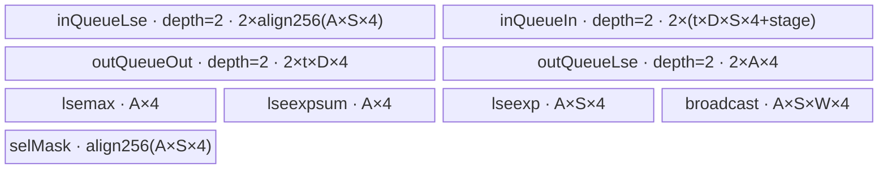

# AttentionUpdate A2/A3 ACLNN 算子知识

## 算子速览

| 项目 | 内容 |
|---|---|
| 实际入口 | `aclnnAttentionUpdateGetWorkspaceSize` / `aclnnAttentionUpdate`，公开 ACLNN 两段式接口 |
| 计算语义 | 对 SP 分片的局部 LSE 先做稳定 log-sum-exp，再以 `exp(lse_i-lse_m)` 加权合并局部 attention 输出 |
| 输入输出 | `lse[i]`: FP32 ND `[L]`；`localOut[i]`: FP32/FP16/BF16 ND `[L,D]`；`out`: 同 localOut；可选 `lseOut`: FP32 `[L]` |
| 执行类型 | `AIV_VECTOR` |
| Kernel 路线 | R-001 DecodeUpdate classic-vector（key 10010/10020/10030） |
| 核心资源 | GM tensor-list 指针表、UB 双缓冲 TQue/TBuf、FP32 寄存/LocalTensor；系统 workspace 16 MiB |
| 来源闭包 | `source_closed`：ACLNN 校验/连续化、AttentionUpdate 调用、Tiling POD、单个 AIV Device 节点、模板 body 与 CMake/OpDef 接线均可见 |
| 验证状态 | 已完成源码闭包检查；本次知识提取未执行编译、真机、数值或性能测试。 |

## 接口与语义

### 计算语义

对 `i=0..sp-1`，逐位置计算 `m=max_i(lse_i)`、`z=sum_i exp(lse_i-m)`、`lse_m=m+log(z)`，再计算 `out=sum_i localOut_i*exp(lse_i-lse_m)`。Kernel 把正无穷 LSE 替换为负无穷后参与计算；非 FP32 `localOut` 先转 FP32，最后转回输出 dtype。`updateType=1` 同时提交 `lseOut=lse_m`，`updateType=0` 不写该输出。

### 输入、输出与属性

| 参数 | shape/layout | dtype | 约束、默认值与语义 |
|---|---|---|---|
| `lse` | tensor-list，每项 ND `[L]` | FP32 | list 长度 `sp`，各项同 shape；非空时参与稳定 softmax 权重；公开契约不支持非连续 Tensor |
| `localOut` | tensor-list，每项 ND `[L,D]` | FP32/FP16/BF16 | list 长度等于 `lse`；各项同 shape，公开契约与单一 Kernel 模板要求同 dtype；`8<=D<=512` 且 `D%8==0`；公开契约不支持非连续 Tensor |
| `updateType` | 标量 | int64 | 仅 0/1；决定 `lseOut` 是否必须存在 |
| `out` | ND `[L,D]` | 同 `localOut` | 必填，shape/dtype 与局部输出一致 |
| `lseOut` | ND `[L]` | FP32 | `updateType=1` 必填，0 时必须为 null |

### 入口与版本

固定仓仅公开无版本后缀的 `aclnnAttentionUpdate`，未见 V2 或其它更高版本入口，因此它是 A2/A3 的实际最新公开版本。README/API 文档与 `AttentionUpdate` OpDef 同时列出 A2、A3；`AddConfig("ascend910b")` 和 `AddConfig("ascend910_93")` 把两平台接到本 classic-vector 实现。API 专用文档与 `CheckSp` 支持 A2/A3 `sp=1..128`，优先于通用 README 中未分平台写出的 `[1,16]`。空输入在 ACLNN 第一阶段返回零 workspace 和空 executor 图，不下发 Kernel。

## Host/Launcher 执行流程

### 参数校验与前处理

`CheckParams` 依次校验 `updateType/lseOut` 对应关系、非空、dtype、SP 数目和全部 shape。随后为两组 tensor-list 的每项调用 `l0op::Contiguous`，把结果封装为 executor 拥有的 tensor-list，再调用 `l0op::AttentionUpdate(lse, localOut, updateType, sp)`；结果经 `ViewCopy` 写入用户 `out`，`updateType=1` 时再复制 `lseM`。这段连续化是实现事实，不改变公开文档“非连续 Tensor 不支持”的契约边界。

### 参数、Workspace 与生命周期

`aclnnAttentionUpdateGetWorkspaceSize` 创建 `aclOpExecutor`，由 executor 持有连续化临时量、内部输出和 ViewCopy 节点，并返回其 workspace 大小。算子 Tiling 固定登记 16 MiB system workspace；当前 Device body 不索引该 workspace。executor 在第二阶段 `CommonOpExecutorRun` 返回前必须有效，workspace 由调用者按第一阶段大小提供，执行绑定调用者 stream。

### 启动图与失败传播

executor 图为 `Contiguous(lse/localOut)*sp -> AttentionUpdate -> ViewCopy(out[,lseOut])`；其中算子自有 Device launch graph 只有一个节点：`l0op::AttentionUpdate/ADD_TO_LAUNCHER_LIST_AICORE -> attention_update`，输入为两张 tensor-list 指针表，输出为内部 `out/lse_m`，无节点间 workspace 边。该节点、前后框架节点与 ViewCopy 由同一 executor 绑定调用者 stream；算子源码不创建额外 event。任一校验、tensor 分配、L0 op 或 ViewCopy 失败立即返回对应 ACLNN 错误并阻断第二阶段执行；成功后 Tiling 产生 blockDim 与 POD，entry 以 TilingKey 选择 dtype 模板实例，任务类型显式为 `KERNEL_TYPE_AIV_ONLY`。

## Route 与参数设计

### 分核与资源计算

`blockDims=min(ceil(L/3), AIV核心数)`；`formerNum=L%blockDims` 个核处理 `formerLength=floor(L/blockDims)+1`，其余处理 `tailLength=floor(L/blockDims)`。Device 再按 188 KiB UB 预算、`sp`、`D` 和输出 dtype 求 `tileLength`，`sp>16` 时分批累计且单批最多引入 15 个新 SP；`sp>=8` 再将最大 tile 减半。所有 GM 乘积在 body 中显式宽化到 uint64。

### Route 选择

| 顺序 | Route | Key/模板 | 精确选择条件与优先级 | 不适用去向 |
|---:|---|---|---|---|
| 1 | R-001 DecodeUpdate classic-vector | 10010 `DecodeUpdate<float,float>`；10020 `DecodeUpdate<float,half>`；10030 `DecodeUpdate<float,bfloat16_t>` | 非 RegBase 平台；Tiling 按 `goType` 依次匹配 FP32、FP16、BF16；ACLNN 已排除其它 dtype | dtype 不支持时 Host 失败；空 Tensor 不 launch |

```text
空 Tensor -> ACLNN 直接成功
否则非 RegBase -> DecodeUpdateTiling
  goType=FP32 -> key 10010
  goType=FP16 -> key 10020
  goType=BF16 -> key 10030
  其它 -> Host dtype 校验失败
```

### 模板/实现执行矩阵

| Route | key/selector | dtype/shape/platform 完整命中条件 | 实际模板/类 | body/helper | 内存与同步特征 | tail/fallback |
|---|---|---|---|---|---|---|
| R-001 DecodeUpdate classic-vector | 10010 / 10020 / 10030 | A2/A3、非空；`lse=FP32`；`localOut/out` 按公开契约同为 FP32/FP16/BF16；`sp=1..128`；`D=8..512 && D%8==0`；shape/list 一致；`updateType=0/1` | 单节点 `attention_update`；`DecodeUpdate<float,float>` / `DecodeUpdate<float,half>` / `DecodeUpdate<float,bfloat16_t>` | `Init/ParseTilingData/CalcTileLength/InitBuffers/Process/CopyInSp/Compute/CopyOut` | 4 个 depth-2 TQue、5 个 TBuf；Queue 交接与 `PIPE_V/PIPE_ALL` barrier；计算为 FP32；`updateType=1` 才有 LSE GM 写边 | former/tail core、tile tail、SP 分批 tail 均在 body 内处理；非法 dtype 在 ACLNN 失败，未知 key 无 body |

### 隐藏性能 Guard

| Guard | Host/Tiling 条件 | Device/资源原因 | 影响 Route | 不满足时去向 | 源码符号 |
|---|---|---|---|---|---|
| AIV 核数与非空域 | ACLNN 对空 Tensor 快返；非空时 `coreNum>0`，`blockDims=min(ceil(L/3),coreNum)` | 避免 `totalLength % blockDims` 的零除并至少给每核约 3 行 | R-001 | 空域不 launch；核数为 0 时 Tiling parse 失败 | `aclnnAttentionUpdateGetWorkspaceSize`；`TilingPrepare4DecodeUpdate`；`DecodeUpdateTiling` |
| 固定 188 KiB tile 模型 | `CalcTileLength` 用 `MAX_UB_SIZE=188*1024`，将结果 clamp 到至少 1 且不超过 `blockLength` | 4 个双缓冲 Queue 与 5 个 TBuf 必须共存；非 FP32 还要内嵌 cast staging | R-001 | 无其它 Route；按公式缩小 tile | `DecodeUpdate::CalcTileLength/InitBuffers` |
| SP 批次容量 | `sp<=16` 单批；否则首批 15 个新 SP，后续每批 15 个并带 1 个累计项，`spAlloc=16` | 单批有效槽最多 16，累计项占 slot 0 | R-001 | 不切换 Route，增加 `spLoopCount` | `DecodeUpdate::ParseTilingData/Process` |
| 大 D 广播窗 | `hDim>256 && spAlloc>=8` 时广播宽度改为 64 | 避免物化 `tileAlign*spAlloc*D` 的完整权重广播区 | R-001 | 条件不成立则完整广播 D | `DecodeUpdate::InitBuffers/Compute` |
| DMA/tail 对齐 | LSE 以 8 个 FP32 对齐；非 FP32 staging 若字节偏移 `%32==16` 则补 16 B；大 D 窗口尾段用 `hDim%64` | 满足 DMA block 与半精度 staging 对齐，避免无效 lane 越界写 GM | R-001 | 使用 `DataCopyPad`、偏移修正和尾段 `Mul` | `CopyInLsePerSp/CopyInOPerSp/Compute/CopyOut` |

### POD/ABI

| 结构 | 字段 | 类型/位宽 | ABI 布局 | 单位 | Host/launcher producer | Device consumer | 边界 |
|---|---|---|---|---|---|---|---|
| `DecodeUpdateTilingData` | `formerLength` | uint32/32 | 宏展开的 `sizeof/alignof/offsetof` 固定仓不可见；声明顺序 1/8 | 元素/核 | `DecodeUpdateTiling`: `formerNum==0 ? 0 : tailLength+1` | `ParseTilingData`: former 核长度/offset | `L` 先窄化为 uint32 |
| 同上 | `tailLength` | uint32/32 | 同上；声明顺序 2/8 | 元素/核 | `totalLength/blockDims` | tail 核长度/offset | 同上 |
| 同上 | `formerNum` | uint32/32 | 同上；声明顺序 3/8 | 核 | `totalLength%blockDims` | 判断 `blockIdx<formerNum` | `<blockDims` |
| 同上 | `tailNum` | uint32/32 | 同上；声明顺序 4/8 | 核 | `blockDims-formerNum` | body 不直接读取 | inactive 字段 |
| 同上 | `hDim` | uint32/32 | 同上；声明顺序 5/8 | 元素 | `inShape.GetDim(1)` 窄化 | GM stride、UB 容量、向量循环 | 8..512，8 倍数 |
| 同上 | `updateType` | uint32/32 | 同上；声明顺序 6/8 | 枚举 | int64 属性窄化 | `CopyOut` 是否提交 LSE | 0/1 |
| 同上 | `sp` | uint32/32 | 同上；声明顺序 7/8 | tensor 数 | int64 属性窄化 | SP 分批、指针表索引 | 1..128 |
| 同上 | `totalLength` | uint32/32 | 同上；声明顺序 8/8 | 元素 | `lseShape.GetDim(0)` 窄化 | GM extent 与地址 | 地址乘 D 前宽化 uint64 |

### Route 源码闭包

| Route | Key/selector | Host/Tiling producer | POD/参数 | Kernel entry/router | Kernel body/直接依赖 | 构建接线 |
|---|---|---|---|---|---|---|
| R-001 DecodeUpdate | 10010/10020/10030，按 go dtype | `decode_update_tiling.cpp::DecodeUpdateTiling/GetTilingKey` | `DecodeUpdateTilingData` 八字段 | `op_kernel/attention_update.cpp::attention_update` | `decode_update.h::DecodeUpdate::{Init,Process,CopyInSp,Compute,CopyOut}` | `attention_update_def.cpp::AttentionUpdate` + `op_host/CMakeLists.txt` |

## Kernel 实现

### 公共执行流程

单个 Device 节点的 entry 解包 POD 并按 dtype 实例化同一 `DecodeUpdate`。body 从动态输入的 GM 指针表定位每个 SP tensor，按核和 tile 执行 `CopyInSp -> Compute -> CopyOut`；SP 超过 16 时把上批 LSE/输出作为下一批的第 0 项累计。TQue 的 EnQue/DeQue/FreeTensor 以及 `PipeBarrier<PIPE_V/ALL>` 保护 UB 生产消费和复用。`workspace` 参数未被读取，Device 节点之间不存在交接边。

### Route R-001：DecodeUpdate classic-vector

#### 适用条件

##### 选择证据

| 层级 | 文件 | 符号 | 源码谓词/参数 | 结果/下一跳 |
|---|---|---|---|---|
| API | `op_host/op_api/aclnn_attention_update.cpp` | `CheckParams` | dtype 属 FP32/FP16/BF16，SP 1..128，D 合法 | 构造 L0 AttentionUpdate |
| Tiling | `op_host/decode_update_tiling.cpp` | `TilingPrepare4DecodeUpdate` | `is_ascendc=false`（非 RegBase） | 使用 classic POD |
| Tiling | `op_host/decode_update_tiling.cpp` | `GetTilingKey` | go dtype 三分支 | key 10010/10020/10030 |
| Router | `op_kernel/attention_update.cpp` | `attention_update` | `TILING_KEY_IS(key)` | 对应 `DecodeUpdate<float,T>` |

#### Device 数据流

##### 函数级调用链

```text
attention_update(lsePtrTable, localOutPtrTable, out, lseOut, workspace, tiling)
  -> DecodeUpdate<float,T>::Init -> ParseTilingData -> CalcTileLength -> InitBuffers
  -> DecodeUpdate<float,T>::Process
    -> CopyInSp -> CopyInLsePerSp + CopyInOPerSp
    -> Compute -> ProcessLseInfReplacement -> Max/Sub/Exp/Add/Log/BroadCast/Mul/Add
    -> CopyOut
```

##### 源码等价伪码

```text
伪码：
coreRange = former/tail POD 映射；tile = min(UB预算可容纳长度, coreRange)
for progress in core tiles:
  cur = 最后一轮 ? lastLength : tile
  for SP batch (最多16个有效项；后续批含前批累计项):
    从 GM 指针表逐项搬 lse[gmOffset] 与 localOut[gmOffset*D] 到双缓冲 UB
    非 FP32 localOut 在 UB Cast 为 FP32；每个 tail 用 DataCopyPad
    将 +INF lse 选择成 -INF；逐行 Max，Sub/Exp 后求和与 Log 得 lse_m
    BroadCast 权重；对 D 维 Mul，再跨 SP Add 得 FP32 out
    若还有 SP batch，SaveAcc；否则 WriteAcc
  输出按有效 cur*D 前缀写 GM；updateType=1 再写 cur 个 lse_m
```

#### 内存与数据搬运

##### 资源与搬运表

| 层级/缓冲区 | offset/地址公式 | extent/容量公式 | dtype/layout | producer | consumer | owner/lifetime | 对齐/复用 |
|---|---|---|---|---|---|---|---|
| GM `lse[i]` | `progress*tileLength+gmStartOffset` | `totalLength`/SP | FP32 ND | tensor-list 指针表 | `CopyInLsePerSp` | 调用者/stream | 非 8 元素 tail 用 DataCopyPad |
| GM `localOut[i]` | `(progress*tileLength+gmStartOffset)*D` | `totalLength*D`/SP | T ND | 指针表 | `CopyInOPerSp` | 调用者/stream | 非整块 tail pad；地址用 uint64 |
| `inQueueLse` UB | `posIdx*curLengthPad` | 双缓冲，`align256(tileLengthAlign*spAlloc*4)`/槽 | FP32 | CopyIn | Compute | TPipe/一 tile | depth=2，EnQue/DeQue |
| `inQueueIn` UB | `posIdx*curLength*D` | 双缓冲，至少 `tileLength*D*spAlloc*4` | FP32 + 非 FP32 staging | CopyIn/Cast | Compute | TPipe/一 tile | depth=2；半精度 staging 16B 修正 |
| LSE 临时 TBuf | `i*curLengthPad` | max/sum 各 `tileLengthAlign*4`；exp `*spAlloc` | FP32 | Compute | Compute/CopyOut | TPipe/kernel | PipeBarrier 后复用 |
| 权重广播 TBuf | 行/SP/D offset | `tileLengthAlign*spAlloc*(D 或 64)*4` | FP32 | BroadCast | Mul | TPipe/tile | D>256 且 spAlloc>=8 时 64 元素窗口 |
| 输出 TQue | tile 内 0 | out `tileLength*D*4`，LSE `tileLengthAlign*4`，均 depth2 | FP32 | Compute | CopyOut/SaveAcc | TPipe/tile | 只提交有效 `cur` 前缀 |
| workspace | N/A | Host 登记 16 MiB system workspace | byte | runtime | 当前 body 不读取 | executor/stream | N/A：仅系统预留 |

##### UB 内存布局



其中 `t=tileLength`，`A=ceil(t/8)*8`，`S=spAlloc`，`W=(D>256 && S>=8)?64:D`；`stage=0`（FP32）或 `(S+1)*16`（FP16/BF16）。图按 `InitBuffers` 的九次真实分配列出；寄存器由 Vector API 管理，固定仓不暴露其字节数。

##### 字节账与复用顺序

```text
Q_lse   = 2 * align256(A*S*4)
Q_in    = 2 * (t*D*S*4 + stage)
Q_out   = 2 * t*D*4
Q_lse_o = 2 * A*4
TBuf    = A*4 + A*4 + A*S*4 + A*S*W*4 + align256(A*S*4)
UB_total = Q_lse + Q_in + Q_out + Q_lse_o + TBuf
UB_total <= 188*1024
=> `CalcTileLength` 用 `spAligned` 的保守分母求 t；`sp>=8` 再将 t 减半并 clamp 到 [1, blockLength]。
```

| 复用子区 | 写入者 | 读取者/消费点 | 下一次覆盖 | 同步或释放依据 | 安全条件 |
|---|---|---|---|---|---|
| `inQueueIn` FP32 主区 | `CopyInOPerSp`；非 FP32 时 `Cast` 原地写 FP32 | `Compute` 的 `Mul/Add` | 当前 tile `FreeTensor` 后的后续 tile | `EnQue→DeQue→FreeTensor`；cast 前后 `PIPE_ALL` | staging 位于主区尾后且 16/32 B 偏移修正不与有效 FP32 区重叠 |
| `lseexpBuffer` | `ProcessLseInfReplacement` 先写 `NEG_INF` 临时量，随后 `Compute` 写 exp 权重 | `Select` 后由后续 `Sub/Exp/BroadCast` 消费 | Vector barrier 后覆盖 | 每步 `PipeBarrier<PIPE_V>` | 只有前一步的读取全部完成后复用 |
| `lseexpsumBuffer` | 当前 SP 批的 log-sum-exp；`SaveAcc` 写累计 LSE | 下一 SP 批 `CopyInSpAccData` | 下一批 `Compute` | `DataCopy` 后 `PIPE_V`；输出 Queue `DeQue/FreeTensor` | 仅 `sp>16` 的批间累计路径使用 |
| `lseexpBroadcastBuffer` | 广播权重；`SaveAcc` 写累计 out | `Mul` 或下一批 `CopyInSpAccData` | 下一批广播 | `PIPE_V` 与输出 Queue `DeQue/FreeTensor` | 当前批输出已保存后才覆盖；大 D 路径只保留 64 宽窗口 |

#### 同步、精度与尾块

##### 同步与数值边界表

| 阶段 | primitive/机制 | producer | consumer/等待点 | 保护对象 | 精度/尾块 |
|---|---|---|---|---|---|
| GM→UB | TQue EnQue/DeQue | `CopyInSp` | `Compute` | lse/localOut 槽 | tail 用 DataCopyPad；非 FP32 Cast 到 FP32 |
| LSE 向量链 | `PipeBarrier<PIPE_V>` | Compare/Select/Max/Sub/Exp/Add/Log | 后继向量指令 | 同一 TBuf | 全部 FP32；+INF 先替换为 -INF |
| SP 分批累计 | `SaveAcc/WriteAcc` + PIPE_V | 当前批 Compute | 下一批 CopyIn | 累计 LSE 与 out | 每批最多 15 个新 SP，保持稳定 log-sum-exp |
| UB→GM | TQue + DataCopy/DataCopyPad | Compute | CopyOut | out/lseOut | 仅 `curLength*D` 与 `curLength` 有效域；输出 Cast 回 T |

#### 关键实现

##### 符号证据表

| 阶段 | 文件 | 符号/模板实例 | 实现事实 |
|---|---|---|---|
| Host/Tiling producer | `op_host/decode_update_tiling.cpp` | `DecodeUpdateTiling` | 产生 blockDim、former/tail POD、dtype key 和 16 MiB workspace |
| Kernel entry/router | `op_kernel/attention_update.cpp` | `attention_update` | 三个 key 映射 FP32/FP16/BF16 模板且声明 AIV-only |
| Device body/helper | `op_kernel/decode_update.h` | `DecodeUpdate::ParseTilingData/CalcTileLength` | 核地址、SP 分批和 UB tile 上界 |
| Device body/helper | `op_kernel/decode_update.h` | `DecodeUpdate::CopyInSp/Compute/CopyOut` | GM/UB 搬运、稳定权重、FP32 累加与有效输出 |

## 算子特定优化

### Trick T-001：把超 16 路 SP 变成“15 路新输入 + 1 路累计值”的稳定归并

#### 触发与源码依据

- 适用 Route：R-001。
- 触发条件：`sp>MAX_EFFECTIVE_SP(16)`。
- Golden 来源：[`attention/attention_update/op_kernel/decode_update.h:124-134`](../../../../../../../cann-ops-raw/ascendc/ops-transformer/be33d95bb755cedec3108f70805c1874d1792540/attention/attention_update/op_kernel/decode_update.h#L124-L134)

**官方源码（固定 Commit 连续逐字摘录）**：

```cpp
if (sp <= MAX_EFFECTIVE_SP) {
    this->spLoopCount = 1;
    this->spFirstLoop = sp;
    this->spNextLoop = 0;
    this->spAlloc = sp;
} else {
    this->spFirstLoop = MAX_EFFECTIVE_SP - 1;
    this->spNextLoop = MAX_EFFECTIVE_SP - 1;
    this->spLoopCount = 1 + (sp - spFirstLoop + spNextLoop - 1) / spNextLoop;
    this->spAlloc = MAX_EFFECTIVE_SP;
}
```

#### 机制与设计原因

UB 始终只为 `spAlloc<=16` 个槽分配。首批用一个 dummy slot 加 15 个真实 SP，`SaveAcc` 把该批的 `lse_m` 与加权输出保存到 `lseexpsumBuffer/lseexpBroadcastBuffer`；后续批把累计结果放入 slot 0，再引入最多 15 个新 SP。于是 SP 上限 128 不会线性放大单批 UB，同时每次都重新执行稳定 log-sum-exp，而不是直接累加指数。批次数来自 `spFirstLoop/spNextLoop/spLoopCount`，消费点是 `Process→CopyInSpAccData→Compute→SaveAcc/WriteAcc`。

#### 迁移边界

- 适用：可把部分归一化结果表达成与新分片相同 `(lse, out)` 状态的流式合并。
- 前提：FP32 累计；slot 0 的 LSE/out 布局与真实输入一致；每批有效槽不超过 16；Queue/TBuf 生命周期保持原顺序。
- 失效：若归并状态不能保持同一数学语义，必须一次处理全部 SP 或另设更大的状态结构；本实现没有其它 Route。
- 未验证：本次知识提取未执行编译、真机、数值或性能测试。

#### 错误做法

固定仓未提供可验证反例；不得省略累计 slot 后仍按每批独立归一化，否则各批权重不在同一全局归一化域。

## 模板与实现对比

| 对比维度 | R-001 DecodeUpdate classic-vector | 设计选择依据 |
|---|---|---|
| 命中条件/优先级 | 非 RegBase A2/A3；三 dtype key 仅选择模板类型 | dtype 在 ACLNN/Tiling 已闭合，无第二算法 fallback |
| 模板与 dtype | `DecodeUpdate<float,T>`，T=FP32/FP16/BF16 | LSE 与中间累计固定 FP32，GO 输入输出保留 T |
| 循环与分核 | former/tail core→tile loop→SP batch | `min(ceil(L/3),coreNum)` 平衡行域，SP batch 封顶 UB |
| Queue/TBuf/寄存器 | 4 个 depth-2 Queue、5 个 TBuf、Vector 内部寄存器 | 输入/输出流水和多阶段稳定归一化并存 |
| UB 总占用与复用 | 上述九项字节账；大 D 使用 64 宽广播窗 | 188 KiB 固定模型约束 tile；跨批累计复用 TBuf |
| 搬运/Vector API | `DataCopy(Pad)`、Cast、Compare/Select、Max/Sub/Exp/Add/Log/BroadCast/Mul | 对齐 tail 与稳定权重合并 |
| 同步、精度与 tail | Queue + `PIPE_V/ALL`；FP32 累加；BF16 `CAST_RINT` | 防止复用早覆盖并限制误差顺序 |
| fallback/失败边界 | 空域快返；非法 dtype/shape/SP/updateType Host 失败；未知 key 无执行 | 固定仓不存在另一条 A2/A3 body |

## 平台差异

| 项目 | A2 | A3 | 950 |
|---|---|---|---|
| 支持状态 | 支持 | 支持 | 支持但由独立 950 卡描述 |
| Host/Launcher | 共用非 RegBase `DecodeUpdateTiling`，SP<=128 | 同 A2 | ACLNN 走 RegBase 校验，SP<=16 |
| Kernel/资源 | classic AIV，188 KiB UB 模型 | 同 A2 | arch35 MicroAPI，另一 POD/route |

## 限制与失败边界

- `L` 被写入 uint32 POD；固定 Host 只做 C++ 窄化，未见超 uint32 的单独 ACLNN 拒绝，因此复用时必须保留该边界。
- A2/A3 的通用 README 写 `sp=[1,16]`，API 专用文档与公开 ACLNN 实现写 `sp=[1,128]`；本卡按入口专用证据取 128，并保留该文档差异。
- 非 RegBase `CheckDtypeValid` 只逐 tensor 检查 dtype 是否属于允许集合，没有像 `CheckDtypeValid_95` 那样显式检查所有 `localOut` 同 dtype、`out` 与首项同 dtype；公开契约和单一 `DecodeUpdate<float,T>` 实例要求这些 dtype 一致，不能依赖该校验缺口传入混合 dtype。
- 非 RegBase ACLNN 也没有显式校验 `lseOut` dtype；公开声明要求 FP32，不能把实现校验缺口解释为支持其它 dtype。
- README/API 参数表把非连续 Tensor 标为不支持；实现虽无条件插入 `l0op::Contiguous`，复用时仍应遵守公开契约，固定仓未提供非连续输入的公开保证。
- 空 Tensor 不 launch；不支持的 dtype、SP、D、shape 或 `updateType/lseOut` 组合在 ACLNN 阶段失败。workspace 虽登记 16 MiB，但本 body 不依赖其内容。
- POD 宏的展开实现位于固定仓外，`sizeof/alignof/offsetof` 不可见；只能确认字段声明顺序、源码类型以及 Host/Device 共同使用同一结构名。
- 本次知识提取未执行编译、真机、数值或性能测试。

## 源码索引

### 链路索引

| 链路阶段 | 文件 | 关键符号 | 支撑内容 |
|---|---|---|---|
| 入口声明/约束 | `attention/attention_update/README.md` | 产品支持表、约束说明 | A2/A3 公开支持与通用 SP 约束差异 |
| 入口声明/约束 | `attention/attention_update/docs/aclnnAttentionUpdate.md` | 产品支持表、约束说明 | A2/A3/950 公开支持、接口 shape/dtype/SP/D 约束 |
| 入口声明/约束 | `attention/attention_update/op_host/op_api/aclnn_attention_update.h` | `aclnnAttentionUpdate*` | 公开两段式签名 |
| 入口实现 | `attention/attention_update/op_host/op_api/aclnn_attention_update.cpp` | `CheckParams`、两段式入口 | 校验、Contiguous、executor 图 |
| 入口实现 | `attention/attention_update/op_host/op_api/attention_update.cpp` | `l0op::AttentionUpdate` | 内部输出分配与 AICore launcher 节点 |
| Host/Shape | `attention/attention_update/op_host/attention_update_infershape.cpp` | `InferShape4DecodeUpdate/InferDataType4DecodeUpdate` | 内部 `out/lse_m` 继承 GO/LSE shape 与 dtype |
| Host/Tiling/Launcher | `attention/attention_update/op_host/decode_update_tiling.h` | `DecodeUpdateTilingData` | 8 字段 POD ABI |
| Host/Tiling/Launcher | `attention/attention_update/op_host/decode_update_tiling.cpp` | `DecodeUpdateTiling` | key、blockDim、workspace、字段 producer |
| Kernel entry/body | `attention/attention_update/op_kernel/attention_update.cpp` | `attention_update` | key router/AIV 类型 |
| Kernel entry/body | `attention/attention_update/op_kernel/decode_update.h` | `DecodeUpdate` | 实际数据流和资源 |
| 构建接线 | `attention/attention_update/op_host/attention_update_def.cpp` | `OP_ADD(AttentionUpdate)` | ascend910b/910_93 平台注册 |
| 构建接线 | `attention/attention_update/op_host/config/ascend910b/attention_update_binary.json` | `AttentionUpdate_FP32/FP16/BF16` | A2 三个 dtype binary 实例 |
| 构建接线 | `attention/attention_update/op_host/config/ascend910_93/attention_update_binary.json` | `AttentionUpdate_FP32/FP16/BF16` | A3 三个 dtype binary 实例 |
| 构建接线 | `attention/attention_update/op_host/CMakeLists.txt` | `add_op_to_compiled_list` | Host/ACLNN 模块接线 |
| 平台分流 | `common/include/external/aclnn_kernels/aclnn_platform.h` | `AclnnUtil::IsRegbase` | DAV_3510/DAV_5102 才走 RegBase ACLNN 校验，A2/A3 走非 RegBase 分支 |
| 平台分流 | `common/src/op_host/tiling_util.cpp` | `IsRegbaseSocVersion` | 同一架构集合决定 classic Tiling 是否转交模板注册表 |

### 实现复用检查

| 检查项 | 可复用事实 | 不得改变的约束 | 源码符号 |
|---|---|---|---|
| ABI/POD | 8 个按声明顺序序列化的 uint32 字段 | 字段顺序、单位和 `totalLength` 窄化；宏展开布局不可擅自固化 | `DecodeUpdateTilingData` |
| 调用顺序 | Contiguous→L0 AttentionUpdate→ViewCopy | executor owner 和第二阶段 stream 顺序 | `aclnnAttentionUpdateGetWorkspaceSize` |
| workspace/内存 | former/tail 分核和 188 KiB UB tile 公式 | tensor-list 指针表解引用、双缓冲容量、有效前缀 | `DecodeUpdate::{ParseTilingData,InitBuffers}` |
| 同步 | Queue + PIPE_V/ALL | EnQue/DeQue/FreeTensor 与临时 TBuf barrier 次序 | `CopyInSp/Compute/CopyOut` |
| 精度与尾块 | FP32 LSE/累加、非 FP32 输入输出 cast | +INF 替换、log-sum-exp 顺序、DataCopyPad tail | `ProcessLseInfReplacement/Compute` |
| 失败边界 | Host 拒绝非法参数，空 Tensor 快返 | 不得让未识别 dtype 进入 key=0 | `CheckParams/GetTilingKey` |