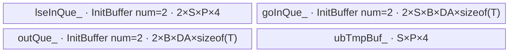
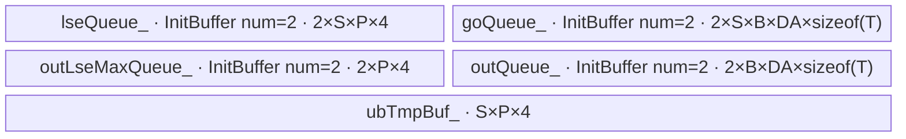

# AttentionUpdate 950 ACLNN 算子知识

## 算子速览

| 项目 | 内容 |
|---|---|
| 实际入口 | `aclnnAttentionUpdateGetWorkspaceSize` / `aclnnAttentionUpdate`，公开 ACLNN 两段式接口 |
| 计算语义 | 以稳定 log-sum-exp 权重合并 SP 分片的局部 LSE 和局部 attention 输出 |
| 输入输出 | `lse[i]` FP32 `[L]`；`localOut[i]` FP32/FP16/BF16 `[L,D]`；`out` 同 dtype；可选 FP32 `lseOut` |
| 执行类型 | `AIV_VECTOR` |
| Kernel 路线 | R-001 updateType=0 无 LSE 输出；R-002 updateType=1 含 LSE 输出 |
| 核心资源 | GM、UB depth-2 TQue、临时 TBuf、RegBase FP32 RegTensor；16 MiB system workspace |
| 来源闭包 | `source_closed`：ACLNN→RegBase Tiling template→POD→单个 AIV Device 节点→两个 MicroAPI body→950 构建接线闭合；通用 AscendC/SDK load-store helper 为明确外部边界 |
| 验证状态 | 已完成源码闭包检查；本次知识提取未执行编译、真机、数值或性能测试。 |

## 接口与语义

### 计算语义

逐输出位置求 `m=max_i(lse_i)`，`lse_m=m+log(sum_i exp(lse_i-m))`，并求 `out=sum_i localOut_i*exp(lse_i-lse_m)`。两个 Route 共享公式与 FP32 RegTensor 累加；R-002 额外把 `lse_m` 搬出，R-001 不分配该输出队列。两 body 先把 `+INF` LSE 选成 `-INF`；第一次 `exp(lse-m)` 使用 ZEROING 模板调用，最终权重 `exp(lse-lse_m)` 才显式使用 `ExpSpecificMode{ZEROING, PRECISION_1ULP_FTZ_FALSE}`。

### 输入、输出与属性

| 参数 | shape/layout | dtype | 约束、默认值与语义 |
|---|---|---|---|
| `lse` | tensor-list ND `[L]` | FP32 | list 长度 `sp`，950 为 1..16，全部同 shape；公开契约不支持非连续 Tensor |
| `localOut` | tensor-list ND `[L,D]` | FP32/FP16/BF16 | 与 lse 等长，同 shape/dtype；`D` 为 8 的倍数且 8..512；公开契约不支持非连续 Tensor |
| `updateType` | 标量 | int64 | 0 选 R-001，1 选 R-002 |
| `out` | ND `[L,D]` | 同 localOut | 必填 |
| `lseOut` | ND `[L]` | FP32 | type=1 必填；type=0 必须 null |

### 入口与版本

固定仓只公开无版本后缀接口，未见 V2 或其它更高版本入口，因此它是 950 的实际最新公开版本。`IsRegbase()` 对 DAV_3510/DAV_5102 返回真，使 950 走 `CheckParams_95`；`TilingPrepare4DecodeUpdate` 用同一架构集合识别 RegBase 后转交注册 priority=1 的 `AttentionUpdateTiling`，注册表按较小 priority 优先且本算子固定仓仅有这一模板。OpDef 的 ascend950 config 将 `opFile.value` 指到 `attention_update_apt`，所以不能复用 A2/A3 的 classic POD/body。

## Host/Launcher 执行流程

### 参数校验与前处理

ACLNN 先校验 tensor-list、dtype/shape、950 的 `sp<=16` 和 `updateType/lseOut`，空输入直接返回。非空时逐项 `Contiguous`，调用 `l0op::AttentionUpdate`，再用 `ViewCopy` 提交 out；R-002 再提交 lseOut。连续化是 executor 的实现节点，不改变公开文档“非连续 Tensor 不支持”的契约。

### 参数、Workspace 与生命周期

executor 持有连续化张量、内部节点与 ViewCopy；第一阶段返回其 workspace 大小。Tiling 固定 `workspaces[0]=16 MiB`，Device body 未读取 `workSpace`。POD by-value 保存到 raw tiling buffer，在 launch 前完成；executor 至少须在 `CommonOpExecutorRun` 调用期间有效，workspace 与用户 tensor 须覆盖异步 stream 执行期。第二阶段返回后的 executor 精确释放时点属于固定仓外框架边界。

### 启动图与失败传播

executor 图 `Contiguous* -> AttentionUpdate -> ViewCopy` 在同一 executor/stream 中执行；算子自有 Device launch graph 只有一个节点：`l0op::AttentionUpdate/ADD_TO_LAUNCHER_LIST_AICORE -> attention_update_apt::attention_update`。该节点接收两张 list tensor 描述、内部 `out/lse_m`、同一 POD 和 16 MiB system workspace 参数；body 不读取 workspace，因而没有 Device 节点间 slice/同步边。Tiling 读取 AIV 核数、UB 大小和 UB block size，求 blockDim、loop 与 key；任一步 null、shape/dtype、UB/core 数、POD buffer 或 L0 op 失败均阻断 launch，源码未创建额外 event。

## Route 与参数设计

### 分核与资源计算

`perCoreCount=ceil(L,totalCoreNum)`，`usedCoreNum=ceil(L,perCoreCount)`，尾核为 `L-(usedCoreNum-1)*perCoreCount`。Host 先从 UB 扣除 `sp*ubBlockSize`，按输入 depth2、FP32 中间、输出 depth2 的逐 L 成本求 `bshInLoop`/`perCorePerLoopCount`，再派生整核与尾核 loops/lastLoop。`D` 按 UB block 的 dtype 元素数对齐。

### Route 选择

| 顺序 | Route | Key/模板 | 精确选择条件与优先级 | 不适用去向 |
|---:|---|---|---|---|
| 1 | R-001 无 LSE 输出 RegBase | key 20000 / `AttentionUpdateWithoutLse<DTYPE_GO>` | 非空且 RegBase，`updateType==0` | type=1 转 R-002；非法值 Host 失败 |
| 2 | R-002 含 LSE 输出 RegBase | key 20001 / `AttentionUpdateWithLse<DTYPE_GO>` | 非空且 RegBase，`updateType==1` | 非 0/1 Host 失败 |

```text
空输入 -> ACLNN 快返
RegBase -> AttentionUpdateTiling
  updateType=0 -> 20000 -> R-001
  updateType=1 -> 20001 -> R-002
  其它 -> Host 失败
```

### 模板/实现执行矩阵

| Route | key/selector | dtype/shape/platform 完整命中条件 | 实际模板/类 | body/helper | 内存与同步特征 | tail/fallback |
|---|---|---|---|---|---|---|
| R-001 无 LSE 输出 RegBase | 20000 | 950 RegBase、非空、`updateType=0`、`lseOut=null`、`sp=1..16`、D/shape/dtype 校验通过 | `AttentionUpdateWithoutLse<DTYPE_GO>`，DTYPE_GO 为 FP32/FP16/BF16 binary specialization | `Init/Process/CopyInLse/ComputeLseMVF/CopyInGo/ComputeOutputVF/CopyOut` | 3 个 `InitBuffer(...,2,...)` Queue + 1 TBuf；MicroAPI FP32 RegTensor；无 LSE 输出 Queue | 尾核/末 loop/VL/DMA tail；非法参数失败，空域不 launch |
| R-002 含 LSE 输出 RegBase | 20001 | 950 RegBase、非空、`updateType=1`、`lseOut` 为 FP32 `[L]`、其余校验同上 | `AttentionUpdateWithLse<DTYPE_GO>` | `Init/Process/CopyLseToUb/ComputeMaxVF/CopyLseMaxToGm/CopyGoToUb/ComputeOutVF/CopyOutToGm` | R-001 资源外再分配 depth-2 `outLseMaxQueue_`；LSE 结果先提交 GM | 同 R-001，并额外只搬 `curBlockNum` 个 LSE；未知 key 无 body |

### 隐藏性能 Guard

| Guard | Host/Tiling 条件 | Device/资源原因 | 影响 Route | 不满足时去向 | 源码符号 |
|---|---|---|---|---|---|
| RegBase 转发与模板优先级 | DAV_3510/DAV_5102 令 `is_ascendc=true` 后进入 `DoTilingImpl`；registry 按升序 priority 试探，`AttentionUpdateTiling::IsCapable=true` 且 priority=1 | 950 必须使用 uint64 POD、MicroAPI body 与 `attention_update_apt` | R-001/R-002 | 非 RegBase 留在 classic Tiling；950 唯一模板内部失败即 Tiling 失败 | `IsRegbaseSocVersion`；`TilingRegistry::DoTilingImpl`；`REGISTER_OPS_TILING_TEMPLATE` |
| AIV/UB 硬件信息 | `totalCoreNum>0 && ubSize>0`，`ubBlockSize=GetUbBlockSize` | 分核、D/LSE 对齐和所有 Queue 容量依赖这些值 | 两 Route | `GetPlatformInfo` 返回失败 | `AttentionUpdateTiling::GetPlatformInfo` |
| UB 可行切分 | 先执行 `ubSize-=sp*ubBlockSize`；由 input/calc/output factor 求 `bshInLoop` 与 `bshPerLoop`，且大于一 UB block 时 floor-align | 为每个 SP 的 LSE 对齐增长预留一 block，并容纳 depth-2 输入/输出及 FP32 权重 | 两 Route | 无 fallback；若商为 0，后续 `CeilDiv` 无安全 Route，固定仓未另设显式 guard | `AttentionUpdateTiling::DoOpTiling` |
| D 对齐 | `dAlign=ceilAlign(D,ubBlockSize/sizeof(T))`；公开范围 `8..512 && D%8==0` | GO Queue 行 stride 必须为 UB block 整数倍，GM 仅搬真实 D | 两 Route | ACLNN/Tiling 参数失败 | `CheckInputDim`；两 Route `Init/Copy*Go*` |
| SP 双路展开 | `unrollLoops=sp/2`，`hasTailRoll=sp%2` | 每轮装载两路权重/GO 并执行两次 `MulAddDst`，奇数 SP 仅编译 tail 分支 | 两 Route | 不切 Route；实例化 `<true>` 或 `<false>` | 两 Route `Process/Compute*VF` |
| 空域 | ACLNN 在 `lse[0]` 或 `localOut[0]` 为空时返回 workspace 0；Tiling/entry 仍定义 key 10000 | 避免用 `L=0` 进入 `ceil(L,totalCoreNum)` 后的分核公式 | 两 Route之外 | 公开 ACLNN 不 launch；entry 命中 10000 直接 return | ACLNN empty branch；`GetTilingKey`；`attention_update_apt` |

### POD/ABI

| 结构 | 字段 | 类型/位宽 | ABI 布局 | 单位 | Host/launcher producer | Device consumer | 边界 |
|---|---|---|---|---|---|---|---|
| `AttentionUpdateTilingData` | `sp` | uint64/64 | 宏展开的 `sizeof/alignof/offsetof` 固定仓不可见；声明顺序 1/11 | tensor 数 | `PostTiling:set_sp(sp_)` | 两 body 的 SP 循环/UB 容量 | 1..16 |
| 同结构 | `d` | uint64/64 | 同上；声明顺序 2/11 | 元素 | `set_d(goShape_[1])` | D 对齐/向量循环/GM stride | 8..512，8 倍数 |
| 同结构 | `usedCoreNum` | uint64/64 | 同上；声明顺序 3/11 | 核 | `ceil(L/perCoreCount)` | `Process` 越界核 guard；Host 同值设 blockDim | 至少 1 |
| 同结构 | `perCoreCount` | uint64/64 | 同上；声明顺序 4/11 | 行/整核 | `ceil(L,totalCoreNum)` | 非尾核范围与 core 起点 | L 非空 |
| 同结构 | `lastCoreCount` | uint64/64 | 同上；声明顺序 5/11 | 行/尾核 | `L-(usedCoreNum-1)*perCoreCount` | 尾核范围 | `<=perCoreCount` |
| 同结构 | `perCoreLoops` | uint64/64 | 同上；声明顺序 6/11 | loop | `ceil(perCoreCount/bshPerLoop)` | 非尾核 `Process` loop | 至少 1 |
| 同结构 | `lastCoreLoops` | uint64/64 | 同上；声明顺序 7/11 | loop | `ceil(lastCoreCount/bshPerLoop)` | 尾核 `Process` loop | 至少 1 |
| 同结构 | `perCorePerLoopCount` | uint64/64 | 同上；声明顺序 8/11 | 行/loop | UB 预算得到 `bshPerLoop` | CopyIn/UB extent | 必须非 0；源码无显式零值 guard |
| 同结构 | `perCoreLastLoopCount` | uint64/64 | 同上；声明顺序 9/11 | 行 | `perCoreCount-(perCoreLoops-1)*bshPerLoop` | 整核末轮 | `<=perCorePerLoopCount` |
| 同结构 | `lastCoreLastLoopCount` | uint64/64 | 同上；声明顺序 10/11 | 行 | `lastCoreCount-(lastCoreLoops-1)*bshPerLoop` | 尾核末轮 | `<=perCorePerLoopCount` |
| 同结构 | `bshInLoop` | uint64/64 | 同上；声明顺序 11/11 | 行/计算内轮 | 两次 UB 商的最小值 | GO/输出 tile | 必须非 0；源码无显式零值 guard |

### Route 源码闭包

| Route | Key/selector | Host/Tiling producer | POD/参数 | Kernel entry/router | Kernel body/直接依赖 | 构建接线 |
|---|---|---|---|---|---|---|
| R-001 无 LSE | 20000/type=0 | `attention_update_tiling.cpp::DoOpTiling/GetTilingKey/PostTiling` | `AttentionUpdateTilingData` | `attention_update_apt.cpp::attention_update` | `attention_update_without_lse_regbase.h::AttentionUpdateWithoutLse` | `attention_update_def.cpp` ascend950 `opFile=attention_update_apt` |
| R-002 含 LSE | 20001/type=1 | `attention_update_tiling.cpp::DoOpTiling/GetTilingKey/PostTiling` | 同 POD | `attention_update_apt.cpp::attention_update` | `attention_update_with_lse_regbase.h::AttentionUpdateWithLse` | 同一 ascend950 config 与 Host CMake |

## Kernel 实现

### 公共执行流程

单个 Device 节点的 entry 解包同一 POD，声明 AIV-only，并按 key 构造 Route 对象。两 body 都把动态 tensor-list GM 地址解包，逐核逐 loop 把 SP 的 LSE 与 GO 搬到 UB，以 FP32 RegTensor 做稳定归一化和乘加，再把有效行写回。Route 的差异是 LSE 输出队列和 LSE 结果提交时点；`workspace` 未读取，不存在跨 Device 节点交接。

### Route R-001：无 LSE 输出 RegBase

#### 适用条件

##### 选择证据

| 层级 | 文件 | 符号 | 源码谓词/参数 | 结果/下一跳 |
|---|---|---|---|---|
| API | `op_host/op_api/aclnn_attention_update.cpp` | `CheckParams_95` | type=0 且 lseOut=null，sp<=16 | 创建 AttentionUpdate 节点 |
| Tiling | `op_host/attention_update_tiling.cpp` | `GetTilingKey` | `L>0` 且 `updateType_=0` | key 20000 |
| Router | `op_kernel/attention_update_apt.cpp` | `attention_update` | `TILING_KEY_IS(20000)` | `AttentionUpdateWithoutLse<DTYPE_GO>` |

#### Device 数据流

##### 函数级调用链

```text
attention_update -> AttentionUpdateWithoutLse<DTYPE_GO>::Init
  -> Process -> CopyInLse -> ComputeLseMVF
  -> CopyInGo -> ComputeOutputVF -> CopyOut
```

##### 源码等价伪码

```text
伪码：按 blockIdx 选择 perCore/lastCore 行数；for 每个 core loop：
  分批搬 sp*curRows 个 FP32 LSE，pad 到 UB block
  RegTensor 对每行执行 +INF 处理、max、exp-sum-log，保存 exp(lse-lse_m)
  for bshInLoop 子块：搬 sp*rows*D 个 GO；按 D 的 VL 分段
    对每 SP 广播权重，以 FP32 MulAddDst 累加；StoreOneTensorForDtypeT 转目标 dtype
  DataCopyPad 只提交 rows*D 有效输出；不访问 outLseMax
```

#### 内存与数据搬运

##### 资源与搬运表

| 层级/缓冲区 | offset/地址公式 | extent/容量公式 | dtype/layout | producer | consumer | owner/lifetime | 对齐/复用 |
|---|---|---|---|---|---|---|---|
| GM lse/go | `coreStart+loopOffset`；GO 再乘 D | 各 `L` / `L*D` 每 SP | FP32 / DTYPE_GO ND | 调用者 | CopyInLse/Go | stream | 地址 uint64，tail DataCopyPad |
| `lseInQue_` | `i*curBlockNumAlign` | depth2 `sp*perCorePerLoopCountAlign*4` | FP32 | CopyInLse | ComputeLseMVF | TPipe/loop | UB block 对齐 |
| `goInQue_` | `i*bshInLoop*dAlign` | depth2 `sp*bshInLoop*dAlign*sizeof(T)` | T ND | CopyInGo | ComputeOutputVF | TPipe/subloop | D 对齐，复用前 DeQue/Free |
| `ubTmpBuf_` | LSE exp 权重分片 | `sp*perCorePerLoopCountAlign*4` | FP32 | ComputeLseMVF | ComputeOutputVF | TPipe/loop | PIPE_V/MicroAPI 同步 |
| `outQue_` | `row*dAlign` | depth2 `bshInLoop*dAlign*sizeof(T)` | T ND | Store helper | CopyOut | TPipe/subloop | 只写有效 D |
| workspace/L1/L0 | N/A | 16 MiB system workspace；L1/L0 未使用 | byte | runtime | body 不读取 | executor | N/A：纯 AIV 路径 |

##### UB 内存布局



`S=sp`，`P=ceilAlign(min(perCorePerLoopCount,本核行数), UB_BLOCK_SIZE/4)`，`B=min(bshInLoop,P)`，`DA=ceilAlign(D,UB_BLOCK_SIZE/sizeof(T))`。`TQue` 声明的第二模板参数为 1，而实际容量由 `InitBuffer(...,BUFFER_NUM=2,...)` 分配；字节账严格按 `InitBuffer` 的 `BUFFER_NUM=2` 计，RegTensor 字节数固定仓不可见。

##### 字节账与复用顺序

```text
UB_R001 = 2*S*P*4 + 2*S*B*DA*sizeof(T) + 2*B*DA*sizeof(T) + S*P*4
        = 3*S*P*4 + 2*(S+1)*B*DA*sizeof(T)
Host 使用更保守的共同预算：先从 UB 扣 S*UB_BLOCK_SIZE，再在 P 的分母中额外计入 2*P*4 的 LSE 输出空间。
UB_R001 <= Host 的共同预算 <= 平台可用 UB
```

| 复用子区 | 写入者 | 读取者/消费点 | 下一次覆盖 | 同步或释放依据 | 安全条件 |
|---|---|---|---|---|---|
| `lseInQue_` 槽 | `CopyInLse` | `ComputeLseMVF` | 下一 UB loop | `EnQue→DeQue→FreeTensor` | `ComputeLseMVF` 写完全部权重后才释放输入槽 |
| `ubTmpBuf_` | `ComputeLseMVF` 按 `[sp,P]` 写归一化权重 | 同一 UB loop 的所有 `ComputeOutputVF` 子循环 | 下一 UB loop 的 `ComputeLseMVF` | 外层循环先完成全部 GO 子循环，再进入下一 LSE loop | `lseUbOffset+i` 必须落在当前 P 行范围 |
| `goInQue_` / `outQue_` | `CopyInGo` / `ComputeOutputVF` | `ComputeOutputVF` / `CopyOut` | 下一 `bshInLoop` 子块 | 两组 Queue 的 `EnQue/DeQue/FreeTensor` | GM 只搬真实 D，UB 行 stride 使用 DA |

#### 同步、精度与尾块

##### 同步与数值边界表

| 阶段 | primitive/机制 | producer | consumer/等待点 | 保护对象 | 精度/尾块 |
|---|---|---|---|---|---|
| CopyIn→Compute | TQue | DataCopyPad | DeQue | LSE/GO UB 槽 | 行/D tail pad |
| LSE 归一化 | 单一 `__VEC_SCOPE__` 内的程序顺序与 MicroAPI mask | Max/Sub/Exp/Add/Log | 权重写 UB | RegTensor/TBuf | FP32，VL predicate 屏蔽尾元素；源码未显式调用 `PipeBarrier` |
| 权重×GO | RegTensor `MulAddDst` | SP 权重与 GO load | `StoreOneTensorForDtypeT` | FP32 accumulator | FP16/BF16 的 load/store 转换发生在 SDK helper；固定仓未给出其精确舍入模式；D tail predicate |
| CopyOut | TQue/DataCopyPad | Store helper | GM | output tile | blockLen=`D*sizeof(T)`，只提交有效行 |

#### 关键实现

##### 符号证据表

| 阶段 | 文件 | 符号/模板实例 | 实现事实 |
|---|---|---|---|
| Host/Tiling producer | `op_host/attention_update_tiling.cpp` | `DoOpTiling/PostTiling/GetTilingKey` | UB 预算、11 字段 POD、key 20000 |
| Kernel entry/router | `op_kernel/attention_update_apt.cpp` | `attention_update` | key 到 WithoutLse 实例 |
| Device body/helper | `op_kernel/arch35/attention_update_without_lse_regbase.h` | `Init/Process/ComputeLseMVF` | TQue/TBuf 与稳定 LSE 权重 |
| Device body/helper | `op_kernel/arch35/attention_update_without_lse_regbase.h` | `CopyInGo/ComputeOutputVF/CopyOut` | SP 加权、dtype store 与尾块 |

### Route R-002：含 LSE 输出 RegBase

#### 适用条件

##### 选择证据

| 层级 | 文件 | 符号 | 源码谓词/参数 | 结果/下一跳 |
|---|---|---|---|---|
| API | `op_host/op_api/aclnn_attention_update.cpp` | `CheckParams_95` | type=1 且 lseOut 非 null/FP32/shape `[L]` | 创建双输出节点 |
| Tiling | `op_host/attention_update_tiling.cpp` | `GetTilingKey` | `L>0` 且 `updateType_=1` | key 20001 |
| Router | `op_kernel/attention_update_apt.cpp` | `attention_update` | `TILING_KEY_IS(20001)` | `AttentionUpdateWithLse<DTYPE_GO>` |

#### Device 数据流

##### 函数级调用链

```text
attention_update -> AttentionUpdateWithLse<DTYPE_GO>::Init
  -> Process -> CopyInLse -> ComputeMaxVF -> CopyLseMaxToGm
  -> CopyInGo -> ComputeOutVF -> CopyOutToGm
```

##### 源码等价伪码

```text
伪码：coreStart = blockIdx*perCoreCount（尾核仍由 POD lastCoreCount 限界）
for loop in 本核 perCoreLoops/lastCoreLoops:
  rows = 末轮 ? 对应 LastLoopCount : perCorePerLoopCount
  lseOffset = coreStart + loop*perCorePerLoopCount；搬入 SP 个 LSE
  MicroAPI 求 max、exp sum、log 与 lse_m，并同时保留 exp(lse-lse_m)
  将 rows 个 lse_m 写到 lseOutGm[lseOffset]
  for sub in ceil(rows/bshInLoop):
    goOffset = (lseOffset + sub*bshInLoop)*D
    搬 GO，FP32 MulAddDst 跨 SP 累加，转换为 DTYPE_GO
    将有效 subRows*D 写到 outGm[goOffset]
```

#### 内存与数据搬运

##### 资源与搬运表

| 层级/缓冲区 | offset/地址公式 | extent/容量公式 | dtype/layout | producer | consumer | owner/lifetime | 对齐/复用 |
|---|---|---|---|---|---|---|---|
| GM 输入/输出 | `coreOffset+loopOffset`，GO/out 再乘 D | LSE `L`，GO/out `L*D` | FP32/T ND | 调用者/Kernel | body/调用者 | stream | uint64 offset，有效尾块 |
| `lseQueue_` | `spIndex*rowsAlign` | depth2 `sp*perCorePerLoopCountAlign*4` | FP32 | CopyInLse | ComputeMaxVF | TPipe/loop | UB block 对齐 |
| `outLseMaxQueue_` | tile 0 | depth2 `perCorePerLoopCountAlign*4` | FP32 | ComputeMaxVF | CopyLseMaxToGm | TPipe/loop | 仅搬 `curRows` |
| `goQueue_` / `outQueue_` | `spIndex*rows*dAlign` / `row*dAlign` | depth2 `sp*bshInLoop*dAlign*sizeof(T)` / `bshInLoop*dAlign*sizeof(T)` | T ND | CopyIn/Compute | Compute/CopyOut | TPipe/subloop | queue 交接和 D tail |
| `ubTmpBuf_`/RegTensor | `spIndex*rowsAlign` | `sp*perCorePerLoopCountAlign*4` | FP32 | ComputeMaxVF | ComputeOutVF | TPipe/loop | Exp 权重复用 |
| workspace/L1/L0 | N/A | 16 MiB system workspace；L1/L0 未使用 | byte | runtime | body 不读取 | executor | N/A：纯 AIV |

##### UB 内存布局



符号定义同 R-001。R-002 比 R-001 多 `outLseMaxQueue_`，其物理容量正是 Host 共同预算中的 `2*P*4`。

##### 字节账与复用顺序

```text
UB_R002 = 2*S*P*4 + 2*S*B*DA*sizeof(T) + 2*P*4
         + 2*B*DA*sizeof(T) + S*P*4
        = (3*S+2)*P*4 + 2*(S+1)*B*DA*sizeof(T)
Host: U'=UB-S*UB_BLOCK_SIZE；先求 B，再以
P <= (U' - 2*S*B*DA*sizeof(T) - 2*B*DA*sizeof(T)) / ((3*S+2)*4)
并在 P 超过一 LSE block 时向下对齐，因此 UB_R002 <= 平台可用 UB。
```

| 复用子区 | 写入者 | 读取者/消费点 | 下一次覆盖 | 同步或释放依据 | 安全条件 |
|---|---|---|---|---|---|
| `lseQueue_` 槽 | `CopyLseToUb` | `ComputeMaxVF` | 下一 UB loop | `EnQue→DeQue→FreeTensor` | 权重与 `lse_m` 已写入各自 owner 后才释放 |
| `outLseMaxQueue_` 槽 | `ComputeMaxVF` | 紧随其后的 `CopyLseMaxToGm` | 下一 UB loop | `EnQue→DeQue→FreeTensor` | 只提交 `perLoopCount`，不搬对齐 padding |
| `ubTmpBuf_` | `ComputeMaxVF` 写 `[sp,P]` 权重 | 当前 UB loop 的全部 `ComputeOutVF` | 下一 UB loop | 外层 loop 顺序；GO/output Queue 各自释放 | 所有 GO 子块完成前不可覆盖权重 |
| `goQueue_` / `outQueue_` | `CopyGoToUb` / `ComputeOutVF` | `ComputeOutVF` / `CopyOutToGm` | 下一 GO 子块 | Queue 交接与释放 | VL predicate 只存真实 D，GM 搬运 `blockLen=D*sizeof(T)` |

#### 同步、精度与尾块

##### 同步与数值边界表

| 阶段 | primitive/机制 | producer | consumer/等待点 | 保护对象 | 精度/尾块 |
|---|---|---|---|---|---|
| LSE Copy/Compute | TQue + MicroAPI predicate | CopyInLse | ComputeMaxVF | lseQueue_ | FP32；行 tail predicate |
| LSE 输出 | outLseMaxQueue_ EnQue/DeQue | ComputeMaxVF | CopyLseMaxToGm | lse_m tile | 仅 `curBlockNum` 有效值 |
| GO 加权 | RegTensor MulAddDst | exp 权重 + GO | `StoreOneTensorForDtypeT` | FP32 accumulator | D/VL tail predicate；最终转 T 的精确舍入模式在固定仓外 |
| 输出提交 | outQueue_ + DataCopyPad | ComputeOutVF | CopyOutToGm | out tile | 尾核、末 loop 由 POD 精确界定 |

#### 关键实现

##### 符号证据表

| 阶段 | 文件 | 符号/模板实例 | 实现事实 |
|---|---|---|---|
| Host/Tiling producer | `op_host/attention_update_tiling.cpp` | `DoOpTiling/PostTiling/GetTilingKey` | key 20001 与同一 POD |
| Kernel entry/router | `op_kernel/attention_update_apt.cpp` | `attention_update` | key 到 WithLse 实例 |
| Device body/helper | `op_kernel/arch35/attention_update_with_lse_regbase.h` | `Init/Process/ComputeMaxVF` | 额外 LSE 输出队列和权重生成 |
| Device body/helper | `op_kernel/arch35/attention_update_with_lse_regbase.h` | `CopyLseMaxToGm/ComputeOutVF/CopyOutToGm` | 两输出有效域提交 |

## 算子特定优化

### Trick T-001：SP 两路编译期展开并单独收口奇数尾路

#### 触发与源码依据

- 适用 Route：R-001、R-002。
- 触发条件：所有 950 非空输入；`sp/2` 决定双路循环，`sp%2` 决定是否实例化 tail。
- Golden 来源：[`attention/attention_update/op_kernel/arch35/attention_update_with_lse_regbase.h:304-329`](../../../../../../../cann-ops-raw/ascendc/ops-transformer/be33d95bb755cedec3108f70805c1874d1792540/attention/attention_update/op_kernel/arch35/attention_update_with_lse_regbase.h#L304-L329)

**官方源码（固定 Commit 连续逐字摘录）**：

```cpp
for (uint16_t i = 0; i < bshInLoopNum; i++) {
    uint32_t sreg = dNum;
    for (uint16_t j = 0; j < vfLoop; j++) {
        preg1 = AscendC::MicroAPI::UpdateMask<float, MicroAPI::RegTraitNumOne>(sreg);
        AscendC::MicroAPI::Duplicate(vreg4, 0, preg1);
        for (uint16_t k = 0; k < unrollLoops; k++) {
            AscendC::MicroAPI::DataCopy<float, AscendC::MicroAPI::LoadDist::DIST_BRC_B32>(
                vreg0, expAddr + (k * unrollTimes * bshNum + lseUbOffset + i));
            ops::LoadOneTensorForDtypeT<goType>(goAddr, vreg2, preg1,
                                                k * unrollTimes * goAlignNum + i * dAlignNum + j * VL);
            AscendC::MicroAPI::MulAddDst(vreg4, vreg0, vreg2, preg1);

            AscendC::MicroAPI::DataCopy<float, AscendC::MicroAPI::LoadDist::DIST_BRC_B32>(
                vreg1, expAddr + ((k * unrollTimes + 1) * bshNum + lseUbOffset + i));
            ops::LoadOneTensorForDtypeT<goType>(goAddr, vreg3, preg1,
                                                (k * unrollTimes + 1) * goAlignNum + i * dAlignNum + j * VL);
            AscendC::MicroAPI::MulAddDst(vreg4, vreg1, vreg3, preg1);
        }
        if constexpr (hasTailRoll) {
            AscendC::MicroAPI::DataCopy<float, AscendC::MicroAPI::LoadDist::DIST_BRC_B32>(
                vreg0, expAddr + ((spSize - 1) * bshNum + lseUbOffset + i));
            ops::LoadOneTensorForDtypeT<goType>(goAddr, vreg2, preg1,
                                                (spSize - 1) * goAlignNum + i * dAlignNum + j * VL);
            AscendC::MicroAPI::MulAddDst(vreg4, vreg0, vreg2, preg1);
        }
        ops::StoreOneTensorForDtypeT<goType>(sumAddr, vreg4, preg1, i * dAlignNum + j * VL);
```

#### 机制与设计原因

`Process` 计算 `unrollLoops=sp/2` 和 `hasTailRoll=sp%2`，分别调用 `Compute*VF<false/true>`。内层一次加载两路用 `DIST_BRC_B32` 广播的 FP32 权重与两路 GO，连续执行两次 `MulAddDst` 到同一个 FP32 accumulator；奇数 SP 的最后一路只存在于 `<true>` 实例中。这样减少每路循环控制，并让偶数 SP 的主实例不含运行时尾分支。`preg1` 由真实 D 递减生成，所有 load、FMA 与 store 共用该 mask。

#### 迁移边界

- 适用：SP 较小且各路共享相同行/D 布局的加权和；R-001/R-002 两个 body 都有等价实现。
- 前提：`sp<=16`、权重为 FP32、GO helper 能按 T 加载并转 FP32、累加器保持 FP32、D 尾由同一 predicate 保护。
- 失效：若 SP 数据布局或 dtype 不同，不能沿用固定 `goAlignNum`；必须改写 load/offset，Host 无其它 fallback Route。
- 未验证：本次知识提取未执行编译、真机、数值或性能测试。

#### 错误做法

固定仓未提供可验证反例；若奇数 SP 仍实例化 `<false>`，最后一路不会参与 `MulAddDst`。

## 模板与实现对比

| 对比维度 | R-001 无 LSE 输出 | R-002 含 LSE 输出 | 设计选择依据 |
|---|---|---|---|
| 命中条件/优先级 | `updateType=0`，key 20000 | `updateType=1`，key 20001 | 属性在 Host 已校验，key 直接选择 body |
| 模板与 dtype | `AttentionUpdateWithoutLse<DTYPE_GO>` | `AttentionUpdateWithLse<DTYPE_GO>` | 三个 binary dtype specialization 共享算法 |
| 循环与分核 | core→UB row loop→GO subloop→D VL | 同 R-001；每个 UB row loop 先提交 LSE | 输出有效域决定提交顺序 |
| Queue/TBuf/寄存器 | lse/go/out 三组 num=2 Queue + TBuf | 再加 outLseMax num=2 Queue | `updateType=0` 物理省去 LSE 输出 Queue |
| UB 总占用与复用 | `3*S*P*4+2*(S+1)*B*DA*s` | `(3*S+2)*P*4+2*(S+1)*B*DA*s` | Host 统一按更大的 R-002 保守预算 |
| 搬运/Vector API | LSE/GO/out `DataCopyPad`，FP32 MicroAPI | 同上，加 `lse_m` UB→GM | 两 Route 仅输出物化不同 |
| 同步、精度与 tail | Queue、MicroAPI predicate、FP32 Exp/MulAdd | 同 R-001，加 LSE Queue 交接 | `sp%2` 编译 tail，D/VL 与 row tail 动态 mask |
| fallback/失败边界 | 非法属性 Host 失败 | lseOut null/dtype/shape 不合时 Host 失败 | 空域由 ACLNN 快返；未知 key 无执行 |

## 平台差异

| 项目 | A2 | A3 | 950 |
|---|---|---|---|
| 支持状态 | 支持，独立卡 | 支持，独立卡 | 支持 |
| Host/Launcher | classic Tiling，SP<=128 | 同 A2 | RegBase Tiling，SP<=16 |
| Kernel/资源 | classic AIV 与 uint32 POD | 同 A2 | arch35 MicroAPI，uint64 POD，两 body |

## 限制与失败边界

- 950 `sp` 最大 16；D 仅 8..512 且 8 的倍数；dtype/shape/list 数不一致、非法 updateType 或 lseOut 对应关系均在 Host 失败。
- README/API 参数表把非连续 Tensor 标为不支持；实现虽无条件插入 `l0op::Contiguous`，不能据此扩大公开契约。
- 空输入由 ACLNN 快返；Tiling 的 key 10000 在 entry 中存在，但公开 ACLNN 的空路径不 launch，因此不作为 Host 可达实现 Route。
- POD 模板宏的展开实现位于固定仓外，`sizeof/alignof/offsetof` 不可见；只能确认 11 个字段的声明顺序、源码类型以及 Host/Device 共用同一结构名。
- `DoOpTiling` 没有在 `bshInLoop_` 或 `bshPerLoop` 为 0 后给出显式失败 guard；固定仓没有可引用的完整 950 UB 数值来证明所有允许输入下商必为正，迁移时必须补充或保留外部的非零保证。
- `op_kernel/load_store_utils.h`、`op_kernel/math_util.h`、`op_kernel/platform_util.h` 由构建环境提供，不在固定 `ops-transformer` Commit 中；卡片只能确认调用位置、FP32 RegTensor 累加与 predicate，不能补写 FP16/BF16 load/store helper 的精确转换/舍入实现。
- 本次知识提取未执行编译、真机、数值或性能测试。

## 源码索引

### 链路索引

| 链路阶段 | 文件 | 关键符号 | 支撑内容 |
|---|---|---|---|
| 入口声明/约束 | `attention/attention_update/docs/aclnnAttentionUpdate.md` | 产品支持表、约束说明 | 950 公开支持、SP/D/shape/dtype 约束 |
| 入口声明/约束 | `attention/attention_update/op_host/op_api/aclnn_attention_update.h` | ACLNN 两段式声明 | API ABI |
| 入口实现 | `attention/attention_update/op_host/op_api/aclnn_attention_update.cpp` | `CheckParams_95`、入口函数 | 950 校验/executor 图 |
| 入口实现 | `attention/attention_update/op_host/op_api/attention_update.cpp` | `l0op::AttentionUpdate` | 内部输出分配与 AICore launcher 节点 |
| Host/Shape | `attention/attention_update/op_host/attention_update_infershape.cpp` | `InferShape4DecodeUpdate/InferDataType4DecodeUpdate` | 内部 `out/lse_m` 继承 GO/LSE shape 与 dtype |
| Host/Tiling/Launcher | `attention/attention_update/op_host/decode_update_tiling.cpp` | `TilingPrepare4DecodeUpdate` | RegBase 转发模板 |
| Host/Tiling/Launcher | `attention/attention_update/op_host/attention_update_tiling.h` | `AttentionUpdateTilingData` | 11 字段 ABI |
| Host/Tiling/Launcher | `attention/attention_update/op_host/attention_update_tiling.cpp` | `AttentionUpdateTiling` | key/资源/字段 producer |
| Kernel entry/body | `attention/attention_update/op_kernel/attention_update_apt.cpp` | `attention_update` | 950 router |
| Kernel entry/body | `attention/attention_update/op_kernel/arch35/attention_update_base_regbase.h` | `BUFFER_NUM/UB_BLOCK_SIZE/VREG_SIZE` | 两 Route 的硬件常量与公共依赖 |
| Kernel entry/body | `attention/attention_update/op_kernel/arch35/attention_update_without_lse_regbase.h` | `AttentionUpdateWithoutLse` | R-001 body |
| Kernel entry/body | `attention/attention_update/op_kernel/arch35/attention_update_with_lse_regbase.h` | `AttentionUpdateWithLse` | R-002 body |
| 构建接线 | `attention/attention_update/op_host/attention_update_def.cpp` | ascend950 config | 950 opFile 接线 |
| 构建接线 | `attention/attention_update/op_host/config/ascend950/attention_update_binary.json` | 三个 `AttentionUpdate_ba*` binary | 950 FP32/FP16/BF16 编译实例 |
| 构建接线 | `attention/attention_update/op_host/CMakeLists.txt` | 950 compile options | 编译接线 |
| 平台分流 | `common/include/external/aclnn_kernels/aclnn_platform.h` | `AclnnUtil::IsRegbase` | ACLNN 对 DAV_3510/DAV_5102 选择 950 校验 |
| Tiling 分流 | `common/src/op_host/tiling_util.cpp` | `IsRegbaseSocVersion` | Tiling parse 对同一架构集合转交模板注册表 |
| Tiling 框架 | `common/include/op_host/tiling_base.h` | `TilingBaseClass::DoTiling` | shape→platform→IsCapable→op tiling→workspace→POD→key 的真实顺序 |
| Tiling 框架 | `common/include/op_host/tiling_templates_registry.h` | `TilingRegistry::DoTilingImpl` | priority 升序、fallthrough 与最终失败终点 |

### 实现复用检查

| 检查项 | 可复用事实 | 不得改变的约束 | 源码符号 |
|---|---|---|---|
| ABI/POD | 11 个按声明顺序序列化的 uint64 字段 | 字段顺序/单位和两个 key 共用 ABI；宏展开布局不可擅自固化 | `AttentionUpdateTilingData` |
| 调用顺序 | ACLNN executor 图及 RegBase Tiling 转发 | type=1 才创建/复制 LSE 输出 | `aclnnAttentionUpdateGetWorkspaceSize` |
| workspace/内存 | Host UB 因子与 depth2 队列容量 | 先扣 `sp*ubBlockSize`、D 对齐、两 Route 资源差异 | `DoOpTiling`、两个 `Init` |
| 同步 | TQue + MicroAPI pipeline | 队列生命周期与临时权重复用顺序 | 两 body 的 `Process` |
| 精度与尾块 | FP32 LSE/累加，predicate tail | 最终权重 Exp mode、+INF 处理；SDK helper 的最终 dtype 舍入不可外推 | `ComputeLseMVF/ComputeMaxVF/ComputeOut*` |
| 失败边界 | 空输入快返与 Host 校验 | 10000 不得误当公开非空 fallback | `GetTilingKey`/ACLNN empty branch |