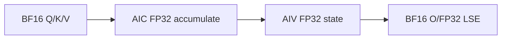

# BlockSparseAttention A2/A3 ACLNN 算子知识

## 算子速览

| 项目 | 内容 |
|---|---|
| 实际入口 | `aclnnBlockSparseAttentionV2GetWorkspaceSize` / `aclnnBlockSparseAttentionV2`，公开两段式 ACLNN；V2 是固定提交内同语义公开最新版。 |
| 计算语义 | 对 `blockSparseMask[b,n,x,y] >= 1` 选中的 KV 块计算 `Softmax(scaleValue·QKᵀ)·V`，跨 KV tile 维护在线 max/sum；`softmaxLseFlag=1` 时输出 `log(sum(exp))+max`。 |
| 输入输出 | Q/K/V 同为 FP16 或 BF16；A2/A3 实际支持同布局 TND 或 BNSD，D=64/128；attentionOut 与 Q 同 shape/dtype，LSE 为 FP32。 |
| 执行类型 | `MIX_CV`：单一 `block_sparse_attention` launch，默认 `KERNEL_TYPE_MIX_AIC_1_2`；AIC 执行 QK/PV，AIV 执行 mask→index、online softmax、rescale/LSE。 |
| Kernel 路线 | R-001 FP16+FP32 softmax；R-002 FP16+FP16 softmax；R-003 BF16+FP32 softmax。各路线显式含 TND/BNSD 与 LSE on/off key 变体。 |
| 核心资源 | 用户 GM workspace、L1/L0A/L0B/L0C、192 KiB UB、寄存器；三份环形 GM stage 连接 AIC/AIV。 |
| 来源闭包 | `source_closed`：V2 ACLNN→L0 launcher→OpDef/InferShape→Tiling/POD→tiling key router→arch22 MIX body/具体 QK、softmax、PV、rescale helper→CMake 接线闭合。 |
| 验证状态 | 已完成源码闭包检查；本次知识提取未执行编译、真机、数值或性能测试。 |

## 接口与语义

### 计算语义

令 `X=blockShapeX`、`Y=blockShapeY`。对每个 batch、Q head 和 X 块，AIV 先把四维 INT8 `blockSparseMask` 中值不小于 1 的 Y 块位置压缩成 `selectIdx` 并记录 `selectCount`。每个 128 行 Q 子块只 gather 这些 KV 块，分段执行 `S=QKᵀ`；online softmax 先乘 `scaleValue`，按行维护全局 max `m`、归一化分母 `l` 和修正因子 `dm=exp(m_old-m_new)`；PV 得到的局部输出按 `O_acc←O_acc·dm+P·V` 更新，末段除以 `l` 后 cast 为输出 dtype。没有 attention mask、paged cache 或滑窗叠加；`maskType` 的公开支持值为 0。

### 输入、输出与属性

| 参数 | shape/layout | dtype | 约束、默认值与语义 |
|---|---|---|---|
| query | TND `[Tq,N,D]`；BNSD `[B,N,Sq,D]` | FP16/BF16 | 与 K/V dtype 一致；D=64/128；N 必须可按 `numKeyValueHeads` 分组。 |
| key/value | TND `[Tkv,Nkv,D]`；BNSD `[B,Nkv,Skv,D]` | 与 query 相同 | K/V batch、head、D 一致，`Nkv=numKeyValueHeads`。 |
| blockSparseMask | `[B,N,ceil(maxSq/X),ceil(maxSkv/Y)]`，ND | INT8 | 名义 optional、实际必须提供；Kernel 以 `uint8_t` 读取并保留 `>=1` 的列。 |
| attenMaskOptional / blockTableOptional | N/A | INT8 / INT32 | 固定实现不支持，必须为 `nullptr`。 |
| blockShapeOptional | 长度严格为 2 | INT64 | V2 实际必选；X、Y>0；Y 是 128 的倍数。API 拒绝 nullptr、只检查“至少 2”，Tiling 进一步要求恰为 2。 |
| actualSeqLengthsOptional / Kv | batch 长度数组 | INT64 | TND 两者必选且和分别等于 Tq/Tkv；BNSD 两者同时给或同时空，为空时使用 shape 的 S。 |
| q/k/vDequantScaleOptional | N/A | N/A | A2/A3 非 FP8 路线必须为空；非 950 Tiling 不消费量化 scale。 |
| qInputLayout / kvInputLayout | 相同字符串 | char* | A2/A3 可达 key 只有 `TND/TND`、`BNSD/BNSD`；BSND 被 Tiling 以“仅 950”拒绝。 |
| numKeyValueHeads | 标量 | INT64→uint32 | 必须非 0；K/V head 数与属性一致，Q head 分组 `groupSize=N/Nkv`。固定源码未显式检查整除，复用时必须保持合法 GQA/MQA。 |
| maskType | 标量 | INT64→uint32 | 公开约束为 0；Tiling 对 3 编码 causal key，但 arch22 router 无对应 key。 |
| scaleValue | 标量 | double→float POD | QK 后、softmax 前逐元素相乘。 |
| innerPrecise | 标量 | INT64→uint32 | FP16 支持 0（FP32 online softmax/rescale）或 1（FP16）；BF16 只支持 0。 |
| blockSize / preTokens / nextTokens | 标量 | INT64 | 必须分别为 0、2147483647、2147483647。Device 的 `blockSize` 字段保持类内默认 128，作为内部稀疏搬运粒度。 |
| softmaxLseFlag | 标量 | INT64 | 0/1；1 时 `softmaxLseOptional` 必须是对应 FP32 输出。 |
| attentionOut | 与 query 相同 | 与 query 相同 | ACLNN 用底层临时输出后 `ViewCopy` 提交。 |
| softmaxLseOptional | TND `[Tq,N,1]`；BNSD `[B,N,Sq,1]` | FP32 | 仅 flag=1 时 `ViewCopy`；Kernel 模板为 `LseMode::OUT_ONLY`。 |

### 入口与版本

固定提交同时公开旧 `aclnnBlockSparseAttention` 与新增三项 dequant scale 的 `aclnnBlockSparseAttentionV2`；V2 文档产品表明确支持 Atlas A2、A3 和 Ascend 950，因此本卡选择 V2。A2/A3 不因 V2 增参获得 FP8：`CheckQKVDtype` 在非 950 仅接受 FP16/BF16，且 router 的 arch22 只有 12 个非量化 key。V2 文档参数表按产品明确 A2/A3 仅支持 `innerPrecise=0/1`，但同页“约束说明”又笼统写成“仅支持 4”；本卡采用产品细分参数表、`ParseAttrs` 与 12 个 arch22 key 三方一致的 0/1 结论，并把该文档内部矛盾保留为失败边界。

## Host/Launcher 执行流程

### 参数校验与前处理

`aclnnBlockSparseAttentionV2GetWorkspaceSize` 依次执行 `ValidateParams`（必选 Q/K/V、同 dtype、布局字符串且相同、blockShape 正数）、`ValidateAdditionalParams`（innerPrecise 属于 0/1/4、输出/workspace/executor 非空）、创建 executor、`MakeContiguous`。后者连续化 Q/K/V 以及所有非空 optional Tensor，并只在 ACLNN 层检查 sparse mask 与 dequant scale 为四维。`l0op::BlockSparseAttention` 把三个 `aclIntArray` 转为 INT64 ND tensor，分配两个底层输出，调用 `INFER_SHAPE`，再用 `ADD_TO_LAUNCHER_LIST_AICORE` 添加唯一算子节点。ACLNN 最后对 attentionOut 总是 `ViewCopy`，对 LSE 仅在 flag=1 时复制。

### 参数、Workspace 与生命周期

`BSATiling::GetBsaTiling` 获取 AIV/AIC 数和 LibApi workspace，按 layout/shape/actual lengths 生成 batch、head、序列、稀疏块参数。A2/A3 的 `blockDim=min(aicNum,totalTaskNum)`；`GetUserWorkspace` 在 Kernel 入口跳过框架 LibApi 前缀，用户区按字节顺序切为 S、P、OTmp、OUpdate、selectCount、selectIdx，末尾另保留 1024 B sync 区。executor 保存 Contiguous、底层节点、ViewCopy 与 workspace 计划；第一段 `ReleaseTo` 后由调用者持有 executor/workspace，第二段在同一 stream 由 `CommonOpExecutorRun` 执行。

### 启动图与失败传播

```text
V2GetWorkspaceSize -> MakeContiguous -> l0op::BlockSparseAttention -> InferShape
  -> ADD_TO_LAUNCHER_LIST_AICORE -> TilingBlockSparseAttention
  -> block_sparse_attention [blockDim=min(aicNum,totalTaskNum), MIX_AIC_1_2]
       AIV mask->selectIdx/count -> SyncAll
       AIC QK -> S(GM) --flag1--> AIV softmax -> P(GM) --flag2-->
       AIC PV -> OTmp(GM) --flag3--> AIV rescale -> O/LSE
  -> ViewCopy
```

任一 ACLNN 检查、Contiguous、InferShape、launcher 添加、Tiling 序列化或 `CommonOpExecutorRun` 失败都返回错误；没有备用算子。Tiling key 不在 12 个 arch22 注册 key 时没有公开可达 fallback；router 源码的编译期 `#else` 默认实例不应解释成 Host fallback。

## Route 与参数设计

### 分核与资源计算

`CalculateBatchTaskSplit` 固定 `qNBlockTile=1`，令 `groupSize=N/Nkv`、`curQNBlockNum=groupSize·Nkv=N`，每 batch task 数为 `GetQBlocks(qSeqlen,X)·N`。`GetQBlocks` 把每个 X 块继续拆成 128 行，尾 X 块向上取整；总 task 以 `blockDim=min(aicNum,totalTaskNum)` 跨核步进。AIV mask 预处理把 `B·N·maxQBlockNum` 行按 `blockDim·2` 个子核均分。主计算固定 QK L1 tile `128×128×128`、L0 `128×128×128`；PV L1 `128×128×256`、L0 `128×128×128`。每个 gather stack 最大 512 token，按内部 128 分块，`PRE_LAUNCH=2`，故三份 GM stage 环形复用。

### Route 选择

| 顺序 | Route | Key/模板 | 精确选择条件与优先级 | 不适用去向 |
|---:|---|---|---|---|
| 1 | R-001 FP16/FP32 | `9000000030000002`、`9000000050000003`、`9000000130000002`、`9000000150000003` | FP16；innerPrecise=0；TND/BNSD；LSE=0/1 | 下一路线或失败 |
| 2 | R-002 FP16/FP16 | `9000000030100002`、`9000000050100003`、`9000000130100002`、`9000000150100003` | FP16；innerPrecise=1；TND/BNSD；LSE=0/1 | 下一路线 |
| 3 | R-003 BF16/FP32 | `9000000030022222`、`9000000050022223`、`9000000130022222`、`9000000150022223` | BF16；innerPrecise=0；TND/BNSD；LSE=0/1 | 未注册 key 则失败 |

```text
非950 -> layout∈{TND,BNSD} -> FP16/precise0:R-001；FP16/precise1:R-002；BF16/precise0:R-003
每路线再由 layout 与 softmaxLseFlag 唯一确定实际 key/LseMode；其余组合失败
```

### 模板/实现执行矩阵

| Route | key/selector | dtype/shape/platform 完整命中条件 | 执行族与 kernel 节点 | 实际模板/body | 内存与同步特征 | tail/fallback |
|---|---|---|---|---|---|---|
| R-001 | TND/BNSD×LSE 0/1 四 key | A2/A3、FP16、precision0、D64/128 | mask2idx→QK→SM→PV→rescale | `BlockSparseAttentionInfer<half,float,LseMode,layout,layout>` | FP32 S/OTmp/update；flags 1/2/3；3 GM stages | M/N/K、X/Y tail；无 fallback |
| R-002 | TND/BNSD×LSE 0/1 四 key | A2/A3、FP16、precision1、D64/128 | 同上 | `BlockSparseAttentionInfer<half,half,LseMode,QueryLayout,KvCacheLayout>` | 中间逻辑 FP16；Host 仍保守分配 | 同上 |
| R-003 | TND/BNSD×LSE 0/1 四 key | A2/A3、BF16、precision0、D64/128 | 同上 | `BlockSparseAttentionInfer<bfloat16_t,float,LseMode,QueryLayout,KvCacheLayout>` | Q/K/V/P/O BF16，state FP32 | 同上 |

### 隐藏性能 Guard

| Guard | Host/Tiling 条件 | Device/资源原因 | 影响 Route | 不满足时去向 | 源码符号 |
|---|---|---|---|---|---|
| 平台/layout | 非950且 TND/BNSD | arch22 无 BSND key | 全部 | Tiling 失败 | `GetInputLayout` |
| dtype/precision | FP16:0/1；BF16:0 | 仅实例化对应 epilogue | 全部 | Tiling/key 失败 | `ParseAttrs`, router |
| D | 64/128 | 固定 tile/L1/L0 | 全部 | Tiling 失败 | `CheckQKVDimVal` |
| sparse shape | mask `[B,N,Qb,Kb]`，Y%128=0 | mask2idx 64列、MMAD按128 gather | 全部 | Tiling 失败 | `CheckSparsePattern` |
| 非空任务 | batch>0、Nkv>0、blockDim>0 | 避免除零/无 owner | 全部 | Tiling 失败 | `CalculateTaskSplit/WorkSpace` |
| stage | `PRE_LAUNCH=2`，每 stage 131072 元素槽 | QK/SM/PV 重叠 | 全部 | 无动态小容量 route | constants |
| 空稀疏行 | `curSelectNum==0` | 防止 `idx[count-1]` 下溢 | 全部 | `continue`，不写 O/LSE | arch22 `operator()` |

### POD/ABI

`BEGIN_TILING_DATA_DEF` 生成 ABI；固定仓未展开 `sizeof/alignof/offsetof` 数值。下表按声明顺序覆盖全部字段；primitive 为自然宽度，复用时不得重排或互换字节/元素单位。

| 结构 | 字段 | 类型/位宽 | ABI 布局 | 单位 | Host/launcher producer | Device consumer | 边界 |
|---|---|---|---|---|---|---|---|
| BlockSparseAttentionTilingData | batch | uint32_t/32 | 宏生成；结构 `sizeof/alignof/offsetof` 固定仓未展开 | batch 个数 | `FillTilingData:set_batch(batch_)` | arch22 batch task 定位 | `batch_>0` |
| 同上 | numHeads | uint32_t/32 | 同上 | head 个数 | `set_numHeads(numHeads_)` | group/task/stride | Q head 数 |
| 同上 | kvHeads | uint32_t/32 | 同上 | head 个数 | `set_kvHeads(kvHeads_)` | `groupSize`、KV stride | 必须非 0 |
| 同上 | embeddingSize | uint32_t/32 | 同上 | 元素 | `set_embeddingSize(embeddingSize_)` | QK/PV 的 K/N | 64 或 128 |
| 同上 | blockSize | uint32_t/32 | 同上 | token | 类默认 `blockSize_=128`；`set_blockSize` | 内部 KV gather 粒度 | API 属性 `blockSize` 必须为 0；二者语义不同 |
| 同上 | maxNumBlocksPerBatch | uint32_t/32 | 同上 | block 个数 | 类默认 0；`set_maxNumBlocksPerBatch` | paged-cache 分支 | 当前 route inactive |
| 同上 | firstBatchTaskNum | uint32_t/32 | 同上 | task 个数 | `CalculateTaskSplit` 首 batch | arch22 batch 边界定位 | batch 0 的 task 数 |
| 同上 | totalTaskNum | uint32_t/32 | 同上 | task 个数 | `CalculateTaskSplit` 累加 | 各 AIC 按 `blockDim` 跨步 | 必须非 0 |
| 同上 | maskType | uint32_t/32 | 同上 | 枚举 | `ParseAttrs` | key 生成/Kernel 字段 | 公开只允许 0 |
| 同上 | scaleValue | float/32 | 同上 | 标量 | `ParseAttrs`；`set_scaleValue` | online softmax | double API 窄化为 float |
| 同上 | totalQBlocks | uint32_t/32 | 同上 | Q block/head 计数 | `CalculateTaskSplit` | arch22 batch/Q block 映射 | 累加值 |
| 同上 | firstQBlockNum | uint32_t/32 | 同上 | Q block/head 计数 | 首 batch `curQBlockNum` | arch22 batch 边界 | batch 0 值 |
| 同上 | blockShapeX | uint64_t/64 | 同上 | token | `ParseSparsePattern` | Q block 与 128-row 子块 | 大于 0 |
| 同上 | blockShapeY | uint64_t/64 | 同上 | token | `ParseSparsePattern` | sparse K/V gather | 大于 0 且 128 倍数 |
| 同上 | maxKvBlockNum | uint32_t/32 | 同上 | sparse Y block 个数 | mask dim3 | idx stride、KV tail | 公开 shape 应为 `ceil(maxSkv/Y)` |
| 同上 | maxQBlockNum | uint32_t/32 | 同上 | sparse X block 个数 | mask dim2 | mask row/task mapping | 公开 shape 应为 `ceil(maxSq/X)` |
| 同上 | avgRowNumPerSubCore | uint32_t/32 | 同上 | mask 行数/AIV 子核 | `CalculateWorkSpace` | `Mask2IdxAndCount` | `ceil(totalRows/(2*blockDim))` |
| 同上 | preActivateSubCoreNum | uint32_t/32 | 同上 | AIV 子核数 | `CalculateWorkSpace` | mask2idx 早退 | `ceil(totalRows/avgRows)` |
| 同上 | queryLayout | uint32_t/32 | 同上 | 枚举 | `GetInputLayout` | arch22 stride 分支 | 0=TND，1=BNSD |
| 同上 | kvCacheLayout | uint32_t/32 | 同上 | 枚举 | `GetInputLayout` | arch22 stride 分支 | 0=TND，1=BNSD |
| 同上 | maxQSeqlen | uint32_t/32 | 同上 | token | Q shape/actual lengths | Q stride/tail | BNSD actual 越界只记录日志 |
| 同上 | maxKvSeqlen | uint32_t/32 | 同上 | token | K/V shape/actual lengths | KV stride/tail | 同上 |
| 同上 | useUniformQSeqlen | uint32_t/32 | 同上 | bool | `ParseSeqlensInNonTND` | 是否读取 actual-Q GM | 0/1 |
| 同上 | useUniformKvSeqlen | uint32_t/32 | 同上 | bool | `ParseSeqlensInNonTND` | 是否读取 actual-KV GM | 0/1 |
| 同上 | tilingKey | uint64_t/64 | 同上 | key | `GenerateTilingKey` | entry router | 12 个 arch22 key 之一 |
| 同上 | selectNumIdxSize | uint64_t/64 | 同上 | 字节 | `CalculateWorkSpace` | count→idx slice offset | 显式溢出检查不可见 |
| 同上 | selectIdxSize | uint64_t/64 | 同上 | 字节 | `CalculateWorkSpace` | workspace 总量记录 | 同上 |
| 同上 | mm1OutSize | uint64_t/64 | 同上 | 字节 | `blockDim*131072*4*3` | `gS`→`gP` offset | FP16-low route 仍按 4B 保守分配 |
| 同上 | smOnlineOutSize | uint64_t/64 | 同上 | 字节 | `blockDim*131072*2*3` | `gP`→`gOTmp` offset | 三 stage |
| 同上 | mm2OutSize | uint64_t/64 | 同上 | 字节 | `blockDim*131072*4*3` | `gOTmp`→`gOUpdate` offset | FP16-low route仍按4B分配 |
| 同上 | updateSize | uint64_t/64 | 同上 | 字节 | `blockDim*131072*4*3` | 后续 count slice offset | Device 每核只使用起始 update 子区，Host 仍分配三 stage |
| 同上 | workSpaceSize | uint64_t/64 | 同上 | 字节 | `CalculateWorkSpace` | 仅记录；框架 workspace[0] | libapi+四中间区+count+idx+1024B sync |
| BsaMask2IdxTiling | xBlockNumAligned | uint32_t/32 | 嵌套字段；offset 固定仓未展开 | block 个数 | A2/A3 路径未初始化成员后仍由 `FillTilingData` 写入 | arch22 不读取 | inactive，值不得复用 |
| 同上 | yBlockNumAligned | uint32_t/32 | 同上 | block 个数 | 同上 | arch22 不读取 | inactive，值不得复用 |
| 同上 | avgRowPerSubCore | uint32_t/32 | 同上 | 行数 | 同上 | arch22 不读取 | inactive，值不得复用 |
| 同上 | preActiveSubCoreNum | uint32_t/32 | 同上 | 子核数 | 同上 | arch22 不读取 | inactive，值不得复用 |
| BsaBaseTiling | qBaseTile | uint32_t/32 | 嵌套字段；offset 固定仓未展开 | token | A2/A3 未初始化成员后写入 | arch22 不读取 | inactive，值不得复用 |
| 同上 | kvBaseTile | uint32_t/32 | 同上 | token | 同上 | arch22 不读取 | inactive，值不得复用 |
| BsaMmPhaseL1Tiling | mm1L1TileM | uint32_t/32 | 嵌套字段；offset 固定仓未展开 | 元素 | A2/A3 未初始化成员后写入 | arch22 不读取 | inactive，值不得复用 |
| 同上 | mm1L1TileN | uint32_t/32 | 同上 | 元素 | 同上 | arch22 不读取 | inactive |
| 同上 | mm1L1TileKLeft | uint32_t/32 | 同上 | 元素 | 同上 | arch22 不读取 | inactive |
| 同上 | mm1L1TileKRight | uint32_t/32 | 同上 | 元素 | 同上 | arch22 不读取 | inactive |
| 同上 | mm2L1TileM | uint32_t/32 | 同上 | 元素 | 同上 | arch22 不读取 | inactive |
| 同上 | mm2L1TileN | uint32_t/32 | 同上 | 元素 | 同上 | arch22 不读取 | inactive |
| 同上 | mm2L1TileKLeft | uint32_t/32 | 同上 | 元素 | 同上 | arch22 不读取 | inactive |
| 同上 | mm2L1TileKRight | uint32_t/32 | 同上 | 元素 | 同上 | arch22 不读取 | inactive |
| 同上 | qL1BufNum | uint32_t/32 | 同上 | buffer 份数 | 同上 | arch22 不读取 | inactive |
| 同上 | kL1BufNum | uint32_t/32 | 同上 | buffer 份数 | 同上 | arch22 不读取 | inactive |
| 同上 | vL1BufNum | uint32_t/32 | 同上 | buffer 份数 | 同上 | arch22 不读取 | inactive |
| 同上 | pL1BufNum | uint32_t/32 | 同上 | buffer 份数 | 同上 | arch22 不读取 | inactive |

### Route 源码闭包

| Route | Key/selector | Host/Tiling producer | POD/参数 | Kernel entry/router | Kernel body/直接依赖 | 构建接线 |
|---|---|---|---|---|---|---|
| R-001 | FP16/float 四 key | `op_host/block_sparse_attention_tiling.cpp:GenerateTilingKey` | `op_host/block_sparse_attention_tiling.h:BlockSparseAttentionTilingData` | `op_kernel/block_sparse_attention.cpp`→`BlockSparseAttentionInfer<half,float,LseMode,QueryLayout,KvCacheLayout>` | arch22 body、QK/PV、FP32 epilogues | `op_host/CMakeLists.txt` |
| R-002 | FP16/half 四 key | 同上 | 同上 | `op_kernel/block_sparse_attention.cpp`→`BlockSparseAttentionInfer<half,half,LseMode,QueryLayout,KvCacheLayout>` | arch22 body、QK/PV、low-prec epilogues | 同上 |
| R-003 | BF16/float 四 key | 同上 | 同上 | `op_kernel/block_sparse_attention.cpp`→`BlockSparseAttentionInfer<bfloat16_t,float,LseMode,QueryLayout,KvCacheLayout>` | arch22 body、QK/PV、FP32 epilogues | 同上 |

## Kernel 实现

### 公共执行流程

所有 key 共用单 MIX launch。AIV 按 128×64 mask tile 做 `INT8→FP16→FP32`，`CompareScalar` 以标量 1.0 和 `CMPMODE::GE` 产生 bit mask，`GatherMask` 产出原始 Y 索引/count；`SyncAll<false>` 后每个 task 映射到 `(batch,qHead,xBlock,128-row-inner-block)`。AIC 常驻 Q 于 L1并稀疏 gather K做QK；AIV wait flag1 后在GM S stage做online softmax并set flag2；AIC wait flag2 后gather V做PV并set flag3；AIV wait flag3后重标定，末tile写O/LSE。stage按`stackSeqCount%3`复用，硬件事件防覆盖。

### Route R-001：FP16 输入、FP32 online softmax/rescale

#### 适用条件

##### 选择证据

| 层级 | 文件 | 符号 | 源码谓词/参数 | 结果/下一跳 |
|---|---|---|---|---|
| Tiling | `op_host/block_sparse_attention_tiling.cpp` | `ParseAttrs/GenerateTilingKey` | FP16、precise0、layout0/1、LSE0/1 | 四个 key |
| Router | `op_kernel/block_sparse_attention.cpp` | arch220 branches | key相等 | `Infer<half,float,LseMode,layout,layout>` |

#### Device 数据流

##### 函数级调用链

```text
block_sparse_attention -> BlockSparseAttentionInfer<half,float,LseMode,QueryLayout,KvCacheLayout>
 -> BlockSparseAttentionKernel::operator() -> Mask2IdxAndCount -> SyncAll
 -> BlockMmadQK -> FP32 OnlineSoftmax -> BlockMmadPV -> FP32 RescaleO
```

##### 源码等价伪码

```text
for task by paired AIC core: locate batch/head/Q tile; if count==0 continue; load Q once
for gatheredKV stage plus 2 drain stages:
  AIC sparse K gather -> QK -> S[core,stage%3]; flag1
  AIV wait1 -> scale/online max,sum,exp -> P[core,stage%3]; flag2
  AIC wait2 -> sparse V gather -> PV -> OTmp[core,stage%3]; flag3
  AIV wait3 -> Oacc=Oacc*dm+OTmp; last: O=Oacc/sum and optional LSE
```

#### 内存与数据搬运

##### 资源与搬运表

| 层级/缓冲区 | offset/地址公式 | extent/容量公式 | dtype/layout | producer | consumer | owner/lifetime | 对齐/复用 |
|---|---|---|---|---|---|---|---|
| GM Q/K/V/mask | layout stride | logical shape | FP16/INT8 ND | caller | AIC/AIV | stream | tail guarded |
| WS S | 0 | `blockDim*131072*4*3` B | FP32 row-major | QK Fixpipe | softmax | executor | 3 stage |
| WS P | mm1 | `blockDim*131072*2*3` B | FP16 | softmax | PV | 同上 | 3 stage |
| WS OTmp | mm1+sm | `blockDim*131072*4*3` B | FP32 | PV | rescale | 同上 | 3 stage |
| WS OUpdate | mm1+sm+mm2 | `blockDim*131072*4*3` B | FP32 | rescale | next stage | task | per-core base |
| count/idx | four slices后/再加count | Tiling公式 | INT32 | mask2idx | scheduler/MMAD | kernel | SyncAll后只读 |
| L1 QK | 0 | Q32768B + K65536B | FP16 | MTE2 | L0 | task/stage | K双缓冲 |
| L1 PV | 98304 | P131072B + V65536B | FP16 | GM | L0 | stage | P双缓冲 |
| L0A/B/C | 固定资源/2 | 每stage 32/32/64KiB | FP16/FP16/FP32 acc | MTE1/MMAD | MMAD/Fixpipe | stage | events |
| UB | 固定 | 192KiB physical | FP32/FP16/INT32 | AIV | AIV/GM | launch | 时分复用 |

##### 分层内存布局


##### 字节账、交接边与复用顺序

```text
workspace_total = libapiSize + blockDim*131072*(4+2+4+4)*3 + countSize + idxSize + 1024
L1_peak = 98304+131072+65536 = 294912 B <= 512 KiB
L0 physical = 64+64+128 KiB；UB physical = 192 KiB
```

| 边/复用子区 | producer | offset/extent | dtype/layout | consumer | ordering/sync | owner/lifetime | 安全条件 |
|---|---|---|---|---|---|---|---|
| mask→idx | AIV | count/idx slices | INT32 | tasks | SyncAll | workspace | active rows完成 |
| QK→SM | AIC Fixpipe | S `[core,stage%3]` | FP32 | AIV | flag1 mode0x2 | stage | reverse event |
| SM→PV | AIV MTE3 | P same stage | FP16 | AIC | flag2 | stage | PRE_LAUNCH=2 |
| PV→RE | AIC Fixpipe | OTmp same stage | FP32 | AIV | flag3 | stage | release before reuse |

#### 同步、精度与尾块

##### 同步与数值边界表

| 阶段 | primitive/机制 | producer | consumer/等待点 | 保护对象 | 精度/尾块 |
|---|---|---|---|---|---|
| mask | `SyncAll<false>` | AIV | main loop | idx/count | 列补32/64，阈值1 |
| QK/SM/PV | flags1/2/3 + pipe events | AIC/AIV | paired core | ring | M/N/K actual；M align16 |
| softmax/output | online max/sum/dm + DataCopyPad | AIV | GM | state/O/LSE | state FP32，O FP16，LSE FP32 |

#### 关键实现

##### 符号证据表

| 阶段 | 文件 | 符号/模板实例 | 实现事实 |
|---|---|---|---|
| Host/Tiling | `op_host/block_sparse_attention_tiling.cpp` | task/workspace/key functions | blockDim、slice、key |
| Router | `op_kernel/block_sparse_attention.cpp` | arch220 branches | key→half/float |
| Body | `op_kernel/block_sparse_attention_kernel_regular_arch22.h` | `operator()/Mask2IdxAndCount` | MIX图、flags、tail |
| Helper | `attn_infra/gemm/block/bsa_block_mmad_qk.hpp` | QK specialization | GM→L1→L0→MMAD→GM |

### Route R-002：FP16 输入、FP16 online softmax/rescale

#### 适用条件

##### 选择证据

| 层级 | 文件 | 符号 | 源码谓词/参数 | 结果/下一跳 |
|---|---|---|---|---|
| Tiling/Router | `op_host/block_sparse_attention_tiling.cpp` / `op_kernel/block_sparse_attention.cpp` | `innerPrecise_==1` / HALFSM key | FP16、TND/BNSD、LSE0/1 | `BlockSparseAttentionInfer<half,half,LseMode,QueryLayout,KvCacheLayout>` |

#### Device 数据流

##### 函数级调用链

```text
公共链路 -> EpilogueAtlasA2OnlineSoftmax<LseMode,half> -> EpilogueAtlasA2RescaleO<LseMode,half>
```

##### 源码等价伪码

```text
mask2idx -> QK -> FP16 online max/sum/exp -> PV -> FP16 rescale -> FP16 O (+ optional LSE)
```

#### 内存与数据搬运

##### 资源与搬运表

| 层级/缓冲区 | offset/地址公式 | extent/容量公式 | dtype/layout | producer | consumer | owner/lifetime | 对齐/复用 |
|---|---|---|---|---|---|---|---|
| GM workspace | 同R-001 | Host仍按R-001保守字节公式 | 中间逻辑FP16 | AIC/AIV | AIV/AIC | executor | 3 stage，offset不缩 |
| L1/L0/UB | 同R-001 | L1 294912B；UB192KiB | FP16/accumulator | 同上 | 同上 | launch | low-prec specialization |

##### 分层内存布局


##### 字节账、交接边与复用顺序

```text
物理 workspace/L1/L0/UB 与 R-001 相同；类型变窄不改变 Host slice offset。
```

| 边/复用子区 | producer | offset/extent | dtype/layout | consumer | ordering/sync | owner/lifetime | 安全条件 |
|---|---|---|---|---|---|---|---|
| 三条MIX边 | 同R-001 | 同R-001 | FP16中间 | 同R-001 | flags1/2/3 | workspace | HALFSM key |

#### 同步、精度与尾块

##### 同步与数值边界表

| 阶段 | primitive/机制 | producer | consumer/等待点 | 保护对象 | 精度/尾块 |
|---|---|---|---|---|---|
| 全流水 | 同R-001 | AIC/AIV | paired core | ring | online/rescale FP16，可能溢出；BF16禁用 |

#### 关键实现

##### 符号证据表

| 阶段 | 文件 | 符号/模板实例 | 实现事实 |
|---|---|---|---|
| Router | `op_kernel/block_sparse_attention.cpp` | HALFSM branches | half/half实例 |
| Helpers | low-prec online/rescale headers | half specialization | FP16 state与tail |

### Route R-003：BF16 输入、FP32 online softmax/rescale

#### 适用条件

##### 选择证据

| 层级 | 文件 | 符号 | 源码谓词/参数 | 结果/下一跳 |
|---|---|---|---|---|
| Tiling/Router | `op_host/block_sparse_attention_tiling.cpp` / `op_kernel/block_sparse_attention.cpp` | BF16且precise0 | TND/BNSD、LSE0/1 | `BlockSparseAttentionInfer<bfloat16_t,float,LseMode,QueryLayout,KvCacheLayout>` |

#### Device 数据流

##### 函数级调用链

```text
公共链路；Q/K/V/P/O=bfloat16_t，S/OTmp/update/online state=float。
```

##### 源码等价伪码

```text
BF16 Q,K -> FP32-acc QK -> FP32 softmax -> BF16 P,V -> FP32 rescale -> BF16 O / FP32 LSE
```

#### 内存与数据搬运

##### 资源与搬运表

| 层级/缓冲区 | offset/地址公式 | extent/容量公式 | dtype/layout | producer | consumer | owner/lifetime | 对齐/复用 |
|---|---|---|---|---|---|---|---|
| GM/L1 | 同R-001 | 同字节公式 | BF16 | caller/MTE | MMAD | stream/task | 2B |
| WS/UB | 同R-001 | 同字节公式 | FP32 state、BF16 P | AIC/AIV | AIV/AIC | executor | 3 stage |

##### 分层内存布局



##### 字节账、交接边与复用顺序

```text
workspace/L1/L0/UB 字节账与 R-001 相同。
```

| 边/复用子区 | producer | offset/extent | dtype/layout | consumer | ordering/sync | owner/lifetime | 安全条件 |
|---|---|---|---|---|---|---|---|
| 三边 | 同R-001 | 同R-001 | FP32/BF16/FP32 | 同R-001 | flags1/2/3 | workspace | BF16+precise0 |

#### 同步、精度与尾块

##### 同步与数值边界表

| 阶段 | primitive/机制 | producer | consumer/等待点 | 保护对象 | 精度/尾块 |
|---|---|---|---|---|---|
| 全流水 | 同R-001 | AIC/AIV | paired core | ring | BF16 I/O、FP32 state，tail同R-001 |

#### 关键实现

##### 符号证据表

| 阶段 | 文件 | 符号/模板实例 | 实现事实 |
|---|---|---|---|
| Host | tiling cpp | dtype/precision checks | BF16仅0 |
| Router/body | router/arch22 header | QBF16 branches/common body | BF16/float实例 |

## 算子特定优化

### Trick T-001：三份 GM stage 的两步预启动 MIX 流水

#### 触发与源码依据

- 适用 Route：全部
- 触发条件：arch22注册key；`PRE_LAUNCH=2`、`WORKSPACE_BLOCK_SIZE_DB=131072`。
- Golden 来源：[`block_sparse_attention_kernel_regular_arch22.h:592-602`](../../../../../../../cann-ops-raw/ascendc/ops-transformer/be33d95bb755cedec3108f70805c1874d1792540/attention/block_sparse_attention/op_kernel/block_sparse_attention_kernel_regular_arch22.h)

**官方源码（固定 Commit 连续逐字摘录）**：

```cpp
// Main computation loop: QK matmul -> Softmax -> PV matmul
for (uint32_t kvSIdx = 0; kvSIdx < kvSLoopNumTotal + preKVNum; kvSIdx += blockStackNum) {
    // Stage 1: QK matmul (computed on CUBE core)
    if (kvSIdx < kvSLoopNumTotal) {
        stackSeqTile = noSkipKvS - kvSIdx * pagedBlockSize;
        if (stackSeqTile >= pagedBlockSize * blockStackNum) {
            stackSeqTile = pagedBlockSize * blockStackNum;
        }
        uint32_t curStackTileMod = stackSeqCount % (PRE_LAUNCH + 1);
        uint64_t gmOffsetS = coreIdx * WORKSPACE_BLOCK_SIZE_DB * (PRE_LAUNCH + 1) +
            curStackTileMod * WORKSPACE_BLOCK_SIZE_DB;
```

#### 机制与设计原因

QK/softmax先推进两个stack，PV/rescale再以同一`%3`追赶；flags1/2/3让AIC/AIV交叠而不串行化整个阶段。三份来自`PRE_LAUNCH+1`，Host四类中间区也均按三份分配。

#### 迁移边界

- 适用：单launch、1AIC:2AIV、GM中转的注意力流水。
- 前提：保持stage offset、dtype、flag轮次和反向事件。
- 失效：950片上交接路线；stage数或dtype改变时重算workspace。
- 未验证：本次知识提取未执行编译、真机、数值或性能测试。

#### 错误做法

只把stage数改成2而保留两步预启动会覆盖尚未消费的GM slice。

### Trick T-002：mask 先压缩为索引，MMAD 只 gather 命中块

#### 触发与源码依据

- 适用 Route：全部
- 触发条件：合法四维blockSparseMask。
- Golden 来源：[`block_sparse_attention_kernel_regular_arch22.h:191-204`](../../../../../../../cann-ops-raw/ascendc/ops-transformer/be33d95bb755cedec3108f70805c1874d1792540/attention/block_sparse_attention/op_kernel/block_sparse_attention_kernel_regular_arch22.h)

**官方源码（固定 Commit 连续逐字摘录）**：

```cpp
AscendC::CompareScalar(
    maskPatternInBitUbLocal[k * PRE_COL_TILE],
    maskPatternFloatLocal[k * PRE_COL_TILE],
    (float)1.0, AscendC::CMPMODE::GE, PRE_COL_TILE);
AscendC::PipeBarrier<PIPE_V>();
if (k == 0) {
    AscendC::WaitFlag<AscendC::HardEvent::MTE3_V>(idxPingPongFlag);
}
AscendC::GatherMask(
    sparseIdxUbLocal[idxPingPongFlag][k * PRE_COL_TILE],
    maskIdxUbLocal,
    maskPatternInBitUbLocalUint32[k * PRE_COL_TILE / 4],
    false,
    (uint32_t)0, {1, 1, 0, 0}, rsvdCountPerRowCurColLoop[k]);
```

#### 机制与设计原因

AIV以128×64 tile、双buffer把稠密块mask转为紧凑Y下标；QK/PV的GM→L1 helper再按这些下标拼接512-token stack，未选中块不进入MMAD。

#### 迁移边界

- 适用：布尔块选择且按原序列列顺序gather。
- 前提：mask后两维、X/Y、实际序列一致；先SyncAll。
- 失效：带权mask或任意重排索引需改gather/tail。
- 未验证：本次知识提取未执行编译、真机、数值或性能测试。

#### 错误做法

跳过`selectCount==0`保护会在读取`selectIdx[count-1]`时下溢；A2 body已显式continue。

## 模板与实现对比

| 对比维度 | R-001 FP16/FP32 | R-002 FP16/FP16 | R-003 BF16/FP32 | 设计选择依据 |
|---|---|---|---|---|
| 命中条件/优先级 | FP16,0 | FP16,1 | BF16,0 | Host guard |
| 执行族/节点图 | MIX单kernel | 同左 | 同左 | 共用body |
| M/N/K、tile与scheduler | Q128、KVstack512、L0 128³ | 同左 | 同左 | 固定模板 |
| workspace/L1/L0/UB | FP32 state | 逻辑half但物理不缩 | FP32 state | 精度模板/保守分配 |
| AIC/AIV交接 | GM三stage+flags | 同左 | 同左 | PRE_LAUNCH=2 |
| 同步、精度与tail | FP32 | FP16 | FP32 | innerPrecise/dtype |
| fallback/失败边界 | 无 | BF16不可用 | precise1不可用 | 12-key白名单 |

## 平台差异

| 项目 | A2 | A3 | 950 |
|---|---|---|---|
| 支持状态 | V2文档支持 | V2文档支持 | 支持，见`_950`卡 |
| Host/Launcher | 与A3共用非950分支 | 与A2共用 | 950专用Tiling，precise4 |
| Kernel/资源 | arch22，GM中间，TND/BNSD，FP16/BF16 | 固定仓未给独立A3 body | arch35片上交接，FP8/BSND |

## 限制与失败边界

- 不支持attention mask、paged cache、滑窗；公开`maskType=0`。Tiling虽编码3，router无causal key。
- mask全0行在A2直接跳过O/LSE写入，固定仓未说明其初始化语义。
- V2 文档参数表明确 A2/A3 的 `innerPrecise` 为 0/1，但同页“约束说明”误写为仅 4；Host Tiling 与 arch22 key 支持 0/1，不支持 4。调用方应按产品细分参数表，不能照搬该笼统条目。
- API对blockShape只检查至少2，Tiling要求恰为2；以Tiling为准。
- 固定源码未显式检查`numHeads%kvHeads==0`，实现用整数groupSize，调用方须保持合法GQA/MQA。
- BNSD actual length越上界只`OP_LOGE`而未return；不得依赖安全拒绝。
- workspace乘法和uint32窄化的显式溢出检查不可见。
- 本次知识提取未执行编译、真机、数值或性能测试。

## 源码索引

### 链路索引

| 链路阶段 | 文件 | 关键符号 | 支撑内容 |
|---|---|---|---|
| 公开约束 | `docs/aclnnBlockSparseAttentionV2.md` | 产品表/原型/约束 | V2与A2/A3支持 |
| 旧入口对比 | `docs/aclnnBlockSparseAttention.md` | 旧版产品表/原型 | V2 版本选择基线 |
| 旧入口声明 | `op_host/op_api/aclnn_block_sparse_attention.h` | `aclnnBlockSparseAttention*` | 旧版不含三项 dequant scale |
| 入口声明 | `op_host/op_api/aclnn_block_sparse_attention_v2.h` | 两段式符号 | ABI |
| 入口实现 | `op_host/op_api/aclnn_block_sparse_attention_v2.cpp` | validate/contiguous/workspace | executor流程 |
| L0 launcher | `op_host/op_api/block_sparse_attention.cpp` | `l0op::BlockSparseAttention` | InferShape/launch node |
| OpDef | `op_host/block_sparse_attention_def.cpp` | OpDef | dtype/config |
| InferShape | `op_host/block_sparse_attention_infershape.cpp` | infer functions | O/LSE shape/dtype |
| POD | `op_host/block_sparse_attention_tiling.h` | TilingData | ABI字段 |
| Tiling | `op_host/block_sparse_attention_tiling.cpp` | `BSATiling::*` | selector/workspace/key |
| Router | `op_kernel/block_sparse_attention.cpp` | entry | MIX/12 keys |
| Key | `op_kernel/block_sparse_attention_tilingkey.h` | arch220 macros | key常量 |
| 模板 | `op_kernel/block_sparse_attention_kernel_interface.cpp` | `BlockSparseAttentionInfer` | specialization |
| Body | `op_kernel/block_sparse_attention_kernel_regular_arch22.h` | kernel class | task/memory/sync |
| QK/PV | `op_kernel/attn_infra/gemm/block/bsa_block_mmad_qk.hpp` | QK BlockMmad | sparse MMAD |
| QK/PV | `op_kernel/attn_infra/gemm/block/bsa_block_mmad_pv.hpp` | PV BlockMmad | sparse MMAD |
| Softmax | `op_kernel/attn_infra/epilogue/block/bsa_block_epilogue_online_softmax.hpp` | FP32 specialization | online state |
| Rescale | `op_kernel/attn_infra/epilogue/block/bsa_block_epilogue_rescale_o.hpp` | FP32 specialization | normalize/LSE |
| 低精度Softmax | `op_kernel/attn_infra/epilogue/block/bsa_block_epilogue_online_softmax_low_prec.hpp` | FP16 specialization | R-002 online state/cast/tail |
| 低精度Rescale | `op_kernel/attn_infra/epilogue/block/bsa_block_epilogue_rescale_o_low_prec.hpp` | FP16 specialization | R-002 update/normalize/LSE |
| 同步常量 | `op_kernel/block_sparse_attention_kernel_common.hpp` | `QK_READY_ID/SOFTMAX_READY_ID/PV_READY_ID` | flags 1/2/3 |
| 资源 | `op_kernel/attn_infra/arch/bsa_arch.hpp` | `AtlasA2` | 容量 |
| 构建接线 | `op_host/CMakeLists.txt` | `add_op_to_compiled_list/add_ops_compile_options` | 编译接线与 `--cce-auto-sync=off` |

每行文件均在 Frontmatter `sources` 中。R-002 的 low-precision helper 由公共 epilogue 分发头在同一闭包中按 arch220 include。

### 实现复用检查

| 检查项 | 可复用事实 | 不得改变的约束 | 源码符号 |
|---|---|---|---|
| ABI/POD | 同POD服务Host/MIX两侧 | 字段顺序、位宽、单位 | TilingData |
| 调用顺序 | mask2idx→barrier→QK→SM→PV→RE | PRE_LAUNCH/drain | arch22 operator |
| workspace/内存 | 六slice+sync公式 | 字节offset、三stage | `CalculateWorkSpace` |
| 同步 | flags1/2/3与pipe events | 配对核与轮次 | ready flags |
| 精度与尾块 | 三路线、两layout、actual M/N/K | BF16禁low；cast顺序 | router/epilogues |
| 失败边界 | 12 key、无公开fallback | 不把编译期else当runtime fallback | router |