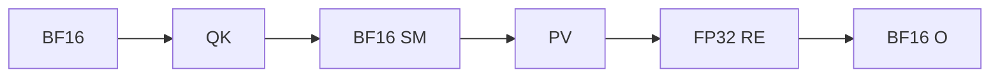
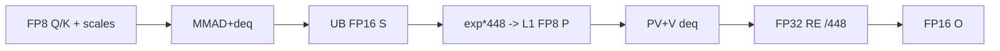
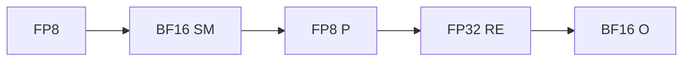

# BlockSparseAttention 950 ACLNN 算子知识

## 算子速览

| 项目 | 内容 |
|---|---|
| 实际入口 | `aclnnBlockSparseAttentionV2GetWorkspaceSize` / `aclnnBlockSparseAttentionV2`，公开两段式 ACLNN，固定提交内最新版。 |
| 计算语义 | 稀疏 gather 的 `Softmax(scale·QKᵀ)·V`；FP8 路线把 Q×K scale 合并进 QK Fixpipe、把 V scale 注入 PV Fixpipe，并用 FP8 P。 |
| 输入输出 | regular：FP16/BF16→同 dtype；full-quant：FP8 E4M3FN→FP16/BF16；TND/BNSD/BSND，D=64/128，LSE FP32 可选。 |
| 执行类型 | 单 Kernel `MIX_CV`，`KERNEL_TYPE_MIX_AIC_1_2`；AIV mask2idx/softmax/rescale，AIC QK/PV。950 交接用 UB/L1，不用 GM 中间矩阵。 |
| Kernel 路线 | R-001 regular FP16；R-002 regular BF16；R-003 FP8→FP16；R-004 FP8→BF16。每族含三 layout×LSE on/off 六个精确 key。 |
| 核心资源 | GM 仅输入/输出与 sparse idx/count workspace；512 KiB L1、双 stage L0、256 KiB UB、mode-4 AIC↔双 AIV flags。 |
| 来源闭包 | `source_closed`：公开 V2→executor/L0→OpDef/InferShape→950 Tiling/POD→24-key router→regular/full-quant body→QK/SM/PV/rescale specialization→构建接线闭合。 |
| 验证状态 | 已完成源码闭包检查；本次知识提取未执行编译、真机、数值或性能测试。 |

## 接口与语义

### 计算语义

mask 预处理与在线 softmax 语义同 A2/A3，但 950 每个 task 只含一个 Q head、`qBaseTile=min(X,128)`，`kvBaseTile=256`。regular 的 QK 结果由 L0C 直接 Fixpipe 到 UB 的 FP16/BF16 S；AIV 在 UB 以低精度做 scale/max/exp，并把 P 直接写入 L1 zN；AIC 从 L1 P 做 PV并把 FP32 OTmp 直接 Fixpipe 到 UB；AIV 以 FP32 `Oacc·dm+OTmp` 和分母完成 rescale。FP8路线：`qScale[b,qHead,x]·kScale[b,kvHead,y]` 作为QK deqScalar，`vScale[b,kvHead,y]`作为PV deqScalar；softmax把exp乘448并量化成FP8 P，rescale用`1/448`补偿。

### 输入、输出与属性

| 参数 | shape/layout | dtype | 约束、默认值与语义 |
|---|---|---|---|
| Q/K/V | TND、BNSD 或 BSND，三者layout相同，D=64/128 | 全FP16、全BF16或全FP8 E4M3FN | batch/head/D一致；950只允许`innerPrecise=4`。 |
| blockSparseMask | `[B,N,ceil(maxSq/X),ceil(maxSkv/Y)]` | INT8 | 必须提供；`>=1`位置压缩为索引。每个有效Q行应至少一个命中块，950 body未做count=0保护。 |
| blockShape | 长度2 | INT64 | V2 实际必选；regular：X/Y>0且Y%128=0；FP8 公开域：X=128，Y=256或512。API 拒绝 nullptr，Tiling 要求恰为2；实现实际只检查 `Y%256==0`，更大的倍数不在 V2 文档公开域内。 |
| actualSeqLengths/QKv | batch数组 | INT64 | TND必选且sum匹配T；BNSD/BSND两者同空或同有。 |
| qDequantScale | `[B,N,maxQBlockNum,1]` | FP32 | FP8必选；非FP8必须空。Tiling以mask维度`maxQBlockNum`精确检查。 |
| k/vDequantScale | `[B,Nkv,maxKvBlockNum,1]` | FP32 | FP8必选；非FP8必须空。公开 V2 的 `maxKvBlockNum` 对应 `ceil(maxSkv/256)` 或 `ceil(maxSkv/512)`，并与 Y=256/512 一致。 |
| attenMask/blockTable | N/A | N/A | 必须nullptr；无attention mask、paged cache。 |
| layouts | 同字符串 | char* | TND/BNSD/BSND均有arch35 key；BSND仅950。 |
| numKeyValueHeads | 标量 | INT64→uint32 | 非0且等于K/V head；Q heads按`N/Nkv`分组。 |
| maskType/scaleValue | 标量 | INT64/float | 公开maskType仅0；scale在online softmax阶段应用。 |
| innerPrecise | 标量 | INT64 | 950必须4：low-precision online softmax + high-precision rescale。 |
| blockSize/preTokens/nextTokens | 标量 | INT64 | 必须0/max-int/max-int。 |
| softmaxLseFlag | 0/1 | INT64 | 控制`LseMode::NONE/OUT_ONLY`与TN1/BNS1/BSN1格式。 |
| attentionOut | 与Q shape相同 | regular同Q；FP8为FP16/BF16 | FP8输出dtype也参与tiling key末位10/20编码。 |
| softmaxLse | TND `[T,N,1]`；BNSD `[B,N,S,1]`；BSND `[B,S,N,1]` | FP32 | 最后KV tile计算`ln(sum)+max`。 |

### 入口与版本

V2文档明确Ascend 950PR/950DT支持，并说明FP8只在该产品支持；因此950使用V2而非旧入口。API层先允许0/1/4和三种dtype，真正平台约束由Tiling收紧为precision4、三layout、regular或full-quant四族。

## Host/Launcher 执行流程

### 参数校验与前处理

ACLNN校验、Contiguous、array→tensor、InferShape、launcher list与ViewCopy顺序和A2/A3相同。FP8的三scale若非空也Contiguous且必须四维；Tiling再检查FP32 dtype与精确shape。OpDef把FP8输入分别映射到FP16/BF16输出类型项，并添加`ascend950`配置。

### 参数、Workspace 与生命周期

950 Tiling令`qBaseTile=min(X,128)`；因precision4且D≤128，`kvBaseTile=256`。每batch task=`GetCurQSTileNum950(seq)·N`，`blockDim=aicNum`。workspace只含LibApi前缀与两块INT32：`idx=B·N·xAligned·yAligned·4`、`count=B·N·xAligned·4`；Kernel的`GetUserWorkspace`后，idx在offset0、count在`idxSize`。所有S/P/OTmp/OUpdate均在片上，workspace与executor活到stream完成。

### 启动图与失败传播

```text
V2GetWorkspaceSize -> L0 BlockSparseAttention -> TilingBlockSparseAttention
 -> block_sparse_attention [blockDim=aicNum, MIX_AIC_1_2]
    AIV mask2idx -> GM idx/count -> SyncAll
    AIC QK: GM->L1->L0->UB S --mode4 flags 0/1--> AIV softmax
    AIV: UB S -> L1 P(zN, triple buffer) --flags 2/3/4--> AIC PV
    AIC: L1 P + GM/L1 V -> L0 -> UB OTmp --flags 5/6--> AIV rescale -> GM O/LSE
 -> ViewCopy
```

任一校验/Tiling/launch失败终止executor；24个key之外没有arch35 `#else` fallback。固定源码950对稀疏count=0直接读取`idx[-1]`，故有效mask行非空是安全前提。

## Route 与参数设计

### 分核与资源计算

`xAligned=ceil(maxSq/X)`、`yAligned=ceil(maxSkv/Y)`；mask行`B·N·xAligned`按AIV子核均分。task映射为`batch→qHead→qSTile`，`qSTile`在每个X块内以qBaseTile切分。D64/128都向128对齐，得到：MM1 L1 `(M,N,Kleft,Kright)=(128,256,128,128)`、Q/K buffers=1/2；MM2为`(128,128,256,256)`、P/V buffers=3/2。QK/PV的L0 tile均128³、L0 stage=2；主循环`PRE_LAUNCH=2`，UB S/Otmp双缓冲，L1 P三缓冲。

### Route 选择

| 顺序 | Route | Key/模板 | 精确选择条件与优先级 | 不适用去向 |
|---:|---|---|---|---|
| 1 | R-001 regular FP16 | `9050000030400002`、`9050000050400003`、`9050000060400004`、`9050000130400002`、`9050000150400003`、`9050000160400004` | FP16、precision4、TND/BNSD/BSND、LSE0/1 | 下一路线 |
| 2 | R-002 regular BF16 | `9050000030422222`、`9050000050422223`、`9050000060422224`、`9050000130422222`、`9050000150422223`、`9050000160422224` | BF16、precision4、三layout、LSE0/1 | 下一路线 |
| 3 | R-003 FP8→FP16 | `9050000030400012`、`9050000050400013`、`9050000060400014`、`9050000130400012`、`9050000150400013`、`9050000160400014` | FP8+三scale、O FP16、X=128、公开 Y∈{256,512} | 下一路线 |
| 4 | R-004 FP8→BF16 | `9050000030400022`、`9050000050400023`、`9050000060400024`、`9050000130400022`、`9050000150400023`、`9050000160400024` | FP8+三scale、O BF16、X=128、公开 Y∈{256,512} | 失败 |

```text
soc950 + precise4 -> dtype
 FP16:R-001；BF16:R-002；FP8+OFP16:R-003；FP8+OBF16:R-004
 -> layout TND/BNSD/BSND -> LSE 0/1 -> 唯一24-key实例
```

### 模板/实现执行矩阵

| Route | key/selector | dtype/shape/platform 完整命中条件 | 执行族与 kernel 节点 | 实际模板/body | 内存与同步特征 | tail/fallback |
|---|---|---|---|---|---|---|
| R-001 | 6 regular-half keys | 950, FP16, precise4 | 单MIX片上流水 | `BsaInferIntfRegular<half,half,float,Format,LseMode,LseFormat>` | UB S half→L1 P half→UB OTmp float | q/kv/layout tail，无fallback |
| R-002 | 6 regular-bf16 keys | 950, BF16, precise4 | 同上 | `BsaInferIntfRegular<bfloat16_t,bfloat16_t,float,qFormat,kvFormat,lseMode,lseFormat>` | UB/L1为BF16，rescale float | 同上 |
| R-003 | 6 FP8/Ohalf keys | 950, FP8, scales, Ohalf | 同MIX+dequant | `BsaInferInterfaceFullQuant<fp8_e4m3fn_t,half,float,qFormat,kvFormat,lseMode,lseFormat>` | FP8 Q/K/V/P；Fixpipe scale；OTmp float | X/Y量化guard |
| R-004 | 6 FP8/Obf16 keys | 同上但O BF16 | 同上 | `BsaInferInterfaceFullQuant<fp8_e4m3fn_t,bfloat16_t,float,qFormat,kvFormat,lseMode,lseFormat>` | BF16 softmax state/output、FP8 P | 同上 |

### 隐藏性能 Guard

| Guard | Host/Tiling 条件 | Device/资源原因 | 影响 Route | 不满足时去向 | 源码符号 |
|---|---|---|---|---|---|
| precise | 仅4 | 950实例固定low SM/high rescale | 全部 | Tiling失败 | `ParseAttrs` |
| base tile | q=min(X,128)，kv=256 | UB列上限256、P三缓冲 | 全部 | 无其他950 route | `CalcBaseTileTilingParams950` |
| D | 64/128→align128 | 固定L1/L0 tile | 全部 | Tiling失败 | `CheckQKVDimVal/CalcMatmulPhaseL1TileInfo950` |
| L1 regular | 491520B≤512KiB | Q/K+P/V当前实例 | R1/R2 | 无fallback | `CalcOnChipBufTileInfo` |
| L1 FP8 | 245760B≤512KiB | 1-byte Q/K/P/V | R3/R4 | 无fallback | full-quant body |
| FP8 block | 公开约束 X=128、Y∈{256,512}；实现 guard 为 `X==128 && Y%256==0` | scale索引按 x/y block，kv tile=256 | R3/R4 | X 或非256倍数由 Tiling 拒绝；其它256倍数虽可过实现 guard，但不属于公开 API 域 | `CheckBlockShapeQuantConstraint`、V2 文档 FP8 约束 |
| 非空 mask 工作域 | `B*N*xBlockNumAligned>0` 且 AIV 数非 0 | `avgRowPerSubCore=ceil(totalRows/aivNum)` 后还以该值作除数；零行没有安全终点 | 全部 | 固定仓未提供 empty route；调用方必须拒绝空工作域 | `CalcSplitCoreTilingParams950` |
| nonempty mask row | count>0 | 950读取`lastIdx=count-1` | 全部 | 未保护，输入前提 | arch35 bodies |

### POD/ABI

宏未展开数值`sizeof/alignof/offsetof`；以下按声明顺序覆盖字段，primitive宽度固定。

| 结构 | 字段 | 类型/位宽 | ABI 布局 | 单位 | Host/launcher producer | Device consumer | 边界 |
|---|---|---|---|---|---|---|---|
| BlockSparseAttentionTilingData | batch | uint32_t/32 | 宏生成；结构 `sizeof/alignof/offsetof` 固定仓未展开 | batch 个数 | `FillTilingData:set_batch(batch_)` | arch35 batch/task 定位 | 非零 |
| 同上 | numHeads | uint32_t/32 | 同上 | head 个数 | `set_numHeads(numHeads_)` | task/stride/GQA | Q head 数 |
| 同上 | kvHeads | uint32_t/32 | 同上 | head 个数 | `set_kvHeads(kvHeads_)` | KV head/scale stride | 必须非零且整除 Q head |
| 同上 | embeddingSize | uint32_t/32 | 同上 | 元素 | `set_embeddingSize(embeddingSize_)` | QK/PV 与 L1 helper | 64 或 128 |
| 同上 | blockSize | uint32_t/32 | 同上 | token | 类默认 `blockSize_=128` | arch35 当前不读取 | API `blockSize=0`；字段 inactive |
| 同上 | maxNumBlocksPerBatch | uint32_t/32 | 同上 | block 个数 | 类默认 0 | arch35 不读取 | paged-cache inactive |
| 同上 | firstBatchTaskNum | uint32_t/32 | 同上 | task 个数 | `CalcSplitCoreTilingParams950` | batch task 定位 | 首 batch 值 |
| 同上 | totalTaskNum | uint32_t/32 | 同上 | task 个数 | 950 split 累加 | 各 AIC 跨步 task loop | `blockDim=aicNum`，可有闲核 |
| 同上 | maskType | uint32_t/32 | 同上 | 枚举 | `ParseAttrs` | tiling key | 公开只允许 0 |
| 同上 | scaleValue | float/32 | 同上 | 标量 | `ParseAttrs` | low-precision online softmax | API double 窄化为 float |
| 同上 | totalQBlocks | uint32_t/32 | 同上 | block 计数 | 类默认 0 后写入 | arch35 不读取 | legacy inactive |
| 同上 | firstQBlockNum | uint32_t/32 | 同上 | block 计数 | 类默认 0 后写入 | arch35 不读取 | legacy inactive |
| 同上 | blockShapeX | uint64_t/64 | 同上 | token | `ParseSparsePattern` | qSTile/block/scale 索引 | regular>0；FP8=128 |
| 同上 | blockShapeY | uint64_t/64 | 同上 | token | `ParseSparsePattern` | sparse gather/scale block 映射 | regular 为128倍数；FP8公开256/512 |
| 同上 | maxKvBlockNum | uint32_t/32 | 同上 | sparse Y block 个数 | mask dim3 | scale shape 校验 | 与公开 `ceil(maxSkv/Y)` 一致 |
| 同上 | maxQBlockNum | uint32_t/32 | 同上 | sparse X block 个数 | mask dim2 | scale shape 校验 | 与公开 `ceil(maxSq/X)` 一致 |
| 同上 | avgRowNumPerSubCore | uint32_t/32 | 同上 | 行数 | 类默认 0 后写入 | arch35 不读取 | legacy inactive |
| 同上 | preActivateSubCoreNum | uint32_t/32 | 同上 | 子核数 | 类默认 0 后写入 | arch35 不读取 | legacy inactive |
| 同上 | queryLayout | uint32_t/32 | 同上 | 枚举 | `GetInputLayout` | tiling key；body由模板 `Format` 固化 | 0/1/2 |
| 同上 | kvCacheLayout | uint32_t/32 | 同上 | 枚举 | `GetInputLayout` | tiling key；body由模板 `Format` 固化 | 与 Q 相同 |
| 同上 | maxQSeqlen | uint32_t/32 | 同上 | token | 950 split 取 shape/actual 最大 | stride/tail | actual 上界检查不完整 |
| 同上 | maxKvSeqlen | uint32_t/32 | 同上 | token | 950 split 取 shape/actual 最大 | stride/tail | 同上 |
| 同上 | useUniformQSeqlen | uint32_t/32 | 同上 | bool | `ParseSeqlensInNonTND` | `actSeqAval_`/是否读 actual GM | 0/1 |
| 同上 | useUniformKvSeqlen | uint32_t/32 | 同上 | bool | `ParseSeqlensInNonTND` | `actSeqAval_`/是否读 actual GM | 0/1 |
| 同上 | tilingKey | uint64_t/64 | 同上 | key | `GenerateTilingKey` | entry router | 24 个 arch35 key 之一 |
| 同上 | selectNumIdxSize | uint64_t/64 | 同上 | 字节 | `CalcWorkspaceTilingParams950` | `gSparseCount` extent/总量 | 950 物理次序中 count 位于 idx 后 |
| 同上 | selectIdxSize | uint64_t/64 | 同上 | 字节 | `CalcWorkspaceTilingParams950` | `gSparseCount` 起始 offset | idx=`B*N*x*y*4` |
| 同上 | mm1OutSize | uint64_t/64 | 同上 | 字节 | 类默认 0；950 不改写 | arch35 不读取 | inactive，无 GM S |
| 同上 | smOnlineOutSize | uint64_t/64 | 同上 | 字节 | 类默认 0；950 不改写 | arch35 不读取 | inactive，无 GM P |
| 同上 | mm2OutSize | uint64_t/64 | 同上 | 字节 | 类默认 0；950 不改写 | arch35 不读取 | inactive，无 GM OTmp |
| 同上 | updateSize | uint64_t/64 | 同上 | 字节 | 类默认 0；950 不改写 | arch35 不读取 | inactive，无 GM OUpdate |
| 同上 | workSpaceSize | uint64_t/64 | 同上 | 字节 | `CalcWorkspaceTilingParams950` | 仅记录；框架 workspace[0] | libapi+idx+count |
| BsaMask2IdxTiling | xBlockNumAligned | uint32_t/32 | 嵌套字段；offset 固定仓未展开 | X block 个数 | 950 split `ceil(maxSq/X)` | mask2idx/task 地址 | active |
| 同上 | yBlockNumAligned | uint32_t/32 | 同上 | Y block 个数 | 950 split `ceil(maxSkv/Y)` | mask2idx/scale 地址 | active |
| 同上 | avgRowPerSubCore | uint32_t/32 | 同上 | mask 行/AIV 子核 | 950 split | `EpilogueMask2Idx` | `ceil(totalRows/aivNum)` |
| 同上 | preActiveSubCoreNum | uint32_t/32 | 同上 | AIV 子核数 | 950 split | mask2idx 早退 | `ceil(totalRows/avgRows)` |
| BsaBaseTiling | qBaseTile | uint32_t/32 | 嵌套字段；offset 固定仓未展开 | token | `CalcBaseTileTilingParams950` | task、QK/PV actual M | `min(X,128)` |
| 同上 | kvBaseTile | uint32_t/32 | 同上 | token | `CalcBaseTileTilingParams950` | QK/PV actual N/K | 当前 precision4、D≤128 为256 |
| BsaMmPhaseL1Tiling | mm1L1TileM | uint32_t/32 | 嵌套字段；offset 固定仓未展开 | 元素 | `CalcMatmulPhaseL1TileInfo950` | QK L1 helper | 128（Q tail 用 actual shape） |
| 同上 | mm1L1TileN | uint32_t/32 | 同上 | 元素 | 同上 | QK K-tile | 256 |
| 同上 | mm1L1TileKLeft | uint32_t/32 | 同上 | 元素 | 同上 | Q L1 K | 128 |
| 同上 | mm1L1TileKRight | uint32_t/32 | 同上 | 元素 | 同上 | K L1 K | 128 |
| 同上 | mm2L1TileM | uint32_t/32 | 同上 | 元素 | 同上 | P L1 M | 128 |
| 同上 | mm2L1TileN | uint32_t/32 | 同上 | 元素 | 同上 | V/output N | 128 |
| 同上 | mm2L1TileKLeft | uint32_t/32 | 同上 | 元素 | 同上 | P/V K | 256 |
| 同上 | mm2L1TileKRight | uint32_t/32 | 同上 | 元素 | 同上 | P L1 K | 256 |
| 同上 | qL1BufNum | uint32_t/32 | 同上 | buffer 份数 | 同上 | Q L1 buffer init | 1 |
| 同上 | kL1BufNum | uint32_t/32 | 同上 | buffer 份数 | 同上 | K L1 buffer init | 2 |
| 同上 | vL1BufNum | uint32_t/32 | 同上 | buffer 份数 | 同上 | V L1 buffer init | 2 |
| 同上 | pL1BufNum | uint32_t/32 | 同上 | buffer 份数 | 同上 | P L1 buffer init/flag id | 3 |

### Route 源码闭包

| Route | Key/selector | Host/Tiling producer | POD/参数 | Kernel entry/router | Kernel body/直接依赖 | 构建接线 |
|---|---|---|---|---|---|---|
| R-001 | 6 half keys | `op_host/block_sparse_attention_tiling.cpp` 950 分支/`GenerateTilingKey` | `op_host/block_sparse_attention_tiling.h` POD+nested tile | `op_kernel/block_sparse_attention.cpp`→`BsaInferIntfRegular<half,half,float,qFormat,kvFormat,lseMode,lseFormat>` | regular body+QK/PV/epilogues | `op_host/CMakeLists.txt` |
| R-002 | 6 bf16 keys | 同上 | 同上 | `op_kernel/block_sparse_attention.cpp`→`BsaInferIntfRegular<bfloat16_t,bfloat16_t,float,qFormat,kvFormat,lseMode,lseFormat>` | regular body+BF16 softmax/QK/PV/rescale | 同上 |
| R-003 | 6 FP8/Ohalf keys | `ValidateGenericDequantScale/CheckBlockShapeQuantConstraint/GenerateTilingKey` | 同上 | `op_kernel/block_sparse_attention.cpp`→`BsaInferInterfaceFullQuant<fp8_e4m3fn_t,half,float,qFormat,kvFormat,lseMode,lseFormat>` | full-quant body+scaled QK/PV | 同上 |
| R-004 | 6 FP8/Obf16 keys | 同上 | 同上 | `op_kernel/block_sparse_attention.cpp`→`BsaInferInterfaceFullQuant<fp8_e4m3fn_t,bfloat16_t,float,qFormat,kvFormat,lseMode,lseFormat>` | full-quant body+BF16 softmax+scaled QK/PV | 同上 |

## Kernel 实现

### 公共执行流程

AIV `EpilogueMask2Idx`把mask写GM idx/count，`SyncAll`后task按AIC数跨步。Q常驻L1；QK以K稀疏block逐段GM→L1→L0B，Q L1→L0A，双stage MMAD后Fixpipe直接到两个AIV对应的UB S半区。mode4 flag id 0/1交给softmax；AIV把P写L1 zN三缓冲并用2/3/4通知AIC；PV后OTmp直接到UB双缓冲并用5/6通知rescale。反向flags加16保护AIC等待两个AIV释放目标。`PRE_LAUNCH=2`让QK领先PV两tile。

### Route R-001：regular FP16

#### 适用条件

##### 选择证据

| 层级 | 文件 | 符号 | 源码谓词/参数 | 结果/下一跳 |
|---|---|---|---|---|
| Tiling/router | `op_host/block_sparse_attention_tiling.cpp` / `op_kernel/block_sparse_attention.cpp` | FP16+precise4+layout+LSE | 6 key | `BsaInferIntfRegular<half,half,float,qFormat,kvFormat,lseMode,lseFormat>` |

#### Device 数据流

##### 函数级调用链

```text
entry -> BsaInferIntfRegular -> BsaRegularKernelArch35::operator()
 -> Mask2Idx -> BlockMmadQK -> OnlineSoftmax -> BlockMmadPV -> RescaleO
```

##### 源码等价伪码

```text
mask2idx; SyncAll; for task: load Q to L1; derive sparse count/last tail
for kvTile + 2 drain: QK(L1/L0->UB S); mode4 -> SM(UB->L1 P); mode4 -> PV(L1/L0->UB OTmp); mode4 -> rescale/output
```

#### 内存与数据搬运

##### 资源与搬运表

| 层级/缓冲区 | offset/地址公式 | extent/容量公式 | dtype/layout | producer | consumer | owner/lifetime | 对齐/复用 |
|---|---|---|---|---|---|---|---|
| WS idx/count | 0 / idxSize | `B*N*x*y*4` / `B*N*x*4` | INT32 | AIV | tasks/MMAD | launch | SyncAll |
| L1 Q/K | 0 | 32768+131072=163840B | FP16 | MTE2 | L0 | task/tile | Q1,K2 |
| L1 P/V | mm2Start | 196608+131072=327680B | FP16 zN/row | AIV/MTE2 | PV | tile | P3,V2 |
| L0A/B/C | physical split2 | 32/32/128KiB per stage | FP16/FP16/FP32 | MTE1/MMAD | MMAD/Fixpipe | stage | events |
| UB S/P/Otmp regions | fixed offsets | S2=`64*256*2*2`; P staging2 same；OTmp2=`64*128*4*2`; through196608B | FP16/FP16/FP32 | AIC/AIV | AIV/AIC | launch | UB双缓冲 |

##### 分层内存布局


##### 字节账、交接边与复用顺序

```text
workspace_total=libapi+B*N*x*y*4+B*N*x*4
L1_peak=163840+327680=491520B<=524288B
UB described regions end at196608B<=262144B；L0 physical=64+64+256KiB
```

| 边/复用子区 | producer | offset/extent | dtype/layout | consumer | ordering/sync | owner/lifetime | 安全条件 |
|---|---|---|---|---|---|---|---|
| QK→SM | Fixpipe | UB S[id0/1] | FP16 row | AIV | mode4 flags0/1及16/17 reverse | UB stage | 双AIV均释放 |
| SM→PV | AIV MTE3 | L1 P[id%3] | FP16 zN | AIC | flags2/3/4及18/19/20 | L1 stage | 三缓冲 |
| PV→RE | Fixpipe | UB OTmp[id0/1] | FP32 row | AIV | flags5/6及21/22 | UB stage | 双AIV释放 |

#### 同步、精度与尾块

##### 同步与数值边界表

| 阶段 | primitive/机制 | producer | consumer/等待点 | 保护对象 | 精度/尾块 |
|---|---|---|---|---|---|
| mask | SyncAll | AIV | all | GM idx/count | 128×64 tail |
| MIX | mode4 CrossCore + hard events | AIC/AIV | paired sides | UB/L1 | M/N/K actual；rows align8/16 |
| numeric | low SM/high RE | AIV | output | state | SM FP16，RE FP32，O FP16，LSE FP32 |

#### 关键实现

##### 符号证据表

| 阶段 | 文件 | 符号/模板实例 | 实现事实 |
|---|---|---|---|
| Tiling | tiling cpp | 950 tile/workspace funcs | tile/buffers |
| Router | `op_kernel/block_sparse_attention.cpp` / `op_kernel/block_sparse_attention_kernel_interface.cpp` | `BsaInferIntfRegular<half,half,float,qFormat,kvFormat,lseMode,lseFormat>` | instance |
| Body | arch35 regular header | operator/flags | on-chip graph |
| Helpers | arch35 QK/PV/epilogues | current specialization | actual dataflow |

### Route R-002：regular BF16

#### 适用条件

##### 选择证据

| 层级 | 文件 | 符号 | 源码谓词/参数 | 结果/下一跳 |
|---|---|---|---|---|
| Router | `op_kernel/block_sparse_attention.cpp` | QBF16 six keys | BF16,precise4 | `BsaInferIntfRegular<bfloat16_t,bfloat16_t,float,qFormat,kvFormat,lseMode,lseFormat>` |

#### Device 数据流

##### 函数级调用链

```text
与R-001同；ElementQ/K/V/P/O/S改BF16，BF16专用online-softmax specialization，RE仍FP32。
```

##### 源码等价伪码

```text
BF16 QK -> UB BF16 S -> BF16 online SM -> L1 BF16 P -> PV FP32 OTmp -> FP32 RE -> BF16 O
```

#### 内存与数据搬运

##### 资源与搬运表

| 层级/缓冲区 | offset/地址公式 | extent/容量公式 | dtype/layout | producer | consumer | owner/lifetime | 对齐/复用 |
|---|---|---|---|---|---|---|---|
| 全层级 | 同R-001 | 同字节账 | BF16/FP32 | 同R-001 | 同R-001 | launch | 2-byte数据同容量 |

##### 分层内存布局



##### 字节账、交接边与复用顺序

```text
workspace/L1/L0/UB与R-001相同。
```

| 边/复用子区 | producer | offset/extent | dtype/layout | consumer | ordering/sync | owner/lifetime | 安全条件 |
|---|---|---|---|---|---|---|---|
| 三片上边 | 同R-001 | 同R-001 | BF16/BF16/FP32 | 同R-001 | 同flags | launch | BF16 key |

#### 同步、精度与尾块

##### 同步与数值边界表

| 阶段 | primitive/机制 | producer | consumer/等待点 | 保护对象 | 精度/尾块 |
|---|---|---|---|---|---|
| 全流水 | 同R-001 | AIC/AIV | paired | UB/L1 | BF16 SM，FP32 RE |

#### 关键实现

##### 符号证据表

| 阶段 | 文件 | 符号/模板实例 | 实现事实 |
|---|---|---|---|
| Router/helper | `op_kernel/block_sparse_attention.cpp` / `op_kernel/attn_infra/epilogue/block/block_epilogue_online_softmax_arch35_reg_low_prec_bf16.hpp` | BF16 instances | BF16 SM |
| Body | regular header | common body | memory/sync |

### Route R-003：FP8 输入、FP16 输出

#### 适用条件

##### 选择证据

| 层级 | 文件 | 符号 | 源码谓词/参数 | 结果/下一跳 |
|---|---|---|---|---|
| Tiling | `op_host/block_sparse_attention_tiling.cpp` | `ValidateGenericDequantScale/CheckBlockShapeQuantConstraint` | FP8、OFP16、X=128、实现 `Y%256==0`；公开 Y=256/512 | 6 keys |
| Router | `op_kernel/block_sparse_attention.cpp` | OF16 keys | layout/LSE | `BsaInferInterfaceFullQuant<fp8_e4m3fn_t,half,float,qFormat,kvFormat,lseMode,lseFormat>` |

#### Device 数据流

##### 函数级调用链

```text
entry -> BsaInferInterfaceFullQuant -> BsaFullQuantKernelArch35
 -> scaled BlockMmadQK -> FP8-P OnlineSoftmax -> scaled BlockMmadPV -> RescaleO<half>
```

##### 源码等价伪码

```text
qScale=qScale[b,qHead,x]; for tile: y=idx[tile*256/Y]
QK Fixpipe deq=qScale*kScale[b,kvHead,y]; SM exp*448 -> FP8 P
PV Fixpipe deq=vScale[b,kvHead,y]; RE applies 1/448 compensation -> FP16 O
```

#### 内存与数据搬运

##### 资源与搬运表

| 层级/缓冲区 | offset/地址公式 | extent/容量公式 | dtype/layout | producer | consumer | owner/lifetime | 对齐/复用 |
|---|---|---|---|---|---|---|---|
| GM scales | `[b,head,block,0]` | logical shapes | FP32 | caller | AIC scalar load | stream | y from sparse idx |
| L1 Q/K/P/V | same offsets | 81920B QK +163840B PV | FP8 | MTE/AIV | MMAD | task/tile | Q1,K2,P3,V2 |
| UB S/P/Otmp | same fixed region | through196608B | FP16/FP8/FP32 | Fixpipe/AIV | AIV/AIC | launch | double/triple buffers |

##### 分层内存布局



##### 字节账、交接边与复用顺序

```text
L1_peak=81920+163840=245760B；workspace与regular相同且无GM矩阵中间。
```

| 边/复用子区 | producer | offset/extent | dtype/layout | consumer | ordering/sync | owner/lifetime | 安全条件 |
|---|---|---|---|---|---|---|---|
| QK→SM | AIC | UB S | FP16 | AIV | flags0/1 | stage | combined scale匹配y块 |
| SM→PV | AIV | L1 P | FP8 zN | AIC | flags2/3/4 | stage | 448缩放 |
| PV→RE | AIC | UB OTmp | FP32 | AIV | flags5/6 | stage | V scale匹配y块 |

#### 同步、精度与尾块

##### 同步与数值边界表

| 阶段 | primitive/机制 | producer | consumer/等待点 | 保护对象 | 精度/尾块 |
|---|---|---|---|---|---|
| QK/PV Fixpipe | deqScalar | AIC | UB | MMAD输出 | scale FP32 bitcast uint64；tail同regular |
| SM/RE | FP8 cast RINT、448/reciprocal | AIV | AIC/GM | P/O | SM half，RE float，O half |

#### 关键实现

##### 符号证据表

| 阶段 | 文件 | 符号/模板实例 | 实现事实 |
|---|---|---|---|
| Tiling | tiling cpp | scale/block validators | quant guards |
| Router | interface cpp | FullQuant OF16 | type traits |
| Body | full-quant header | scale loads/QK/PV calls | dequant order |

### Route R-004：FP8 输入、BF16 输出

#### 适用条件

##### 选择证据

| 层级 | 文件 | 符号 | 源码谓词/参数 | 结果/下一跳 |
|---|---|---|---|---|
| Router | `op_kernel/block_sparse_attention.cpp` | OBF16 six keys | FP8,O BF16 | `BsaInferInterfaceFullQuant<fp8_e4m3fn_t,bfloat16_t,float,qFormat,kvFormat,lseMode,lseFormat>` |

#### Device 数据流

##### 函数级调用链

```text
与R-003相同；S/ElementO为BF16，BF16 online-softmax specialization。
```

##### 源码等价伪码

```text
FP8 Q/K/V + scales -> BF16 S/state -> FP8 P -> FP32 OTmp/rescale -> BF16 O
```

#### 内存与数据搬运

##### 资源与搬运表

| 层级/缓冲区 | offset/地址公式 | extent/容量公式 | dtype/layout | producer | consumer | owner/lifetime | 对齐/复用 |
|---|---|---|---|---|---|---|---|
| 全层级 | 同R-003 | 同字节账 | FP8/BF16/FP32 | 同R-003 | 同R-003 | launch | output BF16 |

##### 分层内存布局



##### 字节账、交接边与复用顺序

```text
与R-003相同。
```

| 边/复用子区 | producer | offset/extent | dtype/layout | consumer | ordering/sync | owner/lifetime | 安全条件 |
|---|---|---|---|---|---|---|---|
| 三边 | 同R-003 | 同R-003 | BF16/FP8/FP32 | 同R-003 | 同flags | launch | OBF16 key |

#### 同步、精度与尾块

##### 同步与数值边界表

| 阶段 | primitive/机制 | producer | consumer/等待点 | 保护对象 | 精度/尾块 |
|---|---|---|---|---|---|
| 全流水 | 同R-003 | AIC/AIV | paired | UB/L1 | BF16 SM/O，FP32 RE |

#### 关键实现

##### 符号证据表

| 阶段 | 文件 | 符号/模板实例 | 实现事实 |
|---|---|---|---|
| Router/body | router/full-quant header | OBF16 instances | dtype/scale/sync |

## 算子特定优化

### Trick T-001：Q/P常驻L1与UB直达消除GM矩阵中间量

#### 触发与源码依据

- 适用 Route：全部
- 触发条件：950、precise4、D64/128当前tile。
- Golden 来源：[`block_sparse_attention_tiling.cpp:1038-1069`](../../../../../../../cann-ops-raw/ascendc/ops-transformer/be33d95bb755cedec3108f70805c1874d1792540/attention/block_sparse_attention/op_host/block_sparse_attention_tiling.cpp)

**官方源码（固定 Commit 连续逐字摘录）**：

```cpp
// 基本原则，Q的基块常驻在L1
mm1L1TileM_ = qBaseTileAligned128;
mm1L1TileKLeft_ = embeddingSizeAligned128;
qL1BufNum_ = SOLO_BUF;
if (embeddingSizeAligned128 == D_SIZE_256) {
    // K矩阵开启2buf，D按256分割，S2按128分割
    // 可以证明，当Q常驻在L1时，无论D和kvBaseTile_为多少，均不会有QK的MTE2重复搬运
    mm1L1TileN_ = TILE_SIZE_128;
    mm1L1TileKRight_ = TILE_SIZE_256;
    kL1BufNum_ = DUO_BUF;
    // V矩阵D按256分割，kvBaseTile_不分割，指令提前于核间同步下发，是否开启db取决于kvBaseTile_的大小
    mm2L1TileN_ = TILE_SIZE_256;
    mm2L1TileKLeft_ = kvBaseTileAligned128;
    vL1BufNum_ = TILE_SIZE_256 / kvBaseTileAligned128;
    // P矩阵在950上会常驻L1，由于基块的prelaunch为2，因此最好有3 buf，以免基块间流水阻塞
    mm2L1TileM_ = qBaseTileAligned128;
    mm2L1TileKRight_ = kvBaseTileAligned128;
    pL1BufNum_ = TRIO_BUF;
} else if (embeddingSizeAligned128 == D_SIZE_128) {
    // K矩阵开启2buf，D按128分割，S2按256分割
    mm1L1TileN_ = TILE_SIZE_256;
    mm1L1TileKRight_ = TILE_SIZE_128;
    kL1BufNum_ = DUO_BUF;
    // V矩阵开启db，D按128分割，kvBaseTile_不分割，指令同样提前于核间同步下发
    // 如果kvBaseTile_进一步增大，考虑关闭db，使得kvBaseTile_不分割
    mm2L1TileN_ = TILE_SIZE_128;
    mm2L1TileKLeft_ = TILE_SIZE_256;
    vL1BufNum_ = DUO_BUF;
    // P矩阵在950上会常驻L1，由于基块的prelaunch为2，因此最好有3 buf，以免基块间流水阻塞
    mm2L1TileM_ = qBaseTileAligned128;
    mm2L1TileKRight_ = kvBaseTileAligned128;
    pL1BufNum_ = TRIO_BUF;
}
```

#### 机制与设计原因

Q单buffer常驻，K/V双buffer，P用`PRE_LAUNCH+1=3`份；QK L0C直接到UB S，softmax直接到L1 P，PV直接到UB OTmp。Host workspace因此只分配稀疏索引/count，不再分配A2的四类GM中间矩阵。

#### 迁移边界

- 适用：L1峰值满足容量且AIC:2AIV支持mode4直达。
- 前提：保持1/2/2/3 buffer、UB双buffer与flags对应。
- 失效：tile/D增大导致L1超512KiB时需重新切tile或回退GM中转；固定仓无该fallback。
- 未验证：本次知识提取未执行编译、真机、数值或性能测试。

#### 错误做法

把P三缓冲缩为双缓冲而不降低两步预启动会让softmax覆盖PV尚未读取的L1 P。

### Trick T-002：FP8 scale在Fixpipe融合并用448量化P

#### 触发与源码依据

- 适用 Route：R-003/R-004
- 触发条件：FP8 E4M3FN、三 scale、X=128、公开 Y=256/512（实现 guard 为 `Y%256==0`）。
- Golden 来源：[`block_sparse_attention_kernel_arch35_full_quant.h:364-373`](../../../../../../../cann-ops-raw/ascendc/ops-transformer/be33d95bb755cedec3108f70805c1874d1792540/attention/block_sparse_attention/op_kernel/arch35/block_sparse_attention_kernel_arch35_full_quant.h)

**官方源码（固定 Commit 连续逐字摘录）**：

```cpp
uint32_t yBlockIndexOffset = (gatheredKvSTileIdx * kvBaseTile_) / blockShapeY_;
uint32_t yBlockIndex = gSparseIdx[gmOffsetSparseIdx].GetValue(yBlockIndexOffset);
uint32_t kvDequantScaleOffset =
    curBatch * kvHeads_ * yBlockNumAligned_ + kvHeadIdx * yBlockNumAligned_ + yBlockIndex;
float kDequantScaleValue = gKDequantScale.GetValue(kvDequantScaleOffset);
float combinedDeqScalar = qDequantScaleValue * kDequantScaleValue;
uint64_t deqScalar = static_cast<uint64_t>(*reinterpret_cast<int32_t *>(&combinedDeqScalar));
blockMmadQK(gmKTensorTla, ubSTensorTla, gSparseIdx[gmOffsetSparseIdx], actualBlockShapeQK,
            gatheredKvSTileIdx, kvSeqlen, kvBaseTile_, blockShapeY_, yBlockNumAval, yBlockNumRsvd,
            prefixSumL0AStages, prefixSumL0BStages, mm1ToSmFlag, deqScalar);
```

#### 机制与设计原因

QK只传`qScale*kScale`给L0C→UB copy，PV只传V scale；避免额外dequant kernel/GM张量。softmax把概率乘FP8最大值448后RINT成E4M3FN，rescale中乘`1/448`恢复尺度。

#### 迁移边界

- 适用：per sparse-block FP32 scale与FP8 P流水。
- 前提：scale第三维与mask块索引一致，Y tile映射不能改变。
- 失效：per-token/per-channel scale需重做offset和Fixpipe granularity。
- 未验证：本次知识提取未执行编译、真机、数值或性能测试。

#### 错误做法

只量化P而不在rescale补偿`1/448`会改变最终attention输出尺度。

## 模板与实现对比

| 对比维度 | R-001 regular F16 | R-002 regular BF16 | R-003 FP8→F16 | R-004 FP8→BF16 | 设计选择依据 |
|---|---|---|---|---|---|
| 命中条件/优先级 | FP16 | BF16 | FP8/OFP16 | FP8/OBF16 | dtype/output key |
| 执行族/节点图 | MIX片上 | 同 | MIX+scale | 同 | regular/full-quant body |
| M/N/K、tile与scheduler | q128/kv256/L0 128³ | 同 | 同 | 同 | 950 Tiling |
| workspace/L1/L0/UB | idx/count；L1 491520B | 同 | L1 245760B | 同 | 元素字节 |
| AIC/AIV交接 | UB/L1/UB | 同 | 同，P为FP8 | 同 | mode4 flags |
| 同步、精度与tail | F16 SM,F32 RE | BF16 SM,F32 RE | F16 SM,FP8 P | BF16 SM,FP8 P | template traits |
| fallback/失败边界 | 无 | 无 | quant guards | quant guards | 24-key白名单 |

## 平台差异

| 项目 | A2 | A3 | 950 |
|---|---|---|---|
| 支持状态 | V2支持 | V2支持 | V2支持；FP8仅950 |
| Host/Launcher | 非950 workspace/task分支 | 同A2 | 950 tile/workspace分支 |
| Kernel/资源 | arch22 GM中间、TND/BNSD | 同 | arch35片上、TND/BNSD/BSND、FP8 |

## 限制与失败边界

- 950仅innerPrecise=4；不支持attention mask、paged cache、滑窗，公开maskType仅0。
- FP8 的公开量化块 Y 只有 256/512；`CheckBlockShapeQuantConstraint` 对任意 256 倍数都会放行属于实现宽松边界，不得据此声明其它 Y 为公开支持。
- 每个实际Q mask行必须至少一个命中块；regular/full-quant都在无count检查时读取`count-1`。
- 950 Tiling 对 `B*N*xBlockNumAligned==0` 没有安全空域路线，`preActiveSubCoreNum_` 推导会以零 `avgRowPerSubCore_` 作除数；空 batch/head/Q 工作域必须在调用侧拒绝。
- FP8 scale shape由mask维度精确约束；文档的CeilDiv描述最终必须与mask后两维相同。
- regular L1峰值491520B离512KiB上限仅32768B；改变tile/buffer数前必须重做账。
- `CalcSplitCoreTilingParams950`令blockDim固定aicNum，即使totalTask较少也会launch闲置core；这是源码事实而非性能结论。
- actual length上界日志未必返回失败、uint32窄化/乘法溢出检查不可见。
- 本次知识提取未执行编译、真机、数值或性能测试。

## 源码索引

### 链路索引

| 链路阶段 | 文件 | 关键符号 | 支撑内容 |
|---|---|---|---|
| 公开约束 | `docs/aclnnBlockSparseAttentionV2.md` | 产品/FP8/原型 | 950/V2支持 |
| 旧入口对比 | `docs/aclnnBlockSparseAttention.md` | 旧版产品/原型 | V2 版本选择基线 |
| 旧入口声明 | `op_host/op_api/aclnn_block_sparse_attention.h` | `aclnnBlockSparseAttention*` | 旧版不含三项 dequant scale |
| 入口声明 | `op_host/op_api/aclnn_block_sparse_attention_v2.h` | API | 参数ABI |
| 入口实现 | `op_host/op_api/aclnn_block_sparse_attention_v2.cpp` | validate/contiguous | executor |
| L0 launcher | `op_host/op_api/block_sparse_attention.cpp` | L0 function | infer/launch |
| OpDef | `op_host/block_sparse_attention_def.cpp` | OpDef | FP8映射/950 |
| InferShape | `op_host/block_sparse_attention_infershape.cpp` | infer | O/LSE |
| POD/Tiling | `op_host/block_sparse_attention_tiling.h` | TilingData | ABI |
| POD/Tiling | `op_host/block_sparse_attention_tiling.cpp` | 950 functions | tile/workspace/key |
| Router/key | `op_kernel/block_sparse_attention.cpp` | entry | 24 key |
| Router/key | `op_kernel/block_sparse_attention_tilingkey.h` | arch310 macros | constants |
| 模板 | `op_kernel/block_sparse_attention_kernel_interface.cpp` | Regular/FullQuant | specialization |
| Body | `op_kernel/arch35/block_sparse_attention_kernel_arch35_regular.h` | regular class | graph/sync |
| Body | `op_kernel/arch35/block_sparse_attention_kernel_arch35_full_quant.h` | quant class | scales |
| Body公共参数 | `op_kernel/arch35/kernel_utils.hpp` | `BsaKernelParamsArch35`/layout helper | arch35 参数、task/layout公共闭包 |
| QK/PV | `op_kernel/attn_infra/gemm/block/block_mmad_qk_arch35_ABf16_C_to_UB.hpp` | QK | L1/L0/Fixpipe |
| QK/PV | `op_kernel/attn_infra/gemm/block/block_mmad_pv_arch35_ABf16_C_to_UB.hpp` | PV | L1/L0/Fixpipe |
| mask | `op_kernel/attn_infra/epilogue/block/block_epilogue_mask2idx_arch35.hpp` | Mask2Idx | GM index |
| softmax | `op_kernel/attn_infra/epilogue/block/block_epilogue_online_softmax_arch35_reg_low_prec.hpp` | SM | register math/FP8P |
| BF16 softmax | `op_kernel/attn_infra/epilogue/block/block_epilogue_online_softmax_arch35_reg_low_prec_bf16.hpp` | BF16 SM specialization | R-002/R-004 register math/FP8P |
| rescale | `op_kernel/attn_infra/epilogue/block/block_epilogue_rescale_o_arch35_reg_high_prec.hpp` | RE | FP32 update/LSE |
| 资源/同步 | `op_kernel/attn_infra/arch/bsa_arch.hpp` | AtlasA5 | capacities |
| 资源/同步 | `op_kernel/attn_infra/arch/bsa_cross_core_sync.hpp` | mode4 flags | IDs/reverse |
| 构建接线 | `op_host/CMakeLists.txt` | `add_op_to_compiled_list/add_ops_compile_options` | op wiring 与 `--cce-auto-sync=off` |

### 实现复用检查

| 检查项 | 可复用事实 | 不得改变的约束 | 源码符号 |
|---|---|---|---|
| ABI/POD | 950 nested tile字段 | 声明顺序/单位 | TilingData |
| 调用顺序 | mask→barrier→QK→SM→PV→RE | PRE_LAUNCH=2 | arch35 operator |
| workspace/内存 | 仅idx/count GM；片上三边 | L1/UB offsets与1/2/2/3 buffers | tile funcs/body |
| 同步 | mode4 IDs0..6及16..22 reverse | AIC对应两个AIV | sync helpers |
| 精度与尾块 | regular/full-quant四族 | scale次序、448补偿、layout/LSE format | interface/epilogues |
| 失败边界 | 24 key、无fallback | 非空mask行、quant guards | router/bodies |