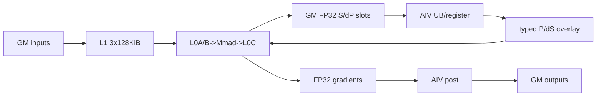

# BlockSparseAttentionGrad A2/A3 ACLNN 算子知识

## 算子速览

| 项目 | 内容 |
|---|---|
| 实际入口 | 无版本后缀两段式 API：`aclnnBlockSparseAttentionGradGetWorkspaceSize` / `aclnnBlockSparseAttentionGrad` |
| 计算语义 | 在稀疏块上重算 `S/P/dP/dS`，生成 `dQ/dK/dV` |
| 输入输出 | TND/BNSD；主输入输出 FP16/BF16，LSE FP32，mask BOOL/UINT8；公开边界 D=128、MHA |
| 执行类型 | 单 Kernel `MIX_CV`，AIC:AIV=1:2 |
| Kernel 路线 | R-001 arch22；key 0/1/10/11 区分 dtype×layout |
| 核心资源 | GM/workspace、512 KiB L1、64 KiB L0A/B、128 KiB L0C、UB、flag 7/8/9 |
| 来源闭包 | `source_closed`：公开 ACLNN→L0→DAV_2201 Tiling/POD→router→AIC/AIV body→构建闭合 |
| 验证状态 | 已完成源码闭包检查；本次知识提取未执行编译、真机、数值或性能测试。 |

## 接口与语义

### 计算语义

对 `blockSparseMask=1` 的块：`S=QKᵀ`，`P=exp(scale·S-LSE)`，`dP=dOut·Vᵀ`，`softmax_grad=sum(dOut·attentionOut)`，`dS=P·(dP-softmax_grad)`；Cube 累加 `dQ=dS·K`、`dK=dSᵀ·Q`、`dV=Pᵀ·dOut` 到 FP32 workspace，Vector post 对 dQ/dK 乘 `scale` 并把三路梯度转换为输入类型。

### 输入、输出与属性

| 参数 | shape/layout | dtype | 约束、默认值与语义 |
|---|---|---|---|
| `dout/query/attentionOut` | TND `[T,N,D]`；BNSD `[B,N,Sq,D]` | FP16/BF16，同 dtype | 非空；公开 D=128、MHA |
| `key/value` | TND `[Tkv,N,D]`；BNSD `[B,N,Skv,D]` | 同 query | 公开 N1=N2 |
| `softmaxLse` | `[T,N,1]` 或 `[B,N,Sq,1]` | FP32 | softmax 重算输入 |
| `blockSparseMaskOptional` | `[B,N,ceil(Sq/X),ceil(Skv/Y)]` | BOOL/UINT8 | 当前 ACLNN 实际必传；非零块参与 |
| `attenMaskOptional` | 可选 | BOOL/UINT8 | 当前只接受 null；`maskType=0` |
| `blockShapeOptional` | 至少 `[X,Y]` | int64 | 当前实际必传，X/Y>0 |
| `actualSeqLengths*` | batch 长度数组 | int64 | TND 两组均必传，arch22 按“每 batch 长度”而非累积长度读取；BNSD body 使用 shape 的 S |
| layout/attrs | TND/BNSD、标量 | string/int64/double | layout须匹配；pre/nextTokens均为2147483647；scale窄化float |
| `dq/dk/dv` | 同 Q/K/V | 同输入 | L0复制输入shape，ACLNN `ViewCopy`提交 |

### 入口与版本

固定 Commit 仅有无版本后缀 Grad API，故为同平台最新公开版本。README 明确 Atlas A2/A3 训练产品支持、对应推理产品不支持，并限定 BSND 不支持、D=128、MHA、默认确定性；`OpDef` 注册 `ascend910b`/`ascend910_93`，Tiling 注册 `DAV_2201`。Host 的 `N1>=N2 && N1%N2==0` 实现条件宽于公开 MHA 边界，不能据此发布 GQA/MQA。

## Host/Launcher 执行流程

### 参数校验与前处理

`ValidateParams` 检查必需 tensor、主 dtype 一致、LSE FP32、mask BOOL/UINT8、主要 shape、null attention mask、mask/window 属性、TND 长度数组和正数 block shape。随后 executor 对 `dout/query/key/value/attentionOut/softmaxLse/blockSparseMaskOptional` 七个必选 tensor 做 `Contiguous`；`attenMaskOptional` 若非空也有连续化分支，但已被前序校验拒绝。L0 把 int-array 转 INT64 ND tensor、为空 attention mask 分配空 BOOL tensor，infer 三路 shape并添加唯一 AICore 节点，ACLNN 再添加三次 `ViewCopy`。源码在 layout null 检查前构造 `std::string`，调用者必须提供有效字符串。

### 参数、Workspace 与生命周期

Tiling 获取 AIC/AIV、UB 和 libapi workspace。user workspace 顺序为 S、dP、FP32 dQ/dK/dV、softmax-grad；Device 通过 `GetUserWorkspace` 跳过 system 前缀。S/dP 每 AIC 各有两个 128×128 槽，槽前部是 FP32 S/dP，后半字节区复用为 typed P/dS。executor、输入输出和 workspace 必须存活至第二段所在 stream 完成。

### 启动图与失败传播

```text
ACLNN Validate/Contiguous -> L0 infer/launcher
  -> DAV_2201 arch22 tiling -> key 0/1/10/11, blockDim=min(aicNum,totalTaskNum)
  -> single MIX launch:
     AIV clear gradients
     AIC Cube1(S,dP) -> flag7 -> AIV P,dS -> flag8 -> AIC dQ,dK,dV
     AIC flag9 -> AIV post(scale/cast)
  -> ViewCopy(dq,dk,dv)
```

任一 API、infer、Tiling/POD 保存失败直接返回；unknown key 无 Device fallback/输出分支。单 launch 可见性依靠 cross-core flag 与 hard event。

## Route 与参数设计

### 分核与资源计算

`GetQBlocks(Sq,X)=ceil(X/128)·floor(Sq/X)+ceil((Sq mod X)/128)`；task 为 `(batch,Q-basic-block,head)`。TND 按 batch→Q block→head，BNSD 按 batch→head→Q block。`taskNumPerCore=floor(totalTaskNum/aicNum)`，前 `tailTaskNum` 核多一项；Y 以 128 再切 KV basic block。`postUbBaseSize=floor((UB-sizeof(POD)-2KiB)/3/256)·256`。

### Route 选择

| 顺序 | Route | Key/模板 | 精确选择条件与优先级 | 不适用去向 |
|---:|---|---|---|---|
| 1 | R-001 arch22 MIX | 0 half/TND；1 half/BNSD；10 bf16/TND；11 bf16/BNSD；`BlockSparseAttentionGradInfer<T,L>` | DAV_2201，公开 FP16/BF16、D=128、MHA、TND/BNSD；唯一 priority=1 模板 | API/Tiling失败；unknown key无输出 |

```text
FP16: TND->0, BNSD->1
BF16: TND->10, BNSD->11
all -> same 128x128x128 MIX body
```

### 模板/实现执行矩阵

| Route | key/selector | dtype/shape/platform 完整命中条件 | 执行族与 kernel 节点 | 实际模板/body | 内存与同步特征 | tail/fallback |
|---|---|---|---|---|---|---|
| R-001 | 0/1/10/11 | DAV_2201；公开 FP16/BF16、TND/BNSD、D=128、MHA | Cube1→Vector softmax/dS→Cube2/3→Vector post | 三个 `MmadAtlasA2SBSAG2` 128³实例；四个 epilogue | GM双槽；flag7/8/9；FP32 atomic梯度 | M/N actualShape；mask=0跳过；无fallback |

### 隐藏性能 Guard

| Guard | Host/Tiling 条件 | Device/资源原因 | 影响 Route | 不满足时去向 | 源码符号 |
|---|---|---|---|---|---|
| 非空任务 | `blockDim>0` | workspace与task初值要求有效核 | R-001 | `CalculateWorkSpace`失败 | `CalculateTaskSplit` |
| 公开MHA | README `N1==N2` | 产品边界窄于实现group逻辑 | R-001 | unsupported | README约束 |
| 128 tile | basicM/N=128，公开D=128 | 静态L1/L0/slot容量 | R-001 | M/N tail；D越界 | `BlockSparseAttentionGradInfer` |
| UB三分 | `UB>sizeof(POD)+2KiB` | post两输入+一输出 | R-001 | 固定仓无显式下界检查 | `CalculatePostUbBaseSize` |
| POD核数组 | AIC索引<64 | begin/pre数组长度64 | R-001 | 固定仓无显式核数guard | `AssignCoreTasks` |
| slot复用 | 覆盖前收到flag8 | S/dP与P/dS共享双槽 | R-001 | 无fallback | `CUBE2VEC/VEC2CUBE` |

### POD/ABI

宏声明顺序可见，但最终 `sizeof/alignof/offsetof` 固定仓不可见；各行 ABI 均为“宏展开 offset 不可见”。

| 结构 | 字段 | 类型/位宽 | ABI 布局 | 单位 | Host/launcher producer | Device consumer | 边界 |
|---|---|---|---|---|---|---|---|
| `BlockSparseAttentionGradTilingData` | `batch` | u32 | 不可见 | batch | ProcessTND/BNSD | task地址 | >0 |
| 同结构 | `numHeads` | u32 | 不可见 | head | Q shape | task/stride | 公开=kvHeads |
| 同结构 | `kvHeads` | u32 | 不可见 | head | K shape | group/stride | 非0 |
| 同结构 | `headDim` | u32 | 不可见 | element | Q shape | MMAD | 公开128 |
| 同结构 | `totalTaskNum` | u32 | 不可见 | task | task split | loop | 非0 |
| 同结构 | `maskType` | u32 | 不可见 | enum | attr | Device 未读取 | 0 |
| 同结构 | `scaleValue` | f32 | 不可见 | scalar | attr/default | softmax/post | double窄化 |
| 同结构 | `totalQBlocks` | u32 | 不可见 | block | tiling累加 | Device 未读取 | inactive |
| 同结构 | `blockShapeX` | u64 | 不可见 | token | blockShape[0] | task/mask | >0 |
| 同结构 | `blockShapeY` | u64 | 不可见 | token | blockShape[1] | KV loop | >0 |
| 同结构 | `inputLayout` | u32 | 不可见 | enum | TND=0/BNSD=1 | 地址 | 0/1 |
| 同结构 | `maxQSeqlen` | u32 | 不可见 | token | shape/list max | task/mask | int64窄化 |
| 同结构 | `maxKvSeqlen` | u32 | 不可见 | token | shape/list max | KV/mask | int64窄化 |
| 同结构 | `tilingKey` | u64 | 不可见 | key | GenerateTilingKey | Device 未读 POD；router 使用 context key | 0/1/10/11 |
| 同结构 | `gradSize` | u64 | 不可见 | byte | Qrows·N·8·4 | Device 未读取 | workspace 尾部 sftg 容量 |
| 同结构 | `sOutSize` | u64 | 不可见 | byte | blockDim·65536·4 | S/P offset | FP32双槽 |
| 同结构 | `dPOutSize` | u64 | 不可见 | byte | 同S | dP/dS offset | 同上 |
| 同结构 | `dQOutSize` | u64 | 不可见 | byte | \|Q\|·4 | dQ/post | FP32 |
| 同结构 | `dKOutSize` | u64 | 不可见 | byte | \|K\|·4 | dK/post | FP32 |
| 同结构 | `dVOutSize` | u64 | 不可见 | byte | \|V\|·4 | dV/post | FP32 |
| 同结构 | `basicQBlockSize` | u32 | 不可见 | token | const128 | task M | 128 |
| 同结构 | `basicKVBlockSize` | u32 | 不可见 | token | const128 | task N | 128 |
| 同结构 | `taskNumPerCore` | u32 | 不可见 | task/core | floor split | loop | 可0 |
| 同结构 | `tailTaskNum` | u32 | 不可见 | core | modulo split | 前核+1 | <aicNum |
| 同结构 | `preQSeqLengths[64]` | u32[64] | 不可见 | token | AssignCoreTasks | initTaskInfo | core<64；u64 前缀和写入 u32 |
| 同结构 | `preKVSeqLengths[64]` | u32[64] | 不可见 | token | AssignCoreTasks | initTaskInfo | core<64；u64 前缀和写入 u32 |
| 同结构 | `beginBatch[64]` | u32[64] | 不可见 | index | AssignCoreTasks | initTaskInfo | core<64 |
| 同结构 | `beginHead[64]` | u32[64] | 不可见 | index | AssignCoreTasks | initTaskInfo | core<64 |
| 同结构 | `beginQSeqOffset[64]` | u32[64] | 不可见 | token | AssignCoreTasks | initTaskInfo | core<64 |
| 同结构 | `usedVecCoreNum` | u32 | 不可见 | core | `blockDim*2` | vec split | 1:2 |
| 同结构 | `qTotalSeqlen` | u32 | 不可见 | token | TND total | epilogue | BNSD inactive |
| 同结构 | `kvTotalSeqlen` | u32 | 不可见 | token | TND total | Device 未读取 | BNSD inactive |
| 同结构 | `dqSize` | u64 | 不可见 | element | Q size | pre/post | uint64 |
| 同结构 | `dkvSize` | u64 | 不可见 | element | KV size | pre/post | K=V |
| 同结构 | `postUbBaseSize` | u64 | 不可见 | byte | UB三分 | BlockPost | 256B对齐 |
| 同结构 | `ubSize` | u64 | 不可见 | byte | UB-POD-2KiB | epilogues | 平台值 |
| 同结构 | `softmaxGradTilingData` | `SoftMaxTiling` | 嵌套不可见 | libapi POD | tiling API | SoftmaxGradFront | D=128 |

### Route 源码闭包

| Route | Key/selector | Host/Tiling producer | POD/参数 | Kernel entry/router | Kernel body/直接依赖 | 构建接线 |
|---|---|---|---|---|---|---|
| R-001 | 0/1/10/11 | `attention/block_sparse_attention_grad/op_host/arch22/block_sparse_attention_grad_tiling_arch22.cpp::BSAGradTiling` | arch22 POD | `attention/block_sparse_attention_grad/op_kernel/block_sparse_attention_grad.cpp::block_sparse_attention_grad` | `BlockSparseAttentionGradInfer`→kernel→`BlockMmad`/epilogues | OpDef+CMake |

## Kernel 实现

### 公共执行流程

四 key 只替换 dtype/layout。AIC block 对应 AIV `vecCoreIdx/2`；AIV 先清梯度，AIC写 S/dP，两个AIV按 Q 行两半写 P/dS，AIC消费上一 ping-pong 块做三路梯度，最后 AIV post。跨族边均在同一 GM workspace，P/dS占各 FP32槽后半字节区。

### Route R-001：arch22 128-tile MIX

#### 适用条件

##### 选择证据

| 层级 | 文件 | 符号 | 源码谓词/参数 | 结果/下一跳 |
|---|---|---|---|---|
| API | `attention/block_sparse_attention_grad/README.md` | 产品表/公开约束 | A2/A3训练、FP16/BF16、D128、MHA、TND/BNSD | ACLNN |
| API | `attention/block_sparse_attention_grad/op_host/op_api/aclnn_block_sparse_attention_grad.cpp` | `ValidateParams` | dtype/shape/layout/mask/window/blockShape | L0或失败 |
| Tiling | `attention/block_sparse_attention_grad/op_host/arch22/block_sparse_attention_grad_tiling_arch22.cpp` | `ProcessInput/GenerateTilingKey` | dtype×layout | 0/1/10/11 |
| Router | `attention/block_sparse_attention_grad/op_kernel/block_sparse_attention_grad.cpp` | non-310 branch | 四 `TILING_KEY_IS` | 对应模板；否则终止 |

#### Device 数据流

##### 函数级调用链

```text
block_sparse_attention_grad -> BlockSparseAttentionGradInfer<T,L>
  -> operator()<AIV>: VecPre -> SoftmaxGrad -> SimpltSoftmax -> VecPost
  -> operator()<AIC>: BlockMmadCube1 -> BlockMmadCube2 -> BlockMmadCube3
```

##### 源码等价伪码

```text
AIV clear FP32 gradients; SyncAll
for task and selected <=128 KV tile:
  two AIV halves compute sftg=sum(dout*attentionOut) once for this Q task
  AIC GM->L1->L0A/B->Mmad->L0C->FP32 S/dP(slot); flag7
  AIV0/1 wait7; P=exp(scale*S-LSE); dS=P*(dP-sftg); cast/write typed slot; flag8
  AIC wait8 for previous slot; atomic Mmad dQ/dK/dV; ping^=1
flush last slot; AIC flag9; AIV SyncAll and scale/cast/store
```

#### 内存与数据搬运

##### 资源与搬运表

| 层级/缓冲区 | offset/地址公式 | extent/容量公式 | dtype/layout | producer | consumer | owner/lifetime | 对齐/复用 |
|---|---|---|---|---|---|---|---|
| S/dP slots | `core·65536+ping·32768` float index；dP加`sOutSize` | 各`blockDim·65536·4`B | FP32 row-major | Cube1 | AIV | executor/launch | 双槽 |
| P/dS overlay | slot byte+65536；dS加`sOutSize` | ≤128²·2B/槽 | input type | AIV | Cube2/3 | 同槽 | flag保护 |
| gradients | `sOut+dP+[0,dQ,dQ+dK]` | 4·(\|Q\|+\|K\|+\|V\|) | FP32 ND | Cube atomic | post | executor/launch | 先清零 |
| L1 | 起点0/128/256KiB | 三实例各128KiB，共384KiB≤512KiB | input NZ/ZN | GM copy | L0 | AIC | 各双缓冲 |
| L0A/B/C | ping/pong 32/32/64KiB | 64/64/128KiB | input/input/FP32 | L1/MMAD | MMAD/Fixpipe | AIC | hard event |
| UB | 分阶段复用 | `UB-sizeof(POD)-2KiB` | FP32+typed | MTE2/V | MTE3 | AIV | post三分片 |

##### 分层内存布局



##### 字节账、交接边与复用顺序

```text
sOutSize=dPOutSize=blockDim*2*(128*128*2)*4=blockDim*262144 B
workspace_total=libapiSize+sOutSize+dPOutSize+4*(|Q|+|K|+|V|)+Qrows*N*8*4
L1=384KiB; L0A/L0B/L0C=64/64/128KiB
```

| 边/复用子区 | producer | offset/extent | dtype/layout | consumer | ordering/sync | owner/lifetime | 安全条件 |
|---|---|---|---|---|---|---|---|
| Cube1→AIV | Cube1 | 当前S/dP actual M×N | FP32 | softmax/dS | flag7 PIPE_FIX | workspace/launch | Fixpipe后发flag |
| AIV→Cube | 两AIV | typed P/dS，两行分片 | input | Cube2/3 | flag8 PIPE_MTE3 | workspace/launch | 两子核完成 |
| Cube→post | Cube2/3 | gradient slices | FP32 | BlockPost | flag9+SyncAll | workspace/launch | flush完成 |
| local复用 | BlockMmad | L1分区/L0 pingpong | mixed | next MMAD | M_MTE1/MTE1_MTE2/FIX_M | AIC | event offset 0/2/4 |

#### 同步、精度与尾块

##### 同步与数值边界表

| 阶段 | primitive/机制 | producer | consumer/等待点 | 保护对象 | 精度/尾块 |
|---|---|---|---|---|---|
| pre | VecPre+SyncAll | AIV | Cube | gradient zero | DataCopyPad tail |
| S/dP | flag7 | AIC Fixpipe | AIV | current slot | FP32，actual M/N |
| P/dS | flag8 | AIV0/1 | AIC | overlay | `CAST_ROUND`，ceil/floor行 |
| MMAD | hard events | MTE/M/FIX | next stage | L1/L0 | round硬件对齐，写actual域 |
| gradient | FP32 atomic Fixpipe | Cube | post | dQ/dK/dV | FP32累加 |
| output | flag9+SyncAll | AIC | AIV | full gradients | dQ/dK乘scale，三路round-cast |

#### 关键实现

##### 符号证据表

| 阶段 | 文件 | 符号/模板实例 | 实现事实 |
|---|---|---|---|
| Host/Tiling producer | `attention/block_sparse_attention_grad/op_host/arch22/block_sparse_attention_grad_tiling_arch22.cpp` | task/workspace/fill/key | 分核、POD、workspace |
| Kernel entry/router | `attention/block_sparse_attention_grad/op_kernel/block_sparse_attention_grad.cpp` | entry | 四key映射 |
| Device body/helper | `attention/block_sparse_attention_grad/op_kernel/arc22/block_sparse_attention_grad_interface.h` | `BlockSparseAttentionGradInfer` | 三个128³模板 |
| Device body/helper | `attention/block_sparse_attention_grad/op_kernel/arc22/block_sparse_attention_grad_kernel.h` | AIC/AIV bodies | graph、地址、flag、tail |
| Device body/helper | `attention/block_sparse_attention_grad/op_kernel/arc22/attn_infra/gemm/block/block_mmad_bsag2.hpp` | `BlockMmad` | GM-L1-L0-MMAD-Fixpipe |

## 算子特定优化

### Trick T-001：双槽跨族流水与槽内覆盖

#### 触发与源码依据

- 适用 Route：R-001
- 触发条件：mask选中块、AIC:AIV=1:2、ping-pong交替。
- Golden 来源：[`block_sparse_attention_grad_kernel.h:698-713`](../../../../../../../cann-ops-raw/ascendc/ops-transformer/be33d95bb755cedec3108f70805c1874d1792540/attention/block_sparse_attention_grad/op_kernel/arc22/block_sparse_attention_grad_kernel.h#L698-L713)

**官方源码（固定 Commit 连续逐字摘录）**：

```cpp
                            uint64_t vector16Soffset =
                                (curInfo.sOffset * 2 + WORKSPACE_P16_OFFSET_ELEMENT + coreOffset) *
                                sizeof(ElementInput);
                            uint64_t vector32Soffset = (curInfo.sOffset + coreOffset) * sizeof(float);

                            GM_ADDR s = params.workspace + vector32Soffset;
                            GM_ADDR softmaxLse = params.softmaxLse;
                            GM_ADDR dp = params.workspace + sOutSize + vector32Soffset;
                            GM_ADDR actualSeqQlen = params.actualQseqlen;
                            GM_ADDR actualSeqKvlen = params.actualKvseqlen;
                            GM_ADDR sftmgGm = params.workspace + sOutSize + dPOutSize + dQOutSize + dKOutSize + dVOutSize;
                            GM_ADDR pWorkspace = params.workspace + vector16Soffset; // 连续
                            GM_ADDR dsWorkspace = params.workspace + sOutSize + vector16Soffset; // 连续
                            GM_ADDR tiling = params.tiling;

                            AscendC::WaitEvent(CUBE2VEC);
```

#### 机制与设计原因

当前槽的 S/dP 放行 AIV 时，AIC消费上一槽的 P/dS；typed结果写各FP32槽后半字节区，省去独立P/dS slice，并形成 Cube12→Vector→Cube345 软件流水。

#### 迁移边界

- 适用：128 basic tile、单 MIX launch、1:2核比。
- 前提：slot布局、flag7/8、两个AIV行分片一致。
- 失效：改变核比、dtype/extent或拆分Kernel须重建同步和字节账。
- 未验证：本次知识提取未执行编译、真机、数值或性能测试。

#### 错误做法

未等两个AIV的flag8就覆盖槽会破坏P/dS；源码的双槽与wait防止该错误。

### Trick T-002：L1分区、L0共享和FP32原子累加

#### 触发与源码依据

- 适用 Route：R-001
- 触发条件：Cube2/3以`isAtomicAdd=true`构造，actualShape≤128³。
- Golden 来源：[`block_mmad_bsag2.hpp:97-108`](../../../../../../../cann-ops-raw/ascendc/ops-transformer/be33d95bb755cedec3108f70805c1874d1792540/attention/block_sparse_attention_grad/op_kernel/arc22/attn_infra/gemm/block/block_mmad_bsag2.hpp#L97-L108)

**官方源码（固定 Commit 连续逐字摘录）**：

```cpp
for (uint32_t i = 0; i < STAGES; i++) {
    l1ATensor[i] = resource.l1Buf.template GetBufferByByte<ElementA>(l1BufAddrStart + L1A_SIZE * i);
    l1BTensor[i] = resource.l1Buf.template GetBufferByByte<ElementB>(l1BufAddrStart + L1A_SIZE * 2 + L1B_SIZE * i);
    l0ATensor[i] = resource.l0ABuf.template GetBufferByByte<ElementA>(L0A_PINGPONG_BUF_SIZE * i);
}
```

#### 机制与设计原因

三实例在L1取0/128/256KiB分区而共享事件保护的L0；Cube2/3 Fixpipe直接atomic-add到FP32 GM workspace，避免额外reduce Kernel。

#### 迁移边界

- 适用：FP16/BF16输入、FP32累加、128³ tile。
- 前提：384KiB L1≤512KiB、workspace已清零、atomic可用。
- 失效：更大tile、非FP32累加或不同确定性方案须改资源/归约。
- 未验证：本次知识提取未执行编译、真机、数值或性能测试。

#### 错误做法

跳过VecPre会把未定义workspace初值纳入原子累加；源码固定先清零。

## 模板与实现对比

| 对比维度 | R-001 key 0/1/10/11 | 设计选择依据 |
|---|---|---|
| 命中条件/优先级 | 唯一arch22模板，key只分dtype/layout | Host key与router一一对应 |
| 执行族/节点图 | 单Kernel MIX | flag7/8/9任务图 |
| M/N/K、tile与scheduler | basicM/N=128、K=D=128，task均分 | 固定槽和模板 |
| workspace/L1/L0/UB | 双槽+FP32梯度+sftg；L1 384KiB | 流水/atomic |
| AIC/AIV交接 | 1:2，AIV分Q行 | usedVecCoreNum |
| 同步、精度与tail | cross-core+hard event；FP32中间 | actualShape/DataCopyPad |
| fallback/失败边界 | 无Device fallback | Host/Tiling拒绝unsupported |

## 平台差异

| 项目 | A2 | A3 | 950 |
|---|---|---|---|
| 支持状态 | 训练支持，推理不支持 | 训练支持，推理不支持 | 支持，见`_950`卡 |
| Host/Launcher | DAV_2201、公开MHA | 同A2 | DAV_3510、公开MQA/MHA/GQA |
| Kernel/资源 | arch22模板/GM交接 | 同A2 | RegBase专用body/UB-L1交接 |

## 限制与失败边界

- 公开 A2/A3 仅 TND/BNSD、D=128、MHA；BSND、attention mask、滑窗和非零maskType不支持。
- `blockSparseMaskOptional`、`blockShapeOptional` 当前ACLNN实际必传；TND两组length必传。
- `numKeyValueHeads` 虽由 ACLNN/L0 传入 attr，arch22 Tiling 不读该 attr，而是从 Q/K shape 生成 `numHeads/kvHeads`；固定源码未做 attr 与 shape 的一致性检查。
- README 声明 BNSD 可用 `actualSeqLengths*` 忽略 padding，但 arch22 `ProcessBNSD` 和 Device BNSD 地址都使用 shape 的 `maxQSeqlen/maxKvSeqlen`；固定 Commit 的公开说明与 body 存在此差异，不应依赖 BNSD 长度裁剪。
- README 将 A2/A3 标为默认确定性实现，而 Cube2/3 body 对 FP32 dQ/dK/dV workspace 使用 `SetAtomicAdd`；固定源码未提供跨核 atomic 顺序证明，本次未运行验证，不额外推断数值确定性。
- 非ND storage仅记录警告，不代表自动格式转换承诺。
- POD宏offset、MIX blockDim编码、unknown-key Host返回码固定仓不可见。
- 固定源码没有显式`aicNum<=64`与UB减法下界guard，移植须保留资源前提。

## 源码索引

### 链路索引

| 链路阶段 | 文件 | 关键符号 | 支撑内容 |
|---|---|---|---|
| 入口声明/约束 | `attention/block_sparse_attention_grad/README.md` | 产品表/约束 | 平台、D、MHA |
| 入口声明/约束 | `attention/block_sparse_attention_grad/op_host/op_api/aclnn_block_sparse_attention_grad.h` | ACLNN声明 | ABI |
| 入口实现 | `attention/block_sparse_attention_grad/op_host/op_api/aclnn_block_sparse_attention_grad.cpp` | Validate/GetWorkspaceSize | ACLNN流程 |
| 入口实现 | `attention/block_sparse_attention_grad/op_host/op_api/block_sparse_attention_grad.cpp` | L0 function | infer/launcher |
| Host/Tiling/Launcher | `attention/block_sparse_attention_grad/op_host/block_sparse_attention_grad_tiling.h` | arch22 POD | 字段 |
| Host/Tiling/Launcher | `attention/block_sparse_attention_grad/op_host/arch22/block_sparse_attention_grad_tiling_arch22.cpp` | BSAGradTiling | route/workspace |
| Kernel entry/body | `attention/block_sparse_attention_grad/op_kernel/block_sparse_attention_grad.cpp` | entry | router |
| Kernel entry/body | `attention/block_sparse_attention_grad/op_kernel/arc22/block_sparse_attention_grad_interface.h` | Infer | 实例 |
| Kernel entry/body | `attention/block_sparse_attention_grad/op_kernel/arc22/block_sparse_attention_grad_kernel.h` | bodies | graph/sync |
| Kernel entry/body | `attention/block_sparse_attention_grad/op_kernel/arc22/attn_infra/arch/bsag_arch.hpp` | `AtlasA2` | UB/L1/L0 硬件容量 |
| Kernel entry/body | `attention/block_sparse_attention_grad/op_kernel/arc22/attn_infra/arch/bsag_resource.hpp` | `Resource` | 当前实例的 L1/L0/UB owner |
| Kernel entry/body | `attention/block_sparse_attention_grad/op_kernel/arc22/attn_infra/arch/bsag_local_tensor_buffer.hpp` | `LocalTensorBuffer` | 各层 `InitBuffer` 与字节 offset |
| Kernel entry/body | `attention/block_sparse_attention_grad/op_kernel/arc22/attn_infra/gemm/block/block_mmad_bsag2.hpp` | BlockMmad | Cube闭包 |
| Kernel entry/body | `attention/block_sparse_attention_grad/op_kernel/arc22/attn_infra/epilogue/block/block_epilogue_fag_pre.hpp` | `BlockEpilogue` | FP32 gradient workspace 清零 |
| Kernel entry/body | `attention/block_sparse_attention_grad/op_kernel/arc22/attn_infra/epilogue/block/block_epilogue_softmaxgrad.hpp` | `SoftmaxGrad` | `sum(dout*attentionOut)` 与 UB 分片 |
| Kernel entry/body | `attention/block_sparse_attention_grad/op_kernel/arc22/attn_infra/epilogue/block/block_epilogue_simply_softmax.hpp` | `SimpltSoftmax` | scale/exp/dS/cast/tail |
| Kernel entry/body | `attention/block_sparse_attention_grad/op_kernel/arc22/attn_infra/epilogue/block/block_epilogue_post.hpp` | `BlockPost` | scale/cast/输出 tail |
| 构建接线 | `attention/block_sparse_attention_grad/op_host/block_sparse_attention_grad_def.cpp` | AddConfig | A2/A3注册 |
| 构建接线 | `attention/block_sparse_attention_grad/op_host/CMakeLists.txt` | sources | 构建 |

每行文件均在 Frontmatter `sources` 中。

### 实现复用检查

| 检查项 | 可复用事实 | 不得改变的约束 | 源码符号 |
|---|---|---|---|
| ABI/POD | 四key共用POD | 字段顺序/位宽/数组64/单位 | tiling POD |
| 调用顺序 | pre→Cube12→Vector→Cube345→post | last-slot flush/ViewCopy | AIC/AIV bodies |
| workspace/内存 | 双槽覆盖与前缀和 | 字节/元素换算、先清零、lifetime | workspace symbols |
| 同步 | flag7/8/9+hard event | ID/pipe/1:2/轮次 | kernel body |
| 精度与尾块 | FP32中间、typed P/dS、final cast | scale时机/actualShape | MMAD/epilogues |
| 失败边界 | Host/Tiling拒绝、无fallback | 不扩展公开MHA边界 | API/Tiling/router |