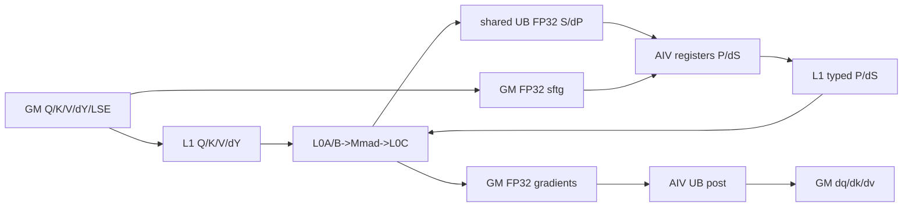

# BlockSparseAttentionGrad 950 ACLNN 算子知识

## 算子速览

| 项目 | 内容 |
|---|---|
| 实际入口 | 无版本后缀两段式 API：`aclnnBlockSparseAttentionGradGetWorkspaceSize` / `aclnnBlockSparseAttentionGrad` |
| 计算语义 | 重算 `S/P/dP/dS`，以 FP32 累加并输出 `dQ/dK/dV` |
| 输入输出 | BSND/BNSD/TND；主输入输出 FP16/BF16，LSE FP32，mask BOOL/UINT8；D=128 |
| 执行类型 | 单 Kernel RegBase `MIX_CV`，AIC:AIV=1:2 |
| Kernel 路线 | R-001 arch35；key 1000..1005 区分 dtype×layout |
| 核心资源 | user workspace、247 KiB UB、512 KiB L1、64 KiB L0A/B、256 KiB L0C、flag 0..4 |
| 来源闭包 | `source_closed`：ACLNN→L0→DAV_3510 Tiling/POD→六 key router→地址器/Cube/Vector→ascend950构建闭合 |
| 验证状态 | 已完成源码闭包检查；本次知识提取未执行编译、真机、数值或性能测试。 |

## 接口与语义

### 计算语义

对 mask 选中块：Cube 计算 FP32 `S=QKᵀ`、`dP=dOutVᵀ`；Vector 以寄存器执行 `P=exp(scale·S-LSE)` 和 `dS=P·(dP-softmax_grad)`，再以 `SAT + ZEROING + CAST_RINT` 转 FP16/BF16 NZ 写 L1；Cube 计算 `dV=PᵀdOut`、`dQ=dSK`、`dK=dSᵀQ`，Fixpipe atomic-add 到 FP32 workspace；Vector post 对 dQ/dK 乘 `scale`，以 `CAST_RINT` 输出，dV只转换不缩放。

### 输入、输出与属性

| 参数 | shape/layout | dtype | 约束、默认值与语义 |
|---|---|---|---|
| `dout/query/attentionOut` | BSND `[B,Sq,N1,128]`；BNSD `[B,N1,Sq,128]`；TND `[Tq,N1,128]` | FP16/BF16 | 非空、同 dtype |
| `key/value` | 对应 `[B,Skv,N2,128]`、`[B,N2,Skv,128]`、`[Tkv,N2,128]` | 同 query | N1%N2=0，支持 MQA/MHA/GQA |
| `softmaxLse` | BSND需按BNS1解释；BNSD `[B,N1,Sq,1]`；TND `[Tq,N1,1]` | FP32 | softmax重算输入 |
| `blockSparseMaskOptional` | `[B,N1,ceil(Sq/X),ceil(Skv/Y)]` | BOOL/UINT8 | 当前ACLNN实际必传；非零块参与 |
| `attenMaskOptional` | 可选 | BOOL/UINT8 | 当前只接受 null，`maskType=0` |
| `blockShapeOptional` | `[X,Y]` | int64 | 当前实际必传；X/Y为64的正倍数 |
| `actualSeqLengths*` | 累积长度数组 | int64 | TND必传；Device以差分恢复每batch长度；非TND忽略 |
| layout/attrs | BSND/BNSD/TND、标量 | string/int64/double | q/kv layout一致；pre/nextTokens均2147483647；不支持deterministic |
| `dq/dk/dv` | 同Q/K/V | 同输入 | 最终输出 |

### 入口与版本

固定 Commit 仅有无版本后缀 Grad API，是 950 最新公开版本。README 明确 Ascend 950PR/950DT 支持，允许 BSND/BNSD/TND 和 MQA/MHA/GQA，D=128，默认非确定性且不允许开启确定性。`OpDef` 注册 `ascend950`，Tiling注册`DAV_3510`，CMake为Ascend950PR_9599添加`ENABLE_CV_COMM_VIA_SSBUF=true`。

## Host/Launcher 执行流程

### 参数校验与前处理

公共 ACLNN 校验 dtype/shape/layout、mask/window、TND长度数组和 block shape，对 `dout/query/key/value/attentionOut/softmaxLse/blockSparseMaskOptional` 七个必选 tensor 做 `Contiguous`；`attenMaskOptional` 的非空连续化分支已被校验拒绝。L0将 int-array 转INT64 tensor，infer三路输出并添加单个AICore节点，之后三次`ViewCopy`。arch35 Tiling继续拒绝 deterministic、非FP16/BF16、D≠128、X/Y非64倍数、Q/K/V batch/seq/D或head group不一致；其 `InputCheck` 还要求 Q/K/V 序列长度相等。源码在layout null检查前构造`std::string`，调用者必须传有效字符串。

### 参数、Workspace 与生命周期

`GetWorkspaceSize`在 system workspace 后提供 user workspace，Device用`GetUserWorkspace`取得user基址。user slices为`sftg`、FP32 dq、dk、dv：`sftg=Q-token·N1·8·4B`，其余分别为逻辑元素数×4B。POD按值解析；executor、workspace、输入输出须存活至stream完成。单kernel本地资源固定初始化247KiB UB、512KiB L1、64KiB L0A/B和256KiB L0C。

### 启动图与失败传播

```text
ACLNN Validate/Contiguous -> L0 infer/launcher
  -> DAV_3510 arch35 tiling: blockDim=cubeCoreNum, scheduleMode=1, key1000..1005
  -> single KERNEL_TYPE_MIX_AIC_1_2 launch
     AIV clear gradients + compute sftg -> flag4 releases AIC
     per sparse task, ping-pong:
       AIC QK/dYV -> UB flags0/1 -> AIV P/dS -> L1 flags2/3 -> AIC dV/dQ/dK
     AIC flag4 -> AIV post -> outputs
  -> ViewCopy(dq,dk,dv)
```

API/Tiling失败即终止；router未知key无输出。`need_compute=false`是AIC/AIV共同sentinel，二者都flush后结束；同步不依赖另一个Host kernel。

## Route 与参数设计

### 分核与资源计算

`baseM=min(X,128)`、`baseN=min(Y,128)`、`singleM=ceil(2048/baseM)·baseM`。地址器按 s2→s1→N1→batch 遍历，以`current_cube_idx%cubeCoreNum`分发；`SingleBlock`在`singleM`范围跳过mask=0块，再按baseM返回有效段。`s1Len/s2Len`向16对齐；TND从累积长度差分得到batch实际长度。每 AIC映射两个AIV，AIV以`GetSubBlockIdx`分上/下半Q行。

### Route 选择

| 顺序 | Route | Key/模板 | 精确选择条件与优先级 | 不适用去向 |
|---:|---|---|---|---|
| 1 | R-001 arch35 RegBase MIX | 1000 bf16/BSND；1001 fp16/BSND；1002 bf16/BNSD；1003 fp16/BNSD；1004 bf16/TND；1005 fp16/TND；`BSA_TYPE<T,L,POD,bool>` | DAV_3510；deterministic=0；FP16/BF16；D=128；X%64=Y%64=0；shape/group合法 | Tiling失败；unknown key无输出 |

```text
key=1000 + layout(BSND:0,BNSD:2,TND:4) + dtype(BF16:0,FP16:1)
-> same arch35 Process/CubeProcess/VectorProcess graph
```

### 模板/实现执行矩阵

| Route | key/selector | dtype/shape/platform 完整命中条件 | 执行族与 kernel 节点 | 实际模板/body | 内存与同步特征 | tail/fallback |
|---|---|---|---|---|---|---|
| R-001 | 1000..1005 | DAV_3510、非确定性、D128、X/Y 64倍数、BSND/BNSD/TND、N1%N2=0 | single MIX：Cube12→Vector P/dS→Cube345→post | `BlockSparseAttentionGradArch35`+`AddrComputeModule/CubeOp/VecOp` | Cube→AIV UB，AIV→Cube L1；flag0..4；FP32 atomic GM | 16对齐、mask跳过、need_compute sentinel；无fallback |

### 隐藏性能 Guard

| Guard | Host/Tiling 条件 | Device/资源原因 | 影响 Route | 不满足时去向 | 源码符号 |
|---|---|---|---|---|---|
| 非确定性 | `GetDeterministic()!=1` | 梯度Fixpipe用FP32 atomic | R-001 | IsCapable=false | `IsCapable/MM345CopyOut` |
| D固定 | `head_dim==128` | Cube tile/L1/L0与Vector 8K模型固定 | R-001 | IsCapable=false | `IsCapable` |
| block粒度 | X%64=Y%64=0且正数由ACLNN保证 | baseM/N为64或128，AIV均分M/2 | R-001 | API/Tiling失败 | `IsCapable/DoOpTiling` |
| group | N2>0且N1%N2=0 | `n2Idx=n1Idx/qGroup` | R-001 | shape校验失败 | `InputCheck/AddrCompute` |
| 序列长度 | `q_seq_len==k_seq_len==v_seq_len` | `InputCheck` 对归一化后 `[b,n,s,d]` 的 s 轴作 `IsSameShape` | R-001 | Tiling失败 | `BSA_ARC35::InputCheck` |
| local容量 | max baseM/N=128 | UB/L1/L0静态切片 | R-001 | Host通过min截断；固定仓无动态fallback | `Process/CubeOp::Init` |
| KV复用 | `need_copy_kv`仅首个SingleBlock段为1 | 同KV tile复用L1，dk/dv在L0C跨段累加 | R-001 | 新KV段重新copy/init | `SingleBlock/ComputeMM12/MMDKV` |
| task终点 | `need_compute=false` | 两执行族必须同序看到sentinel | R-001 | flush后退出 | `GetRunTimeInfo` |

### POD/ABI

宏字段顺序可见，最终 `sizeof/alignof/offsetof` 固定仓不可见；下表均为宏展开offset不可见。

| 结构 | 字段 | 类型/位宽 | ABI 布局 | 单位 | Host/launcher producer | Device consumer | 边界 |
|---|---|---|---|---|---|---|---|
| `BlockSparseAttentionGradTilingDataArch35` | `cubeCoreNum` | u64 | 不可见 | AIC core | GetCoreNumAic | scheduler/vec cores | blockDim同值 |
| 同结构 | `batchNum` | u64 | 不可见 | batch | shape/length count | AddrCompute/Vec | 正数 |
| 同结构 | `qSeqLen` | u64 | 不可见 | token | Q shape | address/workspace | TND为totalT |
| 同结构 | `kvSeqLen` | u64 | 不可见 | token | K shape | address/workspace | TND为totalT |
| 同结构 | `qGroup` | u64 | 不可见 | ratio | N1/N2 | n2 mapping | 整除 |
| 同结构 | `qHeadNum` | u64 | 不可见 | head | Q shape | strides/sftg | >0 |
| 同结构 | `kvHeadNum` | u64 | 不可见 | head | K shape | strides | >0 |
| 同结构 | `headDim` | u64 | 不可见 | element | Q shape | Cube/Vec | 128 |
| 同结构 | `baseM` | u64 | 不可见 | token | min(X,128) | tile/buffers | 64/128 |
| 同结构 | `baseN` | u64 | 不可见 | token | min(Y,128) | tile/buffers | 64/128 |
| 同结构 | `singleM` | u64 | 不可见 | token | AlignTo(2048,baseM) | scheduler | 2048 |
| 同结构 | `dqSize` | u64 | 不可见 | element | Q logical size | pre/post | uint64 |
| 同结构 | `dkSize` | u64 | 不可见 | element | K logical size | pre/post dv同值 | K=V |
| 同结构 | `dqWorkspaceOffset` | u64 | 不可见 | byte | sftg后 | dq tensor | prefix |
| 同结构 | `dkWorkspaceOffset` | u64 | 不可见 | byte | dq后 | dk tensor | prefix |
| 同结构 | `dvWorkspaceOffset` | u64 | 不可见 | byte | dk后 | dv tensor | prefix |
| 同结构 | `sftgWorkspaceOffset` | u64 | 不可见 | byte | 0 | sftg tensor | user基址 |
| 同结构 | `softmaxScale` | f32 | 不可见 | scalar | attr窄化 | softmax/post | FP32 |
| 同结构 | `sftgTmpSpaceSize` | u32 | 不可见 | byte | libapi max tmp | Vec temp | UB内 |
| 同结构 | `BlockX` | u32 | 不可见 | token | blockShape[0]窄化 | mask scheduler | 64倍数 |
| 同结构 | `BlockY` | u32 | 不可见 | token | blockShape[1]窄化 | mask scheduler | 64倍数 |
| 同结构 | `softmaxGradFrontTilingData` | `SoftMaxTiling` | 嵌套不可见 | libapi POD | SoftMaxGradTilingFunc | VecOp | 8K模型 |

### Route 源码闭包

| Route | Key/selector | Host/Tiling producer | POD/参数 | Kernel entry/router | Kernel body/直接依赖 | 构建接线 |
|---|---|---|---|---|---|---|
| R-001 | 1000..1005 | `attention/block_sparse_attention_grad/op_host/arch35/block_sparse_attention_grad_tiling_arch35.cpp::BlockSparseAttentionGradArch35Tiling` | arch35 POD | `attention/block_sparse_attention_grad/op_kernel/block_sparse_attention_grad.cpp` 310 branch | `BlockSparseAttentionGradArch35`→`AddrComputeModule/CubeOp/VecOp` | OpDef ascend950+CMake SSBUF option |

## Kernel 实现

### 公共执行流程

六key共享一个`KERNEL_TYPE_MIX_AIC_1_2`图。AIV先把FP32梯度清零并按所有Q行计算`SoftmaxGradFront`到sftg workspace，barrier后以flag4放行AIC。任务ping-pong中，AIC Fixpipe把QK/dYV直接写共享UB；两个AIV用`GetSubBlockIdx`各处理baseM/2行并把P/dS的NZ typed结果写L1；AIC消费上一任务并atomic-add梯度。终点AIC复用flag4通知post。

### Route R-001：arch35 RegBase MIX

#### 适用条件

##### 选择证据

| 层级 | 文件 | 符号 | 源码谓词/参数 | 结果/下一跳 |
|---|---|---|---|---|
| API | `attention/block_sparse_attention_grad/README.md` | 产品表/公开约束 | 950、dtype/layout/attrs合法 | ACLNN |
| API | `attention/block_sparse_attention_grad/op_host/op_api/aclnn_block_sparse_attention_grad.cpp` | `ValidateParams` | dtype/shape/layout/mask/window/blockShape | L0或失败 |
| Tiling | `attention/block_sparse_attention_grad/op_host/arch35/block_sparse_attention_grad_tiling_arch35.cpp` | `IsCapable/GetTilingKey` | non-det、D128、block64倍数、dtype/layout | 1000..1005 |
| Router | `attention/block_sparse_attention_grad/op_kernel/block_sparse_attention_grad.cpp` | `__CCE_AICORE__==310` | 六key | `BSA_TYPE`实例；否则终止 |

#### Device 数据流

##### 函数级调用链

```text
block_sparse_attention_grad -> BlockSparseAttentionGradArch35::Process
  -> VectorProcess -> VecOp::{Pre,SftgFront,Softmax,SoftmaxGrad,Post}
  -> CubeProcess -> CubeOp::{SendMatmulQK,DyV,Dv,Dq,Dk}
     -> ComputeMM12/ComputeMMDQ/ComputeMMDKV
```

##### 源码等价伪码

```text
AIV: zero FP32 dq/dk/dv; compute sftg; SyncAll; flag4
AIC: wait flag4
while addr.GetRunTimeInfo(task):
  ping=taskId%2
  AIC: optional GM KV copy; QK and dYV -> L1/L0 -> Mmad -> FP32 UB; flags0/1
  AIV0/1: wait0/1; P=exp(scale*S-LSE), dS=P*(dP-sftg); CastND2NZ to L1; flags2/3
  AIC: for previous ping wait2/3; dV,dQ,dK Mmad; atomic Fixpipe FP32 GM
flush previous task; AIC flag4
AIV: wait flag4; dv cast, dk/dq scale+cast; store
```

#### 内存与数据搬运

##### 资源与搬运表

| 层级/缓冲区 | offset/地址公式 | extent/容量公式 | dtype/layout | producer | consumer | owner/lifetime | 对齐/复用 |
|---|---|---|---|---|---|---|---|
| sftg workspace | offset0 | Qtoken·N1·8·4B | FP32 BNS8 | AIV front | AIV dS | executor/launch | pre完成后只读 |
| gradients | POD dq/dk/dv offsets | 4·(\|Q\|+\|K\|+\|V\|) | FP32 ND | Cube atomic | AIV post | executor/launch | 先清零 |
| UB MM1/MM2 | four `vecBaseM·baseN·4` segments | `8·baseM·baseN`B，最大128KiB | FP32 row-major | AIC Fixpipe | two AIV | kernel | task ping-pong/flag0,1 |
| UB vector extras | MM区后 typed P/dS、LSE/sftg buffers；pre/front/post阶段也从offset0复用 | 总InitBuffer 247KiB | FP32/input/reg | MTE/V | L1/GM | AIV/stage | 阶段不并存 |
| L1 P/dS | first four `baseM·baseN·2` segments | `8·baseM·baseN`B，最大128KiB | input NZ | AIV | Cube345 | kernel | ping-pong/flag2,3 |
| L1 Q/K/V/dY | P/dS之后；双缓冲 | nominal offset增量`4·baseM·D+4·baseN·D+4·baseM·D+4·baseN·D`B | input NZ/ZN | GM DataCopy | L0 | AIC | KV按need_copy复用 |
| L0A/B | 0/32KiB ping/pong | 各64KiB | input NZ/ZN | L1 LoadData | Mmad | AIC | M_MTE1 events |
| L0C | 0/64KiB MM12；128/192KiB dk/dv | 256KiB | FP32 | Mmad | UB或GM Fixpipe | AIC | dk/dv跨single block累加 |

##### 分层内存布局



##### 字节账、交接边与复用顺序

```text
sftg_bytes=Qtoken*N1*8*4
workspace_total=sysWorkspace+sftg_bytes+4*(|Q|+|K|+|V|)
UB_total=247KiB; persistent MM handoff=8*baseM*baseN <=128KiB
L1 nominal used=8*baseM*baseN+8*baseM*128+8*baseN*128 <=384KiB
L0A/L0B/L0C=64/64/256KiB
```

| 边/复用子区 | producer | offset/extent | dtype/layout | consumer | ordering/sync | owner/lifetime | 安全条件 |
|---|---|---|---|---|---|---|---|
| pre→Cube | AIV pre/sftg | GM workspace全域 | FP32 | Cube/Vector tasks | PipeBarrier+SyncAll+flag4 | executor/launch | 清零和sftg完成 |
| Cube12→AIV | Fixpipe | ping/pong UB，(baseM/2)×baseN/子核 | FP32 row-major | softmax/dS | flag0/1 PIPE_FIX→PIPE_V | kernel | 两MM分别发flag |
| AIV→Cube345 | CastND2NZ+DataCopy | ping/pong L1 P/dS | input NZ | MMAD | flag2/3 PIPE_MTE3→MTE1 | kernel | 两子核完成各半 |
| Cube→post | atomic Fixpipe | FP32 gradient slices | FP32 ND | VecPost | final flag4+SyncAll | executor/launch | sentinel flush后 |
| KV L1 reuse | ComputeMM12 | key/value L1 ping/pong | input NZ | later tasks/MMAD | `need_copy_kv`+local events | kernel | 同一KV tile |

#### 同步、精度与尾块

##### 同步与数值边界表

| 阶段 | primitive/机制 | producer | consumer/等待点 | 保护对象 | 精度/尾块 |
|---|---|---|---|---|---|
| pre | MTE/V events+SyncAll+flag4 | AIV | AIC initial wait | zero/sftg | SoftmaxGradFront FP32；8K tile tail模板 |
| MM12→Vector | flag0/1 | AIC Fixpipe UB | AIV wait | S/dP pingpong | FP32；s1/s2 16对齐 |
| Vector→MM345 | flag2/3 | AIV MTE3 L1 | AIC wait | P/dS pingpong | register FP32，`CastND2NZ` 用 SAT/ZEROING/`CAST_RINT` 转 typed |
| local Cube | M/MTE1/FIX events | loaders/MMAD/Fixpipe | reuse point | L1/L0 | `m==1?2`/`n==1?2`，write actual extent |
| gradients | `SetAtomicType<float>` | Cube345 | post | FP32 workspace | non-deterministic；dk/dv L0C用unitFlag跨段累计 |
| post | final flag4+SyncAll | AIC | AIV | gradients | dq/dk Muls(scale)，`CAST_RINT`；pad tail16对齐 |

#### 关键实现

##### 符号证据表

| 阶段 | 文件 | 符号/模板实例 | 实现事实 |
|---|---|---|---|
| Host/Tiling producer | `attention/block_sparse_attention_grad/op_host/arch35/block_sparse_attention_grad_tiling_arch35.cpp` | IsCapable/DoOpTiling/Workspace/GetTilingKey | guards、tile、slices、keys |
| Kernel entry/router | `attention/block_sparse_attention_grad/op_kernel/block_sparse_attention_grad.cpp` | 310 branch | MIX 1:2六实例 |
| Device body/helper | `attention/block_sparse_attention_grad/op_kernel/arc35/block_sparse_attention_grad.h` | Process/CubeProcess/VectorProcess | graph/pingpong/flags |
| Device body/helper | `attention/block_sparse_attention_grad/op_kernel/arc35/addr_compute.h` | AddrComputeModule/SingleBlock | sparse scheduler/address/tail |
| Device body/helper | `attention/block_sparse_attention_grad/op_kernel/arc35/cube_op.h` | ComputeMM12/MMDQ/MMDKV | L1/L0/MMAD/Fixpipe/atomic |
| Device body/helper | `attention/block_sparse_attention_grad/op_kernel/arc35/vec_op.h` | SendVec*/register bodies | pre/softmax/dS/post |

## 算子特定优化

### Trick T-001：Cube结果直达共享UB、Vector结果直达L1

#### 触发与源码依据

- 适用 Route：R-001
- 触发条件：单`MIX_AIC_1_2` launch，baseM/N∈{64,128}，ping-pong task。
- Golden 来源：[`block_sparse_attention_grad.h:138-152`](../../../../../../../cann-ops-raw/ascendc/ops-transformer/be33d95bb755cedec3108f70805c1874d1792540/attention/block_sparse_attention_grad/op_kernel/arc35/block_sparse_attention_grad.h#L138-L152)

**官方源码（固定 Commit 连续逐字摘录）**：

```cpp
            if (runTimeInfo_[ping_pong_idx].need_compute) {
                // mm12
                cubeOp.SendMatmulQK(query_gm_, key_gm_, mm1_res_ub_tensor_, runTimeInfo_[ping_pong_idx], ping_pong_idx);
                CrossCoreSetFlag<2, PIPE_FIX>(FLAG_C1_V1);
                cubeOp.SendMatmulDyV(dout_gm_, val_gm_, mm2_res_ub_tensor_, runTimeInfo_[ping_pong_idx], ping_pong_idx);
                CrossCoreSetFlag<2, PIPE_FIX>(FLAG_C2_V2);
            }

            if (taskId > 0 && runTimeInfo_[last_ping_pong_idx].need_compute) {
                // mm345
                CrossCoreWaitFlag<2, PIPE_MTE1>(FLAG_V1_C3);
                cubeOp.SendMatmulDv(p_l1_tensor_, dv_workspace_, runTimeInfo_[last_ping_pong_idx], last_ping_pong_idx);
                CrossCoreWaitFlag<2, PIPE_MTE1>(FLAG_V2_C45);
                cubeOp.SendMatmulDq(ds_l1_tensor_, dq_workspace_, runTimeInfo_[last_ping_pong_idx], last_ping_pong_idx);
                cubeOp.SendMatmulDk(ds_l1_tensor_, dk_workspace_, runTimeInfo_[last_ping_pong_idx], last_ping_pong_idx);
```

#### 机制与设计原因

MM12的Fixpipe目标是共享UB而非GM；AIV完成FP32寄存器计算后转NZ typed并直接写L1，Cube345从L1消费。相比arch22的GM slot，950在同kernel内用UB/L1完成跨执行族交接，并以相邻task ping-pong重叠阶段。

#### 迁移边界

- 适用：支持SSBUF/CV共享通信且AIC:AIV=1:2的平台。
- 前提：flag0..3、UB/L1物理布局、两AIV行分片和local lifetime一致。
- 失效：不支持共享UB/L1、改变核比或拆成多Kernel时须改为GM/event方案。
- 未验证：本次知识提取未执行编译、真机、数值或性能测试。

#### 错误做法

把Host launch顺序当作UB/L1可见性会漏掉跨核协议；源码明确每条边都配对set/wait flag。

### Trick T-002：SingleBlock稀疏跳过与KV L1复用

#### 触发与源码依据

- 适用 Route：R-001
- 触发条件：同一KV baseN tile的`singleM=2048` Q窗口中存在连续可计算baseM段。
- Golden 来源：[`addr_compute.h:278-300`](../../../../../../../cann-ops-raw/ascendc/ops-transformer/be33d95bb755cedec3108f70805c1874d1792540/attention/block_sparse_attention_grad/op_kernel/arc35/addr_compute.h#L278-L300)

**官方源码（固定 Commit 连续逐字摘录）**：

```cpp
for (int32_t s1_idx = s1Idx_; s1_idx < s1_end_idx; s1_idx += block_x_) {
    int32_t block_x_idx = s1_idx / block_x_;
    if (IsValidBlock(const_info_, bIdx_, n1Idx_, block_x_idx, block_y_idx, blockSparseMask_)) {
        find_vaild_block = true;
        vaild_s1_idx = s1_idx;
        vaild_s1_len = s1_end_idx - s1_idx;
    }
```

#### 机制与设计原因

地址器先在2048行窗口寻找首个有效Q块，再由`SingleBlock`按baseM继续扫描；后续段设置`need_copy_kv=0`，QK复用已在L1的K/V，dk/dv在专用L0C跨段累加，最后一段才Fixpipe到GM。

#### 迁移边界

- 适用：mask按block索引且同KV块可服务多个Q base块。
- 前提：mask shape、qGroup映射、`need_copy_kv/is_singlekv_last`生命周期一致。
- 失效：token级mask、不同KV layout或跨段L0C不能保留时需逐段copy/reduce。
- 未验证：本次知识提取未执行编译、真机、数值或性能测试。

#### 错误做法

若在`need_copy_kv=0`时覆盖K/V L1，或在`is_singlekv_last`前copyout dk/dv，会破坏复用/累加；源码用这两个runtime字段控制。

## 模板与实现对比

| 对比维度 | R-001 key1000..1005 | 设计选择依据 |
|---|---|---|
| 命中条件/优先级 | 唯一DAV_3510模板，key区分dtype/layout | Host key与router映射 |
| 执行族/节点图 | 单RegBase MIX | UB/L1双向交接 |
| M/N/K、tile与scheduler | baseM/N=min(block,128)，singleM=2048，D128 | local容量与稀疏复用 |
| workspace/L1/L0/UB | sftg+FP32梯度；247KiB/512KiB/64-64-256KiB | 中间S/P不落GM |
| AIC/AIV交接 | 1:2，flag0..3 | 两AIV各半Q行 |
| 同步、精度与tail | flag+event+SyncAll；FP32中间、NZ typed | 16对齐与pad tail |
| fallback/失败边界 | 无fallback，unknown key无输出 | IsCapable严格拒绝 |

## 平台差异

| 项目 | A2 | A3 | 950 |
|---|---|---|---|
| 支持状态 | 训练支持，独立卡 | 训练支持，独立卡 | 950PR/DT支持 |
| Host/Launcher | arch22、公开MHA | 同A2 | arch35、BSND与GQA/MQA、非确定性 |
| Kernel/资源 | GM workspace交接、128KiB L0C | 同A2 | UB/L1交接、256KiB L0C、SSBUF option |

## 限制与失败边界

- 950仅FP16/BF16、D=128、X/Y为64的正倍数；不支持deterministic、attention mask、滑窗和非零maskType。
- `blockSparseMaskOptional`与`blockShapeOptional`当前ACLNN实际必传；TND两组累积length必传，非TND忽略。
- arch35 `InputCheck` 额外要求 Q/K/V 序列长度相等，因而固定 Commit 不能从公开参数表外推 Sq≠Skv 的可达支持。
- `numKeyValueHeads` 虽由 ACLNN/L0 传入 attr，arch35 Tiling 不读该 attr，而从 Q/K shape 推导 `qHeadNum/kvHeadNum/qGroup`；固定源码未做 attr 与 shape 的一致性检查。
- `CubeOp::Init` 中 value L1 tensor 以 `baseN·D` 取 tensor 却以 `baseM·D` 推进 offset，dy L1 tensor 则以 `baseN·D` 取 tensor/推进；当 `baseM!=baseN` 时实际分区与语义 shape 不对称，固定仓没有额外 guard 或 fallback，不应将非方形 base tile 视为已验证路线。
- arch35 Tiling的`block_num_x/y`局部变量未参与输出；真实尾块以AddrCompute的`GetBlockLen`和16对齐为准。
- entry模板第四个bool在源码命名为`deterministic_enable`，FP16实例为true、BF16为false，但固定body未读取该常量；公开950仍统一为非确定性，不据此拆route。
- POD宏offset、MIX blockDim编码和unknown-key返回行为固定仓不可见。

## 源码索引

### 链路索引

| 链路阶段 | 文件 | 关键符号 | 支撑内容 |
|---|---|---|---|
| 入口声明/约束 | `attention/block_sparse_attention_grad/README.md` | 产品表/约束 | 950平台/layout/group/determinism |
| 入口声明/约束 | `attention/block_sparse_attention_grad/op_host/op_api/aclnn_block_sparse_attention_grad.h` | ACLNN声明 | 公开ABI |
| 入口实现 | `attention/block_sparse_attention_grad/op_host/op_api/aclnn_block_sparse_attention_grad.cpp` | Validate/GetWorkspaceSize | ACLNN流程 |
| 入口实现 | `attention/block_sparse_attention_grad/op_host/op_api/block_sparse_attention_grad.cpp` | L0 function | infer/launcher |
| Host/Tiling/Launcher | `attention/block_sparse_attention_grad/op_host/block_sparse_attention_grad_tiling.h` | arch35 POD | 字段 |
| Host/Tiling/Launcher | `attention/block_sparse_attention_grad/op_host/arch35/block_sparse_attention_grad_tiling_arch35.cpp` | Tiling class | guard/tile/workspace/key |
| Kernel entry/body | `attention/block_sparse_attention_grad/op_kernel/block_sparse_attention_grad.cpp` | entry | six-key router |
| Kernel entry/body | `attention/block_sparse_attention_grad/op_kernel/arc35/block_sparse_attention_grad.h` | Process | graph/sync |
| Kernel entry/body | `attention/block_sparse_attention_grad/op_kernel/arc35/common_header.h` | flags/`RunTimeInfo`/offset helper | 跨族 flag、layout 地址和 task ABI |
| Kernel entry/body | `attention/block_sparse_attention_grad/op_kernel/arc35/addr_compute.h` | AddrComputeModule | sparse scheduler/address |
| Kernel entry/body | `attention/block_sparse_attention_grad/op_kernel/arc35/cube_op.h` | CubeOp | Cube闭包 |
| Kernel entry/body | `attention/block_sparse_attention_grad/op_kernel/arc35/vec_op.h` | VecOp | Vector闭包 |
| Kernel entry/body | `attention/block_sparse_attention_grad/op_kernel/arc35/vector_api/vf_cast_nd2nz.h` | `CastND2NZ` | FP32 ND 到 typed NZ 的寄存器 tail |
| 构建接线 | `attention/block_sparse_attention_grad/op_host/block_sparse_attention_grad_def.cpp` | ascend950 config | 平台注册 |
| 构建接线 | `attention/block_sparse_attention_grad/op_host/CMakeLists.txt` | SSBUF/arch35 source | 构建接线 |

每行文件均在 Frontmatter `sources` 中。

### 实现复用检查

| 检查项 | 可复用事实 | 不得改变的约束 | 源码符号 |
|---|---|---|---|
| ABI/POD | 六key共用arch35 POD | 字段顺序/位宽/byte offset/嵌套POD | tiling header |
| 调用顺序 | pre→Cube12→Vector→Cube345→post | sentinel与last task flush | Process bodies |
| workspace/内存 | sftg/dq/dk/dv前缀和与local静态切片 | GetUserWorkspace基址、UB/L1/L0布局 | Workspace/Init |
| 同步 | flag0..4+local events | ID/pipe/1:2/pingpong/初终flag4 | Process/CubeOp/VecOp |
| 精度与尾块 | FP32寄存器/L0C/workspace、typed NZ、final RINT | dq/dk scale时机、16对齐、atomic lifecycle | CubeOp/VecOp |
| 失败边界 | IsCapable严格拒绝，无fallback | 不把模板bool误作公开确定性route | Tiling/router |